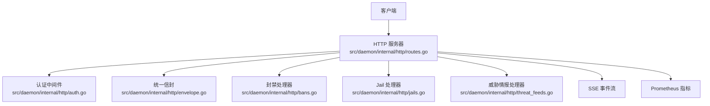
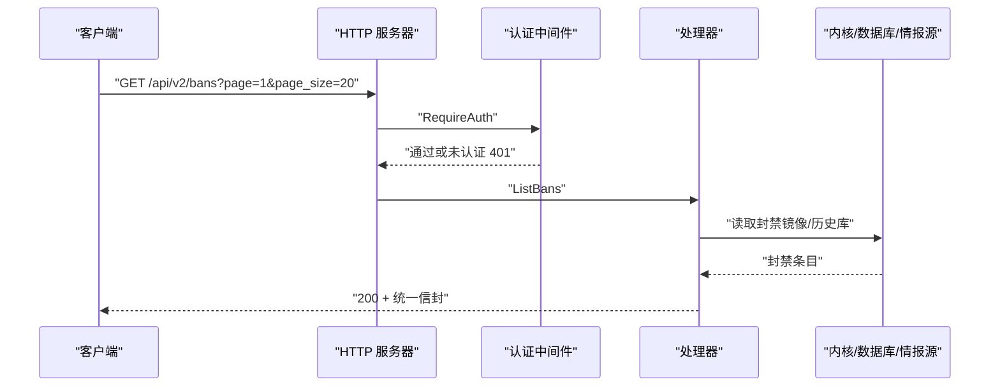
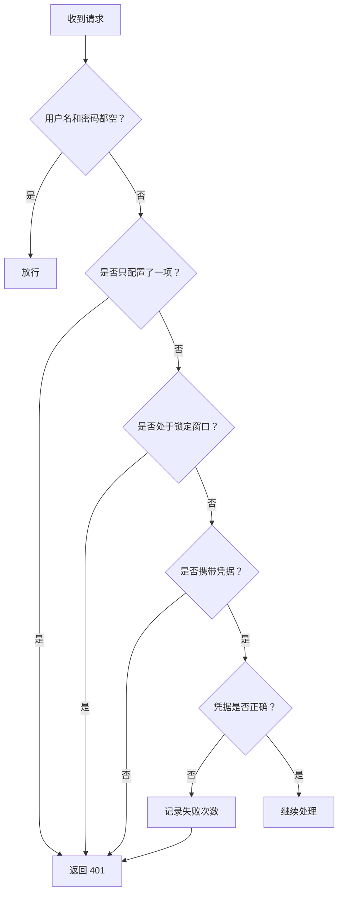
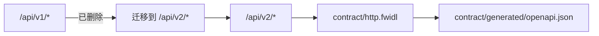
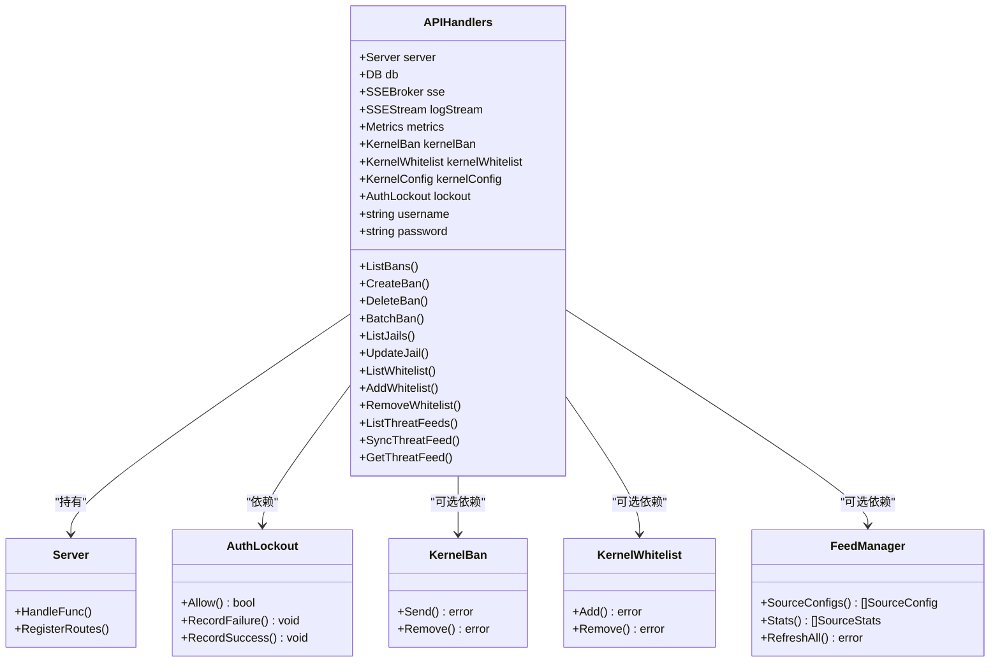

# API参考文档

<cite>
**本文引用的文件**   
- [README.md](file://README.md)
- [http.fwidl](file://contract/http.fwidl)
- [migration-api-v2.md](file://docs/zh/migration-api-v2.md)
- [routes.go](file://src/daemon/internal/http/routes.go)
- [auth.go](file://src/daemon/internal/http/auth.go)
- [envelope.go](file://src/daemon/internal/http/envelope.go)
- [bans.go](file://src/daemon/internal/http/bans.go)
- [jails.go](file://src/daemon/internal/http/jails.go)
- [whitelist_test.go](file://src/daemon/internal/http/whitelist_test.go)
- [threat_feeds.go](file://src/daemon/internal/http/threat_feeds.go)
- [sse_payload_test.go](file://src/daemon/internal/http/sse_payload_test.go)
</cite>

## 目录
1. [简介](#简介)
2. [项目结构](#项目结构)
3. [核心组件](#核心组件)
4. [架构总览](#架构总览)
5. [详细端点参考](#详细端点参考)
6. [认证与鉴权](#认证与鉴权)
7. [统一信封与错误模型](#统一信封与错误模型)
8. [SSE 事件流](#sse-事件流)
9. [API 版本管理与兼容性](#api-版本管理与兼容性)
10. [客户端集成示例](#客户端集成示例)
11. [依赖关系分析](#依赖关系分析)
12. [性能与速率限制](#性能与速率限制)
13. [故障排查指南](#故障排查指南)
14. [结论](#结论)

## 简介
本文件是 Linux Firewall Kernel Module 守护进程 HTTP REST API 的完整参考文档。系统采用“用户态智能判定 + 内核态高速封禁”的三层架构，Go 守护进程对外暴露 `/api/v2/*` REST API、Prometheus 指标、SSE 实时事件流以及静态 Web 面板资源。所有 REST 响应（健康检查除外）使用统一信封；认证采用 HTTP Basic，并支持通过查询参数传递 SSE 凭据；SSE 分为事件流 `/api/v2/events` 与日志流 `/api/v2/logs/stream`，各自有独立连接上限。

## 项目结构
HTTP API 的实现集中在守护进程的 `src/daemon/internal/http` 包中：
- 路由注册与处理器装配在 `routes.go`
- 认证中间件在 `auth.go`
- 统一信封与状态码映射在 `envelope.go`
- 封禁管理在 `bans.go`
- Jail 配置与统计在 `jails.go`
- 白名单逻辑由测试用例约束行为契约
- 威胁情报源接口在 `threat_feeds.go`
- 契约定义与生成产物位于 `contract/http.fwidl` 与 `contract/generated/*`



**图表来源**
- [routes.go:79-233](file://src/daemon/internal/http/routes.go#L79-L233)
- [auth.go:22-70](file://src/daemon/internal/http/auth.go#L22-L70)
- [envelope.go:15-94](file://src/daemon/internal/http/envelope.go#L15-L94)

**章节来源**
- [README.md:10-31](file://README.md#L10-L31)
- [routes.go:79-233](file://src/daemon/internal/http/routes.go#L79-L233)

## 核心组件
- **HTTP 服务器与路由表**：所有 REST 路由以带方法的模式注册，未声明动词由框架返回 405 纯文本。
- **认证中间件**：支持请求头 `Authorization: Basic` 与查询参数 `access_token`，半配置凭据直接拒绝。
- **统一信封**：成功响应 `code=0`，失败响应 `data=null`，业务码与 HTTP 状态码分离。
- **SSE 双流**：事件流最多 10 连接，日志流最多 5 连接，keep-alive 文本为固定字符串。
- **威胁情报源**：列表、手动同步、单个源详情，子系统未初始化时返回 503。

**章节来源**
- [http.fwidl:44-88](file://contract/http.fwidl#L44-L88)
- [http.fwidl:104-128](file://contract/http.fwidl#L104-L128)
- [http.fwidl:477-510](file://contract/http.fwidl#L477-L510)
- [auth.go:22-70](file://src/daemon/internal/http/auth.go#L22-L70)
- [envelope.go:15-94](file://src/daemon/internal/http/envelope.go#L15-L94)

## 架构总览
REST API 的请求路径如下：
1. 客户端发起 HTTP 请求到 `/api/v2/*`
2. 若路由需要认证，进入 `RequireAuth`
3. 处理器解析请求体、参数与路径变量
4. 调用内核、数据库或威胁情报子系统
5. 通过 `WriteSuccess` / `WriteCreated` / `WriteCode` 写出统一信封
6. SSE 事件由 broker 广播，日志流由独立 stream 处理



**图表来源**
- [routes.go:105-117](file://src/daemon/internal/http/routes.go#L105-L117)
- [auth.go:36-70](file://src/daemon/internal/http/auth.go#L36-L70)
- [bans.go:58-99](file://src/daemon/internal/http/bans.go#L58-L99)

## 详细端点参考

### 健康检查
| 方法 | URL | 认证 | 成功状态 | 说明 |
|------|-----|------|----------|------|
| GET | `/api/v2/health` | 否 | 200 或 503 | 载荷为裸 `RuntimeSnapshot`，状态码即语义 |
| GET | `/api/v2/healthz` | 否 | 200 或 503 | 与 `/health` 同实现，供探针使用 |

注意：健康检查不套统一信封，这是契约明确保留的例外。

**章节来源**
- [http.fwidl:378-394](file://contract/http.fwidl#L378-L394)
- [routes.go:80-84](file://src/daemon/internal/http/routes.go#L80-L84)

### 指标与静态资源
| 方法 | URL | 认证 | 成功状态 | 说明 |
|------|-----|------|----------|------|
| GET | `/metrics` | 是 | 200 | Prometheus 文本格式 |
| GET | `/static/*path` | 否 | 200 或 404 | 静态资源，未命中返回纯文本 404 |
| GET | `/sw.js` | 否 | 200 或 404 | Service Worker，需允许浏览器无凭据访问 |

**章节来源**
- [http.fwidl:459-485](file://contract/http.fwidl#L459-L485)
- [routes.go:86-99](file://src/daemon/internal/http/routes.go#L86-L99)

### 封禁管理
| 方法 | URL | 认证 | 成功状态 | 请求体 | 响应 | 业务码 |
|------|-----|------|----------|--------|------|--------|
| GET | `/api/v2/bans` | 是 | 200 | `page`, `page_size`, `sort_by` | `PaginatedResponse<BanResponse>` | 0 |
| POST | `/api/v2/bans` | 是 | 201 或 200 | `CreateBanRequest` | `BanOperationResponse` | 40001, 40007, 40008 |
| DELETE | `/api/v2/bans/:ip` | 是 | 200 | 无 | `BanOperationResponse` | 40002 |
| GET | `/api/v2/bans/:ip/detail` | 是 | 200 | 无 | `BanDetailResponse` | 40006 |
| POST | `/api/v2/bans/unban-temporary` | 是 | 200 | 无 | `BatchOperationResponse` | 40003 |
| POST | `/api/v2/bans/batch` | 是 | 201 或 200 | `BatchBanRequest` | `BatchOperationResponse` | 40005, 40007, 40008 |

分页参数：
- `page`：默认 1
- `page_size`：默认 20，最大 100
- `sort_by`：支持 `banned_at_desc`, `banned_at_asc`, `ip_asc`, `ip_desc`, `jail_asc`, `remaining_asc`, `remaining_desc`，未识别值回落到 `banned_at_desc`

批量封禁限制：
- 单次 1..100 条 IP
- `duration` 缺省按 3600 秒下发，不会升格为永久
- 每条成功封禁同时写入历史底账

**章节来源**
- [http.fwidl:525-577](file://contract/http.fwidl#L525-L577)
- [bans.go:33-56](file://src/daemon/internal/http/bans.go#L33-L56)
- [bans.go:58-99](file://src/daemon/internal/http/bans.go#L58-L99)
- [bans.go:112-190](file://src/daemon/internal/http/bans.go#L112-L190)
- [bans.go:281-374](file://src/daemon/internal/http/bans.go#L281-L374)

### Jail 管理
| 方法 | URL | 认证 | 成功状态 | 请求体 | 响应 | 业务码 |
|------|-----|------|----------|--------|------|--------|
| GET | `/api/v2/jails` | 是 | 200 | 无 | `JailResponse[]` | 无 |
| PUT | `/api/v2/jails/:name` | 是 | 200 | `UpdateJailRequest` | `{name, enabled, status:"updated"}` | 404, 40007, 40008, 50003 |

Jail 列表字段包含配置值、当前活跃封禁数、高峰期系数与运行时累计计数。更新操作只改启用状态来源，下一个周期发布新快照后 GET 才反映新值。

**章节来源**
- [http.fwidl:581-596](file://contract/http.fwidl#L581-L596)
- [jails.go:12-60](file://src/daemon/internal/http/jails.go#L12-L60)

### 配置管理
| 方法 | URL | 认证 | 成功状态 | 请求体 | 响应 | 业务码 |
|------|-----|------|----------|--------|------|--------|
| GET | `/api/v2/config` | 是 | 200 | 无 | `WebuiConfigResponse` | 50003 |
| PUT | `/api/v2/config` | 是 | 200 | `UpdateConfigRequest` | 配置载荷 | 40004, 40007, 40008, 50003 |

**章节来源**
- [http.fwidl:600-616](file://contract/http.fwidl#L600-L616)
- [routes.go:125-129](file://src/daemon/internal/http/routes.go#L125-L129)

### 白名单
| 方法 | URL | 认证 | 成功状态 | 请求体 | 响应 | 业务码 |
|------|-----|------|----------|--------|------|--------|
| GET | `/api/v2/whitelist` | 是 | 200 | 无 | `WhitelistEntryResponse[]` | 无 |
| POST | `/api/v2/whitelist` | 是 | 201 或 200 | `CreateWhitelistRequest` | `WhitelistOperationResponse` | 40003, 40007, 40008 |
| DELETE | `/api/v2/whitelist/:cidr` | 是 | 200 | 无 | `WhitelistOperationResponse` | 40004 |
| GET | `/api/v2/whitelist/recommendations` | 是 | 200 | `min_bans`, `limit` | `WhitelistRecommendation[]` | 50002, 50003 |

白名单键归一化规则：
- 主机位清零
- 恒带前缀长度（裸地址视为 `/32` 或 `/128`）
- IPv4 映射地址会折成原生 IPv4 形式

删除时 CIDR 中的 `/` 必须 URL 编码。

**章节来源**
- [http.fwidl:620-654](file://contract/http.fwidl#L620-L654)
- [whitelist_test.go:169-200](file://src/daemon/internal/http/whitelist_test.go#L169-L200)
- [whitelist_test.go:202-244](file://src/daemon/internal/http/whitelist_test.go#L202-L244)
- [whitelist_test.go:246-272](file://src/daemon/internal/http/whitelist_test.go#L246-L272)

### 速率
| 方法 | URL | 认证 | 成功状态 | 说明 |
|------|-----|------|----------|------|
| GET | `/api/v2/rates/current` | 是 | 200 | `RateResponse[]`，按 `packets_per_sec` 降序 |
| GET | `/api/v2/rates/history` | 是 | 200 | `RateHistoryResponse[]`，时间升序 |
| GET | `/api/v2/rates/windows` | 是 | 200 | `RateWindowSnapshot`，短期/中期/长期窗口 |

**章节来源**
- [http.fwidl:658-680](file://contract/http.fwidl#L658-L680)
- [routes.go:141-147](file://src/daemon/internal/http/routes.go#L141-L147)

### 统计总览与分析
| 方法 | URL | 认证 | 成功状态 | 说明 |
|------|-----|------|----------|------|
| GET | `/api/v2/stats` | 是 | 200 | 首屏混合三路真源 |
| GET | `/api/v2/stats/heatmap` | 是 | 200 | 24 小时热力图 |
| GET | `/api/v2/stats/recidivism` | 是 | 200 | 复发率，百分数 0–100 |
| GET | `/api/v2/stats/ban-effectiveness` | 是 | 200 | 分级成效，百分数口径 |
| GET | `/api/v2/stats/periodic-attackers` | 是 | 200 | 周期性攻击者 |
| GET | `/api/v2/stats/collaborative-attacks` | 是 | 200 | 协同攻击 |
| GET | `/api/v2/stats/udp-ports` | 是 | 200 | UDP 端口分布 |
| GET | `/api/v2/stats/icmp-types` | 是 | 200 | ICMP 类型分布 |
| GET | `/api/v2/stats/sse-status` | 是 | 200 | 两条 SSE 流的连接诊断 |
| GET | `/api/v2/stats/ban-duration-histogram` | 是 | 200 | 封禁时长直方图 |
| GET | `/api/v2/stats/packet-sizes` | 是 | 200 | 包长分布 |
| GET | `/api/v2/stats/ttl-distribution` | 是 | 200 | TTL 分布 |
| GET | `/api/v2/stats/ip-fragments` | 是 | 200 | IP 分片统计 |
| GET | `/api/v2/stats/port-scanners` | 是 | 200 | 端口扫描者 |
| GET | `/api/v2/stats/service-probes` | 是 | 200 | 服务探测 |

部分统计端点不声明业务码，读不到数据时在 200 信封内返回零值或空数组，而不是整体失败。

**章节来源**
- [http.fwidl:515-521](file://contract/http.fwidl#L515-L521)
- [http.fwidl:689-800](file://contract/http.fwidl#L689-L800)
- [routes.go:149-202](file://src/daemon/internal/http/routes.go#L149-L202)

### 风险引擎
| 方法 | URL | 认证 | 成功状态 | 说明 |
|------|-----|------|----------|------|
| GET | `/api/v2/risk-vectors` | 是 | 200 | 风险向量列表 |
| GET | `/api/v2/risk-vectors/:ip` | 是 | 200 | 单 IP 风险向量 |
| GET | `/api/v2/risk-events/:ip` | 是 | 200 | 单 IP 风险事件 |

**章节来源**
- [routes.go:204-210](file://src/daemon/internal/http/routes.go#L204-L210)

### 日志
| 方法 | URL | 认证 | 成功状态 | 说明 |
|------|-----|------|----------|------|
| GET | `/api/v2/logs` | 是 | 200 | 日志查询 |
| GET | `/api/v2/logs/stream` | 是 | 200 或 503 | SSE 日志流，最多 5 连接 |

**章节来源**
- [http.fwidl:500-510](file://contract/http.fwidl#L500-L510)
- [routes.go:212-218](file://src/daemon/internal/http/routes.go#L212-L218)

### 威胁情报源
| 方法 | URL | 认证 | 成功状态 | 请求体 | 响应 | 业务码 |
|------|-----|------|----------|--------|------|--------|
| GET | `/api/v2/threat-feeds` | 是 | 200 | 无 | `ThreatFeedListResponse` | 50003 |
| POST | `/api/v2/threat-feeds/sync` | 是 | 200 | 无 | `ThreatFeedSyncResult` | 50003 |
| GET | `/api/v2/threat-feeds/:id` | 是 | 200 | 无 | `ThreatFeedResponse` | 40006, 404 |

同步为异步执行，立即返回触发时间与占位结果。

**章节来源**
- [http.fwidl:53-60](file://docs/zh/migration-api-v2.md#L53-L60)
- [threat_feeds.go:11-43](file://src/daemon/internal/http/threat_feeds.go#L11-L43)
- [threat_feeds.go:45-98](file://src/daemon/internal/http/threat_feeds.go#L45-L98)
- [routes.go:220-226](file://src/daemon/internal/http/routes.go#L220-L226)

### 综合分析
| 方法 | URL | 认证 | 成功状态 | 说明 |
|------|-----|------|----------|------|
| GET | `/api/v2/analysis/summary` | 是 | 200 | 威胁等级 + Top 风险 IP + 活跃攻击摘要 |
| GET | `/api/v2/analysis/ip/:ip` | 是 | 200 | 单 IP 风险向量 + 封禁历史 + 信誉 + 预测 |

**章节来源**
- [http.fwidl:61-67](file://docs/zh/migration-api-v2.md#L61-L67)
- [routes.go:228-232](file://src/daemon/internal/http/routes.go#L228-L232)

## 认证与鉴权
- 认证方案：HTTP Basic
- 凭据来源：
  - 请求头：`Authorization: Basic <base64(user:pass)>`
  - 查询参数：`?access_token=<base64(user:pass)>`，用于 SSE
- 未配置认证：用户名和密码都为空时放行
- 半配置认证：只配置一项则所有 `required` 路由返回 401
- 连续失败阈值：10 次
- 锁定窗口：60 秒，锁定期内连正确凭据也拒绝
- 401 响应体：纯文本 `401 Unauthorized\n`，不带 `WWW-Authenticate`



**图表来源**
- [auth.go:36-70](file://src/daemon/internal/http/auth.go#L36-L70)
- [auth.go:77-99](file://src/daemon/internal/http/auth.go#L77-L99)

**章节来源**
- [http.fwidl:71-88](file://contract/http.fwidl#L71-L88)
- [http.fwidl:104-109](file://contract/http.fwidl#L104-L109)
- [auth.go:14-35](file://src/daemon/internal/http/auth.go#L14-L35)
- [auth.go:36-70](file://src/daemon/internal/http/auth.go#L36-L70)

## 统一信封与错误模型

### 统一信封
所有 `/api/v2/*` 端点（健康检查除外）返回：
```json
{
  "code": 0,
  "data": { ... },
  "message": ""
}
```
- 成功：`code=0`，`data` 为载荷，`message` 为空串
- 失败：`code!=0`，`data=null`，`message` 含原因

### 业务码与 HTTP 状态码
| 业务码 | HTTP 状态 | 含义 |
|--------|-----------|------|
| 0 | 200 | 成功 |
| 404 | 404 | Jail 不存在 |
| 40001 | 400 | 封禁失败 |
| 40002 | 400 | 解封失败 |
| 40003 | 400 | 批量解封临时封禁失败 / 添加白名单失败 |
| 40004 | 400 | 更新配置失败 / 移除白名单失败 |
| 40005 | 400 | 批量封禁参数非法 / 日志查询参数非法 |
| 40006 | 400 | 封禁详情查询失败 |
| 40007 | 422 | 请求体不是合法 JSON 或字段类型不符 |
| 40008 | 415 | Content-Type 不是 application/json |
| 50002 | 500 | 服务端内部错误 |
| 50003 | 503 | 依赖未就绪 |

### 错误形状分类
- **信封错误**：daemon 自己写出的错误，走统一信封
- **纯文本错误**：401 与静态资源 404
- **框架默认错误**：404 路径不匹配、405 方法不允许

**章节来源**
- [http.fwidl:52-65](file://contract/http.fwidl#L52-L65)
- [http.fwidl:90-128](file://contract/http.fwidl#L90-L128)
- [http.fwidl:156-222](file://contract/http.fwidl#L156-L222)
- [envelope.go:15-94](file://src/daemon/internal/http/envelope.go#L15-L94)
- [migration-api-v2.md:68-105](file://docs/zh/migration-api-v2.md#L68-L105)

## SSE 事件流

### 事件流 `/api/v2/events`
- 认证：需要
- 最大连接数：10
- Keep-alive：每 15 秒发送一次
- 事件名：`connected`, `stats`, `bans`, `jails`, `whitelist`, `rates`
- 超过连接上限返回 503

事件载荷与对应 REST 端点的 `data` 同源同形：
- `stats` → `/api/v2/stats`
- `bans` → 封禁镜像全表
- `jails` → `/api/v2/jails`
- `whitelist` → `/api/v2/whitelist`
- `rates` → `/api/v2/rates/current`

### 日志流 `/api/v2/logs/stream`
- 认证：需要
- 最大连接数：5
- Keep-alive：每 15 秒发送一次
- 事件名：`connected`, `log`, `error`
- 超过连接上限返回 503

### SSE 连接诊断
`GET /api/v2/stats/sse-status` 返回两条流各自的连接状态：
- `events.current`, `events.max`, `events.limit_reached`
- `logs.current`, `logs.max`, `logs.limit_reached`

**章节来源**
- [http.fwidl:487-510](file://contract/http.fwidl#L487-L510)
- [http.fwidl:748-754](file://contract/http.fwidl#L748-L754)
- [routes.go:100-103](file://src/daemon/internal/http/routes.go#L100-L103)
- [routes.go:215-218](file://src/daemon/internal/http/routes.go#L215-L218)
- [sse_payload_test.go:77-157](file://src/daemon/internal/http/sse_payload_test.go#L77-L157)

## API 版本管理与兼容性

### 版本迁移
- v1 路由已全部删除
- 所有客户端必须迁移到 `/api/v2/*`
- 健康检查从根路径迁移到 `/api/v2/health` 与 `/api/v2/healthz`
- 新增威胁情报与分析端点

### 向后兼容策略
- v2 不是 v1 的兼容层
- 前端与后端均从生成的契约常量读取路由，避免硬编码路径
- OpenAPI 规范由 `contract/http.fwidl` 自动生成



**图表来源**
- [migration-api-v2.md:5-19](file://docs/zh/migration-api-v2.md#L5-L19)
- [migration-api-v2.md:107-123](file://docs/zh/migration-api-v2.md#L107-L123)

**章节来源**
- [migration-api-v2.md:1-19](file://docs/zh/migration-api-v2.md#L1-L19)
- [migration-api-v2.md:20-49](file://docs/zh/migration-api-v2.md#L20-L49)
- [migration-api-v2.md:107-123](file://docs/zh/migration-api-v2.md#L107-L123)

## 客户端集成示例

### curl 示例

#### 健康检查
```bash
curl http://<host>:9119/api/v2/health
```

#### 获取封禁列表
```bash
curl -u <user>:<pass> \
  "http://<host>:9119/api/v2/bans?page=1&page_size=20&sort_by=banned_at_desc"
```

#### 创建封禁
```bash
curl -u <user>:<pass> \
  -X POST \
  -H "Content-Type: application/json" \
  -d '{"ip":"1.2.3.4","reason":"manual"}' \
  http://<host>:9119/api/v2/bans
```

#### 批量封禁
```bash
curl -u <user>:<pass> \
  -X POST \
  -H "Content-Type: application/json" \
  -d '{"ips":["1.2.3.4","5.6.7.8"],"duration":3600,"reason":"batch"}' \
  http://<host>:9119/api/v2/bans/batch
```

#### 添加白名单
```bash
curl -u <user>:<pass> \
  -X POST \
  -H "Content-Type: application/json" \
  -d '{"cidr":"192.0.2.0/24"}' \
  http://<host>:9119/api/v2/whitelist
```

#### 删除白名单
```bash
curl -u <user>:<pass> \
  -X DELETE \
  "http://<host>:9119/api/v2/whitelist/192.0.2.0%2F24"
```

#### 获取威胁情报源列表
```bash
curl -u <user>:<pass> \
  http://<host>:9119/api/v2/threat-feeds
```

#### 手动触发威胁情报同步
```bash
curl -u <user>:<pass> \
  -X POST \
  http://<host>:9119/api/v2/threat-feeds/sync
```

#### 订阅事件流
```bash
curl -u <user>:<pass> \
  "http://<host>:9119/api/v2/events?access_token=<base64(user:pass)>"
```

#### 订阅日志流
```bash
curl -u <user>:<pass> \
  "http://<host>:9119/api/v2/logs/stream?access_token=<base64(user:pass)>"
```

### SDK 使用建议
- 前端 SDK 应使用生成的 `ROUTES` 常量，不要手写路径
- 认证凭据通过 `Authorization` 头或 `access_token` 查询参数传递
- SSE 客户端需处理 `connected`、`keep-alive`、`error` 事件
- 对 503 重连时应根据 `/api/v2/stats/sse-status` 判断是否达到连接上限
- 统一信封失败分支应检查 `code` 和 `message`，不能只依赖 HTTP 状态码

**章节来源**
- [migration-api-v2.md:131-155](file://docs/zh/migration-api-v2.md#L131-L155)
- [auth.go:22-35](file://src/daemon/internal/http/auth.go#L22-L35)

## 依赖关系分析



**图表来源**
- [routes.go:22-77](file://src/daemon/internal/http/routes.go#L22-L77)
- [routes.go:235-301](file://src/daemon/internal/http/routes.go#L235-L301)
- [auth.go:36-70](file://src/daemon/internal/http/auth.go#L36-L70)
- [bans.go:21-28](file://src/daemon/internal/http/bans.go#L21-L28)
- [threat_feeds.go:45-98](file://src/daemon/internal/http/threat_feeds.go#L45-L98)

**章节来源**
- [routes.go:22-77](file://src/daemon/internal/http/routes.go#L22-L77)
- [routes.go:235-301](file://src/daemon/internal/http/routes.go#L235-L301)

## 性能与速率限制

### 连接限制
- `/api/v2/events`：最多 10 个 SSE 连接
- `/api/v2/logs/stream`：最多 5 个 SSE 连接
- 超过上限返回 503，客户端应停止无限重连

### 缓存与采样
- `/api/v2/stats` 的首屏封禁窗口缓存 30 秒
- 速率历史环容量约 720 点，代表最近 1 小时
- 封禁列表分页默认 20 条，最大 100 条

### 序列化优化
- SSE 只在内容变化时序列化一次，不再按连接重复序列化
- 帧载荷与 REST 载荷同源同形，前端可直接解析

**章节来源**
- [http.fwidl:487-510](file://contract/http.fwidl#L487-L510)
- [routes.go:272-275](file://src/daemon/internal/http/routes.go#L272-L275)
- [http.fwidl:666-672](file://contract/http.fwidl#L666-L672)
- [http.fwidl:330-336](file://contract/http.fwidl#L330-L336)

## 故障排查指南

### 常见问题
1. **401 认证失败**
   - 检查是否配置了用户名和密码
   - 确认 Basic 凭据 base64 编码正确
   - 检查是否处于锁定窗口
   - 401 响应体为纯文本，不含 `WWW-Authenticate`

2. **SSE 连接被拒 503**
   - 检查是否超过该流的连接上限
   - 使用 `/api/v2/stats/sse-status` 查看当前连接数
   - 事件流最多 10 连接，日志流最多 5 连接

3. **封禁未生效**
   - 检查内核模块是否加载
   - 检查 `KernelBan` 是否注入
   - 查看 message 是否提示“内核未确认”

4. **白名单添加失败**
   - 检查 CIDR 是否合法
   - 检查是否重复添加
   - 内核拒绝添加时会回滚镜像

5. **威胁情报源不可用**
   - 子系统未初始化时返回 50003
   - 手动同步为异步执行，立即返回触发时间

**章节来源**
- [auth.go:14-35](file://src/daemon/internal/http/auth.go#L14-L35)
- [auth.go:36-70](file://src/daemon/internal/http/auth.go#L36-L70)
- [bans.go:112-190](file://src/daemon/internal/http/bans.go#L112-L190)
- [whitelist_test.go:128-150](file://src/daemon/internal/http/whitelist_test.go#L128-L150)
- [threat_feeds.go:45-74](file://src/daemon/internal/http/threat_feeds.go#L45-L74)

## 结论
本 API 参考文档基于 `contract/http.fwidl` 契约与 Go 守护进程实现整理而成。开发者在集成时应：
- 使用 `/api/v2/*` 路径，不再使用 v1
- 正确处理统一信封与业务码
- 为 SSE 客户端设置连接上限与重连策略
- 使用生成的路由常量与 OpenAPI 规范
- 关注健康检查的特殊语义（裸状态码）
- 在威胁情报与分析端点未就绪时处理 503