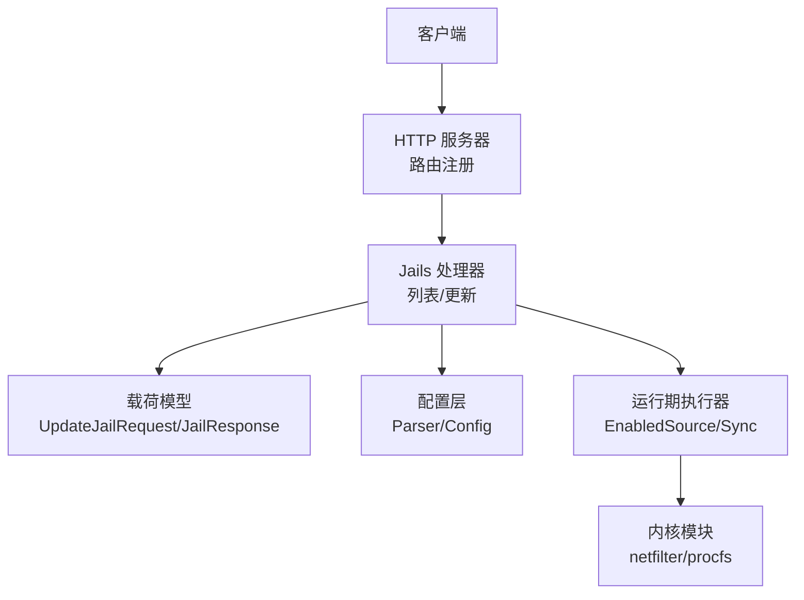
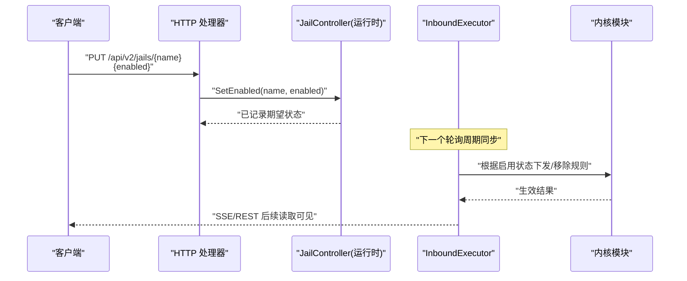
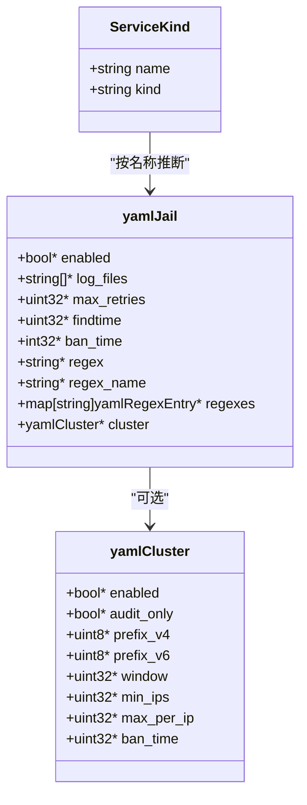
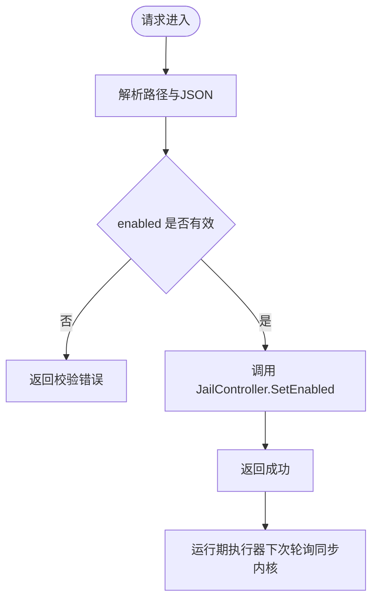
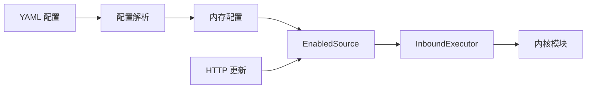
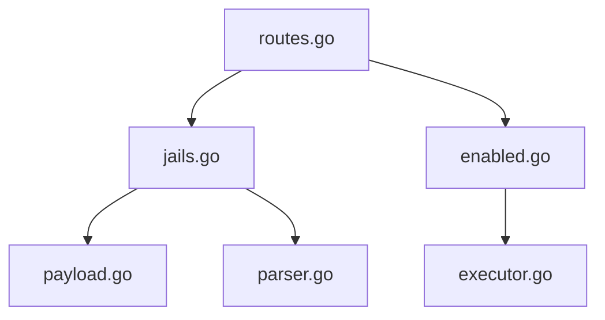

# Jail管理API

<cite>
**本文引用的文件**   
- [README.md](file://README.md)
- [jails.go](file://src/daemon/internal/http/jails.go)
- [payload.go](file://src/daemon/internal/http/payload.go)
- [routes.go](file://src/daemon/internal/http/routes.go)
- [service.go](file://src/daemon/internal/jail/service.go)
- [parser.go](file://src/daemon/internal/config/parser.go)
- [enabled.go](file://src/daemon/internal/runtime/enabled.go)
- [executor.go](file://src/daemon/internal/runtime/executor.go)
- [pipeline.go](file://src/daemon/internal/runtime/pipeline.go)
</cite>

## 目录
1. [简介](#简介)
2. [项目结构](#项目结构)
3. [核心组件](#核心组件)
4. [架构总览](#架构总览)
5. [详细组件分析](#详细组件分析)
6. [依赖关系分析](#依赖关系分析)
7. [性能与一致性](#性能与一致性)
8. [故障排查](#故障排查)
9. [结论](#结论)
10. [附录：配置示例与管理实践](#附录配置示例与管理实践)

## 简介
本文件面向“Jail”这一防火墙策略单元，完整说明其概念、作用域、生命周期、与内核模块的交互机制，以及守护进程暴露的 HTTP API。重点覆盖：
- Jail 启用/禁用接口（PUT /api/v2/jails/{name}）
- Jail 清单与状态查询（GET /api/v2/jails）
- 配置更新接口（PUT /api/v2/config）
- Jail 配置结构、智能默认值、统计口径
- 批量操作与冲突处理建议
- 最佳实践与排错要点

## 项目结构
Jail 相关能力横跨四层：
- HTTP 契约与路由：定义 REST 端点与认证要求
- 请求/响应载荷：契约类型在 Go 侧的结构化映射
- Jail 服务逻辑：按名称推断服务类别、应用智能默认
- 配置解析与运行时同步：YAML 到内存配置，再到运行期执行器

图示来源
- [routes.go:119-123](file://src/daemon/internal/http/routes.go#L119-L123)
- [jails.go:21-23](file://src/daemon/internal/http/jails.go#L21-L23)
- [payload.go:125-132](file://src/daemon/internal/http/payload.go#L125-L132)
- [parser.go:155-207](file://src/daemon/internal/config/parser.go#L155-L207)
- [enabled.go:12-33](file://src/daemon/internal/runtime/enabled.go#L12-L33)
- [executor.go:896-905](file://src/daemon/internal/runtime/executor.go#L896-L905)

章节来源
- [README.md:10-31](file://README.md#L10-L31)
- [routes.go:119-123](file://src/daemon/internal/http/routes.go#L119-L123)

## 核心组件
- HTTP 路由与控制器
  - GET /api/v2/jails：返回当前所有 jail 的配置快照、活跃封禁数、统计累计与阈值调整信息。
  - PUT /api/v2/jails/{name}：仅修改期望启用状态；其余参数通过配置文件热重载更新。
- 载荷模型
  - UpdateJailRequest：只包含 enabled 字段，表示期望状态。
  - JailResponse：聚合配置值、运行时计数、峰值小时系数等。
- Jail 服务逻辑
  - 按 jail 名匹配服务类别（SSH/WEB/FTP/MAIL/FRP/DB），并应用智能默认阈值。
- 配置与运行时
  - YAML 解析后生成内存配置；运行期 EnabledSource 维护启用状态，执行器周期性同步。

章节来源
- [jails.go:12-23](file://src/daemon/internal/http/jails.go#L12-L23)
- [payload.go:125-132](file://src/daemon/internal/http/payload.go#L125-L132)
- [service.go:9-19](file://src/daemon/internal/jail/service.go#L9-L19)
- [parser.go:52-63](file://src/daemon/internal/config/parser.go#L52-L63)

## 架构总览
Jail 的生命周期从配置加载开始，经守护进程解析、运行时同步，最终影响内核过滤行为。

图示来源
- [routes.go:119-123](file://src/daemon/internal/http/routes.go#L119-L123)
- [enabled.go:12-33](file://src/daemon/internal/runtime/enabled.go#L12-L33)
- [executor.go:896-905](file://src/daemon/internal/runtime/executor.go#L896-L905)

## 详细组件分析

### Jail 概念与作用域
- 概念
  - Jail 是围绕某一类服务或日志源定义的检测与封禁策略单元，包含正则表达式、时间窗口、重试次数、封禁时长等参数。
- 作用域
  - 配置作用域：YAML 中每个 jail 键对应一个策略对象，支持 defaults 全局默认与 per-jail 覆盖。
  - 运行时作用域：由守护进程加载为内存配置，受启用状态控制；启用时参与日志解析与封禁判定。
  - 内核作用域：启用且命中策略时，触发内核封禁表写入；未启用则不参与。

章节来源
- [parser.go:52-63](file://src/daemon/internal/config/parser.go#L52-L63)
- [service.go:97-107](file://src/daemon/internal/jail/service.go#L97-L107)

### Jail 配置结构
- YAML 层
  - yamlJail：包含 enabled、log_files、max_retries、findtime、ban_time、regex/regexes、cluster 等。
  - yamlCluster：集群扫描检测开关与审计模式、前缀长度、窗口、最小 IP 数、每 IP 上限、封禁时长。
- 内存层
  - 解析后形成 Config.Jails 数组，带 Set 标记区分用户显式值与推断默认值。
- 智能默认
  - ApplySmartDefaults 对未显式给出的 max_retries/findtime/ban_time 按服务类别或全局默认填充，幂等且不覆盖用户值。

图示来源
- [parser.go:52-75](file://src/daemon/internal/config/parser.go#L52-L75)
- [service.go:67-95](file://src/daemon/internal/jail/service.go#L67-L95)

章节来源
- [parser.go:52-75](file://src/daemon/internal/config/parser.go#L52-L75)
- [service.go:109-134](file://src/daemon/internal/jail/service.go#L109-L134)

### 启用/禁用接口
- 路由
  - GET /api/v2/jails：列出所有 jail 及其统计、阈值调整信息。
  - PUT /api/v2/jails/{name}：仅更新 enabled 期望状态。
- 请求体
  - UpdateJailRequest：仅含 enabled 布尔值。
- 实现要点
  - API 层通过 JailController 接口写入启用状态，不直接改配置；实际规则同步由 InboundExecutor 在下一轮 poll 完成。

图示来源
- [routes.go:119-123](file://src/daemon/internal/http/routes.go#L119-L123)
- [payload.go:125-132](file://src/daemon/internal/http/payload.go#L125-L132)
- [enabled.go:12-33](file://src/daemon/internal/runtime/enabled.go#L12-L33)
- [executor.go:896-905](file://src/daemon/internal/runtime/executor.go#L896-L905)

章节来源
- [routes.go:119-123](file://src/daemon/internal/http/routes.go#L119-L123)
- [payload.go:125-132](file://src/daemon/internal/http/payload.go#L125-L132)
- [enabled.go:12-33](file://src/daemon/internal/runtime/enabled.go#L12-L33)

### 状态查询接口
- 列表接口
  - GET /api/v2/jails：返回当前配置的 jail 清单，包含：
    - 配置值：max_retries、findtime、ban_time
    - 运行时计数：ban_count（当前活跃封禁）、lines_parsed、regex_matches、ips_extracted、failed_attempts、bans_triggered
    - 阈值调整：is_peak_hours、peak_hours_addend、internal_source_addend、effective_max_retries
- 数据口径
  - ban_count 来自 bans.GlobalCache()，与 stats.current_bans 同源，非历史累计。
  - lines_parsed…bans_triggered 是本进程累计，重启归零。
  - effective_max_retries 综合高峰期、内网来源等调整量。

章节来源
- [jails.go:21-60](file://src/daemon/internal/http/jails.go#L21-L60)

### 配置更新接口
- 路由
  - PUT /api/v2/config：局部更新 Web UI 相关配置段（如速率阈值、DDoS 开关、容量上限、日志过滤起点等）。
- 语义
  - 全字段可选（指针），未提交字段保持现值；属于“局部更新”。
- 与 Jail 的关系
  - Jail 的参数（regex、findtime、ban_time 等）不走此接口，应通过 YAML 配置热重载更新。
  - Jail 的 enabled 走专用 PUT /api/v2/jails/{name}。

章节来源
- [payload.go:138-167](file://src/daemon/internal/http/payload.go#L138-L167)
- [routes.go:125-129](file://src/daemon/internal/http/routes.go#L125-L129)

### 生命周期与依赖关系
- 启动阶段
  - 解析 YAML → 构建内存配置 → 应用智能默认 → 初始化运行期 EnabledSource。
- 运行阶段
  - HTTP 更新 enabled → 写入期望状态 → InboundExecutor 周期同步 → 内核模块生效。
- 依赖关系
  - HTTP 层依赖 JailController 接口（由运行时注入）。
  - 运行时依赖内核模块（netfilter/procfs）与配置系统。
  - 统计面依赖 bans 缓存与 decision 层的峰值小时判断。

图示来源
- [parser.go:155-207](file://src/daemon/internal/config/parser.go#L155-L207)
- [enabled.go:12-33](file://src/daemon/internal/runtime/enabled.go#L12-L33)
- [executor.go:896-905](file://src/daemon/internal/runtime/executor.go#L896-L905)

章节来源
- [parser.go:155-207](file://src/daemon/internal/config/parser.go#L155-L207)
- [executor.go:896-905](file://src/daemon/internal/runtime/executor.go#L896-L905)

### 冲突处理与批量操作
- 冲突场景
  - 同一 jail 被多个来源设置 enabled：以 EnabledSource 的最终状态为准，执行器同步时取最新快照。
  - 配置热重载与运行时 enabled 并存：enabled 是运行期覆盖，不影响 YAML 中的其他字段。
- 批量操作建议
  - 使用多次 PUT /api/v2/jails/{name} 进行批量启用/禁用；前端可并发但需保证幂等与顺序无关。
  - 若需要一次性下发多份配置变更，优先使用 PUT /api/v2/config 局部更新，再触发配置重载。

章节来源
- [enabled.go:12-33](file://src/daemon/internal/runtime/enabled.go#L12-L33)
- [payload.go:138-167](file://src/daemon/internal/http/payload.go#L138-L167)

## 依赖关系分析
- HTTP 层
  - routes.go 注册 /api/v2/jails 两条路由，统一 RequireAuth 认证。
  - jails.go 提供 ListJails，内部调用 config.GetActiveJails 与 bans.GlobalCache。
- 载荷层
  - payload.go 定义 UpdateJailRequest、WebuiConfigResponse 等契约类型。
- 配置层
  - parser.go 负责 YAML 解析、defaults 应用、jails 合并、capacity/webui/threat_feeds 等段落处理。
- 运行期
  - enabled.go 提供 JailEnabledSource 接口与实现，维护 map[jail]bool。
  - executor.go 的 InboundExecutor 在轮询中同步启用状态到内核。

图示来源
- [routes.go:119-123](file://src/daemon/internal/http/routes.go#L119-L123)
- [jails.go:21-60](file://src/daemon/internal/http/jails.go#L21-L60)
- [payload.go:125-167](file://src/daemon/internal/http/payload.go#L125-L167)
- [parser.go:155-207](file://src/daemon/internal/config/parser.go#L155-L207)
- [enabled.go:12-33](file://src/daemon/internal/runtime/enabled.go#L12-L33)
- [executor.go:896-905](file://src/daemon/internal/runtime/executor.go#L896-L905)

章节来源
- [routes.go:119-123](file://src/daemon/internal/http/routes.go#L119-L123)
- [jails.go:21-60](file://src/daemon/internal/http/jails.go#L21-L60)
- [payload.go:125-167](file://src/daemon/internal/http/payload.go#L125-L167)
- [parser.go:155-207](file://src/daemon/internal/config/parser.go#L155-L207)
- [enabled.go:12-33](file://src/daemon/internal/runtime/enabled.go#L12-L33)
- [executor.go:896-905](file://src/daemon/internal/runtime/executor.go#L896-L905)

## 性能与一致性
- 列表接口
  - 每次返回列表时重新读取 active 计数与决策层峰值小时标志，避免启动快照陈旧。
- 统计口径
  - ban_count 与 stats.current_bans 同源，确保面板与列表一致。
  - lines_parsed…bans_triggered 为进程级累计，重启归零，适合趋势观察而非绝对总量。
- 一致性
  - REST 与 SSE 的 jails 域共用同一构造函数，避免刷新后 enabled 不一致。

章节来源
- [jails.go:25-60](file://src/daemon/internal/http/jails.go#L25-L60)

## 故障排查
- 常见问题
  - 更新 enabled 后未立即生效：确认 InboundExecutor 下一次轮询是否已执行；可通过 /api/v2/jails 查看 enabled 是否变化。
  - 列表统计异常：检查 bans.GlobalCache 是否可用；确认内核模块是否加载。
  - 配置更新无效：确认 PUT /api/v2/config 是否为局部更新；未提交的字段不会改变。
- 定位步骤
  - 查看 /health 与 /stats 确认内核链路健康。
  - 核对 YAML 中 jail 是否存在拼写错误、正则数量超限、log_files 超限等校验错误。
  - 检查 EnabledSource 中该 jail 的状态是否与预期一致。

章节来源
- [routes.go:119-123](file://src/daemon/internal/http/routes.go#L119-L123)
- [payload.go:138-167](file://src/daemon/internal/http/payload.go#L138-L167)
- [parser.go:303-373](file://src/daemon/internal/config/parser.go#L303-L373)

## 结论
Jail 管理 API 将“期望状态”与“配置参数”解耦：enabled 通过专用接口动态切换，其余参数通过 YAML 配置热重载更新。守护进程在运行期同步启用状态至内核模块，保障高吞吐封禁与低开销过滤。列表接口聚合配置、运行时计数与阈值调整信息，便于运维快速评估策略效果。

## 附录：配置示例与管理实践

- 配置示例（节选）
  - 基础 jail：指定 log_files、regex，启用智能默认。
  - SSH jail：按名称自动匹配 SSH 类别，获得更严格的阈值。
  - WEB jail：自定义 findtime 与 ban_time，覆盖默认。
  - 集群扫描：开启 audit_only 模式，仅审计不封禁。

- 管理实践
  - 命名规范：使用 ssh、nginx、apache、frp、mysql 等关键词，以便智能默认生效。
  - 阈值调优：先使用默认值，结合 /api/v2/jails 的 effective_max_retries 与 is_peak_hours 观察峰值小时影响。
  - 启用/禁用：通过 PUT /api/v2/jails/{name} 切换；批量操作建议串行或限流，避免瞬时风暴。
  - 配置更新：使用 PUT /api/v2/config 局部更新 Web UI 相关参数；Jail 参数请通过 YAML 热重载。
  - 监控与回滚：关注 /api/v2/stats 与 /api/v2/jails 的变化；必要时回滚 YAML 并再次重载。

章节来源
- [service.go:9-19](file://src/daemon/internal/jail/service.go#L9-L19)
- [service.go:109-134](file://src/daemon/internal/jail/service.go#L109-L134)
- [payload.go:125-167](file://src/daemon/internal/http/payload.go#L125-L167)
- [jails.go:21-60](file://src/daemon/internal/http/jails.go#L21-L60)