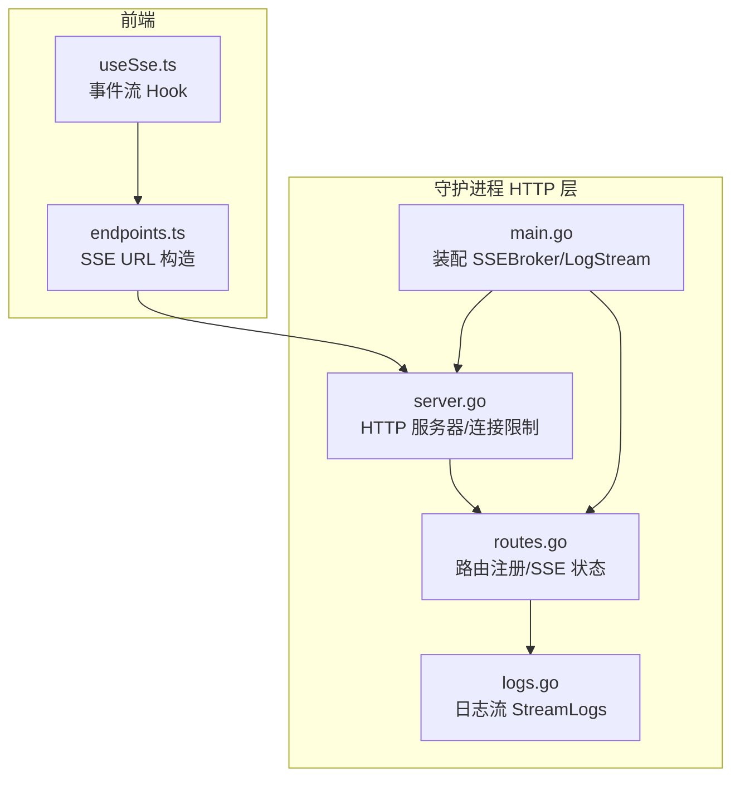
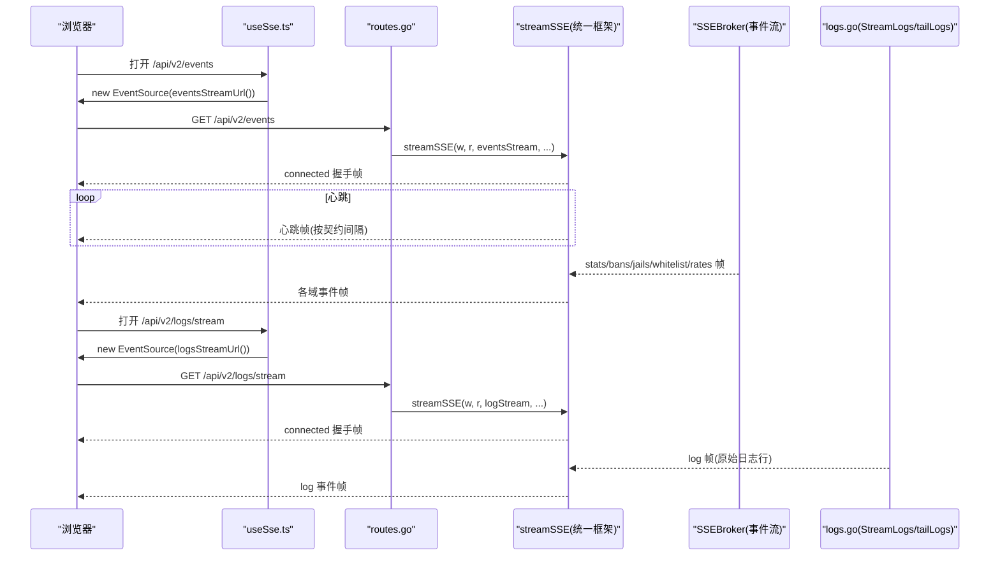
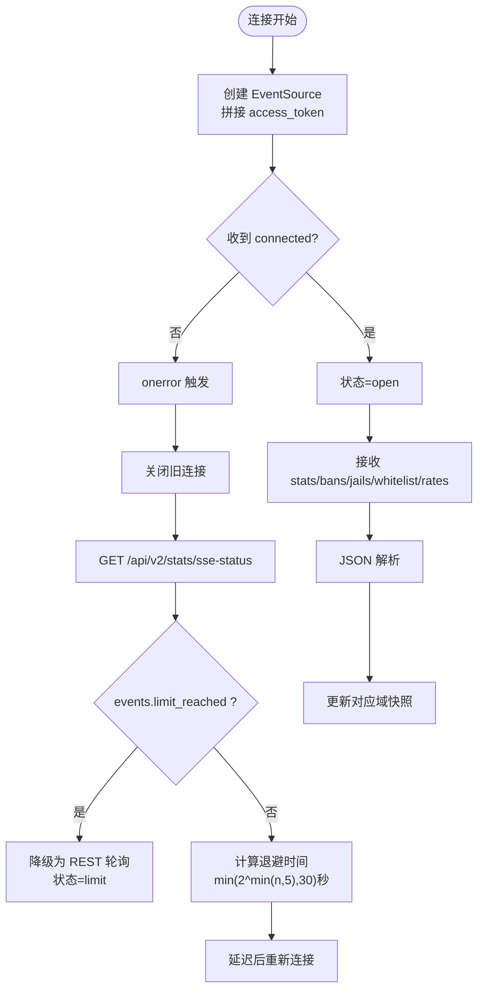
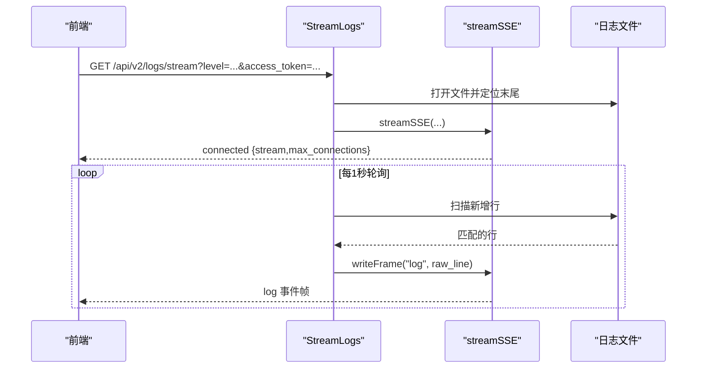
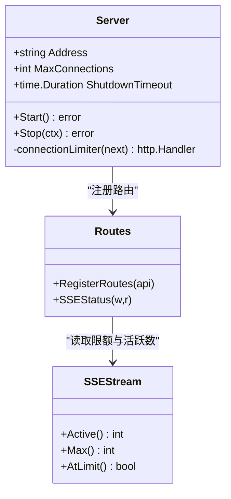
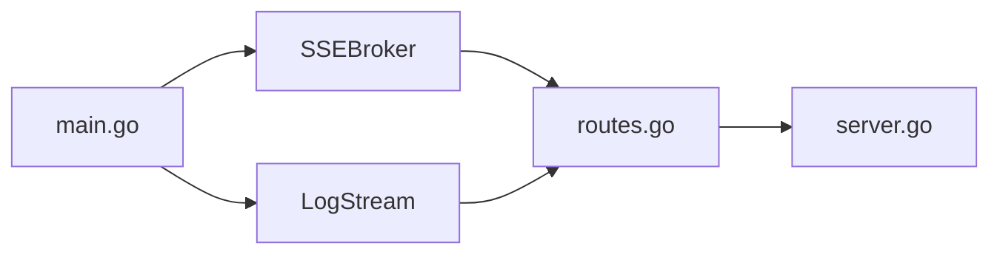

# SSE流式API

<cite>
**本文引用的文件**   
- [main.go](file://src/daemon/cmd/firewall-daemon/main.go)
- [server.go](file://src/daemon/internal/http/server.go)
- [routes.go](file://src/daemon/internal/http/routes.go)
- [logs.go](file://src/daemon/internal/http/logs.go)
- [useSse.ts](file://frontend/src/hooks/useSse.ts)
- [endpoints.ts](file://frontend/src/api/endpoints.ts)
</cite>

## 目录
1. [简介](#简介)
2. [项目结构](#项目结构)
3. [核心组件](#核心组件)
4. [架构总览](#架构总览)
5. [详细组件分析](#详细组件分析)
6. [依赖关系分析](#依赖关系分析)
7. [性能与调优](#性能与调优)
8. [故障排查](#故障排查)
9. [结论](#结论)

## 简介
本文件面向“SSE 流式 API”，覆盖事件流 `/api/v2/events` 与日志流 `/api/v2/logs/stream` 的连接建立、消息格式、心跳机制、错误处理、连接上限与限流、断线重连、协议实现细节、浏览器与移动端兼容性，以及前端流式数据处理示例和性能调优建议。后端基于 Go HTTP 服务器与自定义 SSE Broker/Stream；前端使用 `EventSource` 并接管重连策略，通过查询参数传递认证令牌。

## 项目结构
SSE 相关代码横跨守护进程 HTTP 层与前端：
- 守护进程侧：HTTP 服务器、路由注册、事件广播器、日志流处理器、连接限制器。
- 前端侧：SSE URL 构造、事件监听、退避重连、状态快照。

**图表来源** 
- [main.go:228-353](file://src/daemon/cmd/firewall-daemon/main.go#L228-L353)
- [server.go:34-73](file://src/daemon/internal/http/server.go#L34-L73)
- [routes.go:79-233](file://src/daemon/internal/http/routes.go#L79-L233)
- [logs.go:254-306](file://src/daemon/internal/http/logs.go#L254-L306)
- [useSse.ts:128-235](file://frontend/src/hooks/useSse.ts#L128-L235)
- [endpoints.ts:495-514](file://frontend/src/api/endpoints.ts#L495-L514)

**章节来源**
- [main.go:228-353](file://src/daemon/cmd/firewall-daemon/main.go#L228-L353)
- [server.go:34-73](file://src/daemon/internal/http/server.go#L34-L73)
- [routes.go:79-233](file://src/daemon/internal/http/routes.go#L79-L233)
- [logs.go:254-306](file://src/daemon/internal/http/logs.go#L254-L306)
- [useSse.ts:128-235](file://frontend/src/hooks/useSse.ts#L128-L235)
- [endpoints.ts:495-514](file://frontend/src/api/endpoints.ts#L495-L514)

## 核心组件
- 事件流（`/api/v2/events`）：由 `SSEBroker` 广播多域帧（stats/bans/jails/whitelist/rates），握手帧为 `connected`，心跳由统一 SSE 框架按契约间隔推送。
- 日志流（`/api/v2/logs/stream`）：从日志文件末尾轮询新行，以 `log` 事件推送原始行，握手帧为 `connected`，心跳与接入名额由统一 SSE 框架管理。
- HTTP 服务器与连接限制：全局连接数上限，超限返回 503。
- 前端 EventSource 管理：集中拼接认证令牌、监听事件、退避重连、探测连接上限并降级到 REST。

**章节来源**
- [routes.go:79-103](file://src/daemon/internal/http/routes.go#L79-L103)
- [logs.go:254-306](file://src/daemon/internal/http/logs.go#L254-L306)
- [server.go:129-149](file://src/daemon/internal/http/server.go#L129-L149)
- [useSse.ts:128-235](file://frontend/src/hooks/useSse.ts#L128-L235)
- [endpoints.ts:495-514](file://frontend/src/api/endpoints.ts#L495-L514)

## 架构总览
SSE 请求从浏览器发起，经前端 Hook 构造 URL 并创建 `EventSource`；服务端路由将请求交给对应处理器，统一由 `streamSSE` 管理握手、心跳、连接名额与 503；事件流由 `SSEBroker` 推送多域帧，日志流由 `tailLogs` 轮询文件输出 `log` 帧。

**图表来源** 
- [useSse.ts:128-235](file://frontend/src/hooks/useSse.ts#L128-L235)
- [routes.go:79-103](file://src/daemon/internal/http/routes.go#L79-L103)
- [logs.go:254-306](file://src/daemon/internal/http/logs.go#L254-L306)

## 详细组件分析

### 事件流 `/api/v2/events`
- 连接建立
  - 前端通过 `eventsStreamUrl()` 拼接 `?access_token=` 后创建 `EventSource`。
  - 服务端路由注册在 `RequireAuth` 保护下，未认证直接拒绝。
- 握手帧
  - 事件流握手帧名为 `connected`，前端监听该事件进入 `open` 状态。
- 事件类型与数据结构
  - 事件名：`stats`、`bans`、`jails`、`whitelist`、`rates`。
  - 数据形状与对应 REST 端点同源同形；`bans` 帧为全表数组而非分页对象。
- 心跳机制
  - 心跳由统一 SSE 框架按契约间隔推送（事件流 15 秒）。
- 错误处理
  - 前端捕获 `onerror`，先关闭旧连接，再探一次 `/api/v2/stats/sse-status`；若 `events.limit_reached=true`，则停止重试并降级为 REST 轮询。
  - 解析失败不中断整条流，仅丢弃坏帧。

**图表来源** 
- [useSse.ts:128-235](file://frontend/src/hooks/useSse.ts#L128-L235)
- [endpoints.ts:495-514](file://frontend/src/api/endpoints.ts#L495-L514)
- [routes.go:79-103](file://src/daemon/internal/http/routes.go#L79-L103)

**章节来源**
- [useSse.ts:128-235](file://frontend/src/hooks/useSse.ts#L128-L235)
- [endpoints.ts:495-514](file://frontend/src/api/endpoints.ts#L495-L514)
- [routes.go:79-103](file://src/daemon/internal/http/routes.go#L79-L103)

### 日志流 `/api/v2/logs/stream`
- 连接建立
  - 前端通过 `logsStreamUrl()` 拼接 `?access_token=` 后创建 `EventSource`。
  - 服务端路由注册在 `RequireAuth` 保护下。
- 握手帧
  - 握手帧名为 `connected`，携带流名称与最大连接数。
- 事件类型与数据结构
  - 事件名：`log`，data 为原始日志行（JSON 或文本）。
  - 可选过滤：`level` 查询参数支持 error/warn/info/debug（无法识别时退化为不过滤）。
- 心跳机制
  - 心跳由统一 SSE 框架按契约间隔推送（日志流 15 秒）。
- 错误处理
  - 文件不可读或未配置：返回 503。
  - 读取异常：发送 `error` 帧，data 为人类可读文本。
  - 轮询间隔 1 秒，单行上限 512 KiB。

**图表来源** 
- [logs.go:254-306](file://src/daemon/internal/http/logs.go#L254-L306)
- [logs.go:308-354](file://src/daemon/internal/http/logs.go#L308-L354)

**章节来源**
- [logs.go:254-306](file://src/daemon/internal/http/logs.go#L254-L306)
- [logs.go:308-354](file://src/daemon/internal/http/logs.go#L308-L354)

### 连接池与限流
- 全局连接限制
  - HTTP 服务器维护活跃连接计数，超过 `MaxConnections` 直接返回 503。
  - 默认值 32，可通过配置传入。
- 每条 SSE 流的独立上限
  - 事件流上限 10，日志流上限 5；心跳间隔均为 15 秒（来自契约生成物）。
  - 两条流各自维护名额账本，诊断接口 `/api/v2/stats/sse-status` 分别报告 `current/max/limit_reached`。
- 关停顺序
  - 先停事件流与日志流，再调用 HTTP 服务器优雅关停，避免 SSE 长连接导致超时。

**图表来源** 
- [server.go:14-32](file://src/daemon/internal/http/server.go#L14-L32)
- [server.go:129-149](file://src/daemon/internal/http/server.go#L129-L149)
- [routes.go:323-357](file://src/daemon/internal/http/routes.go#L323-L357)

**章节来源**
- [server.go:14-32](file://src/daemon/internal/http/server.go#L14-L32)
- [server.go:129-149](file://src/daemon/internal/http/server.go#L129-L149)
- [routes.go:323-357](file://src/daemon/internal/http/routes.go#L323-L357)
- [main.go:341-353](file://src/daemon/cmd/firewall-daemon/main.go#L341-L353)

### 认证与令牌传递
- 浏览器不允许给 `EventSource` 设置请求头，因此凭据走查询参数 `access_token`。
- 前端集中拼接令牌，避免视图各自拼接。
- 服务端对 SSE 路由使用 `RequireAuth` 校验。

**章节来源**
- [endpoints.ts:495-514](file://frontend/src/api/endpoints.ts#L495-L514)
- [routes.go:79-103](file://src/daemon/internal/http/routes.go#L79-L103)

### 断线重连与退避策略
- 前端禁用 `EventSource` 自带重连，自行接管。
- 退避公式：`min(2^min(attempts,5), 30)` 秒。
- 重连前探测 `/api/v2/stats/sse-status`，若 `events.limit_reached=true`，则停止重试并降级为 REST 轮询。
- 用户可手动触发重连，用于名额释放后的恢复。

**章节来源**
- [useSse.ts:13-20](file://frontend/src/hooks/useSse.ts#L13-L20)
- [useSse.ts:75-78](file://frontend/src/hooks/useSse.ts#L75-L78)
- [useSse.ts:201-235](file://frontend/src/hooks/useSse.ts#L201-L235)

### 协议实现与兼容性
- 协议：标准 SSE（Server-Sent Events），使用 `EventSource`。
- 握手帧：`connected`。
- 事件名：事件流为 `stats/bans/jails/whitelist/rates`；日志流为 `log`。
- 心跳：由统一 SSE 框架按契约间隔推送（事件流 15 秒，日志流 15 秒）。
- 浏览器兼容：现代浏览器均支持 `EventSource`；移动端 Safari/iOS Chrome 行为一致。
- 移动端适配：注意网络切换与后台节流，前端已做退避重连与状态降级。

**章节来源**
- [useSse.ts:128-235](file://frontend/src/hooks/useSse.ts#L128-L235)
- [logs.go:254-306](file://src/daemon/internal/http/logs.go#L254-L306)

## 依赖关系分析
- 主进程装配 `SSEBroker` 与 `LogStream`，注入 `APIHandlers`。
- 路由注册将 `/api/v2/events` 与 `/api/v2/logs/stream` 交由 `RequireAuth` 保护。
- 事件泵将内核事件推送到 `SSEBroker`，驱动多域帧。
- 日志流独立于事件流，各自维护连接名额与心跳。

**图表来源** 
- [main.go:228-353](file://src/daemon/cmd/firewall-daemon/main.go#L228-L353)
- [routes.go:79-233](file://src/daemon/internal/http/routes.go#L79-L233)
- [server.go:34-73](file://src/daemon/internal/http/server.go#L34-L73)

**章节来源**
- [main.go:228-353](file://src/daemon/cmd/firewall-daemon/main.go#L228-L353)
- [routes.go:79-233](file://src/daemon/internal/http/routes.go#L79-L233)
- [server.go:34-73](file://src/daemon/internal/http/server.go#L34-L73)

## 性能与调优
- 连接上限
  - 事件流上限 10，日志流上限 5；合理控制标签页数量，避免达到上限后频繁 503。
- 心跳间隔
  - 两条流均为 15 秒；如需更实时，需调整契约与后端实现（当前由契约生成物固定）。
- 日志轮询
  - 轮询间隔 1 秒，单行上限 512 KiB；大日志文件建议开启日志轮转并在前端分页查看历史。
- 前端解析
  - 逐帧 JSON 解析失败不会中断流；建议在 UI 层对关键帧增加容错与告警。
- 关停顺序
  - 先停 SSE 流再关 HTTP 服务器，避免优雅关停超时。

**章节来源**
- [logs.go:16-31](file://src/daemon/internal/http/logs.go#L16-L31)
- [logs.go:308-354](file://src/daemon/internal/http/logs.go#L308-L354)
- [main.go:341-353](file://src/daemon/cmd/firewall-daemon/main.go#L341-L353)

## 故障排查
- 503 服务不可用
  - 可能原因：全局连接数已满、日志文件未配置或不可读、依赖未就绪。
  - 检查：`/api/v2/stats/sse-status` 的 `limit_reached` 与 `max_connections`。
- 连接上限达满
  - 现象：事件流不断 503，前端状态变为 `limit`。
  - 处理：关闭多余标签页，等待名额释放；前端提供手动重连入口。
- 日志流无输出
  - 现象：只有 `connected`，无 `log` 帧。
  - 检查：日志文件路径是否配置、文件是否可读写、级别过滤是否过严。
- 认证失败
  - 现象：EventSource 连接被拒绝。
  - 检查：`access_token` 是否正确拼接、服务端 `RequireAuth` 是否启用。

**章节来源**
- [routes.go:323-357](file://src/daemon/internal/http/routes.go#L323-L357)
- [logs.go:254-306](file://src/daemon/internal/http/logs.go#L254-L306)
- [useSse.ts:201-235](file://frontend/src/hooks/useSse.ts#L201-L235)

## 结论
本项目实现了稳定可靠的 SSE 流式 API：事件流提供多域实时数据，日志流提供文件尾部增量推送；统一框架负责握手、心跳与连接名额管理；前端接管重连与降级策略，确保在连接上限与网络波动下的用户体验。通过合理的连接上限、心跳间隔与前端容错，系统在高并发与移动环境下仍保持良好稳定性。