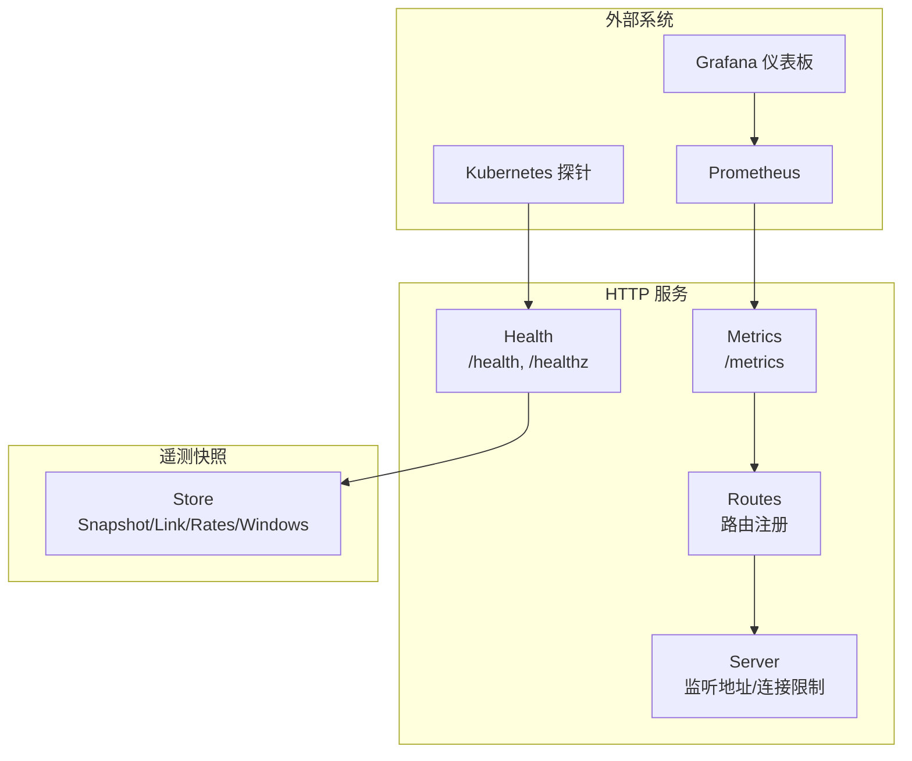
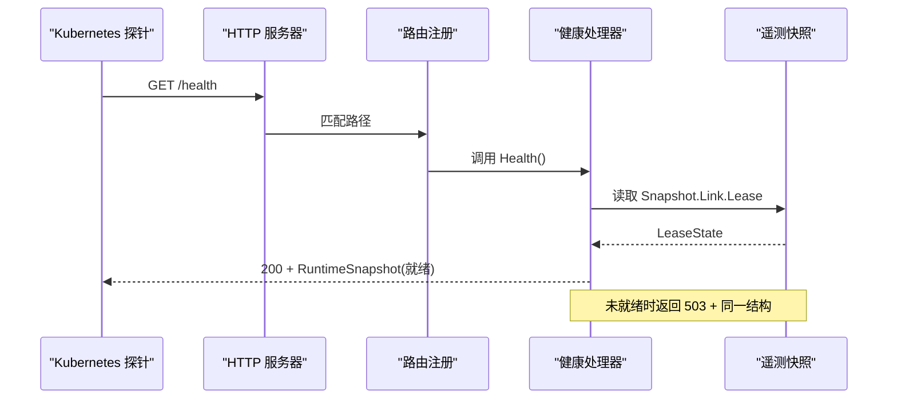
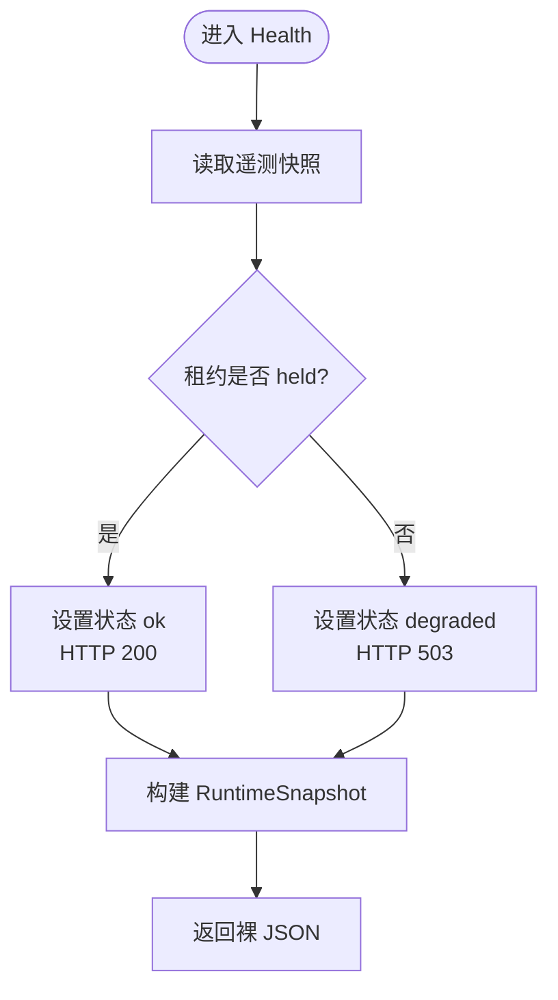
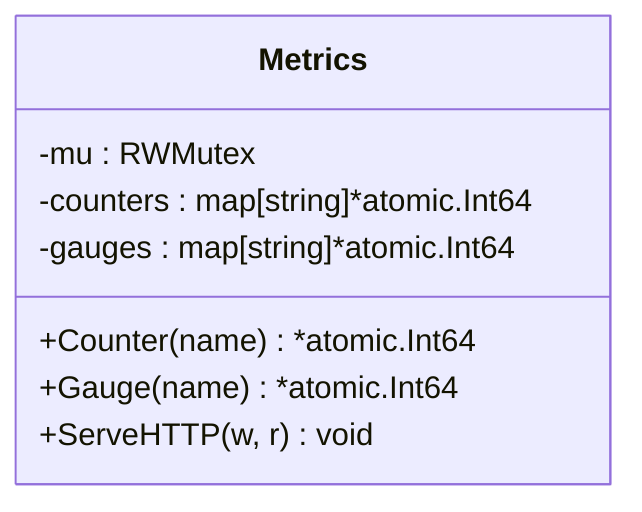
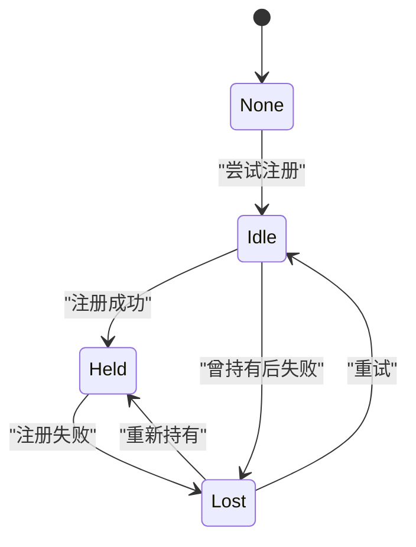
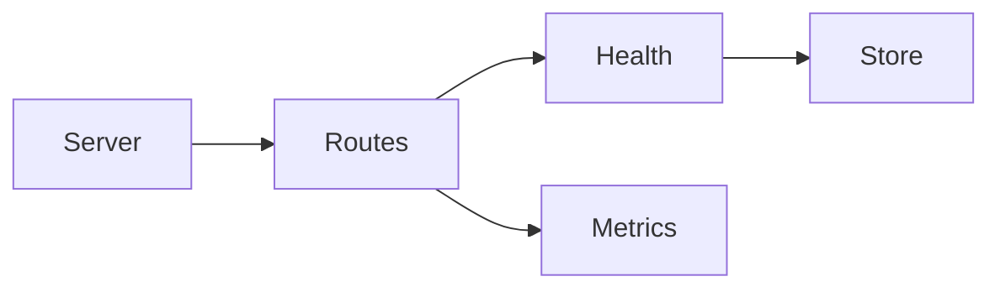

# 健康监控API

<cite>
**本文引用的文件**   
- [health.go](file://src/daemon/internal/http/health.go)
- [metrics.go](file://src/daemon/internal/http/metrics.go)
- [routes.go](file://src/daemon/internal/http/routes.go)
- [server.go](file://src/daemon/internal/http/server.go)
- [store.go](file://src/daemon/internal/telemetry/store.go)
- [firewall-dashboard.json](file://grafana/firewall-dashboard.json)
</cite>

## 目录
1. [简介](#简介)
2. [项目结构](#项目结构)
3. [核心组件](#核心组件)
4. [架构总览](#架构总览)
5. [详细组件分析](#详细组件分析)
6. [依赖关系分析](#依赖关系分析)
7. [性能与阈值](#性能与阈值)
8. [Kubernetes 探针配置示例](#kubernetes-探针配置示例)
9. [Grafana 仪表板集成方法](#grafana-仪表板集成方法)
10. [故障诊断指南](#故障诊断指南)
11. [结论](#结论)

## 简介
本文档面向运维、SRE 和平台工程师，完整说明本项目的健康监控 API。重点包括：
- 就绪探针端点 `/health` 与 `/healthz` 的语义、响应结构与状态码判断逻辑。
- 指标导出端点 `/metrics` 的 Prometheus 文本格式输出规范。
- 内核模块状态检测、系统资源与性能指标的含义及可观测性建议。
- Kubernetes 探针配置示例与 Grafana 仪表板集成方法。
- 健康状态判定规则、常见异常场景与排障步骤。

## 项目结构
健康监控相关代码集中在守护进程的 HTTP 层与遥测快照层：
- HTTP 层负责路由注册、认证、JSON 响应与 Prometheus 文本输出。
- 遥测层提供内核链路只读快照，供健康检查与统计接口复用。
- Grafana 侧提供预置仪表板 JSON，用于可视化 Prometheus 指标。



**图表来源**
- [server.go:34-73](file://src/daemon/internal/http/server.go#L34-L73)
- [routes.go:79-99](file://src/daemon/internal/http/routes.go#L79-L99)
- [health.go:40-48](file://src/daemon/internal/http/health.go#L40-L48)
- [metrics.go:60-91](file://src/daemon/internal/http/metrics.go#L60-L91)
- [store.go:109-123](file://src/daemon/internal/telemetry/store.go#L109-L123)

**章节来源**
- [server.go:34-73](file://src/daemon/internal/http/server.go#L34-L73)
- [routes.go:79-99](file://src/daemon/internal/http/routes.go#L79-L99)

## 核心组件
- 健康检查处理器：实现 `/health` 与 `/healthz`，返回裸 `RuntimeSnapshot`，以 HTTP 状态码表达就绪与否。
- 指标导出器：实现 `/metrics`，按 Prometheus 文本协议输出计数器与仪表盘值。
- 路由注册器：将健康与指标端点挂载到 HTTP 服务器，并控制认证策略。
- 遥测快照存储：维护内核链路状态、速率采样与分析窗口，为健康检查与统计面提供一致快照。

**章节来源**
- [health.go:15-48](file://src/daemon/internal/http/health.go#L15-L48)
- [metrics.go:11-91](file://src/daemon/internal/http/metrics.go#L11-L91)
- [routes.go:79-99](file://src/daemon/internal/http/routes.go#L79-L99)
- [store.go:109-123](file://src/daemon/internal/telemetry/store.go#L109-L123)

## 架构总览
健康监控 API 的关键调用链如下：
- Kubernetes 或负载均衡器对 `/health` 与 `/healthz` 发起 GET 请求。
- 路由分发到统一的健康处理器，读取遥测快照与内核模块存在性。
- 若内核租约已持有，则返回 200；否则返回 503，但响应体仍包含诊断字段。
- Prometheus 抓取 `/metrics`，获取计数器与仪表盘值，供 Grafana 展示。



**图表来源**
- [routes.go:82-84](file://src/daemon/internal/http/routes.go#L82-L84)
- [health.go:40-48](file://src/daemon/internal/http/health.go#L40-L48)
- [store.go:52-72](file://src/daemon/internal/telemetry/store.go#L52-L72)

## 详细组件分析

### 健康检查端点 `/health` 与 `/healthz`
- 两个路径共用同一个处理器，便于 Kubernetes 与负载均衡器使用不同约定。
- 响应体是裸 `RuntimeSnapshot`，不包裹通用信封，以便状态码直接表达就绪语义。
- 就绪判定仅依据内核租约是否持有；其他字段用于排障，不参与就绪判断。

| 字段 | 类型 | 含义 | 备注 |
|---|---|---|---|
| status | string | `ok` 或 `degraded` | 由租约持有情况决定 |
| netlink_ready | bool | 内核链路是否就绪 | 等价于租约已持有 |
| kmod_proc_present | bool | 内核模块 procfs 接口是否存在 | 模块加载证据 |
| ban_cache_initialized | bool | 封禁缓存对象是否已构造 | 进程级单例 |
| ban_history_initialized | bool | 历史库是否成功打开 | 持久化依赖 |
| active_bans | int | 当前活跃封禁数 | 来自全局缓存 |
| lease_state | string | 租约状态：none/idle/held/refused/lost | 契约字符串 |
| lease_losses | uint64 | 累计丢失次数 | 模块重载或前守护进程失效痕迹 |



**图表来源**
- [health.go:40-48](file://src/daemon/internal/http/health.go#L40-L48)
- [health.go:56-100](file://src/daemon/internal/http/health.go#L56-L100)

**章节来源**
- [health.go:15-48](file://src/daemon/internal/http/health.go#L15-L48)
- [health.go:56-100](file://src/daemon/internal/http/health.go#L56-L100)

### 指标导出端点 `/metrics`
- 内容类型为 `text/plain; version=0.0.4; charset=utf-8`，符合 Prometheus 文本协议。
- 支持两类指标：counter（单调递增）与 gauge（可上下波动）。
- 指标名通过运行时注册，排序后逐条输出 HELP 与 TYPE 注释行。

| 指标类型 | 用途 | 示例命名约定 | 更新方式 |
|---|---|---|---|
| counter | 累计计数，如解析行数、错误数 | `firewall_lines_parsed_total` | 原子累加 |
| gauge | 瞬时值，如活跃连接数 | `firewall_active_connections` | 原子赋值 |



**图表来源**
- [metrics.go:11-91](file://src/daemon/internal/http/metrics.go#L11-L91)

**章节来源**
- [metrics.go:11-91](file://src/daemon/internal/http/metrics.go#L11-L91)

### 内核模块状态检测
- 健康检查同时采集内核链路租约与模块 procfs 存在性。
- 租约状态机包含 none/idle/held/refused/lost，分别对应未注册、尝试中、已持有、被拒绝、丢失。
- 模块存在性与租约持有是两件事：模块在但租约未持有，指令会被丢弃；租约在但 procfs 消失，可能模块刚重载。



**图表来源**
- [store.go:52-72](file://src/daemon/internal/telemetry/store.go#L52-L72)
- [store.go:192-236](file://src/daemon/internal/telemetry/store.go#L192-L236)

**章节来源**
- [health.go:89-91](file://src/daemon/internal/http/health.go#L89-L91)
- [store.go:52-72](file://src/daemon/internal/telemetry/store.go#L52-L72)
- [store.go:192-236](file://src/daemon/internal/telemetry/store.go#L192-L236)

### 系统资源与性能指标
- 指标导出器提供通用计数器与仪表盘值，适合扩展系统资源与性能指标。
- 现有 Grafana 仪表板展示了日志解析、DDoS、netlink 通信等关键维度。
- 建议在指标层新增以下指标：
  - 系统资源：CPU 使用率、内存占用、文件句柄数、磁盘 I/O。
  - 性能指标：请求延迟分位、队列长度、线程池利用率。
  - 内核链路：采样失败次数、对账失败次数、事件丢弃数。

**章节来源**
- [metrics.go:60-91](file://src/daemon/internal/http/metrics.go#L60-L91)
- [firewall-dashboard.json:11-171](file://grafana/firewall-dashboard.json#L11-L171)

## 依赖关系分析
- HTTP 服务器负责监听、连接限制与安全头。
- 路由注册将健康与指标端点挂载，并应用认证中间件。
- 健康处理器依赖遥测快照与内核模块存在性函数。
- 指标导出器独立于业务逻辑，仅暴露计数器与仪表盘值。



**图表来源**
- [server.go:34-73](file://src/daemon/internal/http/server.go#L34-L73)
- [routes.go:79-99](file://src/daemon/internal/http/routes.go#L79-L99)
- [health.go:40-48](file://src/daemon/internal/http/health.go#L40-L48)
- [metrics.go:60-91](file://src/daemon/internal/http/metrics.go#L60-L91)
- [store.go:109-123](file://src/daemon/internal/telemetry/store.go#L109-L123)

**章节来源**
- [server.go:34-73](file://src/daemon/internal/http/server.go#L34-L73)
- [routes.go:79-99](file://src/daemon/internal/http/routes.go#L79-L99)

## 性能与阈值
- 健康检查应轻量：仅读取快照与模块存在性，避免阻塞。
- 指标导出应避免频繁锁竞争：计数器与仪表盘值使用原子操作。
- 建议阈值（可根据环境调整）：
  - 内核租约丢失次数超过 0：触发告警。
  - 采样失败或对账失败持续上升：检查内核链路。
  - 活跃连接接近上限：扩容或限流。
  - 指标导出延迟超过 1 秒：优化指标聚合。

[本节为通用指导，不直接分析具体文件]

## Kubernetes 探针配置示例
- 就绪探针：GET `/health`，期望状态码 200。
- 存活探针：GET `/healthz`，期望状态码 200。
- 初始延迟与超时：根据部署环境调整，确保内核模块初始化完成。

```yaml
apiVersion: v1
kind: Pod
metadata:
  name: firewall-daemon
spec:
  containers:
    - name: daemon
      image: your-image
      ports:
        - containerPort: 9119
      readinessProbe:
        httpGet:
          path: /health
          port: 9119
          initialDelaySeconds: 10
          periodSeconds: 5
          timeoutSeconds: 3
          failureThreshold: 3
      livenessProbe:
        httpGet:
          path: /healthz
          port: 9119
          initialDelaySeconds: 15
          periodSeconds: 10
          timeoutSeconds: 3
          failureThreshold: 3
```

[本节为概念性配置示例，不直接映射具体源码文件]

## Grafana 仪表板集成方法
- 在 Prometheus 中添加数据源，指向 `/metrics`。
- 导入预置仪表板 `firewall-dashboard.json`。
- 验证面板是否显示日志解析、DDoS、netlink 通信等指标。
- 如需自定义面板，基于现有指标命名约定扩展查询。

**章节来源**
- [firewall-dashboard.json:1-176](file://grafana/firewall-dashboard.json#L1-L176)

## 故障诊断指南
- 健康检查返回 503：
  - 检查 `lease_state` 是否为 `held`。
  - 查看 `lease_losses` 是否增长，确认内核模块是否重载。
  - 检查 `kmod_proc_present` 是否为真，确认模块已加载。
- 指标导出为空：
  - 确认 `/metrics` 已注册且认证通过。
  - 检查是否有计数器或仪表盘值被注册。
- 内核链路异常：
  - 查看 `sample_failures` 与 `reconcile_failures`。
  - 检查 `last_error` 与 `last_error_at`。
  - 确认事件丢弃、解码错误、畸形报文等计数。

**章节来源**
- [health.go:56-100](file://src/daemon/internal/http/health.go#L56-L100)
- [store.go:74-107](file://src/daemon/internal/telemetry/store.go#L74-L107)
- [store.go:254-290](file://src/daemon/internal/telemetry/store.go#L254-L290)

## 结论
本项目健康监控 API 通过简洁的状态码与丰富的诊断字段，为 Kubernetes 与 Prometheus 提供了可靠的可观测性基础。健康检查聚焦内核租约与模块存在性，指标导出提供可扩展的计数器与仪表盘值。结合 Grafana 仪表板，运维团队可快速定位内核链路、日志解析与 DDoS 相关问题。建议在生产环境中完善系统资源与性能指标，并设定合理阈值与告警策略。

[本节为总结性内容，不直接分析具体文件]