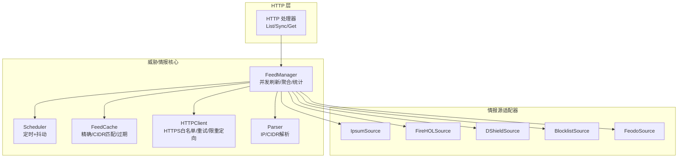
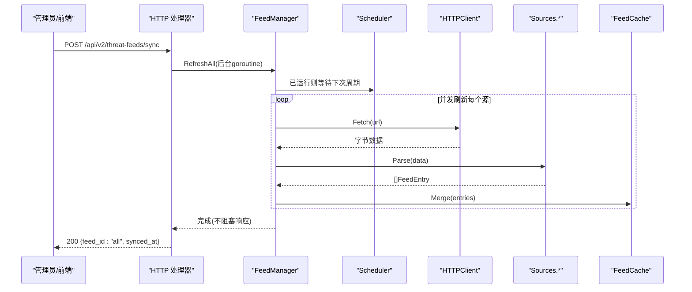
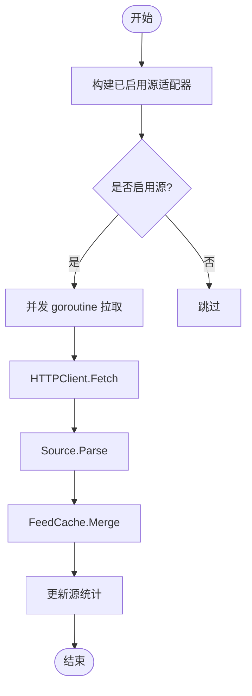
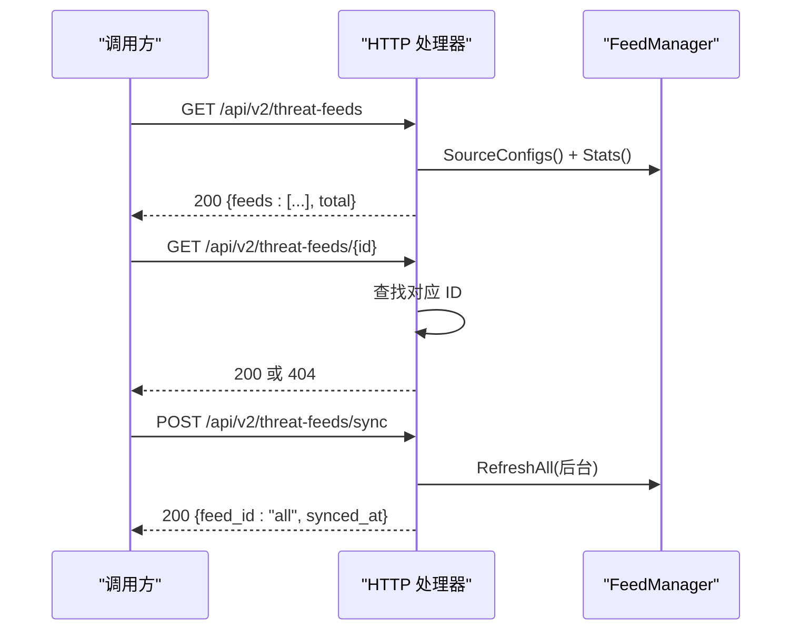
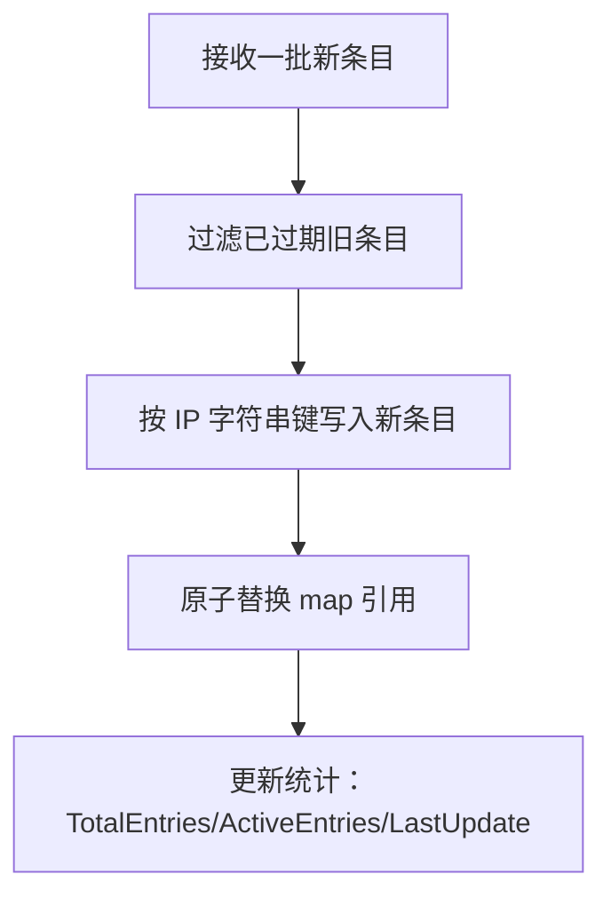
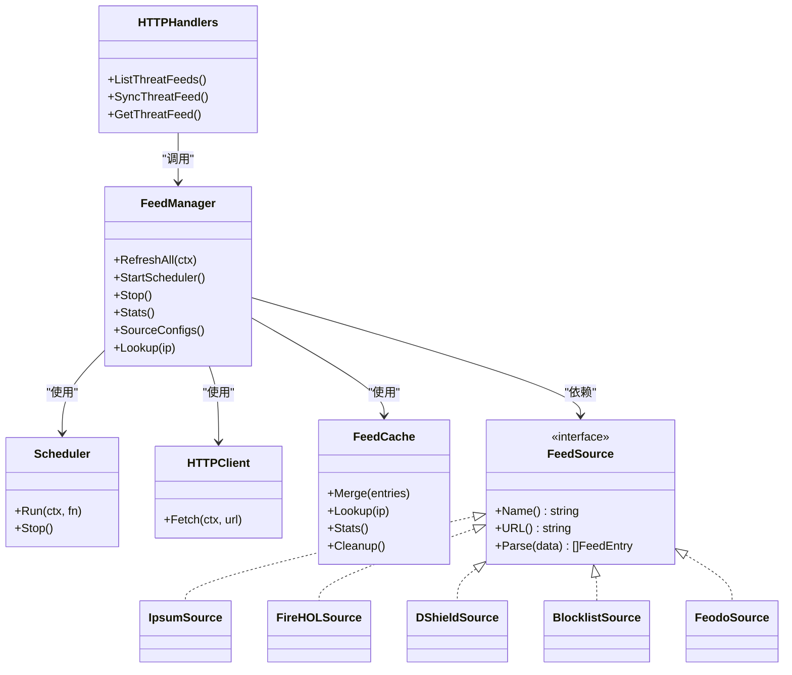

# 威胁情报API

<cite>
**本文引用的文件**   
- [threat-feeds.md](file://docs/zh/configuration/threat-feeds.md)
- [types.go](file://src/daemon/internal/threatfeeds/types.go)
- [config.go](file://src/daemon/internal/threatfeeds/config.go)
- [manager.go](file://src/daemon/internal/threatfeeds/manager.go)
- [scheduler.go](file://src/daemon/internal/threatfeeds/scheduler.go)
- [cache.go](file://src/daemon/internal/threatfeeds/cache.go)
- [http.go](file://src/daemon/internal/threatfeeds/http.go)
- [parser.go](file://src/daemon/internal/threatfeeds/parser.go)
- [ipsum.go](file://src/daemon/internal/threatfeeds/sources/ipsum.go)
- [firehol.go](file://src/daemon/internal/threatfeeds/sources/firehol.go)
- [dshield.go](file://src/daemon/internal/threatfeeds/sources/dshield.go)
- [blocklist.go](file://src/daemon/internal/threatfeeds/sources/blocklist.go)
- [feodo.go](file://src/daemon/internal/threatfeeds/sources/feodo.go)
- [threat_feeds.go](file://src/daemon/internal/http/threat_feeds.go)
</cite>

## 目录
1. [简介](#简介)
2. [项目结构](#项目结构)
3. [核心组件](#核心组件)
4. [架构总览](#架构总览)
5. [详细组件分析](#详细组件分析)
6. [依赖关系分析](#依赖关系分析)
7. [性能与容量特性](#性能与容量特性)
8. [故障排查与安全加固](#故障排查与安全加固)
9. [结论](#结论)
10. [附录：API 契约与示例](#附录api-契约与示例)

## 简介
本文件面向威胁情报子系统与对外 API，覆盖以下主题：
- 威胁源管理、数据同步、状态查询接口
- 威胁情报格式、置信度评估、自动更新机制
- 多源聚合、去重策略、SSRF 防护
- 情报源配置、调度策略、错误处理
- 情报源集成示例与自定义适配器开发指南

该子系统从多个公网情报源并发拉取恶意 IP/CIDR，解析后聚合到内存缓存，供本地判定链路快速查询；同时提供 HTTP API 用于列出源、查看状态、触发同步。

## 项目结构
威胁情报相关代码主要位于守护进程内部模块 threatfeeds，以及对外暴露的 HTTP 处理器：
- 领域模型与配置：types.go、config.go
- 管理器与调度：manager.go、scheduler.go
- 网络拉取与 SSRF 防护：http.go
- 缓存与过期清理：cache.go
- 通用解析工具：parser.go
- 具体情报源适配器：sources/*
- 对外 HTTP 接口：internal/http/threat_feeds.go
- 用户文档与配置示例：docs/zh/configuration/threat-feeds.md

图示来源
- [threat_feeds.go:45-137](file://src/daemon/internal/http/threat_feeds.go#L45-L137)
- [manager.go:20-268](file://src/daemon/internal/threatfeeds/manager.go#L20-L268)
- [scheduler.go:10-94](file://src/daemon/internal/threatfeeds/scheduler.go#L10-L94)
- [cache.go:9-173](file://src/daemon/internal/threatfeeds/cache.go#L9-L173)
- [http.go:14-129](file://src/daemon/internal/threatfeeds/http.go#L14-L129)
- [ipsum.go:81-104](file://src/daemon/internal/threatfeeds/sources/ipsum.go#L81-L104)
- [firehol.go:5-28](file://src/daemon/internal/threatfeeds/sources/firehol.go#L5-L28)
- [dshield.go:66-89](file://src/daemon/internal/threatfeeds/sources/dshield.go#L66-L89)
- [blocklist.go:5-28](file://src/daemon/internal/threatfeeds/sources/blocklist.go#L5-L28)
- [feodo.go:60-83](file://src/daemon/internal/threatfeeds/sources/feodo.go#L60-L83)

章节来源
- [threat-feeds.md:1-286](file://docs/zh/configuration/threat-feeds.md#L1-L286)
- [config.go:5-93](file://src/daemon/internal/threatfeeds/config.go#L5-L93)

## 核心组件
- FeedManager：协调所有源的拉取、解析、聚合、缓存与统计，提供查询与生命周期控制。
- Scheduler：按间隔定时触发刷新，并加入随机抖动避免惊群。
- FeedCache：内存缓存，支持精确 IP 与 CIDR 匹配、过期清理与统计。
- HTTPClient：带超时、重试、指数退避、重定向限制与域名白名单校验的安全拉取客户端。
- Parser：通用文本解析工具（如移除注释、IP/CIDR 行解析）。
- Sources 适配器：各情报源的数据格式适配与条目构造。
- HTTP 处理器：对外提供列表、详情、手动同步等 REST 接口。

章节来源
- [manager.go:20-268](file://src/daemon/internal/threatfeeds/manager.go#L20-L268)
- [scheduler.go:10-94](file://src/daemon/internal/threatfeeds/scheduler.go#L10-L94)
- [cache.go:9-173](file://src/daemon/internal/threatfeeds/cache.go#L9-L173)
- [http.go:14-129](file://src/daemon/internal/threatfeeds/http.go#L14-L129)
- [parser.go:11-79](file://src/daemon/internal/threatfeeds/parser.go#L11-L79)
- [threat_feeds.go:11-137](file://src/daemon/internal/http/threat_feeds.go#L11-L137)

## 架构总览
威胁情报系统采用“配置驱动 + 适配器模式”的多源聚合架构：
- 配置层：Config/SourceConfig 声明启用的源、URL、分类、置信度与全局参数。
- 调度层：Scheduler 周期性触发 RefreshAll，首次立即执行一次。
- 拉取层：HTTPClient 对每个源发起 HTTPS 请求，限制协议、域名与重定向次数。
- 解析层：各 Source 适配器将原始文本解析为 FeedEntry（IP/CIDR、分类、置信度、过期时间）。
- 聚合层：FeedManager 合并结果至 FeedCache，记录统计信息。
- 查询层：Lookup 优先精确匹配，再遍历 CIDR；命中返回最高置信度情报。
- 观测层：Stats/LastUpdate/CacheStats 暴露运行时指标；HTTP 端点提供列表与同步能力。

图示来源
- [threat_feeds.go:57-74](file://src/daemon/internal/http/threat_feeds.go#L57-L74)
- [manager.go:111-155](file://src/daemon/internal/threatfeeds/manager.go#L111-L155)
- [http.go:72-102](file://src/daemon/internal/threatfeeds/http.go#L72-L102)
- [ipsum.go:99-103](file://src/daemon/internal/threatfeeds/sources/ipsum.go#L99-L103)
- [cache.go:44-82](file://src/daemon/internal/threatfeeds/cache.go#L44-L82)

## 详细组件分析

### 威胁源管理与调度
- FeedManager 根据配置构建具体 Source 适配器，维护每个源的统计与错误。
- RefreshAll 并发拉取所有源，任一失败不影响其他源；成功则 Merge 到缓存。
- StartScheduler 启动定时任务，首次立即触发，后续按 interval ± jitter 触发。
- Stop 停止调度器并取消上下文，保证优雅退出。

图示来源
- [manager.go:54-91](file://src/daemon/internal/threatfeeds/manager.go#L54-L91)
- [manager.go:111-155](file://src/daemon/internal/threatfeeds/manager.go#L111-L155)
- [manager.go:212-225](file://src/daemon/internal/threatfeeds/manager.go#L212-L225)
- [scheduler.go:35-64](file://src/daemon/internal/threatfeeds/scheduler.go#L35-L64)

章节来源
- [manager.go:20-268](file://src/daemon/internal/threatfeeds/manager.go#L20-L268)
- [scheduler.go:10-94](file://src/daemon/internal/threatfeeds/scheduler.go#L10-L94)

### 数据同步与状态查询接口
- GET /api/v2/threat-feeds：返回所有源的静态配置与动态同步状态。
- GET /api/v2/threat-feeds/{id}：返回单个源的详情。
- POST /api/v2/threat-feeds/sync：异步触发一次全量同步，立即返回已接受。

字段说明（节选）：
- id/name/source_url/enabled/category/confidence：来自配置的静态字段
- last_synced_at/entry_count/sync_status/last_error：来自运行时统计

图示来源
- [threat_feeds.go:45-137](file://src/daemon/internal/http/threat_feeds.go#L45-L137)
- [manager.go:227-244](file://src/daemon/internal/threatfeeds/manager.go#L227-L244)

章节来源
- [threat_feeds.go:11-137](file://src/daemon/internal/http/threat_feeds.go#L11-L137)

### 威胁情报格式与置信度
- 单条情报 FeedEntry 包含：
  - IP：netip.Prefix（支持精确 IP 与 CIDR）
  - Source：来源名称
  - Category：分类（如 abuse/scanner/botnet）
  - Confidence：置信度 [0.0, 1.0]
  - ExpiresAt：过期时间（由适配器设置）
- 不同源支持不同输入格式：
  - 纯 IP/CIDR 列表（每行一个）
  - TSV（首列为 IP/CIDR）
  - CSV（特定列序，如 Feodo 第二列为 IP）
- 置信度在配置中可设定默认值，也可被解析器覆盖（若实现需要）。

章节来源
- [ipsum.go:12-19](file://src/daemon/internal/threatfeeds/sources/ipsum.go#L12-L19)
- [dshield.go:11-64](file://src/daemon/internal/threatfeeds/sources/dshield.go#L11-L64)
- [feodo.go:11-58](file://src/daemon/internal/threatfeeds/sources/feodo.go#L11-L58)
- [config.go:5-17](file://src/daemon/internal/threatfeeds/config.go#L5-L17)

### 多源聚合与去重策略
- 多源并发拉取，互不影响；任一失败仅记录错误，不中断整体流程。
- 去重策略：
  - 以 IP.String() 作为键进行覆盖式写入（新数据优先）。
  - 相同 IP 的不同源会相互覆盖，保留最新一次拉取的结果。
  - 未显式实现“按置信度择优”，如需可按置信度扩展 Merge 逻辑。
- 过期策略：
  - 每条情报携带 ExpiresAt；Merge 时跳过已过期旧条目。
  - Lookup 时跳过过期条目；Cleanup 定期清理过期键。

图示来源
- [cache.go:44-82](file://src/daemon/internal/threatfeeds/cache.go#L44-L82)
- [cache.go:152-165](file://src/daemon/internal/threatfeeds/cache.go#L152-L165)

章节来源
- [manager.go:111-155](file://src/daemon/internal/threatfeeds/manager.go#L111-L155)
- [cache.go:44-82](file://src/daemon/internal/threatfeeds/cache.go#L44-L82)

### SSRF 防护与网络安全
- 强制 HTTPS：非 HTTPS 直接拒绝。
- 域名白名单：仅允许预置的已知情报源域名。
- 重定向限制：最多跟随 3 次重定向，每次均校验目标 URL。
- 私有地址检测：提供 isPrivateAddr 辅助函数（可用于扩展校验）。

章节来源
- [http.go:14-21](file://src/daemon/internal/threatfeeds/http.go#L14-L21)
- [http.go:30-49](file://src/daemon/internal/threatfeeds/http.go#L30-L49)
- [http.go:51-70](file://src/daemon/internal/threatfeeds/http.go#L51-L70)

### 自动更新机制与调度策略
- 首次立即触发一次刷新，随后按 refresh_interval 周期触发。
- 引入 jitter（抖动），实际延迟 = interval ± jitter，避免多实例惊群。
- 支持 context 取消与 Stop 信号，确保优雅停止。

章节来源
- [scheduler.go:10-94](file://src/daemon/internal/threatfeeds/scheduler.go#L10-L94)
- [manager.go:212-225](file://src/daemon/internal/threatfeeds/manager.go#L212-L225)

### 错误处理与可观测性
- 每个源的错误独立记录，不影响其他源。
- 统计信息包括：上次更新时间、条目数、错误、刷新计数、错误计数。
- HTTP 层将错误映射为 sync_status=error 与 last_error 消息。
- 日志输出刷新成功/失败及耗时。

章节来源
- [manager.go:186-205](file://src/daemon/internal/threatfeeds/manager.go#L186-L205)
- [threat_feeds.go:100-137](file://src/daemon/internal/http/threat_feeds.go#L100-L137)

### 情报源集成与自定义适配器
- 内置源：ipsum、firehol_level1/firehol、dshield、blocklist_de、feodo。
- 自定义适配器需实现 FeedSource 接口：Name()/URL()/Parse([]byte)。
- 在 Config.Sources 中添加 name/url/enabled/category/confidence 即可接入。
- 注意：URL 必须为 HTTPS，且域名需在白名单内。

章节来源
- [manager.go:93-109](file://src/daemon/internal/threatfeeds/manager.go#L93-L109)
- [ipsum.go:21-26](file://src/daemon/internal/threatfeeds/sources/ipsum.go#L21-L26)
- [threat-feeds.md:150-179](file://docs/zh/configuration/threat-feeds.md#L150-L179)

## 依赖关系分析
- HTTP 处理器依赖 FeedManager 提供的 SourceConfigs/Stats/RefreshAll。
- FeedManager 依赖：
  - Scheduler 负责定时触发
  - HTTPClient 负责安全拉取
  - 各 Source 适配器负责解析
  - FeedCache 负责聚合与查询
- 各 Source 适配器之间无耦合，便于扩展与维护。

图示来源
- [threat_feeds.go:45-137](file://src/daemon/internal/http/threat_feeds.go#L45-L137)
- [manager.go:20-268](file://src/daemon/internal/threatfeeds/manager.go#L20-L268)
- [scheduler.go:10-94](file://src/daemon/internal/threatfeeds/scheduler.go#L10-L94)
- [http.go:23-49](file://src/daemon/internal/threatfeeds/http.go#L23-L49)
- [cache.go:9-173](file://src/daemon/internal/threatfeeds/cache.go#L9-L173)
- [ipsum.go:81-104](file://src/daemon/internal/threatfeeds/sources/ipsum.go#L81-L104)
- [firehol.go:5-28](file://src/daemon/internal/threatfeeds/sources/firehol.go#L5-L28)
- [dshield.go:66-89](file://src/daemon/internal/threatfeeds/sources/dshield.go#L66-L89)
- [blocklist.go:5-28](file://src/daemon/internal/threatfeeds/sources/blocklist.go#L5-L28)
- [feodo.go:60-83](file://src/daemon/internal/threatfeeds/sources/feodo.go#L60-L83)

## 性能与容量特性
- 并发拉取：多个源并行刷新，总体耗时取决于最慢源。
- 解析开销：纯 CPU 操作，典型规模下毫秒级。
- 缓存查询：
  - 精确匹配：O(1)
  - CIDR 匹配：O(N) 遍历（N 为缓存条目数）
- 内存占用：随条目数线性增长；建议合理控制启用源数量与刷新频率。
- 过期清理：按需 Cleanup 或依赖 Lookup/Merge 中的过期过滤。

[本节为通用性能讨论，不直接分析具体文件]

## 故障排查与安全加固
常见问题与建议：
- 拉取失败：检查网络连接、DNS、证书、域名白名单。
- 未生效：确认 enabled 开关与具体源 enabled；必要时发送 SIGHUP 热重载。
- 查询延迟偏高：减少启用源数量、优先精确 IP、增大刷新间隔以降低缓存规模。
- SSRF 风险：严格遵循 HTTPS 与域名白名单；谨慎配置重定向行为。

章节来源
- [threat-feeds.md:198-261](file://docs/zh/configuration/threat-feeds.md#L198-L261)
- [http.go:51-70](file://src/daemon/internal/threatfeeds/http.go#L51-L70)

## 结论
威胁情报子系统通过配置驱动的适配器体系实现了多源并发拉取、安全访问、解析聚合与高性能查询，并提供完善的监控与运维接口。其设计强调错误隔离、性能隔离与可观测性，适合在生产环境中稳定运行。未来可扩展更丰富的源格式、置信度择优策略与持久化能力。

## 附录：API 契约与示例

### 接口定义
- GET /api/v2/threat-feeds
  - 返回 feeds 列表与总数 total
  - 字段：id/name/source_url/enabled/category/confidence/last_synced_at/entry_count/sync_status/last_error
- GET /api/v2/threat-feeds/{id}
  - 返回单个源详情；不存在返回 404
- POST /api/v2/threat-feeds/sync
  - 异步触发全量同步；返回 feed_id="all" 与 synced_at

章节来源
- [threat_feeds.go:11-43](file://src/daemon/internal/http/threat_feeds.go#L11-L43)
- [threat_feeds.go:45-137](file://src/daemon/internal/http/threat_feeds.go#L45-L137)

### 配置参考
- 全局参数：enabled/refresh_interval/http_timeout/max_retries
- 源参数：name/url/enabled/category/confidence
- 推荐源：IPsum、FireHOL Level 1、DShield、Blocklist.de、Feodo Tracker

章节来源
- [config.go:5-93](file://src/daemon/internal/threatfeeds/config.go#L5-L93)
- [threat-feeds.md:38-149](file://docs/zh/configuration/threat-feeds.md#L38-L149)