# 封禁管理API

<cite>
**本文引用的文件**   
- [bans.go](file://src/daemon/internal/http/bans.go)
- [routes.go](file://src/daemon/internal/http/routes.go)
- [http.fwidl](file://contract/http.fwidl)
- [ban.go](file://src/daemon/internal/bans/ban.go)
- [cache.go](file://src/daemon/internal/bans/cache.go)
- [consumer.go](file://src/daemon/internal/kernel/consumer.go)
- [fw_ban.c](file://src/kernel-module/fw_ban.c)
- [management.md](file://docs/zh/operations/management.md)
- [test_03_ban_unban.py](file://tests/test_03_ban_unban.py)
- [test_12_permanent_ban.py](file://tests/test_12_permanent_ban.py)
</cite>

## 目录
1. [简介](#简介)
2. [项目结构](#项目结构)
3. [核心组件](#核心组件)
4. [架构总览](#架构总览)
5. [详细端点说明](#详细端点说明)
6. [依赖与关系分析](#依赖与关系分析)
7. [性能与容量特性](#性能与容量特性)
8. [故障排查指南](#故障排查指南)
9. [结论](#结论)
10. [附录：curl 示例与 SDK 调用](#附录curl-示例与-sdk-调用)

## 简介
本文件面向“封禁管理”相关的所有 REST 端点，覆盖查询封禁列表、创建临时或永久封禁、批量封禁、解封单个 IP、批量解除临时封禁，以及查看单条 IP 的封禁详情。文档同时解释请求参数、响应格式、错误码、封禁规则优先级、白名单冲突处理、内核同步机制、生命周期与状态转换，并给出 curl 示例和 SDK 调用建议。

## 项目结构
封禁管理 API 由守护进程 HTTP 层暴露路由，业务逻辑集中在 bans handler；内存镜像在 bans 包维护；内核侧通过 netlink 事件泵对账；内核模块实现实际的 netfilter 封禁表与定时器。

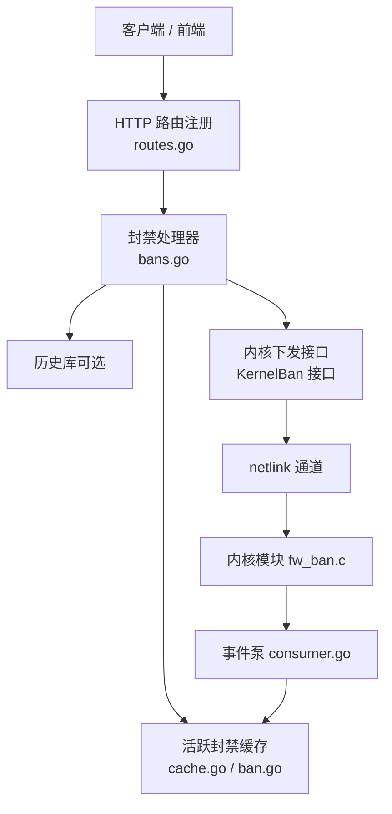

**图示来源**
- [routes.go:105-117](file://src/daemon/internal/http/routes.go#L105-L117)
- [bans.go:21-28](file://src/daemon/internal/http/bans.go#L21-L28)
- [cache.go:16-31](file://src/daemon/internal/bans/cache.go#L16-L31)
- [consumer.go:398-441](file://src/daemon/internal/kernel/consumer.go#L398-L441)
- [fw_ban.c:506-531](file://src/kernel-module/fw_ban.c#L506-L531)

**章节来源**
- [routes.go:105-117](file://src/daemon/internal/http/routes.go#L105-L117)
- [http.fwidl:525-577](file://contract/http.fwidl#L525-L577)

## 核心组件
- HTTP 路由注册：将 `/api/v2/bans` 族路由绑定到 `ListBans`、`CreateBan`、`DeleteBan`、`BanDetail`、`UnbanAllTemporary`、`BatchBan`。
- 封禁处理器：负责参数校验、镜像写入、内核下发、历史落盘、SSE 推送。
- 活跃封禁缓存：提供原子插入、删除、按 jail 反向索引、过期清扫、待确认标记、批量解封临时条目等能力。
- 内核事件泵：消费内核 BanStateChange/CmdResult，驱动镜像对账与 SSE 发布。
- 内核模块：维护分层桶表、前缀匹配、泛洪闸门、白名单优先、到期定时器、统计计数。

**章节来源**
- [bans.go:58-99](file://src/daemon/internal/http/bans.go#L58-L99)
- [bans.go:112-190](file://src/daemon/internal/http/bans.go#L112-L190)
- [cache.go:42-79](file://src/daemon/internal/bans/cache.go#L42-L79)
- [consumer.go:398-441](file://src/daemon/internal/kernel/consumer.go#L398-L441)
- [fw_ban.c:369-383](file://src/kernel-module/fw_ban.c#L369-L383)

## 架构总览
封禁管理的端到端流程如下：

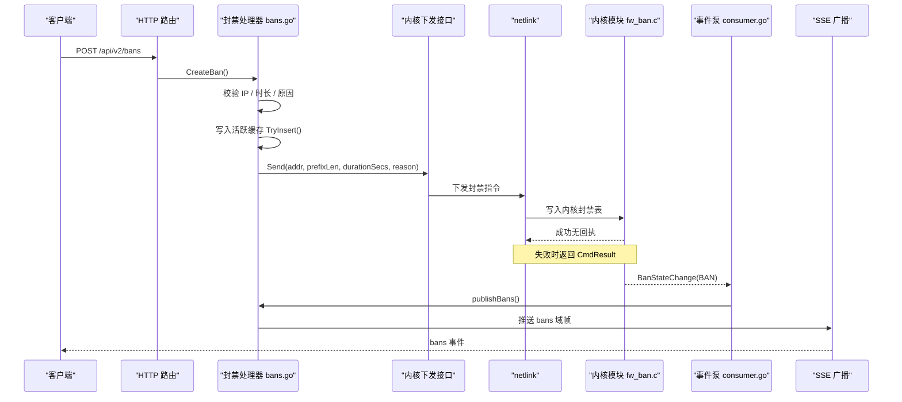

**图示来源**
- [bans.go:112-190](file://src/daemon/internal/http/bans.go#L112-L190)
- [consumer.go:398-441](file://src/daemon/internal/kernel/consumer.go#L398-L441)
- [consumer.go:549-549](file://src/daemon/internal/kernel/consumer.go#L549-L549)
- [fw_ban.c:506-531](file://src/kernel-module/fw_ban.c#L506-L531)

## 详细端点说明

### GET /api/v2/bans
- 功能：分页查询当前活跃封禁列表。
- 鉴权：需要。
- 成功状态码：200。
- 请求参数：
  - page：页码，缺省为 1。
  - page_size：每页条数，缺省为 20，上限为 100。
  - sort_by：排序键，支持 banned_at_desc、banned_at_asc、ip_asc、ip_desc、jail_asc、remaining_asc、remaining_desc；未识别值回落到 banned_at_desc。
- 响应体：统一信封，data 为 PaginatedResponse<BanResponse>，包含 items、total、page、page_size、total_pages。
- 错误：该路由契约只声明 code 0，因此读不到数据也走成功路径，空读数由载荷表达。

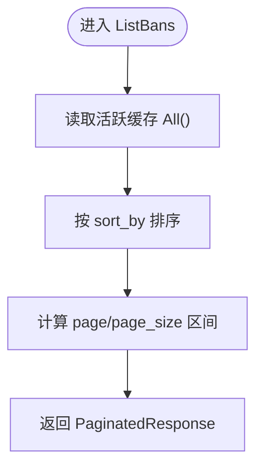

**图示来源**
- [bans.go:58-99](file://src/daemon/internal/http/bans.go#L58-L99)
- [http.fwidl:525-532](file://contract/http.fwidl#L525-L532)

**章节来源**
- [bans.go:58-99](file://src/daemon/internal/http/bans.go#L58-L99)
- [http.fwidl:525-532](file://contract/http.fwidl#L525-L532)

### POST /api/v2/bans
- 功能：创建一条封禁，可为临时或永久。
- 鉴权：需要。
- 成功状态码：201 Created。
- 请求体字段：
  - ip：必填，IP 地址字符串。
  - duration：可选，秒数；缺失或显式 0 表示永久封禁；正整数表示临时封禁时长。
  - reason：可选，原因文本；缺失或空串使用默认原因。
- 响应体：BanOperationResponse，包含 ip、action、permanent，临时封禁还包含 duration_secs。
- 行为：
  - 校验 IP；非法返回业务码 40001。
  - 若 IP 已在活跃封禁表中，拒绝并返回 40001。
  - 写入活跃缓存后尝试下发内核；内核失败则回滚缓存并返回 40001。
  - 可选写历史库 ban_history 与 ban_events。
  - 成功后推送 bans SSE 帧。
- 错误码：
  - 40001：封禁失败（内核未确认、IP 非法、或内核返回错误）。
  - 40007：请求体不是合法 JSON 或字段类型不符。
  - 40008：Content-Type 不是 application/json。

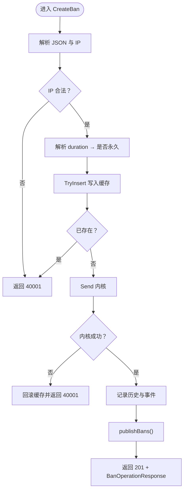

**图示来源**
- [bans.go:112-190](file://src/daemon/internal/http/bans.go#L112-L190)
- [http.fwidl:534-542](file://contract/http.fwidl#L534-L542)

**章节来源**
- [bans.go:101-190](file://src/daemon/internal/http/bans.go#L101-L190)
- [http.fwidl:169-172](file://contract/http.fwidl#L169-L172)
- [http.fwidl:534-542](file://contract/http.fwidl#L534-L542)

### DELETE /api/v2/bans/:ip
- 功能：解封指定 IP。
- 鉴权：需要。
- 成功状态码：200。
- 路径参数：
  - ip：要解封的 IP 地址。
- 响应体：BanOperationResponse，action 为 unbanned。
- 行为：
  - 校验 IP；非法返回 40002。
  - 从活跃缓存移除；不存在返回 40002。
  - 尝试下发内核解封；失败仅记日志，不改变状态码，因为镜像已撤除，TTL 到期也会自行消失。
  - 可选记录解封历史。
  - 成功后推送 bans SSE 帧。
- 错误码：
  - 40002：解封失败（IP 非法或内核拒绝）。

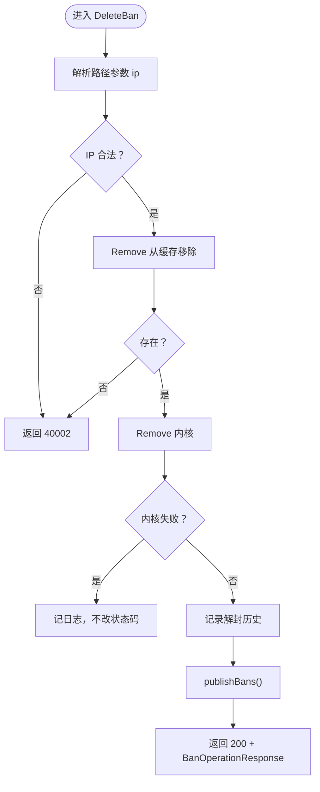

**图示来源**
- [bans.go:192-229](file://src/daemon/internal/http/bans.go#L192-L229)
- [http.fwidl:544-550](file://contract/http.fwidl#L544-L550)

**章节来源**
- [bans.go:192-229](file://src/daemon/internal/http/bans.go#L192-L229)
- [http.fwidl:174-177](file://contract/http.fwidl#L174-L177)
- [http.fwidl:544-550](file://contract/http.fwidl#L544-L550)

### GET /api/v2/bans/:ip/detail
- 功能：查看单个 IP 的封禁详情与历史记录。
- 鉴权：需要。
- 成功状态码：200。
- 路径参数：
  - ip：目标 IP。
- 响应体：BanDetailResponse，包含 is_banned、reason、banned_at、expires_at、is_permanent、fail_count、ban_count、jail_name、progressive_level、next_ban_duration、reputation_score、last_unbanned_at 等。
- 行为：
  - IP 非法返回 40006。
  - 当前封禁状态来自活跃缓存；未被封禁也返回 200，is_banned=false。
  - 历史库读失败不改变状态码，零值字段表达无记录。
  - 根据累计封禁次数计算渐进等级与下次封禁时长。
- 错误码：
  - 40006：封禁详情查询失败（IP 非法）。

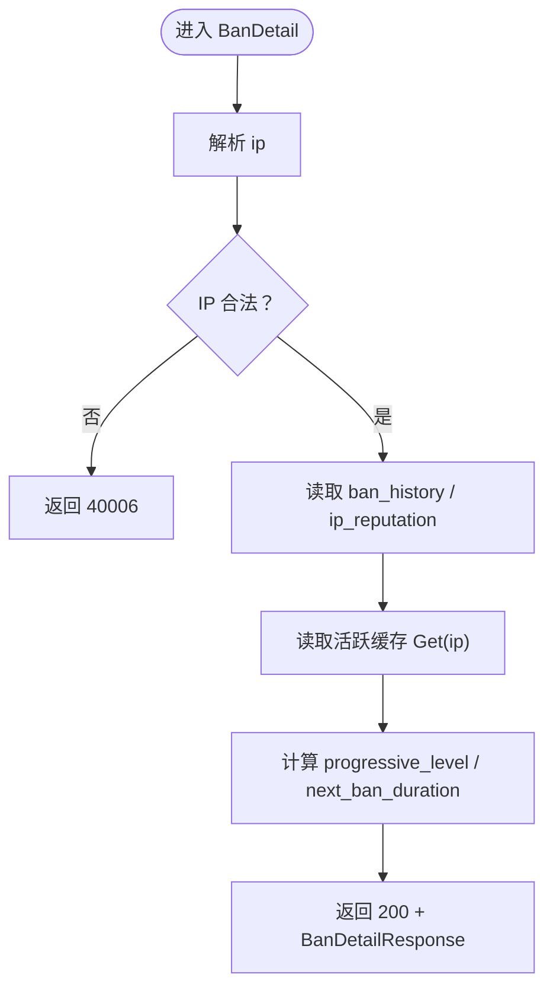

**图示来源**
- [bans.go:376-438](file://src/daemon/internal/http/bans.go#L376-L438)
- [http.fwidl:552-559](file://contract/http.fwidl#L552-L559)

**章节来源**
- [bans.go:376-438](file://src/daemon/internal/http/bans.go#L376-L438)
- [http.fwidl:194-197](file://contract/http.fwidl#L194-L197)
- [http.fwidl:552-559](file://contract/http.fwidl#L552-L559)

### POST /api/v2/bans/unban-temporary
- 功能：批量解除所有临时封禁。
- 鉴权：需要。
- 成功状态码：200。
- 请求体：无。
- 响应体：BatchOperationResponse，包含 total、succeeded、failed_count、details。
- 行为：
  - 从缓存中移除所有非永久封禁，得到被解封 IP 列表。
  - 逐条下发内核解封；任一内核失败即整体返回 40003，message 包含首个失败原因。
  - 逐条记录解封历史。
  - 成功后推送 bans SSE 帧。
- 错误码：
  - 40003：批量解封临时封禁失败。

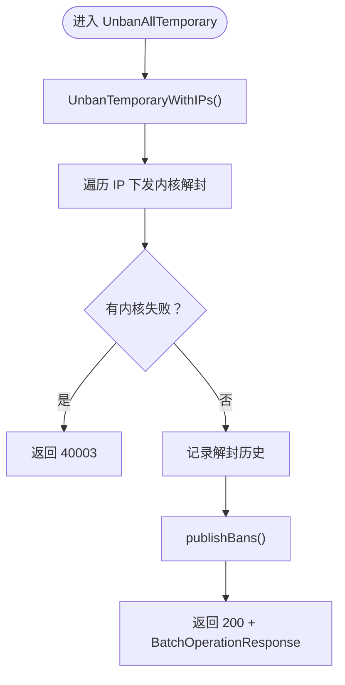

**图示来源**
- [bans.go:231-279](file://src/daemon/internal/http/bans.go#L231-L279)
- [http.fwidl:561-567](file://contract/http.fwidl#L561-L567)

**章节来源**
- [bans.go:231-279](file://src/daemon/internal/http/bans.go#L231-L279)
- [http.fwidl:179-182](file://contract/http.fwidl#L179-L182)
- [http.fwidl:561-567](file://contract/http.fwidl#L561-L567)

### POST /api/v2/bans/batch
- 功能：一次批量封禁多个 IP。
- 鉴权：需要。
- 成功状态码：201 Created。
- 请求体字段：
  - ips：IP 数组，数量范围 1..100。
  - duration：可选，秒数；批量封禁永远不产生永久封禁，缺省或 0 一律按 3600 秒下发。
  - reason：可选，原因文本。
- 响应体：BatchOperationResponse，包含 total、succeeded、failed_count、details。
- 行为：
  - 列表为空或超过 100 条返回 40005。
  - 逐个 IP 校验与插入缓存；重复 IP 计入失败。
  - 逐个下发内核；内核失败回滚该条缓存并计入失败。
  - 成功条目写 ban_history 与 ban_events。
  - 成功后推送 bans SSE 帧。
- 错误码：
  - 40005：批量封禁参数非法（列表为空或超过 100 条）。
  - 40007：请求体不是合法 JSON 或字段类型不符。
  - 40008：Content-Type 不是 application/json。

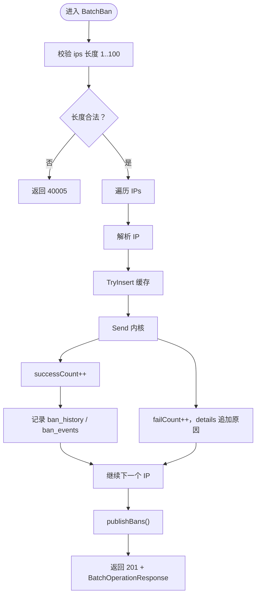

**图示来源**
- [bans.go:281-374](file://src/daemon/internal/http/bans.go#L281-L374)
- [http.fwidl:569-577](file://contract/http.fwidl#L569-L577)

**章节来源**
- [bans.go:281-374](file://src/daemon/internal/http/bans.go#L281-L374)
- [http.fwidl:189-192](file://contract/http.fwidl#L189-L192)
- [http.fwidl:569-577](file://contract/http.fwidl#L569-L577)

## 依赖与关系分析

### 类与接口关系
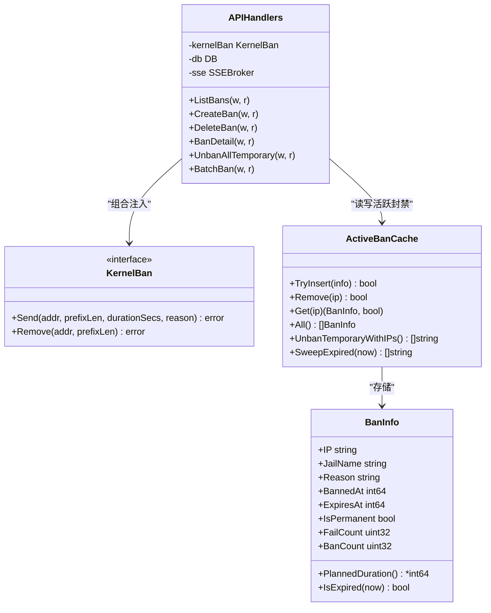

**图示来源**
- [bans.go:21-28](file://src/daemon/internal/http/bans.go#L21-L28)
- [bans.go:58-99](file://src/daemon/internal/http/bans.go#L58-L99)
- [cache.go:16-31](file://src/daemon/internal/bans/cache.go#L16-L31)
- [ban.go:82-132](file://src/daemon/internal/bans/ban.go#L82-L132)

**章节来源**
- [bans.go:21-28](file://src/daemon/internal/http/bans.go#L21-L28)
- [cache.go:16-31](file://src/daemon/internal/bans/cache.go#L16-L31)
- [ban.go:82-132](file://src/daemon/internal/bans/ban.go#L82-L132)

### 内核同步机制
- 下发路径：HTTP handler 调用 KernelBan.Send；内核成功时无回执，失败时通过 CmdResult 通知。
- 确认路径：内核发送 BanStateChange；事件泵更新缓存并触发 bans 域 SSE 推送。
- 对账周期：每 30 秒拉取内核封禁表，纠正本地镜像；刚下发的条目受 pending 保护，避免误删。
- 过期兜底：事件丢失时，对账会清扫本地过期条目。

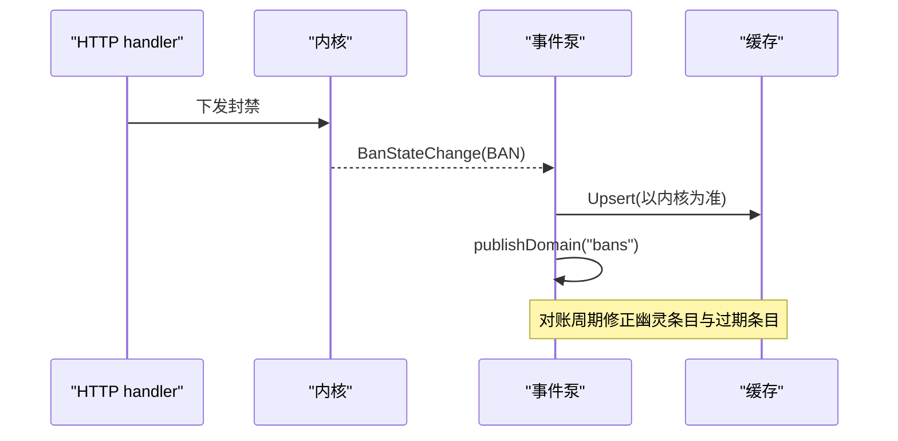

**图示来源**
- [consumer.go:398-441](file://src/daemon/internal/kernel/consumer.go#L398-L441)
- [consumer.go:623-690](file://src/daemon/internal/kernel/consumer.go#L623-L690)
- [cache.go:130-154](file://src/daemon/internal/bans/cache.go#L130-L154)

**章节来源**
- [consumer.go:398-441](file://src/daemon/internal/kernel/consumer.go#L398-L441)
- [consumer.go:623-690](file://src/daemon/internal/kernel/consumer.go#L623-L690)

### 封禁规则优先级与白名单冲突
- 白名单优先于封禁：内核添加封禁前检查白名单，命中直接拒绝。
- 白名单联动：移除白名单时，自动解封落在其覆盖范围内的封禁条目。
- 前缀语义：内核封禁表支持 CIDR 前缀，精确主机与网段分属不同层，互不覆盖。

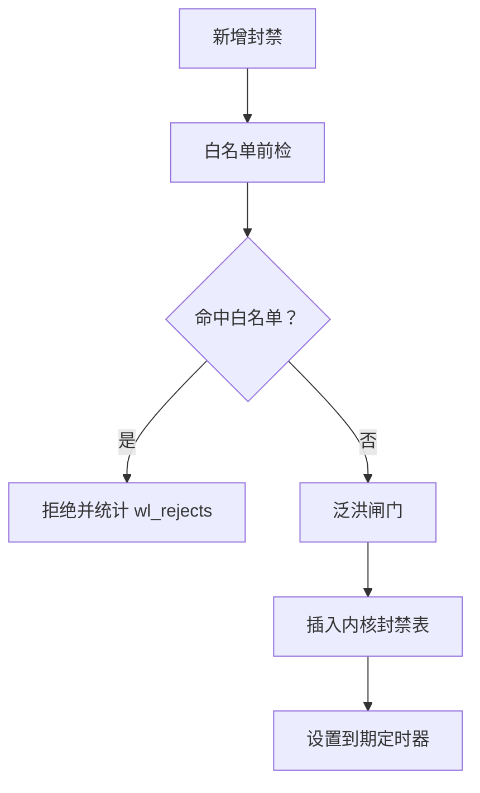

**图示来源**
- [fw_ban.c:506-531](file://src/kernel-module/fw_ban.c#L506-L531)
- [fw_ban.c:572-611](file://src/kernel-module/fw_ban.c#L572-L611)
- [fw_ban.c:369-383](file://src/kernel-module/fw_ban.c#L369-L383)

**章节来源**
- [fw_ban.c:506-531](file://src/kernel-module/fw_ban.c#L506-L531)
- [fw_ban.c:572-611](file://src/kernel-module/fw_ban.c#L572-L611)
- [fw_ban.c:369-383](file://src/kernel-module/fw_ban.c#L369-L383)

### 封禁生命周期与状态转换
- 新建：POST /api/v2/bans 或批量 POST /api/v2/bans/batch。
- 活跃：存在于活跃缓存与内核表；临时封禁带 ExpiresAt。
- 到期：内核定时器触发解封，事件泵收到 UNBAN 并从缓存移除。
- 手动解封：DELETE /api/v2/bans/:ip 或批量 POST /api/v2/bans/unban-temporary。
- 永久封禁：duration 缺失或 0；不会自动过期。

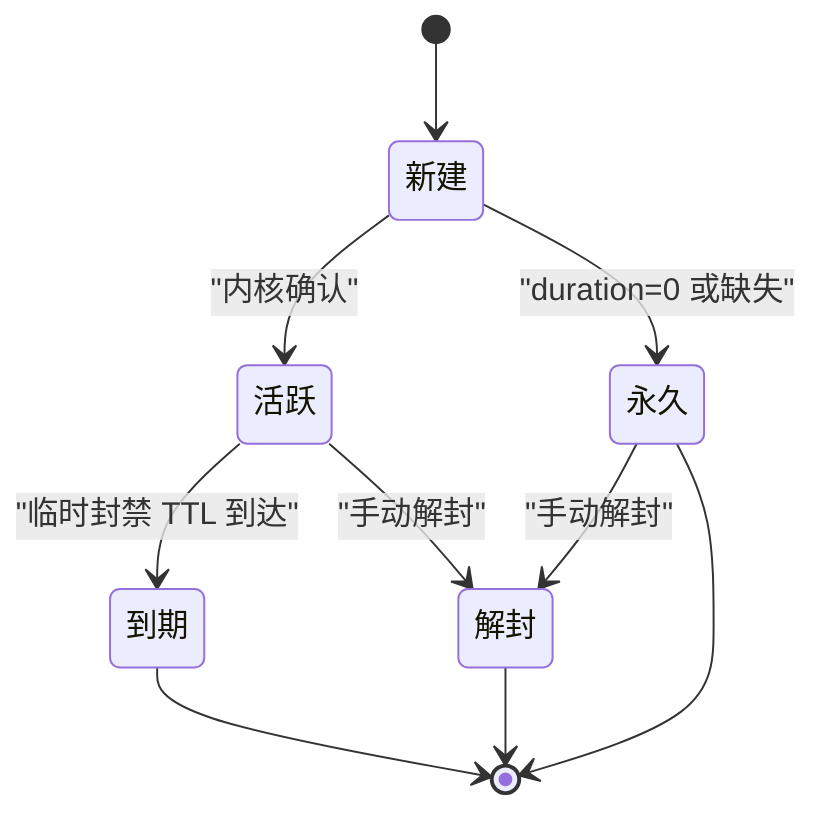

**图示来源**
- [bans.go:101-110](file://src/daemon/internal/http/bans.go#L101-L110)
- [ban.go:120-132](file://src/daemon/internal/bans/ban.go#L120-L132)
- [fw_ban.c:270-329](file://src/kernel-module/fw_ban.c#L270-L329)

**章节来源**
- [bans.go:101-110](file://src/daemon/internal/http/bans.go#L101-L110)
- [ban.go:120-132](file://src/daemon/internal/bans/ban.go#L120-L132)
- [fw_ban.c:270-329](file://src/kernel-module/fw_ban.c#L270-L329)

## 依赖与关系分析

### 路由注册与鉴权
- 所有封禁路由均通过 RequireAuth 包裹，认证失败走 Basic Auth 锁定策略。
- 路由注册串与契约中的 route 定义一致，动词不符由框架返回 405。

**章节来源**
- [routes.go:105-117](file://src/daemon/internal/http/routes.go#L105-L117)
- [http.fwidl:477-511](file://contract/http.fwidl#L477-L511)

### 历史库与事件
- 手工封禁与批量封禁都会写 ban_history 与 ban_events，用于复发统计、分级成效与时长直方图。
- 历史库读失败不改变状态码，载荷零值表达无记录。

**章节来源**
- [bans.go:166-178](file://src/daemon/internal/http/bans.go#L166-L178)
- [bans.go:350-363](file://src/daemon/internal/http/bans.go#L350-L363)

### 测试用例支撑
- 基本封禁/解封、批量封禁、重复封禁、IPv6 重复封禁统计不污染。
- 永久封禁不自动过期、SQLite 集成与独立测试。

**章节来源**
- [test_03_ban_unban.py:22-109](file://tests/test_03_ban_unban.py#L22-L109)
- [test_12_permanent_ban.py:27-199](file://tests/test_12_permanent_ban.py#L27-L199)

## 性能与容量特性
- 内核封禁表容量：默认最大条目数由模块参数控制，达到上限时拒绝新增并递增 ban_table_full_rejects。
- 泛洪闸门：三条封禁路径共用 fw_ban_flood_allow，限制每秒新增封禁速率。
- 对账周期：30 秒一次，纠正镜像与内核差异。
- 采样周期：5 秒一次，更新统计与分析快照。
- 注册租约：10 秒主动续约，防止链路空闲时被内核判死。

**章节来源**
- [fw_ban.c:7-13](file://src/kernel-module/fw_ban.c#L7-L13)
- [fw_ban.c:393-409](file://src/kernel-module/fw_ban.c#L393-L409)
- [consumer.go:37-51](file://src/daemon/internal/kernel/consumer.go#L37-L51)
- [consumer.go:269-309](file://src/daemon/internal/kernel/consumer.go#L269-L309)

## 故障排查指南
- 内核未确认：POST /api/v2/bans 返回 40001，message 含内核未确认原因；检查 netlink 链路、CmdResult 日志。
- IP 非法：各端点校验失败返回对应业务码；确认 IPv4/IPv6 格式与前缀长度。
- 白名单冲突：新增封禁被拒绝且 wl_rejects 增加；检查白名单配置与 CIDR 覆盖。
- 批量封禁超限：ips 数量超过 100 返回 40005；拆分批次。
- 批量解封失败：任一内核解封失败返回 40003；检查内核状态与日志。
- 历史库不可用：读失败不改变状态码，但面板可能显示零值；检查数据库初始化与权限。

**章节来源**
- [bans.go:112-190](file://src/daemon/internal/http/bans.go#L112-L190)
- [bans.go:231-279](file://src/daemon/internal/http/bans.go#L231-L279)
- [fw_ban.c:506-531](file://src/kernel-module/fw_ban.c#L506-L531)
- [management.md:292-315](file://docs/zh/operations/management.md#L292-L315)

## 结论
封禁管理 API 通过统一的 HTTP 契约暴露封禁生命周期操作，结合活跃缓存、历史库与内核事件泵，形成可观测、可审计、可恢复的封禁体系。白名单优先、前缀匹配、泛洪闸门与容量上限共同保障系统稳定性；SSE 与对账机制确保面板与内核状态一致。运维应关注业务码、内核回执与历史库可用性，并结合 procfs 与内核日志进行排障。

## 附录：curl 示例与 SDK 调用

### curl 示例
- 查询封禁列表：
  - curl -u user:pass http://127.0.0.1:9119/api/v2/bans?page=1&page_size=20&sort_by=banned_at_desc
- 创建临时封禁：
  - curl -X POST -u user:pass -H "Content-Type: application/json" -d '{"ip":"1.2.3.4","duration":3600,"reason":"manual"}' http://127.0.0.1:9119/api/v2/bans
- 创建永久封禁：
  - curl -X POST -u user:pass -H "Content-Type: application/json" -d '{"ip":"1.2.3.4","duration":0,"reason":"manual"}' http://127.0.0.1:9119/api/v2/bans
- 解封单个 IP：
  - curl -X DELETE -u user:pass http://127.0.0.1:9119/api/v2/bans/1.2.3.4
- 批量解除临时封禁：
  - curl -X POST -u user:pass http://127.0.0.1:9119/api/v2/bans/unban-temporary
- 批量封禁：
  - curl -X POST -u user:pass -H "Content-Type: application/json" -d '{"ips":["1.2.3.4","5.6.7.8"],"duration":3600,"reason":"batch"}' http://127.0.0.1:9119/api/v2/bans/batch
- 查看封禁详情：
  - curl -u user:pass http://127.0.0.1:9119/api/v2/bans/1.2.3.4/detail

### SDK 调用建议
- 前端 SDK 应封装 endpoints.ts 中的 getBans、createBan、deleteBan、getBanDetail、unbanTemporary、batchBan。
- 错误处理需区分 HTTP 状态码与信封内 code；认证失败走纯文本 401，其他业务错误走信封 ENVELOPE_ERROR。
- SSE 订阅 bans 域以实时刷新面板；REST 作为后备数据源。

**章节来源**
- [http.fwidl:525-577](file://contract/http.fwidl#L525-L577)
- [http.fwidl:91-128](file://contract/http.fwidl#L91-L128)