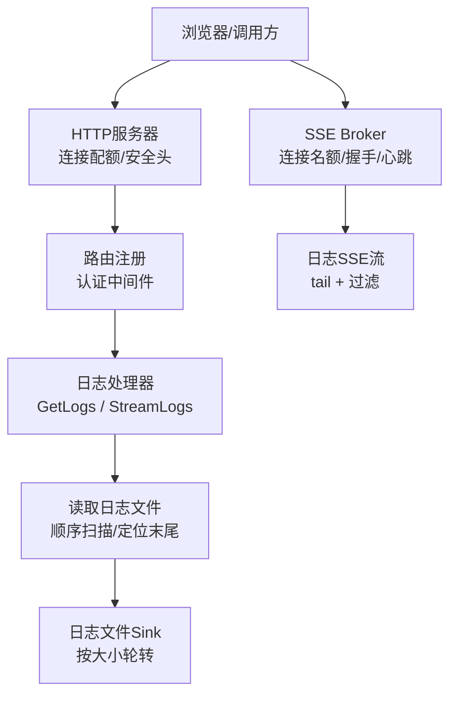
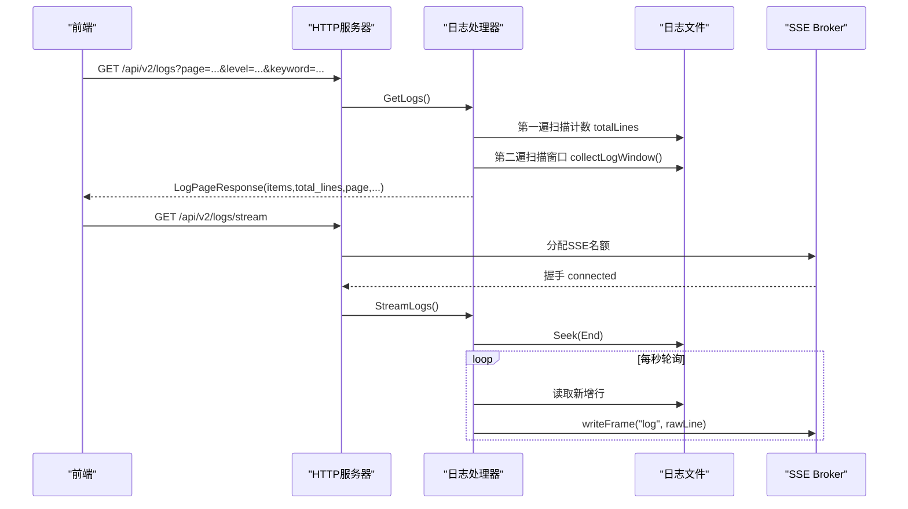
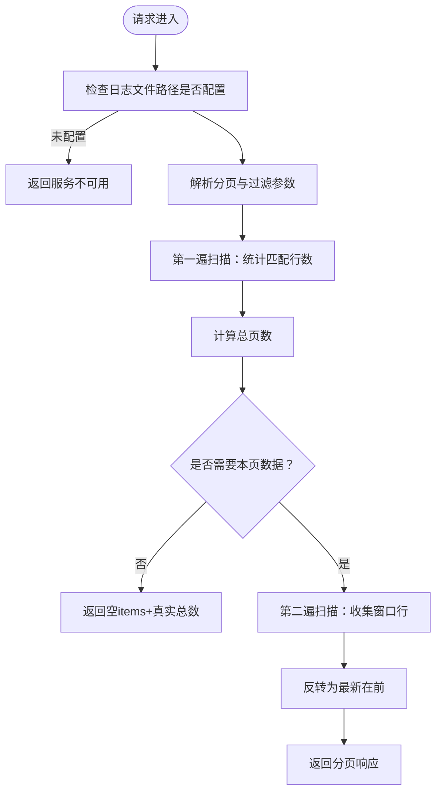
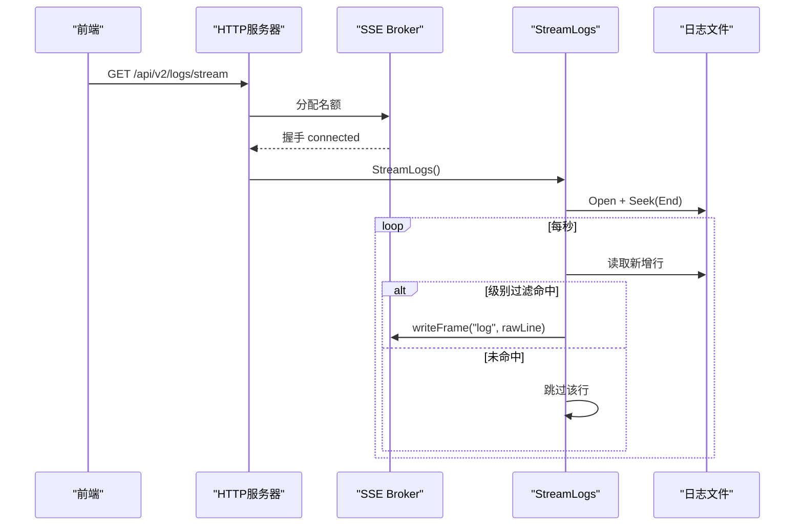
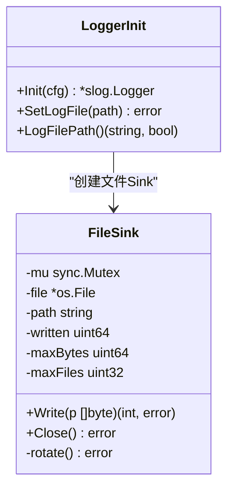
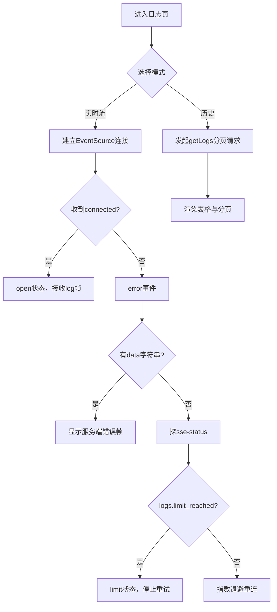
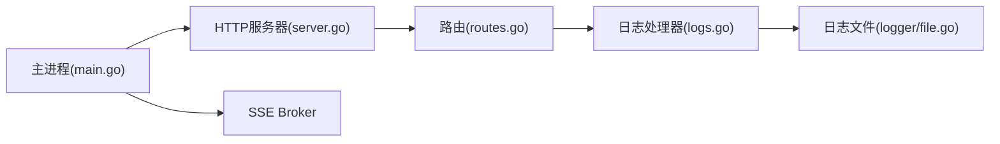

# 日志API

<cite>
**本文引用的文件**   
- [logs.go](file://src/daemon/internal/http/logs.go)
- [routes.go](file://src/daemon/internal/http/routes.go)
- [server.go](file://src/daemon/internal/http/server.go)
- [logger.go](file://src/daemon/internal/logger/logger.go)
- [file.go](file://src/daemon/internal/logger/file.go)
- [Logs.tsx](file://frontend/src/views/Logs.tsx)
- [main.go](file://src/daemon/cmd/firewall-daemon/main.go)
</cite>

## 目录
1. [简介](#简介)
2. [项目结构](#项目结构)
3. [核心组件](#核心组件)
4. [架构总览](#架构总览)
5. [详细组件分析](#详细组件分析)
6. [依赖关系分析](#依赖关系分析)
7. [性能与容量](#性能与容量)
8. [故障排查](#故障排查)
9. [结论](#结论)
10. [附录：接口与集成示例](#附录接口与集成示例)

## 简介
本文件面向“日志API”的完整使用与实现说明，覆盖以下能力：
- 历史日志查询：分页、级别过滤、关键词搜索、时间范围过滤。
- 实时日志流：基于SSE推送新行，支持连接上限、握手帧、心跳、断线重连。
- 日志格式与解析：JSON结构化日志与slog文本日志兼容。
- 日志轮转与存储策略：守护进程内置按大小轮转的文件Sink，以及外部logrotate场景下的行为差异。
- 性能考虑：扫描复杂度、内存上界、轮询间隔、前端缓冲限制。
- 集成示例：前端页面如何消费REST与SSE，以及二次开发建议。

## 项目结构
日志API由后端HTTP处理器、日志写入子系统、前端日志面板三部分协作完成：
- 后端HTTP层提供 `/api/v2/logs`（历史）与 `/api/v2/logs/stream`（实时）。
- 日志写入子系统负责把守护进程日志输出到文件，并支持按大小轮转。
- 前端通过REST拉取历史，通过EventSource订阅实时流，并在客户端做部分过滤与UI优化。

**图表来源**
- [server.go:34-73](file://src/daemon/internal/http/server.go#L34-L73)
- [routes.go:212-218](file://src/daemon/internal/http/routes.go#L212-L218)
- [logs.go:42-95](file://src/daemon/internal/http/logs.go#L42-L95)
- [logs.go:261-306](file://src/daemon/internal/http/logs.go#L261-L306)
- [file.go:23-52](file://src/daemon/internal/logger/file.go#L23-L52)

**章节来源**
- [server.go:34-73](file://src/daemon/internal/http/server.go#L34-L73)
- [routes.go:212-218](file://src/daemon/internal/http/routes.go#L212-L218)
- [logs.go:42-95](file://src/daemon/internal/http/logs.go#L42-L95)
- [logs.go:261-306](file://src/daemon/internal/http/logs.go#L261-L306)
- [file.go:23-52](file://src/daemon/internal/logger/file.go#L23-L52)

## 核心组件
- 日志查询处理器：实现分页、过滤、时间范围、错误码映射。
- 日志流处理器：打开文件定位末尾，按固定间隔轮询新增行，经SSE推送。
- 日志写入子系统：支持syslog/journald/文件/stderr多目的地；文件模式按大小轮转。
- 前端日志面板：实时流连接管理、客户端过滤、历史分页展示。

**章节来源**
- [logs.go:42-95](file://src/daemon/internal/http/logs.go#L42-L95)
- [logs.go:261-306](file://src/daemon/internal/http/logs.go#L261-L306)
- [logger.go:92-116](file://src/daemon/internal/logger/logger.go#L92-L116)
- [file.go:23-52](file://src/daemon/internal/logger/file.go#L23-L52)
- [Logs.tsx:89-149](file://frontend/src/views/Logs.tsx#L89-L149)

## 架构总览
日志API的整体交互如下：
- 历史查询：GET `/api/v2/logs` → 解析分页与过滤 → 两遍扫描文件（先计数后取值）→ 返回分页信封。
- 实时流：GET `/api/v2/logs/stream` → 预检日志文件可读 → 进入SSE握手 → 每1秒轮询新增行 → 推送`log`事件。
- 连接管理：SSE Broker统一处理接入名额、握手帧、心跳与503；前端在连接断开时探测`sse-status`并按限流策略重连。

**图表来源**
- [logs.go:42-95](file://src/daemon/internal/http/logs.go#L42-L95)
- [logs.go:261-306](file://src/daemon/internal/http/logs.go#L261-L306)
- [logs.go:315-354](file://src/daemon/internal/http/logs.go#L315-L354)

## 详细组件分析

### 历史日志查询：GET /api/v2/logs
- 功能要点
  - 分页参数：默认页码1、默认页大小100、最大页大小1000。
  - 过滤条件：级别（info/warn/error/debug）、关键词（不区分大小写）、时间范围（since）。
  - 响应体：包含items数组（每项含物理行号与内容）、total_lines、page、page_size、total_pages。
  - 空页语义：页码越界返回空items与真实总数，前端据此回退最后一页。
- 实现细节
  - 两遍扫描：先count匹配行数，再collect指定窗口；避免近似尾部扫描导致total_lines不一致。
  - 行号从1起，顺序为“最新在前”，与前端阅读习惯一致。
  - 时间戳解析兼容JSON字段与slog文本两种现场格式；无法解析时间的行不被since过滤掉。
  - 文件不可读或不存在时返回服务不可用或内部错误，具体取决于错误类型。

**图表来源**
- [logs.go:42-95](file://src/daemon/internal/http/logs.go#L42-L95)
- [logs.go:110-172](file://src/daemon/internal/http/logs.go#L110-L172)
- [logs.go:174-252](file://src/daemon/internal/http/logs.go#L174-L252)

**章节来源**
- [logs.go:42-95](file://src/daemon/internal/http/logs.go#L42-L95)
- [logs.go:110-172](file://src/daemon/internal/http/logs.go#L110-L172)
- [logs.go:174-252](file://src/daemon/internal/http/logs.go#L174-L252)

### 实时日志流：GET /api/v2/logs/stream
- 功能要点
  - 握手帧：connected事件携带stream名称与max_connections。
  - 数据帧：log事件data为原始日志行（未经JSON包装），error事件data为人类可读错误文本。
  - 级别过滤：可选，仅支持已知级别；未知级别会降级为不过滤并记录警告。
  - 轮询间隔：每秒一次，避免频繁stat开销。
- 连接管理
  - SSE Broker统一管理连接名额、握手、心跳与503。
  - 前端在连接断开时先探sse-status，若达到上限则停止重试并提示降级。
  - 断线重连采用指数退避，首次连接状态为connecting，后续为reconnecting。

**图表来源**
- [logs.go:261-306](file://src/daemon/internal/http/logs.go#L261-L306)
- [logs.go:315-354](file://src/daemon/internal/http/logs.go#L315-L354)

**章节来源**
- [logs.go:261-306](file://src/daemon/internal/http/logs.go#L261-L306)
- [logs.go:315-354](file://src/daemon/internal/http/logs.go#L315-L354)
- [Logs.tsx:181-253](file://frontend/src/views/Logs.tsx#L181-L253)

### 日志格式与时间解析
- 支持的日志格式
  - JSON结构化日志：包含ts与level等字段。
  - slog文本日志：time=... level=... 形式。
- 时间解析
  - 兼容RFC3339Nano/RFC3339/常见日期时间格式。
  - 无法解析时间的行不会被since过滤掉，避免非结构化行被误删。
- 级别匹配
  - 同时识别JSON `"level"` 与文本 `level=` 或 `[LEVEL]` 等形式。
  - REST侧对非法级别返回参数非法；流侧对未知级别降级为不过滤。

**章节来源**
- [logs.go:110-172](file://src/daemon/internal/http/logs.go#L110-L172)
- [logs.go:356-392](file://src/daemon/internal/http/logs.go#L356-L392)

### 日志轮转与存储策略
- 守护进程内置文件Sink
  - 按大小轮转：超过单片上限后触发轮转，保留最多N个历史片。
  - 轮转算法：删除最旧片 → 依次改名 → 当前片改名 `.1` → 新建文件。
  - 并发安全：写入与轮转共用锁，避免并发写者看到中途inode或切分记录。
- 外部logrotate
  - 实时流不感知logrotate导致的rename/truncate：偏移在末尾之后时可能静默停住。
  - 历史查询每次重新打开文件，因此能读到新轮转后的文件内容。
- 多目的地
  - 支持syslog/journald/文件/stderr；文件不可用时自动降级。

**图表来源**
- [file.go:23-52](file://src/daemon/internal/logger/file.go#L23-L52)
- [file.go:54-120](file://src/daemon/internal/logger/file.go#L54-L120)
- [logger.go:92-116](file://src/daemon/internal/logger/logger.go#L92-L116)

**章节来源**
- [file.go:23-52](file://src/daemon/internal/logger/file.go#L23-L52)
- [file.go:54-120](file://src/daemon/internal/logger/file.go#L54-L120)
- [logger.go:92-116](file://src/daemon/internal/logger/logger.go#L92-L116)
- [logs.go:315-354](file://src/daemon/internal/http/logs.go#L315-L354)

### 前端日志面板与连接管理
- 实时流
  - 使用EventSource直接订阅 `/api/v2/logs/stream`。
  - 监听connected/log/error三个事件字面量以通过门禁检查。
  - 客户端级别过滤：因后端对JSON行级别过滤有限，前端解析level后再筛。
  - 连接状态：idle/connecting/open/reconnecting/limit；达到上限时提示降级。
  - 断线重连：先探sse-status，若limit_reached则停止重试，否则指数退避重连。
- 历史查询
  - 分页控件支持20/50/100/200条每页，显示总行数。
  - 关键词去抖400ms，避免每次输入都打后端。
  - 行号与内容列，级别标签由前端解析。

**图表来源**
- [Logs.tsx:181-253](file://frontend/src/views/Logs.tsx#L181-L253)
- [Logs.tsx:516-615](file://frontend/src/views/Logs.tsx#L516-L615)

**章节来源**
- [Logs.tsx:89-149](file://frontend/src/views/Logs.tsx#L89-L149)
- [Logs.tsx:181-253](file://frontend/src/views/Logs.tsx#L181-L253)
- [Logs.tsx:516-615](file://frontend/src/views/Logs.tsx#L516-L615)

## 依赖关系分析
- HTTP服务器
  - 提供连接配额、安全头、超时控制。
  - SSE连接名额独立于HTTP全局活跃连接数，避免日志页占满影响其他流。
- 路由注册
  - 日志相关路由受认证中间件保护；日志流需注入SSEStream才注册。
- 主进程装配
  - 初始化SSE Broker，设置MaxConnections与心跳间隔；日志流与事件流各自限额。
  - 关停顺序：先断SSE流，再关闭HTTP服务器，避免端口占用。

**图表来源**
- [main.go:228-292](file://src/daemon/cmd/firewall-daemon/main.go#L228-L292)
- [server.go:34-73](file://src/daemon/internal/http/server.go#L34-L73)
- [routes.go:212-218](file://src/daemon/internal/http/routes.go#L212-L218)

**章节来源**
- [main.go:228-292](file://src/daemon/cmd/firewall-daemon/main.go#L228-L292)
- [server.go:34-73](file://src/daemon/internal/http/server.go#L34-L73)
- [routes.go:212-218](file://src/daemon/internal/http/routes.go#L212-L218)

## 性能与容量
- 历史查询
  - 时间复杂度O(N)扫描整份日志；空间上界为page_size条记录。
  - 两遍扫描保证total_lines准确，避免近似尾部扫描导致分页错乱。
- 实时流
  - 每秒轮询一次，单行上限512KiB，避免超长JSON行丢弃。
  - 每连接一个goroutine，避免共享读取器扇出导致串数据或重复扫描。
- 前端缓冲
  - 实时流最多缓存500行，超出丢弃最旧行，降低内存与渲染压力。
- 连接上限
  - 日志流上限5，事件流上限10；前端在达到上限时停止重试并提示降级。
- 轮转影响
  - 实时流不感知logrotate：文件rename/truncate后可能静默停住。
  - 历史查询每次重新打开文件，可读到新轮转后的内容。

[本节为通用性能讨论，不直接分析具体文件]

## 故障排查
- 日志文件未配置
  - 现象：GET /api/v2/logs 与 /api/v2/logs/stream 均返回服务不可用。
  - 原因：守护进程未登记日志文件路径。
  - 处理：确认配置文件中的日志文件路径已正确设置。
- 日志文件不可读
  - 现象：读取失败返回服务不可用或内部错误。
  - 原因：文件权限不足、路径错误或已被外部工具删除。
  - 处理：检查文件存在性与权限；必要时重启守护进程。
- 实时流断开
  - 现象：前端显示重连中或已达上限。
  - 原因：网络抖动、SSE名额已满、级别过滤参数非法。
  - 处理：查看sse-status；若limit_reached则等待名额释放或改用历史检索。
- 级别过滤无效
  - 现象：实时流对JSON行级别过滤不生效。
  - 原因：后端对JSON行级别过滤有限，前端需自行解析level后筛选。
  - 处理：在前端进行级别过滤，或调整日志格式以便后端识别。

**章节来源**
- [logs.go:42-50](file://src/daemon/internal/http/logs.go#L42-L50)
- [logs.go:101-108](file://src/daemon/internal/http/logs.go#L101-L108)
- [logs.go:261-289](file://src/daemon/internal/http/logs.go#L261-L289)
- [Logs.tsx:181-253](file://frontend/src/views/Logs.tsx#L181-L253)

## 结论
日志API通过REST与SSE双通道提供历史检索与实时推送能力。历史查询采用两遍扫描确保分页准确性；实时流通过SSE Broker统一管理连接与握手，前端实现稳健的重连与降级逻辑。日志写入子系统支持多目的地与按大小轮转，满足生产环境的存储需求。整体设计兼顾性能、可靠性与可观测性，适合大规模日志场景。

[本节为总结性内容，不直接分析具体文件]

## 附录：接口与集成示例

### 历史日志查询
- 方法：GET
- 路径：/api/v2/logs
- 查询参数
  - page：页码，默认1
  - page_size：每页行数，默认100，最大1000
  - level：DEBUG/INFO/WARN/ERROR，可选
  - keyword：关键词，不区分大小写
  - since：ISO8601时间戳，过滤早于该时间的行
- 响应体
  - items：数组，每项含line_number与content
  - total_lines：过滤后总行数
  - page/page_size/total_pages：分页元信息

**章节来源**
- [logs.go:42-95](file://src/daemon/internal/http/logs.go#L42-L95)

### 实时日志流
- 方法：GET
- 路径：/api/v2/logs/stream
- 事件
  - connected：握手成功，data包含stream名称与max_connections
  - log：data为原始日志行
  - error：data为人类可读错误文本；连接级错误无data
- 连接管理
  - 前端应监听error事件，先探sse-status，若limit_reached则停止重试
  - 断线重连采用指数退避，首次连接状态为connecting

**章节来源**
- [logs.go:261-306](file://src/daemon/internal/http/logs.go#L261-L306)
- [Logs.tsx:181-253](file://frontend/src/views/Logs.tsx#L181-L253)

### 集成示例
- 前端日志面板
  - 实时流：使用EventSource订阅，监听connected/log/error事件
  - 历史查询：调用getLogs，支持分页与过滤
  - 连接状态：idle/connecting/open/reconnecting/limit
- 二次开发建议
  - 保持SSE事件名字面量不变，以通过门禁检查
  - 前端级别过滤优先于后端过滤，确保JSON行也能正确筛选
  - 达到连接上限时提示用户降级或稍后重试

**章节来源**
- [Logs.tsx:89-149](file://frontend/src/views/Logs.tsx#L89-L149)
- [Logs.tsx:181-253](file://frontend/src/views/Logs.tsx#L181-L253)
- [Logs.tsx:516-615](file://frontend/src/views/Logs.tsx#L516-L615)