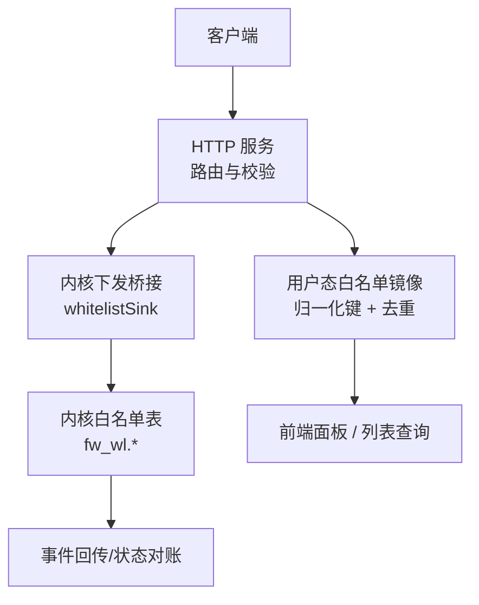
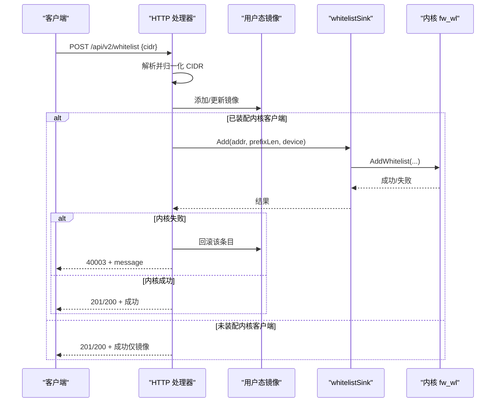
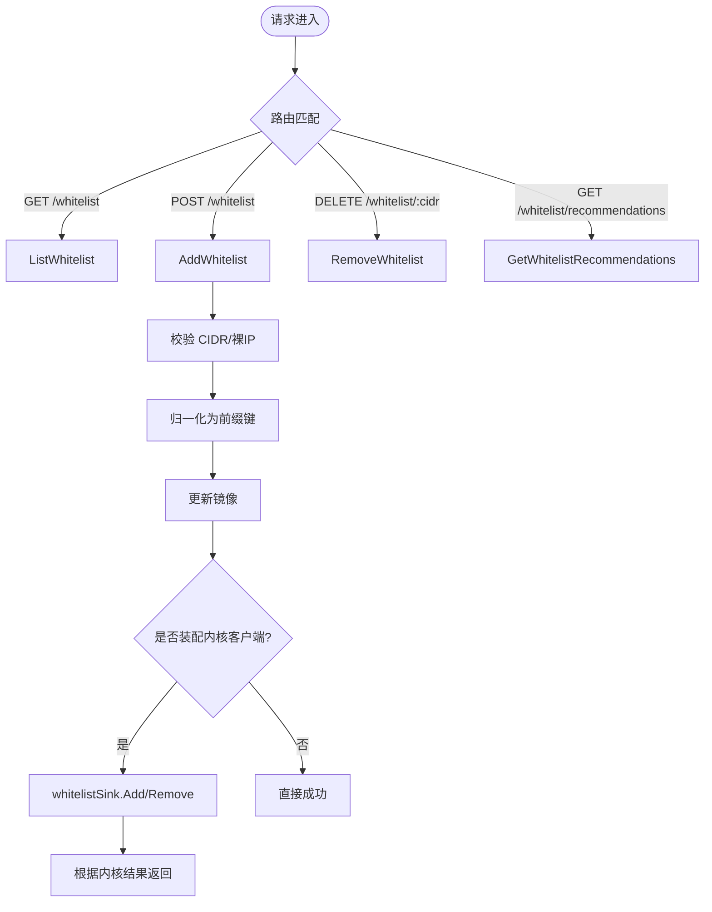
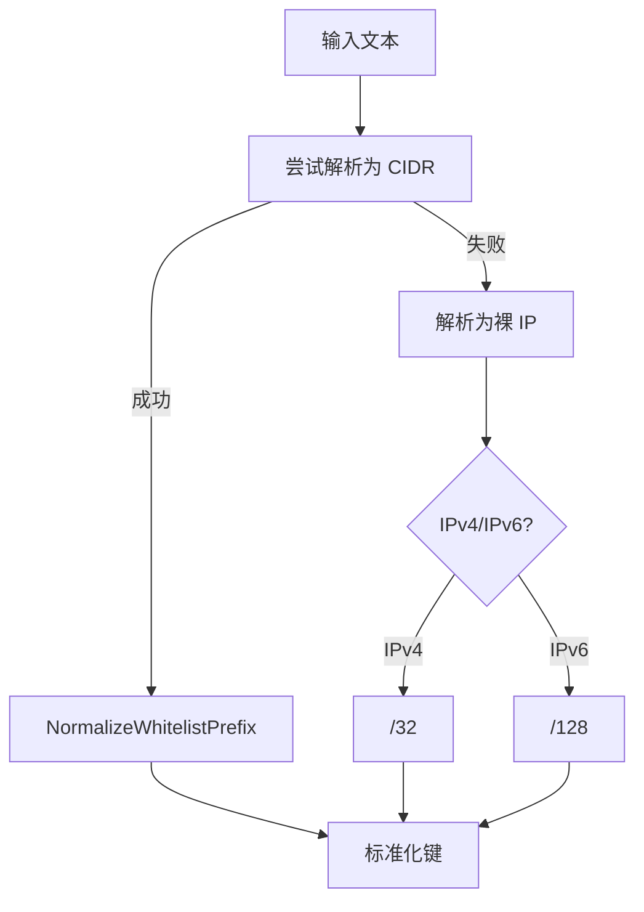
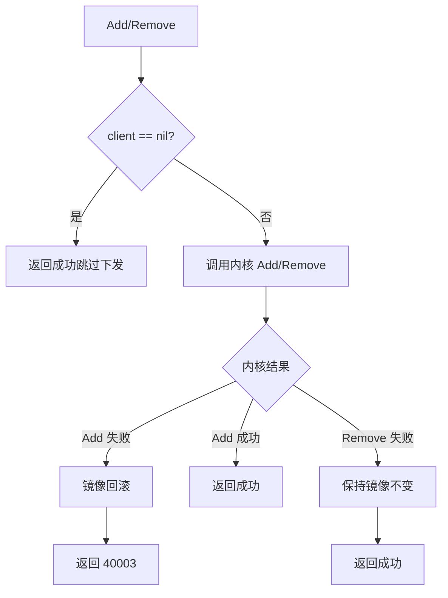
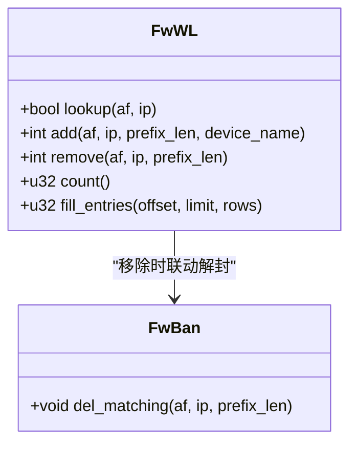
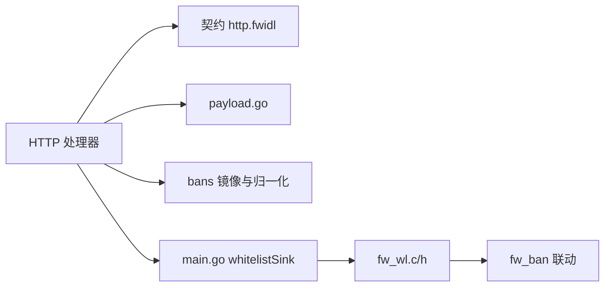

# 白名单API

<cite>
**本文引用的文件**   
- [http.fwidl](file://contract/http.fwidl)
- [payload.go](file://src/daemon/internal/http/payload.go)
- [routes.go](file://src/daemon/internal/http/routes.go)
- [recommendations.go](file://src/daemon/internal/http/recommendations.go)
- [whitelist_test.go](file://src/daemon/internal/http/whitelist_test.go)
- [main.go](file://src/daemon/cmd/firewall-daemon/main.go)
- [whitelist_prefix.go](file://src/daemon/internal/bans/whitelist_prefix.go)
- [cache_test.go](file://src/daemon/internal/bans/cache_test.go)
- [fw_wl.c](file://src/kernel-module/fw_wl.c)
- [fw_wl.h](file://src/kernel-module/fw_wl.h)
</cite>

## 目录
1. [简介](#简介)
2. [项目结构](#项目结构)
3. [核心组件](#核心组件)
4. [架构总览](#架构总览)
5. [详细组件分析](#详细组件分析)
6. [依赖关系分析](#依赖关系分析)
7. [性能与缓存策略](#性能与缓存策略)
8. [故障排查指南](#故障排查指南)
9. [结论](#结论)
10. [附录：API契约与使用示例](#附录api契约与使用示例)

## 简介
本文件面向“白名单”能力，覆盖以下目标：
- 白名单的增删改查接口、CIDR 与裸 IP 支持、推荐功能。
- 白名单优先级、与封禁规则的冲突解决、内核同步机制。
- 导入导出、批量操作、验证规则。
- 镜像缓存策略、性能优化、扩展性设计。
- 使用示例与最佳实践。

白名单用于放行特定地址或网段，命中时绕过封禁判定；当白名单与封禁同时存在时，白名单优先。内核侧通过哈希桶加子网链表实现高效匹配，用户态守护进程维护镜像表并负责与内核同步。

## 项目结构
与白名单相关的代码分布在三层：
- 契约层：HTTP API 路由、请求/响应类型定义。
- 守护进程层：HTTP 处理器、镜像缓存、内核下发桥接、推荐逻辑。
- 内核模块层：白名单数据结构、查找/添加/移除、与封禁联动。

图表来源
- [http.fwidl:620-654](file://contract/http.fwidl#L620-L654)
- [main.go:690-764](file://src/daemon/cmd/firewall-daemon/main.go#L690-L764)
- [fw_wl.c:114-244](file://src/kernel-module/fw_wl.c#L114-L244)

章节来源
- [http.fwidl:620-654](file://contract/http.fwidl#L620-L654)
- [routes.go:133-139](file://src/daemon/internal/http/routes.go#L133-L139)
- [main.go:690-764](file://src/daemon/cmd/firewall-daemon/main.go#L690-L764)
- [fw_wl.c:114-244](file://src/kernel-module/fw_wl.c#L114-L244)

## 核心组件
- HTTP 契约与路由：定义白名单列表、新增、删除、推荐等端点及错误码。
- 请求/响应载荷：CreateWhitelistRequest、WhitelistOperationResponse 等。
- 用户态镜像：统一 CIDR 键归一化、去重、包含判断。
- 内核下发桥接：whitelistSink 封装 Add/Remove，缺失内核客户端时不报错。
- 内核白名单表：精确桶 + 子网链表，RCU 读路径，容量上限，与封禁联动。
- 推荐器：基于封禁历史生成可加入白名单的建议条目。

章节来源
- [http.fwidl:620-654](file://contract/http.fwidl#L620-L654)
- [payload.go:115-123](file://src/daemon/internal/http/payload.go#L115-L123)
- [whitelist_prefix.go:11-41](file://src/daemon/internal/bans/whitelist_prefix.go#L11-L41)
- [main.go:690-764](file://src/daemon/cmd/firewall-daemon/main.go#L690-L764)
- [fw_wl.c:1-311](file://src/kernel-module/fw_wl.c#L1-L311)
- [recommendations.go:33-44](file://src/daemon/internal/http/recommendations.go#L33-L44)

## 架构总览
白名单写入流程（新增）：
- 客户端 POST /api/v2/whitelist，携带 CIDR 或裸 IP。
- HTTP 层解析并归一化为标准前缀键。
- 更新用户态镜像；若配置了内核客户端，则调用 whitelistSink.Add 下发。
- 内核 fw_wl_add 去重、检查容量、插入精确桶或子网链表。
- 若内核拒绝，HTTP 层回滚镜像，返回业务错误码。

图表来源
- [whitelist_test.go:97-149](file://src/daemon/internal/http/whitelist_test.go#L97-L149)
- [main.go:702-711](file://src/daemon/cmd/firewall-daemon/main.go#L702-L711)
- [fw_wl.c:157-210](file://src/kernel-module/fw_wl.c#L157-L210)

## 详细组件分析

### HTTP 白名单接口
- GET /api/v2/whitelist：返回 WhitelistEntryResponse 数组。
- POST /api/v2/whitelist：创建白名单，请求体 CreateWhitelistRequest{cidr}，成功返回 201 或 200，错误码 40003/40007/40008。
- DELETE /api/v2/whitelist/:cidr：删除白名单，成功返回 200，错误码 40004。
- GET /api/v2/whitelist/recommendations：返回 WhitelistRecommendation 数组，参数 min_bans、limit。

图表来源
- [http.fwidl:620-654](file://contract/http.fwidl#L620-L654)
- [routes.go:133-139](file://src/daemon/internal/http/routes.go#L133-L139)
- [payload.go:115-123](file://src/daemon/internal/http/payload.go#L115-L123)

章节来源
- [http.fwidl:620-654](file://contract/http.fwidl#L620-L654)
- [routes.go:133-139](file://src/daemon/internal/http/routes.go#L133-L139)
- [payload.go:115-123](file://src/daemon/internal/http/payload.go#L115-L123)

### CIDR 与键归一化
- 输入支持 CIDR 与裸 IP；裸 IP 自动补全为 /32（IPv4）或 /128（IPv6）。
- IPv4 映射写法 ::ffff:x.x.x.x/128 被归一化为 x.x.x.x/32，避免镜像与内核键不一致。
- 所有键在镜像中按网络地址掩码后存储，确保同一子网只有一条记录。

图表来源
- [whitelist_prefix.go:11-41](file://src/daemon/internal/bans/whitelist_prefix.go#L11-L41)
- [cache_test.go:212-277](file://src/daemon/internal/bans/cache_test.go#L212-L277)

章节来源
- [whitelist_prefix.go:11-41](file://src/daemon/internal/bans/whitelist_prefix.go#L11-L41)
- [cache_test.go:212-277](file://src/daemon/internal/bans/cache_test.go#L212-L277)

### 内核同步与回滚策略
- whitelistSink.Add/Remove：若内核客户端未装配，直接返回成功（不视为失败），保持镜像一致。
- 新增失败回滚：内核拒绝时，HTTP 层从镜像撤回该条目，返回 40003，message 说明失败原因。
- 删除失败不回滚：删除时即使内核拒绝，仍视为成功，避免重复塞回镜像。

图表来源
- [main.go:702-721](file://src/daemon/cmd/firewall-daemon/main.go#L702-L721)
- [whitelist_test.go:128-149](file://src/daemon/internal/http/whitelist_test.go#L128-L149)
- [whitelist_test.go:202-226](file://src/daemon/internal/http/whitelist_test.go#L202-L226)

章节来源
- [main.go:702-721](file://src/daemon/cmd/firewall-daemon/main.go#L702-L721)
- [whitelist_test.go:128-149](file://src/daemon/internal/http/whitelist_test.go#L128-L149)
- [whitelist_test.go:202-226](file://src/daemon/internal/http/whitelist_test.go#L202-L226)

### 内核白名单数据结构与优先级
- 数据结构：精确桶（prefix_len 等于地址族全长）+ 子网链表（前缀 < 全长）。
- 热路径查找 fw_wl_lookup：先查精确桶，再遍历子网链表，命中即放行。
- 容量上限：由模块参数控制，超过返回 -ENOSPC，用户态收到对应错误码。
- 与封禁联动：白名单新增/移除会触发 fw_ban_del_matching，使落在白名单覆盖范围内的封禁解除。

图表来源
- [fw_wl.h:17-38](file://src/kernel-module/fw_wl.h#L17-L38)
- [fw_wl.c:114-244](file://src/kernel-module/fw_wl.c#L114-L244)

章节来源
- [fw_wl.h:17-38](file://src/kernel-module/fw_wl.h#L17-L38)
- [fw_wl.c:114-244](file://src/kernel-module/fw_wl.c#L114-L244)

### 推荐功能
- 端点：GET /api/v2/whitelist/recommendations。
- 参数：min_bans（最小封禁次数阈值，默认 5）、limit（条数上限，默认 20，最大 100）。
- 返回：WhitelistRecommendation 数组；无推荐时返回空数组而非 null。
- 数据源：基于封禁历史分析，生成建议加入白名单的地址或网段。

章节来源
- [http.fwidl:647-654](file://contract/http.fwidl#L647-L654)
- [recommendations.go:33-44](file://src/daemon/internal/http/recommendations.go#L33-L44)

### 导入导出与批量操作
- 导出：通过 GET /api/v2/whitelist 获取当前白名单条目数组，可用于外部系统导入。
- 导入：将导出的 CIDR 列表逐条调用 POST /api/v2/whitelist 进行批量添加。
- 批量行为：每条请求独立处理；单条失败不影响其余条目。
- 注意：CIDR 中的 “/” 需要在 URL 中编码（例如 %2F），以避免路由解析错误。

章节来源
- [http.fwidl:620-654](file://contract/http.fwidl#L620-L654)
- [whitelist_test.go:213-215](file://src/daemon/internal/http/whitelist_test.go#L213-L215)

### 验证规则
- CIDR 合法性：非法 CIDR 返回 40003。
- 重复添加：已在表中时返回 40003，且不会再次下发内核。
- 裸 IP：自动补全为 /32 或 /128。
- IPv4 映射归一化：::ffff:x.x.x.x/128 转为 x.x.x.x/32。
- 主机位归一化：存入镜像时使用网络地址掩码后的键，避免同网段多条记录。

章节来源
- [whitelist_test.go:261-272](file://src/daemon/internal/http/whitelist_test.go#L261-L272)
- [whitelist_test.go:152-167](file://src/daemon/internal/http/whitelist_test.go#L152-L167)
- [whitelist_test.go:169-200](file://src/daemon/internal/http/whitelist_test.go#L169-L200)
- [cache_test.go:212-277](file://src/daemon/internal/bans/cache_test.go#L212-L277)

## 依赖关系分析
- HTTP 层依赖契约定义与载荷类型。
- HTTP 层依赖 bans 包进行 CIDR 归一化与镜像管理。
- HTTP 层依赖 main.go 中的 whitelistSink 作为内核下发出口。
- 内核模块 fw_wl 提供白名单核心能力，并与 fw_ban 联动。

图表来源
- [http.fwidl:620-654](file://contract/http.fwidl#L620-L654)
- [payload.go:115-123](file://src/daemon/internal/http/payload.go#L115-L123)
- [main.go:690-764](file://src/daemon/cmd/firewall-daemon/main.go#L690-L764)
- [fw_wl.c:1-311](file://src/kernel-module/fw_wl.c#L1-L311)

章节来源
- [http.fwidl:620-654](file://contract/http.fwidl#L620-L654)
- [payload.go:115-123](file://src/daemon/internal/http/payload.go#L115-L123)
- [main.go:690-764](file://src/daemon/cmd/firewall-daemon/main.go#L690-L764)
- [fw_wl.c:1-311](file://src/kernel-module/fw_wl.c#L1-L311)

## 性能与缓存策略
- 内核热路径：fw_wl_lookup 使用 RCU 读锁，先查精确桶 O(1)，再遍历子网链表，整体高效。
- 容量限制：fw_max_whitelist_entries 限制白名单条目数量，防止内存膨胀。
- 用户态镜像：按归一化键去重，避免重复条目；Contains 使用掩码后前缀判断，保证一致性。
- 推荐查询：服务端按 pps 降序排序，前端可直接渲染，减少前端计算负担。

章节来源
- [fw_wl.c:114-147](file://src/kernel-module/fw_wl.c#L114-L147)
- [fw_wl.c:157-210](file://src/kernel-module/fw_wl.c#L157-L210)
- [cache_test.go:212-277](file://src/daemon/internal/bans/cache_test.go#L212-L277)

## 故障排查指南
- 新增失败（40003）：
  - 检查 CIDR 是否合法。
  - 检查是否重复添加。
  - 检查内核容量是否已满。
  - 查看 message 字段以区分失败原因。
- 删除失败（40004）：
  - 确认 CIDR 是否存在于镜像与内核。
  - 注意 URL 中 “/” 需编码。
- 内核客户端未装配：
  - 白名单操作仍成功，但仅更新镜像；面板显示规则但内核未生效。
  - 检查模块加载与 netlink 链路。
- 推荐为空：
  - 调整 min_bans 阈值或扩大 limit。
  - 检查封禁历史是否充足。

章节来源
- [whitelist_test.go:128-149](file://src/daemon/internal/http/whitelist_test.go#L128-L149)
- [whitelist_test.go:246-259](file://src/daemon/internal/http/whitelist_test.go#L246-L259)
- [http.fwidl:620-654](file://contract/http.fwidl#L620-L654)

## 结论
白名单 API 提供了完整的增删改查与推荐能力，支持 CIDR 与裸 IP，具备严格的键归一化与去重机制。内核侧采用高效的数据结构与 RCU 读路径，保障高吞吐下的低延迟。用户态镜像与内核同步遵循“新增失败回滚、删除失败不回滚”的策略，确保面板与内核状态一致。推荐功能基于封禁历史，帮助运维快速识别应放行的地址或网段。

## 附录：API契约与使用示例

### 接口定义
- GET /api/v2/whitelist
  - 返回：WhitelistEntryResponse[]
- POST /api/v2/whitelist
  - 请求体：CreateWhitelistRequest{cidr}
  - 成功：201 或 200
  - 错误：40003/40007/40008
- DELETE /api/v2/whitelist/:cidr
  - 成功：200
  - 错误：40004
- GET /api/v2/whitelist/recommendations
  - 参数：min_bans、limit
  - 返回：WhitelistRecommendation[]

章节来源
- [http.fwidl:620-654](file://contract/http.fwidl#L620-L654)
- [payload.go:115-123](file://src/daemon/internal/http/payload.go#L115-L123)

### 使用示例
- 新增白名单
  - 请求：POST /api/v2/whitelist {"cidr":"192.0.2.0/24"}
  - 成功：201/200
  - 失败：40003（非法 CIDR、重复、内核拒绝）
- 删除白名单
  - 请求：DELETE /api/v2/whitelist/192.0.2.0%2F24
  - 成功：200
  - 失败：40004（不存在）
- 获取推荐
  - 请求：GET /api/v2/whitelist/recommendations?min_bans=10&limit=50
  - 返回：WhitelistRecommendation[]

章节来源
- [whitelist_test.go:97-149](file://src/daemon/internal/http/whitelist_test.go#L97-L149)
- [whitelist_test.go:213-226](file://src/daemon/internal/http/whitelist_test.go#L213-L226)
- [http.fwidl:647-654](file://contract/http.fwidl#L647-L654)