# 统计分析API

<cite>
**本文引用的文件**   
- [routes.go](file://src/daemon/internal/http/routes.go)
- [stats.go](file://src/daemon/internal/http/stats.go)
- [snapshot.go](file://src/daemon/internal/http/snapshot.go)
- [analysis.go](file://src/daemon/internal/http/analysis.go)
- [risk.go](file://src/daemon/internal/http/risk.go)
- [threat_feeds.go](file://src/daemon/internal/http/threat_feeds.go)
- [recommendations.go](file://src/daemon/internal/http/recommendations.go)
- [query.go](file://src/daemon/internal/http/query.go)
- [detection.go](file://src/daemon/internal/analysis/detection.go)
- [prediction.go](file://src/daemon/internal/analysis/prediction.go)
- [rate_history.go](file://src/daemon/internal/telemetry/rate_history.go)
- [db.go](file://src/daemon/internal/persist/db.go)
- [history.go](file://src/daemon/internal/persist/history.go)
- [firewall-dashboard.json](file://grafana/firewall-dashboard.json)
</cite>

## 目录
1. [引言](#引言)
2. [项目结构](#项目结构)
3. [核心组件](#核心组件)
4. [架构总览](#架构总览)
5. [详细组件分析](#详细组件分析)
6. [依赖关系分析](#依赖关系分析)
7. [性能与优化](#性能与优化)
8. [故障排查指南](#故障排查指南)
9. [结论](#结论)
10. [附录：端点清单与数据口径](#附录端点清单与数据口径)

## 引言
本文件面向“统计分析API”的完整技术文档，覆盖实时速率、历史数据、攻击分析、风险评分、威胁情报等统计面端点。重点说明：
- 各类统计数据的时间窗口、聚合方式与精度要求
- 异常检测算法、预测模型与协同攻击识别
- 地理分布与网络分布（通过历史库与风险向量体现）
- 数据持久化策略、查询优化与缓存机制
- 数据分析示例与可视化集成方案（含 Grafana 面板）

## 项目结构
统计分析能力由 HTTP 层路由与处理器组合多个子系统构成：
- HTTP 路由注册与认证封装
- 内核快照读数（速率、协议分布、Top-N、异常）
- 历史库查询（封禁活动、信誉、风险向量、事件）
- 分析引擎（周期性攻击、协同攻击、预测）
- 威胁情报源管理
- 推荐与白名单建议
- 持久化数据库（SQLite）与清理调度

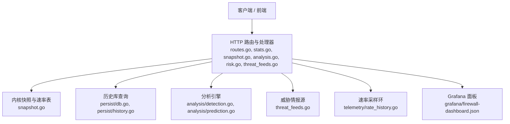

**图表来源**
- [routes.go:79-233](file://src/daemon/internal/http/routes.go#L79-L233)
- [stats.go:50-88](file://src/daemon/internal/http/stats.go#L50-L88)
- [snapshot.go:28-34](file://src/daemon/internal/http/snapshot.go#L28-L34)
- [analysis.go:49-74](file://src/daemon/internal/http/analysis.go#L49-L74)
- [risk.go:11-55](file://src/daemon/internal/http/risk.go#L11-L55)
- [threat_feeds.go:45-74](file://src/daemon/internal/http/threat_feeds.go#L45-L74)
- [rate_history.go:21-48](file://src/daemon/internal/telemetry/rate_history.go#L21-L48)
- [firewall-dashboard.json:1-176](file://grafana/firewall-dashboard.json#L1-L176)

**章节来源**
- [routes.go:79-233](file://src/daemon/internal/http/routes.go#L79-L233)

## 核心组件
- HTTP 路由与处理器：统一认证、错误封装、参数解析、分页与排序
- 内核快照读取：提供当前速率、协议分布、端口扫描与服务探测、TTL/分片统计
- 历史库访问：封禁事件、信誉、风险向量、攻击事件、频繁封禁
- 分析引擎：周期性攻击检测、协同攻击检测、攻击预测、Jail 趋势
- 威胁情报源：配置、同步状态、条目计数、错误信息
- 速率采样环：守护进程侧固定容量环形缓冲，供历史与异常检测共用
- 持久化：SQLite，WAL 模式，索引优化，自动迁移与过期清理

**章节来源**
- [routes.go:235-301](file://src/daemon/internal/http/routes.go#L235-L301)
- [snapshot.go:28-34](file://src/daemon/internal/http/snapshot.go#L28-L34)
- [db.go:23-65](file://src/daemon/internal/persist/db.go#L23-L65)
- [rate_history.go:50-62](file://src/daemon/internal/telemetry/rate_history.go#L50-L62)

## 架构总览
统计分析API采用“快照+历史+分析”的分层架构：
- 实时层：从内核快照直接取数，保证同一轮刷新的一致性
- 历史层：基于 SQLite 的封禁事件、信誉、风险向量等表进行聚合
- 分析层：在历史与快照基础上做异常检测、周期性与协同攻击识别、预测
- 外部集成：SSE 事件流、Prometheus 指标、Grafana 面板

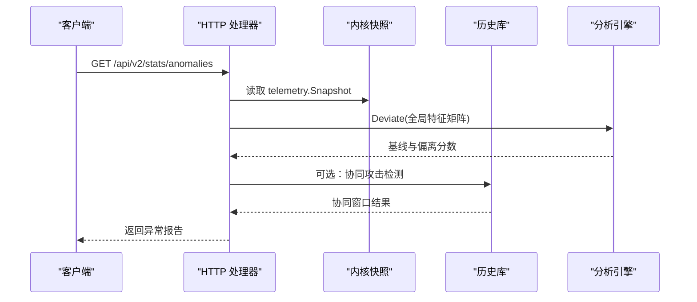

**图表来源**
- [snapshot.go:218-252](file://src/daemon/internal/http/snapshot.go#L218-L252)
- [detection.go:150-238](file://src/daemon/internal/analysis/detection.go#L150-L238)
- [analysis.go:184-196](file://src/daemon/internal/http/analysis.go#L184-L196)

## 详细组件分析

### 实时速率与窗口
- 实时速率：GET /api/v2/rates/current
  - 数据源：内核速率表；按 pps 降序输出，跳过未知地址族
  - 时间窗口：无（瞬时快照）
  - 精度：整数 pps/bps（平滑值四舍五入）
- 多窗口 EWMA：GET /api/v2/rates/windows
  - 三档窗口：5s/60s/300s
  - 数据源：守护进程侧派生（内核不暴露窗口）
  - 精度：整数 pps/bps（四舍五入）
- 速率历史：GET /api/v2/rates/history
  - 数据源：守护进程侧 RateHistory 环（默认 720 条 ≈ 1 小时）
  - 采样间隔：约 5 秒（事件泵每 5 秒查询一次）
  - 用途：异常检测基线、历史折线图

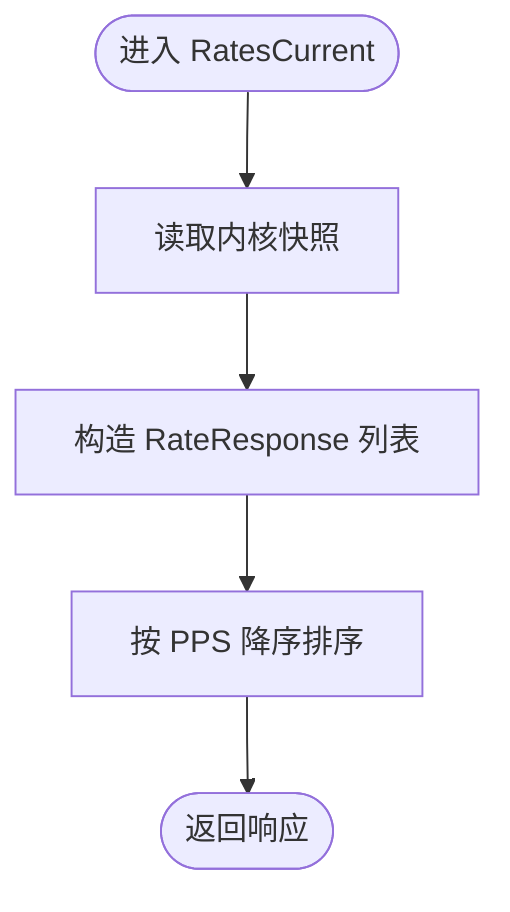

**图表来源**
- [snapshot.go:28-73](file://src/daemon/internal/http/snapshot.go#L28-L73)

**章节来源**
- [snapshot.go:28-97](file://src/daemon/internal/http/snapshot.go#L28-L97)
- [rate_history.go:21-48](file://src/daemon/internal/telemetry/rate_history.go#L21-L48)
- [rate_history.go:72-108](file://src/daemon/internal/telemetry/rate_history.go#L72-L108)

### 统计总览与威胁等级
- 总览：GET /api/v2/stats
  - 数据来源：
    - 内核快照：current_bans、total_bans、packets_*、whitelist_count
    - 历史库：today_bans、ban_trend、heatmap
    - 守护进程累计：failed_attempts、ddos_events、uptime_seconds
  - 威胁等级：三路信号取最大值（速率倍数、封禁表占用率、近 5 分钟新增封禁）
  - 时间窗口：
    - 今日自然日（本地时区 00:00 起）
    - 近 5 分钟封禁
    - 趋势图回溯 7 个自然日
- 热力图：GET /api/v2/stats/heatmap
  - 按 hour-of-day 归并到 24 个桶，缺小时占位为 0

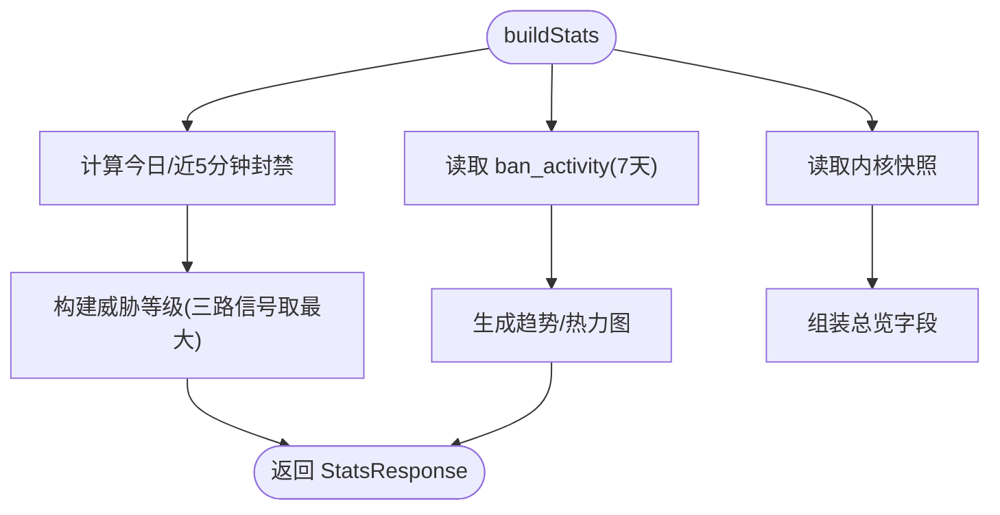

**图表来源**
- [stats.go:50-88](file://src/daemon/internal/http/stats.go#L50-L88)
- [stats.go:316-372](file://src/daemon/internal/http/stats.go#L316-L372)

**章节来源**
- [stats.go:30-42](file://src/daemon/internal/http/stats.go#L30-L42)
- [stats.go:50-88](file://src/daemon/internal/http/stats.go#L50-L88)
- [stats.go:115-169](file://src/daemon/internal/http/stats.go#L115-L169)
- [stats.go:171-237](file://src/daemon/internal/http/stats.go#L171-L237)
- [stats.go:316-372](file://src/daemon/internal/http/stats.go#L316-L372)

### 协议与流量分布
- 包长分布：GET /api/v2/stats/packet-sizes
- TTL 分布：GET /api/v2/stats/ttl-distribution
- IP 分片占比：GET /api/v2/stats/ip-fragments
- UDP 端口分布：GET /api/v2/stats/udp-ports
- ICMP 类型分布：GET /api/v2/stats/icmp-types
- 端口扫描者：GET /api/v2/stats/port-scanners
- 服务探测者：GET /api/v2/stats/service-probes
- 说明：
  - 直方图为自模块加载起的累计计数，不是时间窗口
  - UDP/ICMP 行可能被截断（容量有限），契约已标注缺陷

**章节来源**
- [snapshot.go:99-186](file://src/daemon/internal/http/snapshot.go#L99-L186)

### 异常检测
- 全局异常：基于速率历史环的特征矩阵（9 维：pps/bps/各协议 pps/tracked_ips）
  - 样本不足时 global_features 为 null，基线与维度为空数组
- per-IP 异常：基于当前速率表的横向比较（特征包含比例列）
  - 过滤低分与未知地址族，按分数降序输出，限制 MaxIPAnomalies

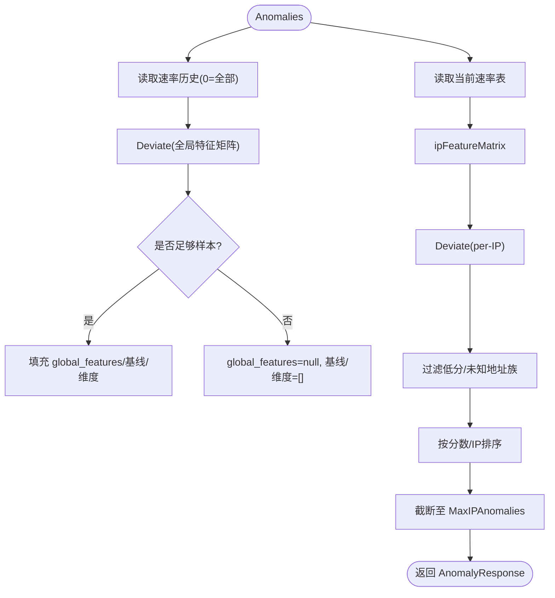

**图表来源**
- [snapshot.go:218-339](file://src/daemon/internal/http/snapshot.go#L218-L339)

**章节来源**
- [snapshot.go:218-339](file://src/daemon/internal/http/snapshot.go#L218-L339)

### 攻击分析与综合
- 综合分析摘要：GET /api/v2/analysis/summary
  - 复用威胁等级、活跃攻击数、异常数、协同攻击数
  - 生成可读总结文案
- 单 IP 综合分析：GET /api/v2/analysis/ip/{ip}
  - 风险向量、封禁历史、信誉、预测、白名单在场
  - 预测仅对“有周期性证据”的地址产出

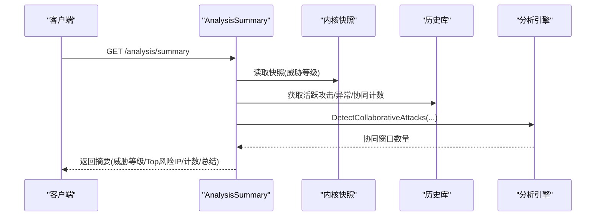

**图表来源**
- [analysis.go:49-74](file://src/daemon/internal/http/analysis.go#L49-L74)
- [detection.go:150-238](file://src/daemon/internal/analysis/detection.go#L150-L238)

**章节来源**
- [analysis.go:49-104](file://src/daemon/internal/http/analysis.go#L49-L104)
- [analysis.go:168-215](file://src/daemon/internal/http/analysis.go#L168-L215)
- [analysis.go:217-318](file://src/daemon/internal/http/analysis.go#L217-L318)

### 风险评分与事件
- 风险向量：GET /api/v2/risk/vectors/:ip 与 /api/v2/risk/vectors
  - 七维向量：failure/ban/scan/bruteforce/ddos/geo/cluster
  - 总分 = 各维度之和（加法模型）
- 风险事件：GET /api/v2/risk/events/:ip
  - 最近 100 条，按时间降序

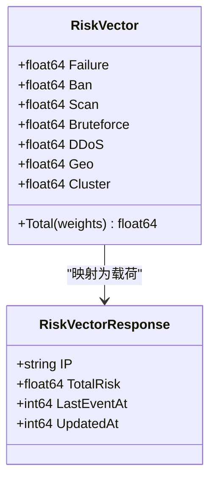

**图表来源**
- [risk.go:149-161](file://src/daemon/internal/http/risk.go#L149-L161)
- [types.go:44-93](file://src/daemon/internal/risk/types.go#L44-L93)

**章节来源**
- [risk.go:11-55](file://src/daemon/internal/http/risk.go#L11-L55)
- [risk.go:57-93](file://src/daemon/internal/http/risk.go#L57-L93)
- [risk.go:95-146](file://src/daemon/internal/http/risk.go#L95-L146)
- [types.go:44-93](file://src/daemon/internal/risk/types.go#L44-L93)

### 威胁情报
- 列表：GET /api/v2/threat-feeds
- 手动同步：POST /api/v2/threat-feeds/sync
- 详情：GET /api/v2/threat-feeds/{id}
- 字段：ID/名称/URL/启用/分类/置信度/最后同步/条目数/状态/错误

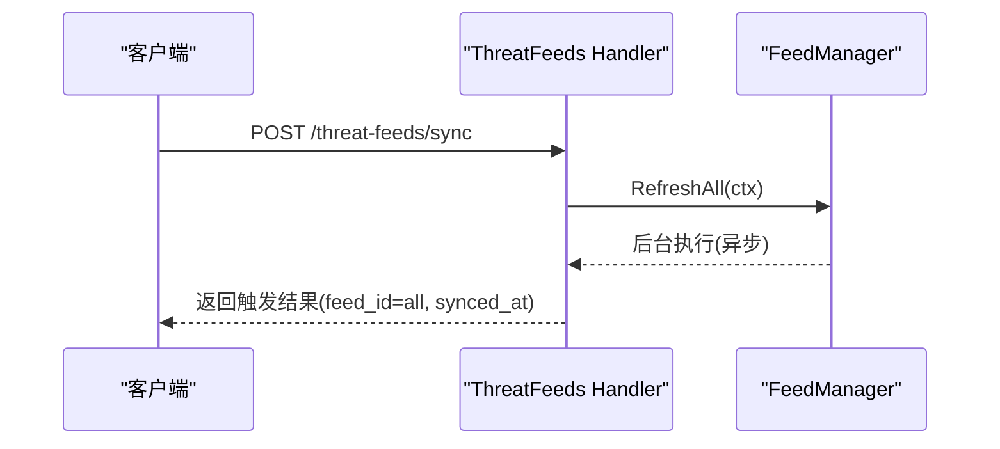

**图表来源**
- [threat_feeds.go:57-74](file://src/daemon/internal/http/threat_feeds.go#L57-L74)

**章节来源**
- [threat_feeds.go:45-98](file://src/daemon/internal/http/threat_feeds.go#L45-L98)
- [threat_feeds.go:100-136](file://src/daemon/internal/http/threat_feeds.go#L100-L136)

### 推荐与阈值建议
- 白名单推荐：GET /api/v2/whitelist/recommendations
  - 基于频繁临时封禁的 IP/子网聚合（IPv4 /24、IPv6 /48）
  - 置信度按样本量分档（≥50→90、≥20→70、≥10→50、其余 30）
- 封禁时长建议与阈值建议：由分析层提供（与风险引擎/阈值策略联动）

**章节来源**
- [recommendations.go:33-126](file://src/daemon/internal/http/recommendations.go#L33-L126)

### 历史数据与查询
- 历史库表：
  - ban_events：封禁事件（含 jail_name、banned_at、ban_count、is_permanent、duration_secs）
  - ip_reputation：IP 信誉（score、last_updated、last_failure、last_ban、total_failures、total_bans）
  - ban_history：封禁底账（累计次数、上次封禁/解封时间）
  - attack_events：攻击事件（event_type、increment、occurred_at）
  - ip_risk_vectors：多维风险向量（updated_at）
- 查询优化：
  - WAL 模式、同步级别 NORMAL、busy_timeout
  - 针对常用查询建索引（ip/jail/banned_at/created_at/score/updated_at）
- 过期清理：
  - 定时清理 ban_events、ip_reputation、ban_history、attack_events、ip_risk_vectors

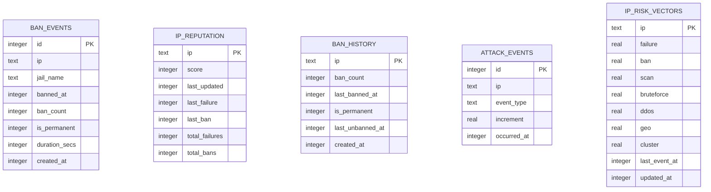

**图表来源**
- [db.go:71-144](file://src/daemon/internal/persist/db.go#L71-L144)

**章节来源**
- [db.go:23-65](file://src/daemon/internal/persist/db.go#L23-L65)
- [db.go:71-144](file://src/daemon/internal/persist/db.go#L71-L144)
- [db.go:283-351](file://src/daemon/internal/persist/db.go#L283-L351)
- [history.go:9-21](file://src/daemon/internal/persist/history.go#L9-L21)
- [history.go:42-65](file://src/daemon/internal/persist/history.go#L42-L65)

### 异常检测算法与预测模型
- 周期性攻击检测：
  - 输入：封禁事件时间戳序列
  - 指标：均值、标准差、变异系数 CV
  - 规则度：CV < 0.3 时 regularity = (1-CV)*100，否则 0
  - 输出：IP、jail、regularity、avg_interval、jitter、stddev、timestamps
- 协同攻击检测：
  - 滑动窗口内唯一 IP 数 ≥ minIPs（默认 3）
  - 强度按窗口内封禁事件数线性放大，上限 100
  - 每个 jail 只报第一个达标窗口
- 攻击预测：
  - 中位数周期 median_period
  - 下次攻击 next_attack_at = last_ban + median
  - 置信度 = regularity*0.6 + data_amount*0.4
  - 紧急度：imminent/soon/later/distant

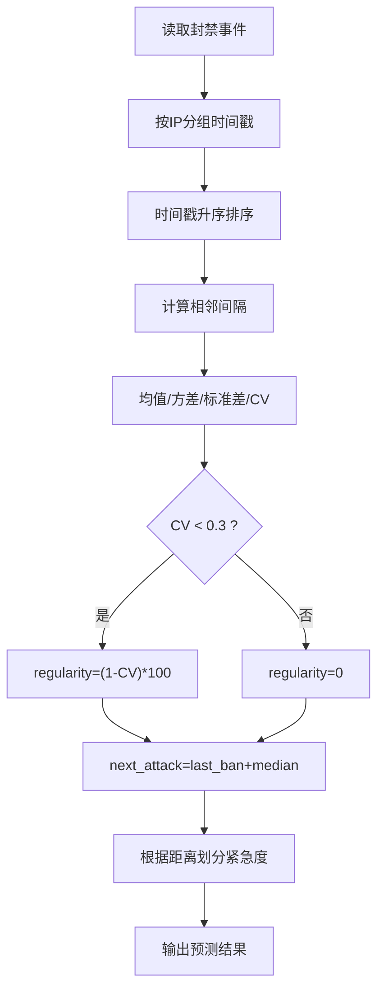

**图表来源**
- [prediction.go:47-186](file://src/daemon/internal/analysis/prediction.go#L47-L186)
- [detection.go:35-126](file://src/daemon/internal/analysis/detection.go#L35-L126)

**章节来源**
- [detection.go:35-126](file://src/daemon/internal/analysis/detection.go#L35-L126)
- [detection.go:150-238](file://src/daemon/internal/analysis/detection.go#L150-L238)
- [prediction.go:47-186](file://src/daemon/internal/analysis/prediction.go#L47-L186)

### 地理分布与网络分布
- 地理分布：通过风险向量的 geo 维度与 ip_reputation 中的地域相关字段体现
- 网络分布：通过 UDP/ICMP 端口与类型分布、端口扫描与服务探测 Top-N 体现
- 协同攻击：按 jail 与时间窗口的多源联动体现网络层面的协作行为

**章节来源**
- [snapshot.go:142-186](file://src/daemon/internal/http/snapshot.go#L142-L186)
- [risk.go:149-161](file://src/daemon/internal/http/risk.go#L149-L161)
- [detection.go:150-238](file://src/daemon/internal/analysis/detection.go#L150-L238)

## 依赖关系分析
- HTTP 层依赖：
  - 内核快照（telemetry.Snapshot）
  - 历史库（persist.DB）
  - 分析引擎（analysis.*）
  - 威胁情报（threatfeeds.FeedManager）
  - 速率采样环（telemetry.RateHistory）
- 耦合与内聚：
  - HTTP 层只做装配与降级处理，业务逻辑下沉至 analysis 与 risk 包
  - 历史库与内核快照解耦，避免强耦合导致不可用场景下的级联失败

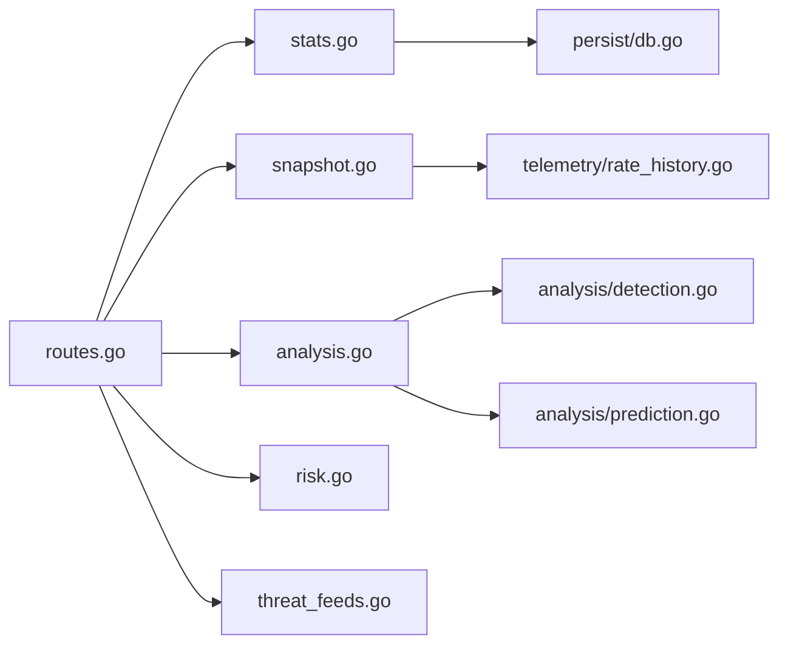

**图表来源**
- [routes.go:79-233](file://src/daemon/internal/http/routes.go#L79-L233)
- [stats.go:50-88](file://src/daemon/internal/http/stats.go#L50-L88)
- [snapshot.go:28-34](file://src/daemon/internal/http/snapshot.go#L28-L34)
- [analysis.go:49-74](file://src/daemon/internal/http/analysis.go#L49-L74)
- [risk.go:11-55](file://src/daemon/internal/http/risk.go#L11-L55)
- [threat_feeds.go:45-74](file://src/daemon/internal/http/threat_feeds.go#L45-L74)

**章节来源**
- [routes.go:79-233](file://src/daemon/internal/http/routes.go#L79-L233)

## 性能与优化
- 内核快照一致性：同一轮刷新的速率、协议分布与 Top-N 来自同一份快照，避免时间不一致
- 历史库优化：
  - WAL 模式、NORMAL 同步、busy_timeout
  - 常用查询建索引（ip/jail/banned_at/created_at/score/updated_at）
  - 定期清理过期数据
- 缓存机制：
  - 速率采样环：固定容量环形缓冲，避免无限增长
  - 统计窗口缓存：今日/近 5 分钟封禁计数缓存 30 秒，减少首屏 SQL 压力
- 前端轮询：
  - Grafana 面板默认 10 秒刷新，适合监控但不宜用于高频交互页面

**章节来源**
- [snapshot.go:1-15](file://src/daemon/internal/http/snapshot.go#L1-L15)
- [stats.go:30-42](file://src/daemon/internal/http/stats.go#L30-L42)
- [db.go:31-51](file://src/daemon/internal/persist/db.go#L31-L51)
- [db.go:283-351](file://src/daemon/internal/persist/db.go#L283-L351)
- [rate_history.go:21-48](file://src/daemon/internal/telemetry/rate_history.go#L21-L48)
- [firewall-dashboard.json:1-176](file://grafana/firewall-dashboard.json#L1-L176)

## 故障排查指南
- 历史库未初始化：
  - 现象：/analysis/*、/risk/*、/threat-feeds/* 返回服务不可用
  - 排查：确认 SQLite 路径、权限、WAL 模式、迁移是否成功
- 内核链路断开：
  - 现象：stats 读数陈旧但仍有值；新鲜度由 /health 链路字段判断
  - 排查：检查 netlink 通信、内核模块版本、健康探针
- 速率历史为空：
  - 现象：异常检测 global_features 为 null
  - 排查：确认事件泵是否正常写入 RateHistory，采样间隔是否为 5 秒
- 威胁情报同步失败：
  - 现象：sync_status=error，last_error 非空
  - 排查：检查源 URL、网络连通性、凭据与证书

**章节来源**
- [analysis.go:52-55](file://src/daemon/internal/http/analysis.go#L52-L55)
- [risk.go:14-18](file://src/daemon/internal/http/risk.go#L14-L18)
- [threat_feeds.go:47-51](file://src/daemon/internal/http/threat_feeds.go#L47-L51)
- [snapshot.go:1-15](file://src/daemon/internal/http/snapshot.go#L1-L15)

## 结论
统计分析API以“快照+历史+分析”的分层架构实现高一致性的实时与历史统计，结合异常检测、周期性与协同攻击识别、预测模型，以及威胁情报与风险评分，形成完整的网络安全观测与分析闭环。通过 SQLite 优化与缓存机制保障性能，配合 Grafana 面板提供直观的可视化支持。

## 附录：端点清单与数据口径

### 实时速率
- GET /api/v2/rates/current
  - 时间窗口：瞬时
  - 聚合：按源地址汇总 pps/bps/各协议 pps
  - 精度：整数 pps/bps
- GET /api/v2/rates/windows
  - 时间窗口：5s/60s/300s
  - 聚合：EWMA 平滑
  - 精度：整数 pps/bps
- GET /api/v2/rates/history
  - 时间窗口：≈1 小时（720 条 × 5 秒）
  - 聚合：逐点记录
  - 精度：原始采样值

**章节来源**
- [snapshot.go:28-97](file://src/daemon/internal/http/snapshot.go#L28-L97)
- [rate_history.go:21-48](file://src/daemon/internal/telemetry/rate_history.go#L21-L48)

### 历史数据
- GET /api/v2/stats
  - 时间窗口：今日自然日、近 5 分钟、7 天趋势
  - 聚合：内核快照 + 历史库 + 守护进程累计
  - 精度：整数计数、浮点比率
- GET /api/v2/stats/heatmap
  - 时间窗口：当日 24 小时
  - 聚合：hour-of-day 归并
  - 精度：整数计数

**章节来源**
- [stats.go:50-88](file://src/daemon/internal/http/stats.go#L50-L88)
- [stats.go:90-113](file://src/daemon/internal/http/stats.go#L90-L113)

### 攻击分析
- GET /api/v2/stats/anomalies
  - 时间窗口：全局基线（速率历史环）、per-IP 横向比较
  - 聚合：Deviate 异常检测
  - 精度：浮点分数
- GET /api/v2/stats/collaborative-attacks
  - 时间窗口：滑动窗口（默认 300 秒）
  - 聚合：唯一 IP 数 ≥ 3
  - 精度：整数计数、浮点强度
- GET /api/v2/stats/attack-predictions
  - 时间窗口：未来 24 小时
  - 聚合：中位数周期预测
  - 精度：时间戳、浮点置信度

**章节来源**
- [snapshot.go:218-339](file://src/daemon/internal/http/snapshot.go#L218-L339)
- [detection.go:150-238](file://src/daemon/internal/analysis/detection.go#L150-L238)
- [prediction.go:47-186](file://src/daemon/internal/analysis/prediction.go#L47-L186)

### 风险评分
- GET /api/v2/risk/vectors/:ip
- GET /api/v2/risk/vectors
- GET /api/v2/risk/events/:ip
  - 时间窗口：最近 100 条
  - 聚合：七维向量累加、事件时间倒序
  - 精度：浮点维度值、整数事件 ID

**章节来源**
- [risk.go:11-55](file://src/daemon/internal/http/risk.go#L11-L55)
- [risk.go:57-93](file://src/daemon/internal/http/risk.go#L57-L93)
- [risk.go:95-146](file://src/daemon/internal/http/risk.go#L95-L146)

### 威胁情报
- GET /api/v2/threat-feeds
- POST /api/v2/threat-feeds/sync
- GET /api/v2/threat-feeds/{id}
  - 时间窗口：最后同步时刻
  - 聚合：源配置 + 运行时统计
  - 精度：字符串/数值/布尔

**章节来源**
- [threat_feeds.go:45-98](file://src/daemon/internal/http/threat_feeds.go#L45-L98)
- [threat_feeds.go:100-136](file://src/daemon/internal/http/threat_feeds.go#L100-L136)

### 可视化集成
- Grafana 面板：firewall-dashboard.json
  - 指标：日志解析、正则命中、DDoS 事件、netlink 消息、内核拒绝指令、配置热重载
  - 刷新：10 秒
  - 目标：运维监控与告警

**章节来源**
- [firewall-dashboard.json:1-176](file://grafana/firewall-dashboard.json#L1-L176)