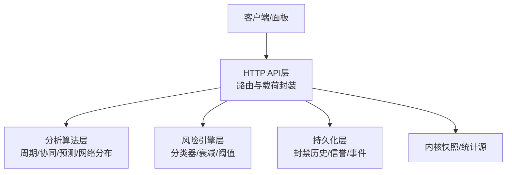
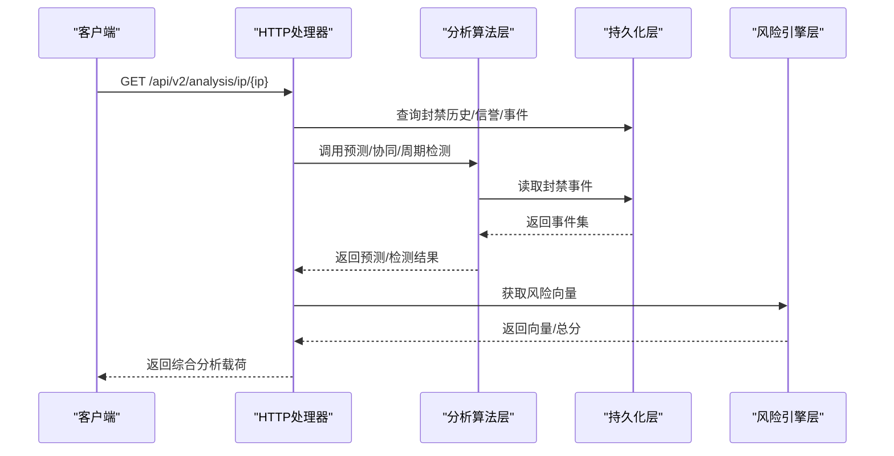
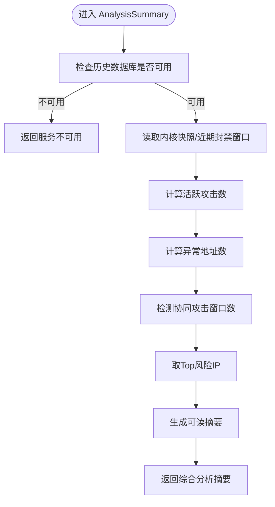
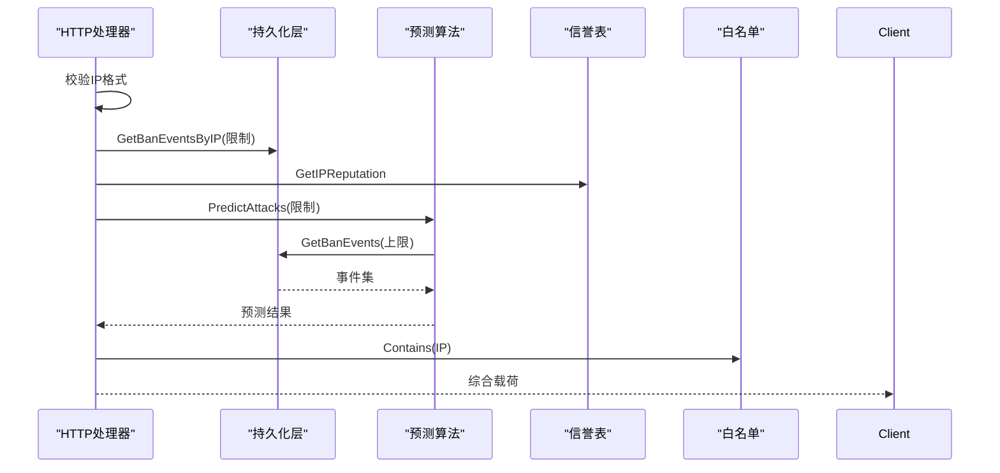
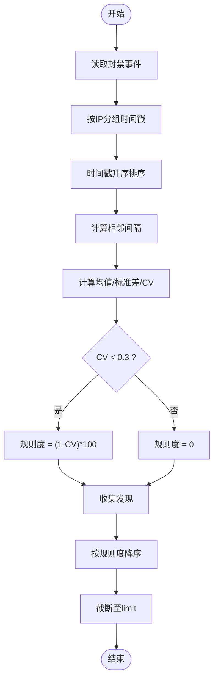
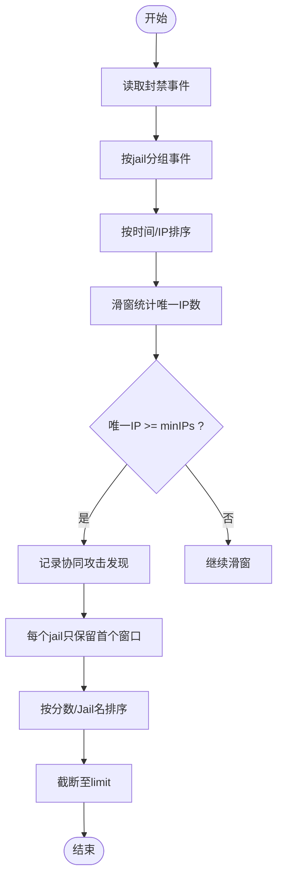
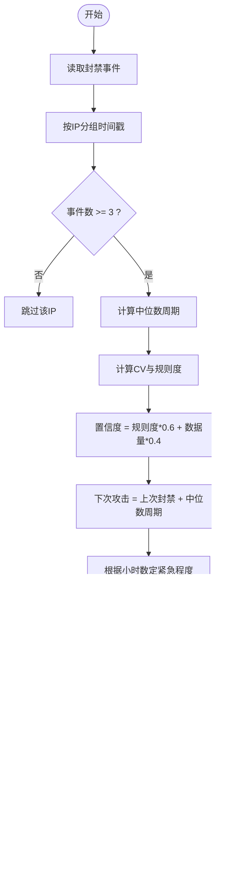
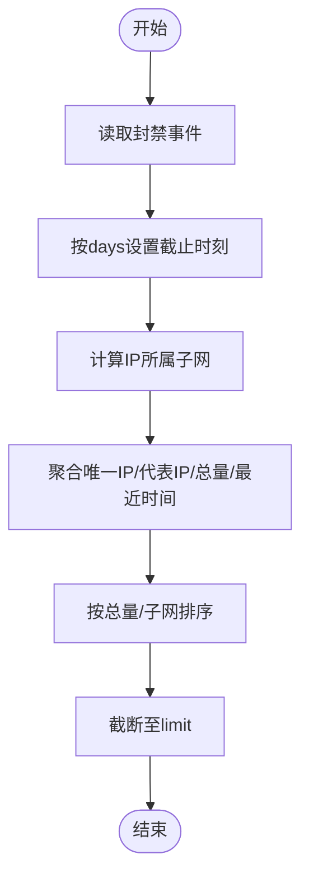
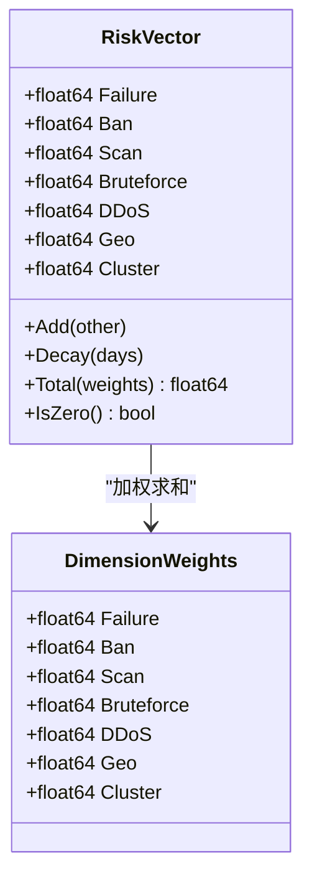
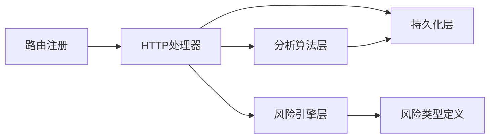

# 综合分析API

<cite>
**本文引用的文件**   
- [README.md](file://README.md)
- [routes.go](file://src/daemon/internal/http/routes.go)
- [analysis.go](file://src/daemon/internal/http/analysis.go)
- [risk.go](file://src/daemon/internal/http/risk.go)
- [detection.go](file://src/daemon/internal/analysis/detection.go)
- [prediction.go](file://src/daemon/internal/analysis/prediction.go)
- [network.go](file://src/daemon/internal/analysis/network.go)
- [classifier.go](file://src/daemon/internal/risk/classifier.go)
- [types.go](file://src/daemon/internal/risk/types.go)
- [history.go](file://src/daemon/internal/persist/history.go)
- [reputation.go](file://src/daemon/internal/persist/reputation.go)
</cite>

## 目录
1. [引言](#引言)
2. [项目结构](#项目结构)
3. [核心组件](#核心组件)
4. [架构总览](#架构总览)
5. [详细组件分析](#详细组件分析)
6. [依赖关系分析](#依赖关系分析)
7. [性能与扩展性](#性能与扩展性)
8. [故障排查指南](#故障排查指南)
9. [结论](#结论)
10. [附录：接口契约与数据模型](#附录接口契约与数据模型)

## 引言
本文件面向“综合分析API”，聚焦IP行为分析、攻击模式识别与风险评估。文档覆盖多维度风险评分、关联协同攻击检测、周期性攻击预测、网络分布聚合，以及分析报告生成与第三方系统集成方案。同时解释分析引擎架构、性能优化策略与扩展机制，帮助开发者与运维人员快速理解并安全使用这些能力。

## 项目结构
综合分析能力由三层协作完成：
- HTTP API层：暴露REST端点，统一认证、封装载荷、降级处理。
- 分析算法层：实现周期性攻击、协同攻击、网络分布、威胁预测等算法。
- 持久化与风险引擎层：SQLite历史库、多维风险向量、信誉系统、封禁历史。

图表来源
- [routes.go:79-233](file://src/daemon/internal/http/routes.go#L79-L233)
- [analysis.go:49-104](file://src/daemon/internal/http/analysis.go#L49-L104)
- [detection.go:35-126](file://src/daemon/internal/analysis/detection.go#L35-L126)
- [prediction.go:47-186](file://src/daemon/internal/analysis/prediction.go#L47-L186)
- [network.go:22-109](file://src/daemon/internal/analysis/network.go#L22-L109)
- [risk.go:11-55](file://src/daemon/internal/http/risk.go#L11-L55)
- [classifier.go:5-34](file://src/daemon/internal/risk/classifier.go#L5-L34)
- [types.go:44-93](file://src/daemon/internal/risk/types.go#L44-L93)

章节来源
- [README.md:10-31](file://README.md#L10-L31)
- [routes.go:79-233](file://src/daemon/internal/http/routes.go#L79-L233)

## 核心组件
- 综合分析摘要与单IP分析：提供威胁等级、活跃攻击数、异常地址数、协同攻击窗口数、Top风险IP、单IP风险向量、封禁历史、信誉、预测与白名单状态。
- 风险向量与事件：按维度（失败、封禁、扫描、爆破、DDoS、地域、集群）独立衰减与加权求和，支持事件溯源与重算。
- 周期性攻击检测：基于封禁时间序列的变异系数评估规律性，输出规则度、抖动、标准差与原始时刻。
- 协同攻击检测：在滑动窗口内统计唯一IP数量，判定多源联动，给出强度分数与参与IP列表。
- 攻击预测：对具备周期性证据的地址估计下次攻击时间、置信度与紧急程度，并按jail汇总趋势。
- 网络分布分析：按子网聚合封禁IP集合、代表IP、最近封禁时间与总量。

章节来源
- [analysis.go:17-47](file://src/daemon/internal/http/analysis.go#L17-L47)
- [risk.go:149-183](file://src/daemon/internal/http/risk.go#L149-L183)
- [detection.go:10-33](file://src/daemon/internal/analysis/detection.go#L10-L33)
- [prediction.go:11-45](file://src/daemon/internal/analysis/prediction.go#L11-L45)
- [network.go:13-20](file://src/daemon/internal/analysis/network.go#L13-L20)

## 架构总览
综合分析API的请求路径如下：
- 客户端发起REST请求到HTTP服务器。
- 路由层进行认证与参数校验。
- Handler调用分析算法或风险引擎。
- 分析层从持久化层读取历史事件，计算结果后返回给Handler。
- Handler将内部结构映射为契约载荷，统一包装成功响应。

图表来源
- [analysis.go:76-104](file://src/daemon/internal/http/analysis.go#L76-L104)
- [prediction.go:47-186](file://src/daemon/internal/analysis/prediction.go#L47-L186)
- [detection.go:150-238](file://src/daemon/internal/analysis/detection.go#L150-L238)
- [risk.go:14-55](file://src/daemon/internal/http/risk.go#L14-L55)

## 详细组件分析

### 综合分析摘要接口
- 功能：聚合威胁等级、活跃攻击数、异常地址数、协同攻击窗口数、Top风险IP、自然语言摘要与时间戳。
- 数据来源：
  - 威胁等级与活跃攻击数来自内核快照与统计子系统。
  - 异常地址数复用异常检测逻辑。
  - 协同攻击数通过协同攻击检测算法计算。
  - Top风险IP来自风险引擎的风险向量表。
- 降级策略：数据库未初始化时返回服务不可用；子系统缺失时字段为空数组或零值。

图表来源
- [analysis.go:49-74](file://src/daemon/internal/http/analysis.go#L49-L74)
- [analysis.go:168-215](file://src/daemon/internal/http/analysis.go#L168-L215)

章节来源
- [analysis.go:49-74](file://src/daemon/internal/http/analysis.go#L49-L74)
- [analysis.go:168-215](file://src/daemon/internal/http/analysis.go#L168-L215)

### 单IP综合分析接口
- 功能：返回指定IP的风险向量、封禁历史、信誉条目、攻击预测与白名单状态。
- 关键流程：
  - 解析并校验IP。
  - 从风险引擎取向量。
  - 从历史库取封禁事件（限制条数）。
  - 从信誉表取信誉条目。
  - 运行预测算法并筛选目标IP。
  - 查询全局白名单镜像判断是否被保护。

图表来源
- [analysis.go:76-104](file://src/daemon/internal/http/analysis.go#L76-L104)
- [analysis.go:235-318](file://src/daemon/internal/http/analysis.go#L235-L318)
- [prediction.go:47-186](file://src/daemon/internal/analysis/prediction.go#L47-L186)

章节来源
- [analysis.go:76-104](file://src/daemon/internal/http/analysis.go#L76-L104)
- [analysis.go:235-318](file://src/daemon/internal/http/analysis.go#L235-L318)

### 周期性攻击检测
- 输入：封禁事件集、最小事件数、结果上限、事件读取上限。
- 算法要点：
  - 对每个IP的时间戳排序，计算相邻间隔均值与标准差。
  - 变异系数CV=标准差/均值；当CV<0.3时，规则度=(1-CV)*100，否则为0。
  - 输出包含规则度、平均间隔、抖动、标准差、事件数与原始时间戳。
  - 按规则度降序排序并截断。

图表来源
- [detection.go:35-126](file://src/daemon/internal/analysis/detection.go#L35-L126)

章节来源
- [detection.go:35-126](file://src/daemon/internal/analysis/detection.go#L35-L126)

### 协同攻击检测
- 输入：窗口秒数、最小唯一IP数、结果上限、事件读取上限。
- 算法要点：
  - 按jail分组封禁事件，按时间+IP排序。
  - 滑窗统计窗口内唯一IP数，达到阈值即记录一次协同攻击。
  - 输出窗口起止时间、参与IP列表（最多固定数量）、唯一IP总数、封禁次数与强度分数。
  - 每个jail仅报告首个达标窗口，避免重复复制。

图表来源
- [detection.go:150-238](file://src/daemon/internal/analysis/detection.go#L150-L238)

章节来源
- [detection.go:150-238](file://src/daemon/internal/analysis/detection.go#L150-L238)

### 攻击预测与趋势
- 输入：预测结果上限。
- 算法要点：
  - 对每个IP至少3次封禁才参与预测。
  - 使用中位数周期估计下次攻击时间。
  - 置信度=规则度权重×0.6 + 数据量权重×0.4。
  - 紧急程度按距离下次攻击的小时数划分。
  - 按jail汇总近24h/7d封禁量，计算趋势（上升/下降/稳定），并附带未来24h预计再动手的攻击者数量。

图表来源
- [prediction.go:47-186](file://src/daemon/internal/analysis/prediction.go#L47-L186)
- [prediction.go:188-259](file://src/daemon/internal/analysis/prediction.go#L188-L259)

章节来源
- [prediction.go:47-186](file://src/daemon/internal/analysis/prediction.go#L47-L186)
- [prediction.go:188-259](file://src/daemon/internal/analysis/prediction.go#L188-L259)

### 网络分布分析
- 输入：天数窗口、结果上限。
- 算法要点：
  - 过滤过去days天的封禁事件。
  - 将IPv4归入/24子网，IPv6归入/48子网。
  - 聚合每个子网的唯一IP、代表IP（同频最高且文本较小者优先）、最近封禁时间与总量。
  - 按总量降序、子网字典序排序并截断。

图表来源
- [network.go:22-109](file://src/daemon/internal/analysis/network.go#L22-L109)
- [network.go:111-126](file://src/daemon/internal/analysis/network.go#L111-L126)

章节来源
- [network.go:22-109](file://src/daemon/internal/analysis/network.go#L22-L109)
- [network.go:111-126](file://src/daemon/internal/analysis/network.go#L111-L126)

### 风险向量与事件接口
- 功能：
  - 单个IP风险向量：返回七维向量与总分，若无记录则返回零向量。
  - 全量风险向量：按总分降序返回（默认限制100）。
  - IP攻击事件历史：最近100条，按时间降序。
- 风险向量维度：失败、封禁、扫描、爆破、DDoS、地域、集群；采用加法阈值模型，各维度独立衰减。

图表来源
- [types.go:44-93](file://src/daemon/internal/risk/types.go#L44-L93)
- [types.go:106-130](file://src/daemon/internal/risk/types.go#L106-L130)

章节来源
- [risk.go:11-55](file://src/daemon/internal/http/risk.go#L11-L55)
- [risk.go:57-93](file://src/daemon/internal/http/risk.go#L57-L93)
- [risk.go:95-146](file://src/daemon/internal/http/risk.go#L95-L146)
- [types.go:44-93](file://src/daemon/internal/risk/types.go#L44-L93)

### 事件分类器
- 功能：根据事件类型与负载信息，分类为失败、扫描、爆破、DDoS、地域、集群、封禁等，并返回对应向量增量。
- 典型规则：
  - 高频失败（count>10）→ 更高增量。
  - 端口扫描（ports>100）→ 高增量；目录遍历（含“..”或“%2e”）→ 中等增量。
  - 高频爆破（rate>100/min）→ 高增量。
  - 流量型DDoS（pps>10000）→ 高增量。
  - 境外访问→ 提升地域维度。
  - 与已知恶意IP关联→ 提升集群维度。
  - 永久封禁→ 提升封禁维度。

章节来源
- [classifier.go:5-34](file://src/daemon/internal/risk/classifier.go#L5-L34)
- [classifier.go:36-144](file://src/daemon/internal/risk/classifier.go#L36-L144)

## 依赖关系分析
- HTTP路由注册：所有综合分析相关端点在路由表中集中声明，统一受认证中间件保护。
- Handler依赖：
  - 历史数据库（persist.DB）用于读取封禁事件、信誉、风险向量。
  - 内核快照与统计源用于威胁等级与活跃攻击计数。
  - 威胁情报管理器（可选）用于情报相关端点。
- 分析层依赖：
  - 周期性/协同/预测/网络分布均依赖持久化层的封禁事件读取。
- 风险引擎依赖：
  - 分类器与向量类型定义位于risk包，供HTTP层与上层分析组合使用。

图表来源
- [routes.go:228-233](file://src/daemon/internal/http/routes.go#L228-L233)
- [analysis.go:49-104](file://src/daemon/internal/http/analysis.go#L49-L104)
- [detection.go:35-126](file://src/daemon/internal/analysis/detection.go#L35-L126)
- [prediction.go:47-186](file://src/daemon/internal/analysis/prediction.go#L47-L186)
- [network.go:22-109](file://src/daemon/internal/analysis/network.go#L22-L109)
- [types.go:44-93](file://src/daemon/internal/risk/types.go#L44-L93)

章节来源
- [routes.go:228-233](file://src/daemon/internal/http/routes.go#L228-L233)

## 性能与扩展性
- 性能优化
  - 批量读取封禁事件，限制最大读取条数（如10000），避免全表扫描。
  - 对结果集进行排序与截断，控制返回规模。
  - 使用滑动窗口与唯一集合去重，降低冗余计算。
  - 对Top-N风险IP显式排序后再截断，保证“top”语义正确。
- 扩展机制
  - 风险向量维度可配置权重，便于调优不同场景敏感度。
  - 分类器可按payload字段扩展规则（如新增协议特征、地理标签）。
  - 分析算法以函数形式暴露，便于替换或并行化。
  - HTTP层通过接口注入外部依赖（如内核快照、威胁情报），便于测试与替换。

[本节为通用指导，不直接分析具体文件]

## 故障排查指南
- 历史数据库未初始化
  - 现象：综合分析摘要与单IP分析返回服务不可用。
  - 原因：持久化层未装配或连接失败。
  - 处理：检查数据库初始化与连接配置。
- 风险引擎未启用
  - 现象：风险向量接口返回服务不可用。
  - 原因：风险引擎未启用或未装配。
  - 处理：确认风险引擎开关与依赖注入。
- 预测结果为空
  - 现象：单IP预测字段为null。
  - 原因：该IP缺乏周期性证据（事件数不足或CV过高）。
  - 处理：积累更多封禁事件或放宽预测条件。
- 协同攻击数为零
  - 现象：协同攻击窗口数为0。
  - 原因：窗口内唯一IP数未达到阈值。
  - 处理：调整窗口大小、最小IP数或事件上限。

章节来源
- [analysis.go:51-55](file://src/daemon/internal/http/analysis.go#L51-L55)
- [analysis.go:78-82](file://src/daemon/internal/http/analysis.go#L78-L82)
- [risk.go:14-18](file://src/daemon/internal/http/risk.go#L14-L18)

## 结论
综合分析API将内核态高速封禁与用户态智能判定有机结合，通过多维度风险向量、周期性/协同攻击检测、攻击预测与网络分布聚合，形成完整的IP行为分析与风险评估体系。其设计强调口径一致性、可观测性与可扩展性，既满足实时监控与面板展示需求，也为第三方系统集成与分析报告生成提供了稳定基础。

[本节为总结性内容，不直接分析具体文件]

## 附录：接口契约与数据模型

### 综合分析相关端点
- GET /api/v2/analysis/summary：综合分析摘要
- GET /api/v2/analysis/ip/{ip}：单IP综合分析
- GET /api/v2/stats/periodic-attackers：周期性攻击者
- GET /api/v2/stats/collaborative-attacks：协同攻击
- GET /api/v2/stats/attack-predictions：攻击预测
- GET /api/v2/stats/network-distribution：网络分布
- GET /api/v2/risk/vectors/:ip：单IP风险向量
- GET /api/v2/risk/vectors：全量风险向量
- GET /api/v2/risk/events/:ip：IP攻击事件历史

章节来源
- [routes.go:228-233](file://src/daemon/internal/http/routes.go#L228-L233)
- [routes.go:189-200](file://src/daemon/internal/http/routes.go#L189-L200)
- [routes.go:204-210](file://src/daemon/internal/http/routes.go#L204-L210)

### 核心数据结构
- 综合分析摘要响应：威胁等级、Top风险IP、活跃攻击数、异常地址数、协同攻击数、摘要文本、时间戳。
- 单IP综合分析响应：IP、风险向量、封禁历史、信誉、预测、白名单状态。
- 风险向量：七维向量与总分、最后事件时间、更新时间。
- 周期性攻击发现：IP、jail名、规则度、平均间隔、抖动、标准差、事件数、时间戳列表。
- 协同攻击发现：jail名、窗口起止、参与IP列表、唯一IP数、封禁次数、强度分数。
- 攻击预测：IP、jail名、下次攻击时间、上次封禁时间、置信度、紧急程度、事件数、中位周期。
- 网络分布：子网、唯一IP数、封禁总量、最近封禁时间、代表IP、IP列表。

章节来源
- [analysis.go:17-47](file://src/daemon/internal/http/analysis.go#L17-L47)
- [risk.go:149-183](file://src/daemon/internal/http/risk.go#L149-L183)
- [detection.go:10-33](file://src/daemon/internal/analysis/detection.go#L10-L33)
- [detection.go:128-148](file://src/daemon/internal/analysis/detection.go#L128-L148)
- [prediction.go:11-45](file://src/daemon/internal/analysis/prediction.go#L11-L45)
- [network.go:13-20](file://src/daemon/internal/analysis/network.go#L13-L20)

### 历史与信誉数据模型
- 封禁历史：IP、累计封禁次数、最近封禁时间、是否永久、最近解封时间、创建时间。
- 信誉：IP、分数、最后更新时间、最后失败时间、最后封禁时间、累计失败次数、累计封禁次数。

章节来源
- [history.go:9-21](file://src/daemon/internal/persist/history.go#L9-L21)
- [history.go:42-65](file://src/daemon/internal/persist/history.go#L42-L65)
- [reputation.go:9-20](file://src/daemon/internal/persist/reputation.go#L9-L20)
- [reputation.go:42-66](file://src/daemon/internal/persist/reputation.go#L42-L66)