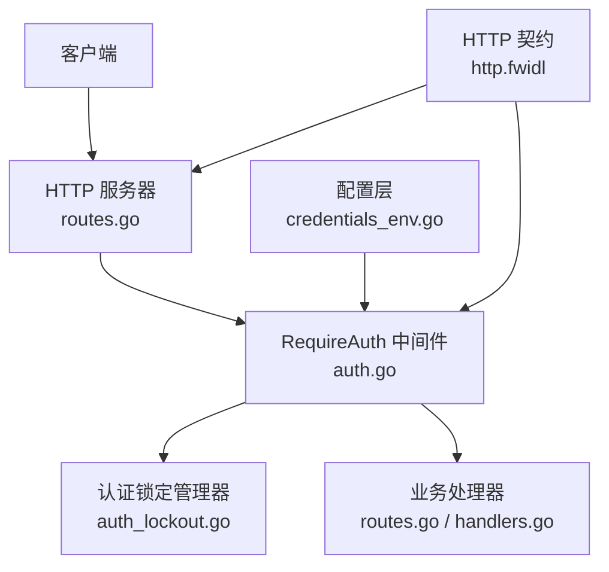
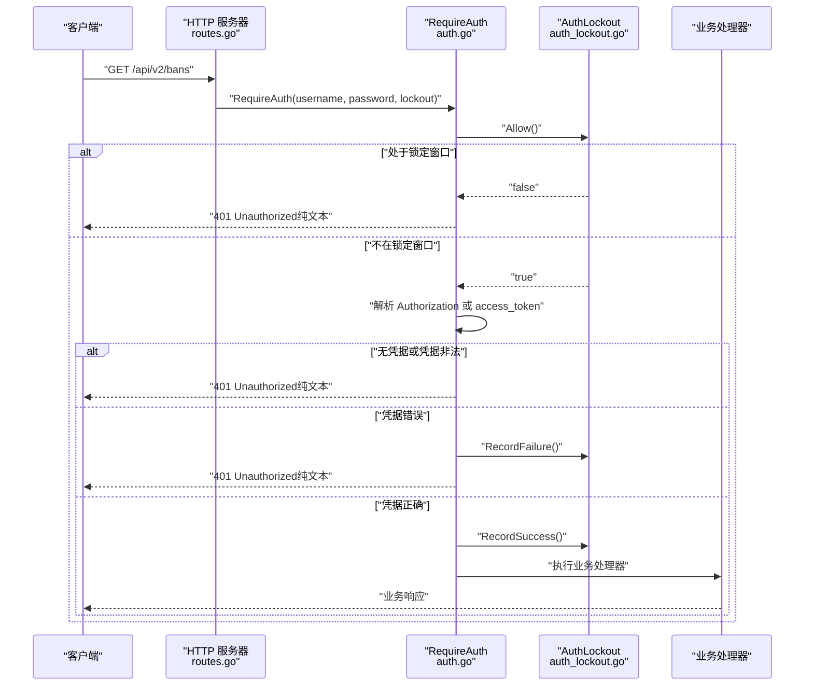
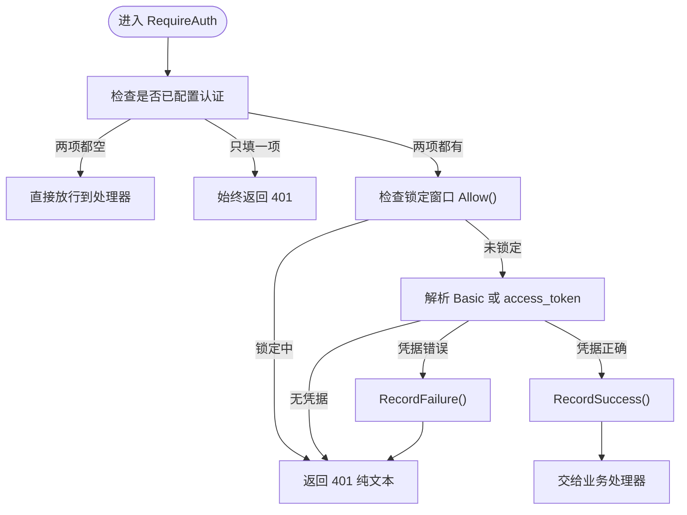
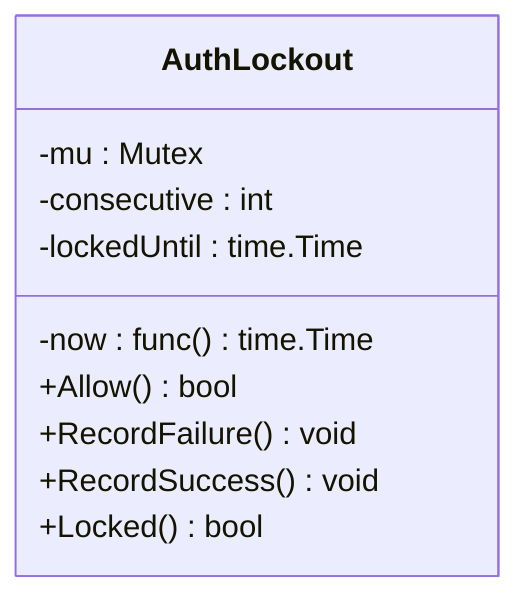
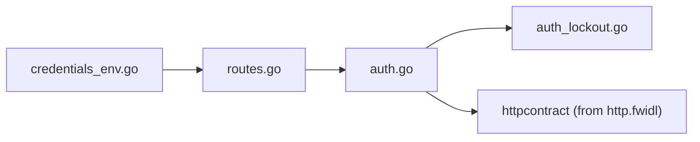

# 认证API

<cite>
**本文引用的文件**   
- [auth.go](file://src/daemon/internal/http/auth.go)
- [auth_lockout.go](file://src/daemon/internal/http/auth_lockout.go)
- [routes.go](file://src/daemon/internal/http/routes.go)
- [handlers.go](file://src/daemon/internal/http/handlers.go)
- [credentials_env.go](file://src/daemon/internal/config/credentials_env.go)
- [http.fwidl](file://contract/http.fwidl)
</cite>

## 目录
1. [简介](#简介)
2. [项目结构](#项目结构)
3. [核心组件](#核心组件)
4. [架构总览](#架构总览)
5. [详细组件分析](#详细组件分析)
6. [依赖关系分析](#依赖关系分析)
7. [性能与安全考量](#性能与安全考量)
8. [故障排查指南](#故障排查指南)
9. [结论](#结论)
10. [附录：客户端集成与示例](#附录客户端集成与示例)

## 简介
本文件面向需要对接守护进程 HTTP API 的开发者，聚焦认证面：HTTP Basic 认证机制、凭据来源、认证失败锁定策略、错误处理、安全头约定、状态码语义，以及 curl 和前端集成要点。文档同时解释“未配置认证”“半配置认证”“锁定期内一律拒绝”等边界行为，并给出可操作的排错步骤。

## 项目结构
认证相关代码分布在以下位置：
- HTTP 认证中间件与锁定逻辑：`src/daemon/internal/http/auth.go`、`src/daemon/internal/http/auth_lockout.go`
- 路由注册（所有需认证端点统一包裹认证）：`src/daemon/internal/http/routes.go`
- 配置层凭据来源与环境变量覆盖：`src/daemon/internal/config/credentials_env.go`
- HTTP 接口契约（认证参数、错误模型、安全头、路由表）：`contract/http.fwidl`

**图表来源**
- [routes.go:79-233](file://src/daemon/internal/http/routes.go#L79-L233)
- [auth.go:22-69](file://src/daemon/internal/http/auth.go#L22-L69)
- [auth_lockout.go:15-82](file://src/daemon/internal/http/auth_lockout.go#L15-L82)
- [credentials_env.go:21-72](file://src/daemon/internal/config/credentials_env.go#L21-L72)
- [http.fwidl:68-128](file://contract/http.fwidl#L68-L128)

**章节来源**
- [routes.go:79-233](file://src/daemon/internal/http/routes.go#L79-L233)
- [http.fwidl:68-128](file://contract/http.fwidl#L68-L128)

## 核心组件
- RequireAuth 中间件：负责解析凭据、调用锁定检查、比较用户名与密码、记录成功或失败。
- AuthLockout：进程级连续失败计数与锁定窗口；达到阈值后在固定时间内拒绝所有请求（包括正确凭据）。
- 凭据来源：YAML 配置中的 `metrics_username` / `metrics_password`，可被环境变量 `FIREWALL_METRICS_USERNAME` / `FIREWALL_METRICS_PASSWORD` 覆盖。
- 契约约束：Basic 方案、查询参数名 `access_token`、失败阈值 10、锁定 60 秒、401 纯文本响应体、禁止 WWW-Authenticate。

**章节来源**
- [auth.go:22-115](file://src/daemon/internal/http/auth.go#L22-L115)
- [auth_lockout.go:15-82](file://src/daemon/internal/http/auth_lockout.go#L15-L82)
- [credentials_env.go:15-72](file://src/daemon/internal/config/credentials_env.go#L15-L72)
- [http.fwidl:68-88](file://contract/http.fwidl#L68-L88)

## 架构总览
认证流程从路由注册开始：所有受保护端点在注册时统一使用 `RequireAuth` 包装；请求进入中间件后先过锁定门，再取凭据，最后比较并更新计数。

**图表来源**
- [routes.go:96-117](file://src/daemon/internal/http/routes.go#L96-L117)
- [auth.go:36-69](file://src/daemon/internal/http/auth.go#L36-L69)
- [auth_lockout.go:36-72](file://src/daemon/internal/http/auth_lockout.go#L36-L72)

## 详细组件分析

### 认证中间件 RequireAuth
- 支持两种凭据来源：
  - `Authorization: Basic <base64>`
  - 查询参数 `?access_token=<base64>`（用于 SSE 等浏览器不允许设置请求头的场景）
- 未携带凭据不会计入失败次数；只有“携带且错误”才触发锁定计数。
- 用户名与密码分别进行常量时间比较，避免时序侧信道。
- 认证失败返回 401 纯文本，不发送 `WWW-Authenticate`，以避免浏览器原生对话框挂起 fetch。

**图表来源**
- [auth.go:36-69](file://src/daemon/internal/http/auth.go#L36-L69)
- [auth.go:77-115](file://src/daemon/internal/http/auth.go#L77-L115)

**章节来源**
- [auth.go:22-115](file://src/daemon/internal/http/auth.go#L22-L115)

### 认证失败锁定 AuthLockout
- 进程级共享账本：不按路由、不按来源 IP 切分。
- 连续失败达到阈值后进入锁定窗口；锁定期间无论凭据是否正确都拒绝。
- 成功登录会清零连续失败计数。
- 阈值与时长来自契约生成常量，避免硬编码漂移。

**图表来源**
- [auth_lockout.go:15-82](file://src/daemon/internal/http/auth_lockout.go#L15-L82)

**章节来源**
- [auth_lockout.go:1-82](file://src/daemon/internal/http/auth_lockout.go#L1-L82)

### 凭据管理与配置
- YAML 配置项：`metrics_username` / `metrics_password`。
- 环境变量覆盖：`FIREWALL_METRICS_USERNAME` / `FIREWALL_METRICS_PASSWORD`。
- 语义：
  - 两项都为空：视为“未配置认证”，放行所有请求。
  - 只填一项：视为“半配置”，整组端点一律 401。
  - 两项都有值：启用认证。
- 日志可报告凭据来源（环境变量 / 配置文件 / 未配置），但绝不输出凭据值。

**章节来源**
- [credentials_env.go:1-72](file://src/daemon/internal/config/credentials_env.go#L1-L72)

### 路由与认证范围
- 健康探针 `/api/v2/health`、`/api/v2/healthz` 不需要认证。
- 静态资源、SPA 外壳、Service Worker 不需要认证。
- 其余 REST 端点、指标 `/metrics`、事件流 `/api/v2/events`、日志流 `/api/v2/logs/stream` 都需要认证。

**章节来源**
- [routes.go:79-233](file://src/daemon/internal/http/routes.go#L79-L233)
- [http.fwidl:376-511](file://contract/http.fwidl#L376-L511)

## 依赖关系分析
- `routes.go` 通过 `RequireAuth` 把认证逻辑注入每条受保护路由。
- `auth.go` 依赖 `httpcontract` 中的认证查询参数名，并依赖 `AuthLockout`。
- `auth_lockout.go` 依赖契约生成的失败阈值与锁定秒数常量。
- `credentials_env.go` 提供配置层凭据来源判断与覆盖逻辑，供组合根装配 `RequireAuth` 使用的用户名与密码。

**图表来源**
- [routes.go:22-77](file://src/daemon/internal/http/routes.go#L22-L77)
- [auth.go:4-12](file://src/daemon/internal/http/auth.go#L4-L12)
- [auth_lockout.go:8-13](file://src/daemon/internal/http/auth_lockout.go#L8-L13)
- [credentials_env.go:21-32](file://src/daemon/internal/config/credentials_env.go#L21-L32)

**章节来源**
- [routes.go:22-77](file://src/daemon/internal/http/routes.go#L22-L77)
- [auth.go:4-12](file://src/daemon/internal/http/auth.go#L4-L12)
- [auth_lockout.go:8-13](file://src/daemon/internal/http/auth_lockout.go#L8-L13)
- [credentials_env.go:21-32](file://src/daemon/internal/config/credentials_env.go#L21-L32)

## 性能与安全考量
- 常量时间比较：用户名与密码比较使用常量时间比较函数，避免长度泄露与时序侧信道。
- 锁定窗口按墙上时间推进，测试可通过时钟注入点控制时间。
- 锁定是进程级全局，防止攻击者通过多路由分散失败预算。
- 安全头由契约定义并在服务器层统一施加，包括内容类型嗅探防护、点击劫持防护、内容安全策略与缓存控制。
- 401 响应为纯文本且不包含 `WWW-Authenticate`，避免浏览器原生对话框阻塞前端交互。

**章节来源**
- [auth.go:101-115](file://src/daemon/internal/http/auth.go#L101-L115)
- [auth_lockout.go:27-29](file://src/daemon/internal/http/auth_lockout.go#L27-L29)
- [http.fwidl:131-153](file://contract/http.fwidl#L131-L153)
- [http.fwidl:104-109](file://contract/http.fwidl#L104-L109)

## 故障排查指南
常见问题与定位建议：
- 登录后仍提示 401：
  - 确认是否处于锁定窗口（连续失败达到阈值后 60 秒内任何请求都会被拒）。
  - 检查是否使用了正确的凭据来源（Basic 头或 `access_token` 查询参数）。
  - 检查是否出现“半配置”情况（只配置了用户名或密码之一）。
- 浏览器弹出原生凭据对话框：
  - 本项目有意不发 `WWW-Authenticate`，因此不应出现该对话框；若出现，说明请求可能绕过应用表单直接触发了其他路径。
- 无法访问数据但能打开页面：
  - 静态资源与 SPA 外壳不需要认证；数据接口需要认证。
- 锁定后一直无法登录：
  - 等待锁定窗口结束；不要在 UI 上反复重试，否则会延长锁定体验。
- 环境变量未生效：
  - 确认环境变量名是否为 `FIREWALL_METRICS_USERNAME` / `FIREWALL_METRICS_PASSWORD`。
  - 注意环境变量会覆盖 YAML 配置；显式设为空串等同于关闭该项。

**章节来源**
- [auth.go:36-69](file://src/daemon/internal/http/auth.go#L36-L69)
- [auth_lockout.go:47-72](file://src/daemon/internal/http/auth_lockout.go#L47-L72)
- [credentials_env.go:21-72](file://src/daemon/internal/config/credentials_env.go#L21-L72)
- [http.fwidl:104-109](file://contract/http.fwidl#L104-L109)

## 结论
本项目的认证面以契约为中心：Basic 认证、`access_token` 查询参数、失败阈值与锁定窗口、401 纯文本响应、安全头与路由分组都在契约中明确定义，并在 Go 实现中严格对齐。运维应优先通过环境变量管理凭据，避免将凭据提交到版本库；客户端应正确处理 401 与锁定窗口，不要无限重试导致用户体验恶化。

## 附录：客户端集成与示例

### 认证头格式
- Basic 认证头：
  - 名称：`Authorization`
  - 值：`Basic <base64("username:password")>`
- SSE 兼容凭据：
  - 查询参数：`access_token=<base64("username:password")>`

**章节来源**
- [auth.go:24-29](file://src/daemon/internal/http/auth.go#L24-L29)
- [auth.go:80-98](file://src/daemon/internal/http/auth.go#L80-L98)
- [http.fwidl:81-84](file://contract/http.fwidl#L81-L84)

### 状态码说明
- 401 Unauthorized：认证失败或未携带凭据；响应体为纯文本，不含信封。
- 200 OK：认证成功后的业务响应（多数 REST 端点）。
- 201 Created：创建类操作成功（例如封禁、添加白名单）。
- 503 Service Unavailable：依赖未就绪（如历史库未初始化、SSE 连接名额已满）。

**章节来源**
- [http.fwidl:104-128](file://contract/http.fwidl#L104-L128)
- [http.fwidl:164-222](file://contract/http.fwidl#L164-L222)
- [routes.go:79-233](file://src/daemon/internal/http/routes.go#L79-L233)

### curl 命令示例
- 使用 Basic 认证访问受保护端点：
  - `curl -u "用户名:密码" "https://localhost:端口/api/v2/bans"`
- 使用查询参数传递 Basic 凭据（适用于某些受限环境）：
  - `curl "https://localhost:端口/api/v2/bans?access_token=base64字符串"`
- 健康探针（无需认证）：
  - `curl "https://localhost:端口/api/v2/health"`

注意：
- 上述命令中的 `base64字符串` 应为 `用户名:密码` 的标准 base64 编码。
- 生产环境建议使用 HTTPS 并通过反向代理暴露服务。

**章节来源**
- [auth.go:80-98](file://src/daemon/internal/http/auth.go#L80-L98)
- [routes.go:79-84](file://src/daemon/internal/http/routes.go#L79-L84)

### 常见认证问题解决方案
- 问题：输错密码后按钮永久转圈
  - 原因：浏览器原生凭据对话框会挂起 fetch；本项目刻意不发 `WWW-Authenticate` 以避免此问题。
  - 解决：确保前端使用应用内登录表单显式携带凭据，而不是依赖浏览器弹窗。
- 问题：锁定后正确凭据也被拒
  - 原因：锁定窗口内一律拒绝，这是暴力破解防护的设计。
  - 解决：等待锁定窗口结束后再尝试；UI 应提示用户当前处于锁定期。
- 问题：只配置了用户名或密码
  - 原因：半配置被视为非法，整组端点一律 401。
  - 解决：同时配置用户名与密码，或使用环境变量覆盖。

**章节来源**
- [http.fwidl:104-109](file://contract/http.fwidl#L104-L109)
- [auth.go:30-35](file://src/daemon/internal/http/auth.go#L30-L35)
- [auth_lockout.go:36-45](file://src/daemon/internal/http/auth_lockout.go#L36-L45)
- [credentials_env.go:66-72](file://src/daemon/internal/config/credentials_env.go#L66-L72)