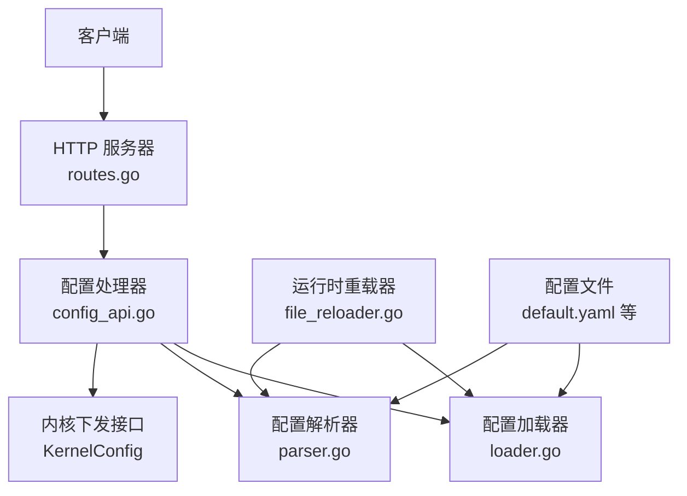
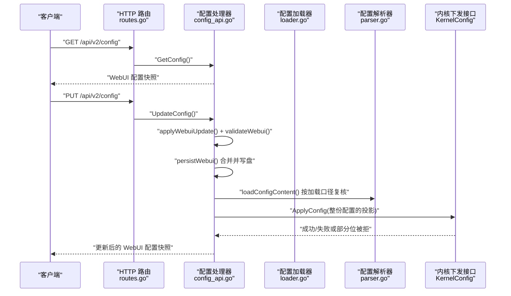
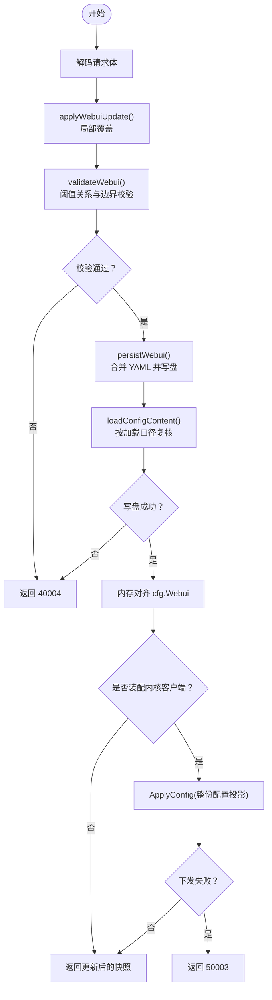
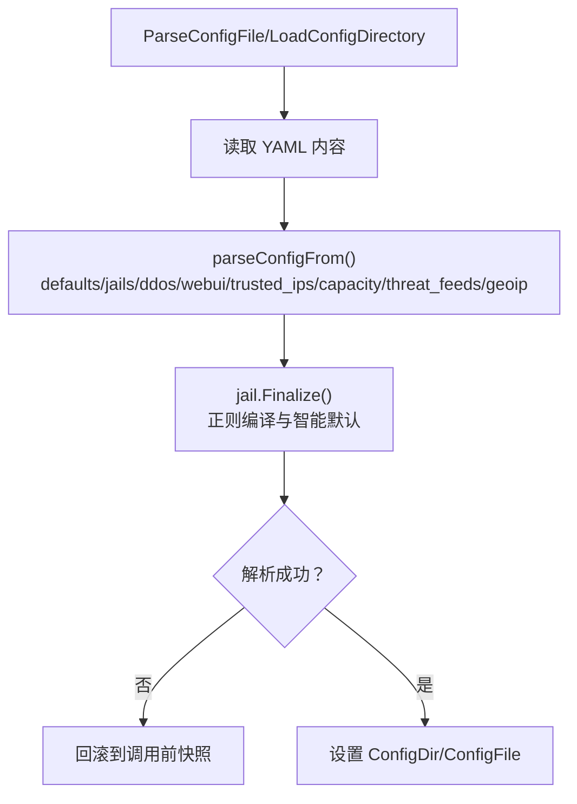
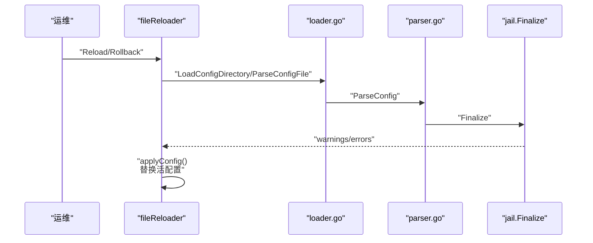
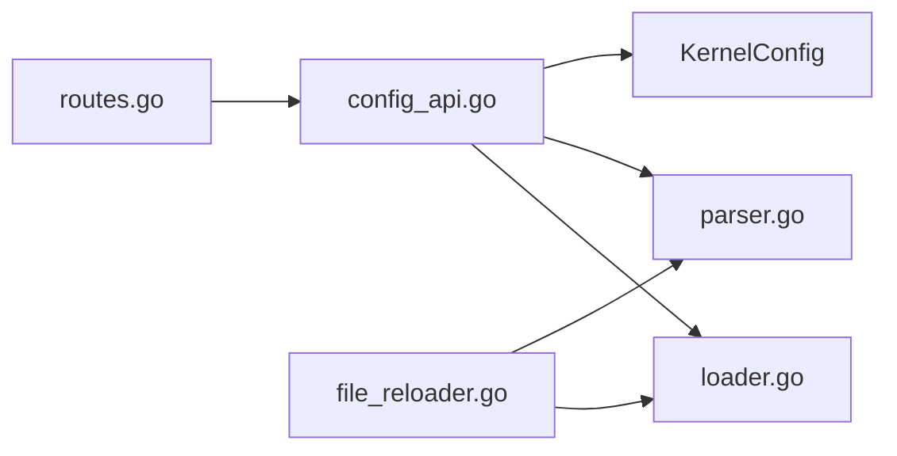

# 配置管理API

<cite>
**本文引用的文件**   
- [src/daemon/internal/http/config_api.go](file://src/daemon/internal/http/config_api.go)
- [src/daemon/internal/http/routes.go](file://src/daemon/internal/http/routes.go)
- [src/daemon/internal/http/config_api_test.go](file://src/daemon/internal/http/config_api_test.go)
- [src/daemon/internal/config/loader.go](file://src/daemon/internal/config/loader.go)
- [src/daemon/internal/config/parser.go](file://src/daemon/internal/config/parser.go)
- [src/daemon/internal/runtime/file_reloader.go](file://src/daemon/internal/runtime/file_reloader.go)
- [src/daemon/internal/config/args.go](file://src/daemon/internal/config/args.go)
- [config/default.yaml](file://config/default.yaml)
</cite>

## 目录
1. [简介](#简介)
2. [项目结构](#项目结构)
3. [核心组件](#核心组件)
4. [架构总览](#架构总览)
5. [详细组件分析](#详细组件分析)
6. [依赖关系分析](#依赖关系分析)
7. [性能与一致性](#性能与一致性)
8. [故障排查指南](#故障排查指南)
9. [结论](#结论)
10. [附录：YAML 配置结构与规则](#附录yaml-配置结构与规则)

## 简介
本文面向守护进程的配置管理 API，覆盖以下能力：
- 读取当前 Web UI 相关配置（GET /api/v2/config）
- 局部更新 Web UI 相关配置并持久化（PUT /api/v2/config）
- YAML 配置文件结构、字段含义、默认值与校验规则
- 动态重载机制、热更新行为与回滚策略
- 权限控制、变更审计与版本管理建议
- 配置模板、迁移脚本与故障恢复流程

本项目的配置由 YAML 文件驱动，守护进程在启动和运行时通过重载器重新加载；Web UI 的阈值等参数通过 REST API 进行局部更新，并写回同一份配置文件。

## 项目结构
与配置管理相关的代码主要分布在以下位置：
- HTTP API 层：路由注册与处理器实现
- 配置解析与加载：YAML 解析、合并、校验、默认值应用
- 运行时重载：SIGHUP 或命令行触发重载与回滚
- 示例配置：default.yaml 提供完整注释与默认值

**图表来源**
- [src/daemon/internal/http/routes.go:125-129](file://src/daemon/internal/http/routes.go#L125-L129)
- [src/daemon/internal/http/config_api.go:28-115](file://src/daemon/internal/http/config_api.go#L28-L115)
- [src/daemon/internal/config/loader.go:17-50](file://src/daemon/internal/config/loader.go#L17-L50)
- [src/daemon/internal/config/parser.go:155-207](file://src/daemon/internal/config/parser.go#L155-L207)
- [src/daemon/internal/runtime/file_reloader.go:24-58](file://src/daemon/internal/runtime/file_reloader.go#L24-L58)

**章节来源**
- [src/daemon/internal/http/routes.go:125-129](file://src/daemon/internal/http/routes.go#L125-L129)
- [src/daemon/internal/http/config_api.go:28-115](file://src/daemon/internal/http/config_api.go#L28-L115)
- [src/daemon/internal/config/loader.go:17-50](file://src/daemon/internal/config/loader.go#L17-L50)
- [src/daemon/internal/config/parser.go:155-207](file://src/daemon/internal/config/parser.go#L155-L207)
- [src/daemon/internal/runtime/file_reloader.go:24-58](file://src/daemon/internal/runtime/file_reloader.go#L24-L58)

## 核心组件
- HTTP 路由与处理器
  - GET /api/v2/config：返回当前 Web UI 配置快照，仅投影 webui 段，不泄露凭据
  - PUT /api/v2/config：接收局部更新请求，校验后写入配置文件，并按加载口径复核，随后尝试下发内核
- 配置加载与解析
  - 支持单文件与目录两种加载模式
  - 按文件名字母序合并，运行期覆盖文件最后生效
  - 严格模式拒绝未知字段，宽松模式忽略未知字段
- 运行时重载与回滚
  - SIGHUP 或命令行触发重载
  - 支持从备份文件回滚到上一版本
- 配置模板
  - default.yaml 提供完整注释与默认值，可作为基线模板

**章节来源**
- [src/daemon/internal/http/routes.go:125-129](file://src/daemon/internal/http/routes.go#L125-L129)
- [src/daemon/internal/http/config_api.go:28-115](file://src/daemon/internal/http/config_api.go#L28-L115)
- [src/daemon/internal/config/loader.go:17-50](file://src/daemon/internal/config/loader.go#L17-L50)
- [src/daemon/internal/config/parser.go:155-207](file://src/daemon/internal/config/parser.go#L155-L207)
- [src/daemon/internal/runtime/file_reloader.go:24-91](file://src/daemon/internal/runtime/file_reloader.go#L24-L91)
- [config/default.yaml:1-198](file://config/default.yaml#L1-L198)

## 架构总览
配置管理 API 的整体调用链如下：

**图表来源**
- [src/daemon/internal/http/routes.go:125-129](file://src/daemon/internal/http/routes.go#L125-L129)
- [src/daemon/internal/http/config_api.go:28-115](file://src/daemon/internal/http/config_api.go#L28-L115)
- [src/daemon/internal/config/parser.go:155-207](file://src/daemon/internal/config/parser.go#L155-L207)

## 详细组件分析

### 配置读取接口（GET /api/v2/config）
- 功能
  - 返回当前 Web UI 相关配置快照
  - 仅投影 webui 段，避免泄露 metrics_password 等凭据
- 行为
  - 若未注入配置来源或活配置为空，返回服务不可用
  - 响应体为扁平字段集合，键名遵循契约 snake_case
- 安全
  - 读路径只访问 cfg.Webui，不在副本上清零凭据，从取值范围层面杜绝泄露

**章节来源**
- [src/daemon/internal/http/config_api.go:28-45](file://src/daemon/internal/http/config_api.go#L28-L45)
- [src/daemon/internal/http/config_api_test.go:286-320](file://src/daemon/internal/http/config_api_test.go#L286-L320)

### 配置更新接口（PUT /api/v2/config）
- 功能
  - 接收局部更新请求，仅提交要改的字段
  - 将提交的字段覆盖到当前 webui 段，未提交字段保持现值
  - 校验合并后的最终状态，通过后写回配置文件
  - 按加载口径复核，再尝试下发内核
- 关键流程
  - applyWebuiUpdate：局部覆盖
  - validateWebui：阈值关系与边界校验
  - persistWebui：合并 YAML、写盘、对齐内存、下发内核
  - loadConfigContent：以 Default() 打底，解析并 Finalize，确保“写下去的文件能再次加载”
- 错误码
  - 40004：取值越界、落盘失败、加载校验失败
  - 50003：内核通道发不出去（依赖未就绪），但文件已写对
  - 40007/40008：请求体解码失败（由通用 JSON 解码负责）
- 幂等性
  - 内核下发是幂等的；部分位被拒只记日志，不影响响应载荷

**图表来源**
- [src/daemon/internal/http/config_api.go:83-185](file://src/daemon/internal/http/config_api.go#L83-L185)
- [src/daemon/internal/http/config_api.go:187-369](file://src/daemon/internal/http/config_api.go#L187-L369)

**章节来源**
- [src/daemon/internal/http/config_api.go:47-115](file://src/daemon/internal/http/config_api.go#L47-L115)
- [src/daemon/internal/http/config_api.go:117-185](file://src/daemon/internal/http/config_api.go#L117-L185)
- [src/daemon/internal/http/config_api.go:187-369](file://src/daemon/internal/http/config_api.go#L187-L369)
- [src/daemon/internal/http/config_api_test.go:98-144](file://src/daemon/internal/http/config_api_test.go#L98-L144)
- [src/daemon/internal/http/config_api_test.go:146-193](file://src/daemon/internal/http/config_api_test.go#L146-L193)
- [src/daemon/internal/http/config_api_test.go:195-240](file://src/daemon/internal/http/config_api_test.go#L195-L240)
- [src/daemon/internal/http/config_api_test.go:242-284](file://src/daemon/internal/http/config_api_test.go#L242-L284)

### 配置加载与解析
- 单文件加载
  - ParseConfigFile：校验路径、读取文件、快照式解析，失败时整体回滚
- 目录加载
  - LoadConfigDirectory：收集 .yml/.yaml，跳过隐藏文件与非普通文件
  - 排序规则：先按字母序，运行期覆盖文件（前缀 `_`）最后合并
  - 任一文件失败则整体回滚
- 解析流程
  - parseConfigFrom：defaults → jails → ddos → webui → trusted_ips → capacity → threat_feeds → geoip → 环境变量覆盖凭据
  - strict 控制是否拒绝未知字段
- 智能默认
  - 仅新建 jail 时应用智能默认（findtime/ban_time/max_retries）
  - 用户显式值不会被覆盖

**图表来源**
- [src/daemon/internal/config/loader.go:17-50](file://src/daemon/internal/config/loader.go#L17-L50)
- [src/daemon/internal/config/loader.go:53-128](file://src/daemon/internal/config/loader.go#L53-L128)
- [src/daemon/internal/config/parser.go:155-207](file://src/daemon/internal/config/parser.go#L155-L207)

**章节来源**
- [src/daemon/internal/config/loader.go:17-50](file://src/daemon/internal/config/loader.go#L17-L50)
- [src/daemon/internal/config/loader.go:53-128](file://src/daemon/internal/config/loader.go#L53-L128)
- [src/daemon/internal/config/parser.go:155-207](file://src/daemon/internal/config/parser.go#L155-L207)
- [src/daemon/internal/config/parser.go:277-497](file://src/daemon/internal/config/parser.go#L277-L497)

### 动态重载与热更新
- 重载入口
  - fileReloader.Reload：从 Default() 起步，按目录或单文件加载，Finalize 后替换活配置
  - 正则编译失败只告警，不阻断重载
- 回滚
  - fileReloader.Rollback：优先从 config.yaml.rollback 回滚；若无备份则退化为 Reload
- 监听地址
  - 重载与回滚不会重绑 HTTP 端口；若 listen_address 变化，记录告警并提示需重启

**图表来源**
- [src/daemon/internal/runtime/file_reloader.go:24-58](file://src/daemon/internal/runtime/file_reloader.go#L24-L58)
- [src/daemon/internal/runtime/file_reloader.go:61-106](file://src/daemon/internal/runtime/file_reloader.go#L61-L106)

**章节来源**
- [src/daemon/internal/runtime/file_reloader.go:24-58](file://src/daemon/internal/runtime/file_reloader.go#L24-L58)
- [src/daemon/internal/runtime/file_reloader.go:61-106](file://src/daemon/internal/runtime/file_reloader.go#L61-L106)

### 权限控制与审计
- 权限控制
  - 配置相关路由均受 RequireAuth 保护，使用 metrics_username/metrics_password
  - GET /metrics 与 /api/v2/events 也受认证保护，避免暴露拓扑信息
- 审计建议
  - 建议在外部系统记录每次 PUT /api/v2/config 的请求体摘要、操作者身份与时间戳
  - 结合守护进程日志与文件系统变更事件（如 inotify）构建审计线索

**章节来源**
- [src/daemon/internal/http/routes.go:86-129](file://src/daemon/internal/http/routes.go#L86-L129)
- [src/daemon/internal/config/args.go:23-60](file://src/daemon/internal/config/args.go#L23-L60)

### 版本管理与迁移
- 版本命令
  - --rollback：回滚到上一个配置版本（需守护进程运行中）
  - --no-strict：宽松模式，忽略未知配置 key
- 迁移建议
  - 使用 git 管理配置文件，配合 CI 校验 YAML 语法与字段合法性
  - 在部署流水线中执行 loadConfigContent 模拟重载，提前发现非法配置

**章节来源**
- [src/daemon/internal/config/args.go:23-60](file://src/daemon/internal/config/args.go#L23-L60)
- [src/daemon/internal/http/config_api.go:350-369](file://src/daemon/internal/http/config_api.go#L350-L369)

## 依赖关系分析
- HTTP 层依赖
  - routes.go 注册 GET/PUT /api/v2/config
  - config_api.go 实现 GetConfig/UpdateConfig
- 配置层依赖
  - loader.go 提供单文件与目录加载
  - parser.go 提供 YAML 解析、默认值应用与校验
- 运行时依赖
  - file_reloader.go 提供重载与回滚
- 内核依赖
  - KernelConfig 接口可空；未装配时 PUT /config 仍落盘成功

**图表来源**
- [src/daemon/internal/http/routes.go:125-129](file://src/daemon/internal/http/routes.go#L125-L129)
- [src/daemon/internal/http/config_api.go:28-115](file://src/daemon/internal/http/config_api.go#L28-L115)
- [src/daemon/internal/config/loader.go:17-50](file://src/daemon/internal/config/loader.go#L17-L50)
- [src/daemon/internal/config/parser.go:155-207](file://src/daemon/internal/config/parser.go#L155-L207)
- [src/daemon/internal/runtime/file_reloader.go:24-58](file://src/daemon/internal/runtime/file_reloader.go#L24-L58)

**章节来源**
- [src/daemon/internal/http/routes.go:125-129](file://src/daemon/internal/http/routes.go#L125-L129)
- [src/daemon/internal/http/config_api.go:28-115](file://src/daemon/internal/http/config_api.go#L28-L115)
- [src/daemon/internal/config/loader.go:17-50](file://src/daemon/internal/config/loader.go#L17-L50)
- [src/daemon/internal/config/parser.go:155-207](file://src/daemon/internal/config/parser.go#L155-L207)
- [src/daemon/internal/runtime/file_reloader.go:24-58](file://src/daemon/internal/runtime/file_reloader.go#L24-L58)

## 性能与一致性
- 原子性与一致性
  - 解析失败时整体回滚，避免半更新状态
  - 写盘成功后立即对齐内存，保证 GET /config 与文件一致
- 内核下发
  - 幂等；部分位被拒只记日志，不影响响应载荷
- 重载开销
  - 重载从 Default() 起步，避免零值导致的全局清零
  - 正则编译失败只告警，不阻断重载

[本节为通用指导，不直接分析具体文件]

## 故障排查指南
- 常见错误码
  - 40004：取值越界、落盘失败、加载校验失败
  - 50003：内核通道发不出去（依赖未就绪）
  - 40007/40008：请求体解码失败
- 排查步骤
  - 检查 PUT 请求体字段是否符合约束（warning < critical、非零上限等）
  - 确认配置文件路径可用且可写
  - 查看内核通道是否装配成功
  - 使用 --rollback 回滚到上一版本
  - 使用 --no-strict 临时放宽未知字段限制（谨慎）

**章节来源**
- [src/daemon/internal/http/config_api.go:83-185](file://src/daemon/internal/http/config_api.go#L83-L185)
- [src/daemon/internal/http/config_api_test.go:195-284](file://src/daemon/internal/http/config_api_test.go#L195-L284)
- [src/daemon/internal/config/args.go:23-60](file://src/daemon/internal/config/args.go#L23-L60)

## 结论
配置管理 API 提供了安全的读取与局部更新能力，结合 YAML 加载器与运行时重载器，实现了可验证、可回滚、可审计的配置生命周期管理。通过严格的校验与幂等的内核下发，系统在灵活性与稳定性之间取得平衡。建议在生产环境中配合版本控制与外部审计系统，进一步提升变更的可追溯性与安全性。

[本节为总结性内容，不直接分析具体文件]

## 附录：YAML 配置结构与规则

### 顶层结构
- defaults：全局默认值
- jails：各服务防护定义
- ddos：DDoS 防护配置
- webui：Web UI 相关阈值与容量
- trusted_ips：可信 IP 白名单
- capacity：容量上限
- threat_feeds：威胁情报源
- geoip_db_path：GeoIP 数据库路径
- server_latitude/server_longitude：本机坐标（必须成对）
- geoip_detect_egress/geoip_egress_probe_url：出口 IP 探测开关与地址

**章节来源**
- [src/daemon/internal/config/parser.go:13-153](file://src/daemon/internal/config/parser.go#L13-L153)
- [config/default.yaml:1-198](file://config/default.yaml#L1-L198)

### defaults 字段
- max_retries：最大重试次数
- findtime：检测窗口（秒）
- ban_time：封禁时长（秒）
- interval：检查间隔（秒）
- metrics_port/metrics_bind_address：指标端口与绑定地址
- metrics_username/metrics_password：指标认证凭据
- log_file/log_level/log_destination/log_format/log_max_size_mb/log_max_files：日志配置
- history_db_path/history_retention_days：历史库路径与保留天数

**章节来源**
- [src/daemon/internal/config/parser.go:31-50](file://src/daemon/internal/config/parser.go#L31-L50)
- [src/daemon/internal/config/parser.go:209-275](file://src/daemon/internal/config/parser.go#L209-L275)
- [config/default.yaml:7-30](file://config/default.yaml#L7-L30)

### jails 字段
- enabled：启用状态
- log_files：日志文件列表
- max_retries/findtime/ban_time：单 jail 覆盖默认值
- regex/regex_name：单条正则
- regexes：多条命名正则
- cluster：集群扫描检测配置

**章节来源**
- [src/daemon/internal/config/parser.go:52-80](file://src/daemon/internal/config/parser.go#L52-L80)
- [src/daemon/internal/config/parser.go:277-497](file://src/daemon/internal/config/parser.go#L277-L497)
- [config/default.yaml:35-53](file://config/default.yaml#L35-L53)

### webui 字段
- sse_push_interval：SSE 推送间隔（1-60）
- rate_warning_pps/rate_critical_pps：PPS 阈值（warning < critical）
- rate_warning_syn/rate_critical_syn：SYN 阈值（warning < critical）
- max_syn_per_second/max_udp_per_second/max_icmp_per_second/max_ack_per_second/max_rst_per_second/max_fin_per_second：协议专项阈值（非零）
- static_threshold/dynamic_threshold/ddos_detection：算法开关
- max_ban_entries/max_whitelist_entries/max_rate_entries/max_local_ip_cache：容量上限（非零）
- clear_logs_at：日志页过滤起点（ISO 时间戳字符串，空串表示不过滤）

**章节来源**
- [src/daemon/internal/config/parser.go:104-127](file://src/daemon/internal/config/parser.go#L104-L127)
- [src/daemon/internal/http/config_api.go:273-307](file://src/daemon/internal/http/config_api.go#L273-L307)
- [config/default.yaml:54-61](file://config/default.yaml#L54-L61)

### ddos 字段
- enabled/global_conn_rate/auto_ban_duration/auto_ban_threshold/check_interval：基础开关与阈值
- baseline_warmup_samples：基线预热样本数
- max_*_per_second：协议专项阈值
- static_threshold/dynamic_threshold/ddos_detection：算法开关
- max_bans_per_second/max_rate_entries/protect_open_ports：内核模块参数与端口保护

**章节来源**
- [src/daemon/internal/config/parser.go:82-102](file://src/daemon/internal/config/parser.go#L82-L102)
- [src/daemon/internal/config/parser.go:499-522](file://src/daemon/internal/config/parser.go#L499-L522)
- [config/default.yaml:63-91](file://config/default.yaml#L63-L91)

### capacity 字段
- max_ban_entries/max_whitelist_entries/max_rate_entries/max_local_ip_cache：容量上限

**章节来源**
- [src/daemon/internal/config/parser.go:129-135](file://src/daemon/internal/config/parser.go#L129-L135)
- [src/daemon/internal/config/parser.go:550-559](file://src/daemon/internal/config/parser.go#L550-L559)
- [config/default.yaml:103-110](file://config/default.yaml#L103-L110)

### threat_feeds 字段
- enabled/refresh_interval/http_timeout/max_retries：总开关与调度
- sources：情报源列表（name/url/category/confidence/enabled）

**章节来源**
- [src/daemon/internal/config/parser.go:137-153](file://src/daemon/internal/config/parser.go#L137-L153)
- [src/daemon/internal/config/parser.go:561-591](file://src/daemon/internal/config/parser.go#L561-L591)
- [config/default.yaml:123-169](file://config/default.yaml#L123-L169)

### geoip 与坐标
- geoip_db_path：GeoIP 数据库路径
- server_latitude/server_longitude：必须成对，范围 [-90,90]/[-180,180]
- geoip_detect_egress/geoip_egress_probe_url：出口 IP 探测开关与地址（http/https，主机名非空）

**章节来源**
- [src/daemon/internal/config/parser.go:593-635](file://src/daemon/internal/config/parser.go#L593-L635)
- [src/daemon/internal/config/parser.go:667-706](file://src/daemon/internal/config/parser.go#L667-L706)
- [config/default.yaml:112-198](file://config/default.yaml#L112-L198)