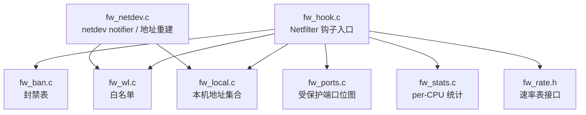
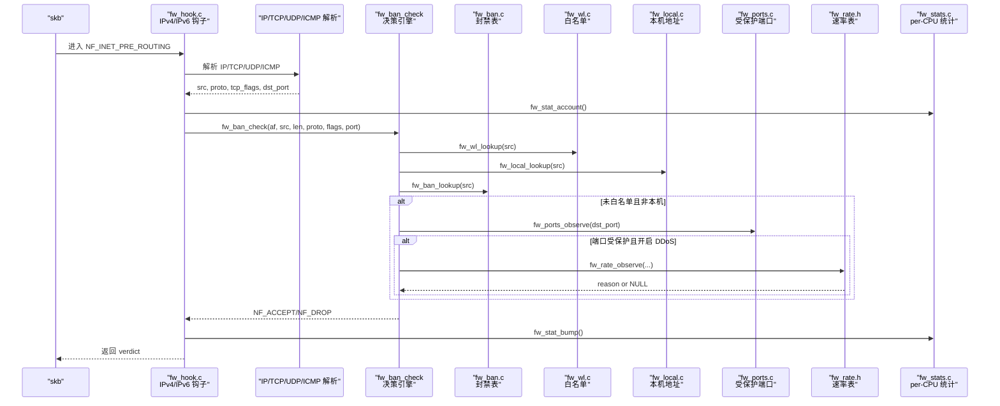
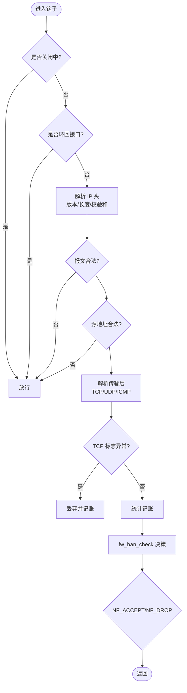
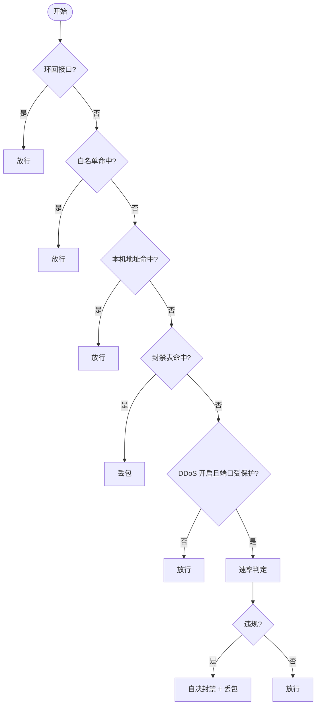
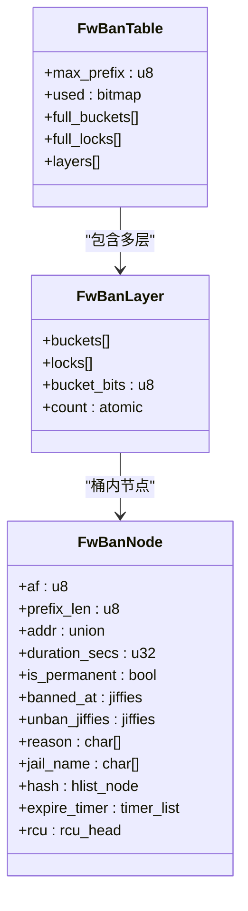
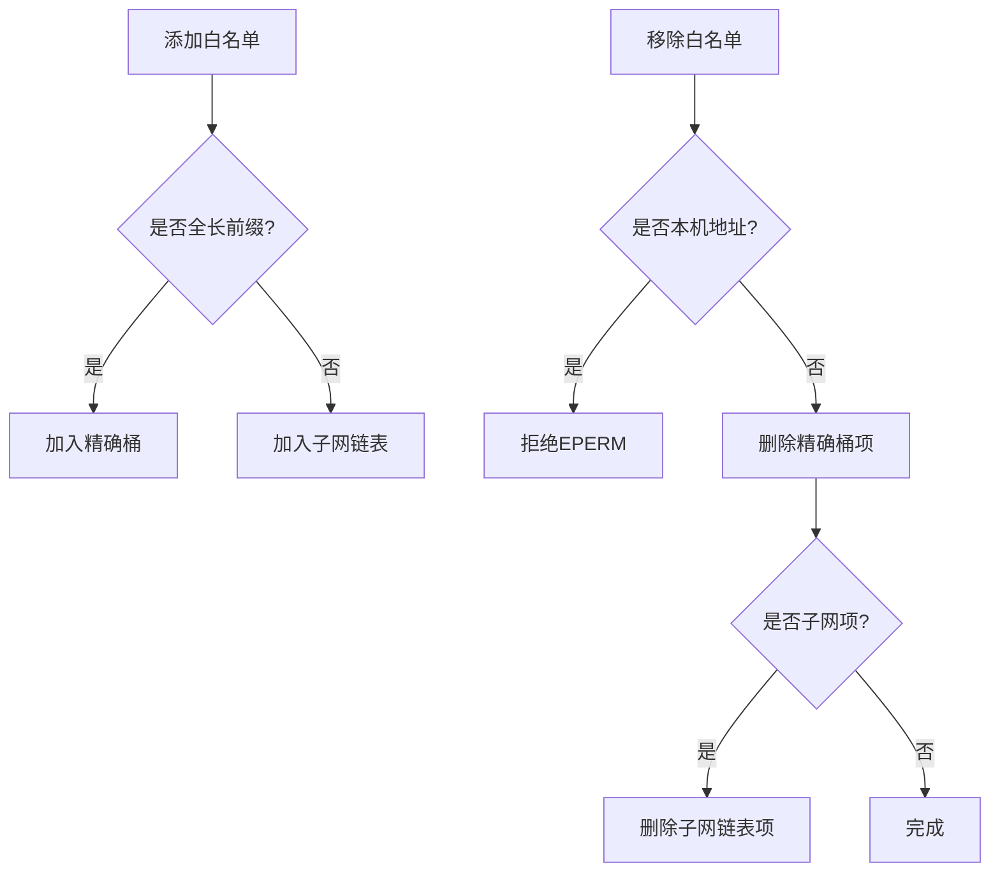
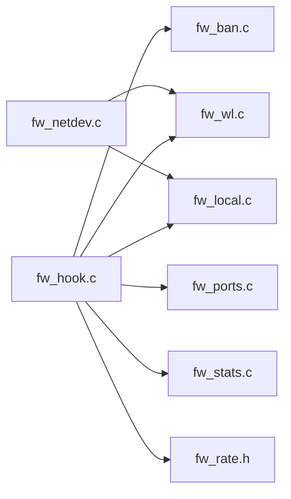

# Netfilter钩子实现

<cite>
**本文引用的文件**   
- [fw_hook.c](file://src/kernel-module/fw_hook.c)
- [fw_ban.c](file://src/kernel-module/fw_ban.c)
- [fw_wl.c](file://src/kernel-module/fw_wl.c)
- [fw_local.c](file://src/kernel-module/fw_local.c)
- [fw_netdev.c](file://src/kernel-module/fw_netdev.c)
- [fw_ports.c](file://src/kernel-module/fw_ports.c)
- [fw_stats.c](file://src/kernel-module/fw_stats.c)
- [fw_rate.h](file://src/kernel-module/fw_rate.h)
- [README.md](file://README.md)
</cite>

## 目录
1. [引言](#引言)
2. [项目结构](#项目结构)
3. [核心组件](#核心组件)
4. [架构总览](#架构总览)
5. [详细组件分析](#详细组件分析)
6. [依赖关系分析](#依赖关系分析)
7. [性能优化要点](#性能优化要点)
8. [内核态调试与排障指南](#内核态调试与排障指南)
9. [结论](#结论)

## 引言
本技术文档聚焦内核模块中的 Netfilter 钩子实现，围绕 IPv4/IPv6 数据包处理、协议识别、TCP 标志位检查、白名单/本机地址判定、封禁表查询、DDoS 检测等关键路径展开。同时说明钩子注册机制、优先级设置、NF_INET_PRE_ROUTING 链拦截原理，以及 RCU、per-CPU 统计、零拷贝等高性能设计。文末提供内核态调试方法与常见问题排查建议。

## 项目结构
内核模块相关源码位于 `src/kernel-module`，其中与 Netfilter 钩子和包处理直接相关的核心文件如下：
- `fw_hook.c`：Netfilter 钩子入口，负责 IPv4/IPv6 报文解析、协议识别、TCP 标志位提取、统计记账与决策调用。
- `fw_ban.c`：封禁表（按前缀分层桶 + RCU + 层内桶锁），支持 CIDR、容量上限、泛洪闸门、到期定时器与状态恢复。
- `fw_wl.c`：白名单（精确桶 + 子网链表），支持容量上限、CIDR 覆盖匹配、与本机地址联动。
- `fw_local.c`：本机接口精确地址集合（开放寻址哈希集），热路径 O(1)。
- `fw_netdev.c`：netdev notifier、本机地址集合重建、自动白名单对账。
- `fw_ports.c`：受保护端口位图，用于收窄 DDoS 速率判定作用面。
- `fw_stats.c`：per-CPU 统计与分析分布，flush 合并到全局。
- `fw_rate.h`：速率表与窗口滚动、EWMA、违规判定的接口定义与设计说明。

**图示来源**
- [fw_hook.c:77-95](file://src/kernel-module/fw_hook.c#L77-L95)
- [fw_ban.c:101-121](file://src/kernel-module/fw_ban.c#L101-L121)
- [fw_wl.c:38-51](file://src/kernel-module/fw_wl.c#L38-L51)
- [fw_local.c:46-49](file://src/kernel-module/fw_local.c#L46-L49)
- [fw_netdev.c:62-118](file://src/kernel-module/fw_netdev.c#L62-L118)
- [fw_ports.c:40-49](file://src/kernel-module/fw_ports.c#L40-L49)
- [fw_stats.c:96-162](file://src/kernel-module/fw_stats.c#L96-L162)
- [fw_rate.h:37-60](file://src/kernel-module/fw_rate.h#L37-L60)

**章节来源**
- [README.md:10-31](file://README.md#L10-L31)

## 核心组件
- Netfilter 钩子：在 NF_INET_PRE_ROUTING 链上以略高于 filter 表的优先级拦截流量，分别注册 IPv4 与 IPv6 两个钩子。
- 包解析器：从 skb 中安全读取 IP/TCP/UDP/ICMP 头，校验长度、版本、校验和，识别分片与非首片场景。
- 决策引擎：环回豁免 → 白名单短路 → 本机地址短路 → 封禁命中即丢 → 若开启 DDoS 且目的端口受保护则进行速率判定，违规即自决封禁并丢包。
- 封禁表：按 prefix_len 分层桶，RCU 读多写少，层内桶锁保护；支持 CIDR、容量上限、泛洪闸门、到期定时器、状态恢复。
- 白名单：精确桶 + 子网链表，支持 CIDR 覆盖匹配，容量上限，与本机地址联动。
- 本机地址集合：开放寻址线性探测哈希集，O(1) 查找，由 netdev notifier 重建并发布。
- 受保护端口位图：固定 65536 位，空指针语义为全端口受保护，用于收窄 DDoS 检测范围。
- per-CPU 统计：直方图、TTL 分布、UDP/ICMP 分布槽，flush 时合并到全局，避免共享 cache line 竞争。
- 速率表接口：一次查表完成窗口滚动与四类违规判定，失败开放策略保证高吞吐。

**章节来源**
- [fw_hook.c:77-154](file://src/kernel-module/fw_hook.c#L77-L154)
- [fw_ban.c:101-121](file://src/kernel-module/fw_ban.c#L101-L121)
- [fw_wl.c:114-147](file://src/kernel-module/fw_wl.c#L114-L147)
- [fw_local.c:70-101](file://src/kernel-module/fw_local.c#L70-L101)
- [fw_ports.c:40-49](file://src/kernel-module/fw_ports.c#L40-L49)
- [fw_stats.c:141-162](file://src/kernel-module/fw_stats.c#L141-L162)
- [fw_rate.h:37-60](file://src/kernel-module/fw_rate.h#L37-L60)

## 架构总览
下图展示从 Netfilter 钩子进入，到包解析、协议识别、决策判断、统计记账的完整数据流。

**图示来源**
- [fw_hook.c:156-278](file://src/kernel-module/fw_hook.c#L156-L278)
- [fw_hook.c:280-410](file://src/kernel-module/fw_hook.c#L280-L410)
- [fw_ban.c:369-383](file://src/kernel-module/fw_ban.c#L369-L383)
- [fw_wl.c:114-147](file://src/kernel-module/fw_wl.c#L114-L147)
- [fw_local.c:70-101](file://src/kernel-module/fw_local.c#L70-L101)
- [fw_ports.c:40-49](file://src/kernel-module/fw_ports.c#L40-L49)
- [fw_rate.h:37-60](file://src/kernel-module/fw_rate.h#L37-L60)
- [fw_stats.c:141-162](file://src/kernel-module/fw_stats.c#L141-L162)

## 详细组件分析

### Netfilter 钩子与优先级
- 钩子注册：IPv4 与 IPv6 各一个钩子，均挂载于 NF_INET_PRE_ROUTING，优先级为 NF_IP_PRI_FILTER - 1，确保在 filter 表之前看到报文。
- 退出保护：钩子入口与判定主体均有“关闭中”双检，置位后热路径直接放行，避免卸载被新流量拖住。
- 环回豁免：IFF_LOOPBACK 的入口直接放行，不进任何表查询，也不计统计。
- 报文合法性：pskb_may_pull、版本/头长/长度/校验和校验，非法报文直接放行（不由防火墙处理）。
- 源地址合法性：IPv4/IPv6 分别调用 fw_src_is_invalid_* 过滤非法源地址，不进入任何表查询，不计丢弃统计。
- 分片处理：非首片传 protocol=0，跳过协议专项判定；IPv6 扩展头遍历深度上限 8，超限丢包。
- TCP 标志异常：SYN+FIN/SYN+RST/四标志全零直接丢弃，并计入 packets_dropped。
- 统计记账：统一在解析之后记账，包括直方图、TTL 分布、UDP/ICMP 分布、全局流量计数。

**图示来源**
- [fw_hook.c:156-278](file://src/kernel-module/fw_hook.c#L156-L278)
- [fw_hook.c:280-410](file://src/kernel-module/fw_hook.c#L280-L410)

**章节来源**
- [fw_hook.c:77-95](file://src/kernel-module/fw_hook.c#L77-L95)
- [fw_hook.c:156-278](file://src/kernel-module/fw_hook.c#L156-L278)
- [fw_hook.c:280-410](file://src/kernel-module/fw_hook.c#L280-L410)

### 包解析与协议识别
- IPv4：读取 iphdr，校验 ihl/tot_len/skb->len，必要时软件校验和；提取 TCP/UDP/ICMP 头，记录 dst_port、tcp_flags、icmp_type/code。
- IPv6：遍历扩展头（Hop/Routing/Dest/Auth），深度上限 8；根据 nexthdr 识别 TCP/UDP/ICMPv6；仅 Echo Request 映射为 IPPROTO_ICMP 以覆盖阈值。
- 分片与非首片：非首片传 protocol=0，跳过协议专项判定；IPv6 分片扩展头后无传输层头。
- 统计账户：fw_stat_account 统一记录 pkt_sizes、ttl_dist、ip_frag_total/ip_frag_count、UDP/ICMP 分布。

**章节来源**
- [fw_hook.c:156-278](file://src/kernel-module/fw_hook.c#L156-L278)
- [fw_hook.c:280-410](file://src/kernel-module/fw_hook.c#L280-L410)
- [fw_stats.c:141-162](file://src/kernel-module/fw_stats.c#L141-L162)

### 决策流程：环回豁免、白名单、本机地址、封禁表、DDoS
- 决策顺序：
  1) 环回接口进入 ⇒ 放行（环回流量不是外来流量，入口即豁免、不计统计）
  2) 白名单命中 ⇒ 放行（永不封禁，跳过速率判定）
  3) 本机地址命中 ⇒ 放行（跳过速率判定）
  4) 封禁表命中 ⇒ 丢包
  5) 皆不命中且 DDoS 开启且目的端口受保护 ⇒ 速率判定，违规即自决封禁并丢包
- 目的端口受保护：该端口在本机对外监听集合中（daemon 扫描 procfs 的 net 表后经 netlink 下发），收窄速率判定作用面；封禁表对所有端口照常生效。
- TCP 标志异常丢包计入 packets_dropped，与旧实现语义一致。

**图示来源**
- [fw_hook.c:97-154](file://src/kernel-module/fw_hook.c#L97-L154)
- [fw_ports.c:40-49](file://src/kernel-module/fw_ports.c#L40-L49)

**章节来源**
- [fw_hook.c:97-154](file://src/kernel-module/fw_hook.c#L97-L154)

### 封禁表设计与实现
- 数据结构：按 prefix_len 分层桶，全长层复用表内桶数组，短前缀层使用小桶数组；层内桶锁保护，RCU 读侧。
- 容量上限：新增 fw_max_ban_entries（默认 65535），在桶锁内原子检查；超限拒绝并递增 ban_table_full_rejects。
- 泛洪闸门：fw_ban_flood_allow() 由三条封禁路径（procfs/netlink/DDoS 自决）统一调用，限制每秒新增封禁数。
- 前缀语义：条目带 prefix_len，命中条件为「地址落在条目前缀内」，复用 fw_prefix_match()；三元组 (af, addr, prefix_len) 决定身份。
- 生命周期：插入先挂链再 count++ 并置位；删除先摘链再 count-- 并清位；到期回调持桶锁摘链 + call_rcu 释放 + 推送 BAN_STATE_CHANGE。
- 状态恢复：保留容量检查，跳过泛洪闸门；保存格式带前缀长度，重启不降级网段封禁。

**图示来源**
- [fw_ban.c:101-121](file://src/kernel-module/fw_ban.c#L101-L121)
- [fw_ban.c:180-212](file://src/kernel-module/fw_ban.c#L180-L212)
- [fw_ban.c:234-268](file://src/kernel-module/fw_ban.c#L234-L268)
- [fw_ban.c:369-383](file://src/kernel-module/fw_ban.c#L369-L383)
- [fw_ban.c:434-504](file://src/kernel-module/fw_ban.c#L434-L504)

**章节来源**
- [fw_ban.c:1-41](file://src/kernel-module/fw_ban.c#L1-L41)
- [fw_ban.c:101-121](file://src/kernel-module/fw_ban.c#L101-L121)
- [fw_ban.c:180-212](file://src/kernel-module/fw_ban.c#L180-L212)
- [fw_ban.c:369-383](file://src/kernel-module/fw_ban.c#L369-L383)
- [fw_ban.c:434-504](file://src/kernel-module/fw_ban.c#L434-L504)
- [fw_ban.c:506-531](file://src/kernel-module/fw_ban.c#L506-L531)
- [fw_ban.c:533-570](file://src/kernel-module/fw_ban.c#L533-L570)
- [fw_ban.c:577-611](file://src/kernel-module/fw_ban.c#L577-L611)
- [fw_ban.c:617-628](file://src/kernel-module/fw_ban.c#L617-L628)
- [fw_ban.c:634-674](file://src/kernel-module/fw_ban.c#L634-L674)

### 白名单与本机地址
- 白名单：精确桶 + 子网链表，容量上限，去重，CIDR 覆盖匹配；remove 改精确匹配，避免子网误删。
- 本机地址：开放寻址线性探测哈希集，O(1) 查找；只存精确主机地址（/32 或 /128），不扩成子网豁免。
- netdev notifier：收集 IFF_UP 接口的精确主机地址，重建集合并发布；对账自动白名单条目，删除已消失接口对应的自动条目。

**图示来源**
- [fw_wl.c:157-210](file://src/kernel-module/fw_wl.c#L157-L210)
- [fw_wl.c:212-245](file://src/kernel-module/fw_wl.c#L212-L245)
- [fw_local.c:70-101](file://src/kernel-module/fw_local.c#L70-L101)
- [fw_netdev.c:62-118](file://src/kernel-module/fw_netdev.c#L62-L118)
- [fw_netdev.c:214-255](file://src/kernel-module/fw_netdev.c#L214-L255)

**章节来源**
- [fw_wl.c:1-18](file://src/kernel-module/fw_wl.c#L1-L18)
- [fw_wl.c:114-147](file://src/kernel-module/fw_wl.c#L114-L147)
- [fw_wl.c:157-210](file://src/kernel-module/fw_wl.c#L157-L210)
- [fw_wl.c:212-245](file://src/kernel-module/fw_wl.c#L212-L245)
- [fw_local.c:1-17](file://src/kernel-module/fw_local.c#L1-L17)
- [fw_local.c:70-101](file://src/kernel-module/fw_local.c#L70-L101)
- [fw_netdev.c:62-118](file://src/kernel-module/fw_netdev.c#L62-L118)
- [fw_netdev.c:214-255](file://src/kernel-module/fw_netdev.c#L214-L255)

### DDoS 检测与速率判定
- 门控：仅当 DDoS 开启且目的端口受保护时才进入速率判定；受保护端口位图由 daemon 下发，空指针语义为全端口受保护。
- 速率表接口：fw_rate_observe() 一次查表取到条目指针，同一指针完成窗口滚动与四类违规判定（total rate/SYN flood/ACK flood/RST flood/FIN flood/UDP flood/ICMP flood）。
- 失败开放：速率表满时有意放行，避免误伤正常流量；通过 rate_slot_spill 观测并在 procfs rates 表头读出。
- 自决封禁：违规时调用 fw_ban_try_add() 精确封禁单个源 IP，并推送 DDoS 事件。

**章节来源**
- [fw_rate.h:1-26](file://src/kernel-module/fw_rate.h#L1-L26)
- [fw_rate.h:37-60](file://src/kernel-module/fw_rate.h#L37-L60)
- [fw_ports.c:1-14](file://src/kernel-module/fw_ports.c#L1-L14)
- [fw_ports.c:40-49](file://src/kernel-module/fw_ports.c#L40-L49)
- [fw_hook.c:97-154](file://src/kernel-module/fw_hook.c#L97-L154)

### 统计与分布
- per-CPU 统计：fw_stat_account() 只写本 CPU 的 fw_stats_pcpu，无锁、无共享 cache line 写。
- flush 合并：fw_stats_flush_all() 同步等待每个 CPU 完成，将 UDP/ICMP 分布槽并入全局哈希表，并清零槽位。
- 全局指标：packets_accepted/packets_dropped/tcp_anomaly_dropped/global_traffic_packets/global_traffic_bytes 等。

**章节来源**
- [fw_stats.c:1-14](file://src/kernel-module/fw_stats.c#L1-L14)
- [fw_stats.c:96-162](file://src/kernel-module/fw_stats.c#L96-L162)
- [fw_stats.c:291-343](file://src/kernel-module/fw_stats.c#L291-L343)
- [fw_stats.c:376-460](file://src/kernel-module/fw_stats.c#L376-L460)

## 依赖关系分析
- 钩子依赖：fw_hook.c 依赖 fw_ban.c、fw_wl.c、fw_local.c、fw_ports.c、fw_stats.c、fw_rate.h。
- 网络变更依赖：fw_netdev.c 依赖 fw_local.c、fw_wl.c、fw_netlink.h（事件推送）。
- 状态持久化：fw_state.c（未在本文详细展开）依赖 fw_ban.c、fw_wl.c，负责保存/恢复。

**图示来源**
- [fw_hook.c:58-64](file://src/kernel-module/fw_hook.c#L58-L64)
- [fw_netdev.c:29-32](file://src/kernel-module/fw_netdev.c#L29-L32)

**章节来源**
- [fw_hook.c:58-64](file://src/kernel-module/fw_hook.c#L58-L64)
- [fw_netdev.c:29-32](file://src/kernel-module/fw_netdev.c#L29-L32)

## 性能优化要点
- RCU 临界区只进一次：白名单/本机地址/封禁表/速率四步判定放在同一个 rcu_read_lock() 内，减少锁开销。
- 热路径零自旋锁：端口去重集合落在 per-CPU 槽位，不再为了更新 seen_ports 取速率桶锁。
- 热路径零共享 cache line 写：统计、直方图、UDP/ICMP 分布全部落本 CPU，flush 时合并。
- 失败开放策略：速率表满时放行，避免误伤；白名单/本机地址短路保护，减少不必要判定。
- 零拷贝技术：使用 skb_header_pointer 安全读取头部，避免额外拷贝；硬件校验和报文跳过软件校验。
- 位图与哈希：受保护端口使用固定位图，O(1) 测试；白名单/本机地址使用哈希集，O(1) 查找。

**章节来源**
- [fw_hook.c:97-154](file://src/kernel-module/fw_hook.c#L97-L154)
- [fw_stats.c:1-14](file://src/kernel-module/fw_stats.c#L1-L14)
- [fw_stats.c:96-162](file://src/kernel-module/fw_stats.c#L96-L162)
- [fw_ports.c:1-14](file://src/kernel-module/fw_ports.c#L1-L14)
- [fw_rate.h:1-26](file://src/kernel-module/fw_rate.h#L1-L26)

## 内核态调试与排障指南
- 日志与 pr_fmt：所有模块输出统一以 "firewall: " 前缀，便于 dmesg 过滤。
- 关键计数器：
  - ban_table_full_rejects：封禁表容量上限触发次数。
  - wl_reject_count：白名单拒绝封禁次数。
  - alloc_failures：内存分配失败次数。
  - cleanup_expired_total：到期清理条目总数。
  - rate_slot_spill：速率/分布槽顶替观测计数。
- 常见现象与定位：
  - 大量 packets_dropped：检查 TCP 标志异常、封禁表命中、DDoS 违规。
  - 本机地址被误封：确认本机地址集合已发布，且白名单 remove 使用精确匹配。
  - DDoS 未触发：检查 DDoS 开关、受保护端口位图是否下发、目的端口是否受保护。
  - 状态恢复失败：检查状态文件 CRC32、文件大小上限、前缀长度字段。
- 调试步骤：
  1) 查看 dmesg 中 "firewall:" 日志，定位错误码与上下文。
  2) 通过 procfs/netlink 查询 stats、rates、whitelist、ban 表，核对计数与条目。
  3) 检查 netdev notifier 是否触发，本机地址集合是否重建并发布。
  4) 验证受保护端口位图是否由 daemon 正确下发。
  5) 对于状态恢复问题，检查状态文件格式、CRC32 尾行、前缀长度字段。

**章节来源**
- [fw_stats.c:168-195](file://src/kernel-module/fw_stats.c#L168-L195)
- [fw_stats.c:376-460](file://src/kernel-module/fw_stats.c#L376-L460)
- [fw_ban.c:393-409](file://src/kernel-module/fw_ban.c#L393-L409)
- [fw_wl.c:212-245](file://src/kernel-module/fw_wl.c#L212-L245)
- [fw_netdev.c:305-331](file://src/kernel-module/fw_netdev.c#L305-L331)

## 结论
本 Netfilter 钩子实现以 NF_INET_PRE_ROUTING 为切入点，构建了高效、可扩展的内核态防火墙管线。通过 RCU、per-CPU 统计、位图与哈希集等关键技术，实现了低延迟、高吞吐的包处理路径。决策流程清晰明确，涵盖环回豁免、白名单、本机地址、封禁表与 DDoS 检测，兼顾安全性与可用性。配合守护进程与前端面板，形成用户态智能判定与内核态高速封禁的三层架构，满足现代网络环境下的安全防护需求。