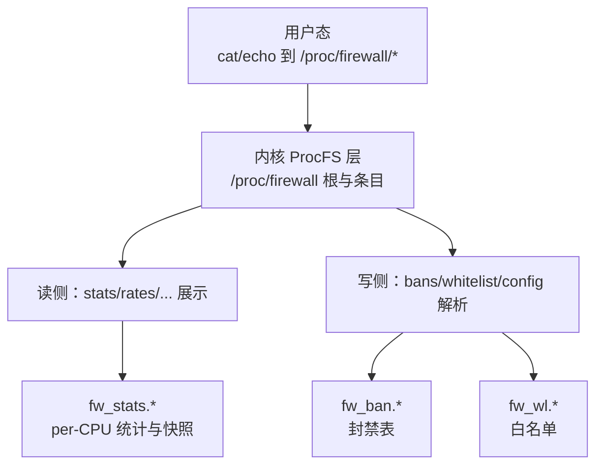
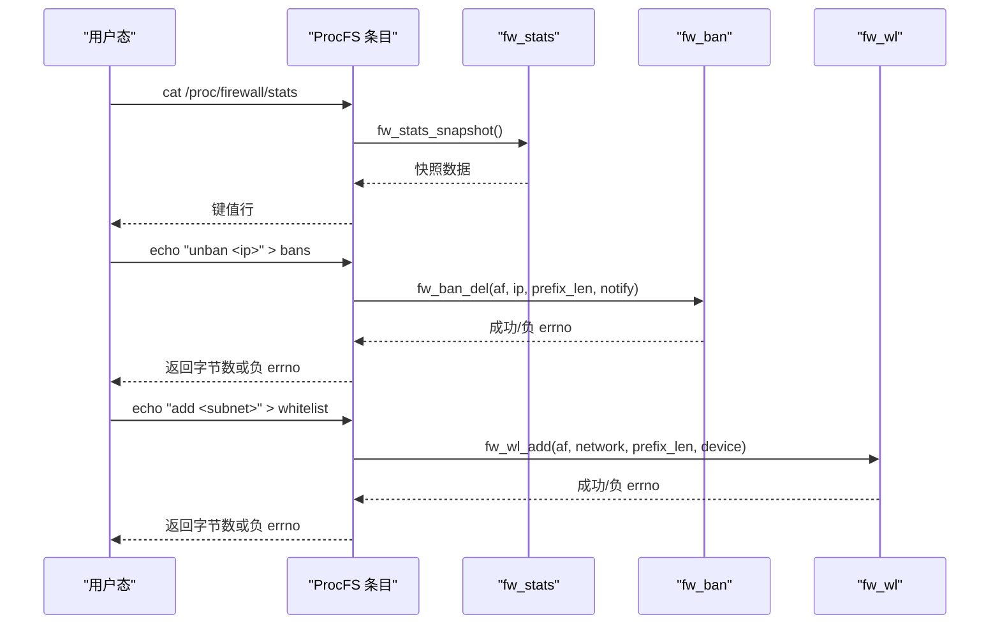
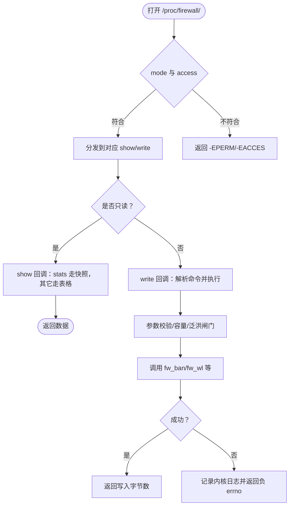
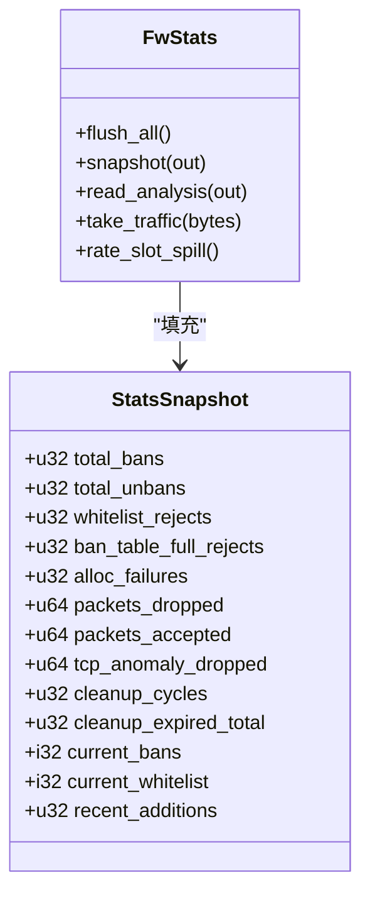
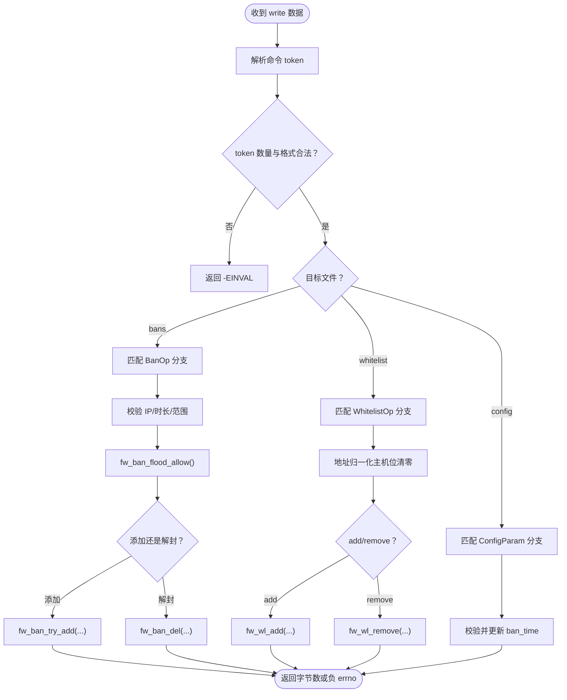
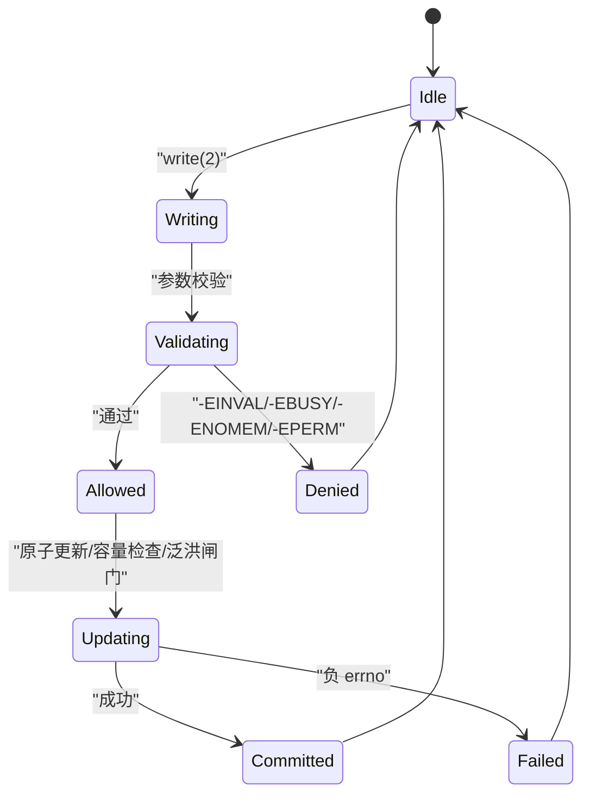
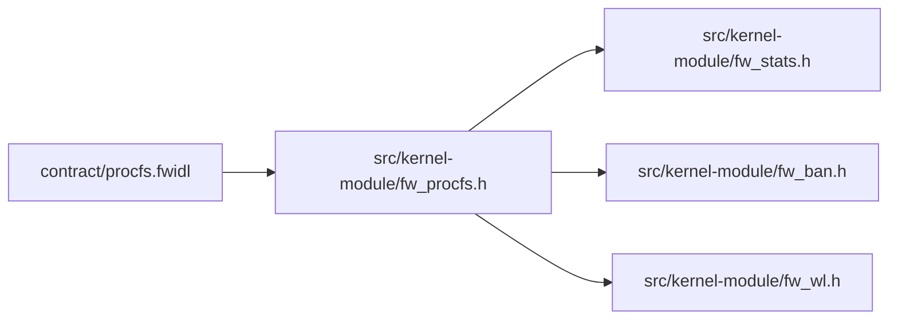

# ProcFS接口

<cite>
**本文引用的文件**   
- [fw_procfs.h](file://src/kernel-module/fw_procfs.h)
- [procfs.fwidl](file://contract/procfs.fwidl)
- [procfs.md](file://docs/zh/configuration/procfs.md)
- [fw_stats.h](file://src/kernel-module/fw_stats.h)
- [fw_ban.h](file://src/kernel-module/fw_ban.h)
- [fw_wl.h](file://src/kernel-module/fw_wl.h)
</cite>

## 目录
1. [简介](#简介)
2. [项目结构](#项目结构)
3. [核心组件](#核心组件)
4. [架构总览](#架构总览)
5. [详细组件分析](#详细组件分析)
6. [依赖关系分析](#依赖关系分析)
7. [性能考虑](#性能考虑)
8. [故障排查指南](#故障排查指南)
9. [结论](#结论)
10. [附录](#附录)

## 简介
本文件面向内核模块与守护进程、运维脚本之间的 ProcFS 接口，聚焦 /proc/firewall 下的虚拟文件机制。内容涵盖：
- 内核态与用户态通过 ProcFS 的通信模型：虚拟文件创建、读/写回调职责边界。
- 状态信息暴露格式：stats 机器可读字段、bans/whitelist/config 的人类可读表格。
- 动态配置写入接口：命令文法、参数校验、原子性更新、错误处理。
- 安全性与并发：权限位、泛洪闸门、容量上限、per-CPU 统计刷新。
- 使用示例与调试方法。

该接口的“单一真相源”是契约定义文件，生成物由 IDL 工具生成；实现侧仅负责按契约创建条目、实现读写语义。

**章节来源**
- [procfs.fwidl:1-28](file://contract/procfs.fwidl#L1-L28)
- [fw_procfs.h:1-14](file://src/kernel-module/fw_procfs.h#L1-L14)

## 项目结构
ProcFS 相关代码位于内核模块目录，契约与文档分别位于 contract 与 docs 目录：
- 契约：contract/procfs.fwidl（文本协议、权限、读/写文法、容量上限、缺陷处置）。
- 内核头：src/kernel-module/fw_procfs.h（对外窄接口：初始化/销毁 /proc/firewall 及其条目）。
- 文档：docs/zh/configuration/procfs.md（面向用户的条目清单、命令示例、输出形状说明）。
- 统计子系统：src/kernel-module/fw_stats.h（per-CPU 计数、快照、flush 纪律）。
- 封禁表：src/kernel-module/fw_ban.h（容量上限、泛洪闸门、前缀封禁、分页遍历）。
- 白名单：src/kernel-module/fw_wl.h（精确桶+子网链表、容量上限、联动解封）。

**图表来源**
- [fw_procfs.h:21-25](file://src/kernel-module/fw_procfs.h#L21-L25)
- [procfs.fwidl:62-164](file://contract/procfs.fwidl#L62-L164)
- [fw_stats.h:18-72](file://src/kernel-module/fw_stats.h#L18-L72)
- [fw_ban.h:29-73](file://src/kernel-module/fw_ban.h#L29-L73)
- [fw_wl.h:17-38](file://src/kernel-module/fw_wl.h#L17-L38)

**章节来源**
- [procfs.fwidl:32-33](file://contract/procfs.fwidl#L32-L33)
- [fw_procfs.h:21-25](file://src/kernel-module/fw_procfs.h#L21-L25)
- [procfs.md:11-29](file://docs/zh/configuration/procfs.md#L11-L29)

## 核心组件
- 契约与生成物
  - procfs.fwidl 冻结了条目名、权限、读/写文法、stats key 与数值类型、容量上限与缺陷处置。
  - 生成物用于编译期/校验期一致性检查，避免契约漂移。
- 内核入口
  - fw_procfs_init/fw_procfs_exit 负责创建/销毁 /proc/firewall 及全部条目，失败时回滚已创建部分。
- 统计子系统
  - fw_stats_* 提供 per-CPU 热路径计数与冷路径 flush/snapshot，确保 stats 读取不陈旧。
- 封禁表
  - fw_ban_* 提供带容量上限与泛洪闸门的封禁操作，支持前缀封禁与分页遍历。
- 白名单
  - fw_wl_* 提供精确桶+子网链表的查找/添加/移除，具备容量上限与联动解封能力。

**章节来源**
- [procfs.fwidl:1-28](file://contract/procfs.fwidl#L1-L28)
- [fw_procfs.h:1-14](file://src/kernel-module/fw_procfs.h#L1-L14)
- [fw_stats.h:1-11](file://src/kernel-module/fw_stats.h#L1-L11)
- [fw_ban.h:1-19](file://src/kernel-module/fw_ban.h#L1-L19)
- [fw_wl.h:1-10](file://src/kernel-module/fw_wl.h#L1-L10)

## 架构总览
ProcFS 作为内核与用户态的文本协议通道，承担三类职责：
- 只读观测：stats（机器可读）、rates/udp_ports/icmp_types/pkt_sizes/ttl_dist/ip_frags/port_scanners/service_probes/protected_ports（人类可读）。
- 控制面写入：bans（封禁/解封）、whitelist（加/删子网）、config（运行时参数）。
- 安全与并发：权限位限制 root 访问；泛洪闸门限制封禁速率；容量上限防止资源耗尽；per-CPU 统计在读取前统一 flush。

**图表来源**
- [procfs.fwidl:92-97](file://contract/procfs.fwidl#L92-L97)
- [procfs.fwidl:170-190](file://contract/procfs.fwidl#L170-L190)
- [fw_stats.h:61-69](file://src/kernel-module/fw_stats.h#L61-L69)
- [fw_ban.h:42-55](file://src/kernel-module/fw_ban.h#L42-L55)
- [fw_wl.h:23-30](file://src/kernel-module/fw_wl.h#L23-L30)

## 详细组件分析

### 虚拟文件与回调职责
- 根目录与条目
  - 根目录为 /proc/firewall，包含 13 个条目：bans、whitelist、config、stats、rates、udp_ports、icmp_types、pkt_sizes、ttl_dist、ip_frags、port_scanners、service_probes、protected_ports。
- 权限位
  - bans/whitelist/config 为 0600（root 可读写）；stats 为 0400（仅 root 可读）；其余只读条目均为 0400。
- 读侧
  - stats 为机器可读，每行「key 十进制整数」；其他条目为人类可读表格，无稳定性承诺。
- 写侧
  - 一次 write(2) 一条命令；成功返回写入字节数，失败返回负 errno；拒绝原因仅进入内核日志。

**图表来源**
- [procfs.fwidl:62-164](file://contract/procfs.fwidl#L62-L164)
- [procfs.fwidl:170-190](file://contract/procfs.fwidl#L170-L190)
- [procfs.md:32-42](file://docs/zh/configuration/procfs.md#L32-L42)

**章节来源**
- [procfs.fwidl:62-164](file://contract/procfs.fwidl#L62-L164)
- [procfs.md:11-29](file://docs/zh/configuration/procfs.md#L11-L29)
- [procfs.md:32-42](file://docs/zh/configuration/procfs.md#L32-L42)

### 状态信息暴露格式（stats）
- 机器可读字段（13 个 key）
  - total_bans、total_unbans、whitelist_rejects、ban_table_full_rejects、alloc_failures、packets_dropped、packets_accepted、tcp_anomaly_dropped、cleanup_cycles、cleanup_expired_total、current_bans、current_whitelist、recent_additions。
- 数值宽度
  - u32/i32/u64 与底层 atomic/atomic64 一致，不得更改。
- 刷新纪律
  - 读侧必须先 fw_stats_flush_all()，再取快照，避免 per-CPU 批量计数导致的陈旧值。

**图表来源**
- [procfs.fwidl:196-216](file://contract/procfs.fwidl#L196-L216)
- [fw_stats.h:61-78](file://src/kernel-module/fw_stats.h#L61-L78)

**章节来源**
- [procfs.fwidl:196-216](file://contract/procfs.fwidl#L196-L216)
- [fw_stats.h:1-11](file://src/kernel-module/fw_stats.h#L1-L11)
- [fw_stats.h:61-78](file://src/kernel-module/fw_stats.h#L61-L78)
- [procfs.md:165-195](file://docs/zh/configuration/procfs.md#L165-L195)

### 动态配置写入接口（bans/whitelist/config）
- bans 写文法
  - "<ip>"：默认时长封禁。
  - "<ip> <seconds>"：指定时长（1..31536000）。
  - "<ip> 0"：永久封禁。
  - "unban <ip>"：解封。
- whitelist 写文法
  - "add <subnet>"：添加子网。
  - "<subnet>"：省略动词即添加。
  - "remove <subnet>"：删除子网；可能联动解封覆盖范围内的封禁。
- config 写文法
  - "ban_time <seconds>"：设置默认封禁时长（1..31536000）。
- 通用规则
  - 分隔符为空格或制表符；除制表符外拒绝所有 < 0x20 的控制字符。
  - 错误返回负 errno，无文本错误通道；具体原因见内核日志。

**图表来源**
- [procfs.fwidl:45-60](file://contract/procfs.fwidl#L45-L60)
- [procfs.fwidl:170-190](file://contract/procfs.fwidl#L170-L190)
- [fw_ban.h:35-55](file://src/kernel-module/fw_ban.h#L35-L55)
- [fw_wl.h:23-30](file://src/kernel-module/fw_wl.h#L23-L30)

**章节来源**
- [procfs.fwidl:45-60](file://contract/procfs.fwidl#L45-L60)
- [procfs.fwidl:170-190](file://contract/procfs.fwidl#L170-L190)
- [procfs.md:44-153](file://docs/zh/configuration/procfs.md#L44-L153)

### 安全性、权限与并发
- 权限控制
  - bans/whitelist/config 为 0600；stats 及其他只读条目为 0400；仅 root 可写。
- 并发与一致性
  - per-CPU 统计在读取前统一 flush，避免陈旧值。
  - 封禁表与白名单均实施容量上限，并在桶锁内原子检查。
  - 泛洪闸门统一三条封禁路径（procfs/netlink/DDoS），限制每秒新增封禁次数。
- 错误处理
  - 写失败一律返回负 errno；无文本错误通道；拒绝原因仅进内核日志。

**图表来源**
- [procfs.fwidl:62-164](file://contract/procfs.fwidl#L62-L164)
- [procfs.fwidl:339-345](file://contract/procfs.fwidl#L339-L345)
- [fw_stats.h:61-69](file://src/kernel-module/fw_stats.h#L61-L69)
- [fw_ban.h:35-55](file://src/kernel-module/fw_ban.h#L35-L55)
- [fw_wl.h:23-30](file://src/kernel-module/fw_wl.h#L23-L30)

**章节来源**
- [procfs.fwidl:62-164](file://contract/procfs.fwidl#L62-L164)
- [procfs.fwidl:339-345](file://contract/procfs.fwidl#L339-L345)
- [fw_stats.h:61-69](file://src/kernel-module/fw_stats.h#L61-L69)
- [fw_ban.h:35-55](file://src/kernel-module/fw_ban.h#L35-L55)
- [fw_wl.h:23-30](file://src/kernel-module/fw_wl.h#L23-L30)

### 使用示例与调试方法
- 常用命令
  - 封禁：echo "203.0.113.9" | sudo tee /proc/firewall/bans
  - 定时封禁：echo "203.0.113.9 3600" | sudo tee /proc/firewall/bans
  - 永久封禁：echo "203.0.113.9 0" | sudo tee /proc/firewall/bans
  - 解封：echo "unban 203.0.113.9" | sudo tee /proc/firewall/bans
  - 白名单：echo "add 203.0.113.0/24" | sudo tee /proc/firewall/whitelist
  - 配置：echo "ban_time 300" | sudo tee /proc/firewall/config
- 观察状态
  - cat /proc/firewall/stats
  - cat /proc/firewall/bans
  - cat /proc/firewall/whitelist
  - cat /proc/firewall/config
- 调试建议
  - 查看内核日志：sudo dmesg | tail
  - 检查白名单命中与表满计数：cat /proc/firewall/whitelist 与 grep ban_table_full_rejects /proc/firewall/stats
  - 确认写入内容：tee 退出码非 0 表示内核返回负 errno

**章节来源**
- [procfs.md:60-74](file://docs/zh/configuration/procfs.md#L60-L74)
- [procfs.md:107-119](file://docs/zh/configuration/procfs.md#L107-L119)
- [procfs.md:147-153](file://docs/zh/configuration/procfs.md#L147-L153)
- [procfs.md:186-191](file://docs/zh/configuration/procfs.md#L186-L191)
- [procfs.md:251-270](file://docs/zh/configuration/procfs.md#L251-L270)

## 依赖关系分析
- 契约驱动
  - procfs.fwidl 决定条目名、权限、读/写文法、stats key 与数值类型、容量上限与缺陷处置。
- 内核实现
  - fw_procfs.h 提供初始化/销毁接口；实际读写逻辑遵循契约。
  - fw_stats.h 提供 per-CPU 统计与快照；stats_show 必须经 fw_stats_snapshot()。
  - fw_ban.h 提供封禁表操作；容量上限与泛洪闸门保证稳定性。
  - fw_wl.h 提供白名单操作；容量上限与联动解封保证一致性。

**图表来源**
- [procfs.fwidl:1-28](file://contract/procfs.fwidl#L1-L28)
- [fw_procfs.h:21-25](file://src/kernel-module/fw_procfs.h#L21-L25)
- [fw_stats.h:18-72](file://src/kernel-module/fw_stats.h#L18-L72)
- [fw_ban.h:29-73](file://src/kernel-module/fw_ban.h#L29-L73)
- [fw_wl.h:17-38](file://src/kernel-module/fw_wl.h#L17-L38)

**章节来源**
- [procfs.fwidl:1-28](file://contract/procfs.fwidl#L1-L28)
- [fw_procfs.h:21-25](file://src/kernel-module/fw_procfs.h#L21-L25)
- [fw_stats.h:18-72](file://src/kernel-module/fw_stats.h#L18-L72)
- [fw_ban.h:29-73](file://src/kernel-module/fw_ban.h#L29-L73)
- [fw_wl.h:17-38](file://src/kernel-module/fw_wl.h#L17-L38)

## 性能考虑
- per-CPU 统计
  - 热路径仅写本 CPU 槽位，减少锁竞争；读侧统一 flush 后取快照，避免陈旧值。
- 容量上限
  - bans/whitelist/rates 等均有明确上限，防止哈希表膨胀与内存压力。
- 泛洪闸门
  - 限制每秒新增封禁次数，保护内核路径不被突发控制面请求压垮。
- 列表遍历
  - bans/whitelist/rates 等列表采用 offset/limit 分页，避免单次返回过大载荷。

[本节为通用性能指导，不直接分析具体文件]

## 故障排查指南
- 写命令未生效
  - 查看内核日志获取拒绝原因。
  - 检查是否命中白名单或被白名单 remove 联动解封。
  - 检查封禁表是否达到上限（ban_table_full_rejects）。
  - 确认写入内容与命令文法是否正确。
- 常见 errno
  - -EINVAL：参数非法或超出范围。
  - -EBUSY：资源忙或冲突。
  - -ENOMEM：分配失败。
  - -EPERM：权限不足或受保护地址不允许操作。

**章节来源**
- [procfs.md:251-270](file://docs/zh/configuration/procfs.md#L251-L270)
- [procfs.fwidl:339-345](file://contract/procfs.fwidl#L339-L345)

## 结论
ProcFS 接口以契约为中心，将内核态与用户态的文本协议固化，确保读侧 stats 的机器可读性与写侧命令文法的稳定性。通过权限控制、容量上限、泛洪闸门与 per-CPU 统计刷新，系统在功能正确性、性能与安全性之间取得平衡。运维与开发应严格遵循契约与文档，避免手工修改生成物，并通过测试与校验器保障一致性。

[本节为总结性内容，不直接分析具体文件]

## 附录
- 条目清单与用途
  - bans：封禁列表与封禁/解封命令。
  - whitelist：白名单与加/删子网命令。
  - config：运行时配置与 ban_time 设置。
  - stats：13 个计数器，机器可读。
  - rates/udp_ports/icmp_types/pkt_sizes/ttl_dist/ip_frags/port_scanners/service_probes/protected_ports：人类可读的分析与分布视图。
- 容量上限参考
  - bans：65535（fw_max_ban_entries）。
  - whitelist：65535（fw_max_whitelist_entries）。
  - rates：65536（fw_max_rate_entries）。
  - udp_ports：512；icmp_types：128；port_scanners/service_probes：20；protected_ports：256（展示行数上限）。

**章节来源**
- [procfs.md:11-29](file://docs/zh/configuration/procfs.md#L11-L29)
- [procfs.md:231-249](file://docs/zh/configuration/procfs.md#L231-L249)