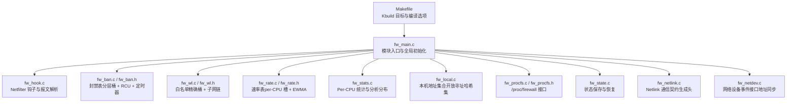
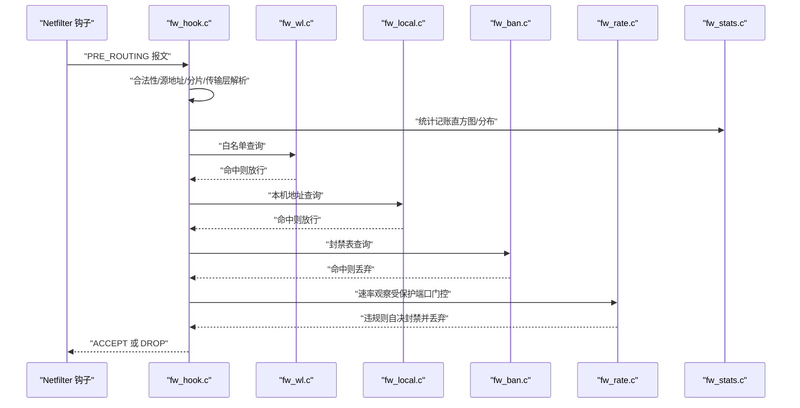
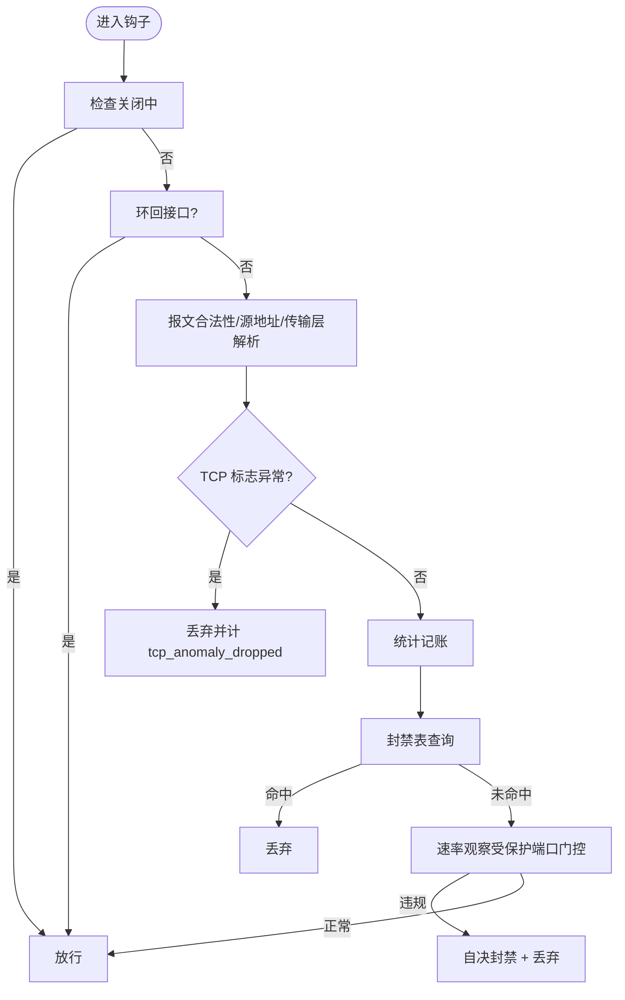
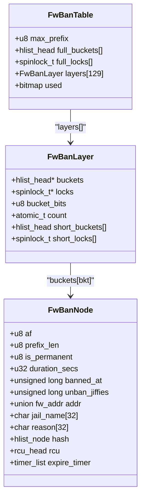
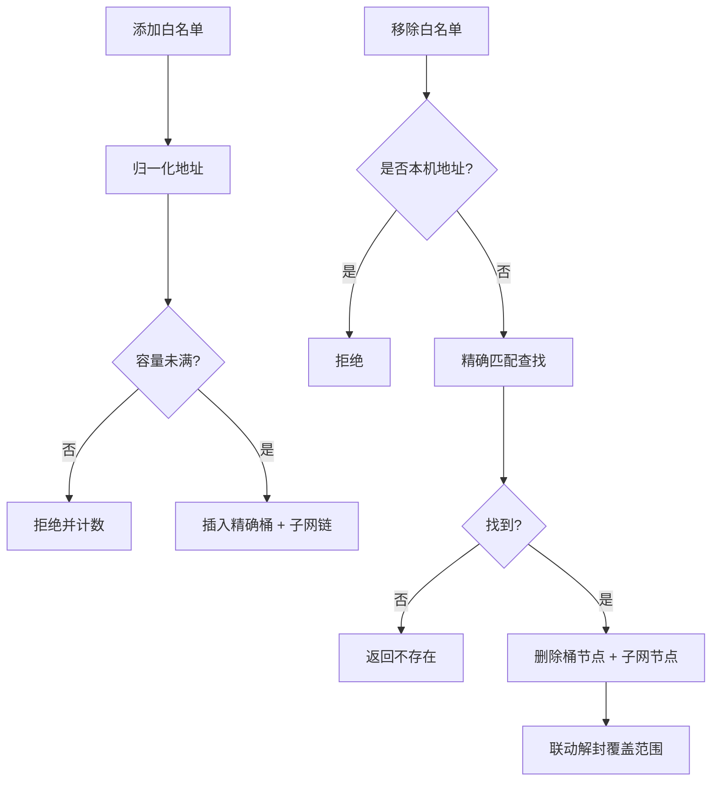
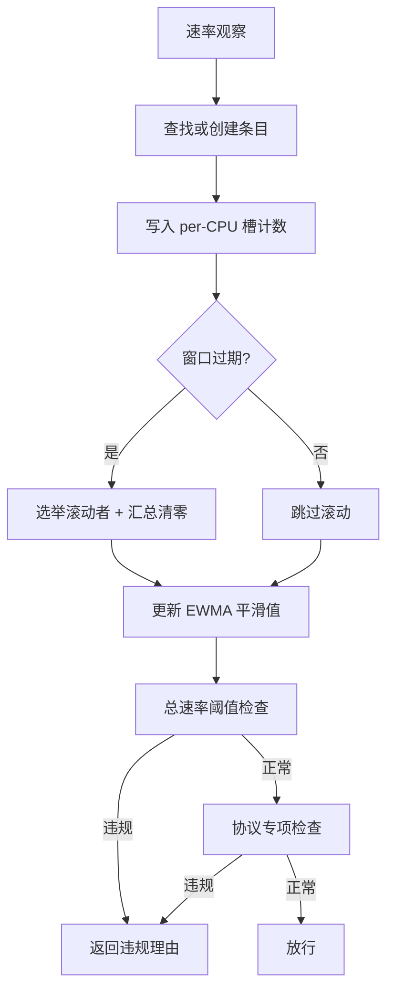
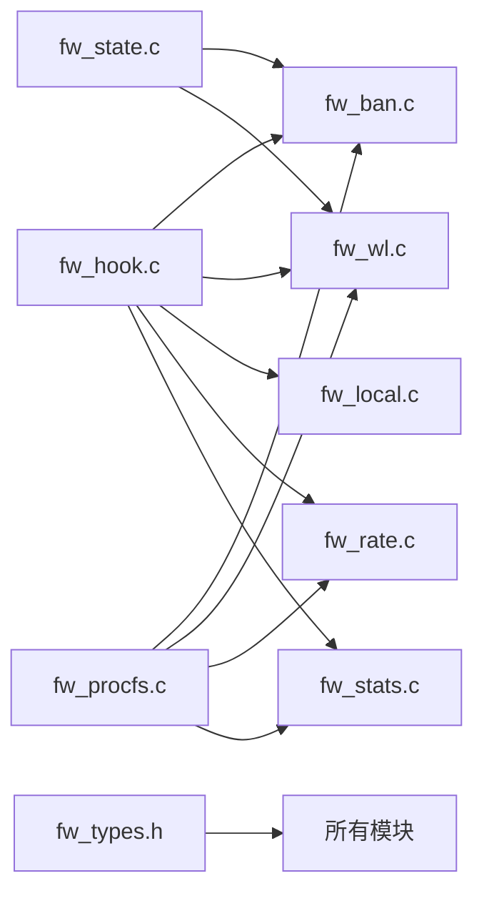

# 内核模块设计

<cite>
**本文引用的文件**   
- [fw_hook.c](file://src/kernel-module/fw_hook.c)
- [fw_ban.c](file://src/kernel-module/fw_ban.c)
- [fw_ban.h](file://src/kernel-module/fw_ban.h)
- [fw_wl.c](file://src/kernel-module/fw_wl.c)
- [fw_wl.h](file://src/kernel-module/fw_wl.h)
- [fw_rate.c](file://src/kernel-module/fw_rate.c)
- [fw_rate.h](file://src/kernel-module/fw_rate.h)
- [fw_stats.c](file://src/kernel-module/fw_stats.c)
- [fw_local.c](file://src/kernel-module/fw_local.c)
- [fw_procfs.c](file://src/kernel-module/fw_procfs.c)
- [fw_procfs.h](file://src/kernel-module/fw_procfs.h)
- [fw_state.c](file://src/kernel-module/fw_state.c)
- [fw_types.h](file://src/kernel-module/fw_types.h)
- [Makefile](file://src/kernel-module/Makefile)
</cite>

## 目录
1. [引言](#引言)
2. [项目结构](#项目结构)
3. [核心组件](#核心组件)
4. [架构总览](#架构总览)
5. [详细组件分析](#详细组件分析)
6. [依赖关系分析](#依赖关系分析)
7. [性能与内存管理](#性能与内存管理)
8. [ProcFS 接口说明](#procfs-接口说明)
9. [并发控制与锁顺序](#并发控制与锁顺序)
10. [调试与故障排查](#调试与故障排查)
11. [结论](#结论)

## 引言
本技术文档面向内核开发者与高级用户，系统性解析 Linux 内核防火墙模块的设计与实现。重点覆盖：
- Netfilter 钩子注册、报文解析与包过滤流程
- RCU 读路径与桶级自旋锁的协作方式
- 封禁表的分层桶结构、前缀匹配与定时器到期机制
- 白名单精确桶 + 子网链的数据结构与算法
- 速率统计的 per-CPU 槽、窗口滚动、EWMA 平滑与违规判定
- ProcFS 文本协议、状态持久化与恢复
- 内存分配、RCU 释放、并发模型与热路径优化
- 内核态调试技巧与常见问题定位方法

## 项目结构
内核模块按数据所有权划分，每个 C 文件对应一个子系统，构建由 Kbuild 统一组织。

**图表来源**
- [Makefile:8-20](file://src/kernel-module/Makefile#L8-L20)
- [fw_types.h:593-700](file://src/kernel-module/fw_types.h#L593-L700)

**章节来源**
- [Makefile:1-29](file://src/kernel-module/Makefile#L1-L29)
- [fw_types.h:593-700](file://src/kernel-module/fw_types.h#L593-L700)

## 核心组件
- **Netfilter 钩子与过滤流程**：在 `NF_INET_PRE_ROUTING` 注册 IPv4/IPv6 钩子，完成报文合法性检查、源地址校验、传输层解析、异常标志丢弃、统计记账，以及白名单、本机地址、封禁表、速率判定的统一决策。
- **封禁表**：按前缀长度分层的桶表，支持精确主机与 CIDR 网段封禁；条目带 per-entry 定时器，到期自动摘链并推送解封事件。
- **白名单**：精确桶 + 子网链表，命中即放行且跳过速率判定；移除时联动解封覆盖范围内的封禁条目。
- **速率统计**：每 CPU 槽记录原始计数，窗口滚动由选举出的 CPU 汇总并清零，使用 EWMA 平滑值进行总速率与协议专项阈值判定。
- **统计与分析**：Per-CPU 直方图、UDP 端口分布、ICMP 类型分布，读侧先 flush 再聚合，避免陈旧读数。
- **本机地址集合**：开放寻址线性探测哈希集，只存精确主机地址，提供 O(1) 查找。
- **ProcFS 接口**：bans、whitelist、config、stats、rates、udp_ports、icmp_types、pkt_sizes、ttl_dist、ip_frags、port_scanners、service_probes、protected_ports 等条目。
- **状态持久化**：CRC32 尾行校验，先写临时文件再原子替换；恢复时先白名单后封禁，保留容量检查与前缀语义。

**章节来源**
- [fw_hook.c:5-45](file://src/kernel-module/fw_hook.c#L5-L45)
- [fw_ban.c:1-41](file://src/kernel-module/fw_ban.c#L1-L41)
- [fw_wl.c:1-18](file://src/kernel-module/fw_wl.c#L1-L18)
- [fw_rate.h:1-26](file://src/kernel-module/fw_rate.h#L1-L26)
- [fw_stats.c:1-14](file://src/kernel-module/fw_stats.c#L1-L14)
- [fw_local.c:1-17](file://src/kernel-module/fw_local.c#L1-L17)
- [fw_procfs.h:1-14](file://src/kernel-module/fw_procfs.h#L1-L14)
- [fw_state.c:1-29](file://src/kernel-module/fw_state.c#L1-L29)

## 架构总览
整体数据流从 Netfilter 钩子进入，经本地快速短路（环回、白名单、本机地址），再到封禁表与速率判定，最终返回 ACCEPT/DROP。

**图表来源**
- [fw_hook.c:104-154](file://src/kernel-module/fw_hook.c#L104-L154)
- [fw_hook.c:156-278](file://src/kernel-module/fw_hook.c#L156-L278)
- [fw_hook.c:280-410](file://src/kernel-module/fw_hook.c#L280-L410)
- [fw_rate.h:37-58](file://src/kernel-module/fw_rate.h#L37-L58)

## 详细组件分析

### Netfilter 钩子与包过滤流程
- 钩子注册于 `init_net` 的 `NF_INET_PRE_ROUTING`，优先级为 `NF_IP_PRI_FILTER - 1`，确保在 filter 表之前看到报文。
- 热路径关键优化：
  - 一次 RCU 临界区完成白名单、本机地址、封禁表、速率四步判定。
  - 端口去重集合落在 per-CPU 槽，热路径零自旋锁。
  - 统计、直方图、UDP/ICMP 分布全部落本 CPU，零共享 cache line 写。
- 判定顺序固定：
  1. 环回接口进入 ⇒ 放行
  2. 白名单命中 ⇒ 放行（跳过速率判定）
  3. 本机地址命中 ⇒ 放行（跳过速率判定）
  4. 封禁表命中 ⇒ 丢包
  5. 未命中且 DDoS 开启且目的端口受保护 ⇒ 速率判定，违规则自决封禁并丢包

**图表来源**
- [fw_hook.c:104-154](file://src/kernel-module/fw_hook.c#L104-L154)
- [fw_hook.c:156-278](file://src/kernel-module/fw_hook.c#L156-L278)
- [fw_hook.c:280-410](file://src/kernel-module/fw_hook.c#L280-L410)

**章节来源**
- [fw_hook.c:5-45](file://src/kernel-module/fw_hook.c#L5-L45)
- [fw_hook.c:104-154](file://src/kernel-module/fw_hook.c#L104-L154)
- [fw_hook.c:156-278](file://src/kernel-module/fw_hook.c#L156-L278)
- [fw_hook.c:280-410](file://src/kernel-module/fw_hook.c#L280-L410)

### 封禁表数据结构与算法
- 分层桶表：按前缀长度（prefix_len）分层，全长层（/32 或 /128）复用大桶数组，短前缀层用小桶数组节省内存。
- 桶索引归一化：同一网段内任意源 IP 归一化后落入同一桶，保证 CIDR 封禁有效。
- 位图维护：used 位图表示某层是否非空，插入/删除严格遵循“挂链在前、位图在后”的顺序，避免活条目被误清。
- 定时器到期：每条目独立 timer_list，到期回调持桶锁摘链、call_rcu 释放，并推送 UNBAN 事件。
- 容量上限：新增 `max_ban_entries`，在桶锁内原子检查，超限拒绝并递增 `ban_table_full_rejects`。
- 泛洪闸门：三条封禁路径（procfs/netlink/DDoS 自决）共用 `fw_ban_flood_allow()`，限制每秒添加次数。

**图表来源**
- [fw_types.h:234-289](file://src/kernel-module/fw_types.h#L234-L289)
- [fw_ban.c:180-212](file://src/kernel-module/fw_ban.c#L180-L212)
- [fw_ban.c:369-383](file://src/kernel-module/fw_ban.c#L369-L383)
- [fw_ban.c:434-504](file://src/kernel-module/fw_ban.c#L434-L504)

**章节来源**
- [fw_ban.c:1-41](file://src/kernel-module/fw_ban.c#L1-L41)
- [fw_ban.c:180-212](file://src/kernel-module/fw_ban.c#L180-L212)
- [fw_ban.c:369-383](file://src/kernel-module/fw_ban.c#L369-L383)
- [fw_ban.c:434-504](file://src/kernel-module/fw_ban.c#L434-L504)
- [fw_ban.h:1-19](file://src/kernel-module/fw_ban.h#L1-L19)

### 白名单处理算法
- 数据结构：64 精确桶 + 子网链表。精确条目只入桶；子网条目同时入桶与子网链。
- 命中判定：先查精确桶，再遍历子网链是否存在覆盖该地址的前缀条目。
- 容量上限：新增 `max_whitelist_entries`，插入前在 wl_lock 内原子检查，修复旧实现容量不生效问题。
- 移除语义：必须 (af, 地址, prefix_len) 完全一致才移除；若命中本机接口地址则拒绝（由 fw_local_lookup 判断）。
- 联动解封：移除白名单后，调用 `fw_ban_del_matching` 解封覆盖范围内的封禁条目。

**图表来源**
- [fw_wl.c:157-210](file://src/kernel-module/fw_wl.c#L157-L210)
- [fw_wl.c:212-245](file://src/kernel-module/fw_wl.c#L212-L245)
- [fw_wl.c:274-310](file://src/kernel-module/fw_wl.c#L274-L310)

**章节来源**
- [fw_wl.c:1-18](file://src/kernel-module/fw_wl.c#L1-L18)
- [fw_wl.c:157-210](file://src/kernel-module/fw_wl.c#L157-L210)
- [fw_wl.c:212-245](file://src/kernel-module/fw_wl.c#L212-L245)
- [fw_wl.h:1-10](file://src/kernel-module/fw_wl.h#L1-L10)

### 速率统计与违规判定
- Per-CPU 槽：每条速率条目固定占用一组 per-CPU 槽，热路径只写本 CPU 内存，无共享 cache line 写。
- 窗口滚动：通过 atomic_cmpxchg 选举唯一结算者，汇总各 CPU 槽并清零，计算 EWMA 平滑值。
- 端口去重：seen_ports 移至 per-CPU 槽，滚动时取并集，热路径零自旋锁。
- 违规判定：总速率（静态 + 动态基线）与协议专项（SYN/ACK/RST/FIN/UDP/ICMP）阈值比较，返回理由字符串。
- 回收机制：静默超过保留时长的条目由周期工作项回收，释放槽位以周转跟踪能力。

**图表来源**
- [fw_rate.c:661-750](file://src/kernel-module/fw_rate.c#L661-L750)
- [fw_rate.c:506-577](file://src/kernel-module/fw_rate.c#L506-L577)
- [fw_rate.c:238-292](file://src/kernel-module/fw_rate.c#L238-L292)

**章节来源**
- [fw_rate.h:1-26](file://src/kernel-module/fw_rate.h#L1-L26)
- [fw_rate.c:661-750](file://src/kernel-module/fw_rate.c#L661-L750)
- [fw_rate.c:506-577](file://src/kernel-module/fw_rate.c#L506-L577)
- [fw_rate.c:238-292](file://src/kernel-module/fw_rate.c#L238-L292)

### 统计与分析
- Per-CPU 统计块：直方图、TTL 分布、UDP 端口分布、ICMP 类型分布全部落本 CPU。
- 读侧 flush：所有统计类读数先经 `fw_stats_flush_all()`，消除陈旧读数。
- 分析快照：一次取齐 UDP/ICMP 分布、扫描者/探测者信息，供 procfs 与 netlink 共用。

**章节来源**
- [fw_stats.c:1-14](file://src/kernel-module/fw_stats.c#L1-L14)
- [fw_stats.c:376-459](file://src/kernel-module/fw_stats.c#L376-L459)

### 本机地址集合
- 开放寻址线性探测哈希集，只存精确主机地址（/32 或 /128）。
- 热路径 O(1) 查找，替代旧实现的 O(N) 线性扫描。
- 集合重建后整体 RCU 发布，旧表 kfree_rcu 释放。

**章节来源**
- [fw_local.c:1-17](file://src/kernel-module/fw_local.c#L1-L17)
- [fw_local.c:70-101](file://src/kernel-module/fw_local.c#L70-L101)
- [fw_local.c:107-177](file://src/kernel-module/fw_local.c#L107-L177)

### 状态持久化与恢复
- 保存：CRC32 尾行校验，先写临时文件再原子替换；封禁行带前缀长度，白名单先于封禁恢复。
- 恢复：两遍解析，先白名单后封禁；容量检查照常，跳过泛洪闸门；非法文件或 CRC 失败直接拒绝。

**章节来源**
- [fw_state.c:1-29](file://src/kernel-module/fw_state.c#L1-L29)
- [fw_state.c:281-354](file://src/kernel-module/fw_state.c#L281-L354)
- [fw_state.c:542-654](file://src/kernel-module/fw_state.c#L542-L654)

## 依赖关系分析
模块间依赖清晰，按数据所有权切分，避免循环依赖。

**图表来源**
- [fw_hook.c:58-64](file://src/kernel-module/fw_hook.c#L58-L64)
- [fw_procfs.c:55-61](file://src/kernel-module/fw_procfs.c#L55-L61)
- [fw_state.c:42-44](file://src/kernel-module/fw_state.c#L42-L44)

**章节来源**
- [fw_types.h:593-700](file://src/kernel-module/fw_types.h#L593-L700)

## 性能与内存管理
- **热路径零锁**：端口去重、统计、直方图全部落 per-CPU 槽，避免共享 cache line 写。
- **RCU 读路径**：白名单、本机地址、封禁表、速率表均使用 RCU 读侧临界区，仅冷路径加锁。
- **内存分配**：GFP_ATOMIC 用于热路径附近分配，失败时统计并放行（速率表满）或拒绝（封禁表满）。
- **RCU 释放**：所有删除路径使用 hlist_del_rcu + call_rcu，确保宽限期后释放，避免使用后释放。
- **窗口滚动**：通过 atomic_cmpxchg 选举滚动者，避免自旋锁竞争。
- **回收机制**：速率表静默条目周期回收，释放槽位以维持跟踪能力。

**章节来源**
- [fw_rate.c:1-37](file://src/kernel-module/fw_rate.c#L1-L37)
- [fw_ban.c:34-41](file://src/kernel-module/fw_ban.c#L34-L41)
- [fw_stats.c:1-14](file://src/kernel-module/fw_stats.c#L1-L14)

## ProcFS 接口说明
/proc/firewall 提供 13 个条目，分为机器可读 stats 与人类可读表格。

| 条目 | 类型 | 功能 |
|------|------|------|
| bans | 读写 | 封禁/解封 IP，支持精确主机（/32 或 /128） |
| whitelist | 读写 | 添加/移除白名单，支持 CIDR 前缀 |
| config | 读写 | 修改默认封禁时长 ban_time |
| stats | 只读 | 13 个 key 的机器可读统计 |
| rates | 只读 | 速率表快照，显示配置与活跃条目 |
| udp_ports | 只读 | UDP 端口分布 |
| icmp_types | 只读 | ICMP 类型分布 |
| pkt_sizes | 只读 | 包大小直方图 |
| ttl_dist | 只读 | TTL 分布 |
| ip_frags | 只读 | IP 分片统计 |
| port_scanners | 只读 | 端口扫描者列表 |
| service_probes | 只读 | 服务探测者列表 |
| protected_ports | 只读 | 受保护端口位图展示 |

**章节来源**
- [fw_procfs.h:1-14](file://src/kernel-module/fw_procfs.h#L1-L14)
- [fw_procfs.c:121-245](file://src/kernel-module/fw_procfs.c#L121-L245)
- [fw_procfs.c:322-447](file://src/kernel-module/fw_procfs.c#L322-L447)
- [fw_procfs.c:494-561](file://src/kernel-module/fw_procfs.c#L494-L561)
- [fw_procfs.c:563-665](file://src/kernel-module/fw_procfs.c#L563-L665)

## 并发控制与锁顺序
锁顺序协议严格定义，违反即死锁：
- 封禁层桶锁 → ban_layer_lock（不嵌套）
- 白名单 wl_lock
- 速率 rate_locks[bkt] → rate_slot_lock（唯一允许嵌套）
- 泛洪 flood_lock
- 统计表锁

热路径（软中断）不持有上述任何锁，仅建速率条目时短暂取桶锁。

**章节来源**
- [fw_types.h:12-28](file://src/kernel-module/fw_types.h#L12-L28)
- [fw_ban.c:21-41](file://src/kernel-module/fw_ban.c#L21-L41)
- [fw_rate.c:433-495](file://src/kernel-module/fw_rate.c#L433-L495)

## 调试与故障排查
- **查看统计**：`cat /proc/firewall/stats` 获取 13 个 key，注意读前先 flush。
- **检查封禁表**：`cat /proc/firewall/bans` 查看活跃封禁，区分永久与临时。
- **速率表诊断**：`cat /proc/firewall/rates` 查看配置与活跃条目，关注 rate_slot_spill 与 rate_reclaimed。
- **常见错误**：
  - 封禁表满：ban_table_full_rejects 递增，新封禁被拒绝。
  - 白名单容量满：wl_reject_count 递增，新白名单被拒绝。
  - 速率表满：rate_slot_spill 递增，新源不判定（失败开放）。
  - 状态文件损坏：CRC32 校验失败，拒绝恢复。
- **内核日志**：pr_fmt("firewall: ") 前缀便于 grep 过滤。
- **性能瓶颈**：观察 rate_window_seconds、max_packets_per_second、max_bytes_per_second 配置是否合理。

**章节来源**
- [fw_procfs.c:567-585](file://src/kernel-module/fw_procfs.c#L567-L585)
- [fw_procfs.c:603-653](file://src/kernel-module/fw_procfs.c#L603-L653)
- [fw_state.c:366-401](file://src/kernel-module/fw_state.c#L366-L401)

## 结论
本内核模块通过精细的 RCU 与 per-CPU 设计，实现了高吞吐、低延迟的包过滤与 DDoS 防护。封禁表的分层桶结构、白名单的子网链、速率表的 per-CPU 槽与 EWMA 平滑，共同构成了可扩展、可观测的内核态防火墙核心。ProcFS 与状态持久化提供了运维友好性，而严格的锁顺序与内存管理保证了稳定性。对于内核开发者，建议重点关注热路径优化、RCU 使用规范与锁顺序协议；对于高级用户，可通过 ProcFS 接口监控与调优参数，平衡安全性与性能。