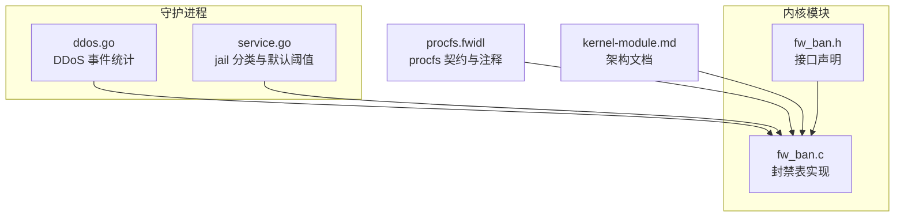
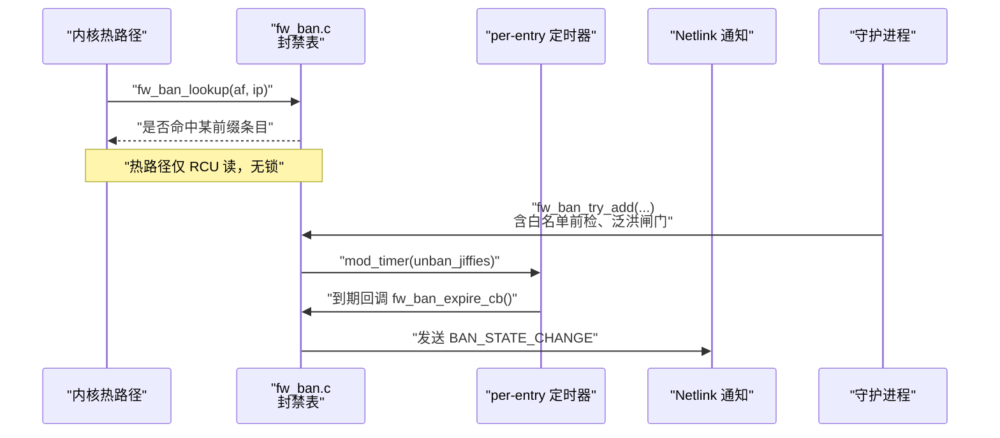
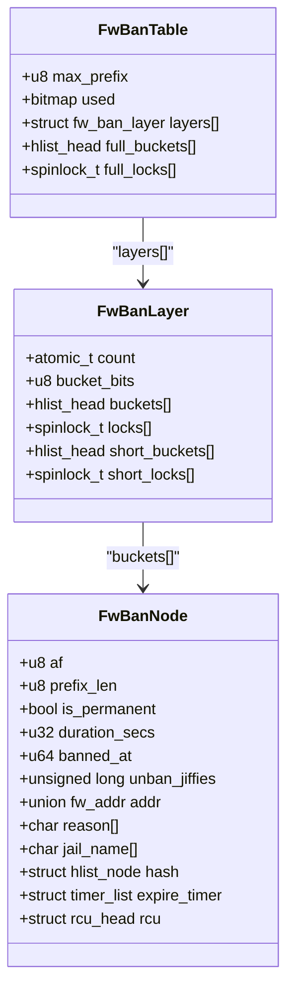
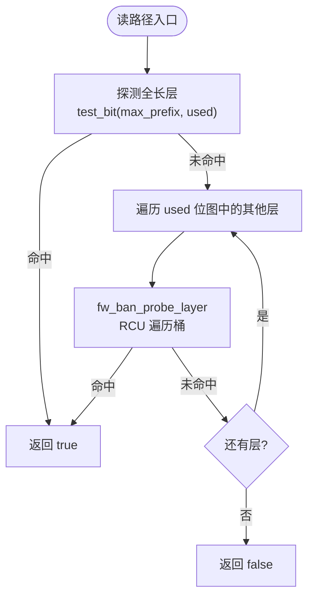
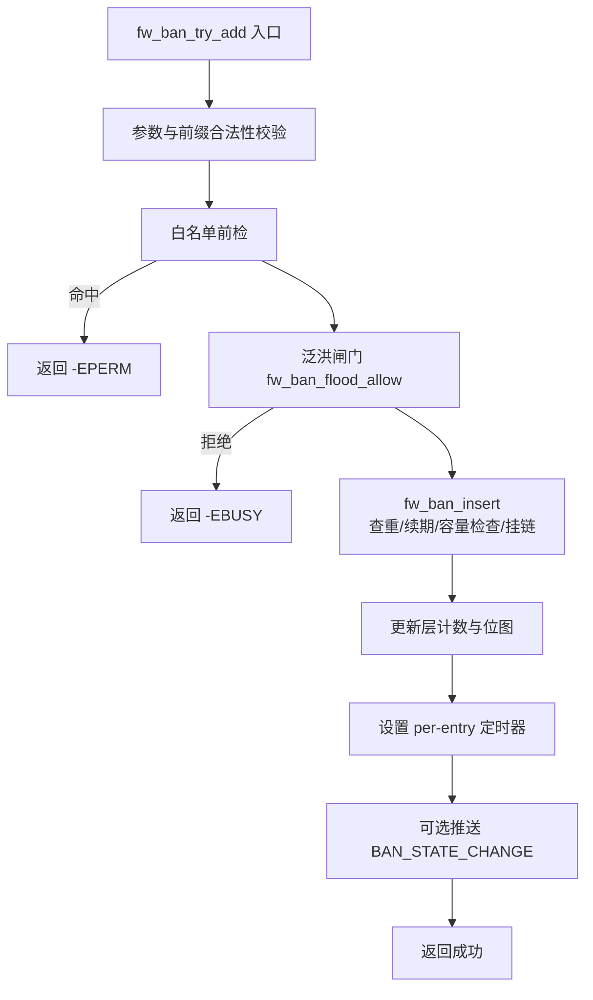
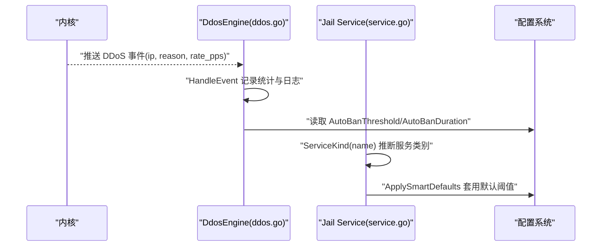
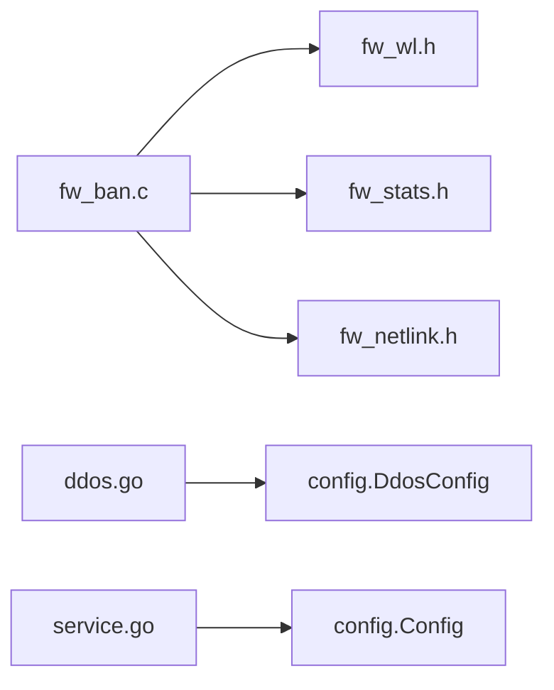

# 封禁表管理

<cite>
**本文引用的文件**   
- [fw_ban.h](file://src/kernel-module/fw_ban.h)
- [fw_ban.c](file://src/kernel-module/fw_ban.c)
- [ddos.go](file://src/daemon/internal/decision/ddos.go)
- [service.go](file://src/daemon/internal/jail/service.go)
- [procfs.fwidl](file://contract/procfs.fwidl)
- [kernel-module.md](file://docs/zh/architecture/kernel-module.md)
</cite>

## 目录
1. [引言](#引言)
2. [项目结构](#项目结构)
3. [核心组件](#核心组件)
4. [架构总览](#架构总览)
5. [详细组件分析](#详细组件分析)
6. [依赖关系分析](#依赖关系分析)
7. [性能与容量特性](#性能与容量特性)
8. [监控与调优](#监控与调优)
9. [故障排查](#故障排查)
10. [结论](#结论)

## 引言
本技术文档聚焦内核模块中的封禁表子系统，系统性说明其数据结构、并发模型、操作语义、自决封禁联动以及内存与容量策略。封禁表采用按前缀长度分层的哈希桶表，配合 RCU 读路径和层内桶锁写路径，提供高吞吐的封禁查询与增删能力；守护进程侧负责 DDoS 事件统计与 jail 分类默认值推断，与内核封禁行为解耦。

## 项目结构
与封禁表直接相关的代码主要分布在：
- 内核模块头文件与实现：`src/kernel-module/fw_ban.h`、`src/kernel-module/fw_ban.c`
- 守护进程决策与 jail 分类：`src/daemon/internal/decision/ddos.go`、`src/daemon/internal/jail/service.go`
- 契约与文档：`contract/procfs.fwidl`、`docs/zh/architecture/kernel-module.md`

图表来源
- [fw_ban.h:26-73](file://src/kernel-module/fw_ban.h#L26-L73)
- [fw_ban.c:1-41](file://src/kernel-module/fw_ban.c#L1-L41)
- [ddos.go:57-81](file://src/daemon/internal/decision/ddos.go#L57-L81)
- [service.go:9-19](file://src/daemon/internal/jail/service.go#L9-L19)
- [procfs.fwidl:230-304](file://contract/procfs.fwidl#L230-L304)
- [kernel-module.md:165-221](file://docs/zh/architecture/kernel-module.md#L165-L221)

章节来源
- [fw_ban.h:26-73](file://src/kernel-module/fw_ban.h#L26-L73)
- [fw_ban.c:1-41](file://src/kernel-module/fw_ban.c#L1-L41)
- [procfs.fwidl:230-304](file://contract/procfs.fwidl#L230-L304)
- [kernel-module.md:165-221](file://docs/zh/architecture/kernel-module.md#L165-L221)

## 核心组件
- 封禁表接口：提供查找、尝试添加、删除、恢复、批量填充、泛洪闸门等能力。
- 分层桶表：按 prefix_len 分层，全长层复用全局桶数组，短前缀层使用每层独立小桶数组。
- 并发模型：RCU 读路径无锁；写路径持层内桶锁；层计数与位图由 ban_layer_lock 保护。
- 定时器机制：每个条目维护 per-entry 定时器，到期自动解封并推送状态变更。
- 容量控制：通过 fw_max_ban_entries 限制总条目数，到限拒绝新增并递增拒绝计数器。
- 白名单联动：添加前检查白名单；白名单变更时批量解封匹配条目。

章节来源
- [fw_ban.h:29-73](file://src/kernel-module/fw_ban.h#L29-L73)
- [fw_ban.c:43-41](file://src/kernel-module/fw_ban.c#L43-L41)
- [fw_ban.c:143-155](file://src/kernel-module/fw_ban.c#L143-L155)
- [fw_ban.c:234-268](file://src/kernel-module/fw_ban.c#L234-L268)
- [fw_ban.c:479-484](file://src/kernel-module/fw_ban.c#L479-L484)
- [fw_ban.c:577-611](file://src/kernel-module/fw_ban.c#L577-L611)

## 架构总览
封禁表在热路径仅做 RCU 只读查表，命中条件为“地址落在条目前缀内”；写路径在桶锁内完成查重、续期或插入、容量检查与位图更新。守护进程的 DDoS 引擎接收内核已封禁的事件进行统计，jail 服务根据服务名推断默认阈值（重试次数、发现时间、封禁时长），这些默认值影响上层对封禁行为的配置与展示。

图表来源
- [fw_ban.c:369-383](file://src/kernel-module/fw_ban.c#L369-L383)
- [fw_ban.c:506-531](file://src/kernel-module/fw_ban.c#L506-L531)
- [fw_ban.c:274-329](file://src/kernel-module/fw_ban.c#L274-L329)

## 详细组件分析

### 数据结构与组织方式
- 条目身份三元组：(地址族 af, 地址 addr, 前缀长度 prefix_len)。不同前缀长度属于不同层，互不覆盖。
- 分层桶表：
  - 全长层（IPv4 /32、IPv6 /128）：复用表内 4096 桶（BAN_HASH_BITS=12）。
  - 短前缀层（prefix_len < max_prefix）：每层独立小桶数组（BAN_SHORT_LAYER_BITS=6，即 64 桶）。
- 层元数据：每层维护 count 原子计数与 bucket_bits；表维护 used 位图，标记哪些层可能有条目。
- 节点字段：包含地址、前缀长度、持续时间、永久标志、banned_at/unban_jiffies、reason/jail_name、RCU 链表节点与定时器。

图表来源
- [kernel-module.md:178-221](file://docs/zh/architecture/kernel-module.md#L178-L221)
- [fw_ban.c:180-212](file://src/kernel-module/fw_ban.c#L180-L212)
- [fw_ban.c:234-268](file://src/kernel-module/fw_ban.c#L234-L268)

章节来源
- [kernel-module.md:178-221](file://docs/zh/architecture/kernel-module.md#L178-L221)
- [fw_ban.c:101-121](file://src/kernel-module/fw_ban.c#L101-L121)
- [fw_ban.c:143-155](file://src/kernel-module/fw_ban.c#L143-L155)
- [fw_ban.c:180-212](file://src/kernel-module/fw_ban.c#L180-L212)
- [fw_ban.c:234-268](file://src/kernel-module/fw_ban.c#L234-L268)

### RCU 读写同步机制
- 读路径：fw_ban_lookup 先探测全长层，再按 used 位图遍历更短前缀层；逐层调用 fw_ban_probe_layer，使用 hlist_for_each_entry_rcu 遍历桶，无需持有桶锁。
- 写路径：所有修改（插入、删除、续期、定时器调整）均在层内桶锁内完成；位图更新在桶锁外，但遵循“挂链在前、mark 在后；摘链在前、release 在后”的顺序，保证位图与活条目一致性。
- 定时器回调：整体包裹在 rcu_read_lock() 中，避免与 call_rcu 释放竞争；若节点已被摘链则直接返回；若被续期则重新 mod_timer。

图表来源
- [fw_ban.c:369-383](file://src/kernel-module/fw_ban.c#L369-L383)
- [fw_ban.c:162-174](file://src/kernel-module/fw_ban.c#L162-L174)

章节来源
- [fw_ban.c:369-383](file://src/kernel-module/fw_ban.c#L369-L383)
- [fw_ban.c:162-174](file://src/kernel-module/fw_ban.c#L162-L174)
- [fw_ban.c:274-329](file://src/kernel-module/fw_ban.c#L274-L329)

### 添加、查找、删除与批量操作
- 查找：fw_ban_lookup 支持 CIDR 前缀命中；命中条件为“ip 落在条目前缀内”，复用白名单的前缀匹配函数以保证语义一致。
- 添加：fw_ban_try_add 统一入口，执行参数校验、白名单前检、泛洪闸门、插入逻辑；插入内部查重与续期，容量不足返回 -ENOSPC。
- 删除：fw_ban_del 精确匹配 (af, addr, prefix_len)，摘链后清理定时器与位图，可选推送 UNBAN 事件。
- 批量：fw_ban_fill_entries 分页遍历 v4/v6 表的所有层与桶，输出 fw_ban_row 数组；fw_ban_del_matching 按网段前缀批量解封匹配条目。

图表来源
- [fw_ban.c:506-531](file://src/kernel-module/fw_ban.c#L506-L531)
- [fw_ban.c:434-504](file://src/kernel-module/fw_ban.c#L434-L504)
- [fw_ban.c:393-409](file://src/kernel-module/fw_ban.c#L393-L409)

章节来源
- [fw_ban.c:369-383](file://src/kernel-module/fw_ban.c#L369-L383)
- [fw_ban.c:506-531](file://src/kernel-module/fw_ban.c#L506-L531)
- [fw_ban.c:434-504](file://src/kernel-module/fw_ban.c#L434-L504)
- [fw_ban.c:533-570](file://src/kernel-module/fw_ban.c#L533-L570)
- [fw_ban.c:634-673](file://src/kernel-module/fw_ban.c#L634-L673)
- [fw_ban.c:577-611](file://src/kernel-module/fw_ban.c#L577-L611)

### 自决封禁机制与 jail 分类
- DDoS 事件处理：守护进程的 DdosEngine 接收内核已封禁的 DDoS 事件，累计统计 EventsDetected、AutoBansTriggered、TrackedIPs；对重复 IP 维护违规计数与最后违规时间，并提供 CleanupStale 回收长时间未活动条目。
- jail 分类与默认阈值：Jail 服务根据服务名模式匹配（SSH、WEB、FTP、MAIL、FRP、DB）推断默认 MaxRetries、FindTime、BanTime；ApplySmartDefaults 对配置中未显式设置的字段套用智能默认，保证幂等。

图表来源
- [ddos.go:103-129](file://src/daemon/internal/decision/ddos.go#L103-L129)
- [ddos.go:138-156](file://src/daemon/internal/decision/ddos.go#L138-L156)
- [service.go:75-95](file://src/daemon/internal/jail/service.go#L75-L95)
- [service.go:109-134](file://src/daemon/internal/jail/service.go#L109-L134)

章节来源
- [ddos.go:14-24](file://src/daemon/internal/decision/ddos.go#L14-L24)
- [ddos.go:57-81](file://src/daemon/internal/decision/ddos.go#L57-L81)
- [ddos.go:103-129](file://src/daemon/internal/decision/ddos.go#L103-L129)
- [ddos.go:138-156](file://src/daemon/internal/decision/ddos.go#L138-L156)
- [service.go:9-19](file://src/daemon/internal/jail/service.go#L9-L19)
- [service.go:75-95](file://src/daemon/internal/jail/service.go#L75-L95)
- [service.go:109-134](file://src/daemon/internal/jail/service.go#L109-L134)

### 内存管理与扩容机制
- 分配策略：条目分配使用 GFP_ATOMIC，失败时统计 alloc_fail；节点生命周期由 call_rcu 延迟释放，避免持桶锁时调用定时器同步释放导致死锁。
- 容量上限：fw_max_ban_entries 作为全局条目上限，在桶锁内原子检查；达到上限返回 -ENOSPC 并递增 ban_table_full_rejects。
- 扩容机制：当前实现未提供运行时扩容；容量通过模块参数 fw_max_ban_entries 控制，需重启或重载模块参数以调整上限。

章节来源
- [fw_ban.c:234-242](file://src/kernel-module/fw_ban.c#L234-L242)
- [fw_ban.c:479-484](file://src/kernel-module/fw_ban.c#L479-L484)
- [procfs.fwidl:230-304](file://contract/procfs.fwidl#L230-L304)
- [kernel-module.md:592-592](file://docs/zh/architecture/kernel-module.md#L592-L592)

### 并发控制与锁顺序
- 层内桶锁：每层每桶一把 spin_lock_bh，确保同桶操作的串行化。
- 层位图锁：ban_layer_lock 保护 used 位图与层计数，不与桶锁嵌套。
- 正确性要点：插入先挂链再 mark；删除先摘链再 release；定时器回调在 RCU 读侧临界区内，避免与 call_rcu 释放竞争。

章节来源
- [fw_ban.c:21-41](file://src/kernel-module/fw_ban.c#L21-L41)
- [fw_ban.c:143-155](file://src/kernel-module/fw_ban.c#L143-L155)
- [fw_ban.c:274-329](file://src/kernel-module/fw_ban.c#L274-L329)

## 依赖关系分析
- 内核模块内部依赖：
  - fw_ban.c 依赖 fw_wl.h（白名单前缀匹配）、fw_stats.h（统计计数）、fw_netlink.h（Netlink 事件推送）。
  - 常量与类型来自 fw_types.h（如 AF、地址结构）。
- 守护进程依赖：
  - DDoS 引擎依赖 config.DdosConfig（阈值与时长）。
  - Jail 服务依赖 config.Config（jail 列表与默认值）。

图表来源
- [fw_ban.c:49-52](file://src/kernel-module/fw_ban.c#L49-L52)
- [ddos.go:11-12](file://src/daemon/internal/decision/ddos.go#L11-L12)
- [service.go:6-7](file://src/daemon/internal/jail/service.go#L6-L7)

章节来源
- [fw_ban.c:49-52](file://src/kernel-module/fw_ban.c#L49-L52)
- [ddos.go:11-12](file://src/daemon/internal/decision/ddos.go#L11-L12)
- [service.go:6-7](file://src/daemon/internal/jail/service.go#L6-L7)

## 性能与容量特性
- 热路径性能：fw_ban_lookup 优先探测全长层，命中概率高且一次哈希即可；未命中时按 used 位图遍历少量短前缀层，每层一次哈希，整体开销低。
- 桶规模：全长层 4096 桶；短前缀层每层 64 桶，适合稀疏网段条目。
- 容量上限：默认 65535 条目，达到上限拒绝新增并统计拒绝次数；桶数不等于容量，二者概念需区分。
- 泛洪闸门：滑动 1 秒窗口限制添加速率，三条封禁路径共用同一闸门，防止突发添加造成拥塞。

章节来源
- [fw_ban.c:369-383](file://src/kernel-module/fw_ban.c#L369-L383)
- [kernel-module.md:178-204](file://docs/zh/architecture/kernel-module.md#L178-L204)
- [procfs.fwidl:230-304](file://contract/procfs.fwidl#L230-L304)
- [fw_ban.c:393-409](file://src/kernel-module/fw_ban.c#L393-L409)

## 监控与调优
- 监控指标：
  - 封禁总数：fw_ban_count。
  - 最近添加次数：fw_ban_recent_additions_stat（用于 procfs stats 的 recent_additions）。
  - 拒绝计数：ban_table_full_rejects（容量满）、wl_rejects（白名单拒绝）。
  - DDoS 统计：EventsDetected、AutoBansTriggered、TrackedIPs。
- 调优建议：
  - 调整 fw_max_ban_entries 以适配业务规模；注意重启或重载模块参数。
  - 合理配置 AutoBanThreshold 与 AutoBanDuration，避免误封或封禁过短。
  - 关注 recent_additions 与 ban_table_full_rejects，评估是否需要扩容或优化上游检测。
  - 利用 fw_ban_fill_entries 分页导出封禁表，结合前端或监控系统进行可视化。

章节来源
- [fw_ban.c:385-387](file://src/kernel-module/fw_ban.c#L385-L387)
- [fw_ban.c:411-423](file://src/kernel-module/fw_ban.c#L411-L423)
- [fw_ban.c:479-484](file://src/kernel-module/fw_ban.c#L479-L484)
- [ddos.go:31-55](file://src/daemon/internal/decision/ddos.go#L31-L55)
- [fw_ban.c:634-673](file://src/kernel-module/fw_ban.c#L634-L673)

## 故障排查
- 添加失败 -EPERM：命中白名单，白名单优先级高于封禁。
- 添加失败 -EBUSY：触发泛洪闸门，降低添加频率或提升阈值。
- 添加失败 -ENOSPC：达到 fw_max_ban_entries 上限，需扩容或清理过期条目。
- 解封失败 -ENOENT：未找到对应 (af, addr, prefix_len) 条目，确认前缀长度与地址族。
- 定时器相关异常：检查 mod_timer 与 timer_delete 的使用场景，确保不在桶锁内调用同步定时器。
- 位图不一致：确认插入/删除顺序符合“挂链/mark、摘链/release”，避免位图清位过早导致条目不可见。

章节来源
- [fw_ban.c:506-531](file://src/kernel-module/fw_ban.c#L506-L531)
- [fw_ban.c:533-570](file://src/kernel-module/fw_ban.c#L533-L570)
- [fw_ban.c:274-329](file://src/kernel-module/fw_ban.c#L274-L329)
- [fw_ban.c:143-155](file://src/kernel-module/fw_ban.c#L143-L155)

## 结论
封禁表子系统通过分层桶表与 RCU 并发模型实现了高性能的 CIDR 前缀封禁查询与增删；容量上限与泛洪闸门保障了系统在极端负载下的稳定性；守护进程的 DDoS 统计与 jail 分类为运维提供了可观测性与可配置性。未来可在不破坏现有并发语义的前提下考虑动态扩容与更细粒度的统计维度，进一步提升可扩展性与可观测性。