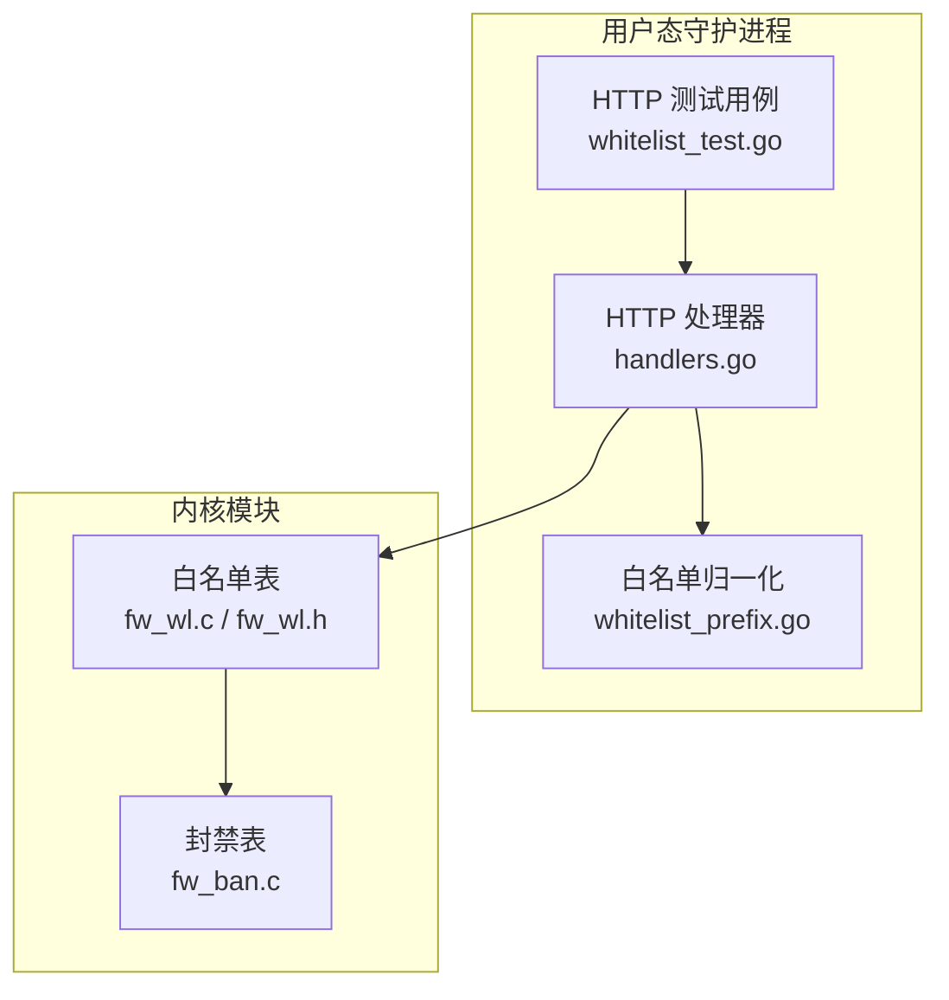
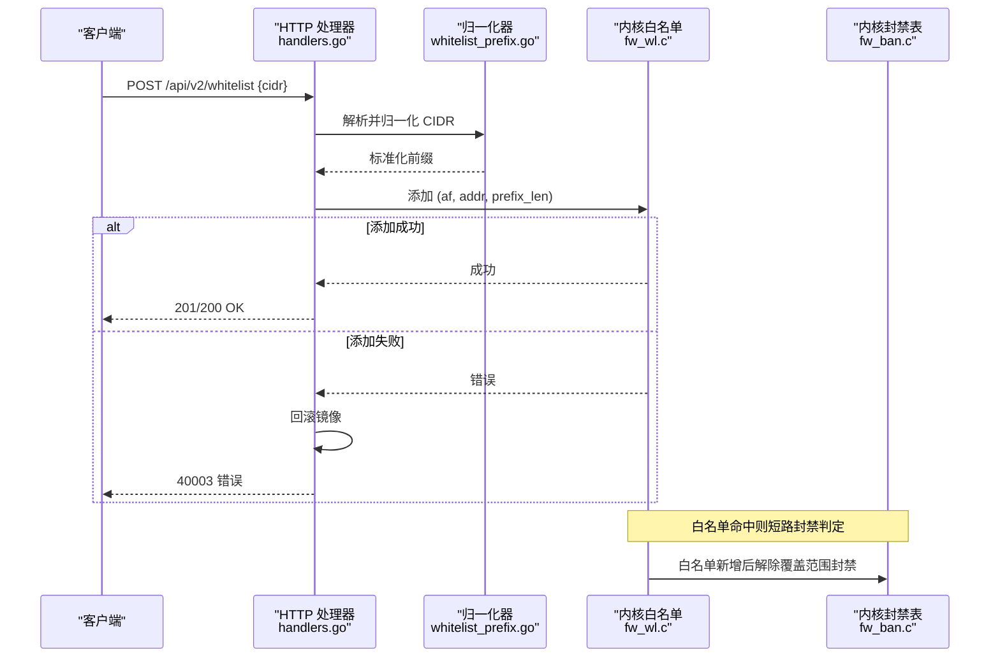
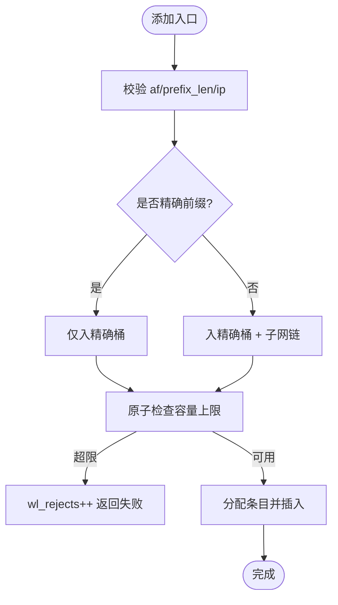
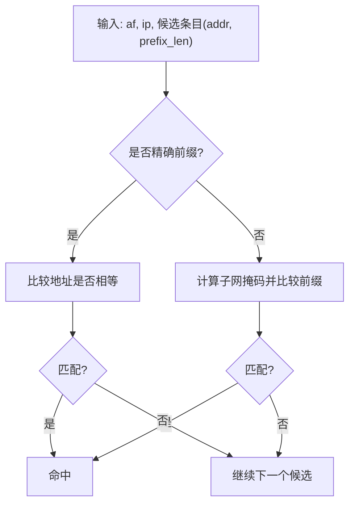
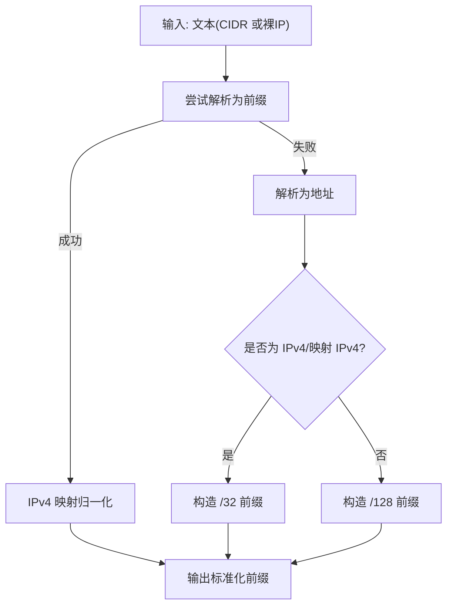
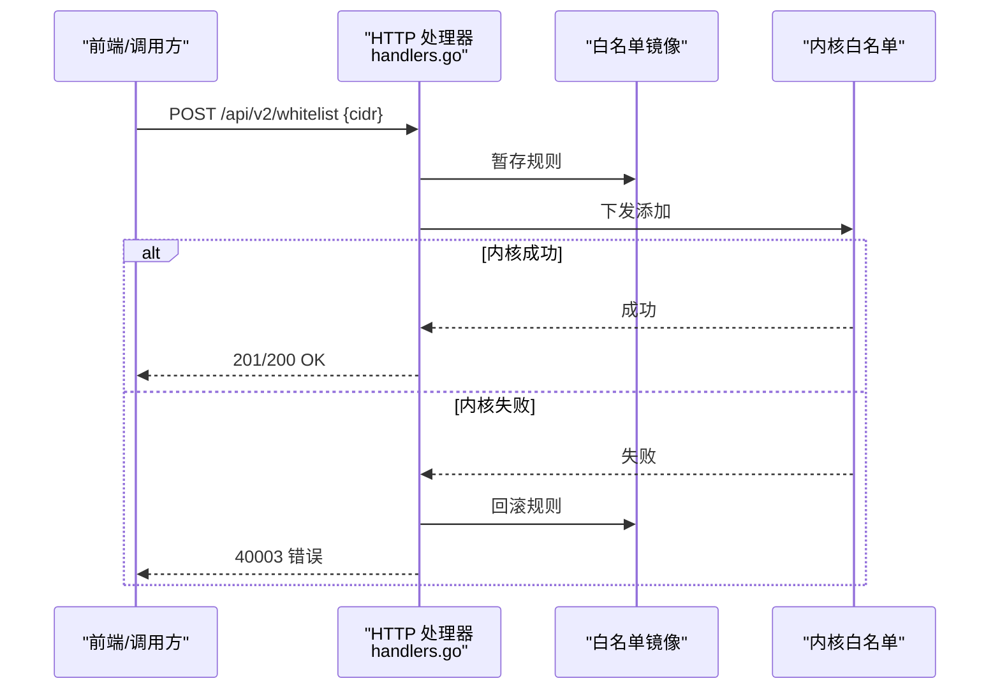
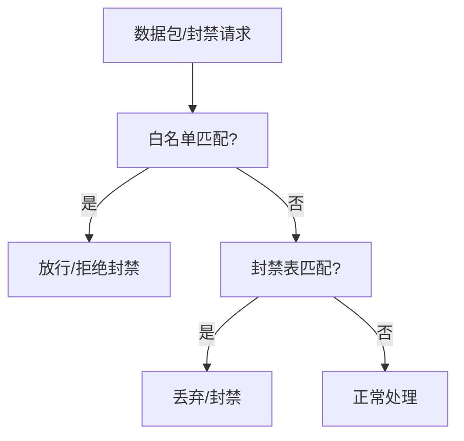
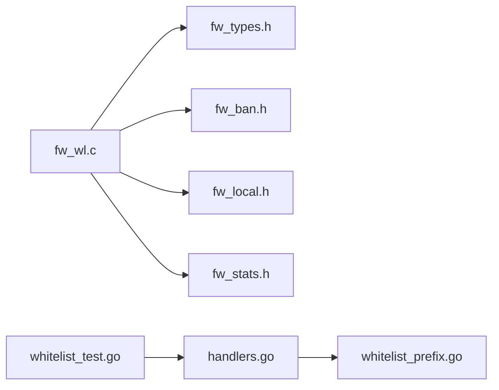

# 白名单处理

<cite>
**本文引用的文件**   
- [README.md](file://README.md)
- [whitelist_prefix.go](file://src/daemon/internal/bans/whitelist_prefix.go)
- [fw_wl.c](file://src/kernel-module/fw_wl.c)
- [fw_wl.h](file://src/kernel-module/fw_wl.h)
- [fw_ban.c](file://src/kernel-module/fw_ban.c)
- [handlers.go](file://src/daemon/internal/http/handlers.go)
- [whitelist_test.go](file://src/daemon/internal/http/whitelist_test.go)
- [test_04_whitelist.py](file://tests/test_04_whitelist.py)
</cite>

## 目录
1. [引言](#引言)
2. [项目结构](#项目结构)
3. [核心组件](#核心组件)
4. [架构总览](#架构总览)
5. [详细组件分析](#详细组件分析)
6. [依赖关系分析](#依赖关系分析)
7. [性能与内存管理](#性能与内存管理)
8. [故障排查指南](#故障排查指南)
9. [结论](#结论)
10. [附录：配置与管理工具](#附录配置与管理工具)

## 引言
本技术文档聚焦“白名单处理”模块，覆盖内核态数据结构、CIDR 前缀匹配算法、IPv4/IPv6 前缀长度处理、子网掩码计算、快速查找优化、动态更新机制（增量/批量/原子性）、与封禁表的优先级与短路逻辑、并发安全、内存管理与性能优化，以及用户态守护进程中的归一化、镜像一致性与 HTTP API 行为。目标是让读者既能理解整体设计，也能定位到具体实现位置进行排障与扩展。

## 项目结构
白名单能力横跨内核模块与守护进程两部分：
- 内核模块：提供白名单表、精确桶 + 子网链、RCU 读路径、容量上限与统计。
- 守护进程：负责 CIDR 文本解析、IPv4 映射地址归一化、HTTP API 校验与下发、镜像一致性维护。

图表来源
- [handlers.go](file://src/daemon/internal/http/handlers.go)
- [whitelist_prefix.go](file://src/daemon/internal/bans/whitelist_prefix.go)
- [fw_wl.c](file://src/kernel-module/fw_wl.c)
- [fw_wl.h](file://src/kernel-module/fw_wl.h)
- [fw_ban.c](file://src/kernel-module/fw_ban.c)
- [whitelist_test.go](file://src/daemon/internal/http/whitelist_test.go)

章节来源
- [README.md:10-31](file://README.md#L10-L31)

## 核心组件
- 内核白名单表
  - 数据结构：64 个精确桶 + 子网链表；精确条目仅入桶，子网条目同时入桶与子网链。
  - 热路径：RCU 只读，先查精确桶，再遍历子网链做前缀匹配。
  - 容量上限：通过模块参数控制，插入前在锁内检查，超限计数并返回失败。
  - 统计：拒绝计数用于监控与诊断。
- 用户态白名单归一化
  - IPv4 映射地址折回 IPv4 本体，避免镜像与内核事件键不一致。
  - 裸 IP 自动补全为 /32 或 /128，保证调用方无需关心地址族差异。
- HTTP API 与镜像一致性
  - 添加失败时回滚镜像，确保面板不显示“内核未生效”的规则。
  - 移除失败时保持镜像已删除状态，与解封策略保持一致。
  - 无内核客户端时仍可工作，按镜像成功返回。

章节来源
- [fw_wl.c:3-18](file://src/kernel-module/fw_wl.c#L3-L18)
- [fw_wl.c:68-108](file://src/kernel-module/fw_wl.c#L68-L108)
- [fw_wl.c:114-147](file://src/kernel-module/fw_wl.c#L114-L147)
- [fw_wl.c:157-245](file://src/kernel-module/fw_wl.c#L157-L245)
- [fw_wl.h:1-10](file://src/kernel-module/fw_wl.h#L1-L10)
- [whitelist_prefix.go:1-41](file://src/daemon/internal/bans/whitelist_prefix.go#L1-L41)
- [whitelist_test.go:128-150](file://src/daemon/internal/http/whitelist_test.go#L128-L150)
- [whitelist_test.go:202-226](file://src/daemon/internal/http/whitelist_test.go#L202-L226)
- [whitelist_test.go:246-259](file://src/daemon/internal/http/whitelist_test.go#L246-L259)

## 架构总览
白名单在内核中作为包过滤的“放行优先”规则存在，命中即短路丢包流程；同时与封禁表联动，新增白名单会解除其覆盖范围内的封禁。

图表来源
- [handlers.go](file://src/daemon/internal/http/handlers.go)
- [whitelist_prefix.go](file://src/daemon/internal/bans/whitelist_prefix.go)
- [fw_wl.c](file://src/kernel-module/fw_wl.c)
- [fw_ban.c](file://src/kernel-module/fw_ban.c)

## 详细组件分析

### 内核白名单表（fw_wl.c / fw_wl.h）
- 数据结构与索引
  - 精确桶：基于哈希函数与随机种子生成桶索引，避免碰撞攻击。
  - 子网链：所有非精确前缀条目加入对应地址族的子网链表，便于前缀匹配。
- 前缀长度与地址族
  - 精确条目判断：IPv4 前缀长度为 32，IPv6 为 128。
  - 最大前缀长度：IPv4 32，IPv6 128。
- 查找路径（热路径）
  - RCU 读侧临界区保护。
  - 第一步：精确桶匹配（相同 af、prefix_len 且地址相等）。
  - 第二步：子网链遍历，使用统一的前缀匹配函数判断是否覆盖目标地址。
- 添加与去重
  - 同一 (af, 归一化地址, prefix_len) 去重。
  - 容量上限检查在桶锁内原子执行，超限计数并返回失败。
  - 子网条目同时入桶与子网链；精确条目仅入桶。
- 移除与联动
  - 本机接口地址不允许直接移除，由 netdev 路径维护。
  - 移除成功后触发封禁表联动，解除被该白名单覆盖的封禁。
- 遍历导出
  - 分页遍历精确桶，供 netlink/procfs 读取白名单列表。

图表来源
- [fw_wl.c:29-36](file://src/kernel-module/fw_wl.c#L29-L36)
- [fw_wl.c:38-51](file://src/kernel-module/fw_wl.c#L38-L51)
- [fw_wl.c:157-210](file://src/kernel-module/fw_wl.c#L157-L210)

章节来源
- [fw_wl.c:29-51](file://src/kernel-module/fw_wl.c#L29-L51)
- [fw_wl.c:68-108](file://src/kernel-module/fw_wl.c#L68-L108)
- [fw_wl.c:114-147](file://src/kernel-module/fw_wl.c#L114-L147)
- [fw_wl.c:157-245](file://src/kernel-module/fw_wl.c#L157-L245)
- [fw_wl.c:274-310](file://src/kernel-module/fw_wl.c#L274-L310)
- [fw_wl.h:1-10](file://src/kernel-module/fw_wl.h#L1-L10)
- [fw_wl.h:17-38](file://src/kernel-module/fw_wl.h#L17-L38)

### CIDR 前缀匹配与快速查找优化
- 前缀匹配
  - 统一使用前缀匹配函数，比较目标地址是否落在条目的网络前缀范围内。
  - 精确前缀等价于“地址本身”，复用同一匹配函数。
- 快速查找优化
  - 精确桶 O(1) 近似查找，命中概率高时可短路。
  - 子网链仅在精确桶未命中时遍历，减少不必要的比较。
  - 桶索引采用与封禁表同源的哈希函数与随机种子，降低碰撞风险。
- IPv4/IPv6 前缀长度处理
  - 精确条目判定区分地址族：IPv4 为 /32，IPv6 为 /128。
  - 子网条目前缀长度小于全长，参与子网链遍历与前缀匹配。

图表来源
- [fw_wl.c:114-147](file://src/kernel-module/fw_wl.c#L114-L147)
- [fw_ban.c:15-15](file://src/kernel-module/fw_ban.c#L15-L15)
- [fw_ban.c:170-170](file://src/kernel-module/fw_ban.c#L170-L170)
- [fw_ban.c:575-595](file://src/kernel-module/fw_ban.c#L575-L595)

章节来源
- [fw_wl.c:114-147](file://src/kernel-module/fw_wl.c#L114-L147)
- [fw_ban.c:15-15](file://src/kernel-module/fw_ban.c#L15-L15)
- [fw_ban.c:170-170](file://src/kernel-module/fw_ban.c#L170-L170)
- [fw_ban.c:575-595](file://src/kernel-module/fw_ban.c#L575-L595)

### 用户态白名单归一化（whitelist_prefix.go）
- IPv4 映射地址归一化
  - 将 ::ffff:x.x.x.x/128 折回 x.x.x.x/32，避免镜像与内核事件键不一致。
  - 前缀长度不足 96 的映射写法保持原样，不视为“一个 IPv4 前缀”。
- 裸 IP 转前缀
  - 裸 IPv4 转为 /32，裸 IPv6 转为 /128，调用方无需关心地址族。
- 文本解析
  - 支持 CIDR 与裸 IP 两种输入形态，统一输出为标准前缀。

图表来源
- [whitelist_prefix.go:11-23](file://src/daemon/internal/bans/whitelist_prefix.go#L11-L23)
- [whitelist_prefix.go:25-41](file://src/daemon/internal/bans/whitelist_prefix.go#L25-L41)

章节来源
- [whitelist_prefix.go:1-41](file://src/daemon/internal/bans/whitelist_prefix.go#L1-L41)

### HTTP API 与镜像一致性（handlers.go 与测试）
- 添加流程
  - 解析并归一化 CIDR。
  - 若内核添加失败，回滚镜像，确保面板不显示“内核未生效”的规则。
  - 重复添加返回特定错误码，且不重复下发内核。
- 移除流程
  - 移除失败时保持镜像已删除状态，与解封策略一致。
  - 带主机位的删除请求按掩码后的键定位，与镜像键同源。
- 无内核客户端
  - 仍可按镜像成功返回，契约未定义“内核缺失”错误码。

图表来源
- [handlers.go](file://src/daemon/internal/http/handlers.go)
- [whitelist_test.go:97-126](file://src/daemon/internal/http/whitelist_test.go#L97-L126)
- [whitelist_test.go:128-150](file://src/daemon/internal/http/whitelist_test.go#L128-L150)
- [whitelist_test.go:152-167](file://src/daemon/internal/http/whitelist_test.go#L152-L167)
- [whitelist_test.go:202-226](file://src/daemon/internal/http/whitelist_test.go#L202-L226)
- [whitelist_test.go:228-244](file://src/daemon/internal/http/whitelist_test.go#L228-L244)
- [whitelist_test.go:246-259](file://src/daemon/internal/http/whitelist_test.go#L246-L259)

章节来源
- [whitelist_test.go:97-126](file://src/daemon/internal/http/whitelist_test.go#L97-L126)
- [whitelist_test.go:128-150](file://src/daemon/internal/http/whitelist_test.go#L128-L150)
- [whitelist_test.go:152-167](file://src/daemon/internal/http/whitelist_test.go#L152-L167)
- [whitelist_test.go:169-200](file://src/daemon/internal/http/whitelist_test.go#L169-L200)
- [whitelist_test.go:202-226](file://src/daemon/internal/http/whitelist_test.go#L202-L226)
- [whitelist_test.go:228-244](file://src/daemon/internal/http/whitelist_test.go#L228-L244)
- [whitelist_test.go:246-259](file://src/daemon/internal/http/whitelist_test.go#L246-L259)

### 白名单与封禁表的优先级与短路逻辑
- 优先级
  - 白名单命中即短路封禁判定，封禁表不会拦截白名单覆盖的地址。
- 联动
  - 新增白名单后，解除其覆盖范围内的封禁，避免误杀。
- 统计
  - 白名单拒绝计数记录两类事件：封禁请求命中白名单被拒；白名单表达到容量上限被拒。

图表来源
- [fw_wl.c:114-147](file://src/kernel-module/fw_wl.c#L114-L147)
- [fw_ban.c:15-15](file://src/kernel-module/fw_ban.c#L15-L15)
- [fw_ban.c:170-170](file://src/kernel-module/fw_ban.c#L170-L170)
- [fw_ban.c:575-595](file://src/kernel-module/fw_ban.c#L575-L595)

章节来源
- [fw_wl.c:114-147](file://src/kernel-module/fw_wl.c#L114-L147)
- [fw_ban.c:15-15](file://src/kernel-module/fw_ban.c#L15-L15)
- [fw_ban.c:170-170](file://src/kernel-module/fw_ban.c#L170-L170)
- [fw_ban.c:575-595](file://src/kernel-module/fw_ban.c#L575-L595)

## 依赖关系分析
- 内核模块内部依赖
  - fw_wl.c 依赖 fw_types.h（类型定义）、fw_ban.h（封禁联动）、fw_local.h（本机接口地址查询）、fw_stats.h（统计）。
- 用户态依赖
  - handlers.go 依赖 bans 包的白名单镜像与归一化逻辑。
  - whitelist_test.go 验证 HTTP 层与内核下发的交互一致性。

图表来源
- [fw_wl.c:22-27](file://src/kernel-module/fw_wl.c#L22-L27)
- [handlers.go](file://src/daemon/internal/http/handlers.go)
- [whitelist_prefix.go](file://src/daemon/internal/bans/whitelist_prefix.go)
- [whitelist_test.go](file://src/daemon/internal/http/whitelist_test.go)

章节来源
- [fw_wl.c:22-27](file://src/kernel-module/fw_wl.c#L22-L27)
- [handlers.go](file://src/daemon/internal/http/handlers.go)
- [whitelist_prefix.go](file://src/daemon/internal/bans/whitelist_prefix.go)
- [whitelist_test.go](file://src/daemon/internal/http/whitelist_test.go)

## 性能与内存管理
- 性能特性
  - 热路径 RCU 只读，避免锁竞争；精确桶 O(1) 近似查找，子网链仅在必要时遍历。
  - 桶索引使用随机种子哈希，降低碰撞攻击风险。
- 内存管理
  - 条目释放使用 call_rcu，配合 synchronize_rcu/rcu_barrier 确保延迟释放安全。
  - 分配失败时统计 alloc_fail，便于监控内存压力。
- 并发安全
  - 写路径使用自旋锁保护桶与子网链，原子检查容量上限。
  - 读路径使用 rcu_read_lock，可嵌套，兼容软中断热路径与进程上下文。
- 容量与统计
  - 容量上限由模块参数控制，超限计数 wl_reject_count。
  - 统计项包括当前白名单数量、拒绝计数等。

章节来源
- [fw_wl.c:68-108](file://src/kernel-module/fw_wl.c#L68-L108)
- [fw_wl.c:114-147](file://src/kernel-module/fw_wl.c#L114-L147)
- [fw_wl.c:157-210](file://src/kernel-module/fw_wl.c#L157-L210)
- [fw_wl.c:274-310](file://src/kernel-module/fw_wl.c#L274-L310)

## 故障排查指南
- 常见问题
  - 镜像与内核不一致：添加失败但镜像残留。应检查 HTTP 层回滚逻辑与内核返回码。
  - 重复添加：返回特定错误码且不重复下发内核。
  - 移除失败：保持镜像已删除状态，不重新塞回。
  - 无内核客户端：HTTP 层按镜像成功返回，契约未定义“内核缺失”错误码。
- 诊断指标
  - whitelist_rejects：封禁请求命中白名单被拒；白名单表达到容量上限被拒。
  - current_whitelist：当前白名单条目数。
- 测试用例参考
  - 系统 IP 自动发现、手动添加/移除、白名单保护、特殊 IP 保护、格式验证、容量测试。

章节来源
- [whitelist_test.go:128-150](file://src/daemon/internal/http/whitelist_test.go#L128-L150)
- [whitelist_test.go:152-167](file://src/daemon/internal/http/whitelist_test.go#L152-L167)
- [whitelist_test.go:202-226](file://src/daemon/internal/http/whitelist_test.go#L202-L226)
- [whitelist_test.go:246-259](file://src/daemon/internal/http/whitelist_test.go#L246-L259)
- [test_04_whitelist.py:30-49](file://tests/test_04_whitelist.py#L30-L49)
- [test_04_whitelist.py:51-76](file://tests/test_04_whitelist.py#L51-L76)
- [test_04_whitelist.py:78-94](file://tests/test_04_whitelist.py#L78-L94)
- [test_04_whitelist.py:95-106](file://tests/test_04_whitelist.py#L95-L106)
- [test_04_whitelist.py:107-133](file://tests/test_04_whitelist.py#L107-L133)

## 结论
白名单模块在内核中以“精确桶 + 子网链”的结构实现高效前缀匹配与快速查找，结合 RCU 与自旋锁保障并发安全与热路径性能；用户态通过归一化与镜像一致性机制，确保 HTTP API 的行为稳定可靠。与封禁表的优先级与联动机制，使白名单具备“放行优先”的安全语义。容量上限与统计指标为运维提供了可观测性与可控性。

## 附录：配置与管理工具
- 内核模块参数
  - fw_max_whitelist_entries：白名单条目上限，默认值较大，插入前在桶锁内检查，超限返回失败并计数。
- ProcFS 接口
  - whitelist：支持 add/remove 操作，包含格式验证与容量限制。
  - whitelist_rejects：统计白名单相关拒绝次数。
- 集成测试
  - 覆盖系统 IP 自动发现、手动增删、白名单保护、特殊 IP 保护、格式验证与容量测试。

章节来源
- [fw_wl.c:7-18](file://src/kernel-module/fw_wl.c#L7-L18)
- [fw_wl.c:180-184](file://src/kernel-module/fw_wl.c#L180-L184)
- [test_04_whitelist.py:30-49](file://tests/test_04_whitelist.py#L30-L49)
- [test_04_whitelist.py:51-76](file://tests/test_04_whitelist.py#L51-L76)
- [test_04_whitelist.py:78-94](file://tests/test_04_whitelist.py#L78-L94)
- [test_04_whitelist.py:95-106](file://tests/test_04_whitelist.py#L95-L106)
- [test_04_whitelist.py:107-133](file://tests/test_04_whitelist.py#L107-L133)