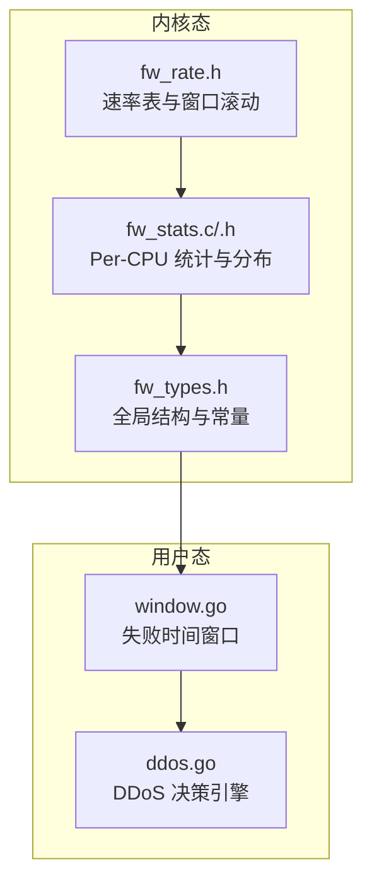
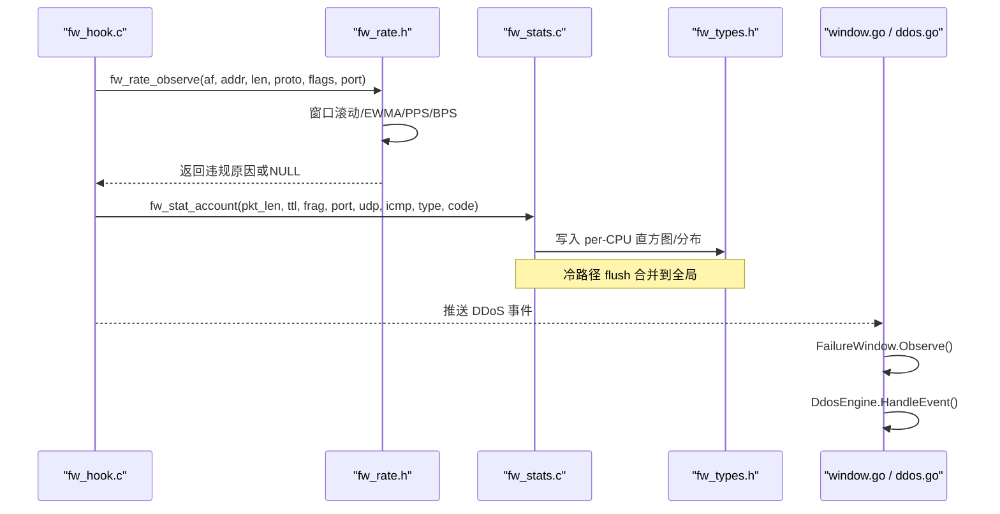
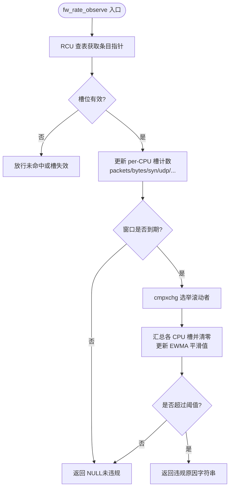
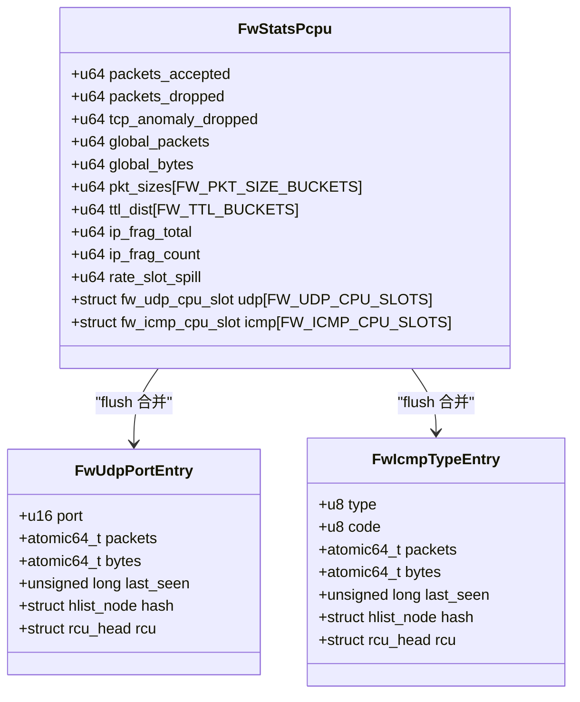
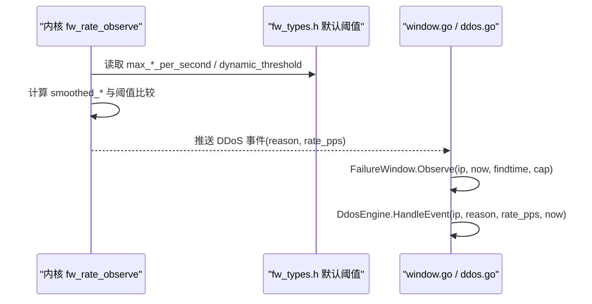
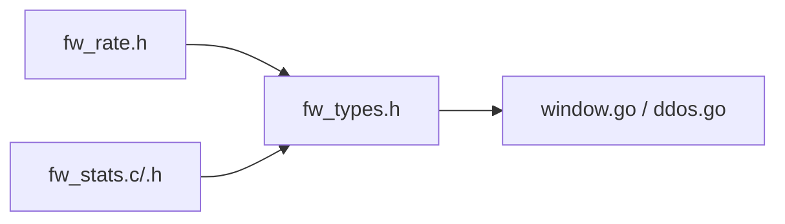

# 速率统计系统

<cite>
**本文引用的文件**   
- [fw_rate.h](file://src/kernel-module/fw_rate.h)
- [fw_stats.h](file://src/kernel-module/fw_stats.h)
- [fw_stats.c](file://src/kernel-module/fw_stats.c)
- [fw_types.h](file://src/kernel-module/fw_types.h)
- [window.go](file://src/daemon/internal/detect/window.go)
- [ddos.go](file://src/daemon/internal/decision/ddos.go)
</cite>

## 目录
1. [引言](#引言)
2. [项目结构](#项目结构)
3. [核心组件](#核心组件)
4. [架构总览](#架构总览)
5. [详细组件分析](#详细组件分析)
6. [依赖关系分析](#依赖关系分析)
7. [性能与内存布局](#性能与内存布局)
8. [故障排查指南](#故障排查指南)
9. [结论](#结论)
10. [附录：数据导出与分析方法](#附录数据导出与分析方法)

## 引言
本技术文档聚焦于内核防火墙模块中的“速率统计与 DDoS 检测”子系统，围绕以下目标展开：
- Per-CPU 速率桶设计：时间窗口管理、滑动窗口结算、EWMA 平滑与 PPS/BPS 统计。
- 直方图与分析分布：包大小/TTL 直方图、UDP 端口分布、ICMP 类型分布的记录与汇总。
- DDoS 检测算法：阈值配置、多协议支持（TCP/UDP/ICMP）、异常流量识别逻辑。
- 高性能实现技巧：内存布局优化、缓存友好设计、无锁热路径、RCU/原子操作。
- 统计数据导出与分析：procfs/netlink 快照、守护进程侧统计与可视化。

## 项目结构
速率统计系统横跨内核态与用户态两部分：
- 内核态（C）：负责热路径的速率统计、窗口滚动、EWMA 平滑、直方图与分析分布收集，以及向 procfs/netlink 暴露读取接口。
- 用户态（Go）：守护进程接收内核事件，维护失败时间窗口、DDoS 决策引擎与累计统计，并提供 API/前端展示。

图表来源
- [fw_rate.h:1-90](file://src/kernel-module/fw_rate.h#L1-L90)
- [fw_stats.c:1-460](file://src/kernel-module/fw_stats.c#L1-L460)
- [fw_types.h:90-170](file://src/kernel-module/fw_types.h#L90-L170)
- [window.go:1-126](file://src/daemon/internal/detect/window.go#L1-L126)
- [ddos.go:1-164](file://src/daemon/internal/decision/ddos.go#L1-L164)

章节来源
- [fw_rate.h:1-90](file://src/kernel-module/fw_rate.h#L1-L90)
- [fw_stats.h:1-81](file://src/kernel-module/fw_stats.h#L1-L81)
- [fw_stats.c:1-460](file://src/kernel-module/fw_stats.c#L1-L460)
- [fw_types.h:90-170](file://src/kernel-module/fw_types.h#L90-L170)
- [window.go:1-126](file://src/daemon/internal/detect/window.go#L1-L126)
- [ddos.go:1-164](file://src/daemon/internal/decision/ddos.go#L1-L164)

## 核心组件
- 速率表与窗口滚动（fw_rate.h）：提供 fw_rate_observe 热路径入口，一次查表完成窗口滚动与四类违规判定；支持 per-CPU 槽位计数、EWMA 平滑、PPS/BPS 统计。
- 统计与分析分布（fw_stats.c/.h）：per-CPU 直方图与 UDP/ICMP 分布记录，冷路径 flush 合并到全局哈希表，供读侧稳定输出。
- 全局类型与常量（fw_types.h）：定义速率表规模、每 CPU 槽位、直方图桶数、默认阈值、EWMA 系数等关键参数。
- 守护进程侧（window.go, ddos.go）：失败时间窗口与 DDoS 事件跟踪，用于统计与审计（不重复封禁）。

章节来源
- [fw_rate.h:1-90](file://src/kernel-module/fw_rate.h#L1-L90)
- [fw_stats.h:1-81](file://src/kernel-module/fw_stats.h#L1-L81)
- [fw_stats.c:1-460](file://src/kernel-module/fw_stats.c#L1-L460)
- [fw_types.h:90-170](file://src/kernel-module/fw_types.h#L90-L170)
- [window.go:1-126](file://src/daemon/internal/detect/window.go#L1-L126)
- [ddos.go:1-164](file://src/daemon/internal/decision/ddos.go#L1-L164)

## 架构总览
速率统计系统采用“内核热路径无锁 + 用户态异步决策”的分层架构：
- 内核热路径：fw_hook 调用 fw_rate_observe 进行速率统计与违规判定；fw_stat_account 更新直方图与分析分布。
- 窗口滚动：由 cmpxchg 选举出的 CPU 在窗口边界汇总 per-CPU 槽并清零，更新 EWMA 平滑值。
- 读侧：通过 fw_stats_flush_all 将 per-CPU 统计合并到全局 atomic，再取快照给 procfs/netlink。
- 用户态：接收内核推送的 DDoS 事件，使用 FailureWindow 维护失败时间窗口，DdosEngine 统计事件与自动封禁次数。

图表来源
- [fw_rate.h:37-60](file://src/kernel-module/fw_rate.h#L37-L60)
- [fw_stats.c:141-155](file://src/kernel-module/fw_stats.c#L141-L155)
- [fw_stats.c:338-343](file://src/kernel-module/fw_stats.c#L338-L343)
- [window.go:36-71](file://src/daemon/internal/detect/window.go#L36-L71)
- [ddos.go:103-129](file://src/daemon/internal/decision/ddos.go#L103-L129)

## 详细组件分析

### Per-CPU 速率桶与滑动窗口
- 设计要点：
  - 一次查表：fw_rate_observe 在一次 RCU 临界区内完成查表、窗口滚动与违规判定，避免旧实现多次 find_rate_entry_rcu。
  - per-CPU 槽：每个条目固定占用一个槽，热路径只写本 CPU 槽，滚动时由选举 CPU 汇总各槽并清零。
  - 端口去重集合移至 per-CPU 槽，滚动时取并集，热路径不再因端口去重取锁。
  - 表满策略：当槽位耗尽时，新源地址不做速率判定（失败开放），由 rate_slot_spill 观测并在 procfs rates 表头显示。
- 时间窗口与 EWMA：
  - 窗口起点 window_start 与 rolling 标志控制滚动选举；平滑值 smoothed_pps/bps/syn/udp/icmp/ack/rst/fin 用 atomic64_t 存储，热路径无锁读取。
  - EWMA 系数 FW_EWMA_NUM/FW_EWMA_DEN 用于平滑计算，基线 baseline_pps/bps 使用 α=0.01 的 EWMA。
- PPS/BPS 统计：
  - 槽内 packets/bytes 累加，滚动时折回条目 smoothed_pps/smoothed_bps，供 DDoS 事件携带 rate_pps。

图表来源
- [fw_rate.h:37-60](file://src/kernel-module/fw_rate.h#L37-L60)
- [fw_types.h:302-359](file://src/kernel-module/fw_types.h#L302-L359)
- [fw_types.h:164-169](file://src/kernel-module/fw_types.h#L164-L169)

章节来源
- [fw_rate.h:1-90](file://src/kernel-module/fw_rate.h#L1-L90)
- [fw_types.h:90-170](file://src/kernel-module/fw_types.h#L90-L170)
- [fw_types.h:302-359](file://src/kernel-module/fw_types.h#L302-L359)

### 直方图与分析分布
- 直方图：
  - 包大小分桶：Tiny(<64)、Small(64-255)、Medium(256-1023)、Large(1024-1500)、Jumbo(>1500)。
  - TTL 分桶：Scan(=1)、VeryShort(2-32)、Short(33-64)、Normal(65-128)、Long(129-192)、Max(>192)。
  - 分片统计：ip_frag_total/ip_frag_count。
- UDP 端口分布：
  - per-CPU 直接映射槽 fw_udp_cpu_slot，冲突时顶替，flush 时并入全局哈希表 fw_info.udp_port_table。
  - 读侧按端口排序输出，保证稳定可比。
- ICMP 类型分布：
  - per-CPU 直接映射槽 fw_icmp_cpu_slot，key = type*256+code，flush 时并入 fw_info.icmp_type_table。
- 读侧一致性：
  - 所有读侧必须先 fw_stats_flush_all，否则读到陈旧值；契约明确禁止 PROC_STATS_STALE_NO_FLUSH。

图表来源
- [fw_stats.c:405-418](file://src/kernel-module/fw_stats.c#L405-L418)
- [fw_stats.c:420-451](file://src/kernel-module/fw_stats.c#L420-L451)
- [fw_types.h:383-439](file://src/kernel-module/fw_types.h#L383-L439)

章节来源
- [fw_stats.c:141-155](file://src/kernel-module/fw_stats.c#L141-L155)
- [fw_stats.c:201-289](file://src/kernel-module/fw_stats.c#L201-L289)
- [fw_stats.c:376-459](file://src/kernel-module/fw_stats.c#L376-L459)
- [fw_types.h:177-207](file://src/kernel-module/fw_types.h#L177-L207)

### DDoS 检测算法
- 内核侧：
  - fw_rate_observe 根据协议与 TCP 标志位进行 SYN/ACK/RST/FIN/UDP/ICMP 专项判定，返回静态原因字符串（如 "SYN flood"、"UDP flood"）。
  - 阈值来自运行态配置（max_syn_per_second、max_udp_per_second 等），支持静态阈值与动态阈值（dynamic_threshold_enabled + dynamic_threshold_ratio_x100）。
- 用户态：
  - FailureWindow（window.go）维护单个 IP 的时间戳队列，窗口长度 findtime，容量 cap，达到 cap 即触发封禁。
  - DdosEngine（ddos.go）接收内核事件，记录 violationCount 与 lastViolation，支持 CleanupStale 回收长时间未活动条目。

图表来源
- [fw_rate.h:37-60](file://src/kernel-module/fw_rate.h#L37-L60)
- [fw_types.h:147-169](file://src/kernel-module/fw_types.h#L147-L169)
- [window.go:36-71](file://src/daemon/internal/detect/window.go#L36-L71)
- [ddos.go:103-129](file://src/daemon/internal/decision/ddos.go#L103-L129)

章节来源
- [fw_rate.h:37-60](file://src/kernel-module/fw_rate.h#L37-L60)
- [fw_types.h:147-169](file://src/kernel-module/fw_types.h#L147-L169)
- [window.go:1-126](file://src/daemon/internal/detect/window.go#L1-L126)
- [ddos.go:1-164](file://src/daemon/internal/decision/ddos.go#L1-L164)

## 依赖关系分析
- 模块内依赖：
  - fw_rate.h 依赖 fw_types.h 的全局结构与常量。
  - fw_stats.c 依赖 fw_types.h 的全局单例 fw_info 与 per-CPU 统计块。
- 跨模块依赖：
  - 内核态通过 netlink/procfs 向用户态暴露统计与事件。
  - 用户态守护进程解析配置、维护 FailureWindow 与 DdosEngine，并与前端/监控集成。

图表来源
- [fw_rate.h:1-90](file://src/kernel-module/fw_rate.h#L1-L90)
- [fw_stats.c:1-460](file://src/kernel-module/fw_stats.c#L1-L460)
- [fw_types.h:90-170](file://src/kernel-module/fw_types.h#L90-L170)
- [window.go:1-126](file://src/daemon/internal/detect/window.go#L1-L126)
- [ddos.go:1-164](file://src/daemon/internal/decision/ddos.go#L1-L164)

章节来源
- [fw_rate.h:1-90](file://src/kernel-module/fw_rate.h#L1-L90)
- [fw_stats.c:1-460](file://src/kernel-module/fw_stats.c#L1-L460)
- [fw_types.h:90-170](file://src/kernel-module/fw_types.h#L90-L170)
- [window.go:1-126](file://src/daemon/internal/detect/window.go#L1-L126)
- [ddos.go:1-164](file://src/daemon/internal/decision/ddos.go#L1-L164)

## 性能与内存布局
- 无锁热路径：
  - fw_stat_account 仅写本 CPU 的 fw_stats_pcpu，无共享 cache line 写。
  - fw_rate_observe 热路径不持有任何自旋锁，窗口滚动由 cmpxchg 选举 CPU 执行。
- 内存布局优化：
  - fw_stats_pcpu 使用 ____cacheline_aligned_in_smp 对齐，减少伪共享。
  - fw_rate_pcpu_chunk 分块申请（FW_RATE_CHUNK_SLOTS=128），避免单次 per-CPU 分配超限。
  - UDP/ICMP 分布使用 per-CPU 直接映射槽，冲突时顶替，降低哈希冲突开销。
- 并发安全：
  - 全局计数器使用 atomic64_t，仅冷路径写入。
  - RCU 保护条目生命周期，删除路径使用 hlist_del_rcu + call_rcu。
- 性能影响：
  - 每包零共享写，显著降低多核竞争。
  - 窗口滚动与 flush 为冷路径，不影响热路径延迟。

章节来源
- [fw_stats.c:1-15](file://src/kernel-module/fw_stats.c#L1-L15)
- [fw_stats.c:405-418](file://src/kernel-module/fw_stats.c#L405-L418)
- [fw_types.h:107-117](file://src/kernel-module/fw_types.h#L107-L117)
- [fw_types.h:361-364](file://src/kernel-module/fw_types.h#L361-L364)

## 故障排查指南
- 常见问题：
  - 读数陈旧：确保读侧先调用 fw_stats_flush_all，避免 PROC_STATS_STALE_NO_FLUSH。
  - 速率表满：rate_slot_spill 增长表示槽位耗尽，新源地址不做速率判定（失败开放）。
  - 分布槽顶替：UDP/ICMP 分布槽被顶替时，rate_slot_spill 增加，允许丢计数但需关注溢出。
- 诊断步骤：
  - 检查 procfs rates 表头，确认 rate_slot_spill 与 rate_reclaimed。
  - 查看 fw_stats_snapshot 中的 alloc_failures、ban_table_full_rejects。
  - 分析 UDP/ICMP 分布，识别异常端口或类型。

章节来源
- [fw_stats.h:5-11](file://src/kernel-module/fw_stats.h#L5-L11)
- [fw_stats.c:394-397](file://src/kernel-module/fw_stats.c#L394-L397)
- [fw_stats.c:408-459](file://src/kernel-module/fw_stats.c#L408-L459)

## 结论
速率统计系统通过 per-CPU 槽位、窗口滚动与 EWMA 平滑实现了高吞吐、低延迟的速率统计与 DDoS 检测。直方图与分析分布提供了丰富的流量特征，支持端口扫描与服务探测识别。内核态无锁热路径与用户态异步决策相结合，既保证了性能，又提供了灵活的统计与可视化能力。

## 附录：数据导出与分析方法
- 内核态导出：
  - procfs：rates、stats、udp_ports、icmp_types、pkt_sizes、ttl_dist、port_scanners、service_probes。
  - netlink：STATS_QUERY、ANALYSIS_QUERY、LIST_RATES_RESPONSE。
- 用户态分析：
  - FailureWindow：维护失败时间窗口，支持 Peek/CleanupExpired/Iter。
  - DdosEngine：统计 EventsDetected、AutoBansTriggered、TrackedIPs，支持 CleanupStale。

章节来源
- [fw_stats.c:376-459](file://src/kernel-module/fw_stats.c#L376-L459)
- [window.go:36-126](file://src/daemon/internal/detect/window.go#L36-L126)
- [ddos.go:31-164](file://src/daemon/internal/decision/ddos.go#L31-L164)