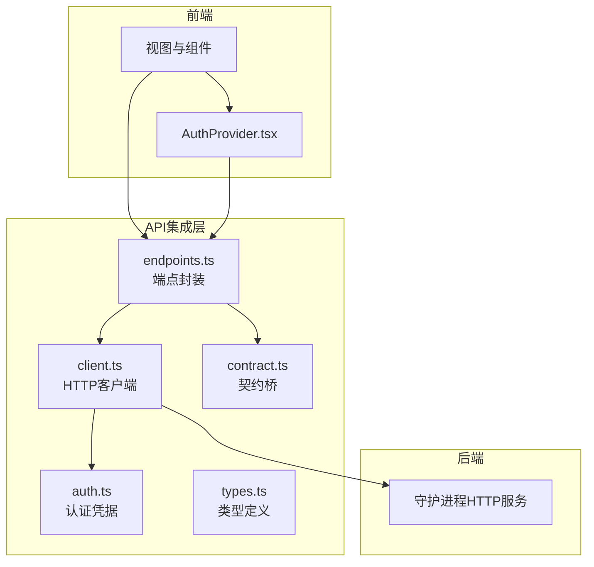
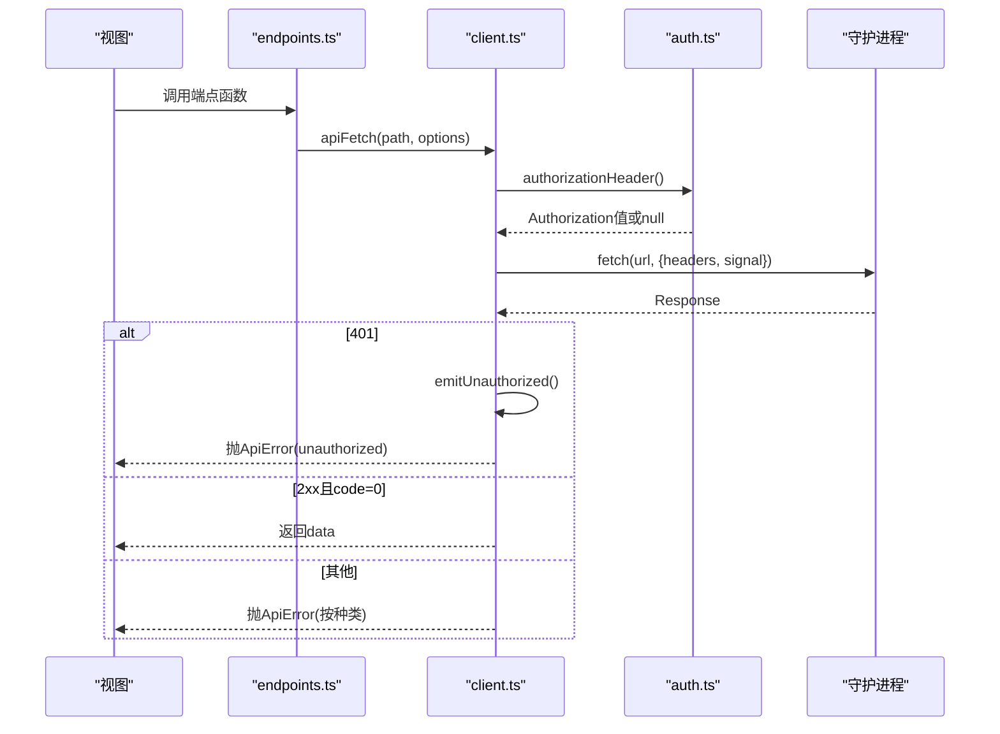
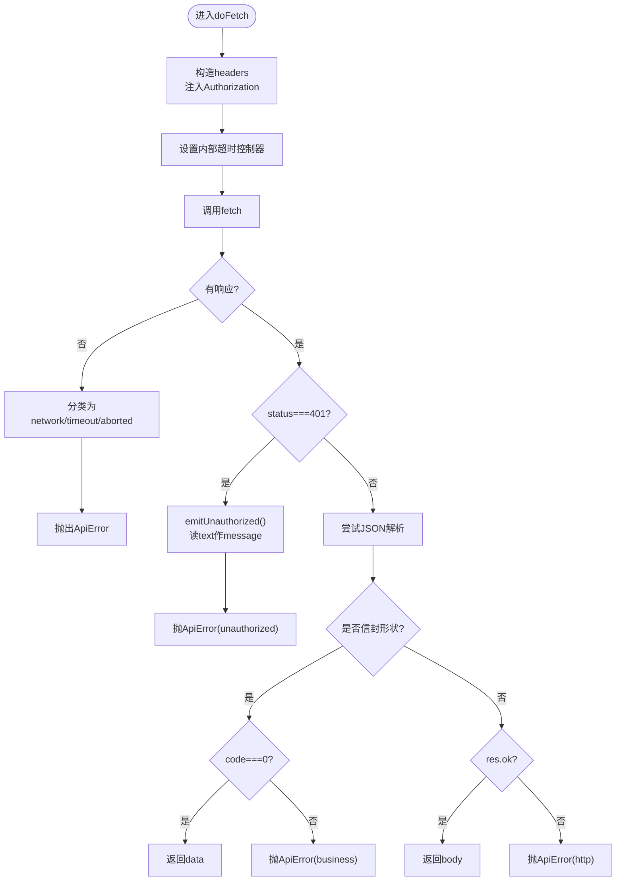
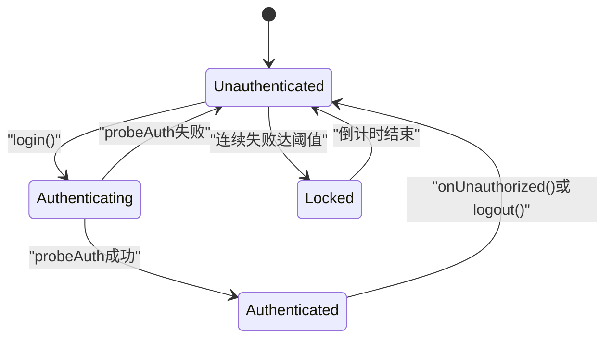
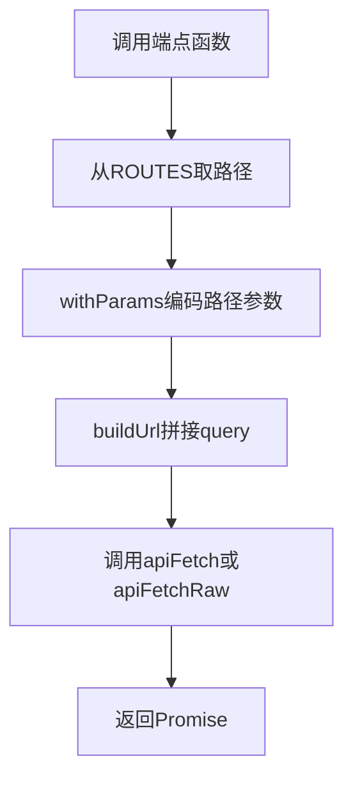
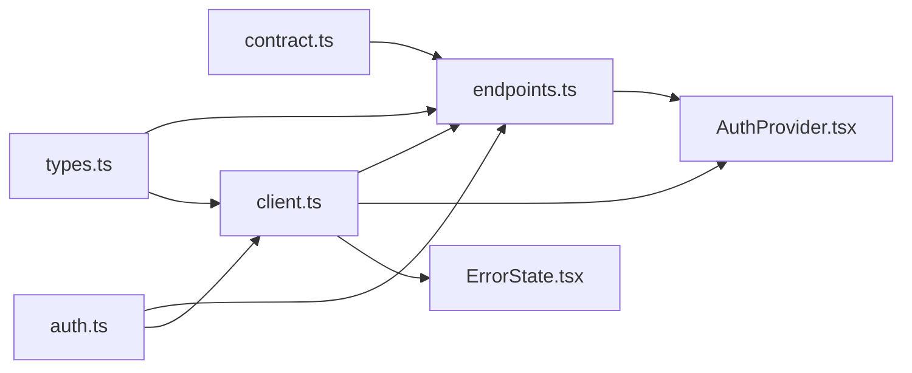

# API集成层

<cite>
**本文引用的文件**   
- [client.ts](file://frontend/src/api/client.ts)
- [auth.ts](file://frontend/src/api/auth.ts)
- [endpoints.ts](file://frontend/src/api/endpoints.ts)
- [types.ts](file://frontend/src/api/types.ts)
- [contract.ts](file://frontend/src/api/contract.ts)
- [AuthProvider.tsx](file://frontend/src/providers/AuthProvider.tsx)
- [ErrorState.tsx](file://frontend/src/components/state/ErrorState.tsx)
</cite>

## 目录
1. [引言](#引言)
2. [项目结构](#项目结构)
3. [核心组件](#核心组件)
4. [架构总览](#架构总览)
5. [详细组件分析](#详细组件分析)
6. [依赖关系分析](#依赖关系分析)
7. [性能与可靠性](#性能与可靠性)
8. [调试与排错](#调试与排错)
9. [最佳实践](#最佳实践)
10. [Mock测试方案](#mock测试方案)
11. [结论](#结论)

## 引言
本文件面向前端“API集成层”，目标是把守护进程提供的 REST 接口、SSE 事件流、认证凭据、契约路由和类型定义，统一封装成稳定、可测试、可观测的前端调用面。它回答以下问题：
- HTTP 请求如何发起、如何携带认证头？
- 成功响应如何解包？失败如何分类？
- 401 未认证如何处理？是否自动登出？
- 哪些端点走信封、哪些端点走裸 JSON？
- 类型如何与后端契约保持同步？
- 如何重试、如何取消、如何避免重复请求？
- 如何 Mock 并验证行为？

## 项目结构
API集成层位于 `frontend/src/api`，采用“分层+契约驱动”的组织方式：
- `client.ts`：HTTP 客户端内核，负责 fetch、超时、取消、错误分类、401 广播。
- `auth.ts`：认证凭据管理，负责 Basic 令牌编码、存储、读取、构造 Authorization 头。
- `endpoints.ts`：端点封装，每条契约路由一个具名函数，集中处理路径参数、查询参数、SSE URL。
- `types.ts`：前端类型镜像，与后端契约字段逐项对齐，提供请求体、分页、图表等类型。
- `contract.ts`：契约桥，只再导出由代码生成器产出的路由常量、鉴权常量、SSE 事件类型。

**图表来源**
- [client.ts:1-205](file://frontend/src/api/client.ts#L1-L205)
- [auth.ts:1-81](file://frontend/src/api/auth.ts#L1-L81)
- [endpoints.ts:1-515](file://frontend/src/api/endpoints.ts#L1-L515)
- [types.ts:1-818](file://frontend/src/api/types.ts#L1-L818)
- [contract.ts:1-21](file://frontend/src/api/contract.ts#L1-L21)
- [AuthProvider.tsx:1-190](file://frontend/src/providers/AuthProvider.tsx#L1-L190)

**章节来源**
- [client.ts:1-205](file://frontend/src/api/client.ts#L1-L205)
- [auth.ts:1-81](file://frontend/src/api/auth.ts#L1-L81)
- [endpoints.ts:1-515](file://frontend/src/api/endpoints.ts#L1-L515)
- [types.ts:1-818](file://frontend/src/api/types.ts#L1-L818)
- [contract.ts:1-21](file://frontend/src/api/contract.ts#L1-L21)

## 核心组件
- HTTP客户端内核：统一入口，封装 fetch、超时、取消、Authorization 注入、信封解包、错误分类、401 广播。
- 认证机制：Basic 令牌编码、sessionStorage 存储、Authorization 头构造、EventSource 查询参数拼接。
- 端点封装：以 ROUTES 常量为唯一路径来源，提供强类型函数；路径参数自动编码；SSE URL 集中构造。
- 类型定义：ApiResponse、PaginatedResponse、业务载荷、请求体、排序键、日志级别等，与契约严格对齐。
- 认证状态：登录探测、连续失败计数、本地锁定倒计时、401 自动登出。

**章节来源**
- [client.ts:22-56](file://frontend/src/api/client.ts#L22-L56)
- [client.ts:73-103](file://frontend/src/api/client.ts#L73-L103)
- [client.ts:105-148](file://frontend/src/api/client.ts#L105-L148)
- [client.ts:150-204](file://frontend/src/api/client.ts#L150-L204)
- [auth.ts:17-81](file://frontend/src/api/auth.ts#L17-L81)
- [endpoints.ts:77-90](file://frontend/src/api/endpoints.ts#L77-L90)
- [endpoints.ts:494-514](file://frontend/src/api/endpoints.ts#L494-L514)
- [types.ts:20-34](file://frontend/src/api/types.ts#L20-L34)
- [types.ts:729-818](file://frontend/src/api/types.ts#L729-L818)
- [AuthProvider.tsx:22-32](file://frontend/src/providers/AuthProvider.tsx#L22-L32)

## 架构总览
API集成层的核心流程如下：
- 视图调用 endpoints.ts 的具名函数。
- endpoints.ts 从 contract.ts 取 ROUTES 常量，拼接路径与查询参数。
- client.ts 执行 doFetch：注入 Authorization、设置超时与取消信号、调用原生 fetch。
- 根据响应状态与信封 code 分类为 network、timeout、unauthorized、business、http、parse、aborted。
- 401 触发 onUnauthorized 广播，AuthProvider 订阅后自动清令牌并切换状态。
- 非 401 的成功响应返回 data；失败抛出 ApiError，供上层统一处理或重试。

**图表来源**
- [endpoints.ts:103-120](file://frontend/src/api/endpoints.ts#L103-L120)
- [client.ts:105-148](file://frontend/src/api/client.ts#L105-L148)
- [client.ts:150-204](file://frontend/src/api/client.ts#L150-L204)
- [auth.ts:64-68](file://frontend/src/api/auth.ts#L64-L68)

## 详细组件分析

### HTTP客户端内核（client.ts）
职责：
- 定义失败种类与 ApiError 类，暴露 isRetryable 判断。
- 提供 onUnauthorized 订阅机制，用于全局 401 处理。
- 构建 URL、注入 Authorization、设置超时与取消。
- 区分信封端点与非信封端点：apiFetch 与 apiFetchRaw。

关键设计：
- 默认超时 15 秒，可通过 timeoutMs 覆盖。
- 支持 AbortSignal，便于组件卸载时中断请求。
- 401 不解析 JSON，直接读纯文本作为 message，并广播。
- 信封成功条件：HTTP 2xx 且 code === 0，否则按 business/http/parse 分类。

**图表来源**
- [client.ts:105-148](file://frontend/src/api/client.ts#L105-L148)
- [client.ts:150-204](file://frontend/src/api/client.ts#L150-L204)

**章节来源**
- [client.ts:22-56](file://frontend/src/api/client.ts#L22-L56)
- [client.ts:58-71](file://frontend/src/api/client.ts#L58-L71)
- [client.ts:73-103](file://frontend/src/api/client.ts#L73-L103)
- [client.ts:105-148](file://frontend/src/api/client.ts#L105-L148)
- [client.ts:150-204](file://frontend/src/api/client.ts#L150-L204)

### 认证机制（auth.ts + AuthProvider.tsx）
职责：
- 将 username:password 编码为 Basic 令牌，存入 sessionStorage。
- 提供 getAccessToken、setAccessToken、clearAccessToken、hasAccessToken。
- 构造 Authorization 头值，供 client.ts 使用。
- 提供 EventSource 用的 TOKEN_QUERY_KEY，供 endpoints.ts 拼接 SSE URL。
- AuthProvider 实现登录探测、连续失败计数、本地锁定倒计时、401 自动登出。

关键点：
- 登录成功与否通过 probeAuth 探测真实 API，而非根路径。
- 连续失败达到阈值后进入本地锁定倒计时，防止账号越试越死。
- 任何 REST 调用收到 401，都会经 onUnauthorized 广播到 AuthProvider，自动清理令牌并切换状态。

**图表来源**
- [auth.ts:26-68](file://frontend/src/api/auth.ts#L26-L68)
- [AuthProvider.tsx:75-91](file://frontend/src/providers/AuthProvider.tsx#L75-L91)
- [AuthProvider.tsx:103-153](file://frontend/src/providers/AuthProvider.tsx#L103-L153)
- [AuthProvider.tsx:93-99](file://frontend/src/providers/AuthProvider.tsx#L93-L99)

**章节来源**
- [auth.ts:1-81](file://frontend/src/api/auth.ts#L1-L81)
- [AuthProvider.tsx:22-32](file://frontend/src/providers/AuthProvider.tsx#L22-L32)
- [AuthProvider.tsx:55-101](file://frontend/src/providers/AuthProvider.tsx#L55-L101)
- [AuthProvider.tsx:103-153](file://frontend/src/providers/AuthProvider.tsx#L103-L153)
- [AuthProvider.tsx:155-190](file://frontend/src/providers/AuthProvider.tsx#L155-L190)

### 端点封装（endpoints.ts）
职责：
- 每条契约路由对应一个具名函数，全站唯一的“路径消费点”。
- 路径参数通过 withParams 逐个 encodeURIComponent，确保 CIDR 中的 `/` 正确转义。
- 查询参数统一通过 query 对象传入，由 client.ts 拼入 URL。
- SSE URL 集中构造，凭据走 access_token 查询参数。
- 健康端点使用 apiFetchRaw，不经信封。

重要约束：
- 不得手写 `/api/v…` 字面量，所有路径来自 ROUTES 常量。
- 契约变更会强制检查前端是否仍消费这些路由。

**图表来源**
- [endpoints.ts:81-90](file://frontend/src/api/endpoints.ts#L81-L90)
- [endpoints.ts:103-120](file://frontend/src/api/endpoints.ts#L103-L120)
- [endpoints.ts:494-514](file://frontend/src/api/endpoints.ts#L494-L514)

**章节来源**
- [endpoints.ts:1-17](file://frontend/src/api/endpoints.ts#L1-L17)
- [endpoints.ts:77-90](file://frontend/src/api/endpoints.ts#L77-L90)
- [endpoints.ts:103-120](file://frontend/src/api/endpoints.ts#L103-L120)
- [endpoints.ts:126-180](file://frontend/src/api/endpoints.ts#L126-L180)
- [endpoints.ts:483-514](file://frontend/src/api/endpoints.ts#L483-L514)

### 类型定义（types.ts）
职责：
- 定义 ApiResponse、PaginatedResponse 等通用信封与分页类型。
- 定义各业务载荷：统计、封禁、Jail、配置、白名单、速率、风险引擎、日志、威胁情报、异常检测、综合分析等。
- 定义请求体：CreateBanRequest、BatchBanRequest、UpdateJailRequest、UpdateConfigRequest、CreateWhitelistRequest、LogQueryParams、PaginationParams。
- 定义前端专属辅助类型：BanSortKey、ThreatLevelName、LogLevel。

校验机制：
- types.ts 与后端契约字段逐项比对，缺字段或多字段都会判红。
- 请求体虽不在 types.ts 中做契约门禁，但集中在同一文件，便于复用与阅读。

**章节来源**
- [types.ts:1-14](file://frontend/src/api/types.ts#L1-L14)
- [types.ts:20-34](file://frontend/src/api/types.ts#L20-L34)
- [types.ts:40-50](file://frontend/src/api/types.ts#L40-L50)
- [types.ts:75-94](file://frontend/src/api/types.ts#L75-L94)
- [types.ts:100-143](file://frontend/src/api/types.ts#L100-L143)
- [types.ts:149-193](file://frontend/src/api/types.ts#L149-L193)
- [types.ts:199-222](file://frontend/src/api/types.ts#L199-L222)
- [types.ts:228-257](file://frontend/src/api/types.ts#L228-L257)
- [types.ts:263-319](file://frontend/src/api/types.ts#L263-L319)
- [types.ts:325-391](file://frontend/src/api/types.ts#L325-L391)
- [types.ts:397-405](file://frontend/src/api/types.ts#L397-L405)
- [types.ts:411-446](file://frontend/src/api/types.ts#L411-L446)
- [types.ts:452-539](file://frontend/src/api/types.ts#L452-L539)
- [types.ts:545-565](file://frontend/src/api/types.ts#L545-L565)
- [types.ts:571-584](file://frontend/src/api/types.ts#L571-L584)
- [types.ts:590-601](file://frontend/src/api/types.ts#L590-L601)
- [types.ts:607-633](file://frontend/src/api/types.ts#L607-L633)
- [types.ts:639-668](file://frontend/src/api/types.ts#L639-L668)
- [types.ts:674-701](file://frontend/src/api/types.ts#L674-L701)
- [types.ts:707-726](file://frontend/src/api/types.ts#L707-L726)
- [types.ts:729-818](file://frontend/src/api/types.ts#L729-L818)

### 契约桥（contract.ts）
职责：
- 只再导出由代码生成器产出的 API_BASE、AUTH、ROUTES 以及 SSE 事件类型。
- 前端任何地方不得手写 `/api/v2/...` 字面量，所有路径必须通过 ROUTES 常量访问。
- 保证“前端调了哪些后端接口”始终是契约的子集，且随契约改名自动跟进。

**章节来源**
- [contract.ts:1-21](file://frontend/src/api/contract.ts#L1-L21)

## 依赖关系分析
- endpoints.ts 依赖 client.ts、contract.ts、auth.ts、types.ts。
- client.ts 依赖 auth.ts、types.ts。
- AuthProvider.tsx 依赖 client.ts、auth.ts、endpoints.ts。
- ErrorState.tsx 消费 ApiError.kind，映射用户可见文案与是否可重试。

**图表来源**
- [endpoints.ts:19-21](file://frontend/src/api/endpoints.ts#L19-L21)
- [client.ts:19-20](file://frontend/src/api/client.ts#L19-L20)
- [AuthProvider.tsx:11-20](file://frontend/src/providers/AuthProvider.tsx#L11-L20)
- [ErrorState.tsx:17-25](file://frontend/src/components/state/ErrorState.tsx#L17-L25)

**章节来源**
- [endpoints.ts:19-21](file://frontend/src/api/endpoints.ts#L19-L21)
- [client.ts:19-20](file://frontend/src/api/client.ts#L19-L20)
- [AuthProvider.tsx:11-20](file://frontend/src/providers/AuthProvider.tsx#L11-L20)
- [ErrorState.tsx:17-25](file://frontend/src/components/state/ErrorState.tsx#L17-L25)

## 性能与可靠性
- 超时控制：默认 15 秒，可按端点调整 timeoutMs，避免长时间阻塞。
- 取消机制：支持 AbortSignal，组件卸载或竞态丢弃时可主动中断请求。
- 重试策略：仅对 network、timeout、5xx 等可重试错误进行重试；unauthorized、business、aborted 不应重试。
- 连接限制：SSE 两条流分别有最大连接数限制，需在前端控制连接数量与生命周期。
- 数据去重：列表页建议结合 refetch 与刷新信号，避免频繁重复请求。
- 序列化开销：请求体仅在 body 存在时序列化为 JSON，减少不必要负载。

[本节为通用指导，不直接分析具体文件]

## 调试与排错
常见错误分类与处理建议：
- network：网络中断或服务未启动，提示用户检查守护进程与网络可达性，可重试。
- timeout：守护进程响应超时，可能负载过高，适当增加 timeoutMs 或优化服务端。
- unauthorized：凭据缺失/错误/锁定，自动登出并跳转登录，不重试。
- business：服务端拒绝请求，展示 message 与业务码，引导用户修正输入。
- http：非 2xx 且非信封分支，提示服务异常，可重试。
- parse：响应体不是合法 JSON，可能是版本不匹配，提示升级或回滚。
- aborted：调用方主动取消，通常忽略。

UI层已为每种 kind 提供可读标题与 fallback 文案，并根据 retryable 决定是否显示重试按钮。

**章节来源**
- [client.ts:22-56](file://frontend/src/api/client.ts#L22-L56)
- [client.ts:150-204](file://frontend/src/api/client.ts#L150-L204)
- [ErrorState.tsx:17-25](file://frontend/src/components/state/ErrorState.tsx#L17-L25)

## 最佳实践
- 始终通过 endpoints.ts 的具名函数发起请求，不要手写路径。
- 对长耗时操作传入 AbortSignal，避免组件卸载后残留请求。
- 对易变数据使用 refetch 刷新，配合 useRefreshSignal 实现全局刷新。
- 对写操作成功后立即 refetch 权威数据，尤其是异步生效的 PUT /jails。
- 对 401 不做重试，交由 AuthProvider 自动登出。
- 对 network/timeout/5xx 可考虑指数退避重试，但需限制最大次数。
- 对 SSE 连接，遵循后端最大连接数限制，避免过多 EventSource。
- 对路径参数中的 CIDR，务必使用 withParams 编码，避免 `/` 被误解析。
- 对查询参数，优先使用 null/undefined 跳过，避免发送无意义参数。

[本节为通用指导，不直接分析具体文件]

## Mock测试方案
推荐策略：
- 拦截 fetch：在测试环境中替换 window.fetch，返回预设 Response，模拟 2xx、401、500、非 JSON 等场景。
- 模拟 ApiError：断言抛出的 ApiError.kind、status、code、isRetryable。
- 模拟 401 广播：订阅 onUnauthorized，断言回调被调用，并验证 AuthProvider 状态切换。
- 模拟 SSE URL：断言 eventsStreamUrl/logsStreamUrl 是否正确拼接 access_token。
- 模拟端点函数：断言 endpoints.ts 调用 apiFetch 的路径、method、body、query 是否符合预期。
- 类型门禁：利用 types.ts 与契约校验脚本，确保前端类型与后端契约一致。

示例步骤（概念性）：
1. 在测试前 mock fetch，返回不同 status 与 body。
2. 调用 endpoints.ts 的某个函数，断言 Promise 结果或抛错。
3. 订阅 onUnauthorized，断言 401 时回调触发。
4. 断言 AuthProvider 的 isAuthenticated、lockoutRemaining、failCount 变化。
5. 断言 SSE URL 包含正确的 access_token 查询参数。

[本节为通用指导，不直接分析具体文件]

## 结论
API集成层通过 client.ts、auth.ts、endpoints.ts、types.ts、contract.ts 形成清晰的分层与契约驱动体系：
- 所有路径与鉴权常量来自生成物，杜绝硬编码。
- 所有请求经统一客户端处理，错误分类明确，401 自动登出。
- 类型与契约逐项对齐，降低前后端不一致风险。
- 提供超时、取消、重试判断、SSE URL 构造等实用能力。
- 配合 AuthProvider 与 ErrorState，形成完整的认证与错误体验闭环。

在此基础上，前端可以稳定地对接守护进程 API，并在测试、调试、性能优化方面具备良好基础。