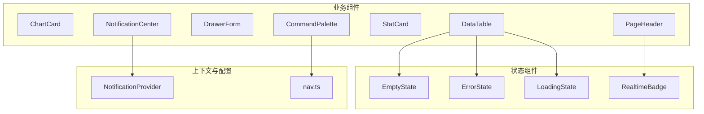
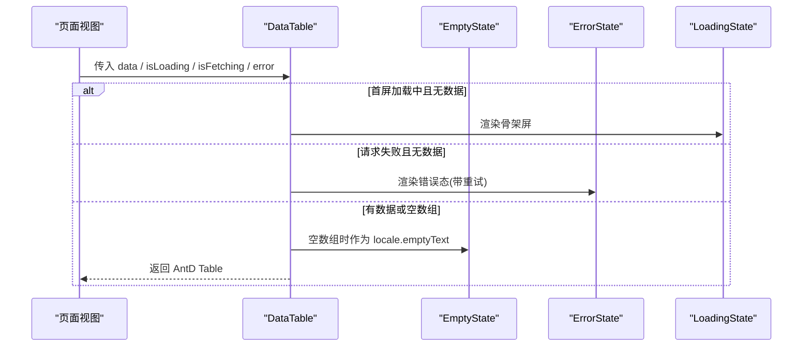
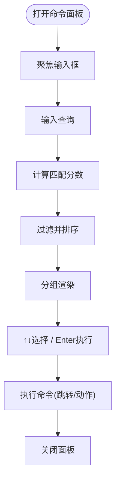
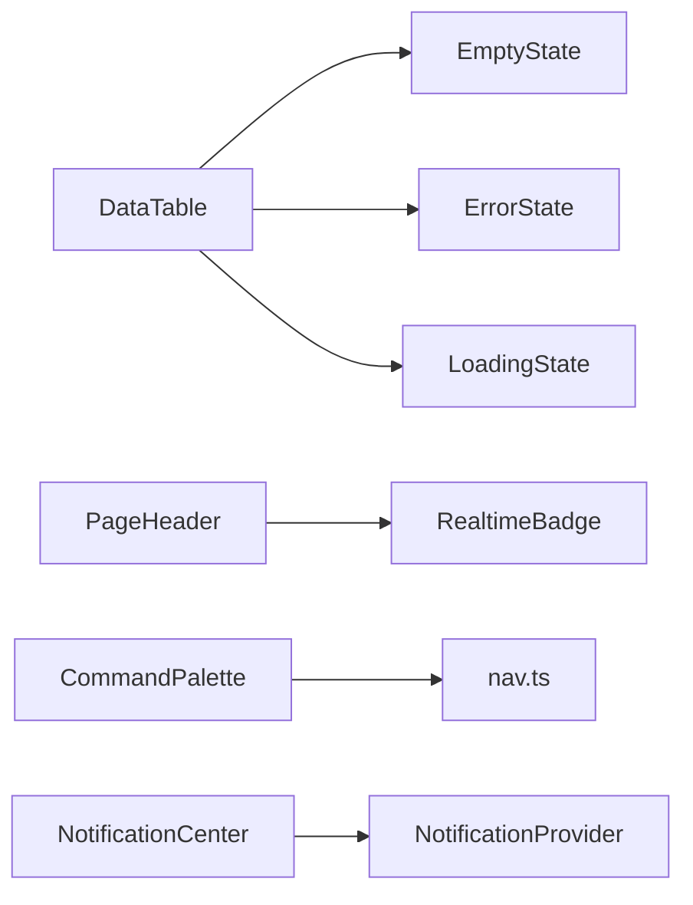

# UI组件库

<cite>
**本文引用的文件**   
- [ChartCard.tsx](file://frontend/src/components/ChartCard.tsx)
- [DataTable.tsx](file://frontend/src/components/DataTable.tsx)
- [DrawerForm.tsx](file://frontend/src/components/DrawerForm.tsx)
- [PageHeader.tsx](file://frontend/src/components/PageHeader.tsx)
- [StatCard.tsx](file://frontend/src/components/StatCard.tsx)
- [CommandPalette.tsx](file://frontend/src/components/CommandPalette.tsx)
- [NotificationCenter.tsx](file://frontend/src/components/NotificationCenter.tsx)
- [EmptyState.tsx](file://frontend/src/components/state/EmptyState.tsx)
- [ErrorState.tsx](file://frontend/src/components/state/ErrorState.tsx)
- [LoadingState.tsx](file://frontend/src/components/state/LoadingState.tsx)
- [RealtimeBadge.tsx](file://frontend/src/components/state/RealtimeBadge.tsx)
- [NotificationProvider.tsx](file://frontend/src/providers/NotificationProvider.tsx)
- [nav.ts](file://frontend/src/app/nav.ts)
</cite>

## 目录
1. [简介](#简介)
2. [项目结构](#项目结构)
3. [核心组件总览](#核心组件总览)
4. [架构总览](#架构总览)
5. [组件详细文档](#组件详细文档)
6. [依赖关系分析](#依赖关系分析)
7. [性能与可访问性](#性能与可访问性)
8. [常见问题排查](#常见问题排查)
9. [结论](#结论)

## 简介
本文件面向“可复用UI组件”的开发者与维护者，系统化说明以下七个组件的功能特性、Props接口、事件回调、样式定制选项、使用示例、组合模式、性能优化技巧和无障碍访问支持：
- ChartCard 图表卡片
- DataTable 数据表格
- DrawerForm 抽屉表单
- PageHeader 页面头部
- StatCard 统计卡片
- CommandPalette 命令面板
- NotificationCenter 通知中心

这些组件基于 Ant Design 构建，围绕安全运维控制台的使用场景统一了视觉语言、交互范式与状态体验。

## 项目结构
前端组件集中在 `frontend/src/components` 下，按职责分为：
- 业务组件：ChartCard、DataTable、DrawerForm、PageHeader、StatCard、CommandPalette、NotificationCenter
- 状态展示组件：EmptyState、ErrorState、LoadingState、RealtimeBadge
- 全局上下文：NotificationProvider（通知中心的数据与行为）
- 导航配置：nav.ts（命令面板与面包屑共享的信息架构）

**图示来源**
- [ChartCard.tsx:1-54](file://frontend/src/components/ChartCard.tsx#L1-L54)
- [DataTable.tsx:1-91](file://frontend/src/components/DataTable.tsx#L1-L91)
- [DrawerForm.tsx:1-143](file://frontend/src/components/DrawerForm.tsx#L1-L143)
- [PageHeader.tsx:1-77](file://frontend/src/components/PageHeader.tsx#L1-L77)
- [StatCard.tsx:1-127](file://frontend/src/components/StatCard.tsx#L1-L127)
- [CommandPalette.tsx:1-346](file://frontend/src/components/CommandPalette.tsx#L1-L346)
- [NotificationCenter.tsx:1-166](file://frontend/src/components/NotificationCenter.tsx#L1-L166)
- [EmptyState.tsx:1-82](file://frontend/src/components/state/EmptyState.tsx#L1-L82)
- [ErrorState.tsx:1-80](file://frontend/src/components/state/ErrorState.tsx#L1-L80)
- [LoadingState.tsx:1-122](file://frontend/src/components/state/LoadingState.tsx#L1-L122)
- [RealtimeBadge.tsx:1-98](file://frontend/src/components/state/RealtimeBadge.tsx#L1-L98)
- [NotificationProvider.tsx:1-119](file://frontend/src/providers/NotificationProvider.tsx#L1-L119)
- [nav.ts:1-155](file://frontend/src/app/nav.ts#L1-L155)

**章节来源**
- [ChartCard.tsx:1-54](file://frontend/src/components/ChartCard.tsx#L1-L54)
- [DataTable.tsx:1-91](file://frontend/src/components/DataTable.tsx#L1-L91)
- [DrawerForm.tsx:1-143](file://frontend/src/components/DrawerForm.tsx#L1-L143)
- [PageHeader.tsx:1-77](file://frontend/src/components/PageHeader.tsx#L1-L77)
- [StatCard.tsx:1-127](file://frontend/src/components/StatCard.tsx#L1-L127)
- [CommandPalette.tsx:1-346](file://frontend/src/components/CommandPalette.tsx#L1-L346)
- [NotificationCenter.tsx:1-166](file://frontend/src/components/NotificationCenter.tsx#L1-L166)
- [EmptyState.tsx:1-82](file://frontend/src/components/state/EmptyState.tsx#L1-L82)
- [ErrorState.tsx:1-80](file://frontend/src/components/state/ErrorState.tsx#L1-L80)
- [LoadingState.tsx:1-122](file://frontend/src/components/state/LoadingState.tsx#L1-L122)
- [RealtimeBadge.tsx:1-98](file://frontend/src/components/state/RealtimeBadge.tsx#L1-L98)
- [NotificationProvider.tsx:1-119](file://frontend/src/providers/NotificationProvider.tsx#L1-L119)
- [nav.ts:1-155](file://frontend/src/app/nav.ts#L1-L155)

## 核心组件总览
- ChartCard：为图表提供统一标题区、顶部品牌色条、内边距与网格跨度控制，适合仪表盘多图并排。
- DataTable：封装 AntD Table 与加载/空/错误态，统一工具条、骨架屏、粘性表头与密度。
- DrawerForm：桌面端“新建/编辑”范式，封装校验、提交、危险确认、脏检查与布局。
- PageHeader：统一页面标题区，含面包屑、标题、描述、右侧操作区与实时徽标。
- StatCard：KPI指标卡，语义化色调、等宽数值、图标背景与hover动效。
- CommandPalette：键盘全可达的命令面板，支持页面跳转与快捷动作，模糊匹配与分组排序。
- NotificationCenter：顶栏铃铛+可回溯通知列表，支持标记已读、清空、点击跳转。

**章节来源**
- [ChartCard.tsx:1-54](file://frontend/src/components/ChartCard.tsx#L1-L54)
- [DataTable.tsx:1-91](file://frontend/src/components/DataTable.tsx#L1-L91)
- [DrawerForm.tsx:1-143](file://frontend/src/components/DrawerForm.tsx#L1-L143)
- [PageHeader.tsx:1-77](file://frontend/src/components/PageHeader.tsx#L1-L77)
- [StatCard.tsx:1-127](file://frontend/src/components/StatCard.tsx#L1-L127)
- [CommandPalette.tsx:1-346](file://frontend/src/components/CommandPalette.tsx#L1-L346)
- [NotificationCenter.tsx:1-166](file://frontend/src/components/NotificationCenter.tsx#L1-L166)

## 架构总览
组件之间的协作关系如下：
- DataTable 组合 EmptyState、ErrorState、LoadingState，形成统一的四态体验。
- PageHeader 组合 RealtimeBadge，表达SSE连接新鲜度。
- CommandPalette 消费 nav.ts 的导航配置，实现页面跳转与快捷动作。
- NotificationCenter 通过 NotificationProvider 管理通知列表与未读数。

**图示来源**
- [DataTable.tsx:21-91](file://frontend/src/components/DataTable.tsx#L21-L91)
- [EmptyState.tsx:21-82](file://frontend/src/components/state/EmptyState.tsx#L21-L82)
- [ErrorState.tsx:28-80](file://frontend/src/components/state/ErrorState.tsx#L28-L80)
- [LoadingState.tsx:14-122](file://frontend/src/components/state/LoadingState.tsx#L14-L122)

## 组件详细文档

### ChartCard 图表卡片
功能特性
- 统一标题区（加粗标题 + 可选 extra 区域），顶部品牌色条，底部可选 footnote。
- 网格布局 span 控制，便于在仪表盘网格中并排。
- 通过 className 与 styles 扩展样式。

Props接口
- title: ReactNode
- extra?: ReactNode
- children: ReactNode
- footnote?: ReactNode
- span?: number
- className?: string

事件回调
- 无内置事件；children 承载图表逻辑。

样式定制
- 通过 CSS 变量 --fw-brand、--fw-border 控制品牌色与边框。
- 通过 className 追加自定义类名。
- 通过 Card.styles.body/header 调整内边距与头部高度。

使用示例
- 将 BaseChart 作为 children 传入，设置 span=2 以占据两列。
- 在 extra 放置切换粒度按钮或下载按钮。

无障碍访问
- 作为纯展示包装，不引入额外交互，无障碍风险低。

性能考虑
- 轻量包装，不引入额外计算；建议配合外层 grid 避免频繁重排。

**章节来源**
- [ChartCard.tsx:15-54](file://frontend/src/components/ChartCard.tsx#L15-L54)

### DataTable 数据表格
功能特性
- 统一四态：骨架屏、空态分场景、错误态、表格主体。
- 支持 toolbar 工具条、sticky 粘性表头、rowKey 默认序列化。
- 区分 isLoading（首屏骨架）与 isFetching（轮询遮罩）。

Props接口
- data: T[] | null
- isLoading?: boolean
- isFetching?: boolean
- error?: ApiError | null
- onRetry?: () => void
- emptyScenario?: 'no-data' | 'no-results' | 'disabled' | 'needs-config'
- emptyTitle?: string
- emptyDescription?: ReactNode
- emptyActionLabel?: string
- onEmptyAction?: () => void
- toolbar?: ReactNode
- skeletonRows?: number
- 其余透传 AntD TableProps（除 dataSource/loading）

事件回调
- onRetry：错误时可重试。
- onEmptyAction：空态引导动作。

样式定制
- 通过 className 与 tableProps 透传的样式覆盖。
- 工具条容器类 fw-table-toolbar。

使用示例
- 传入 data=null 且 isLoading=true 显示骨架；data=[] 显示空态；error 非空且 data=null 显示错误。

无障碍访问
- 继承 AntD Table 的可访问性；toolbar 需自行保证可访问性。

性能考虑
- 大数据量建议使用虚拟滚动（AntD Table 支持）；避免在 rowKey 中使用复杂对象序列化。

**章节来源**
- [DataTable.tsx:21-91](file://frontend/src/components/DataTable.tsx#L21-L91)
- [EmptyState.tsx:21-82](file://frontend/src/components/state/EmptyState.tsx#L21-L82)
- [ErrorState.tsx:28-80](file://frontend/src/components/state/ErrorState.tsx#L28-L80)
- [LoadingState.tsx:14-122](file://frontend/src/components/state/LoadingState.tsx#L14-L122)

### DrawerForm 抽屉表单
功能特性
- 统一提交流程：校验 → 调用 onSubmit → 成功关闭（由调用方控制）、失败保留输入。
- 危险动作二次确认（confirmText）。
- 脏检查：关闭前若字段已改动则二次确认。
- 支持 horizontal/vertical/inline 布局与 extraFooter。

Props接口
- open: boolean
- title: ReactNode
- form: FormInstance<T>
- onSubmit: (values: T) => Promise<void>
- onCancel: () => void
- children: ReactNode
- width?: number
- initialValues?: Partial<T>
- submitText?: string
- cancelText?: string
- danger?: boolean
- confirmText?: string
- confirmTitle?: string
- dirtyCheck?: boolean
- layout?: 'horizontal' | 'vertical' | 'inline'
- extraFooter?: ReactNode

事件回调
- onSubmit：提交成功后由调用方决定是否关闭抽屉。
- onCancel：取消关闭，受脏检查影响。

样式定制
- 通过 width、layout 控制尺寸与布局。
- 通过 extraFooter 追加额外操作。

使用示例
- 在页面中用 Form.useForm() 创建实例，打开前 setFieldsValue，关闭后 resetFields。

无障碍访问
- 使用 App.useApp().modal 确保主题一致；键盘关闭受 submitting 状态保护。

性能考虑
- destroyOnHidden 销毁隐藏内容；maskClosable/keyboard 在提交中禁用以避免误操作。

**章节来源**
- [DrawerForm.tsx:16-143](file://frontend/src/components/DrawerForm.tsx#L16-L143)

### PageHeader 页面头部
功能特性
- 面包屑（react-router Link）、标题、描述、右侧操作区、实时徽标、footer 自定义行。
- 实时徽标结合 SSE 连接状态与最后事件时间，直观表达数据新鲜度。

Props接口
- title: ReactNode
- description?: ReactNode
- breadcrumb?: Array<{title: string; path?: string}>
- extra?: ReactNode
- realtimeState?: SseConnectionState
- realtimeLastEventAt?: number
- footer?: ReactNode

事件回调
- 无内置事件；extra 可包含刷新、新建等操作。

样式定制
- 容器类 fw-page-header；标题与描述使用 AntD Typography。

使用示例
- 在 Dashboard/Bans 等页面统一标题区，传入 realtimeState 与 lastEventAt。

无障碍访问
- 面包屑项为 Link，末项不可点；实时徽标通过 RealtimeBadge 暴露语义信息。

性能考虑
- 轻量布局，实时徽标内部维护每秒刷新计时器，仅在 showFreshness 启用时运行。

**章节来源**
- [PageHeader.tsx:16-77](file://frontend/src/components/PageHeader.tsx#L16-L77)
- [RealtimeBadge.tsx:52-98](file://frontend/src/components/state/RealtimeBadge.tsx#L52-L98)

### StatCard 统计卡片
功能特性
- KPI指标卡：图标+标签、主数值（等宽）、单位、底部说明。
- tone 语义色（default/brand/success/warning/danger/info），左侧色条标识语义。
- hover 动效与 onClick 可点击态。

Props接口
- label: ReactNode
- value: ReactNode
- unit?: ReactNode
- icon?: NavIcon
- tone?: 'default' | 'brand' | 'success' | 'warning' | 'danger' | 'info'
- footer?: ReactNode
- loading?: boolean
- onClick?: () => void
- mono?: boolean

事件回调
- onClick：点击卡片触发。

样式定制
- 通过 tone 映射 CSS 变量与背景色；className 为 fw-stat-card。

使用示例
- 在仪表盘展示“封禁数”“威胁情报源数”等指标，loading 时显示骨架。

无障碍访问
- 可点击时 cursor:pointer；数值使用等宽字体提升可读性。

性能考虑
- 颜色与背景色通过常量映射，避免运行时计算开销。

**章节来源**
- [StatCard.tsx:18-127](file://frontend/src/components/StatCard.tsx#L18-L127)

### CommandPalette 命令面板
功能特性
- 键盘全可达：Ctrl/Cmd+K 打开，↑↓选择，Enter执行，Esc关闭。
- 两类命令：页面跳转（来自 nav.ts）与快捷动作（新建封禁、同步情报、刷新、切换主题/密度、登出）。
- 模糊匹配评分排序，分组渲染，选中项自动滚入可视区。

Props接口
- open: boolean
- onClose: () => void
- onRefresh?: () => void

事件回调
- onClose：关闭面板。
- onRefresh：手动触发当前页刷新。

样式定制
- Modal 宽度 560，body padding 0；选中项高亮与左侧品牌色条。

使用示例
- 在 AppShell 中监听快捷键打开面板，传入 onRefresh 以刷新当前页数据。

无障碍访问
- 输入框 role="combobox"，aria-expanded、aria-controls、aria-haspopup、aria-autocomplete、aria-activedescendant。
- 列表 role="listbox"，每项 role="option"，aria-selected。

性能考虑
- useMemo 缓存 commands、filtered、grouped、ordered；score 函数极简子串匹配。

**图示来源**
- [CommandPalette.tsx:46-57](file://frontend/src/components/CommandPalette.tsx#L46-L57)
- [CommandPalette.tsx:69-156](file://frontend/src/components/CommandPalette.tsx#L69-L156)
- [CommandPalette.tsx:158-204](file://frontend/src/components/CommandPalette.tsx#L158-L204)
- [CommandPalette.tsx:206-217](file://frontend/src/components/CommandPalette.tsx#L206-L217)
- [CommandPalette.tsx:221-346](file://frontend/src/components/CommandPalette.tsx#L221-L346)
- [nav.ts:31-48](file://frontend/src/app/nav.ts#L31-L48)

**章节来源**
- [CommandPalette.tsx:29-346](file://frontend/src/components/CommandPalette.tsx#L29-L346)
- [nav.ts:31-155](file://frontend/src/app/nav.ts#L31-L155)

### NotificationCenter 通知中心
功能特性
- 顶栏铃铛 + Popover 通知列表，最多保留最近 50 条 FIFO。
- 每条通知可点击跳转（link）、标记已读、全部已读、清空。
- 类型元数据（info/success/warning/error）映射颜色与标签。

Props接口
- 无外部 Props；通过 useNotify 获取 items/unreadCount/markAllRead/markRead/clear/dismiss。

事件回调
- 内部处理 markRead、markAllRead、clear、dismiss。

样式定制
- 未读条目左侧品牌色条与浅色背景；时间使用等宽字体。

使用示例
- 在 AppShell 右上角放置铃铛，点击打开通知面板。

无障碍访问
- 可点击的通知行补充 role="button"、tabIndex、aria-label、Enter/Space 激活。
- 铃铛按钮 aria-label="通知中心"。

性能考虑
- MAX_ITEMS=50 限制列表长度；toast 使用 key 去重与自动销毁。

**章节来源**
- [NotificationCenter.tsx:16-166](file://frontend/src/components/NotificationCenter.tsx#L16-L166)
- [NotificationProvider.tsx:25-119](file://frontend/src/providers/NotificationProvider.tsx#L25-L119)

## 依赖关系分析
- DataTable 依赖 EmptyState、ErrorState、LoadingState 与 AntD Table/Flex。
- PageHeader 依赖 RealtimeBadge 与 react-router Link。
- CommandPalette 依赖 nav.ts 的导航配置与 AntD Input/Modal。
- NotificationCenter 依赖 NotificationProvider 与 antd List/Badge/Popover。

**图示来源**
- [DataTable.tsx:1-91](file://frontend/src/components/DataTable.tsx#L1-L91)
- [PageHeader.tsx:1-77](file://frontend/src/components/PageHeader.tsx#L1-L77)
- [CommandPalette.tsx:1-346](file://frontend/src/components/CommandPalette.tsx#L1-L346)
- [NotificationCenter.tsx:1-166](file://frontend/src/components/NotificationCenter.tsx#L1-L166)
- [nav.ts:1-155](file://frontend/src/app/nav.ts#L1-L155)
- [NotificationProvider.tsx:1-119](file://frontend/src/providers/NotificationProvider.tsx#L1-L119)

**章节来源**
- [DataTable.tsx:1-91](file://frontend/src/components/DataTable.tsx#L1-L91)
- [PageHeader.tsx:1-77](file://frontend/src/components/PageHeader.tsx#L1-L77)
- [CommandPalette.tsx:1-346](file://frontend/src/components/CommandPalette.tsx#L1-L346)
- [NotificationCenter.tsx:1-166](file://frontend/src/components/NotificationCenter.tsx#L1-L166)
- [nav.ts:1-155](file://frontend/src/app/nav.ts#L1-L155)
- [NotificationProvider.tsx:1-119](file://frontend/src/providers/NotificationProvider.tsx#L1-L119)

## 性能与可访问性

性能优化建议
- DataTable：大数据集启用虚拟滚动；避免在 rowKey 中使用 JSON.stringify(record) 作为唯一键（当记录不含稳定ID时）。
- CommandPalette：保持 score 函数简洁；commands 与 filtered/grouped/ordered 使用 useMemo 缓存。
- RealtimeBadge：showFreshness 开启时才启动每秒定时器；lastEventAt<=0 时跳过。
- NotificationCenter：MAX_ITEMS=50 防止内存增长；toast 使用 key 去重并在 clear/dismiss 时销毁。

可访问性要点
- CommandPalette：combobox/listbox/option 角色与 aria-* 属性齐全；Enter/↑↓ 键盘导航。
- NotificationCenter：可点击通知行具备 role="button"、tabIndex、aria-label 与 Enter/Space 支持。
- PageHeader：面包屑末项不可点；实时徽标通过 Tooltip 与 aria-label 传达状态。
- DrawerForm：使用 App.useApp().modal 确保主题一致；提交中禁用 maskClosable/keyboard 防误触。

**章节来源**
- [CommandPalette.tsx:221-346](file://frontend/src/components/CommandPalette.tsx#L221-L346)
- [NotificationCenter.tsx:23-86](file://frontend/src/components/NotificationCenter.tsx#L23-L86)
- [RealtimeBadge.tsx:62-98](file://frontend/src/components/state/RealtimeBadge.tsx#L62-L98)
- [NotificationProvider.tsx:58-119](file://frontend/src/providers/NotificationProvider.tsx#L58-L119)
- [DrawerForm.tsx:57-118](file://frontend/src/components/DrawerForm.tsx#L57-L118)

## 常见问题排查
- DataTable 空态文案不一致：通过 emptyScenario 指定 no-data/no-results/disabled/needs-config，并配合 emptyTitle/description/action。
- DataTable 错误态重复提示：onRetry 仅在错误可重试时显示；business/http/parse 等类型决定 retryable。
- DrawerForm 提交失败仍关闭：onSubmit 负责错误提示与关闭逻辑；组件不会强制关闭。
- DrawerForm 误关丢失输入：dirtyCheck=true 时关闭前弹出确认；可通过 form.isFieldsTouched() 判断。
- CommandPalette 执行错乱：分组与排序顺序分离，使用 ordered 索引执行命令，避免跨组误触。
- NotificationCenter 未读红点不消失：打开面板即 markAllRead；点击条目也 markRead。

**章节来源**
- [DataTable.tsx:41-91](file://frontend/src/components/DataTable.tsx#L41-L91)
- [ErrorState.tsx:15-80](file://frontend/src/components/state/ErrorState.tsx#L15-L80)
- [DrawerForm.tsx:57-118](file://frontend/src/components/DrawerForm.tsx#L57-L118)
- [CommandPalette.tsx:182-204](file://frontend/src/components/CommandPalette.tsx#L182-L204)
- [NotificationCenter.tsx:88-166](file://frontend/src/components/NotificationCenter.tsx#L88-L166)

## 结论
这组UI组件围绕安全运维控制台的核心场景，提供了统一的视觉语言与交互范式：
- 通过 DataTable 的四态封装，消除各页面状态差异；
- 通过 DrawerForm 的提交编排与脏检查，保障桌面表单体验；
- 通过 PageHeader 与 RealtimeBadge，让实时数据新鲜度一目了然；
- 通过 StatCard 的语义色与等宽数值，快速传递指标含义；
- 通过 CommandPalette 的键盘全可达与模糊匹配，提升多页穿梭效率；
- 通过 NotificationCenter 的 toast+列表双通道，确保告警可见与可回溯。

建议在新增页面时优先复用这些组件，并通过 CSS 变量与 className 进行主题与样式定制，以保持全站一致性。