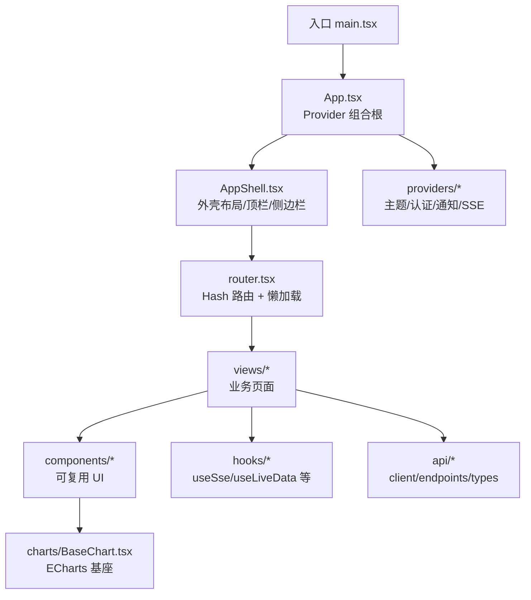
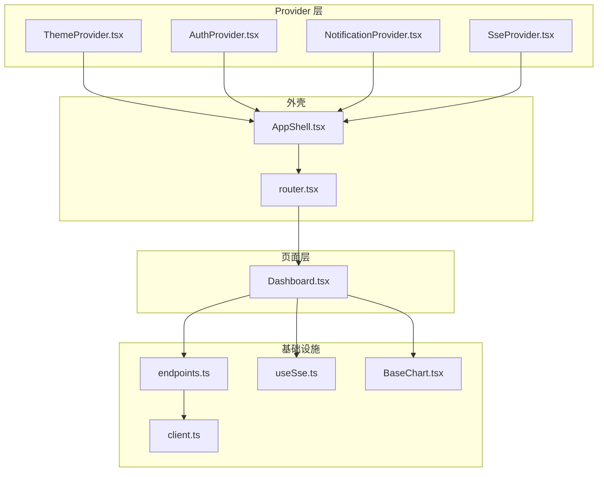
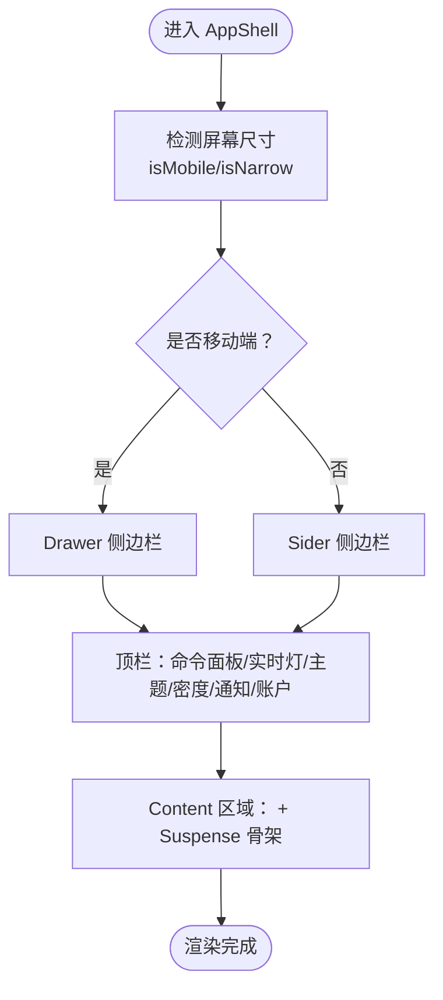
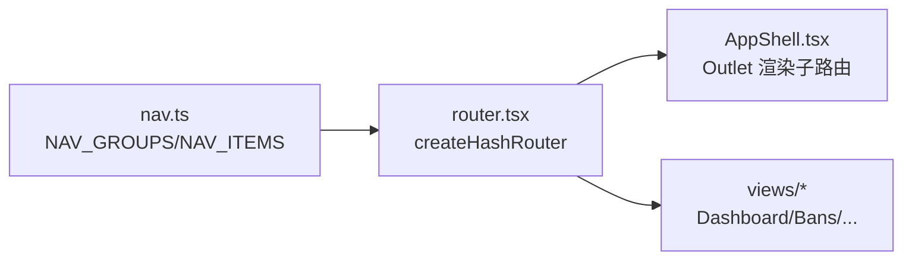
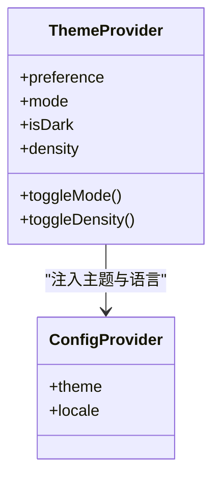
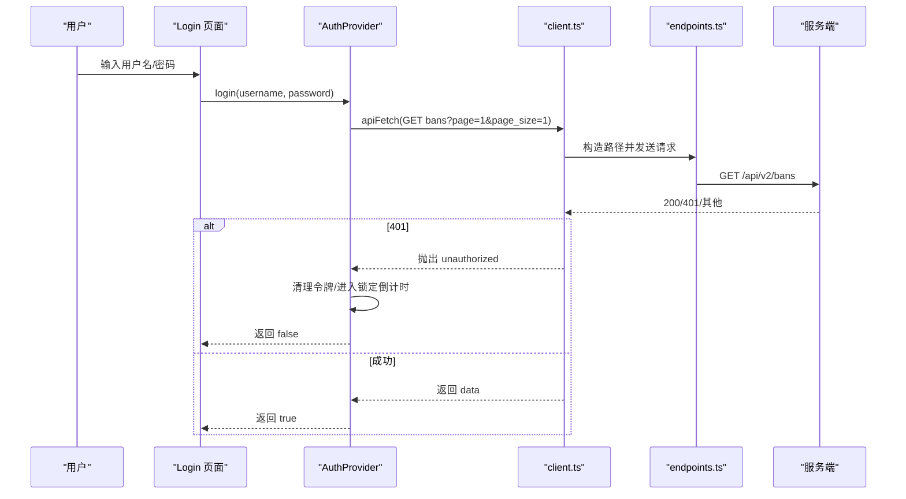
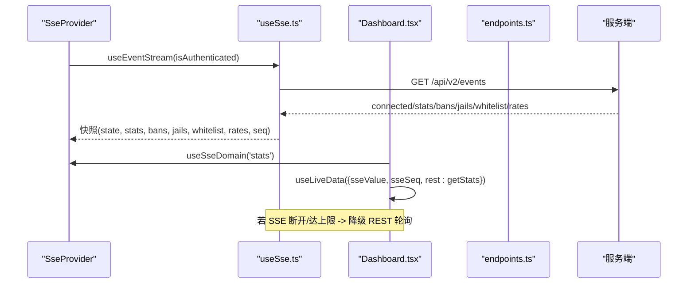
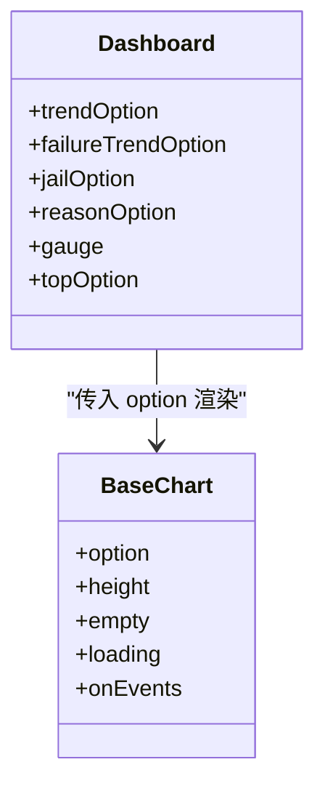
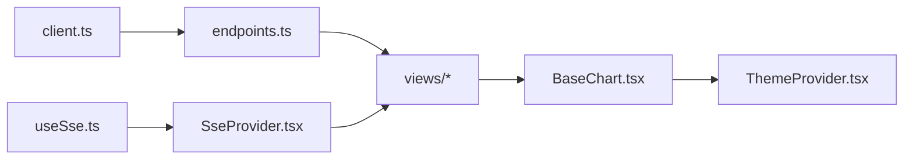

# 前端面板

<cite>
**本文引用的文件**   
- [frontend/package.json](file://frontend/package.json)
- [frontend/src/main.tsx](file://frontend/src/main.tsx)
- [frontend/src/app/App.tsx](file://frontend/src/app/App.tsx)
- [frontend/src/app/AppShell.tsx](file://frontend/src/app/AppShell.tsx)
- [frontend/src/app/router.tsx](file://frontend/src/app/router.tsx)
- [frontend/src/app/nav.ts](file://frontend/src/app/nav.ts)
- [frontend/src/providers/ThemeProvider.tsx](file://frontend/src/providers/ThemeProvider.tsx)
- [frontend/src/providers/AuthProvider.tsx](file://frontend/src/providers/AuthProvider.tsx)
- [frontend/src/providers/SseProvider.tsx](file://frontend/src/providers/SseProvider.tsx)
- [frontend/src/providers/NotificationProvider.tsx](file://frontend/src/providers/NotificationProvider.tsx)
- [frontend/src/hooks/useSse.ts](file://frontend/src/hooks/useSse.ts)
- [frontend/src/api/client.ts](file://frontend/src/api/client.ts)
- [frontend/src/api/endpoints.ts](file://frontend/src/api/endpoints.ts)
- [frontend/src/views/Dashboard.tsx](file://frontend/src/views/Dashboard.tsx)
- [frontend/src/components/charts/BaseChart.tsx](file://frontend/src/components/charts/BaseChart.tsx)
</cite>

## 目录
1. [简介](#简介)
2. [项目结构](#项目结构)
3. [核心组件](#核心组件)
4. [架构总览](#架构总览)
5. [详细组件分析](#详细组件分析)
6. [依赖关系分析](#依赖关系分析)
7. [性能与优化](#性能与优化)
8. [故障排查指南](#故障排查指南)
9. [结论](#结论)
10. [附录：开发环境与最佳实践](#附录开发环境与最佳实践)

## 简介
本文件面向“防火墙控制面板”的前端面板，目标是帮助开发者快速理解 React 应用的整体架构、组件设计模式、状态管理策略，以及页面实现、图表可视化、实时数据更新机制。文档同时覆盖 API 集成、SSE 事件处理、主题定制、组件复用、性能优化、响应式设计与调试方法，并给出可操作的排障建议与最佳实践。

该面板基于 React 19 + TypeScript + Vite + Ant Design，采用桌面优先的响应式布局；通过一条全局 SSE 连接提供秒级实时数据，REST 轮询作为降级兜底；使用 Provider 组合树统一注入主题、认证、通知与实时流能力；路由采用 hash 模式以适配守护进程静态资源部署方式。

## 项目结构
前端工程位于 `frontend` 目录，关键组织方式如下：
- `src/app`：应用外壳、路由与导航信息架构（IA）。
- `src/providers`：跨页上下文 Provider（主题、认证、通知、SSE）。
- `src/hooks`：通用 Hook（SSE 连接、媒体查询、持久化状态等）。
- `src/api`：HTTP 客户端内核、契约端点封装与类型定义。
- `src/views`：业务页面（概览、封禁、白名单、DDoS、风险引擎、威胁情报、综合分析、日志、设置等）。
- `src/components`：可复用 UI 组件（表格、卡片、图表基座、状态占位、通知中心等）。
- `src/theme`：主题令牌与设计系统。
- `src/lib`：工具函数（格式化、图表配置、新鲜度序号等）。

图示来源
- [frontend/src/main.tsx:1-32](file://frontend/src/main.tsx#L1-L32)
- [frontend/src/app/App.tsx:1-44](file://frontend/src/app/App.tsx#L1-L44)
- [frontend/src/app/AppShell.tsx:1-366](file://frontend/src/app/AppShell.tsx#L1-L366)
- [frontend/src/app/router.tsx:1-76](file://frontend/src/app/router.tsx#L1-L76)
- [frontend/src/views/Dashboard.tsx:1-303](file://frontend/src/views/Dashboard.tsx#L1-L303)
- [frontend/src/components/charts/BaseChart.tsx:1-97](file://frontend/src/components/charts/BaseChart.tsx#L1-L97)

章节来源
- [frontend/package.json:1-34](file://frontend/package.json#L1-L34)
- [frontend/src/main.tsx:1-32](file://frontend/src/main.tsx#L1-L32)

## 核心组件
- 应用外壳 AppShell：提供侧边栏、顶栏、内容区与命令面板；聚合实时状态灯、主题/密度切换、通知中心与账户菜单；在窄屏自动折叠为图标条，在小屏使用抽屉导航。
- 路由 router：hash 路由，所有业务页面 lazy 加载，登录前重定向到 /login，未知路径回退到默认页。
- Provider 组合根 App：按严格顺序嵌套 ThemeProvider → AntdApp → ErrorBoundary → AuthProvider → NotificationProvider → SseProvider → RouterProvider，确保主题、通知实例、认证态与 SSE 连接的正确作用域。
- 主题 ThemeProvider：集中 antd ConfigProvider 主题、CSS 变量、data-theme/density 属性与 dayjs 中文本地化；支持跟随系统/暗/亮与标准/紧凑密度，偏好落 localStorage 并跨标签同步。
- 认证 AuthProvider：令牌生命周期、登录探测、401 自动登出、连续失败阈值与本地锁定倒计时。
- 通知 NotificationProvider：非阻塞 toast + 可回溯列表，FIFO 保留最近若干条，错误类通知不自动消失。
- 实时流 SseProvider + useSse：全站唯一 `/api/v2/events` 连接，按域分发 stats/bans/jails/whitelist/rates；断线退避重连，达上限时进入 'limit' 降级态，UI 切 REST 轮询。
- 图表 BaseChart：ECharts 渲染基座，统一主题、空态、尺寸与加载遮罩。

章节来源
- [frontend/src/app/AppShell.tsx:1-366](file://frontend/src/app/AppShell.tsx#L1-L366)
- [frontend/src/app/router.tsx:1-76](file://frontend/src/app/router.tsx#L1-L76)
- [frontend/src/app/App.tsx:1-44](file://frontend/src/app/App.tsx#L1-L44)
- [frontend/src/providers/ThemeProvider.tsx:1-174](file://frontend/src/providers/ThemeProvider.tsx#L1-L174)
- [frontend/src/providers/AuthProvider.tsx:1-190](file://frontend/src/providers/AuthProvider.tsx#L1-L190)
- [frontend/src/providers/NotificationProvider.tsx:1-119](file://frontend/src/providers/NotificationProvider.tsx#L1-L119)
- [frontend/src/providers/SseProvider.tsx:1-88](file://frontend/src/providers/SseProvider.tsx#L1-L88)
- [frontend/src/hooks/useSse.ts:1-259](file://frontend/src/hooks/useSse.ts#L1-L259)
- [frontend/src/components/charts/BaseChart.tsx:1-97](file://frontend/src/components/charts/BaseChart.tsx#L1-L97)

## 架构总览
整体架构由“外壳 + Provider 层 + 路由层 + 页面层 + API/Hook 基础设施”组成。Provider 层负责横切关注点（主题、认证、通知、实时流），页面层消费这些上下文并通过 endpoints 调用后端接口或订阅 SSE 帧。

图示来源
- [frontend/src/app/AppShell.tsx:1-366](file://frontend/src/app/AppShell.tsx#L1-L366)
- [frontend/src/app/router.tsx:1-76](file://frontend/src/app/router.tsx#L1-L76)
- [frontend/src/providers/ThemeProvider.tsx:1-174](file://frontend/src/providers/ThemeProvider.tsx#L1-L174)
- [frontend/src/providers/AuthProvider.tsx:1-190](file://frontend/src/providers/AuthProvider.tsx#L1-L190)
- [frontend/src/providers/NotificationProvider.tsx:1-119](file://frontend/src/providers/NotificationProvider.tsx#L1-L119)
- [frontend/src/providers/SseProvider.tsx:1-88](file://frontend/src/providers/SseProvider.tsx#L1-L88)
- [frontend/src/views/Dashboard.tsx:1-303](file://frontend/src/views/Dashboard.tsx#L1-L303)
- [frontend/src/hooks/useSse.ts:1-259](file://frontend/src/hooks/useSse.ts#L1-L259)
- [frontend/src/api/client.ts:1-205](file://frontend/src/api/client.ts#L1-L205)
- [frontend/src/api/endpoints.ts:1-515](file://frontend/src/api/endpoints.ts#L1-L515)
- [frontend/src/components/charts/BaseChart.tsx:1-97](file://frontend/src/components/charts/BaseChart.tsx#L1-L97)

## 详细组件分析

### 应用外壳 AppShell
- 职责：站点唯一框架层，承载侧边栏、顶栏、内容区与命令面板；聚合全局能力（搜索/命令、实时状态、主题/密度、通知、账户菜单）。
- 响应式策略：≥lg 常驻侧边栏；md–lg 自动折叠为图标条；<md 收进抽屉；表格在各页面内自行降级为卡片/横滚。
- 实时告警：外壳订阅 SSE 连接态与威胁等级，仅在状态跃迁时推送通知（降级/重连/等级升高），避免重复打扰。
- 快捷键：mod+K 打开命令面板，mod+J 切换主题，R 刷新当前页。

图示来源
- [frontend/src/app/AppShell.tsx:1-366](file://frontend/src/app/AppShell.tsx#L1-L366)

章节来源
- [frontend/src/app/AppShell.tsx:1-366](file://frontend/src/app/AppShell.tsx#L1-L366)

### 路由与导航
- 路由：hash 路由，所有业务页面 lazy 加载；未登录访问受保护路由时重定向到 /login；未知路径回退到默认页。
- 导航 IA：nav.ts 集中维护分组、路径、标题、图标与关键词，供侧边栏、命令面板、面包屑与路由表共同消费，避免漂移。

图示来源
- [frontend/src/app/nav.ts:1-155](file://frontend/src/app/nav.ts#L1-L155)
- [frontend/src/app/router.tsx:1-76](file://frontend/src/app/router.tsx#L1-L76)

章节来源
- [frontend/src/app/nav.ts:1-155](file://frontend/src/app/nav.ts#L1-L155)
- [frontend/src/app/router.tsx:1-76](file://frontend/src/app/router.tsx#L1-L76)

### 主题与样式
- ThemeProvider 将 antd ConfigProvider 主题、CSS 变量、data-theme/density 属性与 dayjs 中文本地化集中在一个 Provider 中；支持跟随系统/暗/亮与标准/紧凑密度，偏好落 localStorage 并跨标签同步。
- 纯 CSS 与自绘元素通过 CSS 变量消费语义色与字体，保证与组件库主题一致。

图示来源
- [frontend/src/providers/ThemeProvider.tsx:1-174](file://frontend/src/providers/ThemeProvider.tsx#L1-L174)

章节来源
- [frontend/src/providers/ThemeProvider.tsx:1-174](file://frontend/src/providers/ThemeProvider.tsx#L1-L174)

### 认证流程
- AuthProvider 维护令牌生命周期、登录探测、401 自动登出、连续失败阈值与本地锁定倒计时；任何 REST 调用收到 401 会广播给 AuthProvider 触发自动登出。
- 登录探测使用最小分页拉取封禁列表，避免恒 303 跳转带来的误判。

图示来源
- [frontend/src/providers/AuthProvider.tsx:1-190](file://frontend/src/providers/AuthProvider.tsx#L1-L190)
- [frontend/src/api/client.ts:1-205](file://frontend/src/api/client.ts#L1-L205)
- [frontend/src/api/endpoints.ts:486-492](file://frontend/src/api/endpoints.ts#L486-L492)

章节来源
- [frontend/src/providers/AuthProvider.tsx:1-190](file://frontend/src/providers/AuthProvider.tsx#L1-L190)
- [frontend/src/api/client.ts:1-205](file://frontend/src/api/client.ts#L1-L205)
- [frontend/src/api/endpoints.ts:486-492](file://frontend/src/api/endpoints.ts#L486-L492)

### 实时数据与 SSE 事件处理
- SseProvider 暴露全局快照与域选择器，全站只维持一条 `/api/v2/events` 连接，按域分发 stats/bans/jails/whitelist/rates。
- useSse 接管 EventSource 连接：出错即 close，按指数退避重连；重连前先探 SSE 名额上限，若已达上限则进入 'limit' 降级态，UI 切换到 REST 轮询。
- Dashboard 等页面通过 useLiveData 仲裁 SSE 帧与 REST 轮询，按新鲜度序号选择最新值，保证一致性。

图示来源
- [frontend/src/providers/SseProvider.tsx:1-88](file://frontend/src/providers/SseProvider.tsx#L1-L88)
- [frontend/src/hooks/useSse.ts:1-259](file://frontend/src/hooks/useSse.ts#L1-L259)
- [frontend/src/views/Dashboard.tsx:1-303](file://frontend/src/views/Dashboard.tsx#L1-L303)
- [frontend/src/api/endpoints.ts:504-514](file://frontend/src/api/endpoints.ts#L504-L514)

章节来源
- [frontend/src/providers/SseProvider.tsx:1-88](file://frontend/src/providers/SseProvider.tsx#L1-L88)
- [frontend/src/hooks/useSse.ts:1-259](file://frontend/src/hooks/useSse.ts#L1-L259)
- [frontend/src/views/Dashboard.tsx:1-303](file://frontend/src/views/Dashboard.tsx#L1-L303)

### 图表可视化
- BaseChart 是全站 ECharts 的唯一渲染入口，统一主题、空态、尺寸与加载遮罩；各页面通过 useChartBase 获取轴色/文字色/调色板拼装 option。
- Dashboard 使用 gauge/line/pie/bar 等图表展示威胁分数、趋势、分布与 Top 攻击源。

图示来源
- [frontend/src/components/charts/BaseChart.tsx:1-97](file://frontend/src/components/charts/BaseChart.tsx#L1-L97)
- [frontend/src/views/Dashboard.tsx:1-303](file://frontend/src/views/Dashboard.tsx#L1-L303)

章节来源
- [frontend/src/components/charts/BaseChart.tsx:1-97](file://frontend/src/components/charts/BaseChart.tsx#L1-L97)
- [frontend/src/views/Dashboard.tsx:1-303](file://frontend/src/views/Dashboard.tsx#L1-L303)

### 通知中心
- NotificationProvider 提供 notify/markRead/clear/dismiss 等方法，toast 与列表双写；错误通知不自动关闭，避免重要告警被忽略。
- 外壳在 SSE 状态跃迁与威胁等级升高时推通知，提升运维感知。

章节来源
- [frontend/src/providers/NotificationProvider.tsx:1-119](file://frontend/src/providers/NotificationProvider.tsx#L1-L119)
- [frontend/src/app/AppShell.tsx:136-182](file://frontend/src/app/AppShell.tsx#L136-L182)

## 依赖关系分析
- client.ts 是所有 REST 调用的内核，统一信封解包、错误分类与 401 广播。
- endpoints.ts 集中契约路由与参数编码，禁止手写 `/api/v…` 字面量，便于契约校验。
- useSse.ts 直接消费 endpoints.ts 提供的 SSE URL 与 SSE 状态查询。
- Dashboard 等页面通过 endpoints.ts 拉取 REST 数据，通过 SseProvider/useSse 订阅实时帧。
- BaseChart 依赖 ThemeProvider 的主题信息，保证图表配色与主题一致。

图示来源
- [frontend/src/api/client.ts:1-205](file://frontend/src/api/client.ts#L1-L205)
- [frontend/src/api/endpoints.ts:1-515](file://frontend/src/api/endpoints.ts#L1-L515)
- [frontend/src/hooks/useSse.ts:1-259](file://frontend/src/hooks/useSse.ts#L1-L259)
- [frontend/src/providers/SseProvider.tsx:1-88](file://frontend/src/providers/SseProvider.tsx#L1-L88)
- [frontend/src/components/charts/BaseChart.tsx:1-97](file://frontend/src/components/charts/BaseChart.tsx#L1-L97)
- [frontend/src/providers/ThemeProvider.tsx:1-174](file://frontend/src/providers/ThemeProvider.tsx#L1-L174)

章节来源
- [frontend/src/api/client.ts:1-205](file://frontend/src/api/client.ts#L1-L205)
- [frontend/src/api/endpoints.ts:1-515](file://frontend/src/api/endpoints.ts#L1-L515)
- [frontend/src/hooks/useSse.ts:1-259](file://frontend/src/hooks/useSse.ts#L1-L259)
- [frontend/src/providers/SseProvider.tsx:1-88](file://frontend/src/providers/SseProvider.tsx#L1-L88)
- [frontend/src/components/charts/BaseChart.tsx:1-97](file://frontend/src/components/charts/BaseChart.tsx#L1-L97)
- [frontend/src/providers/ThemeProvider.tsx:1-174](file://frontend/src/providers/ThemeProvider.tsx#L1-L174)

## 性能与优化
- 首屏与路由懒加载：所有业务页面 lazy 加载，切换时由外壳 Suspense 显示骨架屏，避免一次性下载全部代码。
- 单条 SSE 连接：SseProvider 全站共享一条 events 连接，避免多标签/多页面撞上限导致 503；达上限时 UI 降级为 REST 轮询。
- 指数退避重连：useSse 使用 min(2^min(n,5), 30) 秒退避，并在重连前探上限，减少无效重试。
- 新鲜度仲裁：useLiveData 基于 SSE 帧 seq 与 REST 轮询结果仲裁，保证视图始终消费最新值且无闪烁。
- 图表渲染优化：BaseChart 使用 memo 主题对象、autoResize、canvas 渲染器与 notMerge/lazyUpdate，减少重绘开销。
- 主题与密度持久化：localStorage 存储偏好并跨标签同步，避免频繁计算与闪烁。
- 通知限长：通知列表 FIFO 保留固定数量，防止长会话内存增长。

[本节为通用指导，无需具体文件引用]

## 故障排查指南
- 无法建立 SSE 连接：
  - 检查是否已登录（SseProvider 依赖 isAuthenticated）；未登录不会连接。
  - 查看连接状态是否为 'limit'，若是，说明服务端连接数已达上限，需等待名额释放或手动点击重试。
  - 观察外壳实时灯与通知，确认是否出现“实时连接中断，正在重连”或“实时连接已达上限”。
- 登录后仍提示未认证：
  - 检查 401 是否被 client.ts 捕获并广播；AuthProvider 会清令牌并跳转登录。
  - 确认登录探测是否命中真实接口（probeAuth 调用 bans 分页），而非恒 303 的根路径。
- 图表空白或异常：
  - 检查 BaseChart 的 empty/loading 状态；确认 option 是否正确生成。
  - 确认主题模式（明/暗）与 chartBaseTheme 输出一致。
- 通知不显示或主题不正确：
  - 确认 NotificationProvider 位于 AntdApp 内部，使用 App.useApp() 获取上下文感知的通知实例。
- 路由跳转异常：
  - 确认 hash 路由模式；未知路径会回退到默认页；受保护路由未登录会跳转到 /login。

章节来源
- [frontend/src/hooks/useSse.ts:1-259](file://frontend/src/hooks/useSse.ts#L1-L259)
- [frontend/src/providers/AuthProvider.tsx:1-190](file://frontend/src/providers/AuthProvider.tsx#L1-L190)
- [frontend/src/api/client.ts:1-205](file://frontend/src/api/client.ts#L1-L205)
- [frontend/src/providers/NotificationProvider.tsx:1-119](file://frontend/src/providers/NotificationProvider.tsx#L1-L119)
- [frontend/src/app/router.tsx:1-76](file://frontend/src/app/router.tsx#L1-L76)

## 结论
该前端面板通过 Provider 组合树统一管理主题、认证、通知与实时流，结合 hash 路由与懒加载实现良好的首屏体验；SSE 与 REST 仲裁保证了实时性与稳定性；BaseChart 与 StatCard/ChartCard 等组件提升了可视化与复用性。整体架构清晰、职责分离明确，适合持续扩展与维护。

[本节为总结，无需具体文件引用]

## 附录：开发环境与最佳实践
- 环境搭建
  - 安装 Node.js 与 pnpm/yarn/npm。
  - 进入 frontend 目录，执行依赖安装。
  - 启动开发服务器：vite dev。
  - 构建生产包：tsc --noEmit && vite build。
  - 预览构建产物：vite preview。
- 调试技巧
  - 浏览器控制台查看网络面板，确认 REST 与 SSE 连接状态。
  - 使用 React DevTools 检查 Provider 嵌套顺序与组件状态。
  - 在 App.tsx 注释中了解 Provider 顺序约束，避免主题/通知/SSE 作用域问题。
- 最佳实践
  - 新增页面：在 nav.ts 添加导航项，在 router.tsx 注册路由，在 views 创建页面组件，按需接入 SseProvider/useSse 与 endpoints。
  - 新增 API：在 endpoints.ts 新增具名函数，使用 ROUTES 常量与 withParams 拼接路径，禁止手写 `/api/v…`。
  - 新增图表：使用 BaseChart 与 useChartBase，保持主题一致；复杂逻辑放在页面层拼装 option。
  - 实时数据：优先使用 useSseDomain 订阅域快照，结合 useLiveData 仲裁 SSE/REST。
  - 主题定制：通过 ThemeProvider 暴露 CSS 变量与 tokens，避免在各处硬编码颜色。

章节来源
- [frontend/package.json:1-34](file://frontend/package.json#L1-L34)
- [frontend/src/app/App.tsx:1-44](file://frontend/src/app/App.tsx#L1-L44)
- [frontend/src/api/endpoints.ts:1-515](file://frontend/src/api/endpoints.ts#L1-L515)
- [frontend/src/views/Dashboard.tsx:1-303](file://frontend/src/views/Dashboard.tsx#L1-L303)
- [frontend/src/components/charts/BaseChart.tsx:1-97](file://frontend/src/components/charts/BaseChart.tsx#L1-L97)