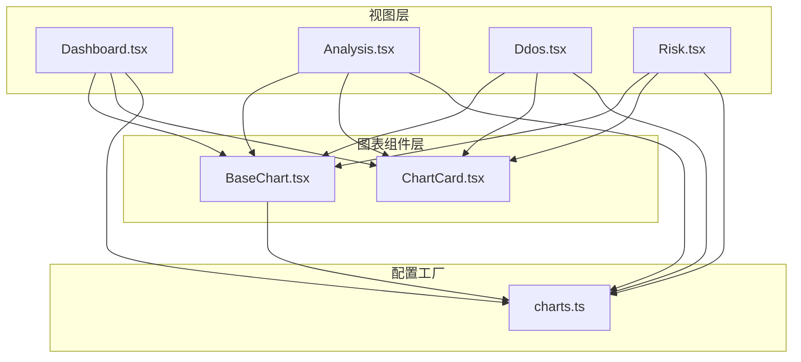
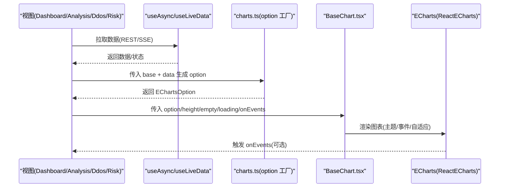
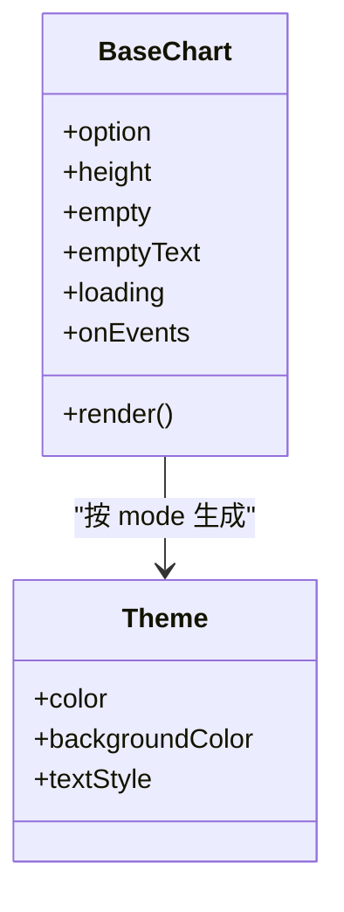
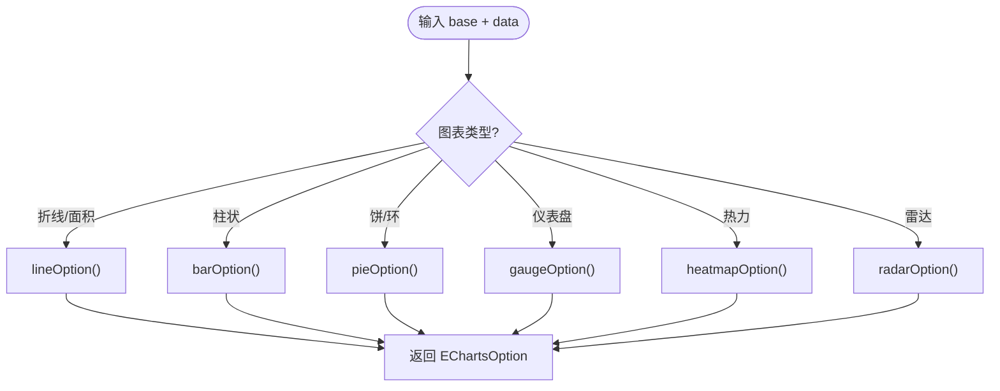
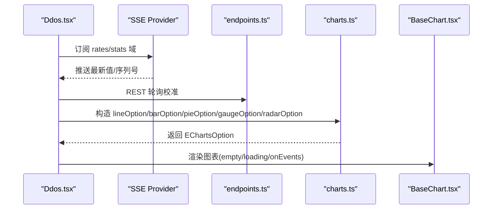
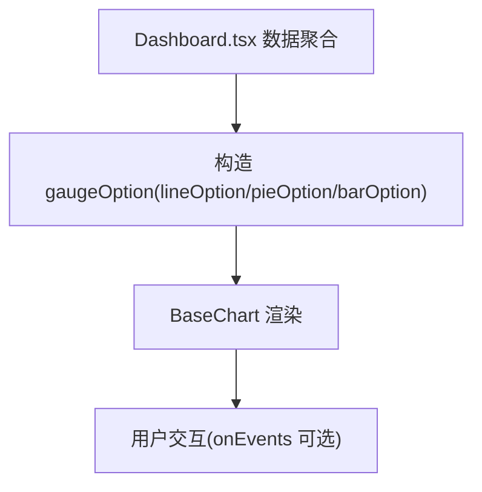
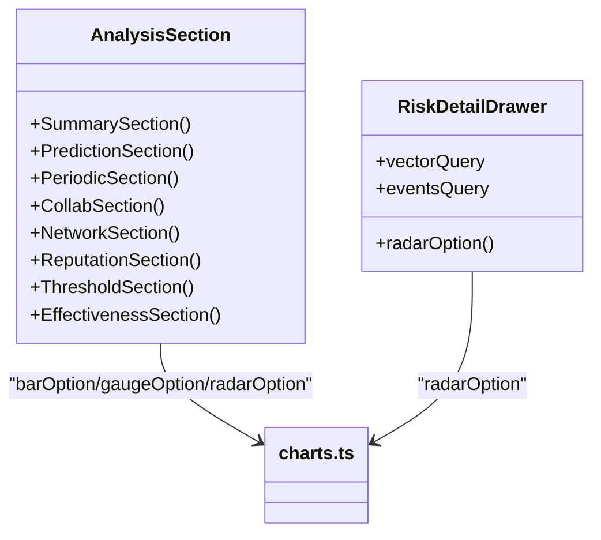
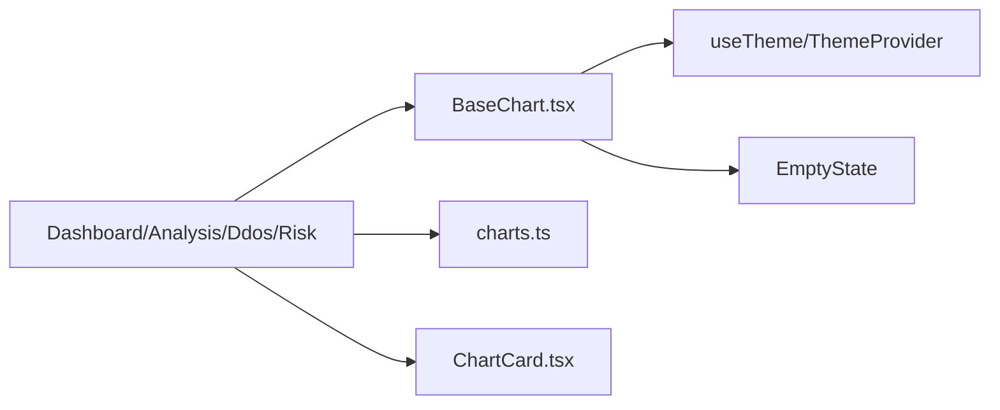

# 图表可视化

<cite>
**本文引用的文件**   
- [BaseChart.tsx](file://frontend/src/components/charts/BaseChart.tsx)
- [charts.ts](file://frontend/src/lib/charts.ts)
- [Dashboard.tsx](file://frontend/src/views/Dashboard.tsx)
- [Analysis.tsx](file://frontend/src/views/Analysis.tsx)
- [Ddos.tsx](file://frontend/src/views/Ddos.tsx)
- [Risk.tsx](file://frontend/src/views/Risk.tsx)
- [ChartCard.tsx](file://frontend/src/components/ChartCard.tsx)
</cite>

## 目录
1. [引言](#引言)
2. [项目结构](#项目结构)
3. [核心组件](#核心组件)
4. [架构总览](#架构总览)
5. [详细组件分析](#详细组件分析)
6. [依赖关系分析](#依赖关系分析)
7. [性能与优化](#性能与优化)
8. [故障排查](#故障排查)
9. [结论](#结论)
10. [附录：扩展指南](#附录扩展指南)

## 引言
本文件面向“图表可视化子系统”，聚焦前端 React + ECharts 的图表实现。目标包括：
- 解释 BaseChart 基础图表组件的设计模式与职责边界；
- 说明 ECharts 集成方式、主题与样式统一机制；
- 梳理动态数据绑定、响应式适配与四态（加载/空/错误/内容）处理；
- 总结折线、柱状、饼环、仪表盘、热力、雷达等图表的配置策略；
- 给出实时监控、趋势分析、统计分析三类场景的具体实现路径；
- 提供自定义扩展方法与性能优化建议。

## 项目结构
图表相关代码集中在前端 `frontend/src` 下，采用“组件层 + 配置工厂 + 页面视图”的分层组织：
- 组件层：`components/charts/BaseChart.tsx`、`components/ChartCard.tsx`
- 配置工厂：`lib/charts.ts`
- 页面视图：`views/Dashboard.tsx`、`views/Analysis.tsx`、`views/Ddos.tsx`、`views/Risk.tsx`

**图示来源**
- [Dashboard.tsx:15-27](file://frontend/src/views/Dashboard.tsx#L15-L27)
- [Analysis.tsx:29-50](file://frontend/src/views/Analysis.tsx#L29-L50)
- [Ddos.tsx:18-47](file://frontend/src/views/Ddos.tsx#L18-L47)
- [Risk.tsx:22-30](file://frontend/src/views/Risk.tsx#L22-L30)
- [BaseChart.tsx:1-97](file://frontend/src/components/charts/BaseChart.tsx#L1-L97)
- [ChartCard.tsx:1-54](file://frontend/src/components/ChartCard.tsx#L1-L54)
- [charts.ts:1-279](file://frontend/src/lib/charts.ts#L1-L279)

**章节来源**
- [Dashboard.tsx:1-303](file://frontend/src/views/Dashboard.tsx#L1-L303)
- [Analysis.tsx:1-800](file://frontend/src/views/Analysis.tsx#L1-L800)
- [Ddos.tsx:1-800](file://frontend/src/views/Ddos.tsx#L1-L800)
- [Risk.tsx:1-489](file://frontend/src/views/Risk.tsx#L1-L489)
- [BaseChart.tsx:1-97](file://frontend/src/components/charts/BaseChart.tsx#L1-L97)
- [ChartCard.tsx:1-54](file://frontend/src/components/ChartCard.tsx#L1-L54)
- [charts.ts:1-279](file://frontend/src/lib/charts.ts#L1-L279)

## 核心组件
- BaseChart：全站 ECharts 的唯一渲染入口，负责主题外壳、空态占位、加载遮罩、尺寸自适应与事件透传。
- ChartCard：统一的图表卡片容器，提供标题区、附加操作区与脚注，保证多图并排时视觉一致。
- charts.ts：ECharts option 构造器集合，封装 grid、tooltip、坐标轴、折线、柱状、饼环、仪表盘、热力、雷达等通用配置。

关键设计要点：
- 主题集中：通过 useTheme 获取明暗模式，统一注入颜色、文字色、背景色与字体族。
- 空态优先：当 empty=true 且未 loading 时，直接渲染 EmptyState，避免误导性的空坐标轴。
- 渲染稳定：使用 useMemo 缓存 theme，避免每次渲染重建导致 ECharts 重复初始化。
- 响应式：autoResize + 百分比宽度，配合外层 Grid/Flex 布局实现自适应。
- 交互透传：onEvents 透传给底层 ECharts，便于点击、悬停等交互扩展。

**章节来源**
- [BaseChart.tsx:8-97](file://frontend/src/components/charts/BaseChart.tsx#L8-L97)
- [ChartCard.tsx:4-54](file://frontend/src/components/ChartCard.tsx#L4-L54)
- [charts.ts:5-13](file://frontend/src/lib/charts.ts#L5-L13)

## 架构总览
下图展示从视图到图表渲染的调用链与数据流：

**图示来源**
- [Dashboard.tsx:72-115](file://frontend/src/views/Dashboard.tsx#L72-L115)
- [Analysis.tsx:397-401](file://frontend/src/views/Analysis.tsx#L397-L401)
- [Ddos.tsx:246-262](file://frontend/src/views/Ddos.tsx#L246-L262)
- [Risk.tsx:341-351](file://frontend/src/views/Risk.tsx#L341-L351)
- [BaseChart.tsx:55-96](file://frontend/src/components/charts/BaseChart.tsx#L55-L96)
- [charts.ts:55-94](file://frontend/src/lib/charts.ts#L55-L94)

## 详细组件分析

### BaseChart 基础图表组件
职责与行为：
- 主题化外壳：根据当前主题模式生成 ECharts 主题对象，包含调色板、背景色、文字色与字体。
- 空态渲染：当 empty=true 且非 loading 时，渲染 EmptyState，而非空坐标轴。
- 加载遮罩：showLoading 控制加载指示器。
- 自适应与渲染器：autoResize、opts.renderer=canvas，提升性能与兼容性。
- 事件透传：onEvents 透传给 ReactECharts，支持点击、悬停等交互。

**图示来源**
- [BaseChart.tsx:20-41](file://frontend/src/components/charts/BaseChart.tsx#L20-L41)
- [BaseChart.tsx:55-96](file://frontend/src/components/charts/BaseChart.tsx#L55-L96)

**章节来源**
- [BaseChart.tsx:8-97](file://frontend/src/components/charts/BaseChart.tsx#L8-L97)

### ECharts 配置工厂（charts.ts）
功能概览：
- 统一网格与提示框：grid、tooltip 函数封装默认边距、边框、文字色与轴线指针样式。
- 坐标轴封装：categoryAxis/valueAxis 统一轴线色、刻度隐藏、标签字号与分割线色。
- 折线/面积图：lineOption，支持名称、颜色、面积渐变、平滑曲线与符号显示阈值。
- 柱状图：barOption，支持横向条形、堆叠、圆角与最大条宽。
- 饼/环图：pieOption，支持环形半径、图例滚动、标签百分比格式化。
- 仪表盘：gaugeOption，支持进度条、最大值限制、数值动画与单位格式化。
- 热力图：heatmapOption，支持二维分类轴、视觉映射、分片区域与明暗配色。
- 雷达图：radarOption，支持指标定义、半径、分割线与多系列填充。

**图示来源**
- [charts.ts:15-52](file://frontend/src/lib/charts.ts#L15-L52)
- [charts.ts:55-94](file://frontend/src/lib/charts.ts#L55-L94)
- [charts.ts:97-133](file://frontend/src/lib/charts.ts#L97-L133)
- [charts.ts:136-160](file://frontend/src/lib/charts.ts#L136-L160)
- [charts.ts:163-200](file://frontend/src/lib/charts.ts#L163-L200)
- [charts.ts:203-246](file://frontend/src/lib/charts.ts#L203-L246)
- [charts.ts:249-278](file://frontend/src/lib/charts.ts#L249-L278)

**章节来源**
- [charts.ts:5-279](file://frontend/src/lib/charts.ts#L5-L279)

### 实时监控图表（DDoS 监控）
特点：
- 实时速率：SSE 秒级推送 + REST 校准，使用 useLiveData 仲裁新鲜度。
- 历史趋势：折线图展示 PPS/BPS 历史，时间轴由 formatClock 生成。
- 分布统计：包长/端口/TTL/ICMP 类型等用饼/柱图呈现。
- 异常检测：仪表盘+雷达图展示全局异常分与维度偏差。

**图示来源**
- [Ddos.tsx:225-262](file://frontend/src/views/Ddos.tsx#L225-L262)
- [Ddos.tsx:441-500](file://frontend/src/views/Ddos.tsx#L441-L500)
- [Ddos.tsx:613-633](file://frontend/src/views/Ddos.tsx#L613-L633)
- [charts.ts:55-94](file://frontend/src/lib/charts.ts#L55-L94)
- [charts.ts:97-133](file://frontend/src/lib/charts.ts#L97-L133)
- [charts.ts:136-160](file://frontend/src/lib/charts.ts#L136-L160)
- [charts.ts:163-200](file://frontend/src/lib/charts.ts#L163-L200)
- [charts.ts:249-278](file://frontend/src/lib/charts.ts#L249-L278)

**章节来源**
- [Ddos.tsx:57-88](file://frontend/src/views/Ddos.tsx#L57-L88)
- [Ddos.tsx:225-434](file://frontend/src/views/Ddos.tsx#L225-L434)
- [Ddos.tsx:441-607](file://frontend/src/views/Ddos.tsx#L441-L607)
- [Ddos.tsx:613-780](file://frontend/src/views/Ddos.tsx#L613-L780)

### 趋势分析图表（概览仪表盘）
特点：
- 威胁等级仪表盘：gaugeOption 展示分数与级别。
- 封禁趋势/失败尝试趋势：lineOption 面积图，带 yName 与颜色。
- Jail 分布/失败原因：pieOption 环形图，带图例。
- Top 复发攻击源：barOption 横向条形图。

**图示来源**
- [Dashboard.tsx:72-115](file://frontend/src/views/Dashboard.tsx#L72-L115)
- [Dashboard.tsx:247-296](file://frontend/src/views/Dashboard.tsx#L247-L296)
- [charts.ts:55-94](file://frontend/src/lib/charts.ts#L55-L94)
- [charts.ts:136-160](file://frontend/src/lib/charts.ts#L136-L160)
- [charts.ts:163-200](file://frontend/src/lib/charts.ts#L163-L200)
- [charts.ts:97-133](file://frontend/src/lib/charts.ts#L97-L133)

**章节来源**
- [Dashboard.tsx:31-39](file://frontend/src/views/Dashboard.tsx#L31-L39)
- [Dashboard.tsx:72-115](file://frontend/src/views/Dashboard.tsx#L72-L115)
- [Dashboard.tsx:247-296](file://frontend/src/views/Dashboard.tsx#L247-L296)

### 统计分析图表（智能分析与风险引擎）
特点：
- 智能分析：Tabs 分区懒加载，每个分区独立取数与兜底四态；雷达图用于多维风险向量。
- 风险引擎：列表按 total_risk 降序，抽屉内单 IP 雷达图与事件历史表。

**图示来源**
- [Analysis.tsx:397-401](file://frontend/src/views/Analysis.tsx#L397-L401)
- [Analysis.tsx:545-552](file://frontend/src/views/Analysis.tsx#L545-L552)
- [Risk.tsx:341-351](file://frontend/src/views/Risk.tsx#L341-L351)
- [charts.ts:97-133](file://frontend/src/lib/charts.ts#L97-L133)
- [charts.ts:163-200](file://frontend/src/lib/charts.ts#L163-L200)
- [charts.ts:249-278](file://frontend/src/lib/charts.ts#L249-L278)

**章节来源**
- [Analysis.tsx:74-88](file://frontend/src/views/Analysis.tsx#L74-L88)
- [Analysis.tsx:397-401](file://frontend/src/views/Analysis.tsx#L397-L401)
- [Analysis.tsx:545-552](file://frontend/src/views/Analysis.tsx#L545-L552)
- [Risk.tsx:35-49](file://frontend/src/views/Risk.tsx#L35-L49)
- [Risk.tsx:341-351](file://frontend/src/views/Risk.tsx#L341-L351)

## 依赖关系分析
- 视图依赖 BaseChart 与 charts.ts：所有页面通过 useChartBase 获取主题基色，再调用 charts.ts 的 option 工厂生成 EChartsOption。
- BaseChart 依赖主题与状态组件：useTheme、EmptyState、ThemeProvider。
- ChartCard 是纯展示包装，不耦合业务逻辑。

**图示来源**
- [Dashboard.tsx:15-27](file://frontend/src/views/Dashboard.tsx#L15-L27)
- [Analysis.tsx:29-50](file://frontend/src/views/Analysis.tsx#L29-L50)
- [Ddos.tsx:18-47](file://frontend/src/views/Ddos.tsx#L18-L47)
- [Risk.tsx:22-30](file://frontend/src/views/Risk.tsx#L22-L30)
- [BaseChart.tsx:1-97](file://frontend/src/components/charts/BaseChart.tsx#L1-L97)
- [ChartCard.tsx:1-54](file://frontend/src/components/ChartCard.tsx#L1-L54)

**章节来源**
- [Dashboard.tsx:1-303](file://frontend/src/views/Dashboard.tsx#L1-L303)
- [Analysis.tsx:1-800](file://frontend/src/views/Analysis.tsx#L1-L800)
- [Ddos.tsx:1-800](file://frontend/src/views/Ddos.tsx#L1-L800)
- [Risk.tsx:1-489](file://frontend/src/views/Risk.tsx#L1-L489)
- [BaseChart.tsx:1-97](file://frontend/src/components/charts/BaseChart.tsx#L1-L97)
- [ChartCard.tsx:1-54](file://frontend/src/components/ChartCard.tsx#L1-L54)

## 性能与优化
- 主题缓存：BaseChart 使用 useMemo 生成 theme，避免频繁重建导致 ECharts 重新初始化。
- 渲染器选择：opts.renderer='canvas'，在大数据量与高频更新场景下更稳定。
- 增量更新：notMerge=false（默认合并），lazyUpdate 减少重绘开销。
- 自适应：autoResize 与百分比宽度结合，避免手动计算尺寸。
- 数据分页与采样：
  - 历史折线限制最近 N 个点（如 HISTORY_LIMIT=60）。
  - 分布类图表仅绘制 Top-N，降低节点数量。
- 空态优先：empty=true 时直接渲染 EmptyState，避免无意义绘图。
- 懒加载与分区：Analysis 页 Tabs 惰性挂载，按需拉取数据，减少首屏压力。

[本节为通用指导，无需具体文件引用]

## 故障排查
常见问题与定位思路：
- 图表空白或显示“暂无图表数据”：检查 empty 标志与数据是否为空数组/全零；确认 chartEmpty 判断逻辑。
- 主题颜色异常：确认 useChartBase 返回的 textColor/axisLineColor/splitLineColor 是否正确；检查 isDark 分支。
- 图表不刷新：确认 option 是否通过 useMemo 依赖 base 与 data；检查 loading 与 refetch 信号。
- 交互无效：检查 onEvents 是否正确透传；确认事件名与参数类型。
- 实时数据不更新：检查 SSE 域订阅与 useLiveData 的新鲜度仲裁；确认 REST 轮询间隔。

**章节来源**
- [Dashboard.tsx:117-119](file://frontend/src/views/Dashboard.tsx#L117-L119)
- [BaseChart.tsx:65-96](file://frontend/src/components/charts/BaseChart.tsx#L65-L96)
- [Ddos.tsx:225-262](file://frontend/src/views/Ddos.tsx#L225-L262)

## 结论
该图表可视化系统以 BaseChart 为核心渲染入口，结合 charts.ts 的统一配置工厂，实现了主题一致、空态友好、响应式适配与可交互的图表体系。各视图通过 useChartBase 与 option 工厂拼装数据，形成清晰的“视图-工厂-组件”分层。实时监控、趋势分析与统计分析三类场景均复用同一套能力，具备良好的可扩展性与维护性。

[本节为总结，无需具体文件引用]

## 附录：扩展指南
新增图表类型的步骤：
1. 在 charts.ts 中新增 option 构造函数（例如 donutOption、funnelOption），复用 grid/tooltip/坐标轴封装。
2. 在视图中通过 useChartBase 获取 base，调用新函数生成 option。
3. 在 BaseChart 中传入 option/height/empty/loading/onEvents，必要时扩展 props。
4. 如需自定义交互，在 onEvents 中注册事件处理器。

示例参考：
- 折线/面积图：lineOption
- 柱状图：barOption
- 饼/环图：pieOption
- 仪表盘：gaugeOption
- 热力图：heatmapOption
- 雷达图：radarOption

**章节来源**
- [charts.ts:55-94](file://frontend/src/lib/charts.ts#L55-L94)
- [charts.ts:97-133](file://frontend/src/lib/charts.ts#L97-L133)
- [charts.ts:136-160](file://frontend/src/lib/charts.ts#L136-L160)
- [charts.ts:163-200](file://frontend/src/lib/charts.ts#L163-L200)
- [charts.ts:203-246](file://frontend/src/lib/charts.ts#L203-L246)
- [charts.ts:249-278](file://frontend/src/lib/charts.ts#L249-L278)