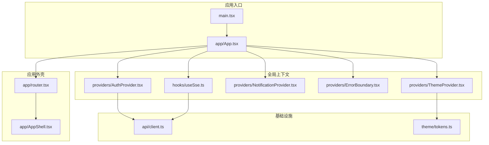
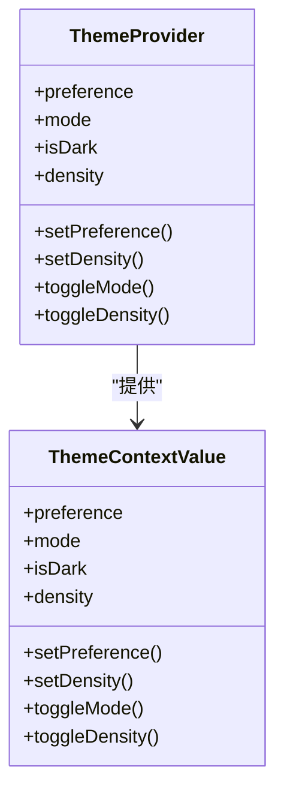
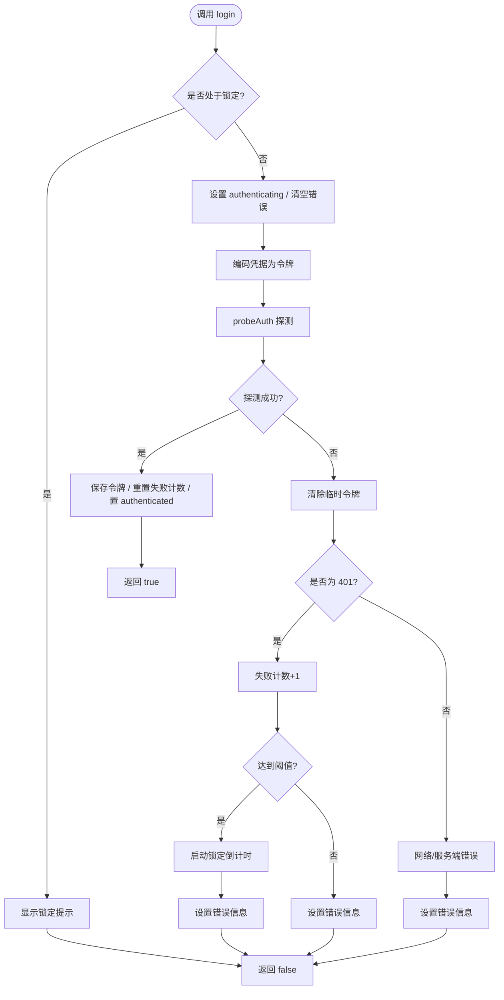
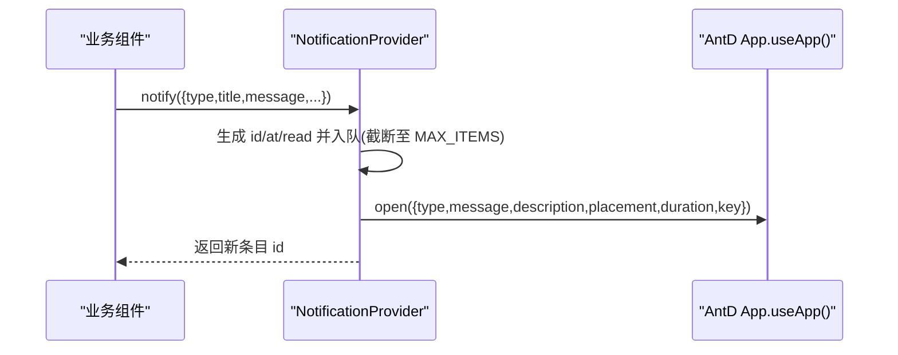
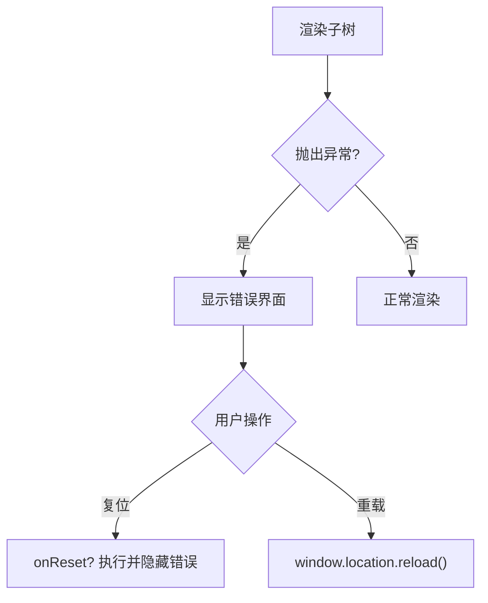
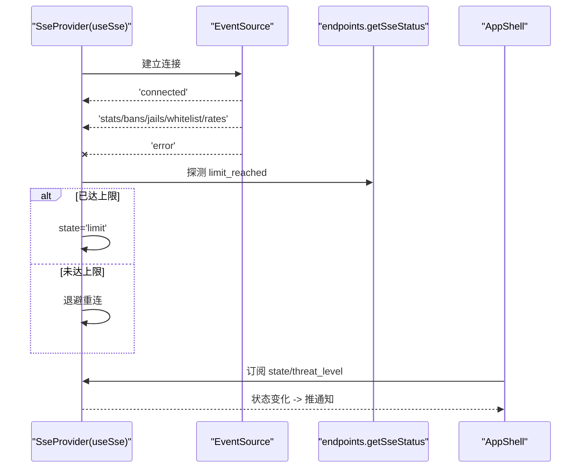
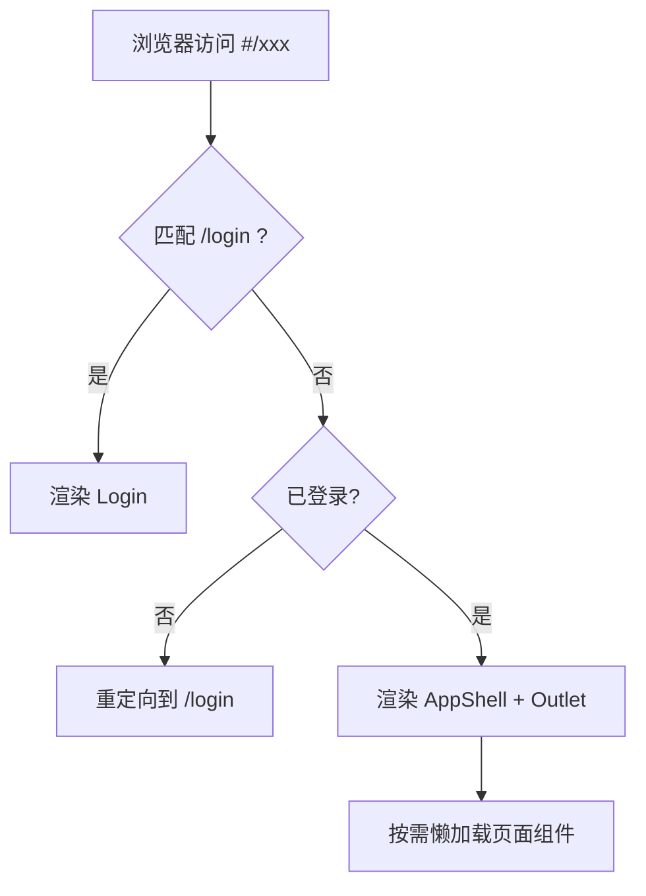
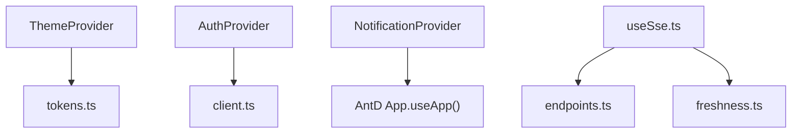

# 应用架构设计

<cite>
**本文引用的文件**   
- [main.tsx](file://frontend/src/main.tsx)
- [App.tsx](file://frontend/src/app/App.tsx)
- [router.tsx](file://frontend/src/app/router.tsx)
- [AppShell.tsx](file://frontend/src/app/AppShell.tsx)
- [ThemeProvider.tsx](file://frontend/src/providers/ThemeProvider.tsx)
- [AuthProvider.tsx](file://frontend/src/providers/AuthProvider.tsx)
- [NotificationProvider.tsx](file://frontend/src/providers/NotificationProvider.tsx)
- [ErrorBoundary.tsx](file://frontend/src/providers/ErrorBoundary.tsx)
- [useSse.ts](file://frontend/src/hooks/useSse.ts)
- [client.ts](file://frontend/src/api/client.ts)
- [tokens.ts](file://frontend/src/theme/tokens.ts)
</cite>

## 目录
1. [引言](#引言)
2. [项目结构](#项目结构)
3. [核心组件](#核心组件)
4. [架构总览](#架构总览)
5. [详细组件分析](#详细组件分析)
6. [依赖关系分析](#依赖关系分析)
7. [性能与可维护性](#性能与可维护性)
8. [故障排查指南](#故障排查指南)
9. [结论](#结论)
10. [附录：最佳实践清单](#附录最佳实践清单)

## 引言
本文件面向前端 React 应用，系统性说明 Provider 组合模式、依赖注入顺序、路由配置结构，以及主题系统、认证流程、错误边界与实时数据流（SSE）的技术实现。文档同时给出组件树结构图、数据流向图和关键流程图，帮助读者从“整体到细节”理解系统。

## 项目结构
前端采用按功能域组织的方式：
- app：应用外壳、根 Provider 组合、路由定义
- providers：全局上下文 Provider（主题、认证、通知、错误边界、SSE）
- hooks：通用 Hook（含 SSE 连接管理）
- api：HTTP 客户端、端点与类型
- theme：设计令牌与 AntD 主题构建
- views：页面视图（由路由懒加载）
- components：跨页复用组件与状态展示

图表来源
- [main.tsx:19-23](file://frontend/src/main.tsx#L19-L23)
- [App.tsx:27-43](file://frontend/src/app/App.tsx#L27-L43)
- [router.tsx:49-75](file://frontend/src/app/router.tsx#L49-L75)
- [AppShell.tsx:86-355](file://frontend/src/app/AppShell.tsx#L86-L355)
- [ThemeProvider.tsx:74-161](file://frontend/src/providers/ThemeProvider.tsx#L74-L161)
- [AuthProvider.tsx:55-182](file://frontend/src/providers/AuthProvider.tsx#L55-L182)
- [NotificationProvider.tsx:58-111](file://frontend/src/providers/NotificationProvider.tsx#L58-L111)
- [useSse.ts:99-257](file://frontend/src/hooks/useSse.ts#L99-L257)
- [client.ts:154-187](file://frontend/src/api/client.ts#L154-L187)
- [tokens.ts:114-180](file://frontend/src/theme/tokens.ts#L114-L180)

章节来源
- [main.tsx:1-32](file://frontend/src/main.tsx#L1-L32)
- [App.tsx:1-44](file://frontend/src/app/App.tsx#L1-L44)
- [router.tsx:1-76](file://frontend/src/app/router.tsx#L1-L76)

## 核心组件
- ThemeProvider：主题与密度单一真相源，注入 AntD ConfigProvider，暴露 CSS 变量与切换能力。
- AuthProvider：令牌生命周期、登录/登出、401 自动登出、连续失败锁定倒计时。
- NotificationProvider：非阻塞告警汇聚点，toast + 可回溯列表，基于 AntD App.useApp() 获取主题感知实例。
- ErrorBoundary：渲染期异常兜底，提供复位或重载恢复。
- useSse（SseProvider 使用）：EventSource 连接管理、退避重连、上限检测、领域数据快照。

章节来源
- [ThemeProvider.tsx:26-161](file://frontend/src/providers/ThemeProvider.tsx#L26-L161)
- [AuthProvider.tsx:22-182](file://frontend/src/providers/AuthProvider.tsx#L22-L182)
- [NotificationProvider.tsx:12-111](file://frontend/src/providers/NotificationProvider.tsx#L12-L111)
- [ErrorBoundary.tsx:4-71](file://frontend/src/providers/ErrorBoundary.tsx#L4-L71)
- [useSse.ts:2-257](file://frontend/src/hooks/useSse.ts#L2-L257)

## 架构总览
Provider 嵌套顺序即依赖注入顺序，从外到内依次为：
- ThemeProvider（AntD 主题与中文 locale）
- AntdApp（主题感知的 notification/message/modal 实例）
- ErrorBoundary（渲染崩溃兜底）
- AuthProvider（认证状态与令牌生命周期）
- NotificationProvider（通知中心）
- SseProvider（实时事件流，受认证状态控制）
- RouterProvider（页面路由与懒加载）

图表来源
- [App.tsx:10-26](file://frontend/src/app/App.tsx#L10-L26)
- [App.tsx:27-43](file://frontend/src/app/App.tsx#L27-L43)

## 详细组件分析

### 主题系统（ThemeProvider）
- 职责
  - 将 AntD 的 ThemeConfig 通过 ConfigProvider 注入整个组件树。
  - 把语义色、字体、威胁等级色阶写入 :root 的 CSS 变量，供纯 CSS 与自绘元素消费。
  - 同步 <html data-theme> 与首屏防闪烁脚本，避免切换主题闪白。
  - 持久化用户偏好（外观模式与信息密度），跨标签同步。
- 关键数据结构
  - ThemeContextValue：包含 preference、mode、isDark、density、setPreference、setDensity、toggleMode、toggleDensity。
- 复杂度与优化
  - 使用 useMemo 稳定 themeConfig 与 context value；useCallback 稳定回调引用。
  - 仅订阅 isDark 的轻量选择器 useIsDark，减少无关重渲染。

图表来源
- [ThemeProvider.tsx:41-53](file://frontend/src/providers/ThemeProvider.tsx#L41-L53)
- [ThemeProvider.tsx:74-161](file://frontend/src/providers/ThemeProvider.tsx#L74-L161)

章节来源
- [ThemeProvider.tsx:26-174](file://frontend/src/providers/ThemeProvider.tsx#L26-L174)
- [tokens.ts:16-180](file://frontend/src/theme/tokens.ts#L16-L180)

### 认证流程（AuthProvider）
- 职责
  - 令牌生命周期：以 base64(user:pass) 作为令牌，存 sessionStorage；通过 probeAuth 探测真实认证成功。
  - 登录/登出：成功则置 authenticated，失败则记录错误并可能触发本地锁定倒计时。
  - 401 自动登出：订阅 client.ts 的 onUnauthorized，统一清理令牌并跳转登录。
  - 锁定机制：连续失败达到阈值后进入本地锁定倒计时，镜像后端锁定窗口。
- 关键数据结构
  - AuthContextValue：status、isAuthenticated、isLoggingIn、error、failCount、threshold、lockoutRemaining、login、logout、clearError。
- 错误处理
  - ApiError.isUnauthorized 分支计入失败次数；网络/服务端错误不计入，避免误锁。
  - 401 时清除令牌并切换到 unauthenticated。

图表来源
- [AuthProvider.tsx:103-153](file://frontend/src/providers/AuthProvider.tsx#L103-L153)
- [client.ts:154-187](file://frontend/src/api/client.ts#L154-L187)

章节来源
- [AuthProvider.tsx:22-190](file://frontend/src/providers/AuthProvider.tsx#L22-L190)
- [client.ts:22-56](file://frontend/src/api/client.ts#L22-L56)
- [client.ts:58-71](file://frontend/src/api/client.ts#L58-L71)
- [client.ts:154-187](file://frontend/src/api/client.ts#L154-L187)

### 通知中心（NotificationProvider）
- 职责
  - 非阻塞告警：弹 toast + 进可回溯列表，便于运维回看。
  - 使用 AntD App.useApp() 获取主题感知实例，确保暗色下样式正确。
  - 列表 FIFO 保留最近 MAX_ITEMS 条，避免长会话内存增长。
- 关键数据结构
  - NoticeItem：id、type、title、message、at、read、source、link。
  - NotificationContextValue：items、unreadCount、notify、markAllRead、markRead、clear、dismiss。
- 行为要点
  - error 类 toast duration=0（不自动关闭），clear/dismiss 会销毁对应 toast。

图表来源
- [NotificationProvider.tsx:58-111](file://frontend/src/providers/NotificationProvider.tsx#L58-L111)

章节来源
- [NotificationProvider.tsx:12-119](file://frontend/src/providers/NotificationProvider.tsx#L12-L119)

### 错误边界（ErrorBoundary）
- 职责
  - 捕获渲染期异常，避免白屏，提供「复位视图」或「重新加载」恢复路径。
  - 仅兜渲染错误，不兜事件处理器/异步回调异常。
- 行为要点
  - 优先调用 onReset 回调进行局部复位；否则 window.location.reload()。
  - 控制台输出本地日志，不上报第三方。

图表来源
- [ErrorBoundary.tsx:27-71](file://frontend/src/providers/ErrorBoundary.tsx#L27-L71)

章节来源
- [ErrorBoundary.tsx:4-72](file://frontend/src/providers/ErrorBoundary.tsx#L4-L72)

### 实时数据流（SSE）
- 职责
  - 管理 EventSource 连接，处理 connected/stats/bans/jails/whitelist/rates 等事件。
  - 自定义退避重连策略，并在重连前探测 events.limit_reached，达上限则降级为 REST 轮询。
  - 维护每个领域的独立快照与新鲜度序号，避免不必要更新。
- 关键数据结构
  - SseSnapshot：state、stats、bans、jails、whitelist、rates、seq、lastEventAt、attempts。
  - SseConnectionState：idle/connecting/open/reconnecting/limit/closed。
- 与外壳交互
  - AppShell 订阅 sse.state 与 threat_level，仅在状态跃迁时推送通知（降级/重连/恢复/威胁升高）。

图表来源
- [useSse.ts:99-257](file://frontend/src/hooks/useSse.ts#L99-L257)
- [AppShell.tsx:136-182](file://frontend/src/app/AppShell.tsx#L136-L182)

章节来源
- [useSse.ts:2-259](file://frontend/src/hooks/useSse.ts#L2-L259)
- [AppShell.tsx:136-182](file://frontend/src/app/AppShell.tsx#L136-L182)

### 路由与导航
- 路由策略
  - 使用 createHashRouter（# 承载前端路由），适配守护进程无 catch-all 的场景。
  - /login 公开；其余路由挂在 RequireAuth 保护的 AppShell 之下，子路由懒加载。
  - 深链如 /bans/:ip、/analysis/ip/:ip 复用同一页面组件，由页面自行解析参数打开详情抽屉。
- 未匹配处理
  - NotFound 判断已知路径前缀，命中则保持当前路径（交由页面处理），否则回默认首页。

图表来源
- [router.tsx:30-47](file://frontend/src/app/router.tsx#L30-L47)
- [router.tsx:49-75](file://frontend/src/app/router.tsx#L49-L75)

章节来源
- [router.tsx:1-76](file://frontend/src/app/router.tsx#L1-L76)

## 依赖关系分析
- Provider 依赖
  - ThemeProvider 依赖 tokens.ts 的设计令牌与 buildTheme。
  - AuthProvider 依赖 client.ts 的 onUnauthorized 与 ApiError 分类。
  - NotificationProvider 依赖 AntD App.useApp() 的主题感知通知实例。
  - SseProvider（useSse）依赖 endpoints 与 freshness 工具。
- 耦合与内聚
  - Provider 之间通过 Context 解耦，职责清晰：主题、认证、通知、错误、实时流各自内聚。
  - 路由层与 Provider 解耦，仅消费 useAuth/useSse/useNotify/useTheme。
- 外部依赖
  - AntD（ConfigProvider/App）、EventSource、fetch。

图表来源
- [ThemeProvider.tsx:15-24](file://frontend/src/providers/ThemeProvider.tsx#L15-L24)
- [AuthProvider.tsx:11-20](file://frontend/src/providers/AuthProvider.tsx#L11-L20)
- [NotificationProvider.tsx:10-10](file://frontend/src/providers/NotificationProvider.tsx#L10-L10)
- [useSse.ts:22-31](file://frontend/src/hooks/useSse.ts#L22-L31)

章节来源
- [App.tsx:10-26](file://frontend/src/app/App.tsx#L10-L26)
- [client.ts:22-56](file://frontend/src/api/client.ts#L22-L56)
- [tokens.ts:114-180](file://frontend/src/theme/tokens.ts#L114-L180)

## 性能与可维护性
- 渲染优化
  - 路由懒加载：页面组件 lazy 导入，配合 Suspense 骨架屏，降低首屏包体。
  - Provider value 使用 useMemo/useCallback 稳定引用，减少子树重渲染。
  - useIsDark 等轻量选择器缩小订阅面。
- 资源与内存
  - 通知列表限制 MAX_ITEMS，FIFO 丢弃旧项，避免长会话内存增长。
  - SSE 连接在组件卸载时主动 close，避免泄漏。
- 可维护性
  - 设计令牌集中管理，AntD 主题与图表配色同源。
  - HTTP 客户端统一封装错误分类与 401 广播，避免散落处理。

[本节为通用指导，不直接分析具体文件]

## 故障排查指南
- 主题相关
  - 暗色下通知/消息颜色异常：确认 NotificationProvider 位于 AntdApp 内部，并使用 App.useApp() 而非静态方法。
  - 切换主题闪白：检查 ThemeProvider 对 documentElement 的 data-theme 属性与 index.html 内联脚本的一致性。
- 认证相关
  - 登录后仍反复 401：检查 onUnauthorized 订阅是否生效，以及 token 是否正确持久化。
  - 频繁被锁定：确认只有 401 才计入失败次数，网络/服务端错误不应推进锁定计数。
- 通知相关
  - 错误 toast 不消失：clear/dismiss 会销毁对应 toast；若列表清空但 toast 残留，检查 destroy 调用。
- 实时流相关
  - 一直重连：检查 getSseStatus 是否返回 limit_reached=true；若是，应降级为 REST 轮询。
  - 数据不更新：核对事件名是否在源码中以字面量出现（门禁要求），并确保 useSse 的 enabled 为真。

章节来源
- [NotificationProvider.tsx:18-23](file://frontend/src/providers/NotificationProvider.tsx#L18-L23)
- [NotificationProvider.tsx:92-102](file://frontend/src/providers/NotificationProvider.tsx#L92-L102)
- [AuthProvider.tsx:93-99](file://frontend/src/providers/AuthProvider.tsx#L93-L99)
- [AuthProvider.tsx:122-147](file://frontend/src/providers/AuthProvider.tsx#L122-L147)
- [useSse.ts:12-19](file://frontend/src/hooks/useSse.ts#L12-L19)
- [useSse.ts:213-234](file://frontend/src/hooks/useSse.ts#L213-L234)

## 结论
该前端应用通过严格的 Provider 组合顺序与清晰的职责划分，实现了主题系统、认证流程、通知中心与实时数据流的协同工作。路由采用 hash 模式与懒加载，兼顾兼容性与性能。错误边界保障渲染稳定性，SSE 连接具备退避重连与上限检测，整体架构具备良好的可维护性与可扩展性。

[本节为总结性内容，不直接分析具体文件]

## 附录：最佳实践清单
- Provider 顺序
  - 始终将 NotificationProvider 放在 AntdApp 内部，确保主题感知。
  - 将 SseProvider 放在 AuthProvider 内部，避免未登录时发起无效连接。
- 主题与样式
  - 所有视觉常量集中在 tokens.ts，避免硬编码颜色。
  - 使用 CSS 变量暴露给纯 CSS 与自绘元素，保证一致性。
- 认证与错误
  - 统一通过 client.ts 的 ApiError 分类处理错误，避免分散逻辑。
  - 利用 onUnauthorized 做全局 401 处理，避免重复代码。
- 实时流
  - 只在状态跃迁时推送通知，避免重复告警。
  - 连接数达上限时降级为 REST 轮询，并提供手动重试入口。
- 路由与性能
  - 页面组件一律懒加载，结合 Suspense 骨架屏提升首屏体验。
  - 使用 key={location.pathname} 在 ErrorBoundary 中按路径复位，隔离页面状态。

[本节为通用指导，不直接分析具体文件]