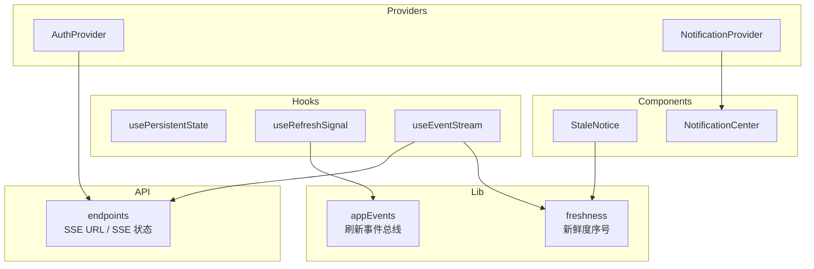
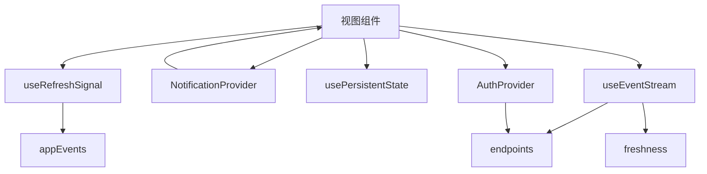
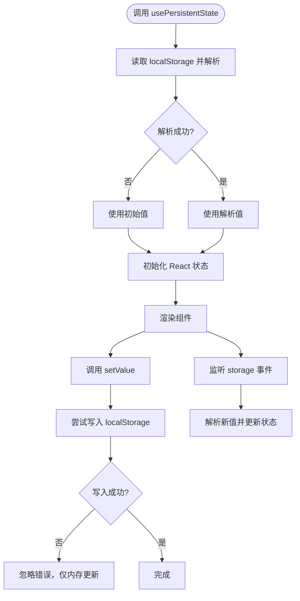
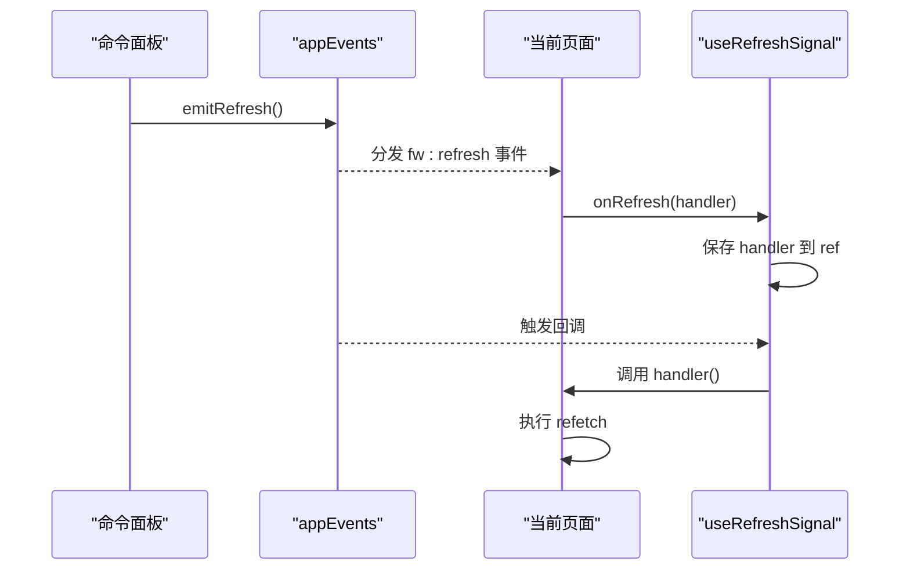
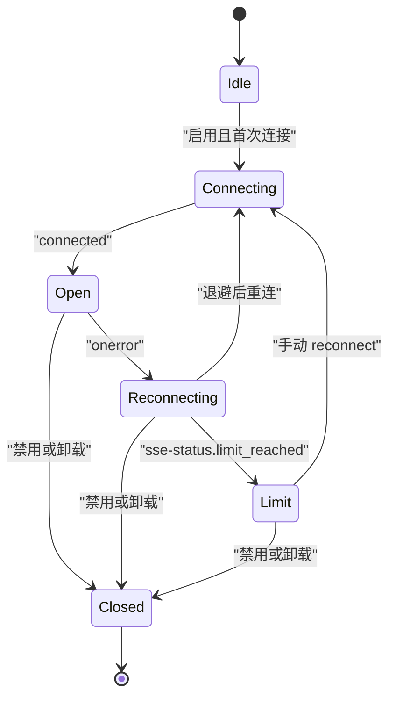
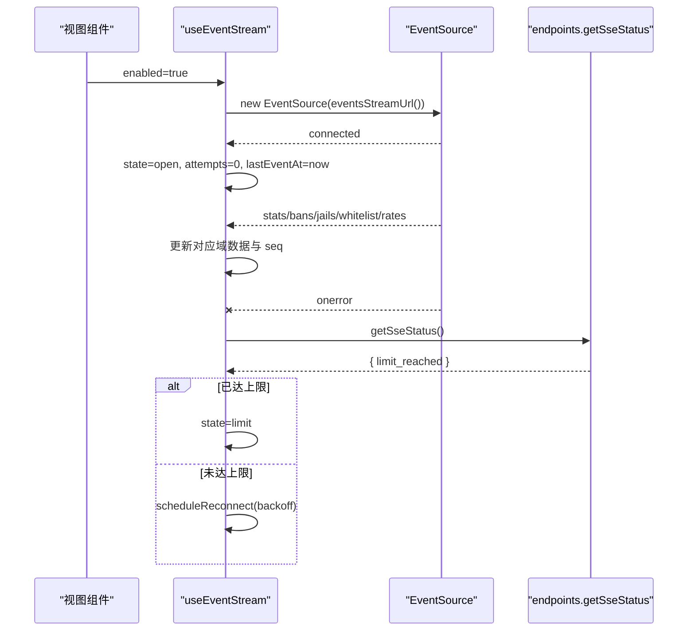
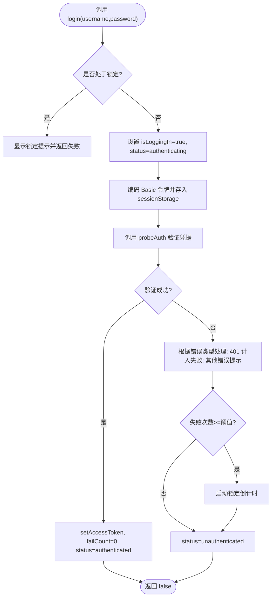
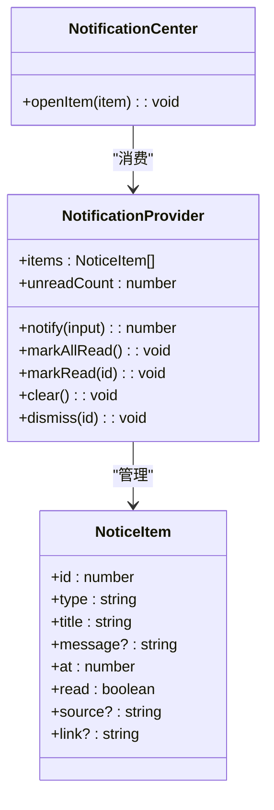
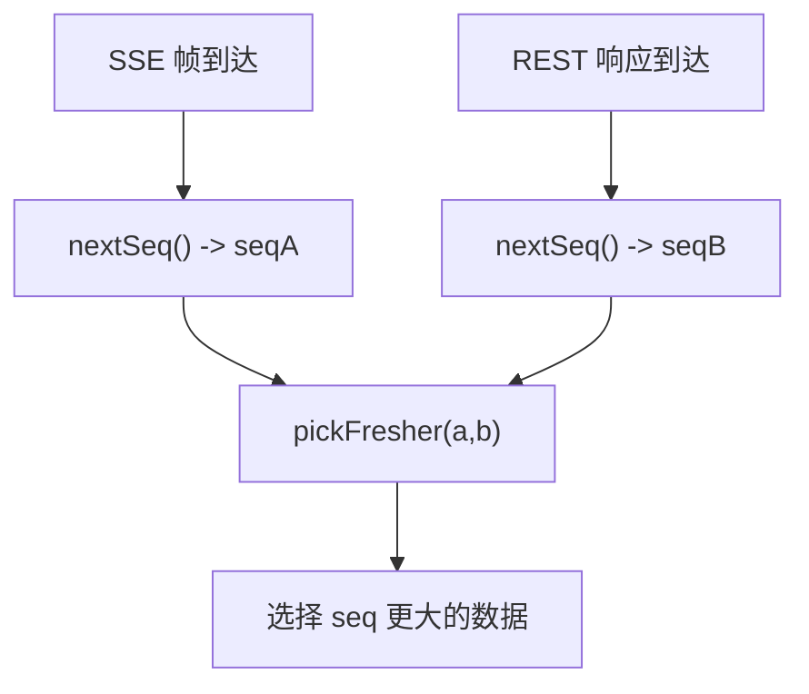
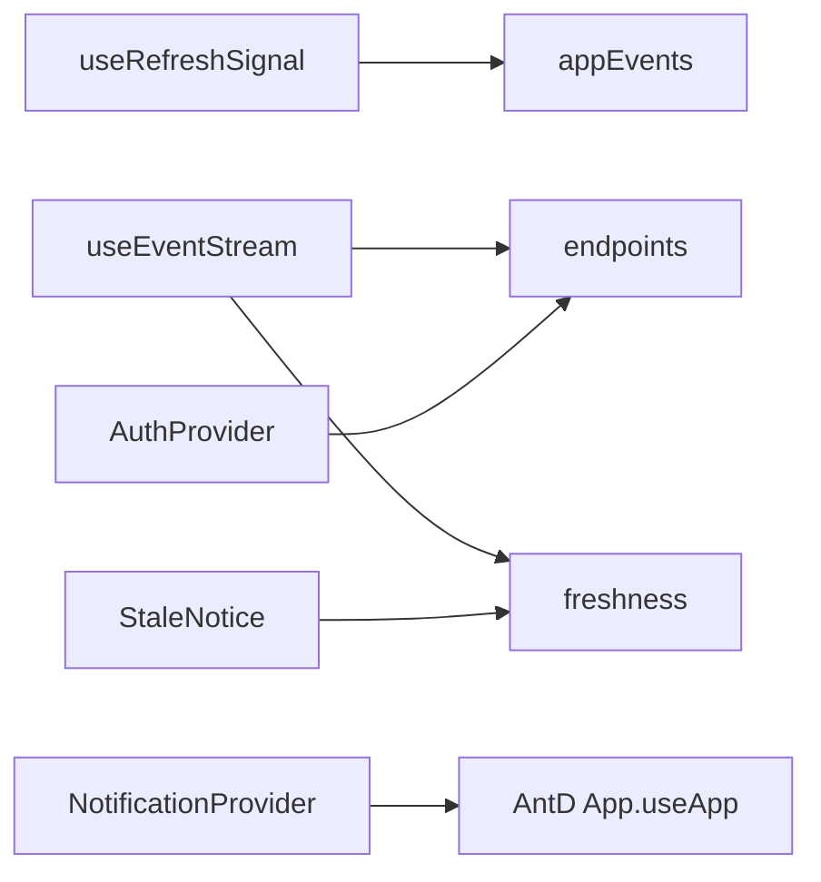

# 状态管理

<cite>
**本文引用的文件**   
- [usePersistentState.ts](file://frontend/src/hooks/usePersistentState.ts)
- [useRefreshSignal.ts](file://frontend/src/hooks/useRefreshSignal.ts)
- [useSse.ts](file://frontend/src/hooks/useSse.ts)
- [AuthProvider.tsx](file://frontend/src/providers/AuthProvider.tsx)
- [NotificationProvider.tsx](file://frontend/src/providers/NotificationProvider.tsx)
- [freshness.ts](file://frontend/src/lib/freshness.ts)
- [appEvents.ts](file://frontend/src/lib/appEvents.ts)
- [endpoints.ts](file://frontend/src/api/endpoints.ts)
- [StaleNotice.tsx](file://frontend/src/components/state/StaleNotice.tsx)
- [NotificationCenter.tsx](file://frontend/src/components/NotificationCenter.tsx)
</cite>

## 目录
1. [引言](#引言)
2. [项目结构](#项目结构)
3. [核心组件](#核心组件)
4. [架构总览](#架构总览)
5. [详细组件分析](#详细组件分析)
6. [依赖关系分析](#依赖关系分析)
7. [性能与缓存策略](#性能与缓存策略)
8. [故障排查指南](#故障排查指南)
9. [结论](#结论)

## 引言
本文件面向前端状态管理系统，聚焦以下能力：
- 持久化状态 Hook：跨刷新、跨标签页同步用户偏好。
- 刷新信号 Hook：通过应用级事件总线触发当前页面刷新。
- SSE 实时事件 Hook：连接 `/api/v2/events`，维护多域数据快照、重连退避与连接上限降级。
- 认证状态 Provider：令牌生命周期、登录/登出、401 自动登出、失败锁定倒计时。
- 通知状态 Provider：非阻塞告警汇聚，同时弹出 toast 并进入可回溯列表。
- 数据新鲜度仲裁：SSE 与 REST 两条来路共用单调序号，避免界面抖动。

目标读者包括前端开发者、运维人员以及需要理解系统实时性与一致性的使用者。

## 项目结构
与状态管理直接相关的代码集中在 `frontend/src` 下：
- hooks：持久化状态、刷新信号、SSE 连接。
- providers：认证上下文、通知上下文。
- lib：应用事件总线、新鲜度仲裁。
- api：端点封装、SSE URL 构造、SSE 状态查询。
- components：陈旧数据提示、通知中心 UI。

图表来源
- [useRefreshSignal.ts:1-15](file://frontend/src/hooks/useRefreshSignal.ts#L1-L15)
- [useSse.ts:22-99](file://frontend/src/hooks/useSse.ts#L22-L99)
- [AuthProvider.tsx:1-33](file://frontend/src/providers/AuthProvider.tsx#L1-L33)
- [NotificationProvider.tsx:1-25](file://frontend/src/providers/NotificationProvider.tsx#L1-L25)
- [appEvents.ts:1-25](file://frontend/src/lib/appEvents.ts#L1-L25)
- [freshness.ts:1-40](file://frontend/src/lib/freshness.ts#L1-L40)
- [endpoints.ts:494-514](file://frontend/src/api/endpoints.ts#L494-L514)
- [StaleNotice.tsx:1-43](file://frontend/src/components/state/StaleNotice.tsx#L1-L43)
- [NotificationCenter.tsx:1-166](file://frontend/src/components/NotificationCenter.tsx#L1-L166)

章节来源
- [usePersistentState.ts:1-73](file://frontend/src/hooks/usePersistentState.ts#L1-L73)
- [useRefreshSignal.ts:1-15](file://frontend/src/hooks/useRefreshSignal.ts#L1-L15)
- [useSse.ts:1-259](file://frontend/src/hooks/useSse.ts#L1-L259)
- [AuthProvider.tsx:1-190](file://frontend/src/providers/AuthProvider.tsx#L1-L190)
- [NotificationProvider.tsx:1-119](file://frontend/src/providers/NotificationProvider.tsx#L1-L119)
- [freshness.ts:1-40](file://frontend/src/lib/freshness.ts#L1-L40)
- [appEvents.ts:1-25](file://frontend/src/lib/appEvents.ts#L1-L25)
- [endpoints.ts:494-514](file://frontend/src/api/endpoints.ts#L494-L514)
- [StaleNotice.tsx:1-43](file://frontend/src/components/state/StaleNotice.tsx#L1-L43)
- [NotificationCenter.tsx:1-166](file://frontend/src/components/NotificationCenter.tsx#L1-L166)

## 核心组件
本节概述各状态管理模块的职责与交互方式。

- usePersistentState：基于 `localStorage` 的持久化状态 Hook，支持跨标签页同步；读失败回退初始值；写失败不抛异常，仅内存更新。
- useRefreshSignal：订阅应用级刷新事件，将页面 refetch 函数注册到全局事件总线，命令面板等全局入口可触发刷新。
- useEventStream（SSE）：连接 `/api/v2/events`，维护 stats/bans/jails/whitelist/rates 五个域的数据快照与新鲜度序号；实现自定义重连退避、连接上限检测与降级。
- AuthProvider：集中管理认证状态、令牌生命周期、登录/登出、401 自动登出、连续失败阈值与本地锁定倒计时。
- NotificationProvider：统一推送通知，弹 toast 并写入最近 N 条列表，支持已读标记、清空、跳转链接。
- freshness：进程内单调递增序号，用于仲裁 SSE 与 REST 两条数据源的新旧关系。

章节来源
- [usePersistentState.ts:1-73](file://frontend/src/hooks/usePersistentState.ts#L1-L73)
- [useRefreshSignal.ts:1-15](file://frontend/src/hooks/useRefreshSignal.ts#L1-L15)
- [useSse.ts:1-259](file://frontend/src/hooks/useSse.ts#L1-L259)
- [AuthProvider.tsx:1-190](file://frontend/src/providers/AuthProvider.tsx#L1-L190)
- [NotificationProvider.tsx:1-119](file://frontend/src/providers/NotificationProvider.tsx#L1-L119)
- [freshness.ts:1-40](file://frontend/src/lib/freshness.ts#L1-L40)

## 架构总览
下图展示状态管理在浏览器端的整体协作关系：UI 组件通过 Providers 获取认证与通知状态；Hook 负责持久化、刷新信号与 SSE 实时流；API 层提供端点与 SSE URL；lib 层提供事件总线与新鲜度仲裁。

图表来源
- [AuthProvider.tsx:55-182](file://frontend/src/providers/AuthProvider.tsx#L55-L182)
- [NotificationProvider.tsx:58-111](file://frontend/src/providers/NotificationProvider.tsx#L58-L111)
- [usePersistentState.ts:18-71](file://frontend/src/hooks/usePersistentState.ts#L18-L71)
- [useRefreshSignal.ts:10-14](file://frontend/src/hooks/useRefreshSignal.ts#L10-L14)
- [useSse.ts:99-257](file://frontend/src/hooks/useSse.ts#L99-L257)
- [appEvents.ts:12-24](file://frontend/src/lib/appEvents.ts#L12-L24)
- [freshness.ts:15-39](file://frontend/src/lib/freshness.ts#L15-L39)
- [endpoints.ts:494-514](file://frontend/src/api/endpoints.ts#L494-L514)

## 详细组件分析

### 持久化状态 Hook：usePersistentState
- 功能要点
  - 从 `localStorage` 读取键值，JSON 解析失败时回退到初始值。
  - 写入时 JSON.stringify 落盘；若存储失败（如隐私模式或配额不足），仅内存更新。
  - 监听 `storage` 事件，实现跨标签页同步；自身 set 不会自我回环。
  - 返回 `[value, setValue]`，setValue 支持函数式更新。
- 使用建议
  - 适合主题、密度、侧边栏折叠等用户偏好。
  - 如需关闭跨标签同步，可设置 `syncTabs: false`。

图表来源
- [usePersistentState.ts:25-69](file://frontend/src/hooks/usePersistentState.ts#L25-L69)

章节来源
- [usePersistentState.ts:1-73](file://frontend/src/hooks/usePersistentState.ts#L1-L73)

### 刷新信号 Hook：useRefreshSignal
- 功能要点
  - 订阅 `fw:refresh` 自定义事件，回调中执行传入的 handler（通常是页面的 refetch）。
  - 使用 ref 保存 handler，避免每次渲染重复订阅/退订。
  - 清理函数随组件卸载自动移除监听。
- 典型场景
  - 命令面板执行操作后广播刷新，当前页收到信号后重新拉取数据。

图表来源
- [useRefreshSignal.ts:10-14](file://frontend/src/hooks/useRefreshSignal.ts#L10-L14)
- [appEvents.ts:12-24](file://frontend/src/lib/appEvents.ts#L12-L24)

章节来源
- [useRefreshSignal.ts:1-15](file://frontend/src/hooks/useRefreshSignal.ts#L1-L15)
- [appEvents.ts:1-25](file://frontend/src/lib/appEvents.ts#L1-L25)

### SSE 实时事件 Hook：useEventStream
- 功能要点
  - 连接 `/api/v2/events`，监听 connected/stats/bans/jails/whitelist/rates 事件。
  - 每个域独立维护数据快照与 seq 序号；lastEventAt 记录最近帧时间。
  - 自定义重连策略：出错即 close，按 `min(2^min(n,5),30)` 秒退避。
  - 重连前探测 `/api/v2/stats/sse-status`，若 `limit_reached` 为真则停止重试，UI 降级为 REST 轮询。
  - 暴露 `reconnect` 方法供用户主动重试。
- 连接状态
  - idle/connecting/open/reconnecting/limit/closed。

图表来源
- [useSse.ts:33-40](file://frontend/src/hooks/useSse.ts#L33-L40)
- [useSse.ts:128-235](file://frontend/src/hooks/useSse.ts#L128-L235)
- [endpoints.ts:504-514](file://frontend/src/api/endpoints.ts#L504-L514)

图表来源
- [useSse.ts:136-235](file://frontend/src/hooks/useSse.ts#L136-L235)
- [endpoints.ts:504-514](file://frontend/src/api/endpoints.ts#L504-L514)

章节来源
- [useSse.ts:1-259](file://frontend/src/hooks/useSse.ts#L1-L259)
- [endpoints.ts:494-514](file://frontend/src/api/endpoints.ts#L494-L514)

### 认证状态管理：AuthProvider
- 功能要点
  - 令牌存储在 sessionStorage；登录成功后通过 `probeAuth` 验证凭据。
  - 任何 REST 请求收到 401 会经 `onUnauthorized` 广播，Provider 清令牌并置为未认证。
  - 连续失败达到阈值后启动本地锁定倒计时；倒计时结束重置失败计数并清除错误提示。
  - 提供 login/logout/clearError 等方法，以及 status/isAuthenticated/isLoggingIn/error/failCount/threshold/lockoutRemaining 等状态。
- 安全与体验
  - 区分 401 与其他错误：仅 401 计入失败次数，避免断网误伤。
  - 锁定期间禁止登录按钮，防止用户反复试错。

图表来源
- [AuthProvider.tsx:103-152](file://frontend/src/providers/AuthProvider.tsx#L103-L152)
- [AuthProvider.tsx:75-91](file://frontend/src/providers/AuthProvider.tsx#L75-L91)
- [endpoints.ts:490-492](file://frontend/src/api/endpoints.ts#L490-L492)

章节来源
- [AuthProvider.tsx:1-190](file://frontend/src/providers/AuthProvider.tsx#L1-L190)
- [endpoints.ts:490-492](file://frontend/src/api/endpoints.ts#L490-L492)

### 通知状态管理：NotificationProvider
- 功能要点
  - notify 同时弹出 AntD toast 并追加到内部列表；列表最多保留 MAX_ITEMS 条，FIFO 丢弃最旧。
  - 支持 markAllRead/markRead/clear/dismiss；unreadCount 由 useMemo 计算。
  - 错误类通知 duration=0（不自动消失），clear 时会销毁对应 toast。
- UI 集成
  - NotificationCenter 展示铃铛红点与下拉列表，点击条目可跳转 link。

图表来源
- [NotificationProvider.tsx:27-50](file://frontend/src/providers/NotificationProvider.tsx#L27-L50)
- [NotificationProvider.tsx:63-108](file://frontend/src/providers/NotificationProvider.tsx#L63-L108)
- [NotificationCenter.tsx:88-166](file://frontend/src/components/NotificationCenter.tsx#L88-L166)

章节来源
- [NotificationProvider.tsx:1-119](file://frontend/src/providers/NotificationProvider.tsx#L1-L119)
- [NotificationCenter.tsx:1-166](file://frontend/src/components/NotificationCenter.tsx#L1-L166)

### 数据新鲜度控制机制：freshness
- 设计动机
  - 同一读数可能来自 SSE 推帧与 REST 拉取，到达顺序不确定；简单“后到覆盖”会导致界面跳动。
  - 方案：给每次拿到新数据都盖一个全局递增序号（seq），比较两个来源的 seq，取更大者。
- 工具函数
  - nextSeq：严格递增，进程内唯一。
  - currentSeq：不推进，用于初始化基准。
  - pickFresher：在两个带 seq 的来源中选择更新者；相等时偏向实时源。

图表来源
- [freshness.ts:15-39](file://frontend/src/lib/freshness.ts#L15-L39)

章节来源
- [freshness.ts:1-40](file://frontend/src/lib/freshness.ts#L1-L40)

## 依赖关系分析
- useRefreshSignal 依赖 appEvents 的事件总线。
- useEventStream 依赖 endpoints 提供的 SSE URL 与 SSE 状态接口，并使用 freshness 生成 seq。
- AuthProvider 依赖 endpoints.probeAuth 进行凭据校验，并通过 client.ts 的 onUnauthorized 接收 401 广播。
- NotificationProvider 依赖 AntD App.useApp 获取上下文感知的 notification 实例。
- StaleNotice 与 useLiveData（未在本文展开）配合，结合 freshness 判断是否陈旧。

图表来源
- [useRefreshSignal.ts:1-15](file://frontend/src/hooks/useRefreshSignal.ts#L1-L15)
- [useSse.ts:22-31](file://frontend/src/hooks/useSse.ts#L22-L31)
- [AuthProvider.tsx:11-20](file://frontend/src/providers/AuthProvider.tsx#L11-L20)
- [NotificationProvider.tsx:1-10](file://frontend/src/providers/NotificationProvider.tsx#L1-L10)
- [StaleNotice.tsx:1-43](file://frontend/src/components/state/StaleNotice.tsx#L1-L43)

章节来源
- [useRefreshSignal.ts:1-15](file://frontend/src/hooks/useRefreshSignal.ts#L1-L15)
- [useSse.ts:1-259](file://frontend/src/hooks/useSse.ts#L1-L259)
- [AuthProvider.tsx:1-190](file://frontend/src/providers/AuthProvider.tsx#L1-L190)
- [NotificationProvider.tsx:1-119](file://frontend/src/providers/NotificationProvider.tsx#L1-L119)
- [StaleNotice.tsx:1-43](file://frontend/src/components/state/StaleNotice.tsx#L1-L43)

## 性能与缓存策略
- 持久化缓存
  - usePersistentState 使用 `localStorage` 作为持久层；写失败不抛异常，保证 UI 可用。
  - 跨标签同步通过 `storage` 事件实现，避免自循环。
- 实时数据缓存
  - useEventStream 维护每域数据快照与 lastEventAt，便于 UI 显示“实时灯”和“数据新鲜度”。
  - seq 序号保证 SSE 与 REST 数据一致性，避免来回跳变。
- 重连与退避
  - 自定义重连延迟公式 `min(2^min(n,5),30)`，避免频繁重连。
  - 连接上限检测：当服务端 events.limit_reached 为真时，停止重试并降级为 REST 轮询。
- 通知去重与限流
  - 通知列表最多保留 MAX_ITEMS 条，FIFO 丢弃最旧，避免长会话内存增长。
  - 错误通知不自动关闭，需显式 clear/dismiss。
- 刷新解耦
  - useRefreshSignal 通过事件总线解耦命令面板与页面 refetch，避免强耦合。

[本节为通用指导，不直接分析具体文件]

## 故障排查指南
- 无法连接 SSE
  - 检查浏览器控制台是否有 EventSource 错误；确认已登录且 access_token 有效。
  - 查看连接状态是否为 limit：若为 limit，说明服务端连接数已达上限，应降级为 REST 轮询或等待名额释放后手动 reconnect。
  - 参考路径：[useSse.ts:213-235](file://frontend/src/hooks/useSse.ts#L213-L235)、[endpoints.ts:504-514](file://frontend/src/api/endpoints.ts#L504-L514)。
- 数据陈旧提示
  - 当 SSE 与 REST 均失败时，StaleNotice 会显示“数据可能已过期”，可点击重试。
  - 参考路径：[StaleNotice.tsx:5-10](file://frontend/src/components/state/StaleNotice.tsx#L5-L10)。
- 认证失败与锁定
  - 连续 401 达到阈值后进入本地锁定倒计时；倒计时结束后自动解锁。
  - 若网络异常导致登录失败，不会计入失败次数，避免误锁。
  - 参考路径：[AuthProvider.tsx:122-152](file://frontend/src/providers/AuthProvider.tsx#L122-L152)、[AuthProvider.tsx:75-91](file://frontend/src/providers/AuthProvider.tsx#L75-L91)。
- 通知丢失或残留
  - 清空通知列表时会销毁对应 toast；错误通知需显式 dismiss/clear。
  - 参考路径：[NotificationProvider.tsx:92-102](file://frontend/src/providers/NotificationProvider.tsx#L92-L102)。

章节来源
- [useSse.ts:213-235](file://frontend/src/hooks/useSse.ts#L213-L235)
- [endpoints.ts:504-514](file://frontend/src/api/endpoints.ts#L504-L514)
- [StaleNotice.tsx:5-10](file://frontend/src/components/state/StaleNotice.tsx#L5-L10)
- [AuthProvider.tsx:122-152](file://frontend/src/providers/AuthProvider.tsx#L122-L152)
- [AuthProvider.tsx:75-91](file://frontend/src/providers/AuthProvider.tsx#L75-L91)
- [NotificationProvider.tsx:92-102](file://frontend/src/providers/NotificationProvider.tsx#L92-L102)

## 结论
该状态管理系统以 Hooks 与 Providers 为核心，结合事件总线与新鲜度仲裁，实现了：
- 跨刷新与跨标签的用户偏好持久化。
- 全局刷新信号的解耦传播。
- 高可靠 SSE 实时流与优雅降级。
- 健壮的认证流程与失败保护。
- 可回溯的通知体系。

在实际使用中，建议：
- 对关键偏好使用 usePersistentState。
- 对需要刷新的页面使用 useRefreshSignal 接入命令面板。
- 对实时数据优先使用 useEventStream，并在 limit 状态下切换到 REST 轮询。
- 对认证相关错误使用 AuthProvider 的错误与锁定提示。
- 对重要告警使用 NotificationProvider，确保可见与可追溯。

[本节为总结性内容，不直接分析具体文件]