# 页面组件

<cite>
**本文引用的文件**   
- [Dashboard.tsx](file://frontend/src/views/Dashboard.tsx)
- [Bans.tsx](file://frontend/src/views/Bans.tsx)
- [Logs.tsx](file://frontend/src/views/Logs.tsx)
- [Risk.tsx](file://frontend/src/views/Risk.tsx)
- [Jails.tsx](file://frontend/src/views/Jails.tsx)
- [ThreatFeeds.tsx](file://frontend/src/views/ThreatFeeds.tsx)
- [Whitelist.tsx](file://frontend/src/views/Whitelist.tsx)
- [Settings.tsx](file://frontend/src/views/Settings.tsx)
- [Login.tsx](file://frontend/src/views/Login.tsx)
- [endpoints.ts](file://frontend/src/api/endpoints.ts)
- [useLiveData.ts](file://frontend/src/hooks/useLiveData.ts)
- [useAsync.ts](file://frontend/src/hooks/useAsync.ts)
- [SseProvider.tsx](file://frontend/src/providers/SseProvider.tsx)
- [DataTable.tsx](file://frontend/src/components/DataTable.tsx)
- [PageHeader.tsx](file://frontend/src/components/PageHeader.tsx)
</cite>

## 目录
1. [引言](#引言)
2. [项目结构](#项目结构)
3. [核心组件](#核心组件)
4. [架构总览](#架构总览)
5. [详细组件分析](#详细组件分析)
6. [依赖关系分析](#依赖关系分析)
7. [性能与体验要点](#性能与体验要点)
8. [故障排查指南](#故障排查指南)
9. [结论](#结论)
10. [附录：使用示例与扩展方法](#附录使用示例与扩展方法)

## 引言
本文件面向前端页面开发者，系统化梳理 Dashboard、Bans、Logs、Risk、Jails、ThreatFeeds、Whitelist、Settings、Login 等页面的功能实现。文档覆盖页面状态管理、数据获取策略（REST + SSE 合流）、用户交互逻辑、响应式布局、错误处理与可观测性，并提供每个页面的使用示例与自定义扩展方法，帮助快速上手与二次开发。

## 项目结构
前端采用 React + Ant Design 的视图层组织方式：
- views：页面级组件，承载业务逻辑与 UI 组合
- api：契约化端点封装，集中维护后端路由与请求构造
- hooks：通用异步与实时能力（useAsync、useLiveData、useSse）
- providers：全局上下文（认证、SSE、主题、通知）
- components：跨页面复用组件（表格、图表卡片、页面头、状态占位）

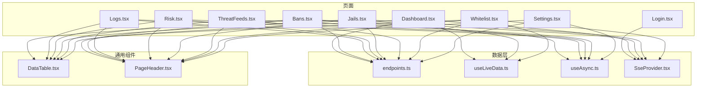

**图示来源**
- [Dashboard.tsx:1-303](file://frontend/src/views/Dashboard.tsx#L1-L303)
- [Bans.tsx:1-788](file://frontend/src/views/Bans.tsx#L1-L788)
- [Logs.tsx:1-616](file://frontend/src/views/Logs.tsx#L1-L616)
- [Risk.tsx:1-489](file://frontend/src/views/Risk.tsx#L1-L489)
- [Jails.tsx:1-447](file://frontend/src/views/Jails.tsx#L1-L447)
- [ThreatFeeds.tsx:1-530](file://frontend/src/views/ThreatFeeds.tsx#L1-L530)
- [Whitelist.tsx:1-477](file://frontend/src/views/Whitelist.tsx#L1-L477)
- [Settings.tsx:1-634](file://frontend/src/views/Settings.tsx#L1-L634)
- [Login.tsx:1-143](file://frontend/src/views/Login.tsx#L1-L143)
- [endpoints.ts:1-515](file://frontend/src/api/endpoints.ts#L1-L515)
- [useLiveData.ts:1-80](file://frontend/src/hooks/useLiveData.ts#L1-L80)
- [useAsync.ts:1-242](file://frontend/src/hooks/useAsync.ts#L1-L242)
- [SseProvider.tsx:1-88](file://frontend/src/providers/SseProvider.tsx#L1-L88)
- [DataTable.tsx:1-91](file://frontend/src/components/DataTable.tsx#L1-L91)
- [PageHeader.tsx:1-77](file://frontend/src/components/PageHeader.tsx#L1-L77)

**章节来源**
- [Dashboard.tsx:1-303](file://frontend/src/views/Dashboard.tsx#L1-L303)
- [endpoints.ts:1-515](file://frontend/src/api/endpoints.ts#L1-L515)
- [useLiveData.ts:1-80](file://frontend/src/hooks/useLiveData.ts#L1-L80)
- [useAsync.ts:1-242](file://frontend/src/hooks/useAsync.ts#L1-L242)
- [SseProvider.tsx:1-88](file://frontend/src/providers/SseProvider.tsx#L1-L88)
- [DataTable.tsx:1-91](file://frontend/src/components/DataTable.tsx#L1-L91)
- [PageHeader.tsx:1-77](file://frontend/src/components/PageHeader.tsx#L1-L77)

## 核心组件
- useAsync：统一 REST 异步状态机，提供竞态丢弃、前台/后台取数区分、轮询与可见性补取、静默重取等能力。
- useLiveData：将 SSE 域帧与 REST 拉取按新鲜度序号仲裁，视图只消费一个值；断连时 REST 兜底轮询。
- SseProvider：全站单条 events 连接，按域分发快照；提供 isLive/isLimited/reconnect 等连接语义。
- DataTable：统一表格四态（骨架/空/错误/数据），支持工具条、分页、滚动与空态文案。
- PageHeader：统一标题区（面包屑、说明、操作区、实时徽标）。

**章节来源**
- [useAsync.ts:1-242](file://frontend/src/hooks/useAsync.ts#L1-L242)
- [useLiveData.ts:1-80](file://frontend/src/hooks/useLiveData.ts#L1-L80)
- [SseProvider.tsx:1-88](file://frontend/src/providers/SseProvider.tsx#L1-L88)
- [DataTable.tsx:1-91](file://frontend/src/components/DataTable.tsx#L1-L91)
- [PageHeader.tsx:1-77](file://frontend/src/components/PageHeader.tsx#L1-L77)

## 架构总览
页面通过 endpoints.ts 调用后端 API；实时数据通过 SseProvider 订阅 events 域；列表页普遍结合 useLiveData 做 SSE+REST 合流；复杂交互由 useAsync 管理加载/错误/轮询。

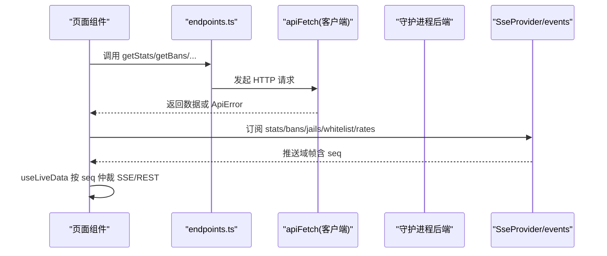

**图示来源**
- [endpoints.ts:117-120](file://frontend/src/api/endpoints.ts#L117-L120)
- [endpoints.ts:132-180](file://frontend/src/api/endpoints.ts#L132-L180)
- [SseProvider.tsx:12-24](file://frontend/src/providers/SseProvider.tsx#L12-L24)
- [useLiveData.ts:6-18](file://frontend/src/hooks/useLiveData.ts#L6-L18)

## 详细组件分析

### Dashboard 仪表板
- 功能：威胁态势、关键计数、趋势折线、结构占比、Top 复发攻击源。
- 数据策略：stats 域 SSE 秒级帧 + REST 30s 校准；recidivism 仅 REST。
- 交互：刷新按钮、导航到 Bans/Whitelist/DDoS/Analysis。
- 响应式：窄屏网格自适应；图表空态/加载中/错误态统一。

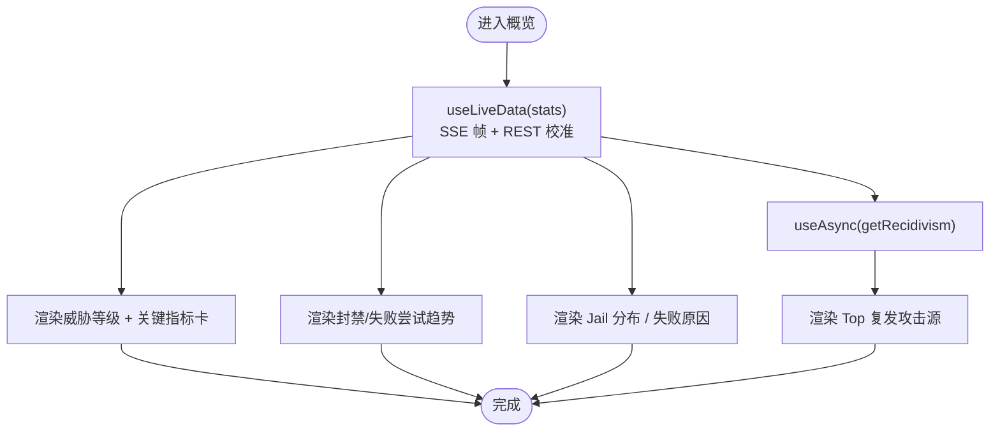

**图示来源**
- [Dashboard.tsx:43-68](file://frontend/src/views/Dashboard.tsx#L43-L68)
- [Dashboard.tsx:70-115](file://frontend/src/views/Dashboard.tsx#L70-L115)
- [Dashboard.tsx:120-299](file://frontend/src/views/Dashboard.tsx#L120-L299)

**章节来源**
- [Dashboard.tsx:1-303](file://frontend/src/views/Dashboard.tsx#L1-L303)
- [endpoints.ts:117-120](file://frontend/src/api/endpoints.ts#L117-L120)
- [endpoints.ts:301-304](file://frontend/src/api/endpoints.ts#L301-L304)

### Bans 封禁管理
- 功能：分页查询、手工/批量封禁、解封、解除全部临时、详情抽屉。
- 数据策略：REST 分页为准；bans 域 SSE 全表镜像不拼入分页表，仅触发静默重取当前页。
- 交互：排序/翻页、深链 /bans/:ip、?new=1 自动打开新建抽屉。
- 性能：剩余倒计时单元级定时器；SSE 帧节流（前沿立即取 + 尾沿补一次）。

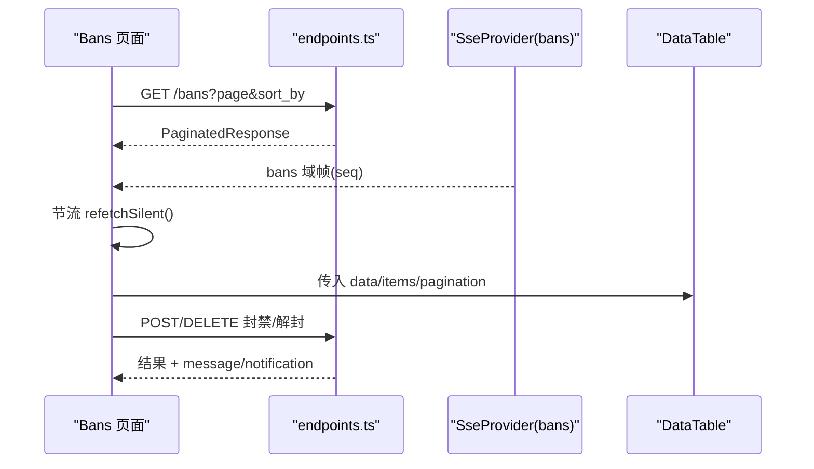

**图示来源**
- [Bans.tsx:159-226](file://frontend/src/views/Bans.tsx#L159-L226)
- [Bans.tsx:257-357](file://frontend/src/views/Bans.tsx#L257-L357)
- [Bans.tsx:458-570](file://frontend/src/views/Bans.tsx#L458-L570)
- [endpoints.ts:132-180](file://frontend/src/api/endpoints.ts#L132-L180)

**章节来源**
- [Bans.tsx:1-788](file://frontend/src/views/Bans.tsx#L1-L788)
- [endpoints.ts:132-180](file://frontend/src/api/endpoints.ts#L132-L180)

### Logs 日志查看
- 功能：实时日志流 + 历史日志检索；级别过滤、关键词搜索、暂停/恢复、自动滚动。
- 数据策略：实时流自建 EventSource（connected/log/error），连接上限 5；历史走 REST 分页。
- 交互：Segmented 切换模式；暂停期间丢行计数；达到上限提示降级并引导重试。

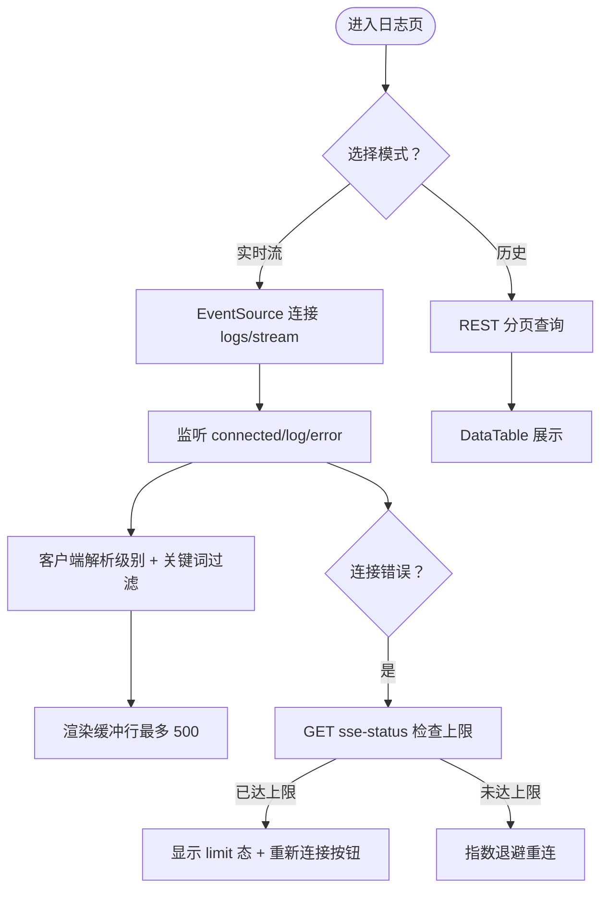

**图示来源**
- [Logs.tsx:89-163](file://frontend/src/views/Logs.tsx#L89-L163)
- [Logs.tsx:181-253](file://frontend/src/views/Logs.tsx#L181-L253)
- [Logs.tsx:371-503](file://frontend/src/views/Logs.tsx#L371-L503)
- [endpoints.ts:432-444](file://frontend/src/api/endpoints.ts#L432-L444)
- [endpoints.ts:510-514](file://frontend/src/api/endpoints.ts#L510-L514)

**章节来源**
- [Logs.tsx:1-616](file://frontend/src/views/Logs.tsx#L1-L616)
- [endpoints.ts:432-444](file://frontend/src/api/endpoints.ts#L432-L444)
- [endpoints.ts:510-514](file://frontend/src/api/endpoints.ts#L510-L514)

### Risk 风险评估
- 功能：多维风险向量列表（7 维原始累加分）、高危阈值标记、近活跃统计；详情抽屉雷达图 + 事件历史。
- 数据策略：risk_engine.enabled=false 时返回 503，前端以“功能未启用”空态呈现。
- 交互：点击 IP 打开详情；雷达量程按当前向量动态计算。

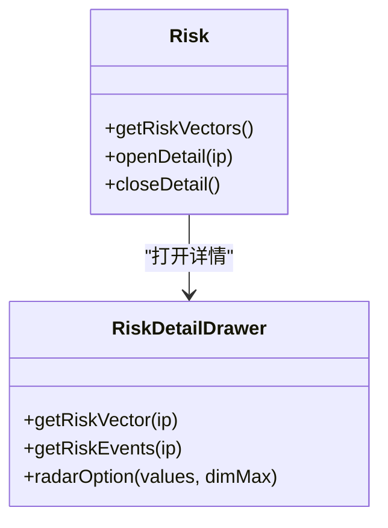

**图示来源**
- [Risk.tsx:103-216](file://frontend/src/views/Risk.tsx#L103-L216)
- [Risk.tsx:330-487](file://frontend/src/views/Risk.tsx#L330-L487)
- [endpoints.ts:413-426](file://frontend/src/api/endpoints.ts#L413-L426)

**章节来源**
- [Risk.tsx:1-489](file://frontend/src/views/Risk.tsx#L1-L489)
- [endpoints.ts:413-426](file://frontend/src/api/endpoints.ts#L413-L426)

### Jails 服务管理
- 功能：jail 配置与运行时计数一览；启停开关（PUT 异步生效且不推 SSE）；展开行查看解析漏斗；详情抽屉全字段画像。
- 数据策略：SSE jails 域 + REST 合流；切换后必须 refetch 权威状态。
- 交互：停用需二次确认；有效阈值 tooltip 提示峰值折算。

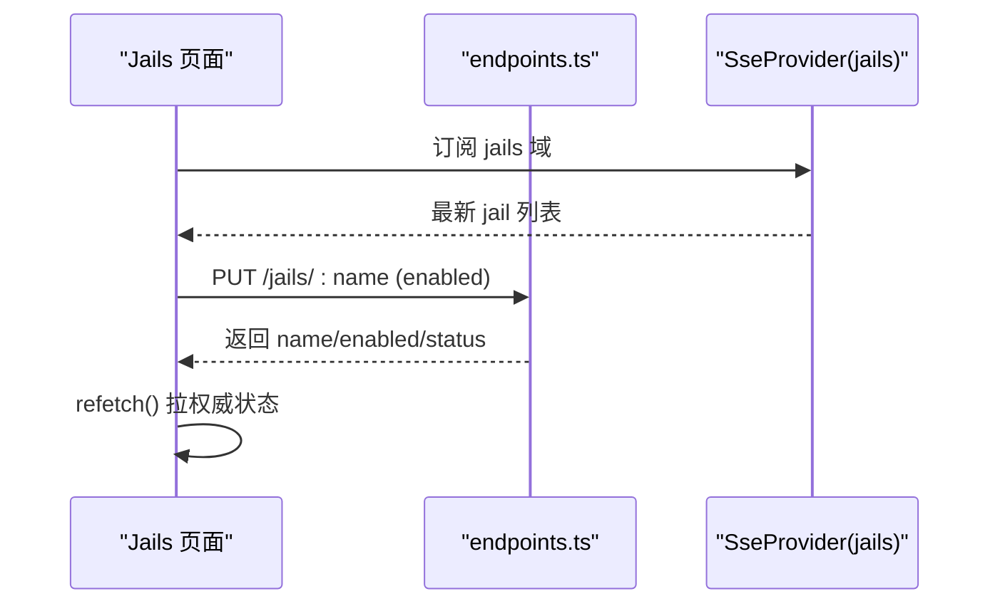

**图示来源**
- [Jails.tsx:55-123](file://frontend/src/views/Jails.tsx#L55-L123)
- [Jails.tsx:143-246](file://frontend/src/views/Jails.tsx#L143-L246)
- [endpoints.ts:186-202](file://frontend/src/api/endpoints.ts#L186-L202)

**章节来源**
- [Jails.tsx:1-447](file://frontend/src/views/Jails.tsx#L1-L447)
- [endpoints.ts:186-202](file://frontend/src/api/endpoints.ts#L186-L202)

### ThreatFeeds 威胁情报
- 功能：情报源列表、同步健康度、全量同步入口、详情抽屉。
- 数据策略：threat_feeds.enabled=false 返回 503，前端以 disabled 空态提示开启方法。
- 交互：工具条「全量同步」与命令面板深链 ?sync=1 共用通知；详情按需拉取单源。

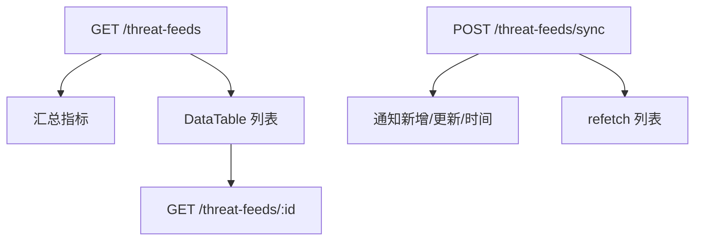

**图示来源**
- [ThreatFeeds.tsx:155-259](file://frontend/src/views/ThreatFeeds.tsx#L155-L259)
- [ThreatFeeds.tsx:272-399](file://frontend/src/views/ThreatFeeds.tsx#L272-L399)
- [ThreatFeeds.tsx:403-527](file://frontend/src/views/ThreatFeeds.tsx#L403-L527)
- [endpoints.ts:450-466](file://frontend/src/api/endpoints.ts#L450-L466)

**章节来源**
- [ThreatFeeds.tsx:1-530](file://frontend/src/views/ThreatFeeds.tsx#L1-L530)
- [endpoints.ts:450-466](file://frontend/src/api/endpoints.ts#L450-L466)

### Whitelist 白名单
- 功能：可信地址/网段维护；基于封禁历史的加白推荐；一键加白。
- 数据策略：whitelist 域 SSE + REST 合流；推荐区 REST 独占独立状态。
- 交互：新增/移除/一键加白均 message + refetch；推荐区阈值/条数筛选。

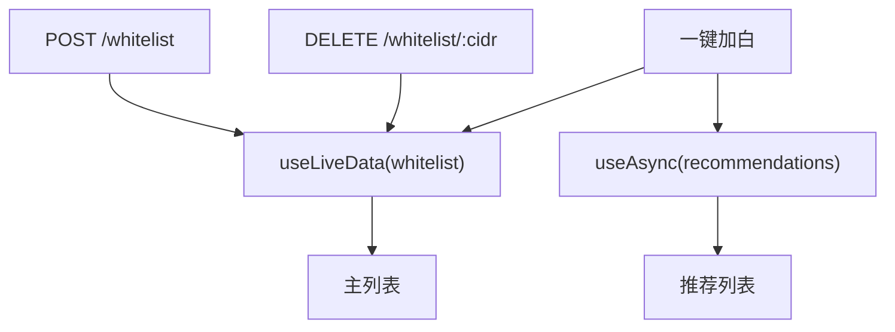

**图示来源**
- [Whitelist.tsx:84-194](file://frontend/src/views/Whitelist.tsx#L84-L194)
- [Whitelist.tsx:196-313](file://frontend/src/views/Whitelist.tsx#L196-L313)
- [Whitelist.tsx:315-477](file://frontend/src/views/Whitelist.tsx#L315-L477)
- [endpoints.ts:229-268](file://frontend/src/api/endpoints.ts#L229-L268)

**章节来源**
- [Whitelist.tsx:1-477](file://frontend/src/views/Whitelist.tsx#L1-L477)
- [endpoints.ts:229-268](file://frontend/src/api/endpoints.ts#L229-L268)

### Settings 设置
- 功能：Web UI/阈值/DDoS/容量配置读写；运行时探针。
- 数据策略：配置表单 getConfig/updateConfig；健康探针 getHealth 独立。
- 交互：差分提交（仅发送变化字段）；脏表单拦截导航/刷新；成对阈值校验（警告 < 严重）。

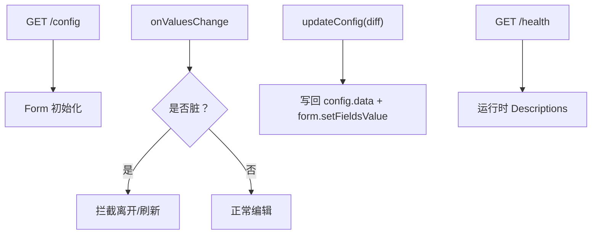

**图示来源**
- [Settings.tsx:266-343](file://frontend/src/views/Settings.tsx#L266-L343)
- [Settings.tsx:351-599](file://frontend/src/views/Settings.tsx#L351-L599)
- [Settings.tsx:601-629](file://frontend/src/views/Settings.tsx#L601-L629)
- [endpoints.ts:208-223](file://frontend/src/api/endpoints.ts#L208-L223)
- [endpoints.ts:103-111](file://frontend/src/api/endpoints.ts#L103-L111)

**章节来源**
- [Settings.tsx:1-634](file://frontend/src/views/Settings.tsx#L1-L634)
- [endpoints.ts:103-111](file://frontend/src/api/endpoints.ts#L103-L111)
- [endpoints.ts:208-223](file://frontend/src/api/endpoints.ts#L208-L223)

### Login 登录
- 功能：认证闸门；已登录跳转；失败次数预警与锁定倒计时；凭据来自环境变量。
- 数据策略：通过 probeAuth 探测凭据有效性；AuthProvider 管理会话与锁定。
- 交互：Enter 提交；锁定态禁用按钮并倒计时。

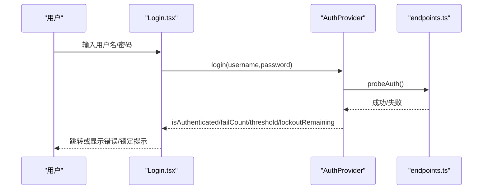

**图示来源**
- [Login.tsx:26-45](file://frontend/src/views/Login.tsx#L26-L45)
- [Login.tsx:47-143](file://frontend/src/views/Login.tsx#L47-L143)
- [endpoints.ts:486-492](file://frontend/src/api/endpoints.ts#L486-L492)

**章节来源**
- [Login.tsx:1-143](file://frontend/src/views/Login.tsx#L1-L143)
- [endpoints.ts:486-492](file://frontend/src/api/endpoints.ts#L486-L492)

## 依赖关系分析
- 页面 → endpoints：所有后端路径集中定义，禁止手写字符串字面量。
- 页面 → hooks：useAsync 负责 REST 状态机；useLiveData 负责 SSE+REST 仲裁。
- 页面 → providers：SseProvider 提供 events 连接与域快照；AuthProvider 提供认证状态。
- 页面 → components：DataTable/PageHeader 统一交互与状态表现。

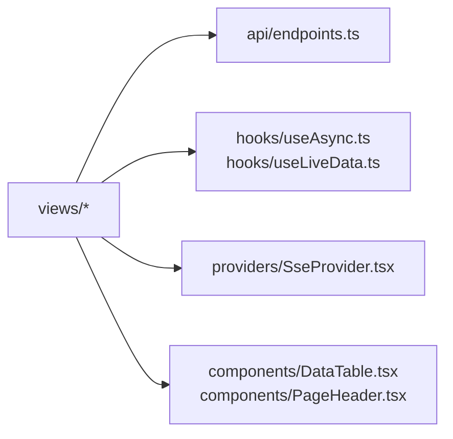

**图示来源**
- [endpoints.ts:1-17](file://frontend/src/api/endpoints.ts#L1-L17)
- [useAsync.ts:5-18](file://frontend/src/hooks/useAsync.ts#L5-L18)
- [useLiveData.ts:6-18](file://frontend/src/hooks/useLiveData.ts#L6-L18)
- [SseProvider.tsx:12-24](file://frontend/src/providers/SseProvider.tsx#L12-L24)
- [DataTable.tsx:8-19](file://frontend/src/components/DataTable.tsx#L8-L19)
- [PageHeader.tsx:7-14](file://frontend/src/components/PageHeader.tsx#L7-L14)

**章节来源**
- [endpoints.ts:1-17](file://frontend/src/api/endpoints.ts#L1-L17)
- [useAsync.ts:5-18](file://frontend/src/hooks/useAsync.ts#L5-L18)
- [useLiveData.ts:6-18](file://frontend/src/hooks/useLiveData.ts#L6-L18)
- [SseProvider.tsx:12-24](file://frontend/src/providers/SseProvider.tsx#L12-L24)
- [DataTable.tsx:8-19](file://frontend/src/components/DataTable.tsx#L8-L19)
- [PageHeader.tsx:7-14](file://frontend/src/components/PageHeader.tsx#L7-L14)

## 性能与体验要点
- 实时与轮询合流：useLiveData 用 seq 仲裁，避免慢 REST 覆盖快 SSE；SSE 断连时 REST 自动兜底。
- 表格遮罩分离：isUserFetching 仅前台取数置真，后台轮询不遮挡用户操作。
- 高频渲染收敛：Bans 剩余倒计时在单元格内自持定时器；Logs 暂停期丢行计数每秒批量同步。
- 连接上限保护：events 上限 10、logs 上限 5；Logs 侧先探 sse-status 再决定是否退避重连。
- 差分保存：Settings 仅提交变化字段，减少无效写入并让保存按钮等价于“表单脏”。

[本节为通用指导，无需具体文件引用]

## 故障排查指南
- 503 功能未启用：
  - Risk：risk_engine.enabled=false 时返回 503，页面以 disabled 空态提示开启方法。
  - ThreatFeeds：threat_feeds.enabled=false 时返回 503，页面以 disabled 空态提示开启方法。
- 实时连接异常：
  - Logs：error 帧带 data 表示服务端读文件失败；无 data 的连接错误走指数退避重连；若 logs.limit_reached 则进入 limit 态并提示重新连接。
- 列表数据不同步：
  - Jails：PUT 异步生效且不推 SSE，务必 refetch 权威状态。
  - Bans：SSE bans 帧不拼入分页表，仅触发静默重取当前页。
- 表单误报/丢失：
  - Settings：确保初始值与服务端快照一致；保存成功后写回 config.data 与 form.setFieldsValue。

**章节来源**
- [Risk.tsx:35-49](file://frontend/src/views/Risk.tsx#L35-L49)
- [ThreatFeeds.tsx:37-51](file://frontend/src/views/ThreatFeeds.tsx#L37-L51)
- [Logs.tsx:31-48](file://frontend/src/views/Logs.tsx#L31-L48)
- [Logs.tsx:212-253](file://frontend/src/views/Logs.tsx#L212-L253)
- [Jails.tsx:34-43](file://frontend/src/views/Jails.tsx#L34-L43)
- [Bans.tsx:48-60](file://frontend/src/views/Bans.tsx#L48-L60)
- [Settings.tsx:28-45](file://frontend/src/views/Settings.tsx#L28-L45)

## 结论
各页面围绕 REST + SSE 的数据模型构建，通过 useAsync/useLiveData/SseProvider 形成统一的异步与实时能力；DataTable/PageHeader 统一了交互与状态表现。针对高风险操作（解封、停用规则、删除白名单）均有二次确认与明确反馈；对后端能力缺失（risk_engine/threat_feeds）以“功能未启用”空态友好提示。整体设计兼顾可读性、可维护性与可扩展性。

[本节为总结，无需具体文件引用]

## 附录：使用示例与扩展方法

- Dashboard
  - 使用示例：进入即展示威胁等级与关键指标；点击 StatCard 跳转至对应页面；点击「刷新」触发 live.refetch 与 topAttackers.refetch。
  - 扩展方法：新增统计卡片时复用 StatCard/ChartCard/BaseChart，并通过 useLiveData 接入新的 stats 子域。

- Bans
  - 使用示例：排序/翻页查询；新建封禁（IP + 时长 + 可选原因）；批量封禁（多 IP + 默认时长）；解除全部临时。
  - 扩展方法：新增列时扩展 BanColumns 类型并在 columns useMemo 中追加；新增处置动作时封装 handleXxx 并配合 Popconfirm。

- Logs
  - 使用示例：切换到「实时流」自动连接；暂停接收并查看丢弃计数；切换到「历史」进行级别/关键词检索。
  - 扩展方法：新增级别映射时在 parseLevel 与 LEVEL_COLORS 中扩展；新增过滤条件时同时更新 LivePanel 与 HistoryPanel。

- Risk
  - 使用示例：查看向量列表并按 total_risk 排序；点击 IP 打开详情查看雷达图与事件历史。
  - 扩展方法：新增维度时扩展 DIMENSIONS 与 EVENT_TYPE_META，并同步雷达 indicators 与事件列。

- Jails
  - 使用示例：启用/停用规则；展开行查看解析漏斗；查看详情看全字段画像。
  - 扩展方法：新增运行时指标时扩展 JailDescriptions 的 items；新增列时扩展 JailColumns。

- ThreatFeeds
  - 使用示例：全量同步；查看各源条目数/置信度/最近同步；打开详情查看完整元信息。
  - 扩展方法：新增分类标签时扩展 CATEGORY_LABELS；新增同步结果字段时扩展 notifySyncResult。

- Whitelist
  - 使用示例：新增 CIDR/IP；移除白名单；根据推荐一键加白。
  - 扩展方法：新增推荐字段时扩展 WhitelistRecommendation 与 recColumns；新增校验规则时扩展 isValidCidr 用法。

- Settings
  - 使用示例：调整推送间隔/速率阈值/检测开关/容量上限；保存后写回权威快照；查看运行时探针。
  - 扩展方法：新增配置字段时加入 NUMBER_FIELDS/BOOL_FIELDS 或单独处理 clear_logs_at 类字段，并在 buildDiff/configToForm 中补齐。

- Login
  - 使用示例：输入用户名/密码登录；失败次数接近阈值时显示剩余尝试；锁定后按钮禁用并倒计时。
  - 扩展方法：如需扩展认证流程，可在 endpoints.probeAuth 基础上增加专用探测接口，并在 Login 中适配。

**章节来源**
- [Dashboard.tsx:120-299](file://frontend/src/views/Dashboard.tsx#L120-L299)
- [Bans.tsx:291-357](file://frontend/src/views/Bans.tsx#L291-L357)
- [Logs.tsx:371-503](file://frontend/src/views/Logs.tsx#L371-L503)
- [Risk.tsx:330-487](file://frontend/src/views/Risk.tsx#L330-L487)
- [Jails.tsx:389-447](file://frontend/src/views/Jails.tsx#L389-L447)
- [ThreatFeeds.tsx:187-259](file://frontend/src/views/ThreatFeeds.tsx#L187-L259)
- [Whitelist.tsx:116-188](file://frontend/src/views/Whitelist.tsx#L116-L188)
- [Settings.tsx:173-188](file://frontend/src/views/Settings.tsx#L173-L188)
- [Login.tsx:43-143](file://frontend/src/views/Login.tsx#L43-L143)