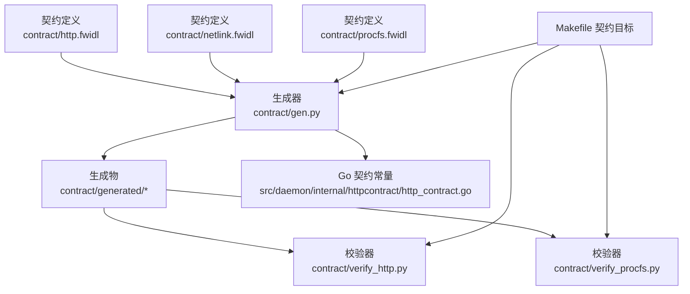
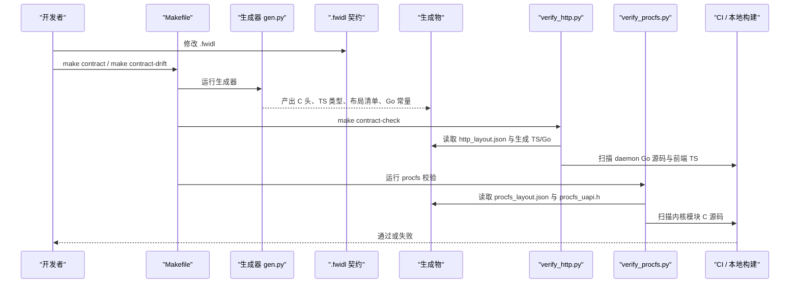
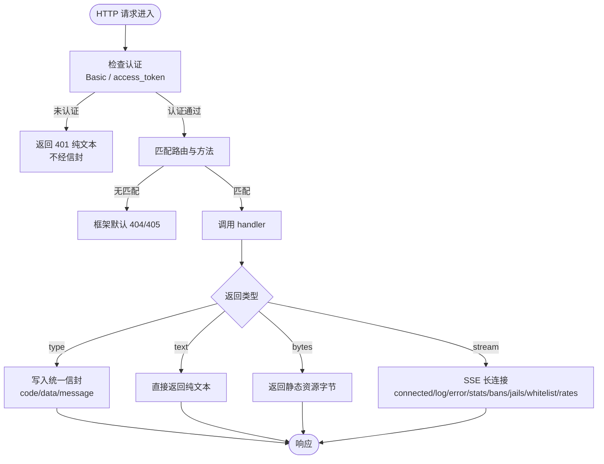
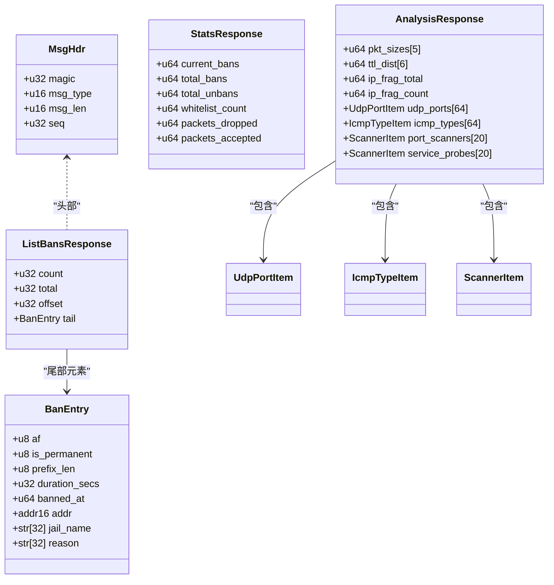
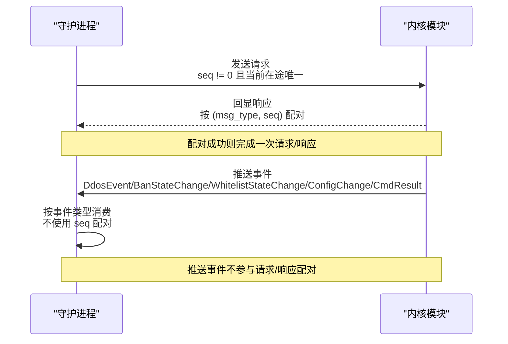
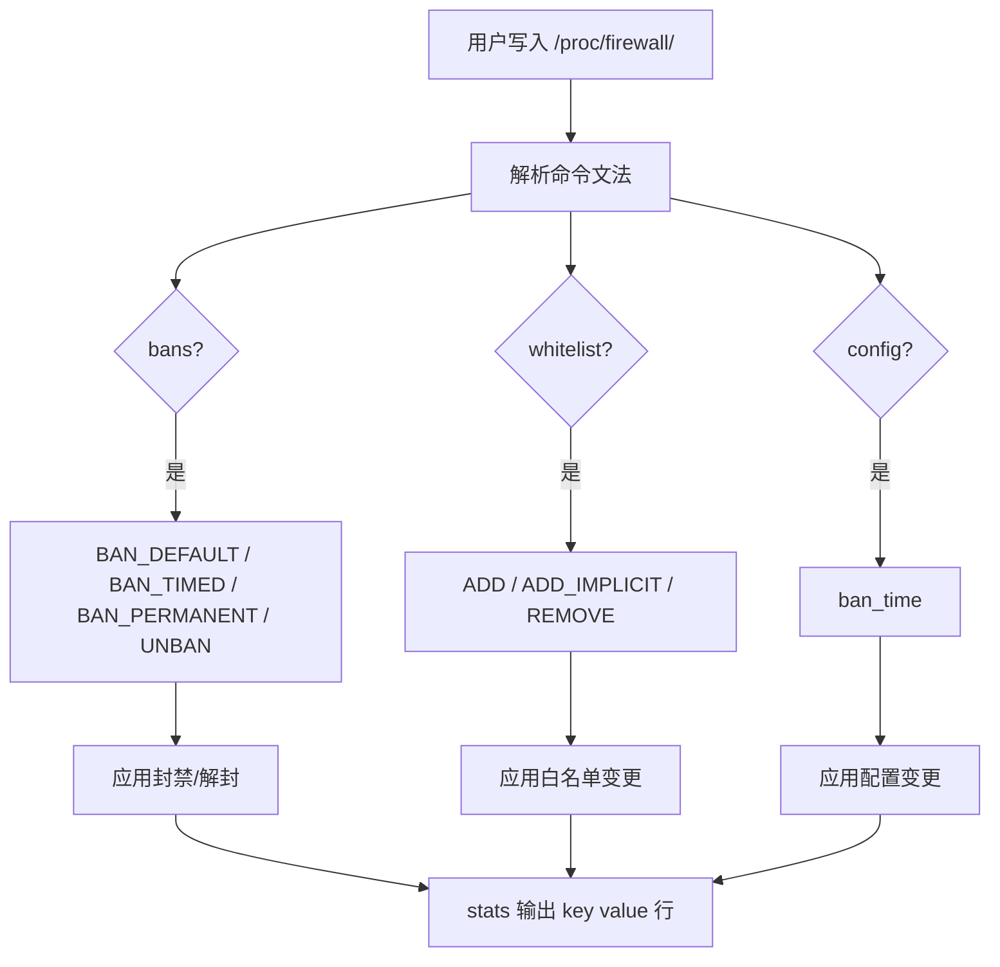
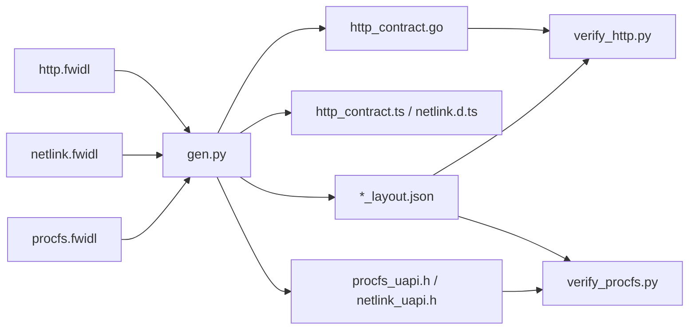

# 契约系统

<cite>
**本文引用的文件**   
- [http.fwidl](file://contract/http.fwidl)
- [netlink.fwidl](file://contract/netlink.fwidl)
- [procfs.fwidl](file://contract/procfs.fwidl)
- [contract.md](file://docs/zh/development/contract.md)
- [Makefile](file://Makefile)
- [verify_http.py](file://contract/verify_http.py)
- [verify_procfs.py](file://contract/verify_procfs.py)
</cite>

## 目录
1. [引言](#引言)
2. [项目结构](#项目结构)
3. [核心组件](#核心组件)
4. [架构总览](#架构总览)
5. [详细组件分析](#详细组件分析)
6. [依赖关系分析](#依赖关系分析)
7. [性能与稳定性特征](#性能与稳定性特征)
8. [故障排查指南](#故障排查指南)
9. [结论](#结论)
10. [附录：开发流程与最佳实践](#附录开发流程与最佳实践)

## 引言
本仓库采用“契约驱动”的跨层接口治理方式：所有跨进程、跨语言、跨内核态与用户态的接口，都先写成 `.fwidl` 契约，再由生成器产出三端代码，最后由校验器把契约与实现、前端、内核模块进行机械对账。这样做的目标是让 HTTP 契约、Netlink 契约、ProcFS 契约成为单一真相源，避免 Go 结构体、TypeScript 类型、C 头文件、内核源码各自演进导致运行时字段漂移、状态码语义错位、SSE 连接上限不一致等隐蔽问题。

## 项目结构
契约相关的关键位置如下：
- `contract/*.fwidl`：HTTP、Netlink、ProcFS 三类契约定义。
- `contract/generated/*`：生成器产出的头文件、TS 类型、布局清单等（由 `make contract` 或 CI 阶段生成）。
- `src/daemon/internal/httpcontract/http_contract.go`：HTTP 契约生成的 Go 常量包（位于 daemon module 内）。
- `contract/verify_*.py`：契约一致性校验脚本。
- `Makefile`：暴露 `contract`、`contract-drift`、`contract-check`、`ci-contract` 等目标，把契约生成与校验纳入构建与 CI。

**图表来源**
- [Makefile:161-178](file://Makefile#L161-L178)
- [Makefile:585-621](file://Makefile#L585-L621)
- [contract.md:5-14](file://docs/zh/development/contract.md#L5-L14)

**章节来源**
- [Makefile:161-178](file://Makefile#L161-L178)
- [Makefile:585-621](file://Makefile#L585-L621)
- [contract.md:5-14](file://docs/zh/development/contract.md#L5-L14)

## 核心组件
契约系统由四类构件组成：

| 组件 | 职责 | 关键文件 |
|---|---|---|
| HTTP 契约 | 描述守护进程与前端之间的路由表、JSON 载荷形状、统一信封、业务码、认证模型、安全头、SSE 事件与连接上限 | [http.fwidl](file://contract/http.fwidl) |
| Netlink 契约 | 描述内核模块与守护进程之间的二进制消息头、枚举、结构体、消息类型、分页规则、序列号配对语义 | [netlink.fwidl](file://contract/netlink.fwidl) |
| ProcFS 契约 | 描述 `/proc/firewall/*` 的文件名、权限、读侧机器可读字段、写侧命令文法、容量上限与缺陷处置 | [procfs.fwidl](file://contract/procfs.fwidl) |
| 生成与校验 | 从 `.fwidl` 生成头文件、TS 类型、布局清单；再核对生成物、实现、前端、内核是否一致 | [Makefile](file://Makefile)、[verify_http.py](file://contract/verify_http.py)、[verify_procfs.py](file://contract/verify_procfs.py) |

**章节来源**
- [http.fwidl:1-43](file://contract/http.fwidl#L1-L43)
- [netlink.fwidl:1-30](file://contract/netlink.fwidl#L1-L30)
- [procfs.fwidl:1-27](file://contract/procfs.fwidl#L1-L27)
- [contract.md:5-14](file://docs/zh/development/contract.md#L5-L14)

## 架构总览
契约系统的整体工作流是“定义 → 生成 → 校验 → 构建/测试”。

**图表来源**
- [Makefile:408-433](file://Makefile#L408-L433)
- [Makefile:585-621](file://Makefile#L585-L621)
- [contract.md:16-28](file://docs/zh/development/contract.md#L16-L28)

## 详细组件分析

### HTTP 契约
HTTP 契约负责守护进程与前端之间的“单一真相源”，包括：
- 统一信封：成功时 `code=0`，失败时 `data=null`，`message` 必须存在。
- 认证模型：Basic Auth，失败阈值与锁定秒数由契约声明，SSE 凭据走查询参数。
- 错误模型：区分信封错误、纯文本错误、框架默认错误。
- 路由表：每条路由声明方法、路径、鉴权语义、返回类型、成功状态码、可选替代状态码、业务码、SSE 上限与事件名。
- 安全头：对所有路由统一施加，Web UI 分支有独立 CSP。
- 业务码：与 HTTP 状态码分离，每个码都有编号、HTTP 状态映射和说明。
- 已核实缺陷：记录 severity、status、fix/where/reason/text，作为可执行断言而非普通注释。

**图表来源**
- [http.fwidl:61-65](file://contract/http.fwidl#L61-L65)
- [http.fwidl:81-88](file://contract/http.fwidl#L81-L88)
- [http.fwidl:104-128](file://contract/http.fwidl#L104-L128)
- [http.fwidl:134-153](file://contract/http.fwidl#L134-L153)
- [http.fwidl:164-222](file://contract/http.fwidl#L164-L222)
- [http.fwidl:376-511](file://contract/http.fwidl#L376-L511)

#### HTTP 校验策略
`verify_http.py` 不做“看起来像同一个东西”的猜测，而是做机械核对：
1. 解析 daemon 中所有 ServeMux 注册串，支持字面量与 `Route*` 常量解引。
2. 对比契约中的路由集合、方法、路径、handler 符号、auth 组。
3. 校验认证常量、SSE 连接上限、安全头构造点。
4. 校验信封 JSON key、业务码构造点、文本错误体。
5. 校验载荷类型在 Go 结构体中存在，且在前端 `types.ts` 中有对应字段。
6. 校验前端只使用生成物中的路由常量，不手写 `/api/v2...` 字面量。
7. 用缺口基线区分历史遗留缺口与新缺口。

**章节来源**
- [http.fwidl:1-43](file://contract/http.fwidl#L1-L43)
- [http.fwidl:61-65](file://contract/http.fwidl#L61-L65)
- [http.fwidl:81-88](file://contract/http.fwidl#L81-L88)
- [http.fwidl:104-128](file://contract/http.fwidl#L104-L128)
- [http.fwidl:134-153](file://contract/http.fwidl#L134-L153)
- [http.fwidl:164-222](file://contract/http.fwidl#L164-L222)
- [http.fwidl:376-511](file://contract/http.fwidl#L376-L511)
- [verify_http.py:1-77](file://contract/verify_http.py#L1-L77)
- [verify_http.py:349-680](file://contract/verify_http.py#L349-L680)

### Netlink 契约
Netlink 契约描述内核模块与守护进程之间的二进制线格式，核心要点：
- 通用消息头包含魔数、消息类型、长度、序列号。
- 所有结构体 packed，多字节整数大端序，填充显式写出。
- 地址为裸字节数组，IPv4 占前 4 字节，字符串 NUL 结尾定长。
- 消息类型覆盖 DDoS 事件、封禁/解封、配置更新、列表查询与响应、速率统计、分析数据、守护进程唯一注册。
- 列表响应必须分页，使用 `count/total/offset + tail` 布局。
- 序列号分两类：请求/响应配对序列号与内核推送事件的自增序列号。

**图表来源**
- [netlink.fwidl:128-133](file://contract/netlink.fwidl#L128-L133)
- [netlink.fwidl:218-237](file://contract/netlink.fwidl#L218-L237)
- [netlink.fwidl:240-248](file://contract/netlink.fwidl#L240-L248)
- [netlink.fwidl:340-358](file://contract/netlink.fwidl#L340-L358)

#### Netlink 序列号配对流程

**图表来源**
- [netlink.fwidl:113-127](file://contract/netlink.fwidl#L113-L127)
- [netlink.fwidl:140-184](file://contract/netlink.fwidl#L140-L184)

**章节来源**
- [netlink.fwidl:1-30](file://contract/netlink.fwidl#L1-L30)
- [netlink.fwidl:32-81](file://contract/netlink.fwidl#L32-L81)
- [netlink.fwidl:105-133](file://contract/netlink.fwidl#L105-L133)
- [netlink.fwidl:140-184](file://contract/netlink.fwidl#L140-L184)
- [netlink.fwidl:218-358](file://contract/netlink.fwidl#L218-L358)

### ProcFS 契约
ProcFS 契约描述 `/proc/firewall/*` 的文本协议，重点包括：
- 文件条目、权限、读侧契约强度（machine/unstable/none）。
- 写侧命令文法：bans、whitelist、config。
- stats 的机器可读键值行格式。
- 各表的容量上限，并指向源码锚点。
- 已核实缺陷：用 status 表达 open/fixed/retained，配合 where/fix 做锚点校验。

**图表来源**
- [procfs.fwidl:45-60](file://contract/procfs.fwidl#L45-L60)
- [procfs.fwidl:71-164](file://contract/procfs.fwidl#L71-L164)
- [procfs.fwidl:170-190](file://contract/procfs.fwidl#L170-L190)
- [procfs.fwidl:202-216](file://contract/procfs.fwidl#L202-L216)

#### ProcFS 校验策略
`verify_procfs.py` 主要核对：
- `proc_create` 条目名与权限是否与契约一致。
- stats 的 key 顺序与 printf 格式符是否与契约一致。
- 可写文件的命令形式 token 是否存在于实现源码。
- limit 数值是否与源码常量一致。
- defect 的 where/fix 锚点是否符合 open/fixed/retained 语义。
- 高价值缺陷追加语义检查，例如 ban_table_full_rejects 是否有递增点、stats_show 是否走 snapshot flush、泛洪闸门是否收敛到封禁模块。

**章节来源**
- [procfs.fwidl:1-27](file://contract/procfs.fwidl#L1-L27)
- [procfs.fwidl:45-60](file://contract/procfs.fwidl#L45-L60)
- [procfs.fwidl:71-164](file://contract/procfs.fwidl#L71-L164)
- [procfs.fwidl:170-190](file://contract/procfs.fwidl#L170-L190)
- [procfs.fwidl:202-216](file://contract/procfs.fwidl#L202-L216)
- [procfs.fwidl:227-273](file://contract/procfs.fwidl#L227-L273)
- [procfs.fwidl:291-455](file://contract/procfs.fwidl#L291-L455)
- [verify_procfs.py:108-262](file://contract/verify_procfs.py#L108-L262)
- [verify_procfs.py:265-446](file://contract/verify_procfs.py#L265-L446)

## 依赖关系分析
契约系统的依赖关系可以拆成三层：

1. **契约定义层**：`.fwidl` 文件是唯一权威。
2. **生成层**：`gen.py` 根据契约生成 C 头、TS 类型、布局清单、Go 常量。
3. **校验层**：`verify_http.py`、`verify_procfs.py` 把生成物与实现、前端、内核模块对账。

**图表来源**
- [Makefile:48-49](file://Makefile#L48-L49)
- [Makefile:161-178](file://Makefile#L161-L178)
- [Makefile:585-621](file://Makefile#L585-L621)
- [contract.md:5-14](file://docs/zh/development/contract.md#L5-L14)

**章节来源**
- [Makefile:48-49](file://Makefile#L48-L49)
- [Makefile:161-178](file://Makefile#L161-L178)
- [Makefile:585-621](file://Makefile#L585-L621)
- [contract.md:5-14](file://docs/zh/development/contract.md#L5-L14)

## 性能与稳定性特征
契约系统本身不是热路径，但它直接影响热路径的稳定性和可观测性：

- **Netlink 分页**：旧实现曾一次性返回全部条目，导致单条响应可达数 MB，甚至触发 u16 长度回绕；新契约强制分页，降低内存分配与传输风险。
- **SSE 连接上限**：events 与 logs 两条流各自独立计数与上限，避免慢客户端挤满广播队列。
- **序列化优化**：契约缺陷记录指出 SSE 不应在每个 tick 重复序列化整个载荷，而应在内容变化时序列化一次后广播。
- **ProcFS 统计刷新**：stats 读路径应经过快照函数内部 flush，避免 per-CPU 计数器低报。
- **容量上限显式化**：bans、whitelist、rates、udp_ports、icmp_types、port_scanners、service_probes、protected_ports 的 entries 都绑定源码常量，防止“文档说 64 条，实现无上限”的失败开放。

这些特性主要由契约定义约束，并由生成器和校验器保证实现不偏离。

**章节来源**
- [netlink.fwidl:295-310](file://contract/netlink.fwidl#L295-L310)
- [http.fwidl:487-511](file://contract/http.fwidl#L487-L511)
- [http.fwidl:330-343](file://contract/http.fwidl#L330-L343)
- [procfs.fwidl:227-273](file://contract/procfs.fwidl#L227-L273)
- [procfs.fwidl:347-353](file://contract/procfs.fwidl#L347-L353)

## 故障排查指南

### 契约生成失败
现象：`make contract` 报错，提示 `.fwidl` 语法错误或生成器无法产出预期文件。

处理步骤：
1. 确认修改的是 `contract/*.fwidl`，而不是直接手改 `contract/generated/*`。
2. 重新运行 `python3 contract/gen.py`。
3. 如果 Go 生成物不在 `contract/generated` 而在 daemon module 内，注意 `make contract-clean` 会清理 `src/daemon/internal/httpcontract/http_contract.go`。

**章节来源**
- [Makefile:161-178](file://Makefile#L161-L178)
- [contract.md:16-28](file://docs/zh/development/contract.md#L16-L28)

### 契约漂移检测失败
现象：`make contract-drift` 失败，提示生成器输出与 `contract/generated` 或 `http_contract.go` 不一致。

处理步骤：
1. 运行 `python3 contract/gen.py` 重新生成。
2. 不要手动编辑生成物；若确实需要调整生成逻辑，应改 `gen.py` 或 `.fwidl`。
3. 再次运行 `make contract-drift`。

**章节来源**
- [Makefile:585-607](file://Makefile#L585-L607)
- [contract.md:16-28](file://docs/zh/development/contract.md#L16-L28)

### HTTP 契约校验失败
常见原因：
- 新增路由但未在 routes.go/main.go 注册。
- handler 函数名改了但契约仍写旧名。
- auth 包装用了 `OptionalAuth` 却声明 `required`。
- 信封 JSON key 顺序或 null 行为不符合契约。
- 业务码没有对应的 Go 构造点。
- 前端手写 `/api/v2...` 路径。
- SSE 事件名只在发布侧或订阅侧出现。

处理步骤：
1. 查看 `contract/verify_http.py` 输出的具体差异。
2. 同步修改 `.fwidl`、Go handler、前端类型与端点封装。
3. 重新生成并运行 `make contract-check`。

**章节来源**
- [verify_http.py:1-77](file://contract/verify_http.py#L1-L77)
- [verify_http.py:349-680](file://contract/verify_http.py#L349-L680)
- [http.fwidl:376-511](file://contract/http.fwidl#L376-L511)

### ProcFS 契约校验失败
常见原因：
- `proc_create` 使用了硬编码权限而不是契约宏。
- stats 的 key 顺序或格式符变化。
- bans/whitelist/config 的命令 token 缺失。
- limit 数值与源码常量不一致。
- defect 的 where/fix 锚点不存在或状态与现状不符。

处理步骤：
1. 查看 `contract/verify_procfs.py` 的输出。
2. 对照 `procfs.fwidl` 的 file/write/key/limit/defect 段。
3. 修正内核实现或契约，确保 where/fix 锚点真实反映现状。

**章节来源**
- [verify_procfs.py:108-262](file://contract/verify_procfs.py#L108-L262)
- [verify_procfs.py:265-446](file://contract/verify_procfs.py#L265-L446)
- [procfs.fwidl:71-164](file://contract/procfs.fwidl#L71-L164)
- [procfs.fwidl:202-216](file://contract/procfs.fwidl#L202-L216)
- [procfs.fwidl:227-273](file://contract/procfs.fwidl#L227-L273)
- [procfs.fwidl:291-455](file://contract/procfs.fwidl#L291-L455)

## 结论
该项目的契约系统以 `.fwidl` 为中心，把 HTTP、Netlink、ProcFS 三种不同形态的接口统一到同一套生成与校验流程中。它通过以下方式降低跨层漂移风险：
- 用契约描述线上 JSON key、二进制布局、文本命令和容量上限。
- 用生成器产出 C 头、TS 类型、Go 常量与布局清单。
- 用校验器机械核对实现、前端、内核模块与契约的一致性。
- 用 Makefile 把契约生成与校验嵌入构建与 CI，使漂移变成构建失败而不是运行时 undefined。

对于维护者来说，最重要的纪律是：**改接口先改 `.fwidl`，再生成，再跑 `make contract-check`，最后提交**。

## 附录：开发流程与最佳实践

### 标准改动流程
1. 修改 `contract/http.fwidl`、`contract/netlink.fwidl` 或 `contract/procfs.fwidl`。
2. 运行 `python3 contract/gen.py` 重新生成。
3. 运行 `make contract-drift`，确保生成物与生成器输出一致。
4. 运行 `make contract-check`，确保三个校验器全部通过。
5. 如需构建内核模块或守护进程，继续运行 `make kernel-module`、`make daemon` 或 `make ci`。

**章节来源**
- [contract.md:16-28](file://docs/zh/development/contract.md#L16-L28)
- [Makefile:408-433](file://Makefile#L408-L433)
- [Makefile:585-621](file://Makefile#L585-L621)

### HTTP 契约最佳实践
- 所有 JSON 字段名写线上 key，而不是 Go 字段名。
- 成功响应 `data` 必须存在；失败响应 `data` 必须为 null。
- 认证失败走 401 纯文本，不走信封。
- 路由注册串必须与 `routes.go`/`main.go` 中的 `Handle` 调用逐字一致。
- SSE 事件名必须在发布侧与前端订阅侧同时存在。
- 载荷类型名要出现在 route note 中，以便校验器找到对应 Go 结构体。

**章节来源**
- [http.fwidl:1-43](file://contract/http.fwidl#L1-L43)
- [http.fwidl:61-65](file://contract/http.fwidl#L61-L65)
- [http.fwidl:81-88](file://contract/http.fwidl#L81-L88)
- [http.fwidl:376-511](file://contract/http.fwidl#L376-L511)
- [verify_http.py:349-680](file://contract/verify_http.py#L349-L680)

### Netlink 契约最佳实践
- 新增消息类型时，同时更新 `MsgType`、消息头、载荷结构、分页逻辑、序列号配对。
- 所有变长列表响应必须分页，不能一次性返回全部条目。
- 多字节整数保持大端序，结构体保持 packed。
- 内核推送事件不得使用请求/响应 seq 配对。

**章节来源**
- [netlink.fwidl:1-30](file://contract/netlink.fwidl#L1-L30)
- [netlink.fwidl:56-81](file://contract/netlink.fwidl#L56-L81)
- [netlink.fwidl:113-133](file://contract/netlink.fwidl#L113-L133)
- [netlink.fwidl:295-310](file://contract/netlink.fwidl#L295-L310)

### ProcFS 契约最佳实践
- 新增只读表格时标记为 `unstable`，不要误当成 machine 契约。
- 新增机器可读 stats 字段时，同时声明 key 与数值类型。
- 新增可写命令时，在 `write` 段声明形式，并确保实现解析代码包含固定 token。
- 新增容量上限时，在 `limit` 段写明 entries 与 where 锚点。
- 记录缺陷时使用 open/fixed/retained，并维护 where/fix 锚点。

**章节来源**
- [procfs.fwidl:66-70](file://contract/procfs.fwidl#L66-L70)
- [procfs.fwidl:71-164](file://contract/procfs.fwidl#L71-L164)
- [procfs.fwidl:170-190](file://contract/procfs.fwidl#L170-L190)
- [procfs.fwidl:202-216](file://contract/procfs.fwidl#L202-L216)
- [procfs.fwidl:227-273](file://contract/procfs.fwidl#L227-L273)
- [procfs.fwidl:291-455](file://contract/procfs.fwidl#L291-L455)