# HTTP API服务

<cite>
**本文引用的文件**   
- [README.md](file://README.md)
- [http.fwidl](file://contract/http.fwidl)
- [routes.go](file://src/daemon/internal/http/routes.go)
- [server.go](file://src/daemon/internal/http/server.go)
- [auth.go](file://src/daemon/internal/http/auth.go)
- [envelope.go](file://src/daemon/internal/http/envelope.go)
- [headers.go](file://src/daemon/internal/http/headers.go)
- [handlers.go](file://src/daemon/internal/http/handlers.go)
- [sse_payload_test.go](file://src/daemon/internal/http/sse_payload_test.go)
</cite>

## 目录
1. [简介](#简介)
2. [项目结构](#项目结构)
3. [核心组件](#核心组件)
4. [架构总览](#架构总览)
5. [详细组件分析](#详细组件分析)
6. [依赖关系分析](#依赖关系分析)
7. [性能与限流](#性能与限流)
8. [错误处理策略](#错误处理策略)
9. [API版本管理与端点清单](#api版本管理与端点清单)
10. [认证与授权机制](#认证与授权机制)
11. [SSE实时事件推送](#sse实时事件推送)
12. [中间件与安全头部](#中间件与安全头部)
13. [客户端集成示例](#客户端集成示例)
14. [调试工具与建议](#调试工具与建议)
15. [故障排查](#故障排查)
16. [结论](#结论)

## 简介
本文件面向需要对接或使用该项目的HTTP API的开发者，聚焦守护进程提供的Web接口：RESTful端点、统一信封、认证鉴权、SSE实时事件、中间件链、错误模型、安全头部、版本前缀与连接限制。文档同时给出架构图、调用时序图、流程图和可操作的集成建议，帮助前端或外部系统稳定接入。

## 项目结构
HTTP API由守护进程的Go实现提供，核心位于`src/daemon/internal/http`；契约定义在`contract/http.fwidl`，用于约束路由、认证、错误模型、安全头与业务码。

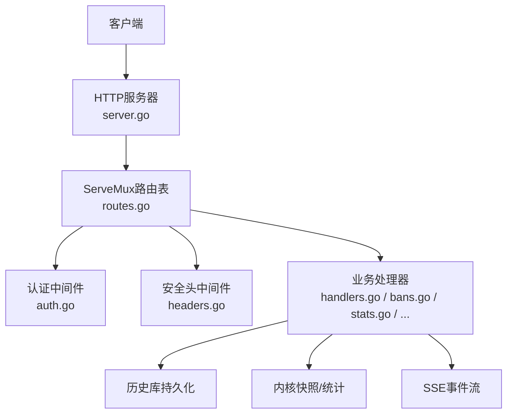

**图表来源**
- [server.go:34-73](file://src/daemon/internal/http/server.go#L34-L73)
- [routes.go:79-233](file://src/daemon/internal/http/routes.go#L79-L233)
- [auth.go:36-69](file://src/daemon/internal/http/auth.go#L36-L69)
- [headers.go:62-86](file://src/daemon/internal/http/headers.go#L62-L86)

**章节来源**
- [README.md:10-31](file://README.md#L10-L31)
- [http.fwidl:44-49](file://contract/http.fwidl#L44-L49)

## 核心组件
- HTTP服务器：监听地址、连接上限、优雅关停、请求超时配置。
- 路由注册：按契约常量注册所有REST/SSE/Metrics端点，并统一包裹认证中间件。
- 认证中间件：Basic认证与查询参数令牌，失败锁定窗口。
- 安全头中间件：对所有响应强制设置X-Content-Type-Options、X-Frame-Options、CSP、Cache-Control。
- 统一信封：成功/失败统一JSON形状，业务码与HTTP状态码分离。
- SSE事件流：events与logs两条独立流，各自有连接上限与心跳。
- 处理器族：封禁、白名单、Jail、配置、速率、统计、威胁情报、风险分析等。

**章节来源**
- [server.go:14-73](file://src/daemon/internal/http/server.go#L14-L73)
- [routes.go:79-233](file://src/daemon/internal/http/routes.go#L79-L233)
- [auth.go:36-115](file://src/daemon/internal/http/auth.go#L36-L115)
- [headers.go:62-86](file://src/daemon/internal/http/headers.go#L62-L86)
- [envelope.go:21-94](file://src/daemon/internal/http/envelope.go#L21-L94)

## 架构总览
HTTP层采用“中间件 + 路由 + 处理器”的经典分层：
- 最外层是Server，负责监听、连接限制、超时与优雅关停。
- 中间件链包括安全头与连接限制（Server内部），以及每个路由上的认证包装。
- 路由表集中注册，使用契约常量作为锚点，避免路径漂移。
- 处理器读取内核快照、历史库、配置与子系统能力，写出统一信封或SSE帧。

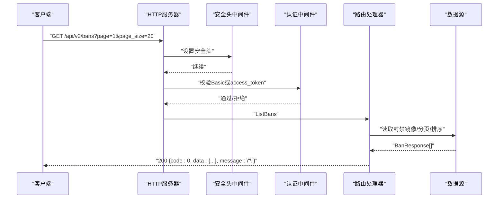

**图表来源**
- [server.go:63-71](file://src/daemon/internal/http/server.go#L63-L71)
- [headers.go:62-86](file://src/daemon/internal/http/headers.go#L62-L86)
- [auth.go:36-69](file://src/daemon/internal/http/auth.go#L36-L69)
- [routes.go:106-117](file://src/daemon/internal/http/routes.go#L106-L117)

## 详细组件分析

### HTTP服务器与连接限制
- 默认监听`127.0.0.1:9119`，最大连接数默认32，关闭超时默认5秒。
- `connectionLimiter`在中间件内计数活跃连接，超过上限直接返回503。
- 优雅关停会等待活跃连接释放，超时会强制关闭以避免端口占用。

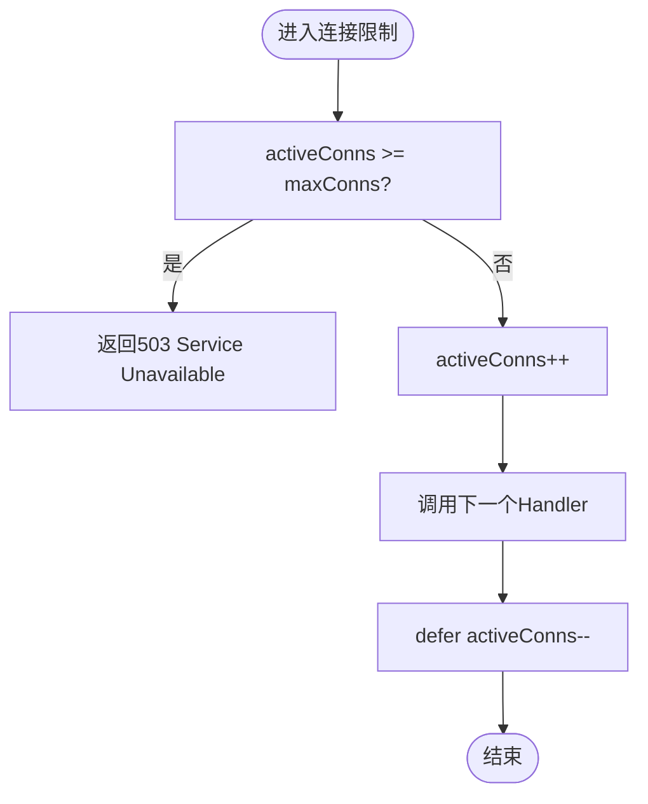

**图表来源**
- [server.go:129-148](file://src/daemon/internal/http/server.go#L129-L148)

**章节来源**
- [server.go:27-73](file://src/daemon/internal/http/server.go#L27-L73)
- [server.go:92-113](file://src/daemon/internal/http/server.go#L92-L113)
- [server.go:119-148](file://src/daemon/internal/http/server.go#L119-L148)

### 路由注册与控制器接口
- 所有REST/SSE/Metrics端点在`RegisterRoutes`中集中注册，使用契约常量命名。
- 认证中间件`RequireAuth`包裹每个需认证的处理器。
- `APIHandlers`聚合依赖：数据库、SSE、内核接口、配置访问、威胁情报等。
- `JailController`抽象了Jail启用/禁用写入，解耦HTTP层与执行体。

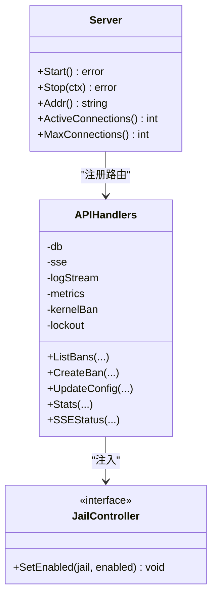

**图表来源**
- [routes.go:14-20](file://src/daemon/internal/http/routes.go#L14-L20)
- [routes.go:22-77](file://src/daemon/internal/http/routes.go#L22-L77)
- [routes.go:79-233](file://src/daemon/internal/http/routes.go#L79-L233)

**章节来源**
- [routes.go:14-77](file://src/daemon/internal/http/routes.go#L14-L77)
- [routes.go:79-233](file://src/daemon/internal/http/routes.go#L79-L233)

### 统一信封与业务码
- 成功响应：`{code:0, data:载荷, message:""}`。
- 失败响应：`{code:业务码, data:null, message:"原因"}`。
- 业务码与HTTP状态码分离，由生成物表映射；未声明的业务码会回500以暴露缺陷。
- 常见业务码：成功0、封禁失败40001、解封失败40002、批量参数非法40005、请求体非法40007、媒体类型不支持40008、Jail不存在404、内部错误50002、依赖未就绪50003。

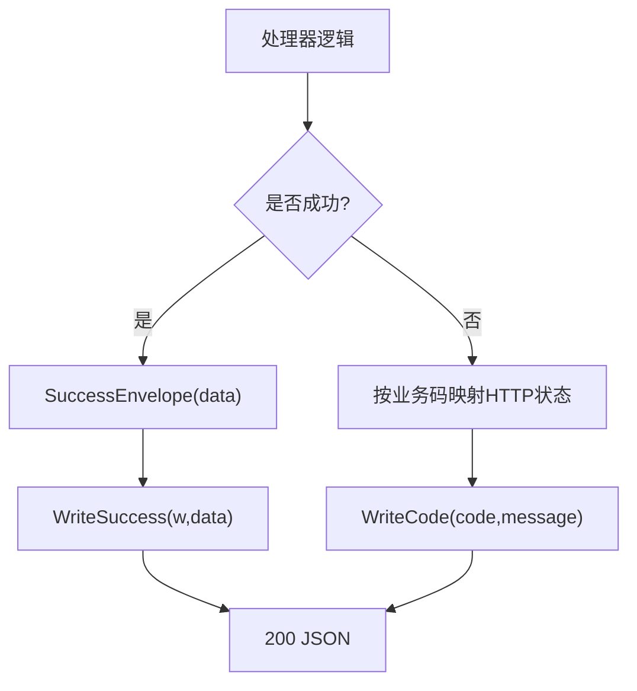

**图表来源**
- [envelope.go:21-94](file://src/daemon/internal/http/envelope.go#L21-L94)

**章节来源**
- [envelope.go:21-94](file://src/daemon/internal/http/envelope.go#L21-L94)
- [http.fwidl:156-223](file://contract/http.fwidl#L156-L223)

### 安全头部与面板CSP
- 所有响应统一设置：
  - X-Content-Type-Options: nosniff
  - X-Frame-Options: DENY
  - Content-Security-Policy: 面板路径放宽，其余default-src 'none'
  - Cache-Control: no-store
- CSP值根据路径是否为面板动态选择，避免API被误当作脚本资源加载。

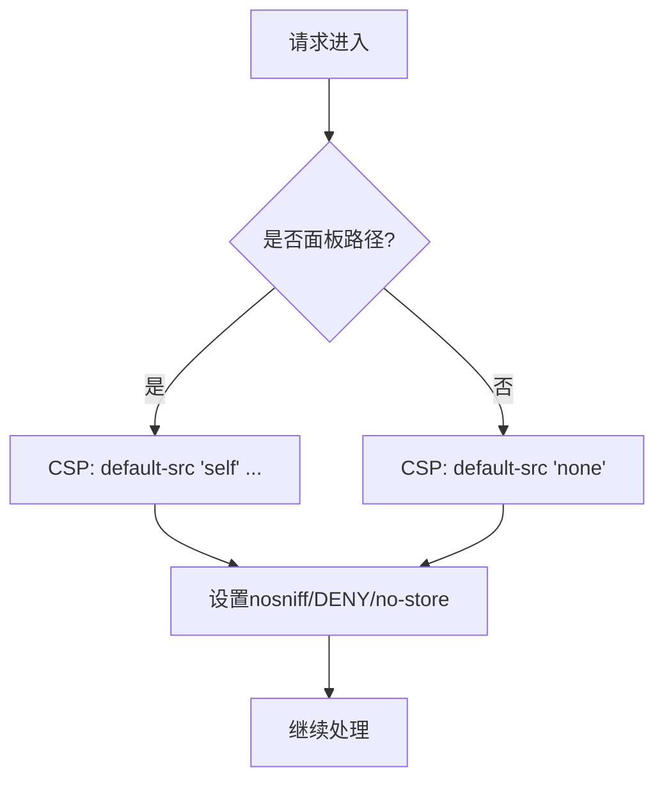

**图表来源**
- [headers.go:18-59](file://src/daemon/internal/http/headers.go#L18-L59)
- [headers.go:62-86](file://src/daemon/internal/http/headers.go#L62-L86)

**章节来源**
- [headers.go:18-86](file://src/daemon/internal/http/headers.go#L18-L86)
- [http.fwidl:131-153](file://contract/http.fwidl#L131-L153)

## 依赖关系分析
- HTTP服务器依赖ServeMux与Logger，组合根注入APIHandlers。
- APIHandlers依赖持久化DB、SSE Broker、日志流、Metrics、内核接口、威胁情报管理器。
- 认证中间件依赖锁出器（失败计数与锁定窗口）。
- 安全头中间件依赖契约生成的路由集合判断面板路径。

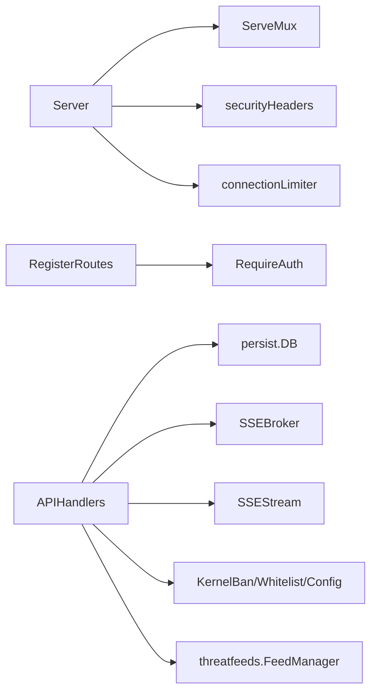

**图表来源**
- [server.go:14-73](file://src/daemon/internal/http/server.go#L14-L73)
- [routes.go:22-77](file://src/daemon/internal/http/routes.go#L22-L77)
- [headers.go:18-43](file://src/daemon/internal/http/headers.go#L18-L43)

**章节来源**
- [server.go:14-73](file://src/daemon/internal/http/server.go#L14-L73)
- [routes.go:22-77](file://src/daemon/internal/http/routes.go#L22-L77)

## 性能与限流
- 全局连接限制：Server级activeConns计数器，超限返回503，防止慢客户端拖垮广播队列。
- SSE连接上限：events最多10条，logs最多5条，各自独立计数与上限。
- 心跳与Keepalive：SSE每15秒发送keep-alive文本，保持长连接存活。
- 快照一致性：统计相关端点读取同一份telemetry.Snapshot，保证读数一致。
- 缓存优化：首屏统计窗口（今日/近5分钟）缓存30秒，减少重复SQL。

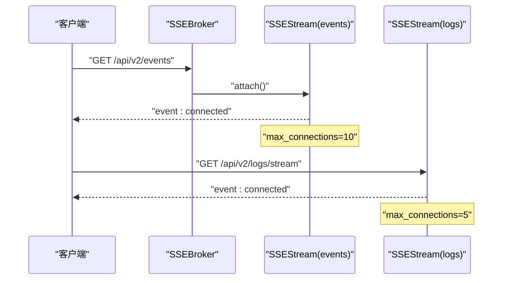

**图表来源**
- [http.fwidl:487-511](file://contract/http.fwidl#L487-L511)
- [routes.go:100-103](file://src/daemon/internal/http/routes.go#L100-L103)

**章节来源**
- [server.go:129-148](file://src/daemon/internal/http/server.go#L129-L148)
- [http.fwidl:487-511](file://contract/http.fwidl#L487-L511)
- [routes.go:150-173](file://src/daemon/internal/http/routes.go#L150-L173)

## 错误处理策略
- 三种错误形状并存：
  - 信封错误：daemon写出的业务错误，走统一信封。
  - 纯文本错误：401 Unauthorized与静态资源404。
  - 框架默认错误：net/http ServeMux自产404/405。
- 业务码与HTTP状态码分离，前端按code区分原因，message提供可读信息。
- 依赖未就绪统一用50003，内部错误用50002，便于监控与告警。

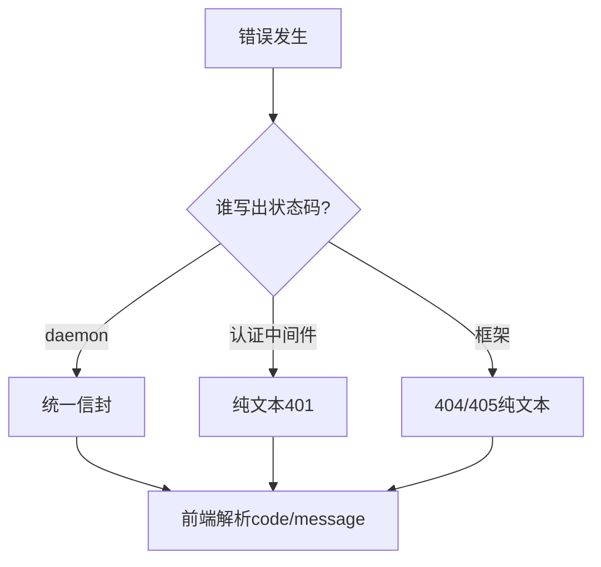

**图表来源**
- [http.fwidl:90-128](file://contract/http.fwidl#L90-L128)
- [envelope.go:75-94](file://src/daemon/internal/http/envelope.go#L75-L94)

**章节来源**
- [http.fwidl:90-128](file://contract/http.fwidl#L90-L128)
- [envelope.go:75-94](file://src/daemon/internal/http/envelope.go#L75-L94)

## API版本管理与端点清单
- 版本前缀：所有REST端点位于`/api/v2`。
- 健康检查：`/health`与`/healthz`裸状态码语义（200/503），不走信封。
- 指标导出：`/metrics`需认证，Prometheus格式。
- 主要REST端点：
  - 封禁：GET/POST/DELETE `/api/v2/bans`，批量封禁`POST /api/v2/bans/batch`
  - Jail：GET/PUT `/api/v2/jails/:name`
  - 配置：GET/PUT `/api/v2/config`
  - 白名单：GET/POST/DELETE `/api/v2/whitelist`，推荐`GET /api/v2/whitelist/recommendations`
  - 速率：GET `/api/v2/rates/current|history|windows`
  - 统计：GET `/api/v2/stats/*`
  - 风险：GET `/api/v2/risk-vectors*`
  - 日志：GET `/api/v2/logs`，SSE `/api/v2/logs/stream`
  - 威胁情报：GET/POST `/api/v2/threat-feeds*`
  - 综合分析：GET `/api/v2/analysis*`

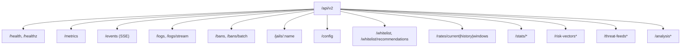

**图表来源**
- [http.fwidl:44-49](file://contract/http.fwidl#L44-L49)
- [http.fwidl:376-800](file://contract/http.fwidl#L376-L800)
- [routes.go:79-233](file://src/daemon/internal/http/routes.go#L79-L233)

**章节来源**
- [http.fwidl:44-49](file://contract/http.fwidl#L44-L49)
- [http.fwidl:376-800](file://contract/http.fwidl#L376-L800)
- [routes.go:79-233](file://src/daemon/internal/http/routes.go#L79-L233)

## 认证与授权机制
- 认证方案：Basic认证，凭据来自配置的metrics_username/metrics_password。
- 令牌来源：Authorization头优先，query参数access_token兜底（SSE必须）。
- 半配置保护：只配置一项则整组端点一律401，避免配置笔误开放API。
- 失败锁定：连续失败达到阈值后锁定一段时间，期间连正确凭据也拒绝。
- 401响应为纯文本，有意不发WWW-Authenticate，避免浏览器原生对话框挂起前端fetch。

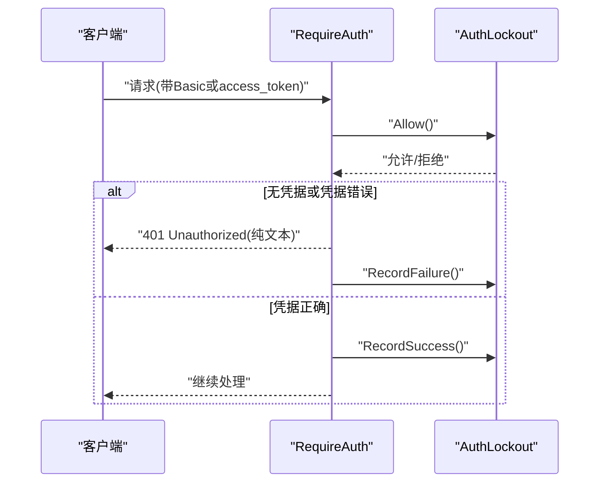

**图表来源**
- [auth.go:36-69](file://src/daemon/internal/http/auth.go#L36-L69)
- [http.fwidl:67-88](file://contract/http.fwidl#L67-L88)

**章节来源**
- [auth.go:36-115](file://src/daemon/internal/http/auth.go#L36-L115)
- [http.fwidl:67-88](file://contract/http.fwidl#L67-L88)

## SSE实时事件推送
- 两条流：
  - `/api/v2/events`：事件流，支持connected、stats、bans、jails、whitelist、rates，上限10。
  - `/api/v2/logs/stream`：日志流，支持connected、log、error，上限5。
- 帧载荷与同域REST同源同形：例如jails帧与GET /api/v2/jails.data完全一致。
- 心跳：每15秒发送keep-alive文本。
- 连接诊断：`/api/v2/stats/sse-status`分别报告events与logs的current/max/limit_reached。

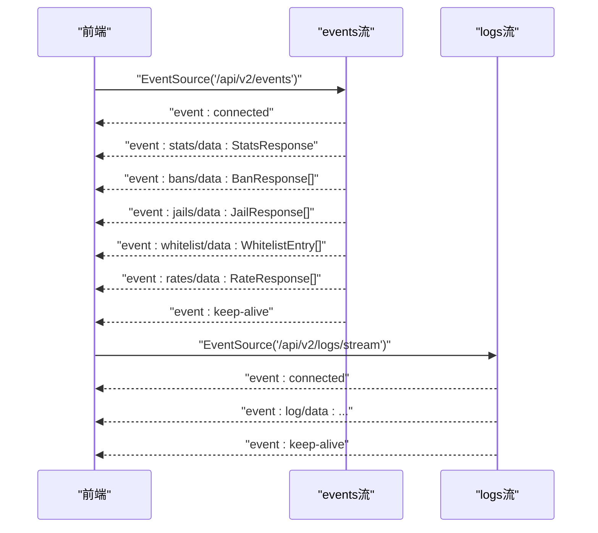

**图表来源**
- [http.fwidl:487-511](file://contract/http.fwidl#L487-L511)
- [sse_payload_test.go:234-277](file://src/daemon/internal/http/sse_payload_test.go#L234-L277)

**章节来源**
- [http.fwidl:487-511](file://contract/http.fwidl#L487-L511)
- [sse_payload_test.go:77-157](file://src/daemon/internal/http/sse_payload_test.go#L77-L157)
- [sse_payload_test.go:234-277](file://src/daemon/internal/http/sse_payload_test.go#L234-L277)

## 中间件与安全头部
- 安全头中间件对全部路由生效，面板路径放宽CSP，其他路径严格禁止脚本。
- 连接限制中间件在安全头之前，确保限额告知响应不经过安全头（避免误导）。
- 认证中间件在每个路由上单独包裹，支持可选认证（auth=none）与必需认证（auth=required）。

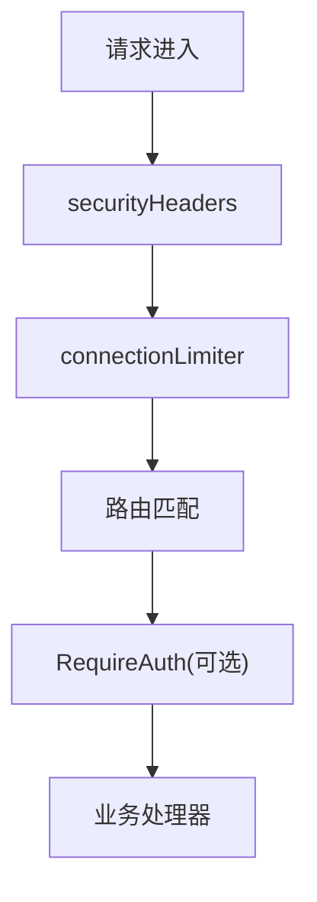

**图表来源**
- [server.go:63-71](file://src/daemon/internal/http/server.go#L63-L71)
- [headers.go:62-86](file://src/daemon/internal/http/headers.go#L62-L86)
- [auth.go:36-69](file://src/daemon/internal/http/auth.go#L36-L69)

**章节来源**
- [server.go:63-71](file://src/daemon/internal/http/server.go#L63-L71)
- [headers.go:62-86](file://src/daemon/internal/http/headers.go#L62-L86)
- [auth.go:36-69](file://src/daemon/internal/http/auth.go#L36-L69)

## 客户端集成示例
- 基础认证：
  - 浏览器fetch：设置Authorization头为Basic base64(user:pass)。
  - SSE EventSource：通过URL query access_token携带base64(user:pass)。
- 统一信封处理：
  - 成功：读取data字段，忽略message为空串。
  - 失败：根据code分支处理，message用于展示给用户。
- 分页与排序：
  - GET /api/v2/bans支持page、page_size、sort_by，缺省page=1、page_size=20，上限100。
- 速率历史：
  - GET /api/v2/rates/history支持limit参数，默认与上限均为环容量。

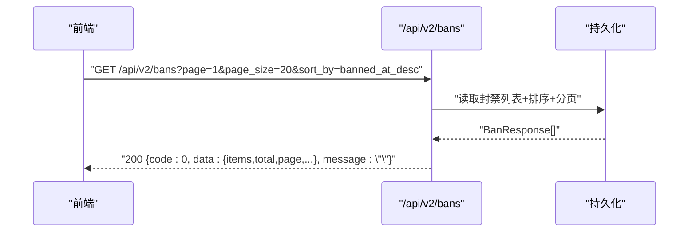

**图表来源**
- [http.fwidl:525-532](file://contract/http.fwidl#L525-L532)
- [routes.go:106-117](file://src/daemon/internal/http/routes.go#L106-L117)

**章节来源**
- [http.fwidl:525-532](file://contract/http.fwidl#L525-L532)
- [http.fwidl:666-680](file://contract/http.fwidl#L666-L680)

## 调试工具与建议
- 健康检查：
  - GET /health与/healthz返回裸JSON，状态码200表示就绪，503表示未就绪。
- 指标导出：
  - GET /metrics返回Prometheus格式，需认证。
- SSE诊断：
  - GET /api/v2/stats/sse-status查看events与logs的连接数与上限。
- 日志流：
  - GET /api/v2/logs/stream实时接收日志事件，适合终端调试。
- 浏览器开发工具：
  - Network面板查看统一信封与业务码。
  - EventSource面板观察SSE事件帧。

**章节来源**
- [http.fwidl:376-394](file://contract/http.fwidl#L376-L394)
- [http.fwidl:477-485](file://contract/http.fwidl#L477-L485)
- [http.fwidl:748-754](file://contract/http.fwidl#L748-L754)
- [http.fwidl:500-511](file://contract/http.fwidl#L500-L511)

## 故障排查
- 401 Unauthorized：
  - 检查Authorization头或access_token是否正确。
  - 确认未处于锁定窗口（连续失败阈值触发）。
- 503 Service Unavailable：
  - 全局连接数已达上限，稍后重试。
  - SSE连接数达上限，检查events/logs各自上限。
- 40007/40008：
  - 请求体不是合法JSON或Content-Type不是application/json。
- 50002/50003：
  - 历史库未初始化或查询失败，检查持久化配置与服务就绪状态。
- 面板无法加载：
  - 检查CSP与静态资源路径，确认非面板路径未误配宽松CSP。

**章节来源**
- [auth.go:36-115](file://src/daemon/internal/http/auth.go#L36-L115)
- [server.go:129-148](file://src/daemon/internal/http/server.go#L129-L148)
- [envelope.go:75-94](file://src/daemon/internal/http/envelope.go#L75-L94)
- [headers.go:62-86](file://src/daemon/internal/http/headers.go#L62-L86)

## 结论
该HTTP API服务以契约驱动设计，统一信封、明确业务码、严格安全头与SSE实时推送构成稳定可靠的对外接口。通过集中路由注册、认证中间件与连接限制，系统在安全性与可用性之间取得平衡。前端或外部系统应遵循契约定义的端点、认证方式与错误模型进行集成，并利用诊断端点与日志流进行调试与监控。