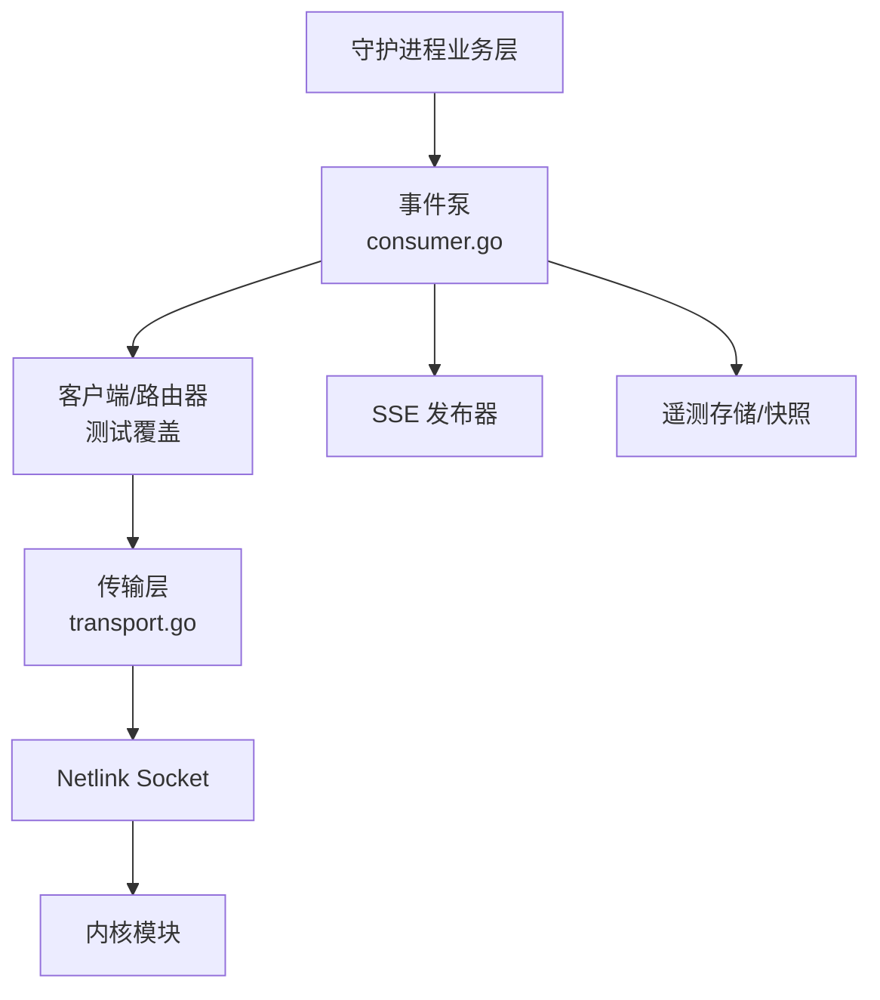
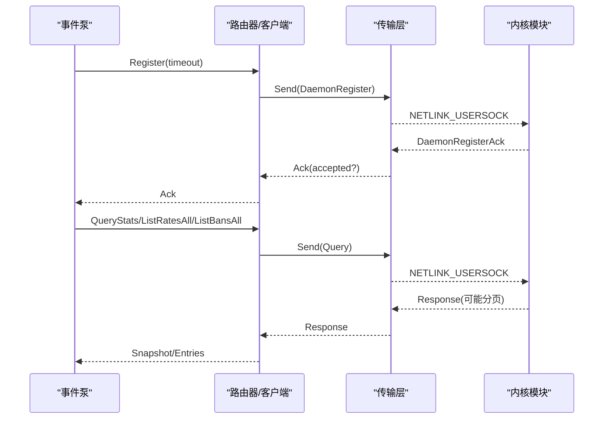
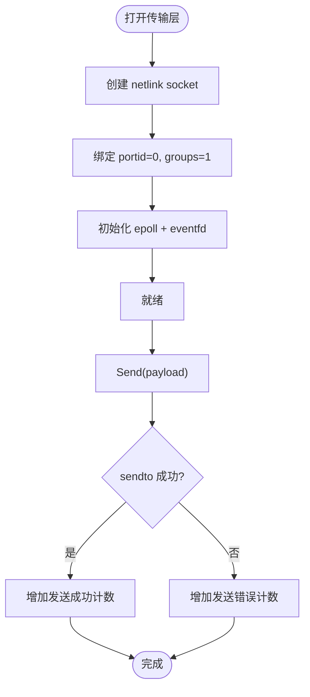
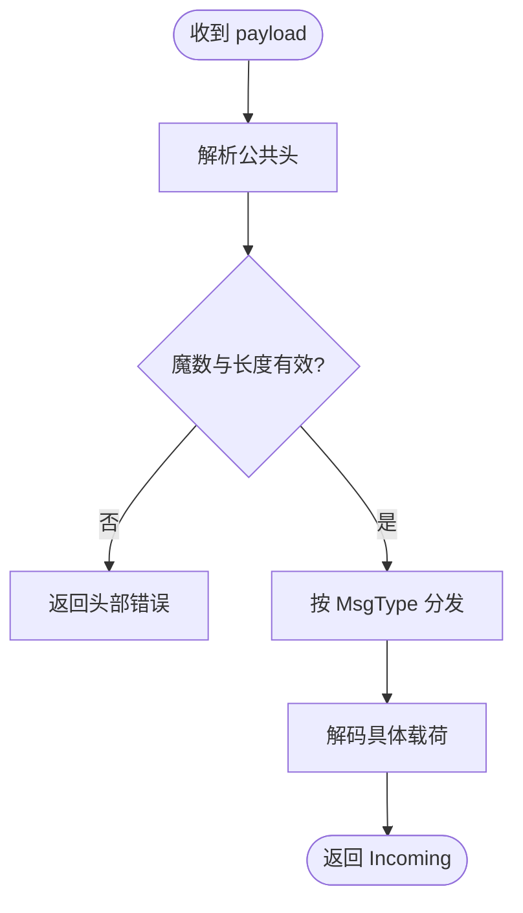
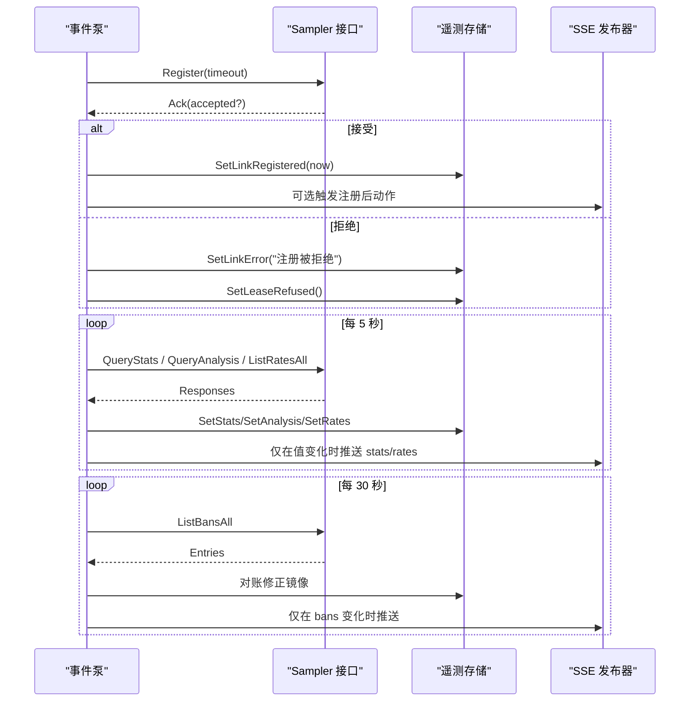
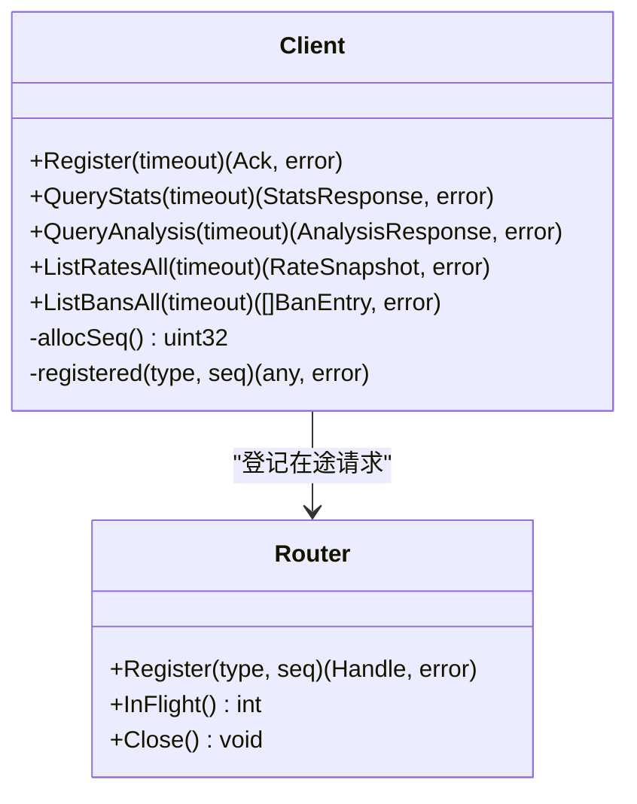
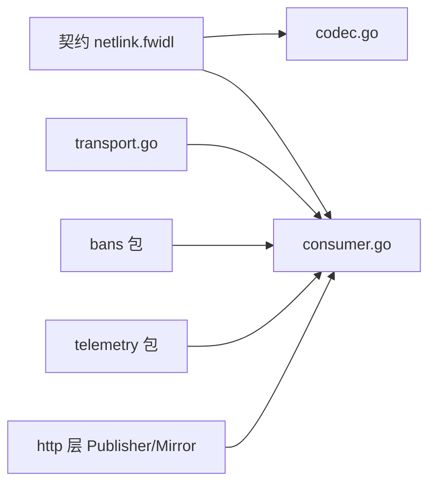

# 内核通信层

<cite>
**本文引用的文件**   
- [netlink.fwidl](file://contract/netlink.fwidl)
- [transport.go](file://src/daemon/internal/kernel/transport.go)
- [codec.go](file://src/daemon/internal/kernel/codec.go)
- [consumer.go](file://src/daemon/internal/kernel/consumer.go)
- [client_test.go](file://src/daemon/internal/kernel/client_test.go)
</cite>

## 目录
1. [简介](#简介)
2. [项目结构](#项目结构)
3. [核心组件](#核心组件)
4. [架构总览](#架构总览)
5. [详细组件分析](#详细组件分析)
6. [依赖关系分析](#依赖关系分析)
7. [性能考量](#性能考量)
8. [故障排查指南](#故障排查指南)
9. [结论](#结论)
10. [附录：契约与消息类型](#附录契约与消息类型)

## 简介
本文件聚焦守护进程侧的“内核通信层”，围绕 Netlink 协议实现、消息编解码、连接管理、数据包传输、错误重试机制、并发控制策略，以及内核模块与守护进程之间的契约定义、消息类型和状态同步机制展开。文档同时给出内核模块调试工具建议、性能监控方法和常见问题解决方案，帮助读者从高层到代码级全面理解该子系统。

## 项目结构
内核通信层位于守护进程的 kernel 包中，主要由以下职责清晰的模块组成：
- 传输层：封装 netlink socket 创建、绑定、发送、接收、就绪事件轮询与链路健康计数。
- 编解码层：按契约解析公共头与具体载荷，校验魔数、长度与字节序。
- 事件泵：消费内核推送事件，驱动周期性采样、对账、注册续约，并对外发布 SSE 域通知。
- 客户端与路由器（测试覆盖）：负责请求序号分配、在途请求表、分页续页、超时与失败映射。

**图示来源**
- [consumer.go:181-309](file://src/daemon/internal/kernel/consumer.go#L181-L309)
- [transport.go:146-262](file://src/daemon/internal/kernel/transport.go#L146-L262)

**章节来源**
- [consumer.go:181-309](file://src/daemon/internal/kernel/consumer.go#L181-L309)
- [transport.go:146-262](file://src/daemon/internal/kernel/transport.go#L146-L262)

## 核心组件
- 传输层 Transport：提供 OpenTransport、Subscribe、Send、TryRecv、Poll、Close 等能力；维护 epoll + eventfd 的就绪观察；统计发送/接收成功与失败次数；支持截止时间与链路断开通知。
- 编解码器 codec：统一解析公共头与各类消息载荷，强制魔数与 msg_len 一致性校验，区分未知类型与字段解码错误。
- 事件泵 EventPump：唯一消费者，负责注册租约、周期采样（统计/分析/速率）、封禁表对账、白名单镜像更新、SSE 域通知、反向指令投递与指标写入。
- 客户端与路由器（测试覆盖）：负责请求 seq 分配、在途请求登记、Abandon、分页续页、超时与失败语义映射（链路断开、忙、序号复用）。

**章节来源**
- [transport.go:95-123](file://src/daemon/internal/kernel/transport.go#L95-L123)
- [codec.go:10-97](file://src/daemon/internal/kernel/codec.go#L10-L97)
- [consumer.go:181-309](file://src/daemon/internal/kernel/consumer.go#L181-L309)
- [client_test.go:20-36](file://src/daemon/internal/kernel/client_test.go#L20-L36)

## 架构总览
内核通信层采用“单向事件流 + 请求/响应配对”的双通道模型：
- 内核 → 守护进程：通过广播组推送 DDoS 事件、封禁/解封变更、白名单变更、配置变更、命令失败回执等。
- 守护进程 → 内核：下发封禁/解封、白名单增删、配置、查询统计/分析/速率列表、受保护端口位图、单守护进程注册。

**图示来源**
- [consumer.go:311-344](file://src/daemon/internal/kernel/consumer.go#L311-L344)
- [transport.go:239-262](file://src/daemon/internal/kernel/transport.go#L239-L262)

## 详细组件分析

### 传输层 Transport
- 连接建立：使用 AF_NETLINK + SOCK_RAW，协议号为 NETLINK_USERSOCK；绑定 portid=0（由内核分配），订阅广播组 group=1。
- 发送流程：构造 nlmsghdr（宿主字节序），尾部拼接自定义载荷（大端）；sendto 成功后记录计数器；发送互斥保证原子性。
- 接收流程：设置 SO_RCVTIMEO 与阻塞模式；使用 MSG_TRUNC 获取真实长度；校验 nlmsghdr 自洽；剥离 nlmsghdr 返回 Payload。
- 就绪事件：epoll 监听 socket 可读与 eventfd 唤醒；支持 EventRx、EventLinkDown、EventDeadline、EventInterrupt 等；避免空转与长等待。
- 生命周期：Close 关闭 fd、epoll、eventfd，并 SignalLinkDown；SetDeadline/ClearDeadline/DeadlineExpired 控制轮询截止时间。

**图示来源**
- [transport.go:146-173](file://src/daemon/internal/kernel/transport.go#L146-L173)
- [transport.go:239-262](file://src/daemon/internal/kernel/transport.go#L239-L262)

**章节来源**
- [transport.go:13-50](file://src/daemon/internal/kernel/transport.go#L13-L50)
- [transport.go:146-262](file://src/daemon/internal/kernel/transport.go#L146-L262)
- [transport.go:310-397](file://src/daemon/internal/kernel/transport.go#L310-L397)
- [transport.go:490-529](file://src/daemon/internal/kernel/transport.go#L490-L529)

### 编解码层 codec
- 公共头校验：魔数必须匹配；msg_len 必须等于 payload 实际长度；否则视为协议违例。
- 类型分发：根据 MsgType 将 payload 解为对应结构体；未知类型直接报错，调用方应计为“不在契约内”。
- 字节序：自定义载荷为大端；nlmsghdr 为宿主字节序。

**图示来源**
- [codec.go:99-118](file://src/daemon/internal/kernel/codec.go#L99-L118)
- [codec.go:14-97](file://src/daemon/internal/kernel/codec.go#L14-L97)

**章节来源**
- [codec.go:10-123](file://src/daemon/internal/kernel/codec.go#L10-L123)

### 事件泵 EventPump
- 生命周期：Run 循环处理事件、周期采样、对账、注册续约、心跳检测；ClaimLease 用于启动抢占租约。
- 注册租约：向内核发送 DAEMON_REGISTER，解析 DaemonRegisterAck；拒绝时上报链路错误并退出或重试。
- 事件处理：BanStateChange/WhitelistStateChange/DDoS/CmdResult/ConfigChange 分别更新镜像、事件环、指标与 SSE 域通知。
- 周期任务：
  - 采样：QueryStats/QueryAnalysis/ListRatesAll，失败独立处理，至少更新链路采样时间。
  - 对账：ListBansAll 以内核为准纠正本地镜像，剔除幽灵条目，兜底过期清理。
  - 续约：每 10 秒刷新租约，防止空闲链路被内核判定死亡。
- 对外输出：通过 DomainMirror 把 bans/whitelist/stats/rates 域载荷交给 http.SSEReplicas；仅当内容变化才推送。

**图示来源**
- [consumer.go:269-309](file://src/daemon/internal/kernel/consumer.go#L269-L309)
- [consumer.go:311-344](file://src/daemon/internal/kernel/consumer.go#L311-L344)
- [consumer.go:568-613](file://src/daemon/internal/kernel/consumer.go#L568-L613)
- [consumer.go:632-690](file://src/daemon/internal/kernel/consumer.go#L632-L690)

**章节来源**
- [consumer.go:37-68](file://src/daemon/internal/kernel/consumer.go#L37-L68)
- [consumer.go:181-309](file://src/daemon/internal/kernel/consumer.go#L181-L309)
- [consumer.go:367-549](file://src/daemon/internal/kernel/consumer.go#L367-L549)
- [consumer.go:568-745](file://src/daemon/internal/kernel/consumer.go#L568-L745)

### 客户端与路由器（测试覆盖）
- 序号分配：u32 回绕时跳过 0，确保不与“不参与配对”的推送冲突。
- 在途请求表：限制 MaxInFlight；满时返回忙错误；重复 seq 返回序号复用错误。
- 分页续页：基于 total/offset/count 自动翻页，遇到空页或 offset 不推进时防御性终止。
- 超时与失败映射：链路断开、忙、序号复用、超时均有明确错误语义，便于上层重试或告警。

**图示来源**
- [client_test.go:20-36](file://src/daemon/internal/kernel/client_test.go#L20-L36)
- [client_test.go:38-76](file://src/daemon/internal/kernel/client_test.go#L38-L76)
- [client_test.go:87-163](file://src/daemon/internal/kernel/client_test.go#L87-L163)

**章节来源**
- [client_test.go:20-36](file://src/daemon/internal/kernel/client_test.go#L20-L36)
- [client_test.go:38-76](file://src/daemon/internal/kernel/client_test.go#L38-L76)
- [client_test.go:87-163](file://src/daemon/internal/kernel/client_test.go#L87-L163)

## 依赖关系分析
- 契约依赖：所有消息类型、结构体布局、字节序与长度约束来自 contract/netlink.fwidl；Go/Rust/C 三端由生成器保持一致。
- 守护进程内部依赖：
  - consumer.go 依赖 transport.go 进行收发。
  - consumer.go 依赖 contract 生成的消息类型进行编解码。
  - consumer.go 依赖 bans 与 telemetry 做镜像与快照。
  - consumer.go 依赖 http 层的 Publisher/Mirror 做 SSE 输出。
- 外部依赖：unix.NETLINK_USERSOCK、epoll、eventfd、SO_RCVTIMEO。

**图示来源**
- [netlink.fwidl:1-30](file://contract/netlink.fwidl#L1-L30)
- [consumer.go:181-309](file://src/daemon/internal/kernel/consumer.go#L181-L309)
- [transport.go:146-262](file://src/daemon/internal/kernel/transport.go#L146-L262)

**章节来源**
- [netlink.fwidl:1-30](file://contract/netlink.fwidl#L1-L30)
- [consumer.go:181-309](file://src/daemon/internal/kernel/consumer.go#L181-L309)
- [transport.go:146-262](file://src/daemon/internal/kernel/transport.go#L146-L262)

## 性能考量
- 接收缓冲：RecvBuf 设为 128 KiB，远大于契约上限（u16 msg_len ≤ 65535），以容纳对齐填充与非契约异常报文。
- 轮询效率：epoll + eventfd 避免 select 短超时空转；单次 epoll_wait 最长 60 秒，避免内核整型溢出。
- 计数器开销：SetMetrics 一次性注入句柄，热路径只做非 nil 判定与原子加一。
- 分页容量：分页上限由契约尾部 capacity 决定，避免历史实现一次返回数 MB 导致 GFP_ATOMIC 分配失败。
- 采样频率：5 秒采样、30 秒对账、10 秒续约，兼顾实时性与内核判死阈值。

[本节为通用指导，不直接分析具体文件]

## 故障排查指南
- 注册失败或被拒绝：
  - 现象：链路错误、面板无控制能力、所有下发静默丢弃。
  - 排查：检查 DaemonRegisterAck.accepted；确认是否已有活跃守护进程；查看链路错误与租约拒绝标记。
  - 参考：[consumer.go:311-344](file://src/daemon/internal/kernel/consumer.go#L311-L344)
- 发送/接收错误计数上升：
  - 现象：CounterMessagesSentTotal/ReceivedTotal/SendErrorsTotal/RecvErrorsTotal 异常增长。
  - 排查：检查 socket 是否被关闭、是否收到截断或畸形报文；确认 RecvBuf 是否足够。
  - 参考：[transport.go:23-32](file://src/daemon/internal/kernel/transport.go#L23-L32), [transport.go:264-308](file://src/daemon/internal/kernel/transport.go#L264-L308)
- 在途请求表满或序号复用：
  - 现象：ErrBusy/ErrSeqReused；请求长时间无回复。
  - 排查：检查 Abandon 是否调用；确认 max in-flight 配置；核对 seq 分配逻辑。
  - 参考：[client_test.go:38-76](file://src/daemon/internal/kernel/client_test.go#L38-L76)
- 分页未完整拉取：
  - 现象：列表数据缺失；total 与 count 不一致。
  - 排查：检查 drain 续页逻辑；确认 offset 推进与空页收尾；核对契约尾部 capacity。
  - 参考：[client_test.go:87-163](file://src/daemon/internal/kernel/client_test.go#L87-L163)
- 内核拒绝指令：
  - 现象：CmdResult 回执；镜像与内核不一致。
  - 排查：查看 CmdResult.original_cmd/error_code；确认镜像撤销与执行体抑制逻辑。
  - 参考：[consumer.go:499-549](file://src/daemon/internal/kernel/consumer.go#L499-L549)

**章节来源**
- [consumer.go:311-344](file://src/daemon/internal/kernel/consumer.go#L311-L344)
- [transport.go:23-32](file://src/daemon/internal/kernel/transport.go#L23-L32)
- [transport.go:264-308](file://src/daemon/internal/kernel/transport.go#L264-L308)
- [client_test.go:38-76](file://src/daemon/internal/kernel/client_test.go#L38-L76)
- [client_test.go:87-163](file://src/daemon/internal/kernel/client_test.go#L87-L163)
- [consumer.go:499-549](file://src/daemon/internal/kernel/consumer.go#L499-L549)

## 结论
内核通信层通过严格的契约定义、健壮的传输与编解码、以及稳健的事件泵与客户端/路由器实现，实现了内核与守护进程之间的高可靠双向通信。其设计重点在于：
- 契约先行：所有消息类型、布局与字节序由 IDL 生成，三端一致。
- 健壮传输：epoll + eventfd 高效轮询，MSG_TRUNC 精确长度，严格错误分类。
- 可观测性：链路健康计数器、采样/对账/注册状态全部暴露。
- 容错与恢复：注册租约主动续约、分页续页、对账纠偏、失败回执可见。

[本节为总结性内容，不直接分析具体文件]

## 附录：契约与消息类型
- 协议族与魔数：AF_INET/AF_INET6 同值；FW_NL_MAGIC 固定，不匹配即丢弃。
- 公共头：magic/msg_type/msg_len/seq，其中 seq 用于请求/响应配对，推送类事件不使用配对。
- 主要消息类型（部分）：
  - 内核 → 守护进程：DDOS_EVENT、BAN_STATE_CHANGE、WHITELIST_STATE_CHANGE、CMD_RESULT、CONFIG_ACK、CONFIG_CHANGE、STATS_RESPONSE、LIST_BANS_RESPONSE、LIST_WHITELIST_RESPONSE、LIST_RATES_RESPONSE、ANALYSIS_RESPONSE、DAEMON_REGISTER_ACK。
  - 守护进程 → 内核：BAN_IP、UNBAN_IP、SET_CONFIG、LIST_BANS_QUERY、LIST_WHITELIST_QUERY、LIST_RATES_QUERY、ADD_WHITELIST、REMOVE_WHITELIST、DAEMON_REGISTER、SET_PROTECTED_PORTS。
- 分页约定：ListBansResponse、ListWhitelistResponse、ListRatesResponse 必须分页，count/total/offset 语义一致。
- 地址与字节序：addr16 裸字节；多字节整数 BIG-ENDIAN；字符串 NUL 结尾定长数组。

**章节来源**
- [netlink.fwidl:32-81](file://contract/netlink.fwidl#L32-L81)
- [netlink.fwidl:108-133](file://contract/netlink.fwidl#L108-L133)
- [netlink.fwidl:139-212](file://contract/netlink.fwidl#L139-L212)
- [netlink.fwidl:218-358](file://contract/netlink.fwidl#L218-L358)
- [netlink.fwidl:360-485](file://contract/netlink.fwidl#L360-L485)