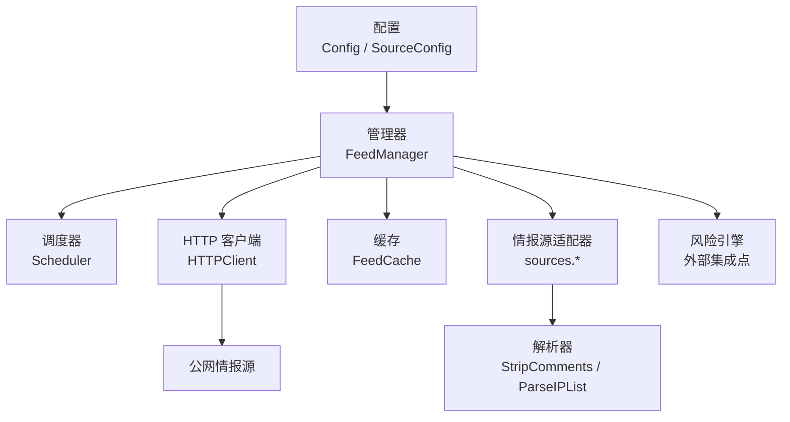
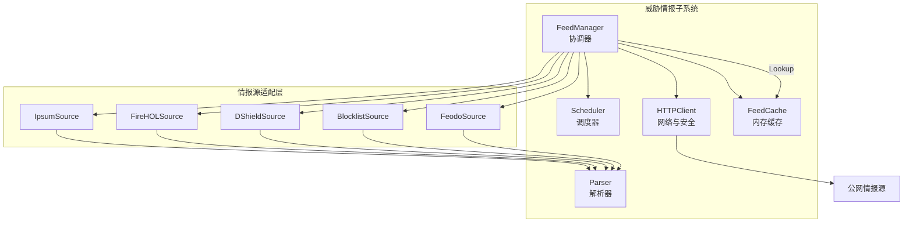
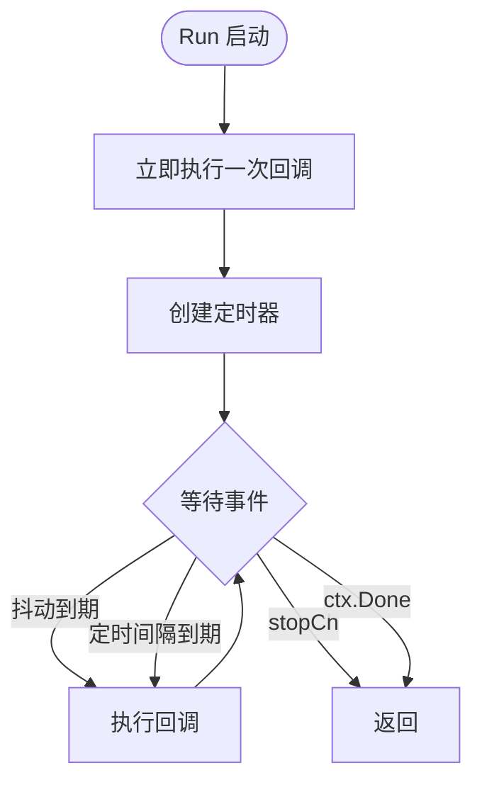
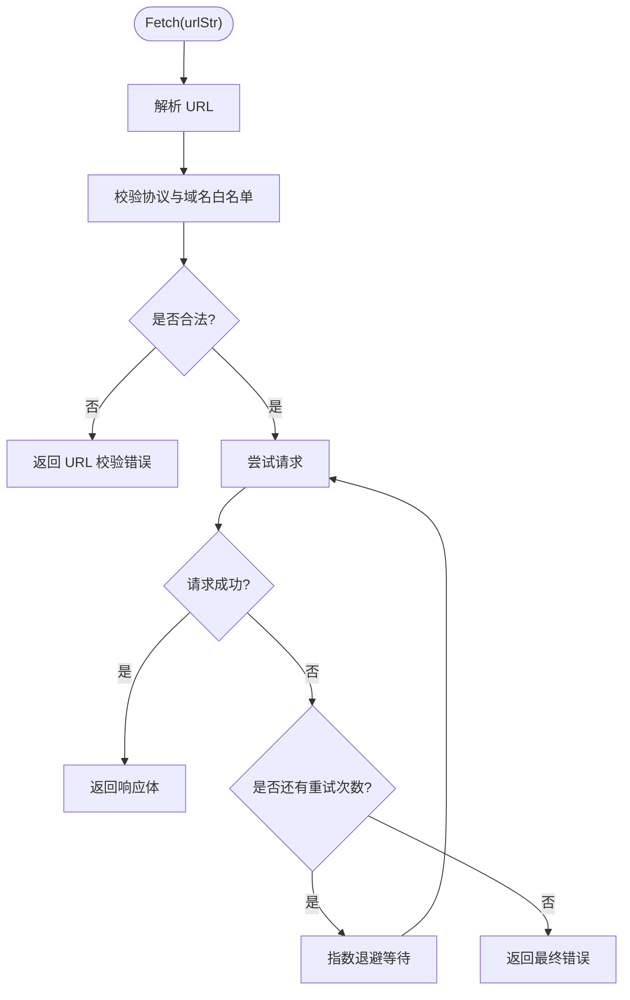
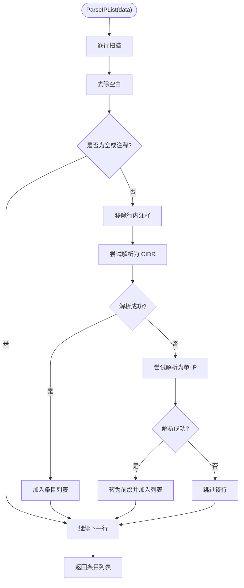
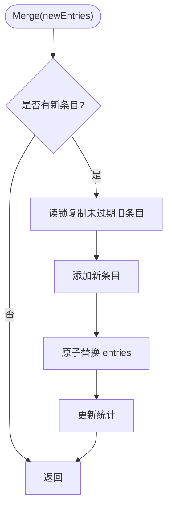
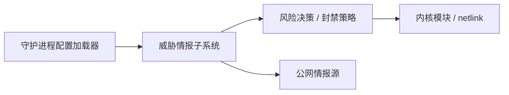
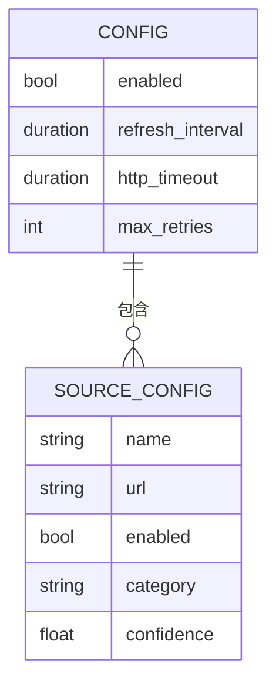
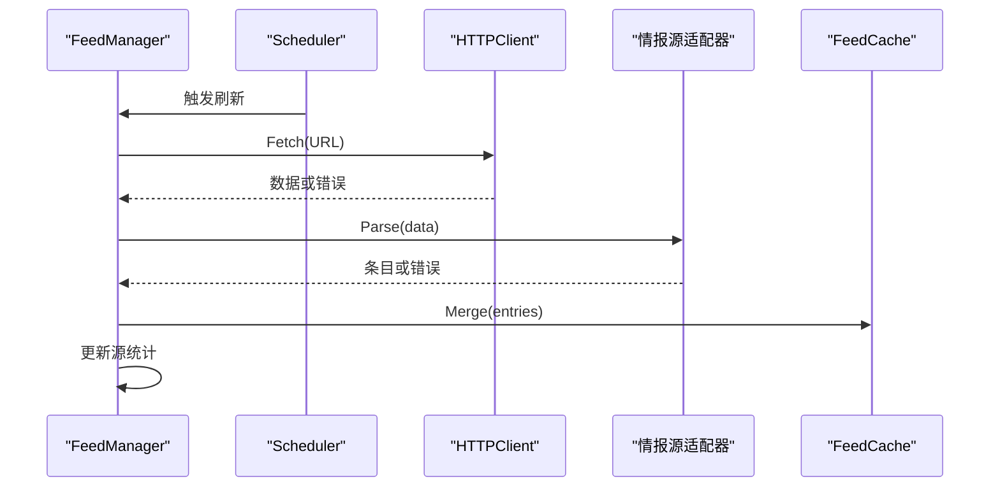
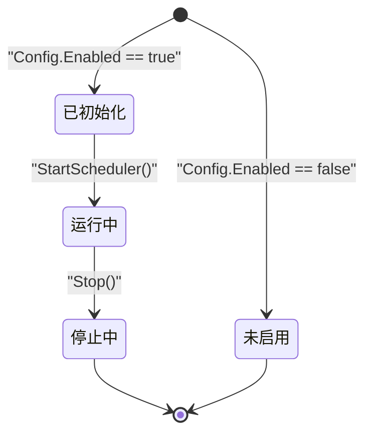

# 威胁情报架构设计

<cite>
**本文引用的文件**   
- [README.md](file://README.md)
- [data-flow.md](file://docs/zh/architecture/data-flow.md)
- [threat-feeds.md](file://docs/zh/configuration/threat-feeds.md)
- [manager.go](file://src/daemon/internal/threatfeeds/manager.go)
- [scheduler.go](file://src/daemon/internal/threatfeeds/scheduler.go)
- [parser.go](file://src/daemon/internal/threatfeeds/parser.go)
- [cache.go](file://src/daemon/internal/threatfeeds/cache.go)
- [http.go](file://src/daemon/internal/threatfeeds/http.go)
- [config.go](file://src/daemon/internal/threatfeeds/config.go)
- [types.go](file://src/daemon/internal/threatfeeds/types.go)
</cite>

## 目录
1. [引言](#引言)
2. [项目结构](#项目结构)
3. [核心组件](#核心组件)
4. [架构总览](#架构总览)
5. [详细组件分析](#详细组件分析)
6. [依赖关系分析](#依赖关系分析)
7. [性能与容量特征](#性能与容量特征)
8. [配置管理](#配置管理)
9. [错误处理、重试与可观测性](#错误处理重试与可观测性)
10. [生命周期管理与资源清理](#生命周期管理与资源清理)
11. [监控指标设计](#监控指标设计)
12. [故障排查指南](#故障排查指南)
13. [结论](#结论)

## 引言
本文件面向威胁情报聚合子系统，目标是说明其整体架构模式、核心组件职责、数据流向、组件交互关系，以及 Manager 协调器、Scheduler 调度器、Parser 解析器的设计模式和协作机制。文档同时覆盖配置管理、错误处理、重试策略、监控指标、架构图和数据流图，并解释各组件的生命周期管理和资源清理机制。

该子系统位于守护进程内部，负责从公网威胁情报源并发拉取恶意 IP/CIDR，解析为统一条目，合并到内存缓存，并在风险判定路径中提供高置信度情报查询能力。它不阻塞主判定链路，支持热重载和 SIGHUP 触发刷新。

**章节来源**
- [README.md:88-98](file://README.md#L88-L98)
- [threat-feeds.md:1-16](file://docs/zh/configuration/threat-feeds.md#L1-L16)

## 项目结构
威胁情报聚合系统主要位于 `src/daemon/internal/threatfeeds`，并按职责拆分为以下模块：

| 模块 | 职责 | 关键文件 |
|------|------|----------|
| 管理器 | 构建源、并发刷新、结果聚合、统计、缓存访问、调度启动与停止 | [manager.go](file://src/daemon/internal/threatfeeds/manager.go) |
| 调度器 | 定时触发刷新，支持抖动防惊群和优雅停止 | [scheduler.go](file://src/daemon/internal/threatfeeds/scheduler.go) |
| HTTP 客户端 | HTTPS 强制、域名白名单、重定向限制、指数退避重试 | [http.go](file://src/daemon/internal/threatfeeds/http.go) |
| 解析器 | 通用行级解析、注释过滤、IP/CIDR 归一化 | [parser.go](file://src/daemon/internal/threatfeeds/parser.go) |
| 缓存 | 并发安全读写、精确匹配优先、CIDR 遍历、过期清理 | [cache.go](file://src/daemon/internal/threatfeeds/cache.go) |
| 配置 | 全局开关、刷新间隔、HTTP 超时、重试次数、源列表 | [config.go](file://src/daemon/internal/threatfeeds/config.go) |
| 类型定义 | 刷新结果、统计结构等共享类型 | [types.go](file://src/daemon/internal/threatfeeds/types.go) |



**图表来源**
- [manager.go:20-41](file://src/daemon/internal/threatfeeds/manager.go#L20-L41)
- [scheduler.go:10-21](file://src/daemon/internal/threatfeeds/scheduler.go#L10-L21)
- [http.go:23-49](file://src/daemon/internal/threatfeeds/http.go#L23-L49)
- [parser.go:11-23](file://src/daemon/internal/threatfeeds/parser.go#L11-L23)
- [cache.go:9-19](file://src/daemon/internal/threatfeeds/cache.go#L9-L19)
- [config.go:5-31](file://src/daemon/internal/threatfeeds/config.go#L5-L31)

**章节来源**
- [manager.go:20-90](file://src/daemon/internal/threatfeeds/manager.go#L20-L90)
- [config.go:5-31](file://src/daemon/internal/threatfeeds/config.go#L5-L31)

## 核心组件
威胁情报系统的核心由四类组件构成：

1. **管理器 FeedManager**
   - 负责根据配置构建启用的情报源。
   - 并发调用所有源的拉取、解析、合并流程。
   - 维护每个源的最新错误、统计、上次更新时间。
   - 暴露 Lookup、Stats、SourceConfigs、BackgroundContext、Stop 等接口。
   - 通过内部 Scheduler 启动定时刷新。

2. **调度器 Scheduler**
   - 按配置的 interval 定期触发刷新回调。
   - 首次立即触发一次刷新。
   - 使用 jitter 在 interval ± jitter 范围内随机延迟，避免多实例惊群。
   - 支持 context 取消和 Stop 信号优雅退出。

3. **HTTP 客户端 HTTPClient**
   - 强制 HTTPS，校验目标域名是否在允许白名单。
   - 禁止自动跟随重定向，最多 3 次手动检查并重校验目标 URL。
   - 对失败请求执行指数退避重试。
   - 设置固定 User-Agent 和 Accept 头。

4. **解析器 Parser**
   - 提供 StripComments 移除行内注释。
   - 提供 ParseIPList 将每行文本解析为 FeedEntry，支持 CIDR 和单 IP。
   - 忽略空行、纯注释行和无法解析的行。

5. **缓存 FeedCache**
   - 使用 RWMutex 保护 entries map。
   - Merge 时先复制未过期旧条目，再追加新条目，最后原子替换。
   - Lookup 先精确匹配，再遍历 CIDR 匹配，跳过已过期条目。
   - 提供 Stats、Clear、Cleanup、Size 等能力。

**章节来源**
- [manager.go:20-90](file://src/daemon/internal/threatfeeds/manager.go#L20-L90)
- [scheduler.go:10-33](file://src/daemon/internal/threatfeeds/scheduler.go#L10-L33)
- [http.go:23-49](file://src/daemon/internal/threatfeeds/http.go#L23-L49)
- [parser.go:11-79](file://src/daemon/internal/threatfeeds/parser.go#L11-L79)
- [cache.go:9-82](file://src/daemon/internal/threatfeeds/cache.go#L9-L82)

## 架构总览
威胁情报聚合系统采用“协调器 + 调度器 + 源适配器 + HTTP 客户端 + 解析器 + 缓存”的分层架构。管理器作为协调器，屏蔽多个情报源差异；调度器负责周期性触发；HTTP 客户端负责网络与安全边界；解析器负责格式归一化；缓存负责快速查询。



**图表来源**
- [manager.go:20-109](file://src/daemon/internal/threatfeeds/manager.go#L20-L109)
- [scheduler.go:10-33](file://src/daemon/internal/threatfeeds/scheduler.go#L10-L33)
- [http.go:23-49](file://src/daemon/internal/threatfeeds/http.go#L23-L49)
- [parser.go:20-79](file://src/daemon/internal/threatfeeds/parser.go#L20-L79)
- [cache.go:9-82](file://src/daemon/internal/threatfeeds/cache.go#L9-L82)

**章节来源**
- [manager.go:20-109](file://src/daemon/internal/threatfeeds/manager.go#L20-L109)
- [types.go:1-39](file://src/daemon/internal/threatfeeds/types.go#L1-L39)

## 详细组件分析

### 管理器 FeedManager
FeedManager 是威胁情报子系统的入口。它接收 Config，构造 HTTPClient、FeedCache、Scheduler，并根据配置中的 sources 列表构建具体源适配器。RefreshAll 并发拉取所有源，收集 RefreshResult，更新每个源的统计，并将成功结果合并进缓存。StartScheduler 启动后台定时刷新；Stop 停止调度器并取消上下文。

关键行为：
- 未启用时返回 nil，避免无意义初始化。
- 构建源失败会取消上下文并返回错误。
- RefreshAll 使用 WaitGroup 和 channel 聚合结果，第一个错误会被记录但不阻断其他源。
- updateSourceStats 维护每个源的刷新次数、错误次数、最近错误、最近成功时间、条目数。
- BackgroundContext 用于手动触发的后台刷新随进程关停收敛。

```mermaid
classDiagram
class FeedManager {
-cfg Config
-sources []FeedSource
-cache *FeedCache
-scheduler *Scheduler
-http *HTTPClient
-mu sync.RWMutex
-lastUpdate time.Time
-errors map[string]error
-stats map[string]*SourceStats
-ctx context.Context
-cancel context.CancelFunc
+NewFeedManager(cfg)
+buildSource(cfg)
+RefreshAll(ctx)
+refreshOne(ctx, src)
+updateSourceStats(result)
+Lookup(ip)
+StartScheduler()
+Stop()
+Stats()
+SourceConfigs()
+BackgroundContext()
+CacheStats()
+LastUpdate()
+SourceCount()
}
class Scheduler {
-interval time.Duration
-jitter time.Duration
-stopCh chan struct{}
-once sync.Once
+Run(ctx, fn)
+Stop()
+Interval()
+Jitter()
}
class HTTPClient {
-client *http.Client
-maxRetries int
-userAgent string
+Fetch(ctx, urlStr)
}
class FeedCache {
-mu sync.RWMutex
-entries map[string]*FeedEntry
-stats CacheStats
+Merge(newEntries)
+Lookup(ip)
+Stats()
+Clear()
+Cleanup()
+Size()
}
FeedManager --> Scheduler : "创建并启动"
FeedManager --> HTTPClient : "使用"
FeedManager --> FeedCache : "写入与查询"
```

**图表来源**
- [manager.go:20-268](file://src/daemon/internal/threatfeeds/manager.go#L20-L268)
- [scheduler.go:10-94](file://src/daemon/internal/threatfeeds/scheduler.go#L10-L94)
- [http.go:23-129](file://src/daemon/internal/threatfeeds/http.go#L23-L129)
- [cache.go:9-173](file://src/daemon/internal/threatfeeds/cache.go#L9-L173)

**章节来源**
- [manager.go:54-90](file://src/daemon/internal/threatfeeds/manager.go#L54-L90)
- [manager.go:111-155](file://src/daemon/internal/threatfeeds/manager.go#L111-L155)
- [manager.go:157-205](file://src/daemon/internal/threatfeeds/manager.go#L157-L205)
- [manager.go:207-268](file://src/daemon/internal/threatfeeds/manager.go#L207-L268)

### 调度器 Scheduler
Scheduler 的核心是 Run 方法。它首先立即执行一次回调，然后进入循环：每次等待一个计算出的抖动延迟或定时间隔，收到 stopCh 或 ctx.Done 时退出。Stop 使用 once 保证只关闭一次 stopCh。calculateJitter 返回 interval ± jitter 的随机延迟。

设计要点：
- 首次立即触发，避免冷启动延迟。
- 抖动防止多实例同时刷新同一源。
- 双通道 select：time.After 控制抖动，ticker.C 控制基础间隔。
- 优雅停止：Stop 关闭 channel，Run 检测到后返回。



**图表来源**
- [scheduler.go:35-64](file://src/daemon/internal/threatfeeds/scheduler.go#L35-L64)
- [scheduler.go:66-83](file://src/daemon/internal/threatfeeds/scheduler.go#L66-L83)

**章节来源**
- [scheduler.go:10-33](file://src/daemon/internal/threatfeeds/scheduler.go#L10-L33)
- [scheduler.go:35-94](file://src/daemon/internal/threatfeeds/scheduler.go#L35-L94)

### HTTP 客户端 HTTPClient
HTTPClient 封装了带超时、域名白名单、重定向限制和指数退避重试的 HTTP 拉取逻辑。validateURL 要求 scheme 为 https，并从 Host 中去除端口后比对 allowedFeedHosts。CheckRedirect 最多允许 3 次重定向，且每次重定向都重新校验 URL。Fetch 在失败时按 1s、2s、4s 指数退避重试，直到达到 maxRetries。

安全特性：
- 仅允许已知情报源域名。
- 强制 HTTPS。
- 限制重定向次数。
- 拒绝私有、回环、链路本地地址（辅助函数存在，当前 validateURL 主要做域名白名单）。



**图表来源**
- [http.go:51-65](file://src/daemon/internal/threatfeeds/http.go#L51-L65)
- [http.go:72-102](file://src/daemon/internal/threatfeeds/http.go#L72-L102)
- [http.go:104-129](file://src/daemon/internal/threatfeeds/http.go#L104-L129)

**章节来源**
- [http.go:14-49](file://src/daemon/internal/threatfeeds/http.go#L14-L49)
- [http.go:51-102](file://src/daemon/internal/threatfeeds/http.go#L51-L102)

### 解析器 Parser
Parser 提供通用的行级解析能力。StripComments 找到第一个 # 并截断该行。ParseIPList 逐行扫描，忽略空行和以 # 开头的行，移除行内注释后再次 trim；然后尝试解析为 CIDR，失败则尝试解析为单 IP，并转换为对应前缀长度；解析失败的行直接跳过。

特点：
- 适合纯 IP 列表和 CIDR 列表。
- 支持 IPv4 和 IPv6。
- 每条 FeedEntry 携带 sourceName、category、confidence、expiresAt。



**图表来源**
- [parser.go:11-18](file://src/daemon/internal/threatfeeds/parser.go#L11-L18)
- [parser.go:20-79](file://src/daemon/internal/threatfeeds/parser.go#L20-L79)

**章节来源**
- [parser.go:11-79](file://src/daemon/internal/threatfeeds/parser.go#L11-L79)

### 缓存 FeedCache
FeedCache 使用 RWMutex 保护 entries map。Merge 先读取旧条目并复制未过期项到新 map，再添加新条目，最后原子替换 entries 并更新统计。Lookup 先查精确 key，再遍历所有条目进行 CIDR 包含判断，跳过已过期条目。Stats 返回缓存统计，包括总条目、有效条目、精确命中、CIDR 命中、未命中和更新时间。Cleanup 删除已过期条目。

复杂度：
- Lookup 精确匹配 O(1)。
- Lookup CIDR 匹配 O(N)，N 为缓存条目数。
- Merge 写锁期间构建新 map，避免长时间持有写锁。



**图表来源**
- [cache.go:44-82](file://src/daemon/internal/threatfeeds/cache.go#L44-L82)
- [cache.go:84-115](file://src/daemon/internal/threatfeeds/cache.go#L84-L115)

**章节来源**
- [cache.go:9-82](file://src/daemon/internal/threatfeeds/cache.go#L9-L82)
- [cache.go:84-173](file://src/daemon/internal/threatfeeds/cache.go#L84-L173)

## 依赖关系分析
威胁情报子系统内部依赖清晰，外部依赖主要包括：
- 守护进程配置加载器：提供 threat_feeds 配置段。
- 风险引擎或封禁决策模块：通过 FeedManager.Lookup 查询高置信度情报。
- 内核模块与 netlink：威胁情报本身不直接操作内核，但高置信度情报可能影响封禁决策。
- 公网情报源：HTTPS 拉取恶意 IP/CIDR。



**图表来源**
- [manager.go:20-90](file://src/daemon/internal/threatfeeds/manager.go#L20-L90)
- [data-flow.md:236-280](file://docs/zh/architecture/data-flow.md#L236-L280)

**章节来源**
- [manager.go:20-90](file://src/daemon/internal/threatfeeds/manager.go#L20-L90)
- [data-flow.md:236-280](file://docs/zh/architecture/data-flow.md#L236-L280)

## 性能与容量特征
- 并发拉取：多个源并行刷新，总耗时取决于最慢源。
- 解析开销：纯 CPU 操作，通常远小于网络 IO。
- 缓存查询：精确匹配接近常数时间；CIDR 匹配需要遍历条目，条目越多越慢。
- 内存占用：与缓存条目数量和平均条目大小相关。
- 调度抖动：降低多实例同时刷新造成的瞬时压力。

建议：
- 合理设置 refresh_interval，避免过短导致频繁拉取。
- 控制启用源数量，尤其是返回大量 CIDR 的源。
- 在高命中率场景下，优先使用精确 IP 条目以减少 CIDR 遍历。
- 监控 CacheStats 中的 ExactHits、CIDRHits、Misses，评估查询分布。

[本节为通用性能讨论，不直接分析具体代码文件]

## 配置管理
威胁情报子系统通过 Config 和 SourceConfig 描述全局开关、刷新间隔、HTTP 超时、重试次数和源列表。DefaultConfig 提供默认推荐源，包括 IPsum 和 FireHOL Level 1，并给出 category 与 confidence 默认值。EnabledSources 返回已启用源列表。

配置关键点：
- enabled 为 false 时整个子系统不启动。
- refresh_interval 控制定时刷新频率。
- http_timeout 控制单次拉取超时。
- max_retries 控制失败重试次数。
- sources 中每个源可独立启用，并指定 name、url、category、confidence。



**图表来源**
- [config.go:5-31](file://src/daemon/internal/threatfeeds/config.go#L5-L31)
- [config.go:33-93](file://src/daemon/internal/threatfeeds/config.go#L33-L93)

**章节来源**
- [config.go:5-31](file://src/daemon/internal/threatfeeds/config.go#L5-L31)
- [config.go:33-93](file://src/daemon/internal/threatfeeds/config.go#L33-L93)
- [threat-feeds.md:38-58](file://docs/zh/configuration/threat-feeds.md#L38-L58)

## 错误处理、重试与可观测性

### 错误隔离
- 单个源失败不会阻止其他源刷新。
- RefreshAll 聚合所有结果，记录第一个错误，但继续处理其他源。
- updateSourceStats 为每个源维护最新错误和错误计数。

### 重试策略
- HTTPClient.Fetch 使用指数退避：第 1 次失败后等待 1s，第 2 次 2s，第 3 次 4s。
- 重试次数由 max_retries 控制。
- 重试过程中若 context 被取消，立即返回上下文错误。

### 可观测性
- FeedManager.Stats 返回每个源的名称、启用状态、最近更新时间、条目数、最新错误、刷新次数、错误次数。
- FeedCache.Stats 返回总条目、有效条目、精确命中、CIDR 命中、未命中、更新时间。
- 日志中记录源刷新成功、失败、错误信息。



**图表来源**
- [manager.go:111-155](file://src/daemon/internal/threatfeeds/manager.go#L111-L155)
- [manager.go:157-205](file://src/daemon/internal/threatfeeds/manager.go#L157-L205)
- [http.go:72-102](file://src/daemon/internal/threatfeeds/http.go#L72-L102)

**章节来源**
- [manager.go:111-205](file://src/daemon/internal/threatfeeds/manager.go#L111-L205)
- [http.go:72-102](file://src/daemon/internal/threatfeeds/http.go#L72-L102)
- [types.go:14-39](file://src/daemon/internal/threatfeeds/types.go#L14-L39)

## 生命周期管理与资源清理
威胁情报子系统生命周期围绕 FeedManager 展开：

1. **初始化**
   - NewFeedManager 根据 Config.Enabled 决定是否创建实例。
   - 创建 context.WithCancel 作为管理器生命周期上下文。
   - 创建 HTTPClient、FeedCache、Scheduler。
   - 遍历配置 sources，构建启用的源适配器，并初始化 SourceStats。

2. **运行期**
   - StartScheduler 启动后台 goroutine，按 interval 和 jitter 触发 RefreshAll。
   - RefreshAll 并发拉取所有源，合并结果到缓存，更新 lastUpdate 和源统计。
   - Lookup 提供线程安全的缓存查询。

3. **停止期**
   - Stop 调用 scheduler.Stop 关闭调度器。
   - 调用 cancel 取消管理器上下文，使后台刷新收敛。



**图表来源**
- [manager.go:54-90](file://src/daemon/internal/threatfeeds/manager.go#L54-L90)
- [manager.go:212-225](file://src/daemon/internal/threatfeeds/manager.go#L212-L225)
- [scheduler.go:66-71](file://src/daemon/internal/threatfeeds/scheduler.go#L66-L71)

**章节来源**
- [manager.go:54-90](file://src/daemon/internal/threatfeeds/manager.go#L54-L90)
- [manager.go:212-225](file://src/daemon/internal/threatfeeds/manager.go#L212-L225)
- [scheduler.go:66-71](file://src/daemon/internal/threatfeeds/scheduler.go#L66-L71)

## 监控指标设计
威胁情报子系统可从两个层面暴露指标：

1. **源级指标**
   - 源名称、是否启用、最近更新时间、条目数、最新错误、刷新次数、错误次数。
   - 用于判断某个情报源是否健康、是否长期失败、是否产出异常数量的条目。

2. **缓存级指标**
   - 总条目数、有效条目数、精确命中次数、CIDR 命中次数、未命中次数、更新时间。
   - 用于评估缓存规模、查询命中分布、过期清理效果。

3. **运行时指标**
   - 管理器上次成功更新时间。
   - 启用的源数量。
   - 调度器间隔与抖动配置。

这些指标可通过 HTTP API 或 Prometheus 指标端点暴露，供 Grafana 或其他监控系统采集。

**章节来源**
- [manager.go:43-52](file://src/daemon/internal/threatfeeds/manager.go#L43-L52)
- [manager.go:227-268](file://src/daemon/internal/threatfeeds/manager.go#L227-L268)
- [cache.go:21-35](file://src/daemon/internal/threatfeeds/cache.go#L21-L35)
- [cache.go:117-123](file://src/daemon/internal/threatfeeds/cache.go#L117-L123)

## 故障排查指南
常见问题及定位方式：

| 问题 | 可能原因 | 排查步骤 |
|------|----------|----------|
| 情报源拉取失败 | 网络不可达、DNS 失败、证书错误、域名不在白名单 | 检查日志中的错误信息；确认 URL 为 HTTPS；确认域名在 allowedFeedHosts |
| 单个源失败不影响其他源 | 设计如此 | 查看每个源的 SourceStats.Error 和 ErrorCount |
| 情报未生效 | 配置未启用、源未启用、缓存未刷新 | 检查 Config.Enabled 和 SourceConfig.Enabled；发送 SIGHUP 触发热重载 |
| 查询性能下降 | CIDR 条目过多 | 查看 CacheStats 中 CIDRHits 和 Misses；减少启用源或优化数据格式 |
| 调度器不停止 | Stop 未调用或上下文未取消 | 检查 FeedManager.Stop 是否被调用；确认 context 被取消 |

热重载说明：
- 文档指出 SIGHUP 触发配置重载时会同步刷新情报。
- 实际实现中，FeedManager 提供 BackgroundContext 和 Stop，便于上层在进程关停时收敛后台任务。

**章节来源**
- [threat-feeds.md:181-189](file://docs/zh/configuration/threat-feeds.md#L181-L189)
- [threat-feeds.md:198-245](file://docs/zh/configuration/threat-feeds.md#L198-L245)
- [manager.go:246-250](file://src/daemon/internal/threatfeeds/manager.go#L246-L250)

## 结论
威胁情报聚合子系统以 FeedManager 为核心协调器，结合 Scheduler 的定时抖动刷新、HTTPClient 的安全拉取与重试、Parser 的统一解析、FeedCache 的高效缓存，实现了高可用、可扩展、可观测的情报聚合能力。其设计强调性能隔离、错误隔离和热重载，适合嵌入守护进程的风险判定流程。未来扩展方向包括：更细粒度的重试策略、更丰富的源适配器、更完善的指标导出、以及更高效的 CIDR 索引结构。

[本节为总结性内容，不直接分析具体代码文件]