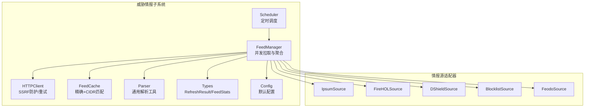
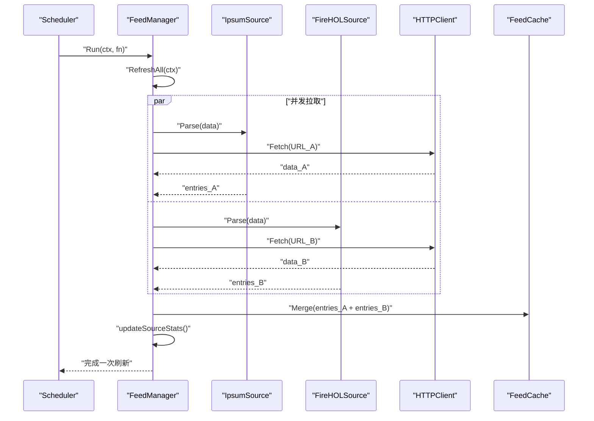
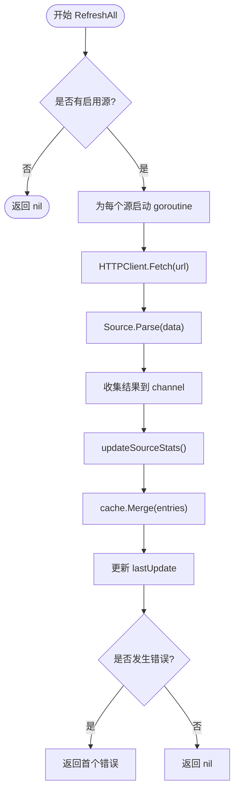
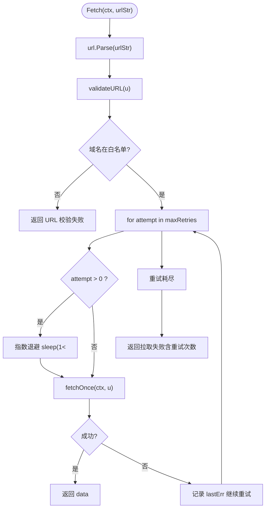
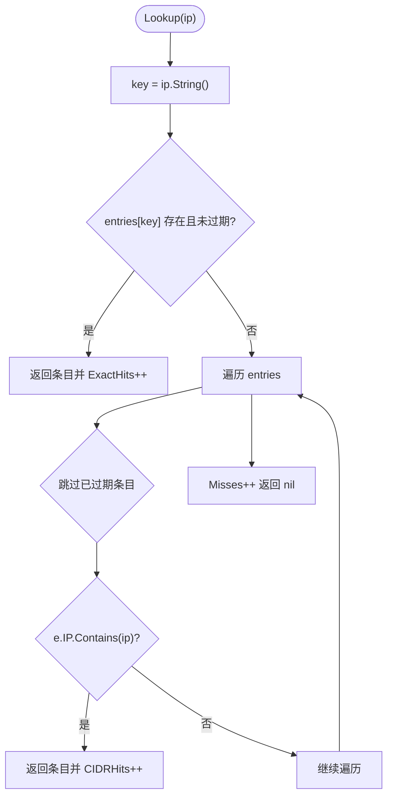
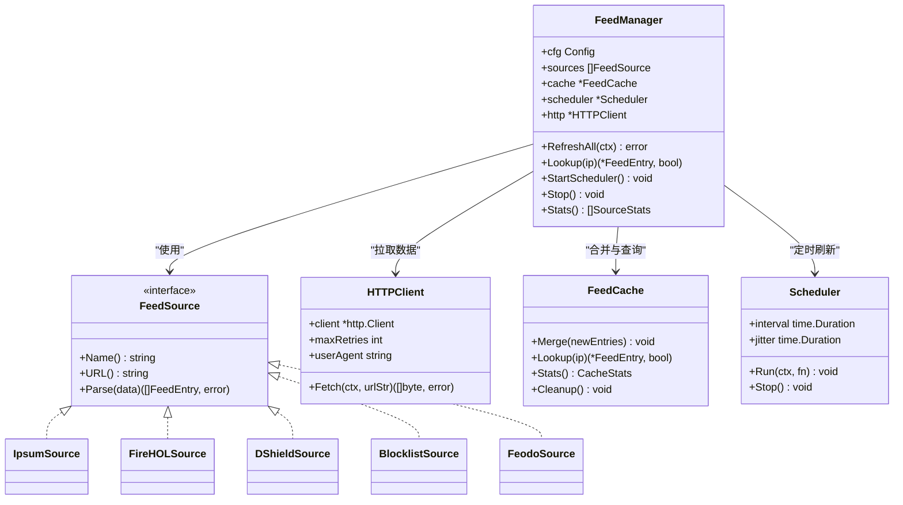

# 威胁情报聚合

<cite>
**本文引用的文件**   
- [manager.go](file://src/daemon/internal/threatfeeds/manager.go)
- [scheduler.go](file://src/daemon/internal/threatfeeds/scheduler.go)
- [parser.go](file://src/daemon/internal/threatfeeds/parser.go)
- [cache.go](file://src/daemon/internal/threatfeeds/cache.go)
- [types.go](file://src/daemon/internal/threatfeeds/types.go)
- [config.go](file://src/daemon/internal/threatfeeds/config.go)
- [http.go](file://src/daemon/internal/threatfeeds/http.go)
- [ipsum.go](file://src/daemon/internal/threatfeeds/sources/ipsum.go)
- [firehol.go](file://src/daemon/internal/threatfeeds/sources/firehol.go)
- [dshield.go](file://src/daemon/internal/threatfeeds/sources/dshield.go)
- [blocklist.go](file://src/daemon/internal/threatfeeds/sources/blocklist.go)
- [feodo.go](file://src/daemon/internal/threatfeeds/sources/feodo.go)
</cite>

## 目录
1. [引言](#引言)
2. [项目结构](#项目结构)
3. [核心组件](#核心组件)
4. [架构总览](#架构总览)
5. [详细组件分析](#详细组件分析)
6. [依赖关系分析](#依赖关系分析)
7. [性能与可扩展性](#性能与可扩展性)
8. [故障排查指南](#故障排查指南)
9. [结论](#结论)
10. [附录：自定义情报源开发指南](#附录自定义情报源开发指南)

## 引言
本系统实现了一个面向 Linux 防火墙内核模块的威胁情报聚合子系统，负责从多个外部情报源拉取 IP/CIDR 黑名单，解析为统一的数据模型，合并到内存缓存，并通过调度器周期性刷新。其设计目标包括：
- 并发拉取：多源并行刷新，整体耗时取决于最慢源。
- 错误隔离：单个源失败不影响其他源。
- 性能隔离：后台 goroutine 更新，不阻塞主判定链路。
- 可观测：每个源的状态、错误、条目数可查询。
- 安全：通过域名白名单、禁止自动重定向、HTTPS 强制等机制防护 SSRF。
- 增量更新：基于过期时间（ExpiresAt）和原子合并策略，避免全量重建锁竞争。

该子系统位于守护进程内部，作为威胁情报数据管道的一部分，向上层风险引擎或封禁决策提供高可用的 IP 命中能力。

## 项目结构
威胁情报相关代码集中在守护进程的 threatfeeds 包及其 sources 子包中，主要文件职责如下：
- manager.go：协调所有源的拉取、解析、统计与缓存合并，暴露查询接口。
- scheduler.go：定时调度器，支持抖动防惊群与优雅停止。
- http.go：HTTP 客户端封装，包含 SSRF 防护、重试与超时控制。
- cache.go：内存缓存，支持精确匹配与 CIDR 匹配，带过期清理与统计。
- parser.go：通用解析工具，如注释剥离、IP/CIDR 列表解析。
- types.go：基础类型定义，如 RefreshResult、FeedStats。
- config.go：配置结构与默认值，内置推荐源。
- sources/*.go：各情报源适配器实现，统一 FeedSource 接口。



**图表来源**
- [manager.go:20-90](file://src/daemon/internal/threatfeeds/manager.go#L20-L90)
- [scheduler.go:10-33](file://src/daemon/internal/threatfeeds/scheduler.go#L10-L33)
- [http.go:23-49](file://src/daemon/internal/threatfeeds/http.go#L23-L49)
- [cache.go:9-42](file://src/daemon/internal/threatfeeds/cache.go#L9-L42)
- [parser.go:11-23](file://src/daemon/internal/threatfeeds/parser.go#L11-L23)
- [types.go:14-38](file://src/daemon/internal/threatfeeds/types.go#L14-L38)
- [config.go:19-31](file://src/daemon/internal/threatfeeds/config.go#L19-L31)
- [ipsum.go:21-26](file://src/daemon/internal/threatfeeds/sources/ipsum.go#L21-L26)
- [firehol.go:5-15](file://src/daemon/internal/threatfeeds/sources/firehol.go#L5-L15)
- [dshield.go:66-76](file://src/daemon/internal/threatfeeds/sources/dshield.go#L66-L76)
- [blocklist.go:5-15](file://src/daemon/internal/threatfeeds/sources/blocklist.go#L5-L15)
- [feodo.go:60-70](file://src/daemon/internal/threatfeeds/sources/feodo.go#L60-L70)

**章节来源**
- [manager.go:20-90](file://src/daemon/internal/threatfeeds/manager.go#L20-L90)
- [scheduler.go:10-33](file://src/daemon/internal/threatfeeds/scheduler.go#L10-L33)
- [http.go:23-49](file://src/daemon/internal/threatfeeds/http.go#L23-L49)
- [cache.go:9-42](file://src/daemon/internal/threatfeeds/cache.go#L9-L42)
- [parser.go:11-23](file://src/daemon/internal/threatfeeds/parser.go#L11-L23)
- [types.go:14-38](file://src/daemon/internal/threatfeeds/types.go#L14-L38)
- [config.go:19-31](file://src/daemon/internal/threatfeeds/config.go#L19-L31)

## 核心组件
- FeedManager：管理所有情报源的构建、并发拉取、结果聚合、缓存合并、统计更新与调度集成。
- Scheduler：按间隔触发刷新，加入随机抖动防止多实例同时拉取；支持 context 取消与 Stop。
- HTTPClient：封装带超时的 HTTP 请求，支持指数退避重试；严格校验 URL 协议与域名白名单，禁止自动重定向。
- FeedCache：内存缓存，支持精确 IP 与 CIDR 匹配；原子 Merge 减少写锁持有时间；过期清理与统计。
- Parser：通用解析工具，处理注释行、空行、IP/CIDR 格式转换。
- Types：RefreshResult、FeedStats 等基础数据结构。
- Config：配置结构体与默认值，内置推荐源（IPsum、FireHOL Level 1）。
- Sources 适配器：IpsumSource、FireHOLSource、DShieldSource、BlocklistSource、FeodoSource，统一实现 FeedSource 接口。

**章节来源**
- [manager.go:20-90](file://src/daemon/internal/threatfeeds/manager.go#L20-L90)
- [scheduler.go:10-33](file://src/daemon/internal/threatfeeds/scheduler.go#L10-L33)
- [http.go:23-49](file://src/daemon/internal/threatfeeds/http.go#L23-L49)
- [cache.go:9-42](file://src/daemon/internal/threatfeeds/cache.go#L9-L42)
- [parser.go:11-23](file://src/daemon/internal/threatfeeds/parser.go#L11-L23)
- [types.go:14-38](file://src/daemon/internal/threatfeeds/types.go#L14-L38)
- [config.go:19-31](file://src/daemon/internal/threatfeeds/config.go#L19-L31)
- [ipsum.go:21-26](file://src/daemon/internal/threatfeeds/sources/ipsum.go#L21-L26)

## 架构总览
下图展示威胁情报子系统在守护进程中的整体交互流程：调度器定时触发管理器，管理器并发调用各源适配器进行拉取与解析，结果合并到缓存，并更新统计信息。



**图表来源**
- [scheduler.go:35-64](file://src/daemon/internal/threatfeeds/scheduler.go#L35-L64)
- [manager.go:111-154](file://src/daemon/internal/threatfeeds/manager.go#L111-L154)
- [http.go:72-102](file://src/daemon/internal/threatfeeds/http.go#L72-L102)
- [cache.go:44-82](file://src/daemon/internal/threatfeeds/cache.go#L44-L82)
- [ipsum.go:99-103](file://src/daemon/internal/threatfeeds/sources/ipsum.go#L99-L103)
- [firehol.go:23-27](file://src/daemon/internal/threatfeeds/sources/firehol.go#L23-L27)

## 详细组件分析

### FeedManager：并发拉取与聚合
- 构建阶段：根据配置创建各源适配器，初始化缓存、HTTP 客户端、调度器与统计映射。
- 刷新阶段：对每个源启动 goroutine 并发拉取，使用 channel 收集结果；记录首个错误但不中断其他源。
- 统计阶段：更新每个源的刷新次数、错误计数、最后更新时间与条目数量。
- 查询阶段：对外暴露 Lookup(ip)，委托给缓存执行精确与 CIDR 匹配。
- 生命周期：StartScheduler 启动后台定时任务；Stop 关闭调度器并取消上下文。



**图表来源**
- [manager.go:111-154](file://src/daemon/internal/threatfeeds/manager.go#L111-L154)
- [manager.go:157-184](file://src/daemon/internal/threatfeeds/manager.go#L157-L184)
- [manager.go:186-205](file://src/daemon/internal/threatfeeds/manager.go#L186-L205)

**章节来源**
- [manager.go:54-90](file://src/daemon/internal/threatfeeds/manager.go#L54-L90)
- [manager.go:111-154](file://src/daemon/internal/threatfeeds/manager.go#L111-L154)
- [manager.go:157-205](file://src/daemon/internal/threatfeeds/manager.go#L157-L205)
- [manager.go:212-225](file://src/daemon/internal/threatfeeds/manager.go#L212-L225)

### Scheduler：定时调度与抖动防惊群
- Run：首次立即触发，随后使用 time.Ticker 与 time.After 组合，支持 context 取消与 Stop 信号。
- calculateJitter：在 interval ± jitter 范围内生成随机延迟，避免多实例同时拉取导致雪崩。
- Interval/Jitter：暴露配置参数供监控与诊断。

```mermaid
flowchart TD
Start(["Run(ctx, fn)"]) --> FirstCall["fn() 立即触发"]
FirstCall --> Ticker["time.NewTicker(interval)"]
Ticker --> Loop{"select 等待"}
Loop --> |time.After(delay)| Trigger["fn() 触发刷新"]
Loop --> |ticker.C| Trigger
Loop --> |stopCh| Stop["Stop() 关闭 stopCh"]
Loop --> |ctx.Done| Exit["context 取消退出"]
Trigger --> Loop
Stop --> End(["结束"])
Exit --> End
```

**图表来源**
- [scheduler.go:35-64](file://src/daemon/internal/threatfeeds/scheduler.go#L35-L64)
- [scheduler.go:73-83](file://src/daemon/internal/threatfeeds/scheduler.go#L73-L83)

**章节来源**
- [scheduler.go:10-33](file://src/daemon/internal/threatfeeds/scheduler.go#L10-L33)
- [scheduler.go:35-64](file://src/daemon/internal/threatfeeds/scheduler.go#L35-L64)
- [scheduler.go:73-83](file://src/daemon/internal/threatfeeds/scheduler.go#L73-L83)

### HTTPClient：SSRF 防护与重试
- validateURL：仅允许 HTTPS 协议，且域名必须在白名单中；移除端口后比对。
- CheckRedirect：禁止自动跟随重定向，最多允许 3 次手动检查；每次跳转都校验 URL。
- Fetch：指数退避重试（1s, 2s, 4s），支持 context 取消；读取响应体并返回字节数组。
- isPrivateAddr：辅助函数用于私有/回环地址检测（当前未直接用于拦截，但可用于扩展）。



**图表来源**
- [http.go:51-65](file://src/daemon/internal/threatfeeds/http.go#L51-L65)
- [http.go:72-102](file://src/daemon/internal/threatfeeds/http.go#L72-L102)
- [http.go:104-128](file://src/daemon/internal/threatfeeds/http.go#L104-L128)

**章节来源**
- [http.go:23-49](file://src/daemon/internal/threatfeeds/http.go#L23-L49)
- [http.go:51-65](file://src/daemon/internal/threatfeeds/http.go#L51-L65)
- [http.go:72-102](file://src/daemon/internal/threatfeeds/http.go#L72-L102)
- [http.go:104-128](file://src/daemon/internal/threatfeeds/http.go#L104-L128)

### FeedCache：原子合并与精确+CIDR 匹配
- Merge：先复制未过期的旧条目到新 map，再添加新条目，最后原子替换；更新 TotalEntries 与 LastUpdate。
- Lookup：先精确匹配 IP.String()，若命中且未过期则返回；否则遍历所有条目进行 CIDR 匹配。
- Stats：返回缓存统计（TotalEntries、ActiveEntries、ExactHits、CIDRHits、Misses、LastUpdate）。
- Cleanup：删除已过期条目，更新统计。



**图表来源**
- [cache.go:44-82](file://src/daemon/internal/threatfeeds/cache.go#L44-L82)
- [cache.go:84-115](file://src/daemon/internal/threatfeeds/cache.go#L84-L115)
- [cache.go:152-165](file://src/daemon/internal/threatfeeds/cache.go#L152-L165)

**章节来源**
- [cache.go:9-42](file://src/daemon/internal/threatfeeds/cache.go#L9-L42)
- [cache.go:44-82](file://src/daemon/internal/threatfeeds/cache.go#L44-L82)
- [cache.go:84-115](file://src/daemon/internal/threatfeeds/cache.go#L84-L115)
- [cache.go:117-173](file://src/daemon/internal/threatfeeds/cache.go#L117-L173)

### Parser：通用解析工具
- StripComments：移除行首 # 注释。
- ParseIPList：逐行扫描，忽略空行与注释行，尝试解析为 CIDR 或单 IP，转换为统一 FeedEntry。

**章节来源**
- [parser.go:11-23](file://src/daemon/internal/threatfeeds/parser.go#L11-L23)
- [parser.go:20-79](file://src/daemon/internal/threatfeeds/parser.go#L20-L79)

### 类型与配置
- RefreshResult：包含 Source、Entries、Err、Duration。
- FeedStats：包含 Source、LastUpdate、EntryCount、Error、Enabled。
- Config：包含 Enabled、RefreshInterval、HTTPTimeout、MaxRetries、Sources。
- DefaultConfig：内置推荐源（IPsum、FireHOL Level 1），默认启用；其他源可选。

**章节来源**
- [types.go:14-38](file://src/daemon/internal/threatfeeds/types.go#L14-L38)
- [config.go:19-31](file://src/daemon/internal/threatfeeds/config.go#L19-L31)
- [config.go:33-81](file://src/daemon/internal/threatfeeds/config.go#L33-L81)

## 依赖关系分析
- FeedManager 依赖：
  - sources.FeedSource 接口与各具体适配器（IpsumSource、FireHOLSource、DShieldSource、BlocklistSource、FeodoSource）。
  - HTTPClient 用于网络拉取。
  - FeedCache 用于存储与查询。
  - Scheduler 用于定时刷新。
  - Config 用于构建与启停源。
- 各适配器均实现 FeedSource 接口，统一 Name、URL、Parse 方法。
- HTTPClient 依赖域名白名单与 URL 校验逻辑，确保 SSRF 防护。



**图表来源**
- [manager.go:20-90](file://src/daemon/internal/threatfeeds/manager.go#L20-L90)
- [ipsum.go:21-26](file://src/daemon/internal/threatfeeds/sources/ipsum.go#L21-L26)
- [firehol.go:5-15](file://src/daemon/internal/threatfeeds/sources/firehol.go#L5-L15)
- [dshield.go:66-76](file://src/daemon/internal/threatfeeds/sources/dshield.go#L66-L76)
- [blocklist.go:5-15](file://src/daemon/internal/threatfeeds/sources/blocklist.go#L5-L15)
- [feodo.go:60-70](file://src/daemon/internal/threatfeeds/sources/feodo.go#L60-L70)
- [http.go:23-49](file://src/daemon/internal/threatfeeds/http.go#L23-L49)
- [cache.go:9-42](file://src/daemon/internal/threatfeeds/cache.go#L9-L42)
- [scheduler.go:10-33](file://src/daemon/internal/threatfeeds/scheduler.go#L10-L33)

**章节来源**
- [manager.go:20-90](file://src/daemon/internal/threatfeeds/manager.go#L20-L90)
- [ipsum.go:21-26](file://src/daemon/internal/threatfeeds/sources/ipsum.go#L21-L26)
- [firehol.go:5-15](file://src/daemon/internal/threatfeeds/sources/firehol.go#L5-L15)
- [dshield.go:66-76](file://src/daemon/internal/threatfeeds/sources/dshield.go#L66-L76)
- [blocklist.go:5-15](file://src/daemon/internal/threatfeeds/sources/blocklist.go#L5-L15)
- [feodo.go:60-70](file://src/daemon/internal/threatfeeds/sources/feodo.go#L60-L70)
- [http.go:23-49](file://src/daemon/internal/threatfeeds/http.go#L23-L49)
- [cache.go:9-42](file://src/daemon/internal/threatfeeds/cache.go#L9-L42)
- [scheduler.go:10-33](file://src/daemon/internal/threatfeeds/scheduler.go#L10-L33)

## 性能与可扩展性
- 并发拉取：每个源独立 goroutine，总耗时取决于最慢源；适合多源并行场景。
- 原子合并：FeedCache.Merge 构建新 map 后一次性替换，避免长时间持锁，降低读放大。
- 精确+CIDR 匹配：优先精确命中，其次遍历 CIDR；在高命中率场景下性能较好。
- 抖动防惊群：Scheduler.calculateJitter 引入随机延迟，避免多实例同时拉取造成上游压力。
- 指数退避重试：HTTPClient.Fetch 使用 1s、2s、4s 退避，提升网络不稳定时的成功率。
- 可扩展性：新增情报源只需实现 FeedSource 接口并在 Manager.buildSource 中注册名称映射。

[本节为一般性指导，无需特定文件引用]

## 故障排查指南
- 拉取失败：
  - 检查 URL 是否在域名白名单中；非 HTTPS 或非白名单域名会被拒绝。
  - 查看重试日志与最后一次错误；确认网络连通性与上游服务状态。
- 解析失败：
  - 确认数据格式是否符合适配器预期（纯 IP/CIDR、TSV、CSV）。
  - 检查行内注释与表头处理逻辑是否正确。
- 缓存命中异常：
  - 检查 ExpiresAt 是否过期；必要时调用 Cleanup 清理过期条目。
  - 观察 ExactHits、CIDRHits、Misses 统计以定位匹配路径。
- 调度问题：
  - 确认 Scheduler.interval 与 jitter 配置合理；避免抖动过大导致刷新不及时。
  - 检查 context 是否被提前取消；Stop 是否被调用。

**章节来源**
- [http.go:51-65](file://src/daemon/internal/threatfeeds/http.go#L51-L65)
- [http.go:72-102](file://src/daemon/internal/threatfeeds/http.go#L72-L102)
- [cache.go:84-115](file://src/daemon/internal/threatfeeds/cache.go#L84-L115)
- [cache.go:152-165](file://src/daemon/internal/threatfeeds/cache.go#L152-L165)
- [scheduler.go:35-64](file://src/daemon/internal/threatfeeds/scheduler.go#L35-L64)

## 结论
威胁情报聚合子系统通过并发拉取、原子合并、精确+CIDR 匹配与抖动调度，实现了高可用、高性能的情报数据处理管道。HTTP 层的 SSRF 防护与重试机制提升了安全性与鲁棒性。各情报源适配器遵循统一接口，便于扩展与维护。建议在生产环境中启用高质量源（如 IPsum、FireHOL Level 1），并根据业务需求调整置信度与分类。

[本节为总结性内容，无需特定文件引用]

## 附录：自定义情报源开发指南
- 实现 FeedSource 接口：
  - Name：返回唯一标识（如 "myfeed"）。
  - URL：返回拉取地址（需为 HTTPS 且在白名单中）。
  - Parse：将原始数据解析为 []FeedEntry，设置 Source、Category、Confidence、ExpiresAt。
- 注册到 Manager：
  - 在 Manager.buildSource 中添加 case 分支，映射名称到 NewXxxSource。
- 配置：
  - 在 Config.Sources 中添加 SourceConfig，设置 name、url、enabled、category、confidence。
- 测试：
  - 准备样例数据（testdata），验证 Parse 正确性。
  - 使用 FeedCache.Lookup 验证命中行为。

**章节来源**
- [ipsum.go:21-26](file://src/daemon/internal/threatfeeds/sources/ipsum.go#L21-L26)
- [manager.go:93-109](file://src/daemon/internal/threatfeeds/manager.go#L93-L109)
- [config.go:5-17](file://src/daemon/internal/threatfeeds/config.go#L5-L17)