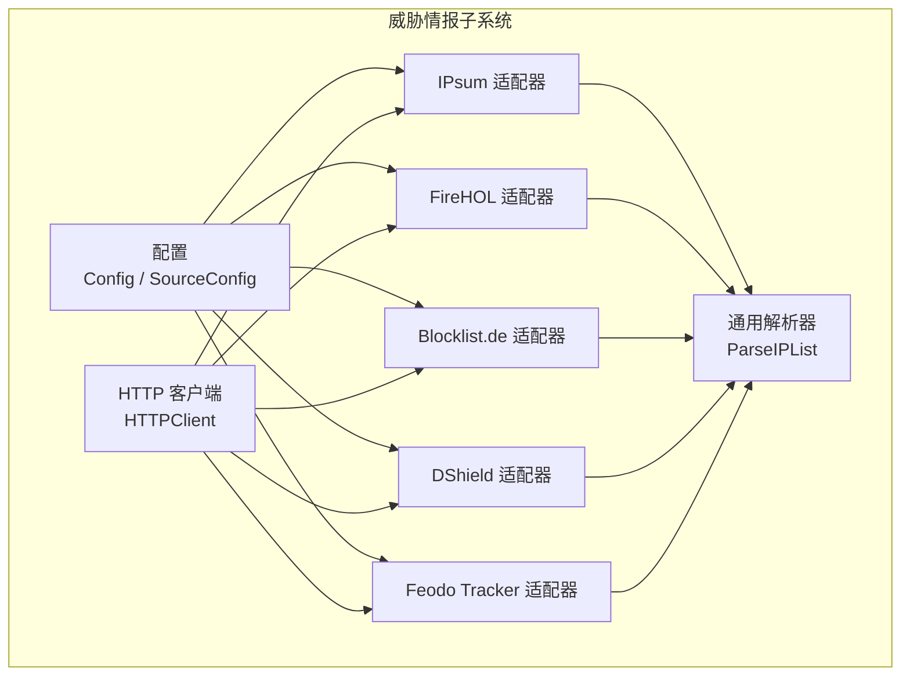
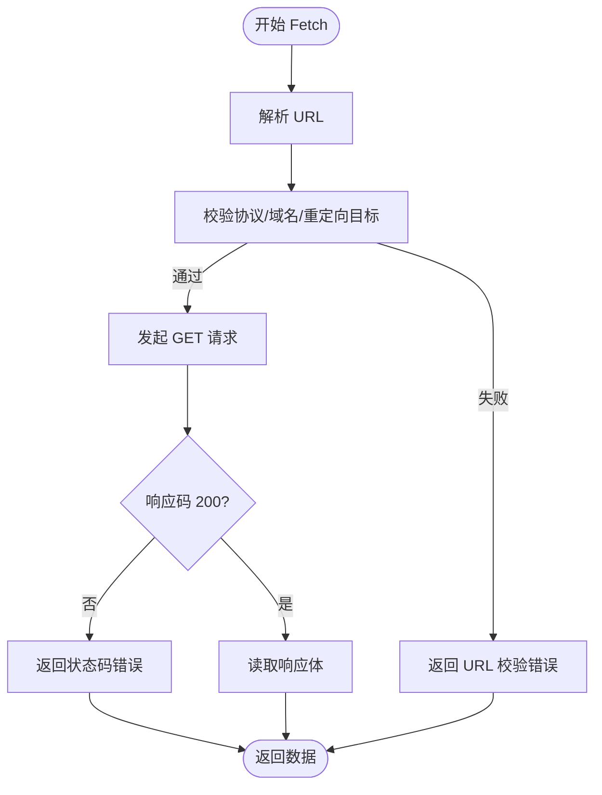
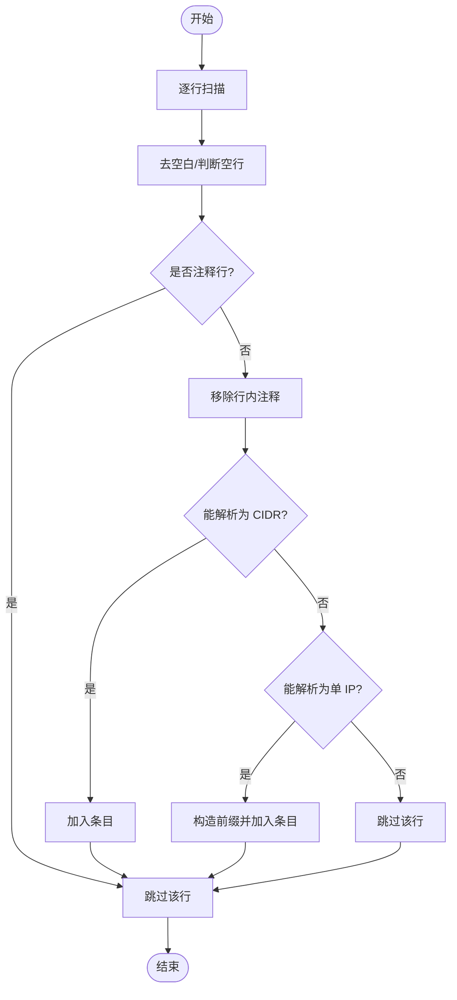
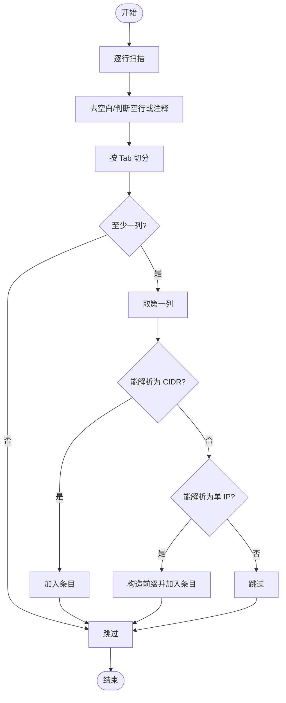
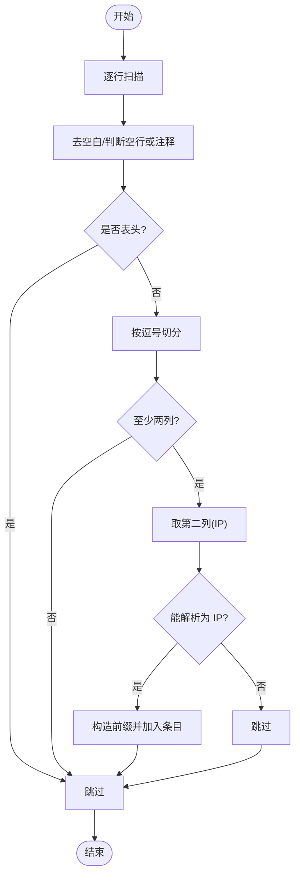
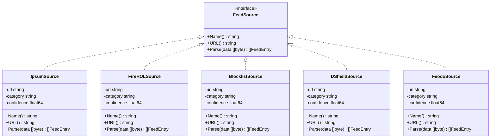
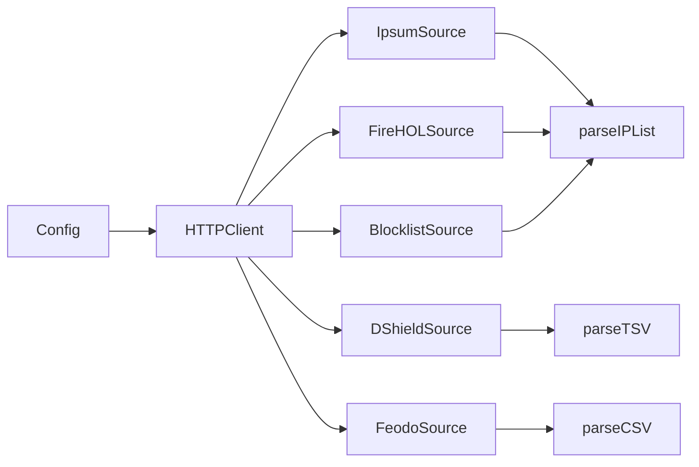

# 情报源适配器

<cite>
**本文引用的文件**   
- [types.go](file://src/daemon/internal/threatfeeds/types.go)
- [parser.go](file://src/daemon/internal/threatfeeds/parser.go)
- [http.go](file://src/daemon/internal/threatfeeds/http.go)
- [config.go](file://src/daemon/internal/threatfeeds/config.go)
- [ipsum.go](file://src/daemon/internal/threatfeeds/sources/ipsum.go)
- [blocklist.go](file://src/daemon/internal/threatfeeds/sources/blocklist.go)
- [dshield.go](file://src/daemon/internal/threatfeeds/sources/dshield.go)
- [feodo.go](file://src/daemon/internal/threatfeeds/sources/feodo.go)
- [firehol.go](file://src/daemon/internal/threatfeeds/sources/firehol.go)
- [blocklist.txt](file://src/daemon/internal/threatfeeds/sources/testdata/blocklist.txt)
- [dshield.txt](file://src/daemon/internal/threatfeeds/sources/testdata/dshield.txt)
- [feodo.csv](file://src/daemon/internal/threatfeeds/sources/testdata/feodo.csv)
- [firehol.txt](file://src/daemon/internal/threatfeeds/sources/testdata/firehol.txt)
- [ipsum.txt](file://src/daemon/internal/threatfeeds/sources/testdata/ipsum.txt)
</cite>

## 目录
1. [简介](#简介)
2. [项目结构](#项目结构)
3. [核心组件](#核心组件)
4. [架构总览](#架构总览)
5. [详细组件分析](#详细组件分析)
6. [依赖关系分析](#依赖关系分析)
7. [性能与可靠性](#性能与可靠性)
8. [自定义情报源开发指南](#自定义情报源开发指南)
9. [故障排查](#故障排查)
10. [结论](#结论)

## 简介
本文件面向“威胁情报源适配器”子系统，系统性梳理 Blocklist、DShield、Feodo、FireHOL、IPsum 等情报源的适配逻辑、数据格式解析规则、HTTP 拉取与安全策略、错误处理与重试机制，并给出自定义情报源的开发规范与测试方法。目标是帮助开发者快速理解现有实现，安全地扩展新的情报源。

## 项目结构
威胁情报子系统位于守护进程内部模块中，主要包含：
- 通用类型与配置：统一的数据模型、默认配置与启用源过滤
- HTTP 客户端：带白名单校验、HTTPS 强制、重定向限制、指数退避重试
- 解析器：纯 IP/CIDR 列表的通用解析工具
- 各情报源适配器：针对不同数据格式的专用解析逻辑
- 测试数据：用于验证解析器的样例文件



图表来源
- [config.go:5-31](file://src/daemon/internal/threatfeeds/config.go#L5-L31)
- [http.go:23-49](file://src/daemon/internal/threatfeeds/http.go#L23-L49)
- [ipsum.go:81-103](file://src/daemon/internal/threatfeeds/sources/ipsum.go#L81-L103)
- [firehol.go:5-27](file://src/daemon/internal/threatfeeds/sources/firehol.go#L5-L27)
- [blocklist.go:5-27](file://src/daemon/internal/threatfeeds/sources/blocklist.go#L5-L27)
- [dshield.go:66-88](file://src/daemon/internal/threatfeeds/sources/dshield.go#L66-L88)
- [feodo.go:60-82](file://src/daemon/internal/threatfeeds/sources/feodo.go#L60-L82)

章节来源
- [config.go:5-31](file://src/daemon/internal/threatfeeds/config.go#L5-L31)
- [http.go:23-49](file://src/daemon/internal/threatfeeds/http.go#L23-L49)

## 核心组件
- 统一数据模型
  - FeedEntry：单条情报记录，包含 IP（支持 CIDR）、来源、分类、置信度、过期时间
  - RefreshResult：单次刷新结果，包含条目、错误、耗时
  - FeedStats：源级统计信息，包含更新时间、条目数、错误、是否启用
- 配置模型
  - Config：全局开关、刷新间隔、HTTP 超时、重试次数、源列表
  - SourceConfig：单个源的名称、URL、启用状态、默认分类与置信度
- HTTP 客户端
  - 域名白名单、仅 HTTPS、禁止自动跟随重定向、指数退避重试、User-Agent 固定
- 通用解析器
  - ParseIPList：逐行解析 IP 或 CIDR，忽略注释与空行，支持行内注释

章节来源
- [types.go:14-38](file://src/daemon/internal/threatfeeds/types.go#L14-L38)
- [config.go:5-31](file://src/daemon/internal/threatfeeds/config.go#L5-L31)
- [http.go:14-49](file://src/daemon/internal/threatfeeds/http.go#L14-L49)
- [parser.go:11-79](file://src/daemon/internal/threatfeeds/parser.go#L11-L79)

## 架构总览
整体流程：配置驱动 -> 按源并发拉取 -> 各自解析 -> 聚合为统一条目 -> 缓存与观测。

```mermaid
sequenceDiagram
participant Cfg as "配置层<br/>Config"
participant HTTP as "HTTP 客户端<br/>HTTPClient"
participant Src as "具体源适配器<br/>FeedSource"
participant Par as "解析器<br/>parseIPList/TSV/CSV"
participant Out as "输出<br/>[]FeedEntry"
Cfg->>Src : 提供 URL/分类/置信度
Src->>HTTP : Fetch(HTTPS, 白名单校验)
HTTP-->>Src : 返回原始字节
Src->>Par : 调用对应解析函数
Par-->>Src : 返回 []FeedEntry
Src-->>Cfg : 返回解析结果
```

图表来源
- [config.go:33-80](file://src/daemon/internal/threatfeeds/config.go#L33-L80)
- [http.go:72-128](file://src/daemon/internal/threatfeeds/http.go#L72-L128)
- [ipsum.go:28-79](file://src/daemon/internal/threatfeeds/sources/ipsum.go#L28-L79)
- [dshield.go:11-64](file://src/daemon/internal/threatfeeds/sources/dshield.go#L11-L64)
- [feodo.go:11-58](file://src/daemon/internal/threatfeeds/sources/feodo.go#L11-L58)

## 详细组件分析

### 通用数据模型与配置
- FeedEntry
  - 字段：IP（netip.Prefix）、Source、Category、Confidence、ExpiresAt
  - 设计要点：统一以网段表示，IPv4/IPv6 自动补前缀位
- RefreshResult / FeedStats
  - 用于上层调度与可观测性（成功/失败、耗时、条目计数）
- Config / SourceConfig
  - 默认启用 IPsum 与 FireHOL Level 1；其他源可选
  - 提供 EnabledSources() 过滤已启用源

章节来源
- [ipsum.go:12-19](file://src/daemon/internal/threatfeeds/sources/ipsum.go#L12-L19)
- [types.go:14-38](file://src/daemon/internal/threatfeeds/types.go#L14-L38)
- [config.go:5-31](file://src/daemon/internal/threatfeeds/config.go#L5-L31)
- [config.go:33-80](file://src/daemon/internal/threatfeeds/config.go#L33-L80)
- [config.go:83-92](file://src/daemon/internal/threatfeeds/config.go#L83-L92)

### HTTP 客户端与安全策略
- 域名白名单：仅允许已知情报源域名
- 协议限制：仅 HTTPS
- 重定向控制：禁止自动跟随，最多 3 次重定向即报错
- 私有地址检查：在重定向校验时拒绝回环/私有/链路本地地址
- 重试策略：指数退避（1s、2s、4s），受上下文取消控制
- 请求头：固定 User-Agent，Accept 接受文本/CSV



图表来源
- [http.go:51-65](file://src/daemon/internal/threatfeeds/http.go#L51-L65)
- [http.go:72-128](file://src/daemon/internal/threatfeeds/http.go#L72-L128)

章节来源
- [http.go:14-49](file://src/daemon/internal/threatfeeds/http.go#L14-L49)
- [http.go:51-65](file://src/daemon/internal/threatfeeds/http.go#L51-L65)
- [http.go:72-128](file://src/daemon/internal/threatfeeds/http.go#L72-L128)

### 通用解析器（纯 IP/CIDR 列表）
- 行为
  - 忽略空行与以 # 开头的注释行
  - 支持行内注释（# 之后内容丢弃）
  - 优先尝试 CIDR 解析，失败再尝试单 IP 解析
  - IPv6 单 IP 自动转换为 /128，IPv4 为 /32
- 复杂度
  - 时间 O(N)，空间 O(M)（M 为有效条目数）



图表来源
- [parser.go:11-79](file://src/daemon/internal/threatfeeds/parser.go#L11-L79)

章节来源
- [parser.go:11-79](file://src/daemon/internal/threatfeeds/parser.go#L11-L79)

### IPsum 适配器
- 数据格式：纯 IP 列表（每行一个 IP 或 CIDR），支持注释
- 解析逻辑：复用通用 parseIPList
- 过期时间：当前时间 + 25 小时
- 默认分类与置信度：由配置注入

章节来源
- [ipsum.go:28-79](file://src/daemon/internal/threatfeeds/sources/ipsum.go#L28-L79)
- [ipsum.go:81-103](file://src/daemon/internal/threatfeeds/sources/ipsum.go#L81-L103)
- [ipsum.txt](file://src/daemon/internal/threatfeeds/sources/testdata/ipsum.txt)

### FireHOL 适配器
- 数据格式：纯 IP/CIDR 列表（Level 1），支持注释
- 解析逻辑：复用通用 parseIPList
- 过期时间：当前时间 + 25 小时

章节来源
- [firehol.go:5-27](file://src/daemon/internal/threatfeeds/sources/firehol.go#L5-L27)
- [firehol.txt](file://src/daemon/internal/threatfeeds/sources/testdata/firehol.txt)

### Blocklist.de 适配器
- 数据格式：纯 IP 列表，支持注释
- 解析逻辑：复用通用 parseIPList
- 过期时间：当前时间 + 2 小时（更短，适合高频更新源）

章节来源
- [blocklist.go:5-27](file://src/daemon/internal/threatfeeds/sources/blocklist.go#L5-L27)
- [blocklist.txt](file://src/daemon/internal/threatfeeds/sources/testdata/blocklist.txt)

### DShield 适配器
- 数据格式：TSV（Tab 分隔），首列为起始 IP（可为 CIDR 或单 IP）
- 解析逻辑：逐行按 Tab 切分，取第一列进行 IP/CIDR 解析
- 过期时间：当前时间 + 25 小时



图表来源
- [dshield.go:11-64](file://src/daemon/internal/threatfeeds/sources/dshield.go#L11-L64)

章节来源
- [dshield.go:11-64](file://src/daemon/internal/threatfeeds/sources/dshield.go#L11-L64)
- [dshield.go:66-88](file://src/daemon/internal/threatfeeds/sources/dshield.go#L66-L88)
- [dshield.txt](file://src/daemon/internal/threatfeeds/sources/testdata/dshield.txt)

### Feodo Tracker 适配器
- 数据格式：CSV，表头含 First seen, IP address, Port, Domain, Malware, Status
- 解析逻辑：跳过表头与注释行，取第二列（IP address）进行解析
- 过期时间：当前时间 + 25 小时



图表来源
- [feodo.go:11-58](file://src/daemon/internal/threatfeeds/sources/feodo.go#L11-L58)

章节来源
- [feodo.go:11-58](file://src/daemon/internal/threatfeeds/sources/feodo.go#L11-L58)
- [feodo.go:60-82](file://src/daemon/internal/threatfeeds/sources/feodo.go#L60-L82)
- [feodo.csv](file://src/daemon/internal/threatfeeds/sources/testdata/feodo.csv)

### 适配器接口与类图
所有适配器均实现统一的 FeedSource 接口，便于统一调度与替换。



图表来源
- [ipsum.go:21-26](file://src/daemon/internal/threatfeeds/sources/ipsum.go#L21-L26)
- [ipsum.go:81-103](file://src/daemon/internal/threatfeeds/sources/ipsum.go#L81-L103)
- [firehol.go:5-27](file://src/daemon/internal/threatfeeds/sources/firehol.go#L5-L27)
- [blocklist.go:5-27](file://src/daemon/internal/threatfeeds/sources/blocklist.go#L5-L27)
- [dshield.go:66-88](file://src/daemon/internal/threatfeeds/sources/dshield.go#L66-L88)
- [feodo.go:60-82](file://src/daemon/internal/threatfeeds/sources/feodo.go#L60-L82)

## 依赖关系分析
- 配置层依赖：无外部依赖，提供默认源与开关
- HTTP 客户端依赖：标准库 net/http，使用上下文控制超时与取消
- 适配器依赖：
  - IPsum/FireHOL/Blocklist：依赖通用 parseIPList
  - DShield：依赖 TSV 解析
  - Feodo：依赖 CSV 解析（跳过表头）
- 安全边界：域名白名单 + HTTPS 强制 + 重定向校验



图表来源
- [config.go:33-80](file://src/daemon/internal/threatfeeds/config.go#L33-L80)
- [http.go:72-128](file://src/daemon/internal/threatfeeds/http.go#L72-L128)
- [ipsum.go:28-79](file://src/daemon/internal/threatfeeds/sources/ipsum.go#L28-L79)
- [dshield.go:11-64](file://src/daemon/internal/threatfeeds/sources/dshield.go#L11-L64)
- [feodo.go:11-58](file://src/daemon/internal/threatfeeds/sources/feodo.go#L11-L58)

章节来源
- [config.go:33-80](file://src/daemon/internal/threatfeeds/config.go#L33-L80)
- [http.go:72-128](file://src/daemon/internal/threatfeeds/http.go#L72-L128)

## 性能与可靠性
- 性能
  - 解析器基于流式 Scanner，内存占用低，时间复杂度线性
  - 各源解析互不阻塞，适合并发调度
- 可靠性
  - HTTP 层具备指数退避重试，避免瞬时抖动导致失败
  - 域名白名单与 HTTPS 强制降低 SSRF 风险
  - 重定向限制防止恶意跳转
- 建议
  - 合理设置 MaxRetries 与 HTTPTimeout，平衡成功率与延迟
  - 对高频更新源（如 Blocklist.de）缩短过期时间，提高时效性

[本节为通用指导，不涉及具体文件分析]

## 自定义情报源开发指南

### 接口定义
- 必须实现 FeedSource 接口：
  - Name() string：返回唯一源名
  - URL() string：返回拉取地址（需满足 HTTPS 与域名白名单）
  - Parse(data []byte) ([]FeedEntry, error)：将原始字节解析为统一条目

章节来源
- [ipsum.go:21-26](file://src/daemon/internal/threatfeeds/sources/ipsum.go#L21-L26)

### 实现规范
- 数据格式
  - 若为纯 IP/CIDR 列表：直接复用 parseIPList
  - 若为 TSV/CSV：参考 parseTSV/parseCSV 的实现风格，注意跳过注释与表头
- 过期时间
  - 根据源更新频率设定 ExpiresAt（例如 2 小时或 25 小时）
- 分类与置信度
  - 从配置注入 Category 与 Confidence，保持语义一致
- 安全
  - URL 必须为 HTTPS，且域名需在白名单中
  - 避免引入任意重定向

章节来源
- [ipsum.go:28-79](file://src/daemon/internal/threatfeeds/sources/ipsum.go#L28-L79)
- [dshield.go:11-64](file://src/daemon/internal/threatfeeds/sources/dshield.go#L11-L64)
- [feodo.go:11-58](file://src/daemon/internal/threatfeeds/sources/feodo.go#L11-L58)
- [http.go:51-65](file://src/daemon/internal/threatfeeds/http.go#L51-L65)

### 测试方法
- 准备测试数据
  - 在 sources/testdata 下新增 .txt/.csv 样例，覆盖注释、空行、非法行、IPv4/IPv6、CIDR 等场景
- 单元测试要点
  - 解析正确性：对照预期 FeedEntry 集合
  - 鲁棒性：忽略无效行、表头、注释
  - 安全性：URL 校验失败路径（非 HTTPS、不在白名单、重定向到内网）
- 集成测试要点
  - 结合 HTTPClient.Fetch 验证端到端拉取与重试行为

章节来源
- [blocklist.txt](file://src/daemon/internal/threatfeeds/sources/testdata/blocklist.txt)
- [dshield.txt](file://src/daemon/internal/threatfeeds/sources/testdata/dshield.txt)
- [feodo.csv](file://src/daemon/internal/threatfeeds/sources/testdata/feodo.csv)
- [firehol.txt](file://src/daemon/internal/threatfeeds/sources/testdata/firehol.txt)
- [ipsum.txt](file://src/daemon/internal/threatfeeds/sources/testdata/ipsum.txt)
- [http.go:72-128](file://src/daemon/internal/threatfeeds/http.go#L72-L128)

## 故障排查
- 无法拉取数据
  - 检查域名是否在白名单中，URL 是否为 HTTPS
  - 查看 HTTP 状态码与错误信息
- 解析结果为空
  - 确认数据格式是否符合适配器约定（TSV/CSV/IP 列表）
  - 检查是否存在表头未跳过、注释行干扰等问题
- 频繁失败
  - 调整 MaxRetries 与 HTTPTimeout
  - 观察指数退避是否生效，必要时增加重试上限

章节来源
- [http.go:51-65](file://src/daemon/internal/threatfeeds/http.go#L51-L65)
- [http.go:72-128](file://src/daemon/internal/threatfeeds/http.go#L72-L128)
- [dshield.go:11-64](file://src/daemon/internal/threatfeeds/sources/dshield.go#L11-L64)
- [feodo.go:11-58](file://src/daemon/internal/threatfeeds/sources/feodo.go#L11-L58)

## 结论
本子系统通过统一接口与通用解析器，实现了多源异构情报数据的标准化接入。HTTP 层的安全与重试策略保障了稳定性，适配器层的差异化解析满足了不同数据格式需求。遵循本文档的开发规范与测试方法，可快速、安全地扩展新的情报源，提升威胁检测能力与系统韧性。