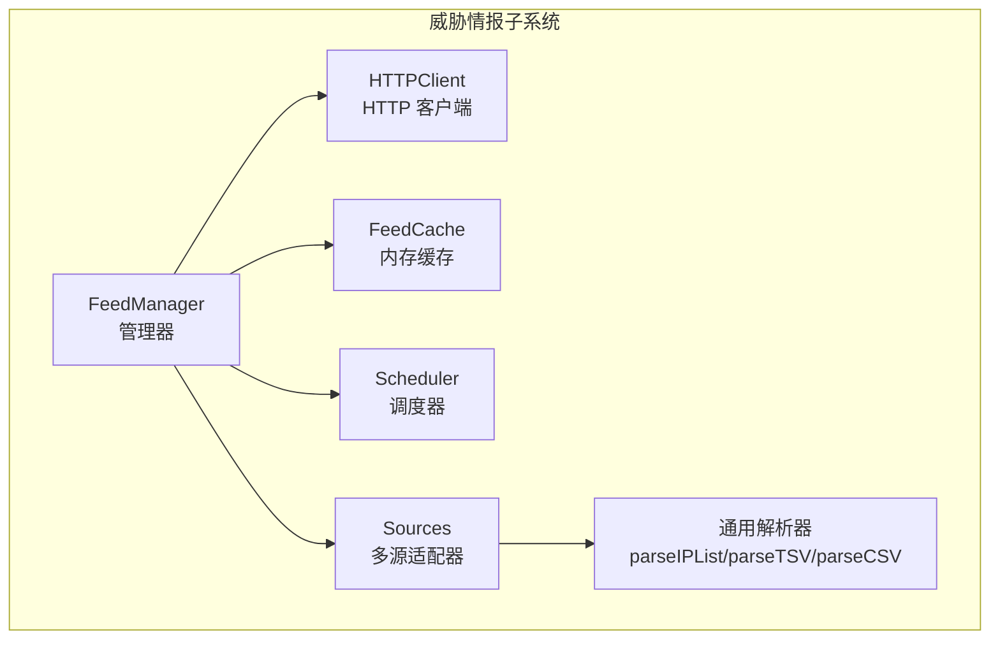
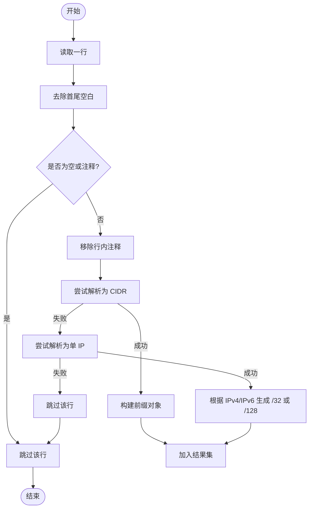
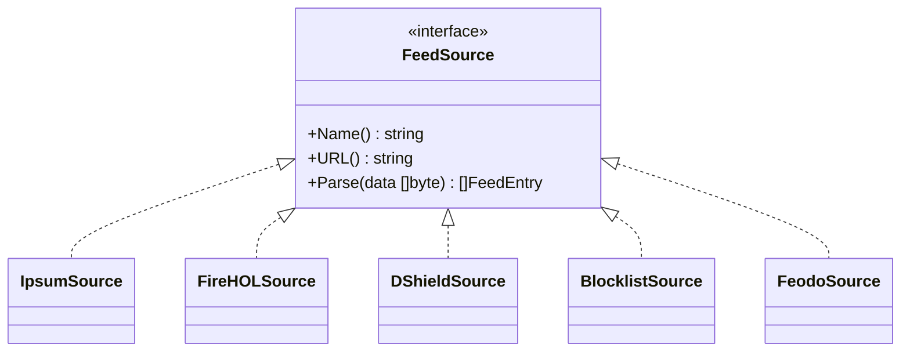
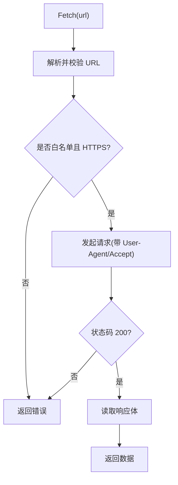
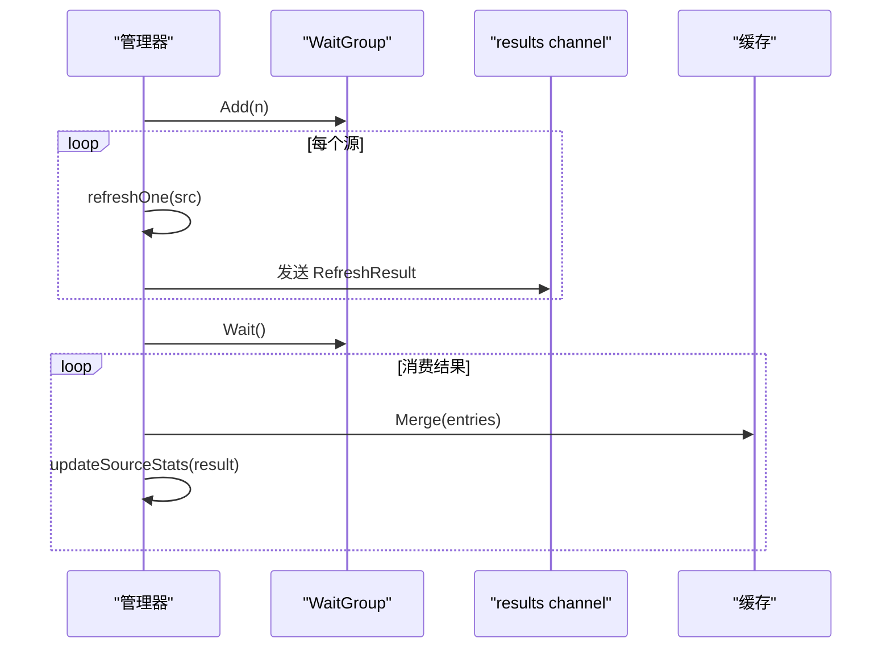
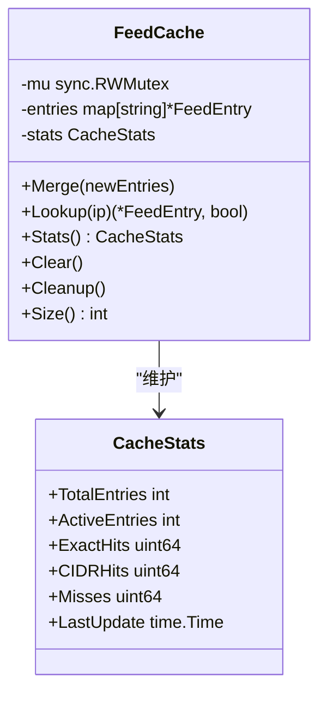
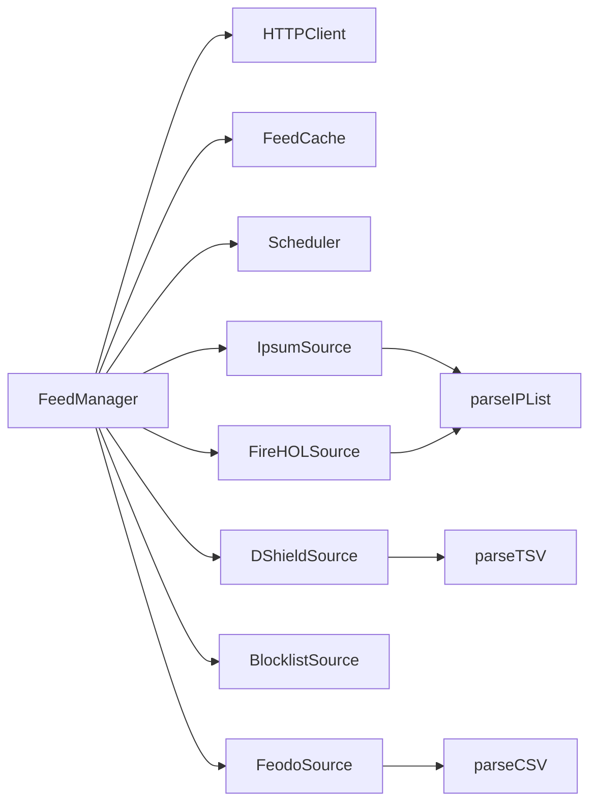

# 数据解析与标准化

<cite>
**本文引用的文件**
- [src/daemon/internal/threatfeeds/parser.go](file://src/daemon/internal/threatfeeds/parser.go)
- [src/daemon/internal/threatfeeds/cache.go](file://src/daemon/internal/threatfeeds/cache.go)
- [src/daemon/internal/threatfeeds/types.go](file://src/daemon/internal/threatfeeds/types.go)
- [src/daemon/internal/threatfeeds/sources/ipsum.go](file://src/daemon/internal/threatfeeds/sources/ipsum.go)
- [src/daemon/internal/threatfeeds/sources/dshield.go](file://src/daemon/internal/threatfeeds/sources/dshield.go)
- [src/daemon/internal/threatfeeds/sources/feodo.go](file://src/daemon/internal/threatfeeds/sources/feodo.go)
- [src/daemon/internal/threatfeeds/sources/firehol.go](file://src/daemon/internal/threatfeeds/sources/firehol.go)
- [src/daemon/internal/threatfeeds/sources/blocklist.go](file://src/daemon/internal/threatfeeds/sources/blocklist.go)
- [src/daemon/internal/threatfeeds/manager.go](file://src/daemon/internal/threatfeeds/manager.go)
- [src/daemon/internal/threatfeeds/http.go](file://src/daemon/internal/threatfeeds/http.go)
- [src/daemon/internal/threatfeeds/scheduler.go](file://src/daemon/internal/threatfeeds/scheduler.go)
</cite>

## 目录
1. [简介](#简介)
2. [项目结构](#项目结构)
3. [核心组件](#核心组件)
4. [架构总览](#架构总览)
5. [详细组件分析](#详细组件分析)
6. [依赖关系分析](#依赖关系分析)
7. [性能考量](#性能考量)
8. [故障排查指南](#故障排查指南)
9. [结论](#结论)

## 简介
本模块负责威胁情报数据的拉取、解析、标准化、缓存与调度，目标是：
- 统一处理不同情报源的数据格式（纯 IP/CIDR、TSV、CSV）。
- 提供 CIDR 前缀提取、IP 地址校验、重复数据去重和置信度评分。
- 实现高性能内存缓存，支持精确匹配与 CIDR 匹配、过期清理与统计。
- 通过并发拉取与错误隔离保证主判定链路不受影响。
- 提供可观测的指标与状态，便于运维监控。

## 项目结构
威胁情报子系统位于 daemon 内部 threatfeeds 包，主要包含：
- 通用解析器与多源适配器：将异构数据统一为 FeedEntry。
- HTTP 客户端：带白名单校验、超时、重试与防 SSRF。
- 管理器：协调拉取、解析、聚合与缓存更新。
- 缓存：内存级 FeedCache，支持并发安全、过期策略与统计。
- 调度器：定时刷新与抖动防惊群。



图表来源
- [src/daemon/internal/threatfeeds/manager.go:20-41](file://src/daemon/internal/threatfeeds/manager.go#L20-L41)
- [src/daemon/internal/threatfeeds/http.go:23-49](file://src/daemon/internal/threatfeeds/http.go#L23-L49)
- [src/daemon/internal/threatfeeds/cache.go:9-19](file://src/daemon/internal/threatfeeds/cache.go#L9-L19)
- [src/daemon/internal/threatfeeds/scheduler.go:10-21](file://src/daemon/internal/threatfeeds/scheduler.go#L10-L21)
- [src/daemon/internal/threatfeeds/sources/ipsum.go:21-26](file://src/daemon/internal/threatfeeds/sources/ipsum.go#L21-L26)

章节来源
- [src/daemon/internal/threatfeeds/manager.go:20-41](file://src/daemon/internal/threatfeeds/manager.go#L20-L41)
- [src/daemon/internal/threatfeeds/http.go:23-49](file://src/daemon/internal/threatfeeds/http.go#L23-L49)
- [src/daemon/internal/threatfeeds/cache.go:9-19](file://src/daemon/internal/threatfeeds/cache.go#L9-L19)
- [src/daemon/internal/threatfeeds/scheduler.go:10-21](file://src/daemon/internal/threatfeeds/scheduler.go#L10-L21)

## 核心组件
- 通用解析器：统一清洗注释、空行，尝试解析 CIDR 或单 IP，并转换为标准前缀。
- 多源适配器：Blocklist.de、DShield、Feodo Tracker、FireHOL、IPsum，各自定义 URL、分类与置信度。
- HTTP 客户端：HTTPS 白名单、禁止自动重定向、指数退避重试。
- 管理器：并发拉取、错误隔离、结果聚合、合并到缓存、统计与查询。
- 缓存：按 IP 字符串键存储，支持精确匹配与 CIDR 包含匹配，过期清理与统计。
- 调度器：定时触发 + 随机抖动，优雅停止。

章节来源
- [src/daemon/internal/threatfeeds/parser.go:11-79](file://src/daemon/internal/threatfeeds/parser.go#L11-L79)
- [src/daemon/internal/threatfeeds/sources/ipsum.go:28-79](file://src/daemon/internal/threatfeeds/sources/ipsum.go#L28-L79)
- [src/daemon/internal/threatfeeds/sources/dshield.go:11-64](file://src/daemon/internal/threatfeeds/sources/dshield.go#L11-L64)
- [src/daemon/internal/threatfeeds/sources/feodo.go:11-58](file://src/daemon/internal/threatfeeds/sources/feodo.go#L11-L58)
- [src/daemon/internal/threatfeeds/http.go:51-101](file://src/daemon/internal/threatfeeds/http.go#L51-L101)
- [src/daemon/internal/threatfeeds/cache.go:44-115](file://src/daemon/internal/threatfeeds/cache.go#L44-L115)
- [src/daemon/internal/threatfeeds/scheduler.go:35-83](file://src/daemon/internal/threatfeeds/scheduler.go#L35-L83)

## 架构总览
整体流程：调度器定时触发管理器；管理器并发调用各源的 HTTP 拉取与解析；解析结果合并入缓存；上层通过 Lookup 进行命中判断。

```mermaid
sequenceDiagram
participant SCH as "调度器"
participant MGR as "管理器"
participant HTTP as "HTTP 客户端"
participant SRC as "源适配器"
participant PAR as "通用解析器"
participant CACHE as "缓存"
SCH->>MGR : 触发刷新
loop 并发拉取每个源
MGR->>HTTP : Fetch(URL)
HTTP-->>MGR : 原始数据
MGR->>SRC : Parse(data)
SRC->>PAR : 解析(清洗/校验/CIDR化)
PAR-->>SRC : FeedEntry[]
SRC-->>MGR : FeedEntry[]
MGR->>CACHE : Merge(entries)
end
Note over MGR,CACHE : 原子替换旧条目+新条目，跳过已过期
```

图表来源
- [src/daemon/internal/threatfeeds/scheduler.go:35-63](file://src/daemon/internal/threatfeeds/scheduler.go#L35-L63)
- [src/daemon/internal/threatfeeds/manager.go:111-155](file://src/daemon/internal/threatfeeds/manager.go#L111-L155)
- [src/daemon/internal/threatfeeds/http.go:72-101](file://src/daemon/internal/threatfeeds/http.go#L72-L101)
- [src/daemon/internal/threatfeeds/sources/ipsum.go:99-103](file://src/daemon/internal/threatfeeds/sources/ipsum.go#L99-L103)
- [src/daemon/internal/threatfeeds/parser.go:20-79](file://src/daemon/internal/threatfeeds/parser.go#L20-L79)
- [src/daemon/internal/threatfeeds/cache.go:44-82](file://src/daemon/internal/threatfeeds/cache.go#L44-L82)

## 详细组件分析

### 通用解析器与数据清洗
- 注释与空白处理：移除行首注释与行内注释，忽略空行。
- 格式识别：优先尝试 CIDR 解析，失败则尝试单 IP 解析。
- 标准化：单 IP 根据 IPv4/IPv6 转换为 /32 或 /128 前缀。
- 异常处理：解析失败的行直接跳过，不中断整批解析。



图表来源
- [src/daemon/internal/threatfeeds/parser.go:11-79](file://src/daemon/internal/threatfeeds/parser.go#L11-L79)
- [src/daemon/internal/threatfeeds/sources/ipsum.go:28-79](file://src/daemon/internal/threatfeeds/sources/ipsum.go#L28-L79)

章节来源
- [src/daemon/internal/threatfeeds/parser.go:11-79](file://src/daemon/internal/threatfeeds/parser.go#L11-L79)
- [src/daemon/internal/threatfeeds/sources/ipsum.go:28-79](file://src/daemon/internal/threatfeeds/sources/ipsum.go#L28-L79)

### 多源适配器与格式转换
- Blocklist.de/FireHOL/IPsum：纯 IP 列表，复用 parseIPList。
- DShield：TSV 格式，取第一列作为 IP/CIDR。
- Feodo Tracker：CSV 格式，跳过表头，取第二列为 IP。
- 所有适配器均设置过期时间、分类与置信度，输出统一 FeedEntry。



图表来源
- [src/daemon/internal/threatfeeds/sources/ipsum.go:21-26](file://src/daemon/internal/threatfeeds/sources/ipsum.go#L21-L26)
- [src/daemon/internal/threatfeeds/sources/firehol.go:5-27](file://src/daemon/internal/threatfeeds/sources/firehol.go#L5-L27)
- [src/daemon/internal/threatfeeds/sources/dshield.go:66-88](file://src/daemon/internal/threatfeeds/sources/dshield.go#L66-L88)
- [src/daemon/internal/threatfeeds/sources/blocklist.go:5-27](file://src/daemon/internal/threatfeeds/sources/blocklist.go#L5-L27)
- [src/daemon/internal/threatfeeds/sources/feodo.go:60-82](file://src/daemon/internal/threatfeeds/sources/feodo.go#L60-L82)

章节来源
- [src/daemon/internal/threatfeeds/sources/ipsum.go:81-103](file://src/daemon/internal/threatfeeds/sources/ipsum.go#L81-L103)
- [src/daemon/internal/threatfeeds/sources/firehol.go:5-27](file://src/daemon/internal/threatfeeds/sources/firehol.go#L5-L27)
- [src/daemon/internal/threatfeeds/sources/dshield.go:11-88](file://src/daemon/internal/threatfeeds/sources/dshield.go#L11-L88)
- [src/daemon/internal/threatfeeds/sources/blocklist.go:5-27](file://src/daemon/internal/threatfeeds/sources/blocklist.go#L5-L27)
- [src/daemon/internal/threatfeeds/sources/feodo.go:11-82](file://src/daemon/internal/threatfeeds/sources/feodo.go#L11-L82)

### HTTP 客户端与安全控制
- 域名白名单：仅允许已知情报源域名。
- 协议限制：仅 HTTPS。
- 重定向控制：禁止自动跟随重定向，防止 SSRF。
- 重试与退避：指数退避，结合 context 取消。



图表来源
- [src/daemon/internal/threatfeeds/http.go:51-101](file://src/daemon/internal/threatfeeds/http.go#L51-L101)

章节来源
- [src/daemon/internal/threatfeeds/http.go:51-101](file://src/daemon/internal/threatfeeds/http.go#L51-L101)

### 管理器：并发拉取与聚合
- 并发拉取：使用 WaitGroup 与 channel 并行刷新多个源。
- 错误隔离：单个源失败不影响其他源，记录首个错误并继续。
- 结果聚合：成功结果合并进缓存，更新源统计与最后更新时间。



图表来源
- [src/daemon/internal/threatfeeds/manager.go:111-155](file://src/daemon/internal/threatfeeds/manager.go#L111-L155)
- [src/daemon/internal/threatfeeds/manager.go:157-184](file://src/daemon/internal/threatfeeds/manager.go#L157-L184)
- [src/daemon/internal/threatfeeds/manager.go:186-205](file://src/daemon/internal/threatfeeds/manager.go#L186-L205)

章节来源
- [src/daemon/internal/threatfeeds/manager.go:111-205](file://src/daemon/internal/threatfeeds/manager.go#L111-L205)

### 缓存机制：结构、过期与统计
- 数据结构：map[string]*FeedEntry，键为 IP.String() 或 CIDR.String()。
- 原子更新：Merge 时先复制未过期旧条目，再添加新条目，最后原子替换 map。
- 过期策略：Lookup 与 Cleanup 均跳过已过期条目；ActiveEntries 动态统计。
- 匹配策略：先精确匹配 IP，再遍历 CIDR 包含匹配。
- 统计信息：ExactHits、CIDRHits、Misses、TotalEntries、ActiveEntries、LastUpdate。



图表来源
- [src/daemon/internal/threatfeeds/cache.go:9-35](file://src/daemon/internal/threatfeeds/cache.go#L9-L35)
- [src/daemon/internal/threatfeeds/cache.go:44-115](file://src/daemon/internal/threatfeeds/cache.go#L44-L115)
- [src/daemon/internal/threatfeeds/cache.go:117-173](file://src/daemon/internal/threatfeeds/cache.go#L117-L173)

章节来源
- [src/daemon/internal/threatfeeds/cache.go:44-173](file://src/daemon/internal/threatfeeds/cache.go#L44-L173)

### 调度器：定时与抖动
- 首次立即触发，随后按 interval 周期触发。
- 每次触发前计算抖动延迟，避免集群同时拉取。
- 支持 Stop 与 context 取消，优雅退出。

```mermaid
flowchart TD
S["Run(ctx, fn)"] --> I["fn() 立即执行"]
I --> T["创建 Ticker(interval)"]
T --> L["循环等待"]
L --> J["计算抖动 delay = interval ± jitter"]
J --> W{"select"}
W --> |time.After(delay)| F["fn() 触发"]
W --> |ticker.C| F
W --> |stopCh| X["退出"]
W --> |ctx.Done| X
```

图表来源
- [src/daemon/internal/threatfeeds/scheduler.go:35-83](file://src/daemon/internal/threatfeeds/scheduler.go#L35-L83)

章节来源
- [src/daemon/internal/threatfeeds/scheduler.go:35-83](file://src/daemon/internal/threatfeeds/scheduler.go#L35-L83)

### 数据模型与字段说明
- FeedEntry：包含 IP 前缀、来源、分类、置信度、过期时间。
- RefreshResult：单次刷新结果，含源名、条目、错误、耗时。
- FeedStats：源级别统计，含上次成功时间、有效条目数、错误、启用状态。

章节来源
- [src/daemon/internal/threatfeeds/sources/ipsum.go:12-19](file://src/daemon/internal/threatfeeds/sources/ipsum.go#L12-L19)
- [src/daemon/internal/threatfeeds/types.go:14-38](file://src/daemon/internal/threatfeeds/types.go#L14-L38)

## 依赖关系分析
- FeedManager 依赖 HTTPClient、FeedCache、Scheduler 与各 FeedSource 适配器。
- 各 Source 适配器依赖通用解析器函数（parseIPList/parseTSV/parseCSV）。
- HTTPClient 依赖系统网络库与白名单配置。
- FeedCache 依赖 netip.Prefix 与 time 进行匹配与过期判断。



图表来源
- [src/daemon/internal/threatfeeds/manager.go:20-41](file://src/daemon/internal/threatfeeds/manager.go#L20-L41)
- [src/daemon/internal/threatfeeds/sources/ipsum.go:21-26](file://src/daemon/internal/threatfeeds/sources/ipsum.go#L21-L26)
- [src/daemon/internal/threatfeeds/sources/dshield.go:11-64](file://src/daemon/internal/threatfeeds/sources/dshield.go#L11-L64)
- [src/daemon/internal/threatfeeds/sources/feodo.go:11-58](file://src/daemon/internal/threatfeeds/sources/feodo.go#L11-L58)

章节来源
- [src/daemon/internal/threatfeeds/manager.go:20-41](file://src/daemon/internal/threatfeeds/manager.go#L20-L41)
- [src/daemon/internal/threatfeeds/sources/ipsum.go:21-26](file://src/daemon/internal/threatfeeds/sources/ipsum.go#L21-L26)
- [src/daemon/internal/threatfeeds/sources/dshield.go:11-64](file://src/daemon/internal/threatfeeds/sources/dshield.go#L11-L64)
- [src/daemon/internal/threatfeeds/sources/feodo.go:11-58](file://src/daemon/internal/threatfeeds/sources/feodo.go#L11-L58)

## 性能考量
- 并发拉取：多源并行刷新，总耗时取决于最慢源。
- 原子更新：缓存 Merge 构建新 map 后一次性替换，减少写锁持有时间。
- 精确优先：Lookup 先精确匹配，再遍历 CIDR，降低平均开销。
- 过期清理：Lookup 与 Cleanup 跳过已过期条目，避免无效扫描。
- 抖动防惊群：调度器引入随机抖动，避免集群同时拉取导致雪崩。
- 连接与超时：HTTP 客户端设置超时与最大重试次数，配合指数退避提升稳定性。

[本节为通用性能建议，不直接分析具体文件]

## 故障排查指南
- 拉取失败：检查域名是否在白名单、协议是否为 HTTPS、HTTP 状态码是否为 200。
- 解析失败：确认数据格式是否符合预期（纯 IP/CIDR、TSV、CSV），注意表头与注释行。
- 命中率为零：检查缓存是否被清空、过期时间是否过短、是否存在大量无效条目。
- 性能问题：观察 ExactHits/CIDRHits/Misses 比例，评估是否需要调整缓存大小或刷新频率。
- 调度异常：确认 Scheduler 的 interval 与 jitter 配置合理，Stop 与 context 取消是否正常。

章节来源
- [src/daemon/internal/threatfeeds/http.go:51-101](file://src/daemon/internal/threatfeeds/http.go#L51-L101)
- [src/daemon/internal/threatfeeds/cache.go:84-115](file://src/daemon/internal/threatfeeds/cache.go#L84-L115)
- [src/daemon/internal/threatfeeds/scheduler.go:35-83](file://src/daemon/internal/threatfeeds/scheduler.go#L35-L83)

## 结论
该模块通过统一的解析器与多源适配器，将异构情报数据标准化为 FeedEntry，并通过高性能内存缓存与并发拉取机制，确保主判定链路的低延迟与高可用。设计在安全性（SSRF 防护）、可观测性（统计与日志）与可扩展性（新增源适配器）方面具备良好基础。未来可在以下方向优化：
- 引入更细粒度的 LRU 淘汰策略以控制内存占用。
- 对超大 CIDR 集合进行分层索引或布隆过滤器加速匹配。
- 增加批量写入与增量合并以提升吞吐。
- 扩展更多情报源适配器与格式支持。

[本节为总结性内容，不直接分析具体文件]