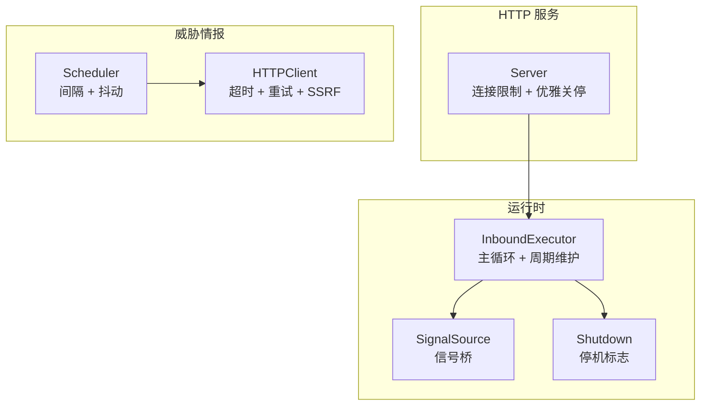
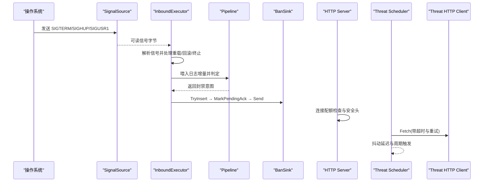
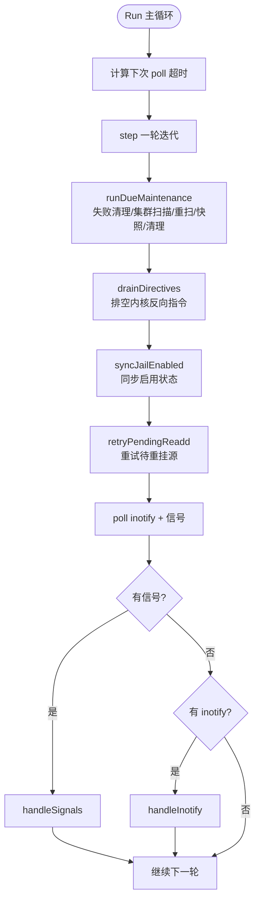
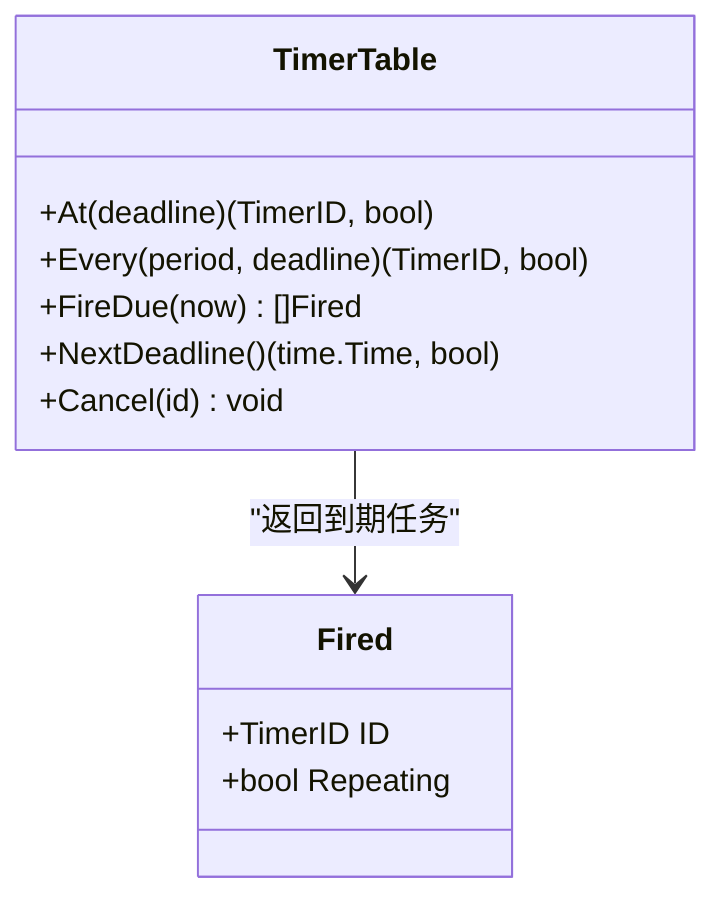
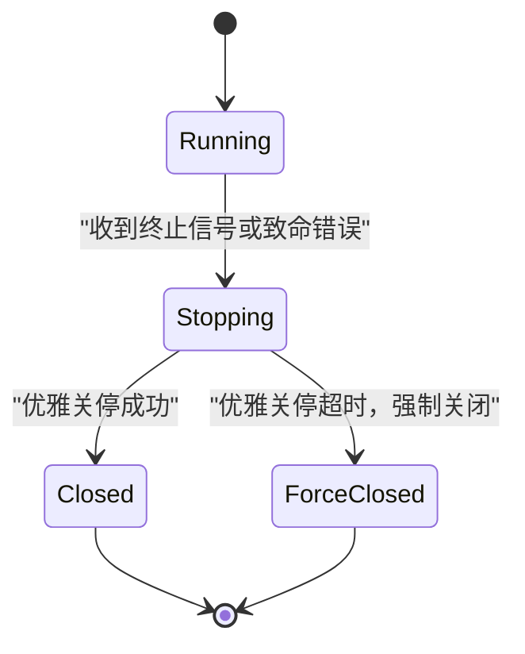
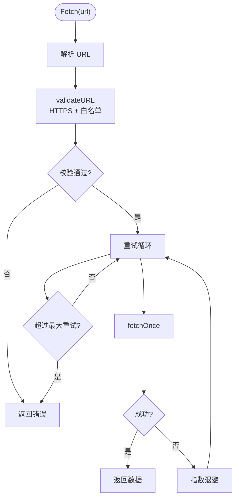
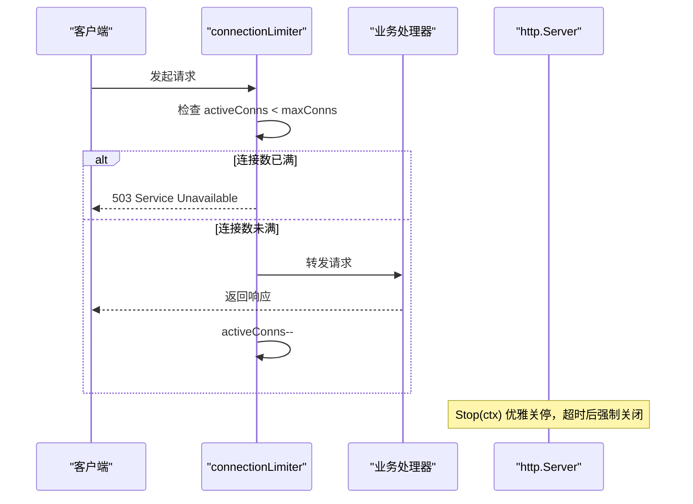
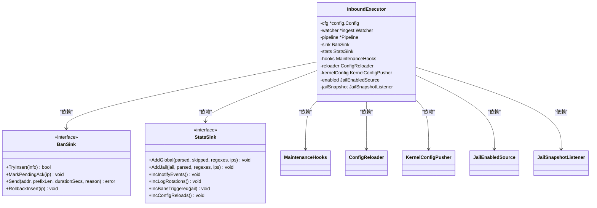

# 调度与生命周期管理

<cite>
**本文引用的文件**   
- [executor.go](file://src/daemon/internal/runtime/executor.go)
- [signals.go](file://src/daemon/internal/runtime/signals.go)
- [shutdown.go](file://src/daemon/internal/runtime/shutdown.go)
- [timers_test.go](file://src/daemon/internal/runtime/timers_test.go)
- [server.go](file://src/daemon/internal/http/server.go)
- [scheduler.go](file://src/daemon/internal/threatfeeds/scheduler.go)
- [http.go](file://src/daemon/internal/threatfeeds/http.go)
</cite>

## 目录
1. [引言](#引言)
2. [项目结构](#项目结构)
3. [核心组件](#核心组件)
4. [架构总览](#架构总览)
5. [详细组件分析](#详细组件分析)
6. [依赖关系分析](#依赖关系分析)
7. [性能与资源特性](#性能与资源特性)
8. [监控、告警与健康检查](#监控告警与健康检查)
9. [配置调优指南](#配置调优指南)
10. [故障排查](#故障排查)
11. [结论](#结论)

## 引言
本文面向守护进程的调度器与 HTTP 客户端，聚焦以下目标：
- 定时任务的调度策略、并发控制、任务优先级与资源限制。
- HTTP 客户端的连接池、超时、重试与 SSRF 防护。
- 任务状态监控、失败告警、健康检查与优雅关闭。
- 调度参数调优与关键性能指标说明。

本仓库的“调度”并非通用 Cron 引擎，而是围绕两条主线实现：
- 运行时主循环中的周期维护定时器，负责失败窗口清理、集群扫描、监视集合重扫、历史快照与数据清理。
- 威胁情报拉取模块中的轻量调度器，支持间隔触发、抖动防惊群与优雅停止。

HTTP 侧则包含两个视角：
- 守护进程自身的 HTTP 服务器，提供连接配额、安全头、优雅关停等能力。
- 威胁情报拉取的 HTTP 客户端，提供超时、重试、SSRF 白名单与重定向保护。

## 项目结构
与调度与 HTTP 相关的代码主要分布在三个子包：
- `internal/runtime`：运行时主循环、信号桥、停机标志、周期维护与封禁下发流程。
- `internal/http`：守护进程内嵌 HTTP 服务器的启动、监听、连接限制与优雅关停。
- `internal/threatfeeds`：威胁情报源的调度器与 HTTP 客户端封装。



**图表来源**
- [executor.go:225-349](file://src/daemon/internal/runtime/executor.go#L225-L349)
- [signals.go:37-68](file://src/daemon/internal/runtime/signals.go#L37-L68)
- [shutdown.go:14-36](file://src/daemon/internal/runtime/shutdown.go#L14-L36)
- [server.go:14-73](file://src/daemon/internal/http/server.go#L14-L73)
- [scheduler.go:16-33](file://src/daemon/internal/threatfeeds/scheduler.go#L16-L33)
- [http.go:23-49](file://src/daemon/internal/threatfeeds/http.go#L23-L49)

**章节来源**
- [executor.go:225-349](file://src/daemon/internal/runtime/executor.go#L225-L349)
- [server.go:14-73](file://src/daemon/internal/http/server.go#L14-L73)
- [scheduler.go:16-33](file://src/daemon/internal/threatfeeds/scheduler.go#L16-L33)
- [http.go:23-49](file://src/daemon/internal/threatfeeds/http.go#L23-L49)

## 核心组件
- 运行时执行体：单 goroutine 驱动的主循环，统一处理 inotify 事件、内核反向指令、信号、周期维护与封禁意图下发。
- 周期定时器表：固定容量、按到期时间排序、支持一次性与周期任务，避免漂移与突发补发。
- 信号桥：将系统信号转为可被 poll 等待的文件描述符，与 inotify fd 合并等待。
- 停机标志：只置位不撤销，支持多生产者、select 等待与轮询判断。
- HTTP 服务器：连接数上限、安全头、读写超时、空闲超时与优雅关停。
- 威胁情报调度器：首次立即触发、周期性触发、随机抖动、context 与 Stop 双通道停止。
- 威胁情报 HTTP 客户端：HTTPS 白名单、禁止自动跟随重定向、指数退避重试、上下文取消。

**章节来源**
- [executor.go:46-64](file://src/daemon/internal/runtime/executor.go#L46-L64)
- [executor.go:194-223](file://src/daemon/internal/runtime/executor.go#L194-L223)
- [signals.go:12-22](file://src/daemon/internal/runtime/signals.go#L12-L22)
- [shutdown.go:5-17](file://src/daemon/internal/runtime/shutdown.go#L5-L17)
- [server.go:14-32](file://src/daemon/internal/http/server.go#L14-L32)
- [scheduler.go:10-33](file://src/daemon/internal/threatfeeds/scheduler.go#L10-L33)
- [http.go:14-28](file://src/daemon/internal/threatfeeds/http.go#L14-L28)

## 架构总览
下图展示调度与 HTTP 在守护进程中的协作关系：



**图表来源**
- [signals.go:70-124](file://src/daemon/internal/runtime/signals.go#L70-L124)
- [executor.go:434-461](file://src/daemon/internal/runtime/executor.go#L434-L461)
- [executor.go:1011-1065](file://src/daemon/internal/runtime/executor.go#L1011-L1065)
- [server.go:129-149](file://src/daemon/internal/http/server.go#L129-L149)
- [scheduler.go:35-63](file://src/daemon/internal/threatfeeds/scheduler.go#L35-L63)
- [http.go:72-102](file://src/daemon/internal/threatfeeds/http.go#L72-L102)

## 详细组件分析

### 运行时调度与周期维护
运行时执行体是守护进程的核心调度点。它不是传统意义上的 Cron 调度器，而是一个以单调时钟驱动的周期维护系统，配合 inotify 与信号完成事件驱动处理。

- 周期任务包括：
  - 失败窗口清理：每 60 秒清理过期失败条目。
  - 集群扫描检测：每 10 秒扫描集群攻击模式。
  - 监视集合重扫：每 60 秒重新对齐 inotify 监视源。
  - 历史快照：每 300 秒记录一次运行历史。
  - 数据清理：每 300 秒执行一次数据清理。

- 调度策略：
  - 使用固定容量的定时器表，按到期时间顺序触发。
  - 周期任务不会因事件洪泛而推迟；poll 超时仅作为事件等待上限。
  - 若存在轮转后待重挂的日志路径，poll 超时缩短为 1 秒，尽快恢复监视。

- 并发模型：
  - 主循环由单个 goroutine 独占，内部状态不加锁。
  - 所有副作用通过窄接口（BanSink、StatsSink、MaintenanceHooks）注入，便于测试与解耦。



**图表来源**
- [executor.go:331-376](file://src/daemon/internal/runtime/executor.go#L331-L376)
- [executor.go:409-432](file://src/daemon/internal/runtime/executor.go#L409-L432)
- [executor.go:958-983](file://src/daemon/internal/runtime/executor.go#L958-L983)

**章节来源**
- [executor.go:46-64](file://src/daemon/internal/runtime/executor.go#L46-L64)
- [executor.go:194-223](file://src/daemon/internal/runtime/executor.go#L194-L223)
- [executor.go:331-376](file://src/daemon/internal/runtime/executor.go#L331-L376)
- [executor.go:409-432](file://src/daemon/internal/runtime/executor.go#L409-L432)
- [executor.go:958-983](file://src/daemon/internal/runtime/executor.go#L958-L983)

### 定时器表与任务优先级
定时器表提供固定容量的任务槽，支持一次性任务与周期任务。其关键行为如下：
- 一次性任务触发后移除，不再重复。
- 周期任务按原定时刻加周期重排，避免累积漂移。
- 即使唤醒迟到，也只触发一次，不补发欠账，防止突发风暴。
- 取消操作幂等，释放槽位供后续登记。
- 满载时如实返回失败，不静默丢弃。



**图表来源**
- [timers_test.go:8-31](file://src/daemon/internal/runtime/timers_test.go#L8-L31)
- [timers_test.go:33-56](file://src/daemon/internal/runtime/timers_test.go#L33-L56)
- [timers_test.go:58-82](file://src/daemon/internal/runtime/timers_test.go#L58-L82)
- [timers_test.go:84-103](file://src/daemon/internal/runtime/timers_test.go#L84-L103)
- [timers_test.go:105-126](file://src/daemon/internal/runtime/timers_test.go#L105-L126)
- [timers_test.go:128-137](file://src/daemon/internal/runtime/timers_test.go#L128-L137)

**章节来源**
- [timers_test.go:8-137](file://src/daemon/internal/runtime/timers_test.go#L8-L137)

### 信号桥与优雅关闭
信号桥将系统信号转换为可被 poll 等待的文件描述符，与 inotify fd 合并等待。支持的信号包括：
- SIGTERM / SIGINT：请求优雅退出。
- SIGHUP：请求热重载配置。
- SIGUSR1：请求回滚配置。

优雅关闭机制：
- Shutdown 类型提供只置位的停机标志，支持多生产者、select 等待与轮询判断。
- HTTP 服务器在 Stop 中先尝试优雅关停，超时后强制关闭，避免端口占用。
- 运行时主循环在异常退出时主动请求终止，避免组合根永久阻塞。



**图表来源**
- [signals.go:12-22](file://src/daemon/internal/runtime/signals.go#L12-L22)
- [signals.go:50-68](file://src/daemon/internal/runtime/signals.go#L50-L68)
- [shutdown.go:5-36](file://src/daemon/internal/runtime/shutdown.go#L5-L36)
- [server.go:92-113](file://src/daemon/internal/http/server.go#L92-L113)

**章节来源**
- [signals.go:12-22](file://src/daemon/internal/runtime/signals.go#L12-L22)
- [signals.go:50-68](file://src/daemon/internal/runtime/signals.go#L50-L68)
- [shutdown.go:5-36](file://src/daemon/internal/runtime/shutdown.go#L5-L36)
- [server.go:92-113](file://src/daemon/internal/http/server.go#L92-L113)

### 威胁情报调度器
威胁情报调度器是一个轻量级定时触发器，设计目标包括：
- 定时触发：按配置的间隔定期刷新。
- 抖动防惊群：添加随机抖动，避免多个实例同时拉取。
- 优雅停止：支持 context 取消和 Stop 信号。

调度逻辑：
- 首次立即触发。
- 每次触发前计算抖动延迟。
- 同时监听 ticker、After 与 stopCh、ctx.Done。

```mermaid
flowchart TD
Start(["NewScheduler"]) --> Run["Run(ctx, fn)"]
Run --> First["fn() 首次立即触发"]
First --> Ticker["time.NewTicker(interval)"]
Ticker --> Loop{"select"}
Loop --> |After(delay)| Trigger["fn() 触发刷新"]
Loop --> |ticker.C| Trigger
Loop --> |stopCh| Stop["Stop() 关闭 stopCh"]
Loop --> |ctx.Done| Cancel["context 取消"]
Trigger --> Loop
Stop --> End(["结束"])
Cancel --> End
```

**图表来源**
- [scheduler.go:16-33](file://src/daemon/internal/threatfeeds/scheduler.go#L16-L33)
- [scheduler.go:35-63](file://src/daemon/internal/threatfeeds/scheduler.go#L35-L63)
- [scheduler.go:66-71](file://src/daemon/internal/threatfeeds/scheduler.go#L66-L71)
- [scheduler.go:73-83](file://src/daemon/internal/threatfeeds/scheduler.go#L73-L83)

**章节来源**
- [scheduler.go:10-94](file://src/daemon/internal/threatfeeds/scheduler.go#L10-L94)

### 威胁情报 HTTP 客户端
威胁情报 HTTP 客户端封装了带超时和重试的请求逻辑，并提供 SSRF 防护：
- 超时控制：通过 http.Client.Timeout 设置整体请求超时。
- 重试机制：指数退避重试，最大重试次数可配置。
- SSRF 防护：
  - 域名白名单：仅允许已知威胁情报源域名。
  - 协议限制：仅允许 HTTPS。
  - 重定向保护：禁止自动跟随重定向，最多 3 次手动检查。
  - 私有地址检查：拒绝回环、私有、链路本地地址。



**图表来源**
- [http.go:14-28](file://src/daemon/internal/threatfeeds/http.go#L14-L28)
- [http.go:30-49](file://src/daemon/internal/threatfeeds/http.go#L30-L49)
- [http.go:51-65](file://src/daemon/internal/threatfeeds/http.go#L51-L65)
- [http.go:67-70](file://src/daemon/internal/threatfeeds/http.go#L67-L70)
- [http.go:72-102](file://src/daemon/internal/threatfeeds/http.go#L72-L102)
- [http.go:104-128](file://src/daemon/internal/threatfeeds/http.go#L104-L128)

**章节来源**
- [http.go:14-128](file://src/daemon/internal/threatfeeds/http.go#L14-L128)

### HTTP 服务器连接管理与优雅关停
守护进程内嵌的 HTTP 服务器提供连接配额、安全头、超时与优雅关停：
- 连接配额：通过中间件限制活跃连接数，超限返回 503。
- 安全头：在连接配额之外设置，确保限额响应也携带安全头。
- 超时配置：ReadHeaderTimeout、ReadTimeout、WriteTimeout、IdleTimeout。
- 优雅关停：先调用 Shutdown，超时后 Close，避免端口占用。



**图表来源**
- [server.go:14-32](file://src/daemon/internal/http/server.go#L14-L32)
- [server.go:34-73](file://src/daemon/internal/http/server.go#L34-L73)
- [server.go:92-113](file://src/daemon/internal/http/server.go#L92-L113)
- [server.go:129-149](file://src/daemon/internal/http/server.go#L129-L149)

**章节来源**
- [server.go:14-158](file://src/daemon/internal/http/server.go#L14-L158)

## 依赖关系分析
运行时执行体依赖多个外部接口，形成松耦合架构：
- BanSink：封禁下发副作用汇聚点。
- StatsSink：统计计数器写入端。
- MaintenanceHooks：周期维护外部副作用。
- ConfigReloader：配置热重载与回滚。
- KernelConfigPusher：配置变更后的内核下发出口。
- JailEnabledSource：Web UI 权威的 jail 启用状态。
- JailSnapshotListener：jail 配置快照变化通知。



**图表来源**
- [executor.go:66-184](file://src/daemon/internal/runtime/executor.go#L66-L184)
- [executor.go:225-269](file://src/daemon/internal/runtime/executor.go#L225-L269)

**章节来源**
- [executor.go:66-184](file://src/daemon/internal/runtime/executor.go#L66-L184)
- [executor.go:225-269](file://src/daemon/internal/runtime/executor.go#L225-L269)

## 性能与资源特性
- 单 goroutine 主循环：避免锁竞争，简化状态管理，适合 I/O 密集型场景。
- 固定容量定时器表：防止定时器泄漏，保证内存可控。
- 连接配额中间件：防止连接数爆炸，保护后端资源。
- 指数退避重试：降低瞬时负载压力，提高系统稳定性。
- 周期任务与事件解耦：事件洪泛不影响维护任务执行。

优化建议：
- 根据日志量调整 poll 超时与 interval。
- 合理设置连接配额，避免过多连接导致内存压力。
- 调整威胁情报拉取间隔与抖动范围，避免惊群效应。
- 监控定时器表容量使用情况，必要时扩容。

[本节为一般性指导，无需特定文件引用]

## 监控、告警与健康检查
- 任务状态监控：
  - 失败窗口清理、集群扫描、监视重扫、历史快照、数据清理等周期任务均可通过 StatsSink 暴露计数。
  - 威胁情报调度器可通过 Interval() 与 Jitter() 暴露配置参数。

- 失败告警：
  - 封禁下发失败会记录 warn 日志，并回滚缓存标记。
  - 配置下发内核失败或部分位未被采纳会记录 warn 日志。
  - 威胁情报拉取失败会返回错误，上层可据此告警。

- 健康检查：
  - HTTP 服务器提供 ActiveConnections() 与 MaxConnections() 用于健康检查。
  - 威胁情报客户端可通过 Fetch 的成功与否判断外部依赖健康状态。

- 优雅关闭：
  - 运行时主循环在异常时请求终止，避免组合根永久阻塞。
  - HTTP 服务器优雅关停，超时后强制关闭。
  - 威胁情报调度器支持 context 取消与 Stop 信号。

**章节来源**
- [executor.go:1011-1065](file://src/daemon/internal/runtime/executor.go#L1011-L1065)
- [executor.go:878-893](file://src/daemon/internal/runtime/executor.go#L878-L893)
- [http.go:72-102](file://src/daemon/internal/threatfeeds/http.go#L72-L102)
- [server.go:115-127](file://src/daemon/internal/http/server.go#L115-L127)
- [scheduler.go:66-71](file://src/daemon/internal/threatfeeds/scheduler.go#L66-L71)

## 配置调优指南
- 运行时周期任务间隔：
  - cleanupInterval：60 秒，适合大多数场景。
  - clusterScanInterval：10 秒，需小于 cluster.Window。
  - rescanInterval：60 秒，覆盖轮转后路径不可见情况。
  - historyInterval：300 秒，平衡历史数据粒度与存储压力。
  - dataCleanupInterval：300 秒，定期清理过期数据。

- HTTP 服务器配置：
  - Address：默认 127.0.0.1:9119。
  - MaxConnections：默认 32，根据并发需求调整。
  - ShutdownTimeout：默认 5 秒，根据业务响应时间调整。

- 威胁情报调度器：
  - interval：拉取间隔，建议 5-30 分钟。
  - jitter：抖动范围，建议为 interval 的 10%-20%。

- 威胁情报 HTTP 客户端：
  - timeout：请求超时，建议 10-30 秒。
  - maxRetries：最大重试次数，建议 2-3 次。

**章节来源**
- [executor.go:46-64](file://src/daemon/internal/runtime/executor.go#L46-L64)
- [server.go:27-43](file://src/daemon/internal/http/server.go#L27-L43)
- [scheduler.go:23-33](file://src/daemon/internal/threatfeeds/scheduler.go#L23-L33)
- [http.go:30-49](file://src/daemon/internal/threatfeeds/http.go#L30-L49)

## 故障排查
- 定时器表满载：
  - 现象：登记新定时器失败。
  - 排查：检查是否频繁创建一次性任务未取消。
  - 解决：复用周期任务或增加定时器表容量。

- 信号处理异常：
  - 现象：信号未生效或主循环卡住。
  - 排查：检查 SignalSource 是否正确初始化与关闭。
  - 解决：确保信号管道非阻塞，消费端循环读取直到无待处理信号。

- HTTP 连接数满：
  - 现象：返回 503 Service Unavailable。
  - 排查：检查业务处理器响应时间是否过长。
  - 解决：优化业务逻辑或增加 MaxConnections。

- 威胁情报拉取失败：
  - 现象：Fetch 返回错误。
  - 排查：检查域名是否在白名单、URL 是否为 HTTPS、网络连通性。
  - 解决：修正域名配置或调整超时与重试参数。

**章节来源**
- [timers_test.go:128-137](file://src/daemon/internal/runtime/timers_test.go#L128-L137)
- [signals.go:108-124](file://src/daemon/internal/runtime/signals.go#L108-L124)
- [server.go:129-149](file://src/daemon/internal/http/server.go#L129-L149)
- [http.go:72-102](file://src/daemon/internal/threatfeeds/http.go#L72-L102)

## 结论
本项目的调度与生命周期管理围绕运行时主循环与威胁情报调度器展开，采用单 goroutine 模型、固定容量定时器表、连接配额中间件与指数退避重试，实现了高内聚、低耦合的可控调度体系。HTTP 服务器与客户端分别提供了连接管理、优雅关停与 SSRF 防护能力。通过合理的配置调优与监控告警，系统能够在高负载下保持稳定运行，并在异常情况下优雅降级与恢复。

[本节为总结性内容，无需特定文件引用]