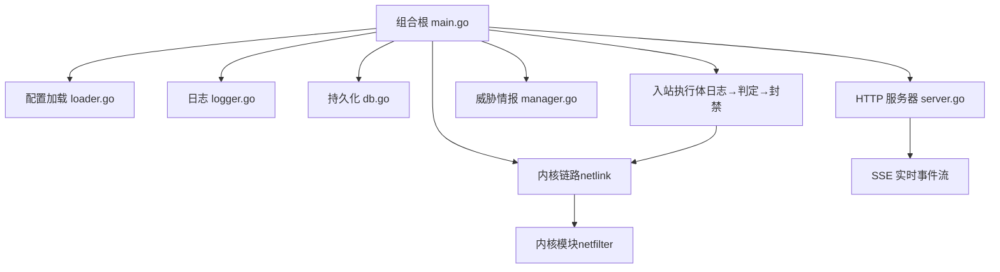
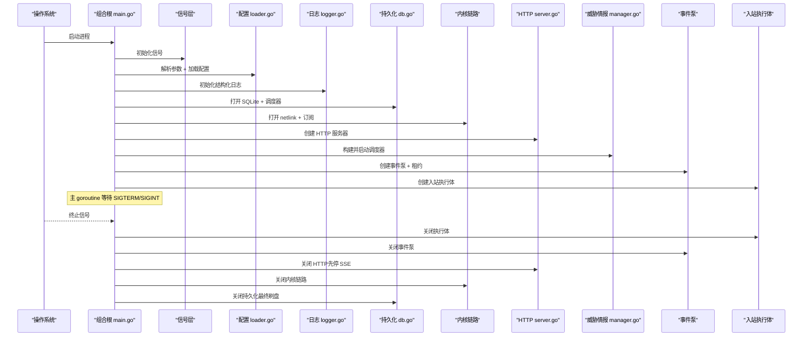
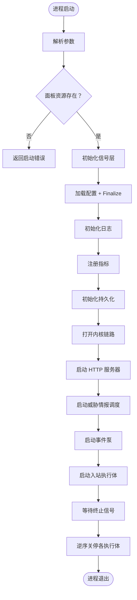
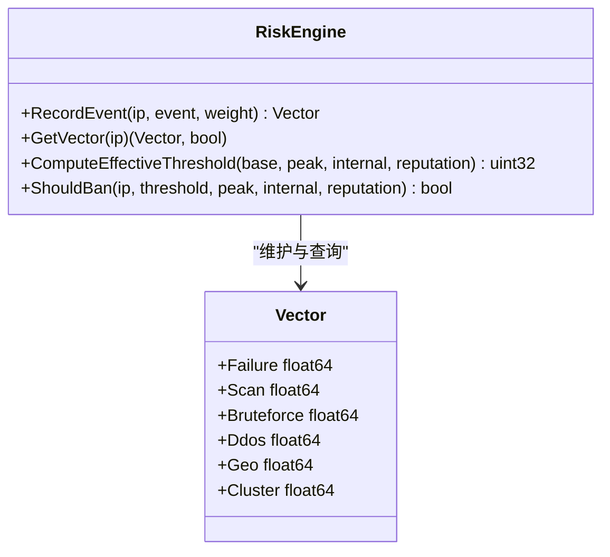
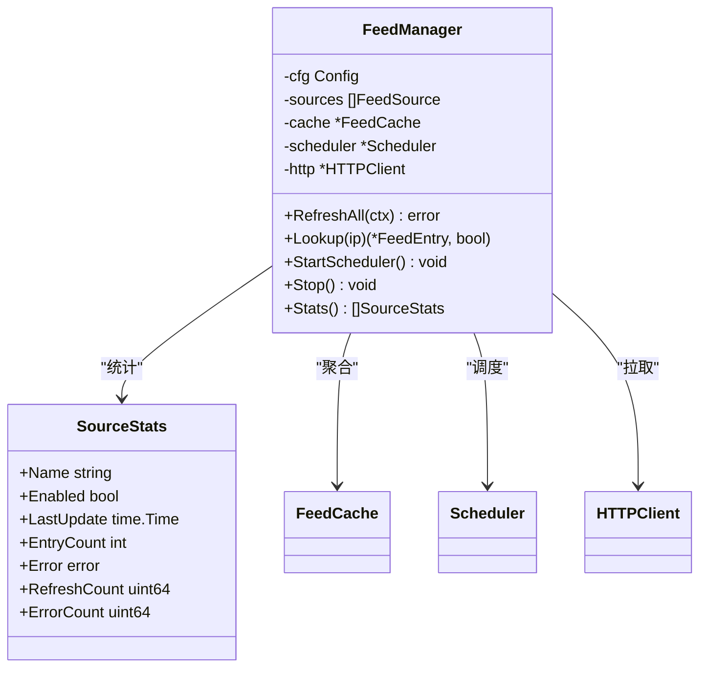
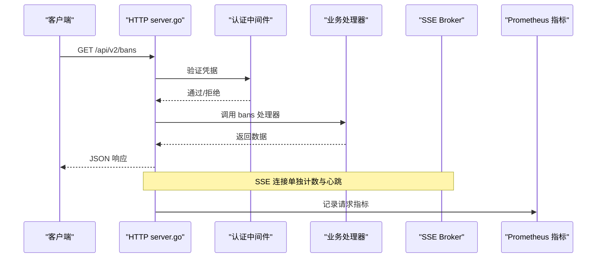
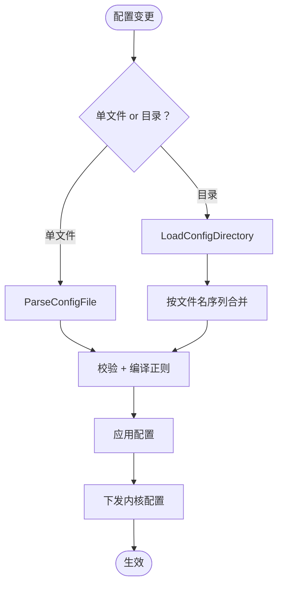
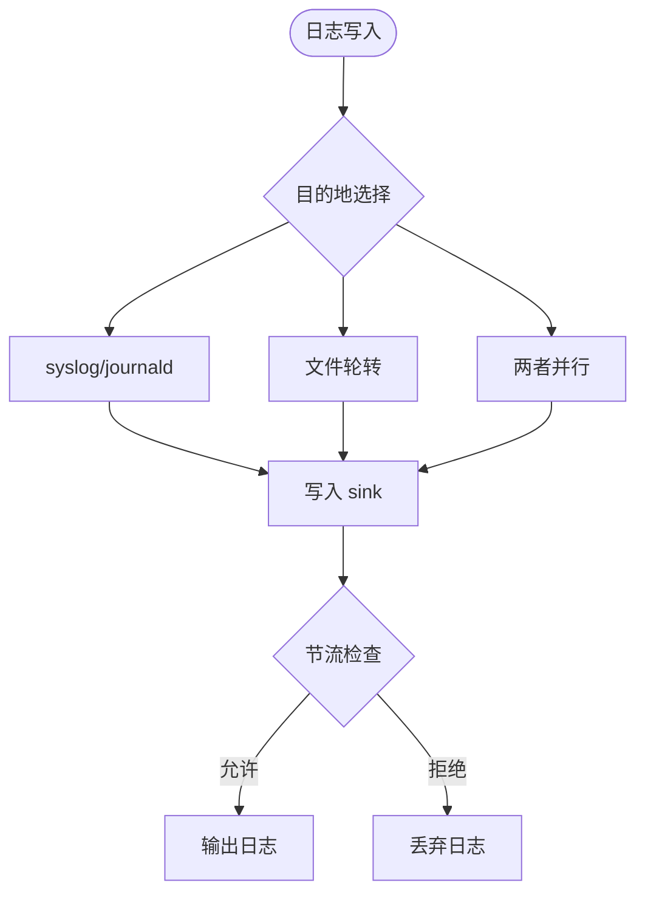
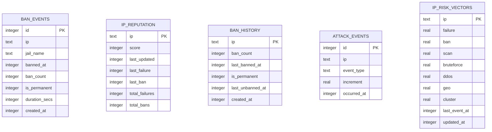
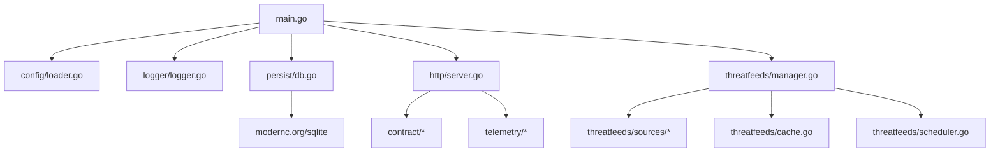

# 守护进程系统

<cite>
**本文引用的文件**   
- [README.md](file://README.md)
- [main.go](file://src/daemon/cmd/firewall-daemon/main.go)
- [daemon.md](file://docs/zh/architecture/daemon.md)
- [data-flow.md](file://docs/zh/architecture/data-flow.md)
- [server.go](file://src/daemon/internal/http/server.go)
- [manager.go](file://src/daemon/internal/threatfeeds/manager.go)
- [loader.go](file://src/daemon/internal/config/loader.go)
- [logger.go](file://src/daemon/internal/logger/logger.go)
- [db.go](file://src/daemon/internal/persist/db.go)
- [engine_test.go](file://src/daemon/internal/risk/engine_test.go)
</cite>

## 目录
1. [简介](#简介)
2. [项目结构](#项目结构)
3. [核心组件](#核心组件)
4. [架构总览](#架构总览)
5. [详细组件分析](#详细组件分析)
6. [依赖关系分析](#依赖关系分析)
7. [性能与并发特性](#性能与并发特性)
8. [错误处理与可观测性](#错误处理与可观测性)
9. [API 扩展与自定义规则指南](#api-扩展与自定义规则指南)
10. [故障排查](#故障排查)
11. [结论](#结论)

## 简介
本仓库实现了一个“用户态智能判定 + 内核态高速封禁”的三层防火墙：Go 守护进程负责日志采集、多维风险引擎、威胁情报聚合、HTTP API 与面板服务；C 内核模块在 netfilter 钩子中完成零用户态开销的包过滤、速率检测与封禁表维护。守护进程通过 netlink 与内核通信，通过 ProcFS 暴露运维接口，并通过 SQLite 持久化历史、信誉与攻击事件。

该文档聚焦守护进程系统的整体架构、生命周期管理、模块化设计，并深入说明风险引擎算法、威胁情报聚合机制、HTTP API 服务、配置管理、日志采集、数据库持久化、错误处理、并发控制与性能监控，最后给出 API 扩展与自定义规则开发方法。

**章节来源**
- [README.md:10-31](file://README.md#L10-L31)
- [README.md:76-131](file://README.md#L76-L131)

## 项目结构
守护进程代码位于 `src/daemon`，组合根为 `cmd/firewall-daemon/main.go`。内部按职责拆分为多个 `internal/*` 包：内核链路、HTTP 面、配置、日志、持久化、风险引擎、威胁情报、入站执行体、内核事件泵等。前端静态资源通过 `go:embed` 嵌入二进制，由 HTTP 服务器提供 SPA 面板。

**图表来源**
- [main.go:44-498](file://src/daemon/cmd/firewall-daemon/main.go#L44-L498)
- [server.go:34-113](file://src/daemon/internal/http/server.go#L34-L113)
- [manager.go:54-90](file://src/daemon/internal/threatfeeds/manager.go#L54-L90)
- [loader.go:17-50](file://src/daemon/internal/config/loader.go#L17-L50)
- [logger.go:92-116](file://src/daemon/internal/logger/logger.go#L92-L116)
- [db.go:23-65](file://src/daemon/internal/persist/db.go#L23-L65)

**章节来源**
- [daemon.md:20-57](file://docs/zh/architecture/daemon.md#L20-L57)
- [main.go:44-498](file://src/daemon/cmd/firewall-daemon/main.go#L44-L498)

## 核心组件
- 组合根与生命周期：解析参数、装配依赖、启动 goroutine、逆序关停。
- 内核链路：netlink 传输、消息编解码、请求路由、事件泵、采样与对账。
- HTTP API：REST、SSE、Prometheus 指标、认证与连接限额、静态面板挂载。
- 风险引擎：多维评分、时间衰减、阈值调整、自动分类。
- 威胁情报：多源并行拉取、解析、缓存、调度、统计。
- 配置管理：单文件或目录合并、严格模式、运行期覆盖、热重载与回滚。
- 日志系统：JSON Lines、多目的地、轮转、节流。
- 持久化：SQLite、WAL、迁移、清理调度器、信誉恢复。

**章节来源**
- [daemon.md:58-119](file://docs/zh/architecture/daemon.md#L58-L119)
- [daemon.md:120-214](file://docs/zh/architecture/daemon.md#L120-L214)
- [daemon.md:225-313](file://docs/zh/architecture/daemon.md#L225-L313)

## 架构总览
守护进程以组合根为中心，装配以下子系统并按依赖顺序启动：信号层 → 配置 → 日志 → 指标 → 持久化 → 内核链路 → HTTP 服务器 → 威胁情报 → 内核事件泵 → 入站执行体。关停时按登记逆序串行停止，确保事件先于库落盘收敛。

**图表来源**
- [main.go:44-498](file://src/daemon/cmd/firewall-daemon/main.go#L44-L498)
- [daemon.md:72-119](file://docs/zh/architecture/daemon.md#L72-L119)

**章节来源**
- [main.go:44-498](file://src/daemon/cmd/firewall-daemon/main.go#L44-L498)
- [daemon.md:72-119](file://docs/zh/architecture/daemon.md#L72-L119)

## 详细组件分析

### 守护进程生命周期与组合根
组合根负责装配与生命周期管理：
- 解析命令行参数，支持帮助、回滚短路径。
- 检查前端静态面板是否嵌入。
- 建立信号层，早于任何 goroutine。
- 加载配置并进行后处理（智能默认、校验、正则编译）。
- 初始化日志、健康检查、ProcFS 存在性检查。
- 注册 Prometheus 指标并预注册关键计数器。
- 初始化持久化与信誉缓存。
- 打开内核 netlink 链路，建立接收回路、路由器、客户端。
- 创建封禁/白名单/配置下发出口，供 HTTP 与入站共用。
- 创建 telemetry 快照存储与 jail 启用状态源。
- 按需启动 HTTP 服务器、SSE、威胁情报管理器。
- 创建内核事件泵，消费事件、周期采样、对账、发布 SSE。
- 创建入站执行体，接管配置所有权。
- 主 goroutine 监听 SIGTERM/SIGINT，调用 Supervisor 逆序关停。

**图表来源**
- [main.go:44-498](file://src/daemon/cmd/firewall-daemon/main.go#L44-L498)

**章节来源**
- [main.go:44-498](file://src/daemon/cmd/firewall-daemon/main.go#L44-L498)
- [daemon.md:84-119](file://docs/zh/architecture/daemon.md#L84-L119)

### 风险引擎核心算法
风险引擎采用多维评分模型，维度包括失败、扫描、探测、协议异常、历史信誉等。关键特性：
- 多维独立评估，加法阈值模型，避免内网与低信誉互相抵消。
- 时间衰减：风险分数随时间指数衰减，避免永久误判。
- 有效阈值调整：高峰时段加成、内网加成、信誉调整。
- 渐进式时长：第 1 次 base、第 2 次 1800、第 3 次 86400、第 4 次起永久。
- 自动分类：基于风险向量判定攻击类型。

测试覆盖了记录事件、获取向量、计算有效阈值、ShouldBan 判定与信誉调整函数。

**图表来源**
- [engine_test.go:7-41](file://src/daemon/internal/risk/engine_test.go#L7-L41)
- [engine_test.go:43-125](file://src/daemon/internal/risk/engine_test.go#L43-L125)
- [engine_test.go:128-144](file://src/daemon/internal/risk/engine_test.go#L128-L144)
- [engine_test.go:146-165](file://src/daemon/internal/risk/engine_test.go#L146-L165)

**章节来源**
- [engine_test.go:7-180](file://src/daemon/internal/risk/engine_test.go#L7-L180)
- [README.md:78-87](file://README.md#L78-L87)

### 威胁情报聚合机制
威胁情报管理器支持多源并行拉取、解析、缓存与调度：
- 并发刷新：多个源并行刷新，总耗时取最慢源。
- 错误隔离：单个源失败不影响其他源。
- 性能隔离：后台 goroutine 刷新，不阻塞主判定链路。
- 可观测：每个源的状态、错误、条目数可查询。
- 调度器：定时刷新，带抖动，支持手动触发。
- 缓存：IP 到情报条目的快速查找。

**图表来源**
- [manager.go:27-41](file://src/daemon/internal/threatfeeds/manager.go#L27-L41)
- [manager.go:54-90](file://src/daemon/internal/threatfeeds/manager.go#L54-L90)
- [manager.go:111-155](file://src/daemon/internal/threatfeeds/manager.go#L111-L155)
- [manager.go:207-268](file://src/daemon/internal/threatfeeds/manager.go#L207-L268)

**章节来源**
- [manager.go:27-268](file://src/daemon/internal/threatfeeds/manager.go#L27-L268)
- [README.md:88-98](file://README.md#L88-L98)

### HTTP API 服务实现
HTTP 服务器承载 REST API、SSE 事件流、Prometheus 指标与静态面板：
- 安全头中间件、连接限额、超时配置。
- 认证中间件（Basic Auth）、失败锁定、SSE 令牌支持。
- 路由注册与契约校验。
- 健康探针 `/health`、`/healthz`。
- 统计端点 `/api/v2/stats`、速率历史、协议分布。
- 封禁、白名单、配置、威胁情报等 API。

**图表来源**
- [server.go:34-113](file://src/daemon/internal/http/server.go#L34-L113)
- [daemon.md:225-269](file://docs/zh/architecture/daemon.md#L225-L269)

**章节来源**
- [server.go:34-158](file://src/daemon/internal/http/server.go#L34-L158)
- [daemon.md:225-313](file://docs/zh/architecture/daemon.md#L225-L313)

### 配置管理系统
配置支持单文件或目录合并：
- 单文件：原子解析，失败回滚。
- 目录：字母序合并，运行期覆盖文件 `_` 前缀最后合并。
- 严格模式：未知 key 报错。
- 热重载：SIGHUP 或文件变化，重读、比较差异、更新内核白名单。
- 回滚：SIGUSR1 或 `--rollback`。
- 内核下发：PUT /config 与执行体重载共用同一出口。

**图表来源**
- [loader.go:17-50](file://src/daemon/internal/config/loader.go#L17-L50)
- [loader.go:53-128](file://src/daemon/internal/config/loader.go#L53-L128)
- [daemon.md:270-287](file://docs/zh/architecture/daemon.md#L270-L287)

**章节来源**
- [loader.go:17-128](file://src/daemon/internal/config/loader.go#L17-L128)
- [daemon.md:270-287](file://docs/zh/architecture/daemon.md#L270-L287)

### 日志采集处理
日志系统支持多目的地、JSON Lines 格式、轮转与节流：
- 目的地：syslog、journald、文件、两者，不可用时降级 stderr。
- 轮转：按大小切片，保留数量可控。
- 节流：高频路径限制日志频率。
- 路径登记：供日志查看器读取。

**图表来源**
- [logger.go:92-116](file://src/daemon/internal/logger/logger.go#L92-L116)
- [logger.go:118-170](file://src/daemon/internal/logger/logger.go#L118-L170)
- [logger.go:213-233](file://src/daemon/internal/logger/logger.go#L213-L233)

**章节来源**
- [logger.go:92-233](file://src/daemon/internal/logger/logger.go#L92-L233)
- [daemon.md:314-334](file://docs/zh/architecture/daemon.md#L314-L334)

### 数据库持久化
持久化使用 SQLite，支持 WAL 模式、迁移、清理调度器：
- 表结构：ban_events、ip_reputation、ban_history、attack_events、ip_risk_vectors。
- 迁移：版本化增量迁移，幂等列添加。
- 清理：按保留期清理过期数据。
- 信誉恢复：周期性恢复信誉分。

**图表来源**
- [db.go:71-144](file://src/daemon/internal/persist/db.go#L71-L144)

**章节来源**
- [db.go:23-352](file://src/daemon/internal/persist/db.go#L23-L352)
- [daemon.md:289-313](file://docs/zh/architecture/daemon.md#L289-L313)

## 依赖关系分析
守护进程内部依赖关系清晰，主要依赖方向如下：
- main.go 依赖 config、logger、persist、kernel、http、threatfeeds、runtime。
- http 依赖 contract、telemetry、bans。
- threatfeeds 依赖 sources、cache、scheduler。
- persist 依赖 sqlite 驱动。
- logger 依赖 config。

**图表来源**
- [main.go:22-34](file://src/daemon/cmd/firewall-daemon/main.go#L22-L34)
- [server.go:3-12](file://src/daemon/internal/http/server.go#L3-L12)
- [manager.go:3-12](file://src/daemon/internal/threatfeeds/manager.go#L3-L12)
- [db.go:3-10](file://src/daemon/internal/persist/db.go#L3-L10)

**章节来源**
- [main.go:22-34](file://src/daemon/cmd/firewall-daemon/main.go#L22-L34)
- [server.go:3-12](file://src/daemon/internal/http/server.go#L3-L12)
- [manager.go:3-12](file://src/daemon/internal/threatfeeds/manager.go#L3-L12)
- [db.go:3-10](file://src/daemon/internal/persist/db.go#L3-L10)

## 性能与并发特性
- 内核热路径：netfilter 钩子 O(1) 平均查找，RCU 保护，零用户态开销。
- 守护进程入站主链路：单一 goroutine 顺序处理，段间无队列，避免丢包。
- 威胁情报：多源并行刷新，错误隔离，后台调度。
- HTTP 服务器：连接限额、超时控制、SSE 独立计数。
- 指标：预注册计数器，避免首次自增延迟。
- 日志：节流器防止高频路径刷满日志。

**章节来源**
- [data-flow.md:316-327](file://docs/zh/architecture/data-flow.md#L316-L327)
- [daemon.md:58-82](file://docs/zh/architecture/daemon.md#L58-L82)
- [manager.go:111-155](file://src/daemon/internal/threatfeeds/manager.go#L111-L155)
- [server.go:129-149](file://src/daemon/internal/http/server.go#L129-L149)
- [logger.go:213-233](file://src/daemon/internal/logger/logger.go#L213-L233)

## 错误处理与可观测性
- 错误处理：内核链路失败降级、持久化失败降级、HTTP 服务器关停强制关闭。
- 可观测性：Prometheus 指标、SSE 实时事件、健康探针、内核版本读取。
- 信号处理：SIGTERM/SIGINT 优雅关停、SIGHUP 热重载、SIGUSR1 回滚。

**章节来源**
- [main.go:173-200](file://src/daemon/cmd/firewall-daemon/main.go#L173-L200)
- [server.go:92-113](file://src/daemon/internal/http/server.go#L92-L113)
- [daemon.md:326-334](file://docs/zh/architecture/daemon.md#L326-L334)
- [daemon.md:335-366](file://docs/zh/architecture/daemon.md#L335-L366)

## API 扩展与自定义规则指南
- API 扩展：新增路由需在 `internal/http/routes.go` 注册，并确保契约生成物一致。
- 自定义规则：在 `internal/jail` 中定义规则集，使用 `Finalize` 进行正则编译与校验。
- 风险引擎扩展：在 `internal/risk` 中添加新维度与权重，更新 `DefaultDimensionWeights`。
- 威胁情报源扩展：在 `threatfeeds/sources` 中实现新源适配器，并在 `buildSource` 中注册。

**章节来源**
- [daemon.md:236-247](file://docs/zh/architecture/daemon.md#L236-L247)
- [daemon.md:270-287](file://docs/zh/architecture/daemon.md#L270-L287)
- [engine_test.go:7-41](file://src/daemon/internal/risk/engine_test.go#L7-L41)
- [manager.go:93-109](file://src/daemon/internal/threatfeeds/manager.go#L93-L109)

## 故障排查
- 面板缺失：检查 `go:embed web_ui/static` 是否成功嵌入。
- 内核链路不可用：检查 netlink 订阅与 ProcFS 是否存在。
- 配置加载失败：检查 YAML 语法与严格模式未知 key。
- 日志无法写入：检查 syslog/journald/socket 权限与文件路径。
- 数据库迁移失败：检查 schema_migrations 表与权限。

**章节来源**
- [main.go:62-65](file://src/daemon/cmd/firewall-daemon/main.go#L62-L65)
- [main.go:122-124](file://src/daemon/cmd/firewall-daemon/main.go#L122-L124)
- [loader.go:20-50](file://src/daemon/internal/config/loader.go#L20-L50)
- [logger.go:118-170](file://src/daemon/internal/logger/logger.go#L118-L170)
- [db.go:71-175](file://src/daemon/internal/persist/db.go#L71-L175)

## 结论
守护进程系统通过清晰的模块化设计与严格的组合根装配流程，实现了高可用、高性能的智能防火墙。风险引擎的多维评分与威胁情报的并行聚合提供了强大的威胁检测能力，HTTP API 与 SSE 提供了丰富的可观测性与管理能力。配置管理、日志系统与持久化确保了系统的可维护性与稳定性。未来可扩展风险维度、威胁情报源与 API 功能，以满足更复杂的网络安全需求。