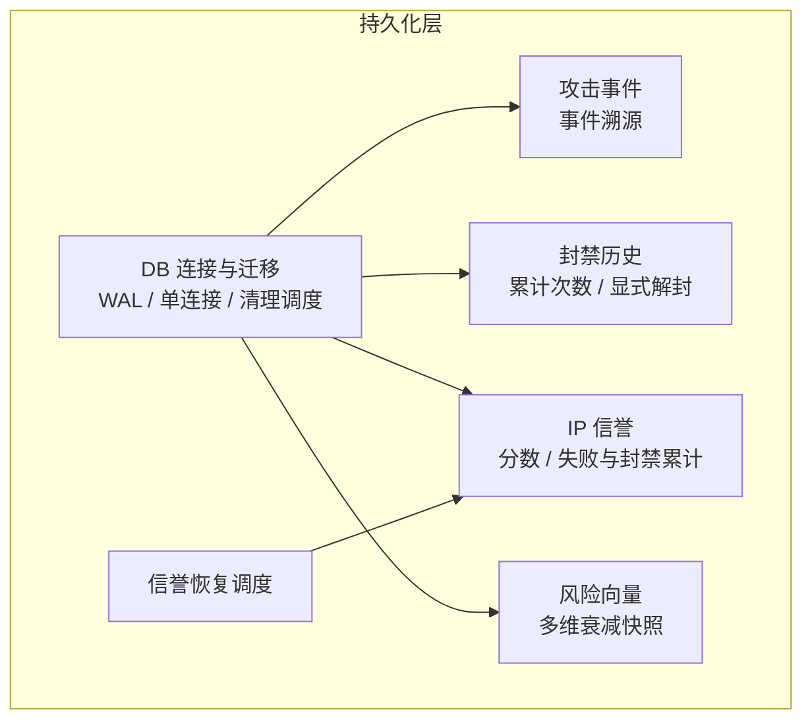
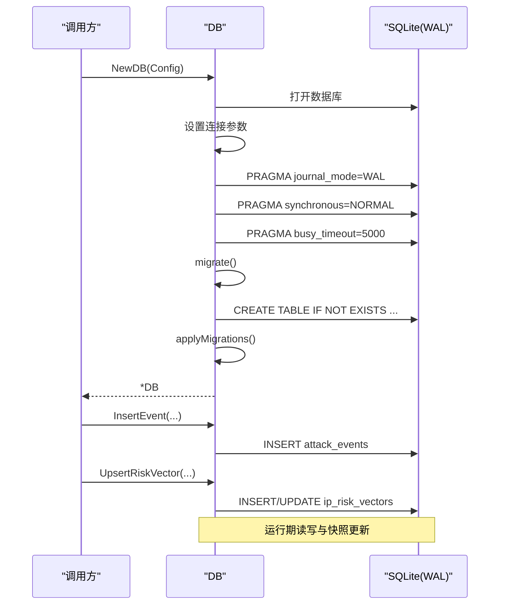
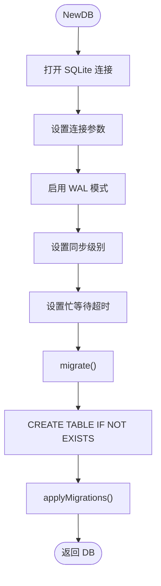
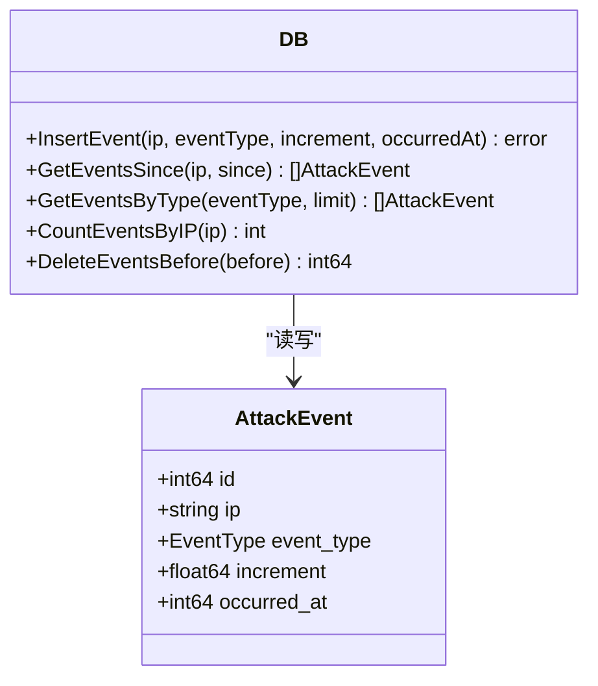
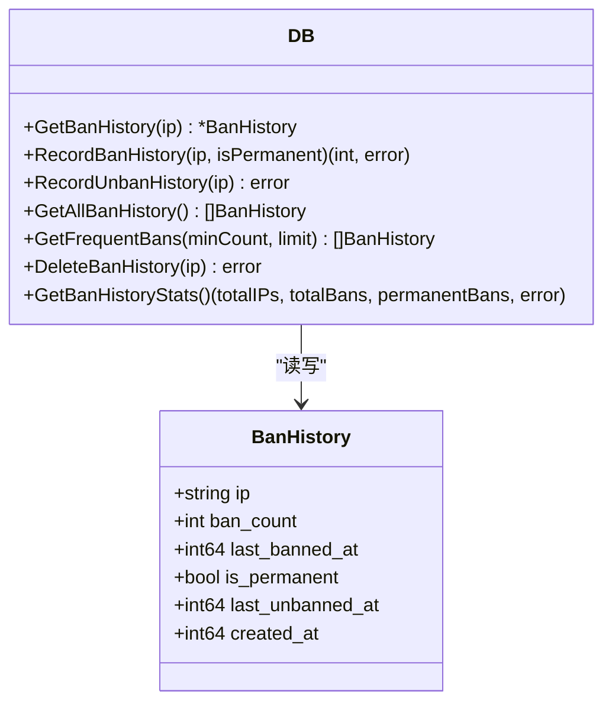
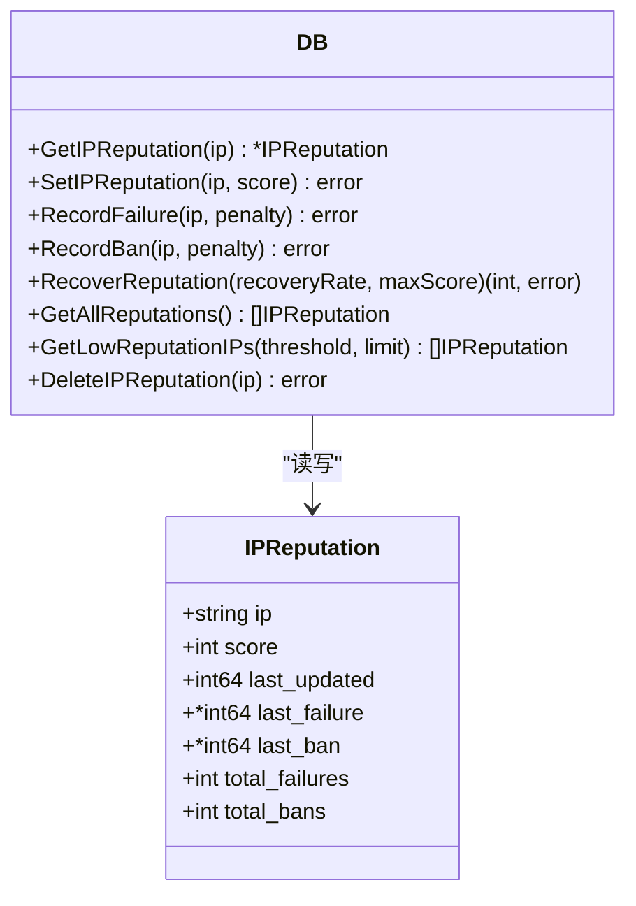
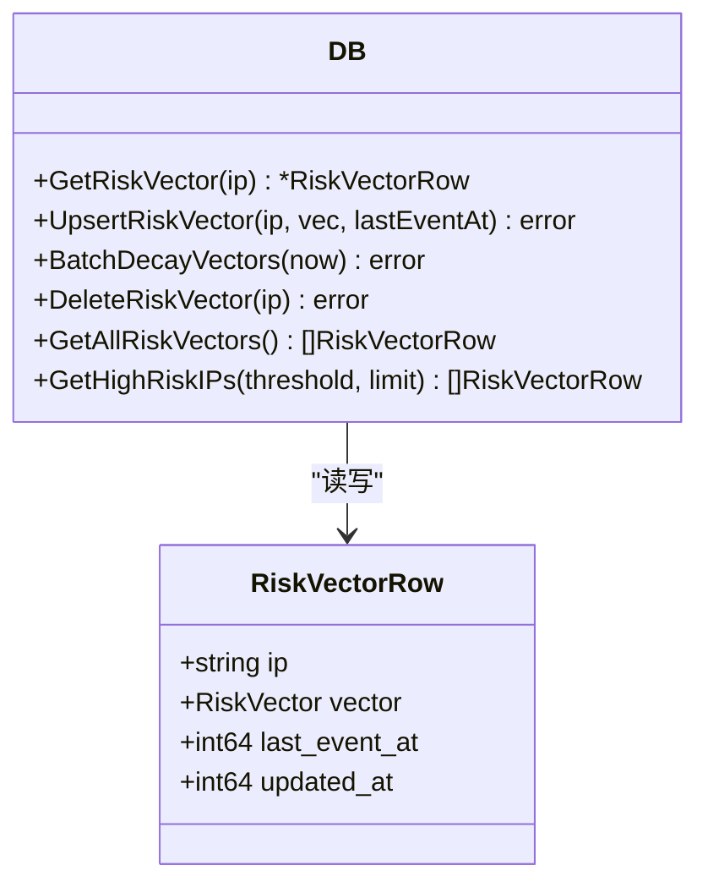
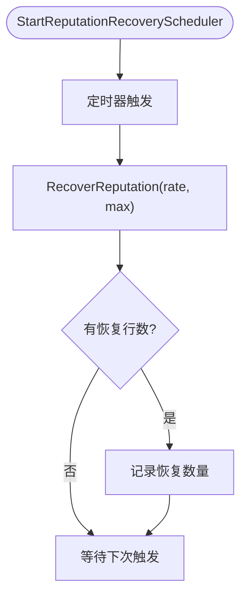
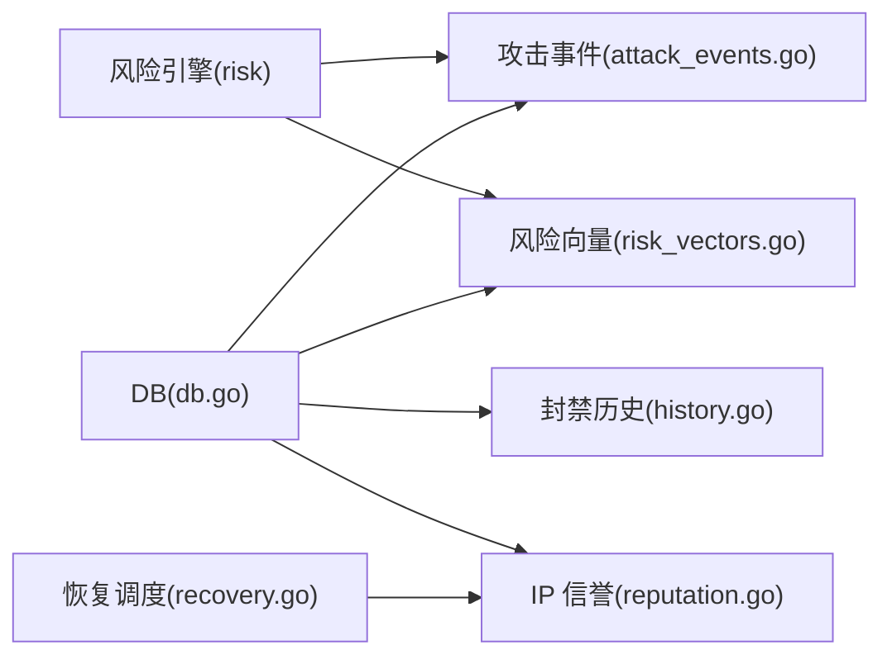
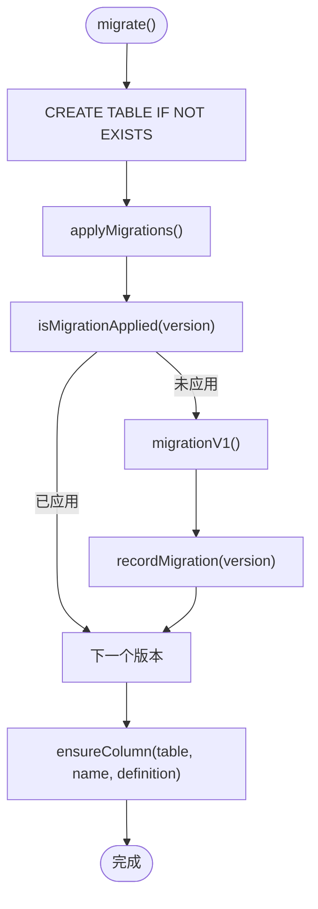

# 数据持久化

<cite>
**本文引用的文件**   
- [db.go](file://src/daemon/internal/persist/db.go)
- [attack_events.go](file://src/daemon/internal/persist/attack_events.go)
- [history.go](file://src/daemon/internal/persist/history.go)
- [reputation.go](file://src/daemon/internal/persist/reputation.go)
- [risk_vectors.go](file://src/daemon/internal/persist/risk_vectors.go)
- [recovery.go](file://src/daemon/internal/persist/recovery.go)
- [activity_test.go](file://src/daemon/internal/persist/activity_test.go)
- [ban_events_test.go](file://src/daemon/internal/persist/ban_events_test.go)
- [history_test.go](file://src/daemon/internal/persist/history_test.go)
- [db_test.go](file://src/daemon/internal/persist/db_test.go)
</cite>

## 目录
1. [引言](#引言)
2. [项目结构](#项目结构)
3. [核心组件](#核心组件)
4. [架构总览](#架构总览)
5. [详细组件分析](#详细组件分析)
6. [依赖关系分析](#依赖关系分析)
7. [性能与索引优化](#性能与索引优化)
8. [数据迁移方案](#数据迁移方案)
9. [备份与恢复流程](#备份与恢复流程)
10. [故障排查指南](#故障排查指南)
11. [结论](#结论)

## 引言
本文件系统梳理 Linux Firewall Kernel Module 守护进程中的 SQLite 数据持久化层。重点覆盖：
- 数据库设计与表结构关系
- 活动记录、攻击事件、封禁历史的数据模型
- 信誉评分、风险向量、遥测数据的存储策略
- 数据迁移机制、清理与归档
- 备份恢复流程与性能调优建议

该持久化层以 SQLite 为唯一后端，通过 WAL 模式、单连接、幂等迁移和定时清理，支撑封禁决策、风控面板、审计统计与趋势分析。

## 项目结构
持久化相关代码集中在守护进程的 `internal/persist` 包中，按职责拆分为数据库初始化与迁移、攻击事件、封禁历史、IP 信誉、风险向量与恢复调度等文件。测试文件覆盖了迁移幂等性、字段补全、窗口语义、排序与计数等关键行为。

**图表来源**
- [db.go:12-65](file://src/daemon/internal/persist/db.go#L12-L65)
- [attack_events.go:11-36](file://src/daemon/internal/persist/attack_events.go#L11-L36)
- [history.go:9-65](file://src/daemon/internal/persist/history.go#L9-L65)
- [reputation.go:9-137](file://src/daemon/internal/persist/reputation.go#L9-L137)
- [risk_vectors.go:11-84](file://src/daemon/internal/persist/risk_vectors.go#L11-L84)
- [recovery.go:7-34](file://src/daemon/internal/persist/recovery.go#L7-L34)

**章节来源**
- [db.go:12-65](file://src/daemon/internal/persist/db.go#L12-L65)

## 核心组件
- 数据库连接与配置：封装 SQLite 连接、WAL 模式、同步级别、忙等待超时、单连接限制，并在启动时执行建表与迁移。
- 攻击事件：以事件溯源方式记录每次攻击的增量与发生时间，支持按 IP、类型、时间范围查询与清理。
- 封禁历史：维护每个 IP 的累计封禁次数、最近封禁时间、是否永久封禁、最近一次显式解封时间。
- IP 信誉：维护 IP 信誉分、最近失败/封禁时间、累计失败/封禁次数，并提供扣分、封禁惩罚与恢复逻辑。
- 风险向量：对多个风险维度（失败、封禁、扫描、暴力破解、DDoS、地理、集群）进行加权与衰减，提供批量衰减与高威胁 IP 查询。
- 清理与恢复调度：定时清理过期数据；周期性提升低信誉 IP 的分数。

**章节来源**
- [db.go:18-65](file://src/daemon/internal/persist/db.go#L18-L65)
- [attack_events.go:11-36](file://src/daemon/internal/persist/attack_events.go#L11-L36)
- [history.go:9-65](file://src/daemon/internal/persist/history.go#L9-L65)
- [reputation.go:9-137](file://src/daemon/internal/persist/reputation.go#L9-L137)
- [risk_vectors.go:11-84](file://src/daemon/internal/persist/risk_vectors.go#L11-L84)
- [recovery.go:7-34](file://src/daemon/internal/persist/recovery.go#L7-L34)

## 架构总览
持久化层对外暴露结构化接口，内部统一使用 SQLite。启动阶段完成 schema 创建与增量迁移；运行期由业务模块写入攻击事件、封禁事件、信誉与风险向量；后台任务负责衰减、清理与信誉恢复。

**图表来源**
- [db.go:23-65](file://src/daemon/internal/persist/db.go#L23-L65)
- [attack_events.go:20-36](file://src/daemon/internal/persist/attack_events.go#L20-L36)
- [risk_vectors.go:50-84](file://src/daemon/internal/persist/risk_vectors.go#L50-L84)

## 详细组件分析

### 数据库连接与迁移
- 连接参数：最大打开连接数与空闲连接数均为 1，生命周期无限，避免多写者竞争。
- WAL 模式：提高并发读能力并减少锁冲突。
- 同步级别：NORMAL 平衡性能与安全。
- 忙等待：busy_timeout 5 秒降低锁争用时的失败率。
- 迁移：启动时执行 schema 创建与版本化迁移，支持向后兼容列补齐。

**图表来源**
- [db.go:23-65](file://src/daemon/internal/persist/db.go#L23-L65)
- [db.go:71-175](file://src/daemon/internal/persist/db.go#L71-L175)

**章节来源**
- [db.go:18-65](file://src/daemon/internal/persist/db.go#L18-L65)
- [db.go:71-175](file://src/daemon/internal/persist/db.go#L71-L175)

### 攻击事件数据模型
- 表：`attack_events`
- 字段：自增 ID、IP、事件类型、增量、发生时间（Unix 秒）。
- 索引：按 IP+时间降序、事件类型、发生时间。
- 操作：插入、按 IP 与时间范围查询、按类型查询、按 IP 计数、按时间清理。

**图表来源**
- [attack_events.go:11-36](file://src/daemon/internal/persist/attack_events.go#L11-L36)
- [attack_events.go:38-136](file://src/daemon/internal/persist/attack_events.go#L38-L136)

**章节来源**
- [attack_events.go:11-136](file://src/daemon/internal/persist/attack_events.go#L11-L136)

### 封禁历史数据模型
- 表：`ban_history`
- 字段：IP 主键、累计封禁次数、最近封禁时间、是否永久、最近显式解封时间、创建时间。
- 语义：仅记录“显式解封”，临时封禁到期不写解封时间；重复封禁递增序号。
- 操作：获取、写入（UPSERT）、解封、全部列表、高频封禁、删除、统计。

**图表来源**
- [history.go:9-65](file://src/daemon/internal/persist/history.go#L9-L65)
- [history.go:67-164](file://src/daemon/internal/persist/history.go#L67-L164)

**章节来源**
- [history.go:9-164](file://src/daemon/internal/persist/history.go#L9-L164)

### IP 信誉数据模型
- 表：`ip_reputation`
- 字段：IP 主键、分数、最近更新时间、最近失败时间、最近封禁时间、累计失败次数、累计封禁次数。
- 语义：分数初始 100，失败与封禁会扣分；累计计数从列存在后开始累加，旧行从 0 起算。
- 操作：读取、设置、记录失败、记录封禁、批量恢复、全部列表、低信誉列表、删除。

**图表来源**
- [reputation.go:9-137](file://src/daemon/internal/persist/reputation.go#L9-L137)
- [reputation.go:139-202](file://src/daemon/internal/persist/reputation.go#L139-L202)

**章节来源**
- [reputation.go:9-202](file://src/daemon/internal/persist/reputation.go#L9-L202)

### 风险向量数据模型
- 表：`ip_risk_vectors`
- 字段：IP 主键、各维度值（失败、封禁、扫描、暴力破解、DDoS、地理、集群）、最近事件时间、更新时间。
- 语义：向量快照，事件后更新；定期批量衰减，接近 0 则删除。
- 操作：读取、UPSERT、批量衰减、删除、全部列表、高威胁 IP 列表。

**图表来源**
- [risk_vectors.go:11-84](file://src/daemon/internal/persist/risk_vectors.go#L11-L84)
- [risk_vectors.go:86-236](file://src/daemon/internal/persist/risk_vectors.go#L86-L236)

**章节来源**
- [risk_vectors.go:11-236](file://src/daemon/internal/persist/risk_vectors.go#L11-L236)

### 信誉恢复调度
- 周期任务：按间隔调用信誉恢复，提升低于上限的分数，受恢复速率与上限控制。
- 触发条件：最近失败超过一定时间才恢复，避免频繁波动。

**图表来源**
- [recovery.go:7-34](file://src/daemon/internal/persist/recovery.go#L7-L34)
- [reputation.go:118-137](file://src/daemon/internal/persist/reputation.go#L118-L137)

**章节来源**
- [recovery.go:7-34](file://src/daemon/internal/persist/recovery.go#L7-L34)
- [reputation.go:118-137](file://src/daemon/internal/persist/reputation.go#L118-L137)

## 依赖关系分析
- 攻击事件依赖风险引擎的事件类型定义，用于分类与统计。
- 风险向量依赖风险引擎的向量结构与衰减函数。
- 封禁历史与信誉相互独立，但共同服务于面板展示与阈值判定。
- 清理调度与恢复调度均依赖 DB 的连接与日志器。

**图表来源**
- [attack_events.go:1-9](file://src/daemon/internal/persist/attack_events.go#L1-L9)
- [risk_vectors.go:1-9](file://src/daemon/internal/persist/risk_vectors.go#L1-L9)
- [db.go:1-10](file://src/daemon/internal/persist/db.go#L1-L10)
- [recovery.go:1-5](file://src/daemon/internal/persist/recovery.go#L1-L5)

**章节来源**
- [attack_events.go:1-9](file://src/daemon/internal/persist/attack_events.go#L1-L9)
- [risk_vectors.go:1-9](file://src/daemon/internal/persist/risk_vectors.go#L1-L9)
- [db.go:1-10](file://src/daemon/internal/persist/db.go#L1-L10)
- [recovery.go:1-5](file://src/daemon/internal/persist/recovery.go#L1-L5)

## 性能与索引优化
- 连接池：单连接避免 SQLite 多写者竞争，适合守护进程单实例场景。
- WAL 模式：提升读并发，减少写阻塞。
- 同步级别 NORMAL：在崩溃恢复与性能之间折中。
- busy_timeout：降低锁争用导致的失败。
- 索引设计：
  - `ban_events`：按 IP、jail_name、banned_at、created_at 建立索引，支持按时间窗口与聚合统计。
  - `attack_events`：复合索引 `(ip, occurred_at DESC)` 加速按 IP 的时间序列查询；单独索引 `event_type`、`occurred_at` 支持类型过滤与时间范围。
  - `ip_risk_vectors`：按 `updated_at` 索引便于批量衰减与清理。
  - `ip_reputation`：按 `score` 索引支持低信誉筛选。
  - `ban_history`：按 `ban_count`、`last_banned_at` 索引支持高频封禁与时间排序。
- 清理策略：按保留天数删除过期事件、信誉、历史、向量，防止数据库膨胀。
- 批量衰减：对风险向量周期性衰减，近零向量直接删除，减少无效数据。

**章节来源**
- [db.go:31-51](file://src/daemon/internal/persist/db.go#L31-L51)
- [db.go:71-144](file://src/daemon/internal/persist/db.go#L71-L144)
- [db.go:283-351](file://src/daemon/internal/persist/db.go#L283-L351)
- [risk_vectors.go:86-144](file://src/daemon/internal/persist/risk_vectors.go#L86-L144)

## 数据迁移方案
- 版本化迁移：通过 `schema_migrations` 表记录已应用版本，启动时检查并顺序执行未应用的迁移。
- 幂等建表：使用 `CREATE TABLE IF NOT EXISTS` 保证多次启动安全。
- 列补齐：通过 `ensureColumn` 检测并追加缺失列，避免二次启动报 duplicate column。
- 迁移只补列不补史：
  - `ban_events.duration_secs` 旧行保持 NULL，避免被直方图误读为 0 秒封禁。
  - `ip_reputation.total_failures`、`total_bans` 旧行从 0 起算，符合“列存在后的累计”语义。
- 当前 v1 为空操作，预留未来扩展点。

**图表来源**
- [db.go:71-175](file://src/daemon/internal/persist/db.go#L71-L175)
- [db.go:177-213](file://src/daemon/internal/persist/db.go#L177-L213)
- [db.go:215-281](file://src/daemon/internal/persist/db.go#L215-L281)

**章节来源**
- [db.go:71-281](file://src/daemon/internal/persist/db.go#L71-L281)

## 备份与恢复流程
- 备份：
  - 推荐在守护进程停止或进入只读状态后进行物理拷贝，确保一致性。
  - 若需在线备份，可使用 SQLite 提供的备份 API（例如 `sqlite3_backup_*`），或在 WAL 模式下进行一致快照。
- 恢复：
  - 将备份文件复制到目标路径，确保守护进程可写。
  - 重启守护进程，自动执行 schema 创建与迁移，确保库结构最新。
- 注意事项：
  - 备份前确认 WAL 文件 `.wal` 与共享内存 `.shm` 一并备份，以保证一致性。
  - 恢复后首次启动会执行迁移，确保列补齐与版本记录正确。

[本节为通用指导，不直接分析具体文件]

## 故障排查指南
- 启动失败：
  - 检查数据库路径是否为空、SQLite 驱动是否正确加载。
  - 查看迁移日志，确认 `schema_migrations` 是否记录成功。
- 锁冲突或写入失败：
  - 检查 busy_timeout 配置与 WAL 模式是否生效。
  - 确认没有外部进程同时写入同一数据库文件。
- 数据不一致：
  - 核对 `ban_events.banned_at` 与 `created_at` 是否一致。
  - 检查 `ip_reputation.last_failure`、`last_ban` 是否为空指针。
  - 验证 `ban_history.last_unbanned_at` 是否在显式解封后更新。
- 性能问题：
  - 检查索引是否命中，尤其是按 IP 和时间范围的查询。
  - 评估清理调度频率与保留天数，避免数据量过大。
  - 监控风险向量批量衰减是否及时删除近零向量。

**章节来源**
- [db.go:23-65](file://src/daemon/internal/persist/db.go#L23-L65)
- [db.go:71-175](file://src/daemon/internal/persist/db.go#L71-L175)
- [history.go:67-81](file://src/daemon/internal/persist/history.go#L67-L81)
- [reputation.go:82-116](file://src/daemon/internal/persist/reputation.go#L82-L116)
- [risk_vectors.go:86-144](file://src/daemon/internal/persist/risk_vectors.go#L86-L144)

## 结论
该数据持久化系统以 SQLite 为核心，围绕攻击事件、封禁历史、IP 信誉与风险向量构建完整的风控数据模型。通过 WAL、单连接、幂等迁移与定时清理，系统在稳定性、可扩展性与性能之间取得平衡。建议在部署时合理配置清理与衰减策略，结合索引优化与备份恢复流程，保障长期运行的可靠性与可观测性。