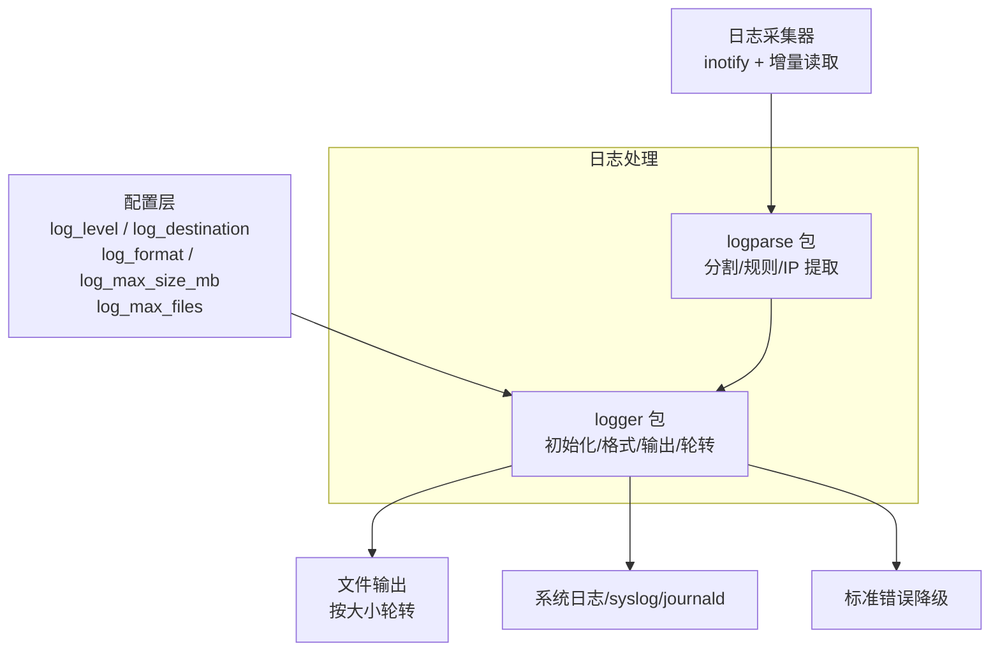
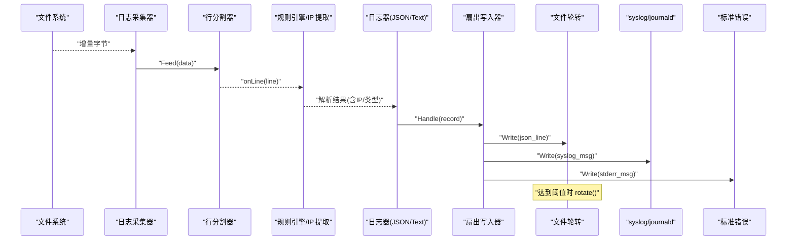
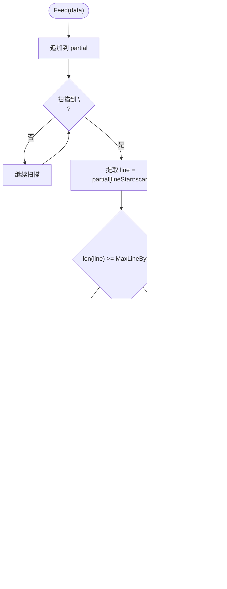
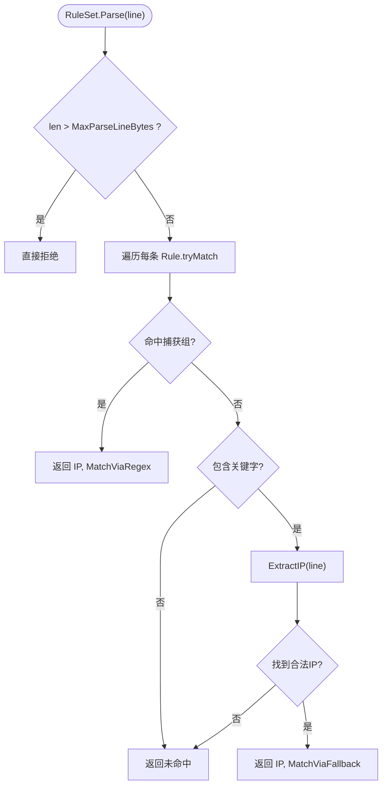
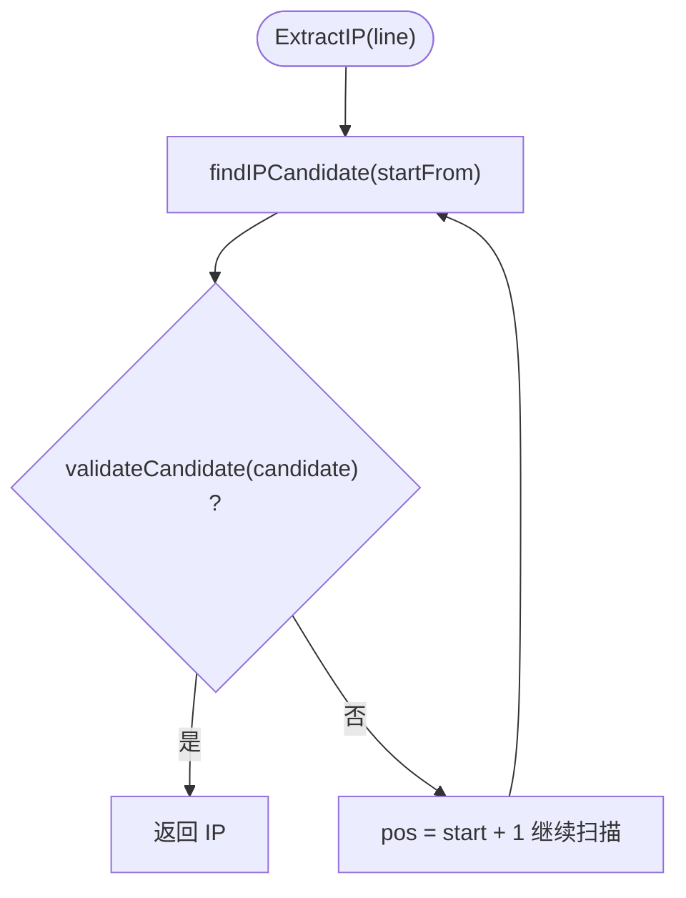
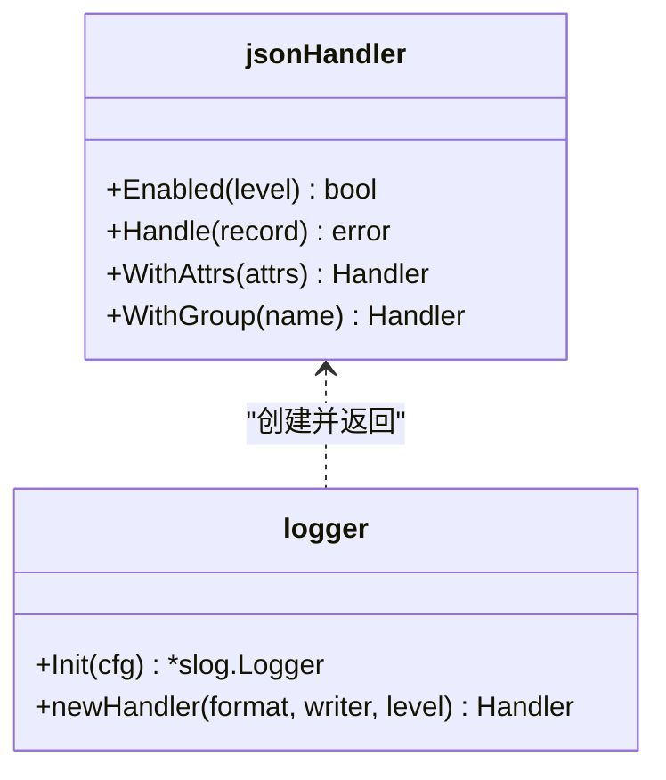
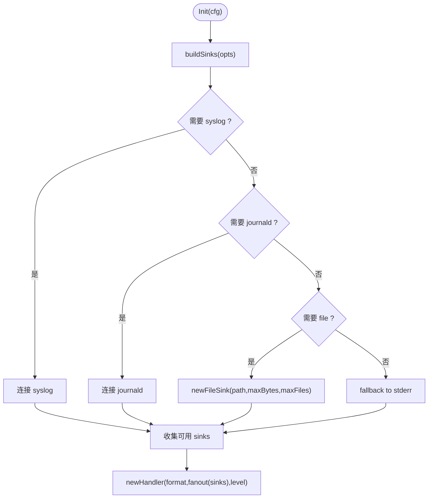
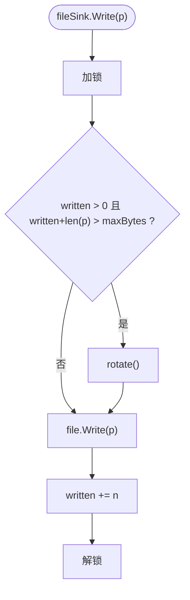
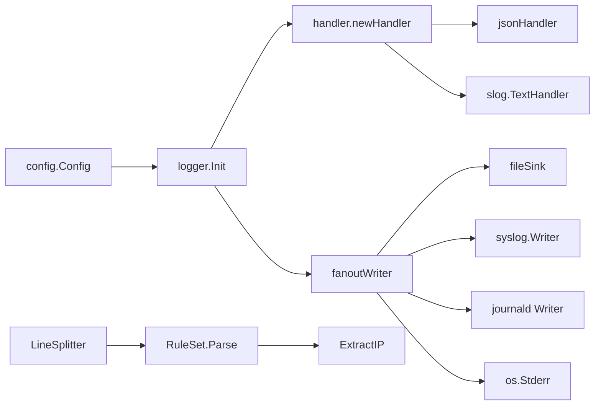

# 日志处理系统

<cite>
**本文引用的文件**   
- [README.md](file://README.md)
- [doc.go](file://src/daemon/internal/logger/doc.go)
- [logger.go](file://src/daemon/internal/logger/logger.go)
- [handler.go](file://src/daemon/internal/logger/handler.go)
- [json.go](file://src/daemon/internal/logger/json.go)
- [file.go](file://src/daemon/internal/logger/file.go)
- [ip.go](file://src/daemon/internal/logparse/ip.go)
- [rule.go](file://src/daemon/internal/logparse/rule.go)
- [splitter.go](file://src/daemon/internal/logparse/splitter.go)
</cite>

## 目录
1. [引言](#引言)
2. [项目结构](#项目结构)
3. [核心组件](#核心组件)
4. [架构总览](#架构总览)
5. [详细组件分析](#详细组件分析)
6. [依赖关系分析](#依赖关系分析)
7. [性能与优化](#性能与优化)
8. [故障排查指南](#故障排查指南)
9. [结论](#结论)

## 引言
本文件系统性地梳理守护进程中的日志处理子系统，覆盖日志采集、解析、格式化、输出与轮转。重点包括：
- 日志采集器：基于行分割器的增量读取与半行缓冲。
- 解析器：正则规则引擎、关键字回退、IP 地址提取与保留段过滤。
- 格式化器：JSON Lines 结构化日志与级别映射。
- 输出与轮转：多目的地扇出、按大小轮转、文件句柄管理。
- 安全与健壮性：ReDoS 防护、超长行丢弃、不可用目的地降级。

该子系统位于守护进程的 Go 代码中，配合内核模块产生的防火墙事件与各类服务日志，共同构成“日志采集 → 解析 → 风险判定 → 封禁”的数据流。

**章节来源**
- [README.md:111-119](file://README.md#L111-L119)

## 项目结构
日志相关代码集中在两个子包：
- `internal/logger`：负责日志初始化、格式编码、目的地扇出、文件轮转与节流。
- `internal/logparse`：负责日志行分割、正则规则匹配、IP 提取与安全校验。

**图表来源**
- [doc.go:1-16](file://src/daemon/internal/logger/doc.go#L1-L16)
- [logger.go:92-116](file://src/daemon/internal/logger/logger.go#L92-L116)
- [file.go:23-52](file://src/daemon/internal/logger/file.go#L23-L52)
- [splitter.go:14-25](file://src/daemon/internal/logparse/splitter.go#L14-L25)
- [rule.go:79-127](file://src/daemon/internal/logparse/rule.go#L79-L127)

**章节来源**
- [doc.go:1-16](file://src/daemon/internal/logger/doc.go#L1-L16)
- [splitter.go:1-25](file://src/daemon/internal/logparse/splitter.go#L1-L25)

## 核心组件
- 日志初始化与级别控制：根据配置选择 JSON 或文本格式，建立 slog 处理器并注入版本属性。
- 目的地扇出：同时支持 syslog、journald、文件、stderr；任一失败不中断其他通道。
- JSON 结构化日志：固定字段顺序 ts/level/msg/version/自定义属性，单次内存编码后一次写出。
- 文件轮转：按大小阈值轮转，片名 `<base>.n`，n 越大越旧；可限制保留数量。
- 行分割器：维护每源半行缓冲，按换行符拆分，超长行丢弃并统计。
- 规则引擎：预编译正则规则集，从右到左扫描捕获组，未命中时走关键字窄路径回退。
- IP 提取：词边界检查 + 长度窗口 + 合法 IP 校验 + 保留段拒绝。

**章节来源**
- [logger.go:92-116](file://src/daemon/internal/logger/logger.go#L92-L116)
- [handler.go:10-45](file://src/daemon/internal/logger/handler.go#L10-L45)
- [json.go:14-51](file://src/daemon/internal/logger/json.go#L14-L51)
- [file.go:23-120](file://src/daemon/internal/logger/file.go#L23-L120)
- [splitter.go:14-91](file://src/daemon/internal/logparse/splitter.go#L14-L91)
- [rule.go:35-127](file://src/daemon/internal/logparse/rule.go#L35-L127)
- [ip.go:17-82](file://src/daemon/internal/logparse/ip.go#L17-L82)

## 架构总览
日志处理在守护进程中以“采集 → 解析 → 格式化 → 输出”的流水线组织。

**图表来源**
- [splitter.go:40-73](file://src/daemon/internal/logparse/splitter.go#L40-L73)
- [rule.go:108-127](file://src/daemon/internal/logparse/rule.go#L108-L127)
- [json.go:34-51](file://src/daemon/internal/logger/json.go#L34-L51)
- [handler.go:16-37](file://src/daemon/internal/logger/handler.go#L16-L37)
- [file.go:54-69](file://src/daemon/internal/logger/file.go#L54-L69)

## 详细组件分析

### 日志采集器与行分割器
- 行分割器为每个日志源维护一个半行缓冲，避免跨文件拼接。
- 完整行以 `\n` 为界；`\r\n` 的 `\r` 保留，不影响后续正则与关键字匹配。
- 超长行（≥ MaxLineBytes）直接丢弃并计入 oversized 统计。
- Flush 用于文件关闭/轮转前取出尾部不完整行，防止丢数据。

**图表来源**
- [splitter.go:40-91](file://src/daemon/internal/logparse/splitter.go#L40-L91)

**章节来源**
- [splitter.go:1-91](file://src/daemon/internal/logparse/splitter.go#L1-L91)

### 规则引擎与正则安全
- RuleSet 由多条预编译 Rule 组成，Parse 先尝试所有正则，再走关键字回退。
- tryMatch 从右向左扫描捕获组，优先取更具体的来源 IP。
- 关键字回退仅对 sshd 与 PAM/dovecot 等特定关键词触发，不是无约束的“猜 IP”。
- ValidateRegexSafety 提供 ReDoS 防护：
  - 拒绝嵌套量词 `(a+)+`、`(a*)*`。
  - 拒绝占有量词 `++` / `*+`。
  - 拒绝非法量词组合 `(?+` / `(?*` / `(?{`。
  - 限制模式长度与分支数。
  - 拒绝被量化的交替组 `(a|aa)+`。

**图表来源**
- [rule.go:108-133](file://src/daemon/internal/logparse/rule.go#L108-L133)
- [rule.go:50-77](file://src/daemon/internal/logparse/rule.go#L50-L77)
- [ip.go:17-33](file://src/daemon/internal/logparse/ip.go#L17-L33)

**章节来源**
- [rule.go:35-133](file://src/daemon/internal/logparse/rule.go#L35-L133)
- [rule.go:141-265](file://src/daemon/internal/logparse/rule.go#L141-L265)

### IP 地址提取与保留段过滤
- ExtractIP 逐位扫描，使用 findIPCandidate 定位候选片段，再做 validateCandidate 校验。
- 词边界检查避免把十六进制串或 `1.2.3.4.5` 误判为 IP。
- IsReserved 排除本地环回、广播、组播、链路本地等保留段，防止误封。

**图表来源**
- [ip.go:17-82](file://src/daemon/internal/logparse/ip.go#L17-L82)

**章节来源**
- [ip.go:1-129](file://src/daemon/internal/logparse/ip.go#L1-L129)

### JSON 结构化日志与级别映射
- jsonHandler 将每条记录编码为单行 JSON，字段顺序固定：ts → level → msg → version → 自定义属性。
- 时间戳采用 RFC3339 UTC，按需保留毫秒/微秒/纳秒精度，并以 Z 结尾。
- 数值类型保持数字字面量；NaN/Inf 退化为字符串，保证 JSON 合法性。
- levelName 映射 ERROR/WARN/INFO/DEBUG；slog.Level 通过 levelFromConfig 与配置值对应。

**图表来源**
- [json.go:14-51](file://src/daemon/internal/logger/json.go#L14-L51)
- [json.go:166-199](file://src/daemon/internal/logger/json.go#L166-L199)
- [logger.go:58-72](file://src/daemon/internal/logger/logger.go#L58-L72)
- [handler.go:39-45](file://src/daemon/internal/logger/handler.go#L39-L45)

**章节来源**
- [json.go:1-200](file://src/daemon/internal/logger/json.go#L1-L200)
- [logger.go:58-72](file://src/daemon/internal/logger/logger.go#L58-L72)

### 输出扇出与多目的地
- fanoutWriter 将一次写分发到多个 sink；任一失败不中断其余 sink。
- buildSinks 根据配置决定启用 syslog/journald/file/both，全部不可用时降级到 stderr。
- SetLogFile 登记日志文件路径供日志查看器读取；LogFilePath 暴露已登记路径。

**图表来源**
- [logger.go:92-169](file://src/daemon/internal/logger/logger.go#L92-L169)
- [handler.go:16-37](file://src/daemon/internal/logger/handler.go#L16-L37)

**章节来源**
- [logger.go:92-169](file://src/daemon/internal/logger/logger.go#L92-L169)
- [handler.go:10-59](file://src/daemon/internal/logger/handler.go#L10-L59)

### 文件输出与日志轮转
- fileSink 以 O_APPEND 打开文件，Write 加锁保证原子性。
- 当本次写入会超过 maxBytes 且已有累计写入时，先 rotate 再写。
- rotate 删除最旧片 `.maxFiles-1`，依次重命名 `.i → .i+1`，当前文件改为 `.1`，再新建新文件。
- maxFiles=1 表示只保留当前片，直接截断；maxBytes=0 表示关闭轮转。

**图表来源**
- [file.go:54-69](file://src/daemon/internal/logger/file.go#L54-L69)
- [file.go:85-120](file://src/daemon/internal/logger/file.go#L85-L120)

**章节来源**
- [file.go:1-121](file://src/daemon/internal/logger/file.go#L1-L121)

## 依赖关系分析
- logger 依赖 config 提供的日志级别、目的地、格式与轮转参数。
- logparse 独立于 logger，专注于行分割、正则匹配与 IP 提取。
- handler 作为中间层，根据 format 选择 JSON 或 Text 处理器。
- fileSink 实现 sink 接口，与 syslog/journald/stderr 并列。

**图表来源**
- [logger.go:43-56](file://src/daemon/internal/logger/logger.go#L43-L56)
- [handler.go:39-45](file://src/daemon/internal/logger/handler.go#L39-L45)
- [file.go:23-52](file://src/daemon/internal/logger/file.go#L23-L52)
- [splitter.go:14-25](file://src/daemon/internal/logparse/splitter.go#L14-L25)
- [rule.go:79-127](file://src/daemon/internal/logparse/rule.go#L79-L127)
- [ip.go:17-33](file://src/daemon/internal/logparse/ip.go#L17-L33)

**章节来源**
- [logger.go:43-56](file://src/daemon/internal/logger/logger.go#L43-L56)
- [handler.go:39-45](file://src/daemon/internal/logger/handler.go#L39-L45)

## 性能与优化
- JSON 编码一次性分配缓冲区并单次写出，减少系统调用次数与并发竞争。
- 文件写入加锁，确保轮转与写入互斥，避免记录跨片。
- 行分割器复用内部缓冲，避免频繁分配；超长行快速丢弃。
- 正则规则预编译，避免重复编译开销；tryMatch 从右向左扫描捕获组，提高命中率。
- 关键字回退仅在特定关键词下触发，降低无谓扫描成本。
- 日志节流器 LogThrottler 可按调用点限制高频日志频率，避免刷满日志。

建议：
- 合理设置 log_max_size_mb 与 log_max_files，平衡磁盘占用与回溯能力。
- 在高吞吐场景优先使用 JSON 格式，便于下游解析与聚合。
- 对高频路径使用 LogThrottler，降低 I/O 压力。
- 正则规则尽量精确，避免宽泛模式导致大量回溯。

[本节为通用指导，不直接分析具体文件]

## 故障排查指南
常见问题与定位方法：
- 日志未落盘：
  - 检查 log_file 是否登记成功；若登记失败，Init 会向 stderr 告警。
  - 确认文件权限与磁盘空间；fileSink 打开失败会降级到其他 sink。
- 日志丢失或乱序：
  - 确认未手动截断正在使用的日志文件；轮转由 fileSink 内部完成。
  - 检查是否有外部进程同时写入同一文件，破坏原子性。
- 正则无法匹配：
  - 使用 ValidateRegexSafety 验证规则是否被拒绝（嵌套量词、占有量词、非法量词、分支过多）。
  - 确认关键字回退是否被触发；只有 sshd/PAM/dovecot 等关键词才会进入回退路径。
- IP 提取异常：
  - 检查是否为保留段（环回、广播、组播、链路本地），会被 IsReserved 过滤。
  - 确认词边界是否正确，避免十六进制串或长 token 干扰。
- 系统日志不可用：
  - syslog/journald 连接失败时会降级到 stderr；检查 /dev/log 或 systemd-journal 状态。

**章节来源**
- [logger.go:92-169](file://src/daemon/internal/logger/logger.go#L92-L169)
- [file.go:39-52](file://src/daemon/internal/logger/file.go#L39-L52)
- [rule.go:141-265](file://src/daemon/internal/logparse/rule.go#L141-L265)
- [ip.go:84-123](file://src/daemon/internal/logparse/ip.go#L84-L123)

## 结论
日志处理系统围绕“稳定、可观测、可扩展”的目标设计：
- 稳定性：多目的地扇出、不可用降级、超长行丢弃、ReDoS 防护。
- 可观测性：JSON 结构化日志、固定字段顺序、版本属性、级别映射。
- 可扩展性：规则引擎与关键字回退分离，IP 提取与保留段过滤清晰。
- 可运维性：按大小轮转、文件句柄管理、日志节流、路径登记。

在生产环境中，建议结合业务日志特征定制正则规则，合理配置轮转策略，并通过 JSON 结构化日志对接下游分析与监控平台。

[本节为总结性内容，不直接分析具体文件]