# 运行时管理

<cite>
**本文引用的文件**   
- [pipeline.go](file://src/daemon/internal/runtime/pipeline.go)
- [executor.go](file://src/daemon/internal/runtime/executor.go)
- [signals.go](file://src/daemon/internal/runtime/signals.go)
- [shutdown.go](file://src/daemon/internal/runtime/shutdown.go)
- [file_reloader.go](file://src/daemon/internal/runtime/file_reloader.go)
- [hooks.go](file://src/daemon/internal/runtime/hooks.go)
- [service.go](file://src/daemon/internal/jail/service.go)
- [cluster_dispatch_test.go](file://src/daemon/internal/runtime/cluster_dispatch_test.go)
</cite>

## 目录
1. [引言](#引言)
2. [项目结构](#项目结构)
3. [核心组件](#核心组件)
4. [架构总览](#架构总览)
5. [详细组件分析](#详细组件分析)
6. [依赖关系分析](#依赖关系分析)
7. [性能与扩展性](#性能与扩展性)
8. [故障排查指南](#故障排查指南)
9. [结论](#结论)

## 引言
本文件面向“运行时管理系统”的深入文档，聚焦守护进程侧的入站主链路：进程生命周期、信号处理、优雅关闭；管道执行器（日志切分、规则匹配、阈值判定、封禁意图）；文件监听与轮转；定时器调度；Jail 服务默认策略；集群扫描与分发；钩子函数机制。同时给出监控指标、故障恢复建议与扩展开发要点，帮助读者在不熟悉内核细节的情况下理解并安全扩展该子系统。

## 项目结构
运行时子系统位于守护进程的 internal/runtime 包，围绕一个单 goroutine 驱动的主循环组织：
- 管道装配体 pipeline：负责按 jail 维度的解析、失败窗口、判定与 BanIntent 产出。
- 执行体 executor：统一装配 inotify 文件监听、增量读取、行切分、判定、下发、统计、配置重载、周期维护。
- 信号桥 signals：将 SIGTERM/SIGINT/SIGHUP/SIGUSR1 转为可 poll 的 fd。
- 停机标志 shutdown：只置位不撤销的停机令牌。
- 文件重载 file_reloader：从磁盘加载 YAML 配置，支持回滚。
- 钩子 hooks：历史快照与数据清理等周期副作用。
- Jail 服务默认策略 service：根据 jail 名推断 SSH/WEB/FTP/MAIL/FRP/DB 的默认阈值。

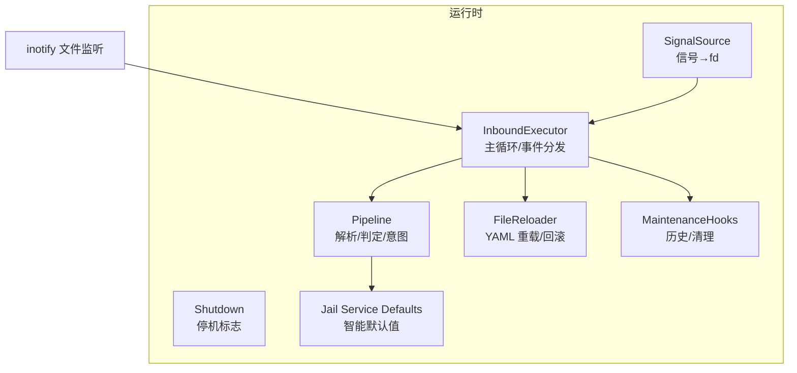

图表来源
- [executor.go:225-320](file://src/daemon/internal/runtime/executor.go#L225-L320)
- [pipeline.go:130-156](file://src/daemon/internal/runtime/pipeline.go#L130-L156)
- [signals.go:37-68](file://src/daemon/internal/runtime/signals.go#L37-L68)
- [shutdown.go:14-36](file://src/daemon/internal/runtime/shutdown.go#L14-L36)
- [file_reloader.go:12-59](file://src/daemon/internal/runtime/file_reloader.go#L12-L59)
- [hooks.go:9-20](file://src/daemon/internal/runtime/hooks.go#L9-L20)
- [service.go:9-19](file://src/daemon/internal/jail/service.go#L9-L19)

章节来源
- [executor.go:1-64](file://src/daemon/internal/runtime/executor.go#L1-L64)
- [pipeline.go:1-23](file://src/daemon/internal/runtime/pipeline.go#L1-L23)

## 核心组件
- InboundExecutor：单 goroutine 主循环，统一协调 inotify、信号、定时器、配置重载、内核下发与统计。
- Pipeline：无锁主链路，按 jail 维度维护失败窗口与半行缓冲，产出 BanIntent。
- SignalSource：把进程信号桥接到 pollable fd，避免阻塞 Go 运行时。
- Shutdown：跨协程共享的只置位停机标志。
- FileReloader：基于 YAML 的配置热重载与回滚。
- MaintenanceHooks：周期性历史快照与数据清理。
- Jail Service Defaults：按 jail 名推断默认阈值，保证多进程一致。

章节来源
- [executor.go:225-320](file://src/daemon/internal/runtime/executor.go#L225-L320)
- [pipeline.go:130-156](file://src/daemon/internal/runtime/pipeline.go#L130-L156)
- [signals.go:37-68](file://src/daemon/internal/runtime/signals.go#L37-L68)
- [shutdown.go:14-36](file://src/daemon/internal/runtime/shutdown.go#L14-L36)
- [file_reloader.go:12-59](file://src/daemon/internal/runtime/file_reloader.go#L12-L59)
- [hooks.go:9-20](file://src/daemon/internal/runtime/hooks.go#L9-L20)
- [service.go:9-19](file://src/daemon/internal/jail/service.go#L9-L19)

## 架构总览
下图展示一次典型的事件流：inotify 唤醒 → 增量读取 → 行切分 → 规则匹配 → 失败窗口判定 → 产生 BanIntent → 内核下发与统计镜像。

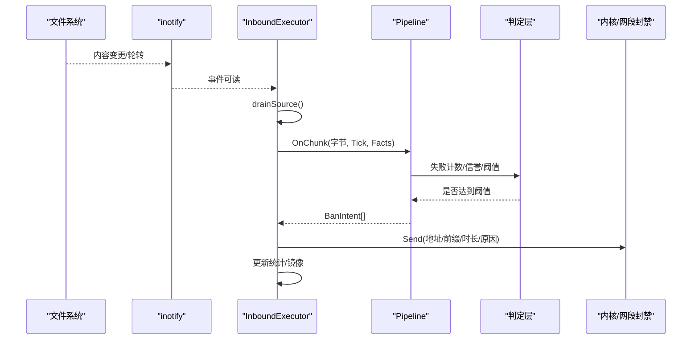

图表来源
- [executor.go:512-556](file://src/daemon/internal/runtime/executor.go#L512-L556)
- [pipeline.go:221-260](file://src/daemon/internal/runtime/pipeline.go#L221-L260)
- [pipeline.go:298-342](file://src/daemon/internal/runtime/pipeline.go#L298-L342)

## 详细组件分析

### 进程生命周期与优雅关闭
- 启动：装配 InboundExecutor，初始化 inotify、注册初始监视源、首次向内核下发配置投影。
- 运行：Run 循环计算下次 poll 超时，step 依次执行到期维护、反向指令排空、启用状态同步、待重挂重试、poll 等待、信号与 inotify 分派。
- 优雅关闭：收到终止信号或致命错误时设置 Shutdown，主循环退出后释放 inotify fd 与信号桥。

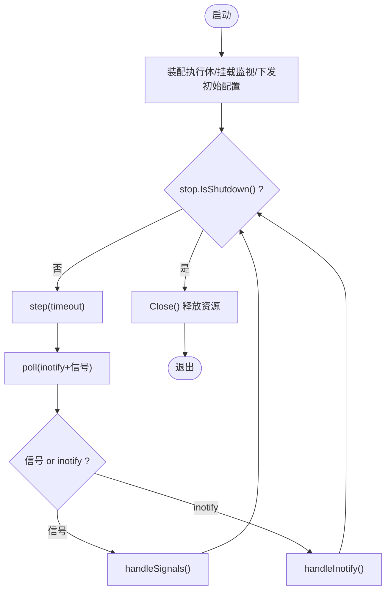

图表来源
- [executor.go:331-376](file://src/daemon/internal/runtime/executor.go#L331-L376)
- [executor.go:378-432](file://src/daemon/internal/runtime/executor.go#L378-L432)
- [executor.go:434-462](file://src/daemon/internal/runtime/executor.go#L434-L462)
- [executor.go:323-329](file://src/daemon/internal/runtime/executor.go#L323-L329)
- [shutdown.go:14-36](file://src/daemon/internal/runtime/shutdown.go#L14-L36)

章节来源
- [executor.go:331-376](file://src/daemon/internal/runtime/executor.go#L331-L376)
- [executor.go:378-432](file://src/daemon/internal/runtime/executor.go#L378-L432)
- [executor.go:434-462](file://src/daemon/internal/runtime/executor.go#L434-L462)
- [shutdown.go:14-36](file://src/daemon/internal/runtime/shutdown.go#L14-L36)

### 信号处理
- 关注信号：SIGTERM/SIGINT（优雅退出）、SIGHUP（热重载）、SIGUSR1（回滚）。
- 实现方式：Go 使用 signal.Notify 接收信号，写入非阻塞自管道；主循环通过 unix.Poll 同时等待 inotify fd 与信号 fd。
- 消费端：PollRead 非阻塞取出信号类别，循环取空。

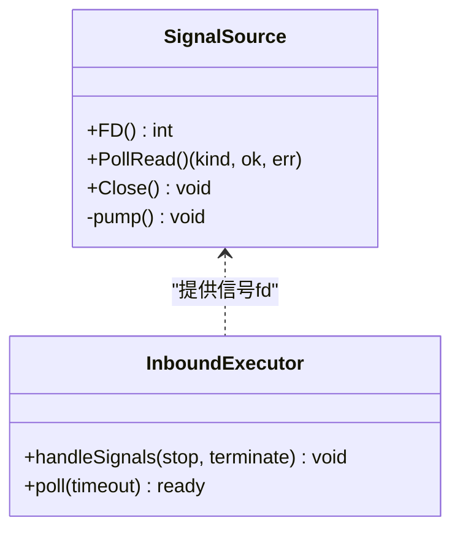

图表来源
- [signals.go:37-68](file://src/daemon/internal/runtime/signals.go#L37-L68)
- [signals.go:102-124](file://src/daemon/internal/runtime/signals.go#L102-L124)
- [executor.go:378-407](file://src/daemon/internal/runtime/executor.go#L378-L407)
- [executor.go:434-462](file://src/daemon/internal/runtime/executor.go#L434-L462)

章节来源
- [signals.go:12-35](file://src/daemon/internal/runtime/signals.go#L12-L35)
- [signals.go:50-68](file://src/daemon/internal/runtime/signals.go#L50-L68)
- [signals.go:102-124](file://src/daemon/internal/runtime/signals.go#L102-L124)
- [executor.go:378-407](file://src/daemon/internal/runtime/executor.go#L378-L407)
- [executor.go:434-462](file://src/daemon/internal/runtime/executor.go#L434-L462)

### 管道执行器（Pipeline）
- 职责：对每个 jail 维护规则集、失败窗口、半行缓冲与累计计数；输入字节输出 BanIntent。
- 关键流程：OnChunk 切行 → collectLine 解析 IP → judgeLine 记录失败、计算阈值、观察窗口、必要时产出 BanIntent。
- 维护：Cleanup 清理过期条目；ScanClusters 周期检测集群扫描。

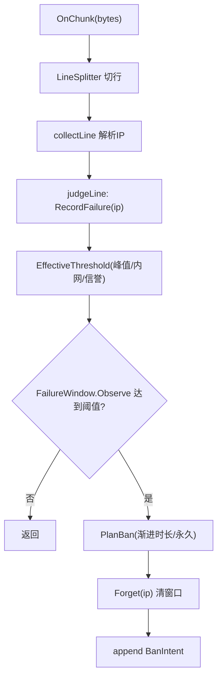

图表来源
- [pipeline.go:221-260](file://src/daemon/internal/runtime/pipeline.go#L221-L260)
- [pipeline.go:298-342](file://src/daemon/internal/runtime/pipeline.go#L298-L342)
- [pipeline.go:358-384](file://src/daemon/internal/runtime/pipeline.go#L358-L384)

章节来源
- [pipeline.go:25-79](file://src/daemon/internal/runtime/pipeline.go#L25-L79)
- [pipeline.go:130-156](file://src/daemon/internal/runtime/pipeline.go#L130-L156)
- [pipeline.go:221-260](file://src/daemon/internal/runtime/pipeline.go#L221-L260)
- [pipeline.go:298-342](file://src/daemon/internal/runtime/pipeline.go#L298-L342)
- [pipeline.go:358-384](file://src/daemon/internal/runtime/pipeline.go#L358-L384)

### 文件监听器与轮转
- 监听：inotify 监视配置文件与日志文件；内容变更触发 drainSource；自身被移走/删除触发 handleRotation。
- 轮转：flushPendingLine 收尾半行 → dropSource 摘旧 watch → 尝试 addLogSource 重挂新 inode；若路径暂不可见则登记 pendingReadd，按 1 秒上限轮询重试。
- 监视对齐：reconcileWatches 按当前配置增量增删 watch，保持 SourceID 稳定，避免偏移丢失。

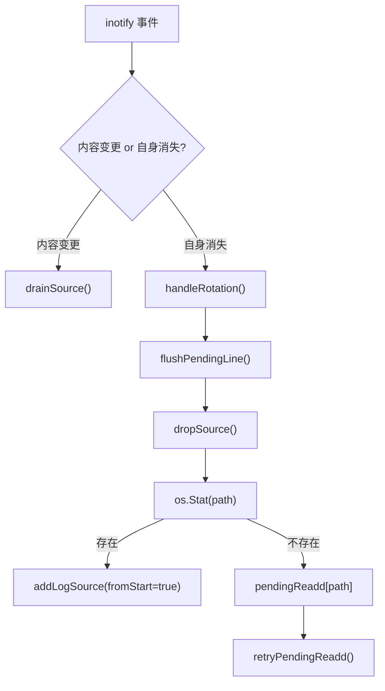

图表来源
- [executor.go:483-510](file://src/daemon/internal/runtime/executor.go#L483-L510)
- [executor.go:612-637](file://src/daemon/internal/runtime/executor.go#L612-L637)
- [executor.go:639-668](file://src/daemon/internal/runtime/executor.go#L639-L668)
- [executor.go:670-717](file://src/daemon/internal/runtime/executor.go#L670-L717)

章节来源
- [executor.go:483-510](file://src/daemon/internal/runtime/executor.go#L483-L510)
- [executor.go:612-637](file://src/daemon/internal/runtime/executor.go#L612-L637)
- [executor.go:639-668](file://src/daemon/internal/runtime/executor.go#L639-L668)
- [executor.go:670-717](file://src/daemon/internal/runtime/executor.go#L670-L717)

### 定时器调度
- 周期任务：失败窗口清理、集群扫描、监视集合重扫、历史快照、数据清理。
- 定时器表：支持一次性与周期定时器，严格对齐到期点，避免漂移与突发补发。
- 主循环集成：nextPollTimeout 取 interval 与下一个定时器到期点的较小者，确保维护不被事件洪泛推迟。

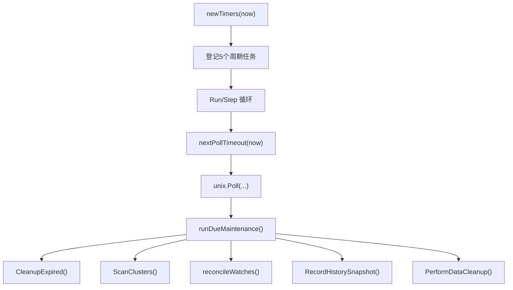

图表来源
- [executor.go:46-64](file://src/daemon/internal/runtime/executor.go#L46-L64)
- [executor.go:194-223](file://src/daemon/internal/runtime/executor.go#L194-L223)
- [executor.go:409-432](file://src/daemon/internal/runtime/executor.go#L409-L432)

章节来源
- [executor.go:46-64](file://src/daemon/internal/runtime/executor.go#L46-L64)
- [executor.go:194-223](file://src/daemon/internal/runtime/executor.go#L194-L223)
- [executor.go:409-432](file://src/daemon/internal/runtime/executor.go#L409-L432)

### Jail 服务管理与智能默认
- 服务类型推断：SSH/WEB/FTP/MAIL/FRP/DB，按名称词边界匹配，优先级固定，保证多进程一致。
- 智能默认：未显式设置的 max_retries/findtime/ban_time 自动填充，幂等且可被用户覆盖。
- 用途：为不同服务提供合理基线阈值，减少运维配置负担。

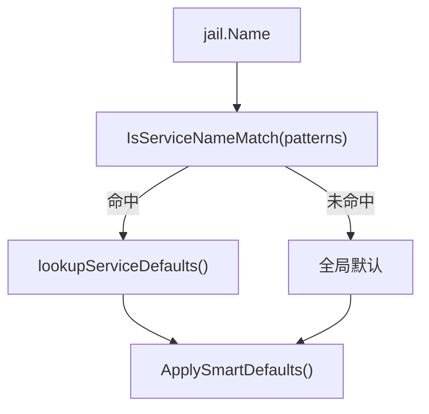

图表来源
- [service.go:9-19](file://src/daemon/internal/jail/service.go#L9-L19)
- [service.go:21-45](file://src/daemon/internal/jail/service.go#L21-L45)
- [service.go:75-95](file://src/daemon/internal/jail/service.go#L75-L95)
- [service.go:109-134](file://src/daemon/internal/jail/service.go#L109-L134)

章节来源
- [service.go:9-19](file://src/daemon/internal/jail/service.go#L9-L19)
- [service.go:21-45](file://src/daemon/internal/jail/service.go#L21-L45)
- [service.go:75-95](file://src/daemon/internal/jail/service.go#L75-L95)
- [service.go:109-134](file://src/daemon/internal/jail/service.go#L109-L134)

### 集群分发与网段封禁
- 检测：Pipeline.ScanClusters 周期扫描 FailureWindow，发现同一网段内多个不同源即视为集群扫描。
- 分发：执行体根据集群配置决定下发网段封禁或仅审计；原因文本需满足契约定长字段约束。
- 测试保障：用例校验原因长度与下发次数，防止因编码超长导致静默失败。

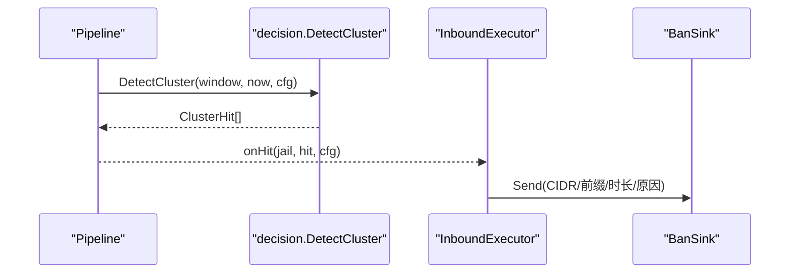

图表来源
- [pipeline.go:369-384](file://src/daemon/internal/runtime/pipeline.go#L369-L384)
- [cluster_dispatch_test.go:16-63](file://src/daemon/internal/runtime/cluster_dispatch_test.go#L16-L63)

章节来源
- [pipeline.go:369-384](file://src/daemon/internal/runtime/pipeline.go#L369-L384)
- [cluster_dispatch_test.go:16-63](file://src/daemon/internal/runtime/cluster_dispatch_test.go#L16-L63)

### 钩子函数机制
- 历史快照：定期聚合 ban_history 统计，便于趋势分析。
- 数据清理：清理超保留期的封禁事件、信誉分与历史记录，防止数据库无限增长。
- 可插拔：MaintenanceHooks 作为接口注入，nil 时跳过外部副作用。

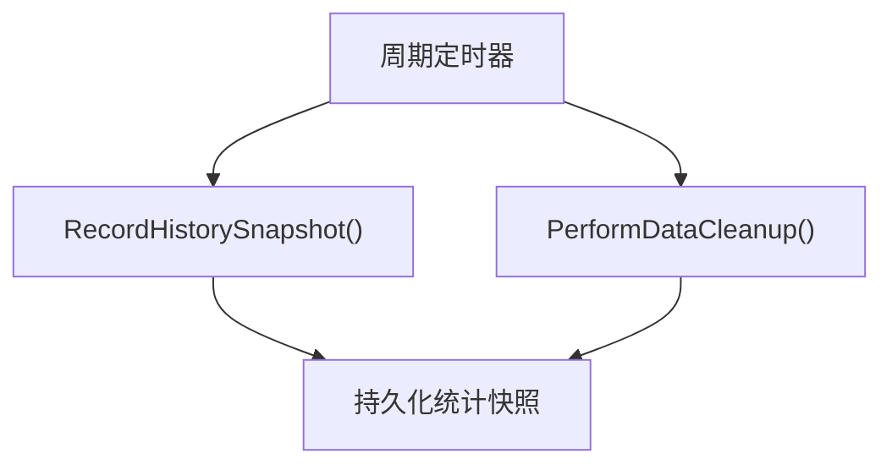

图表来源
- [hooks.go:9-20](file://src/daemon/internal/runtime/hooks.go#L9-L20)
- [hooks.go:29-60](file://src/daemon/internal/runtime/hooks.go#L29-L60)

章节来源
- [hooks.go:9-20](file://src/daemon/internal/runtime/hooks.go#L9-L20)
- [hooks.go:29-60](file://src/daemon/internal/runtime/hooks.go#L29-L60)

## 依赖关系分析
- InboundExecutor 依赖：
  - ingest.Watcher/SourceRegistry/SourceReader：文件监听与增量读取。
  - Pipeline：解析/判定/意图。
  - SignalSource：信号桥。
  - ConfigReloader/MaintenanceHooks/KernelConfigPusher/JailEnabledSource/JailSnapshotListener：外部副作用与状态桥接。
- Pipeline 依赖：
  - logparse.RuleSet：规则解析。
  - decision.*：阈值计算、集群检测、计划生成。
  - detect.FailureWindow：失败窗口。
  - config.ClusterConfig：集群参数。

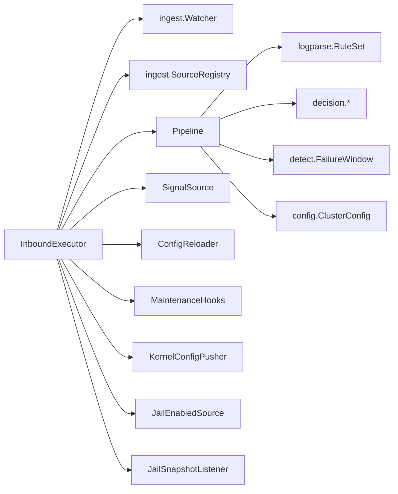

图表来源
- [executor.go:225-320](file://src/daemon/internal/runtime/executor.go#L225-L320)
- [pipeline.go:130-156](file://src/daemon/internal/runtime/pipeline.go#L130-L156)

章节来源
- [executor.go:225-320](file://src/daemon/internal/runtime/executor.go#L225-L320)
- [pipeline.go:130-156](file://src/daemon/internal/runtime/pipeline.go#L130-L156)

## 性能与扩展性
- 单 goroutine 串行模型：主链路独占全部状态，内部无需加锁，避免队列满丢字节与复杂并发问题。
- 定时器解耦维护：维护任务由单调时钟定时器驱动，不受事件洪泛影响。
- 去重与抑制：BanSink.TryInsert 原子占位，rejected 映射抑制重复下发。
- 可扩展点：
  - 自定义 DecisionFacts：替换信誉分与历史封禁次数来源。
  - 自定义 BanSink：对接不同内核通道或网段封禁策略。
  - 自定义 StatsSink：导出到 Prometheus/Grafana。
  - 自定义 KernelConfigPusher：按需下发内核配置投影。
  - 自定义 JailSnapshotListener：推送 SSE 域变化给前端。

[本节为通用指导，不直接分析具体文件]

## 故障排查指南
- 无法监视任何日志源：NewInboundExecutor 在 registry.IsEmpty() 时返回错误，检查权限、kmod 加载与路径有效性。
- 轮转后文件未恢复：确认 handleRotation 中 os.Stat 与 addLogSource 逻辑；检查 pendingReadd 重试是否生效。
- 配置重载无效：FileReloader 从 Default() 起步合并文件，注意 defaults/ddos/interval 缺失导致的 Validate 拒绝；HTTP 监听地址改变不会重新绑定，需重启守护进程。
- 集群扫描告警但无封禁：检查原因文本长度是否超过契约定长字段；参考测试用例断言 reason 长度与发送次数。
- 优雅关闭卡住：确认 Shutdown.Request 被调用，Run 循环能检测到 stop.IsShutdown() 并退出。

章节来源
- [executor.go:271-320](file://src/daemon/internal/runtime/executor.go#L271-L320)
- [executor.go:612-637](file://src/daemon/internal/runtime/executor.go#L612-L637)
- [file_reloader.go:24-59](file://src/daemon/internal/runtime/file_reloader.go#L24-L59)
- [file_reloader.go:94-106](file://src/daemon/internal/runtime/file_reloader.go#L94-L106)
- [cluster_dispatch_test.go:16-63](file://src/daemon/internal/runtime/cluster_dispatch_test.go#L16-L63)
- [shutdown.go:14-36](file://src/daemon/internal/runtime/shutdown.go#L14-L36)

## 结论
运行时管理系统以单 goroutine 主循环为核心，将文件监听、行切分、规则匹配、阈值判定、封禁意图与内核下发串联成一条无锁、可测、可扩展的生产链路。通过信号桥、定时器表、配置重载与钩子机制，系统具备健壮的生命周期管理、优雅关闭与可观测性。Jail 智能默认与集群扫描进一步提升了易用性与安全性。扩展点清晰，便于对接新的存储、监控与内核通道。