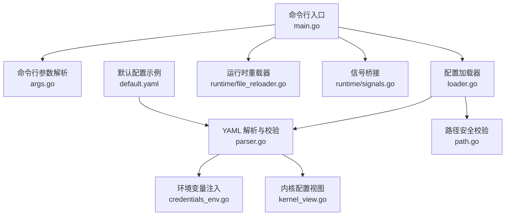
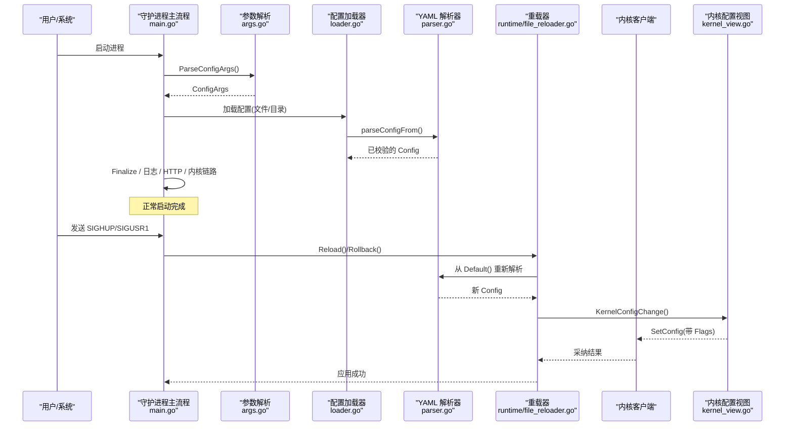
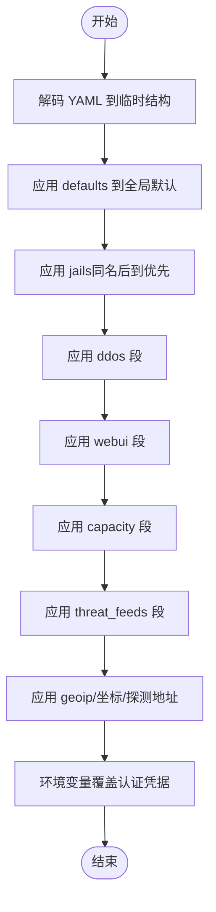
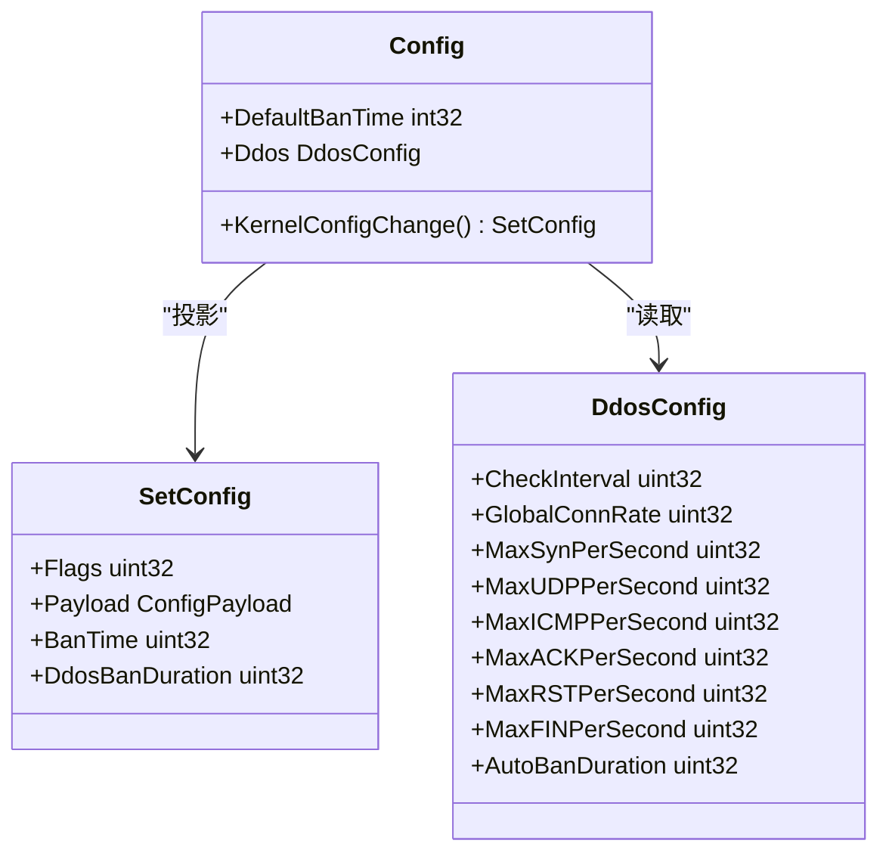
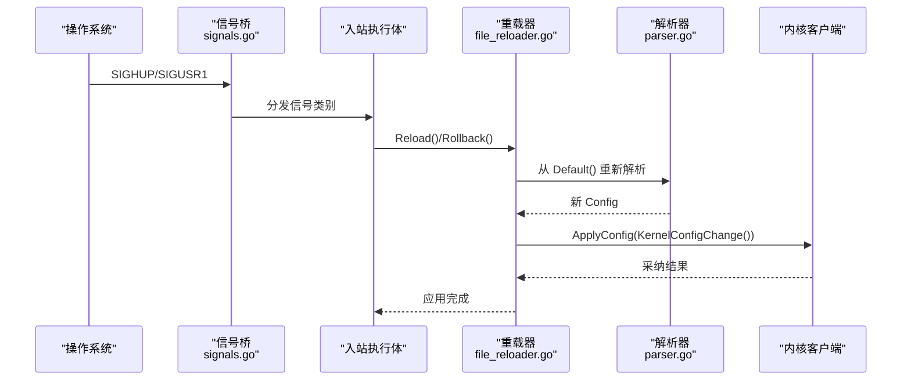
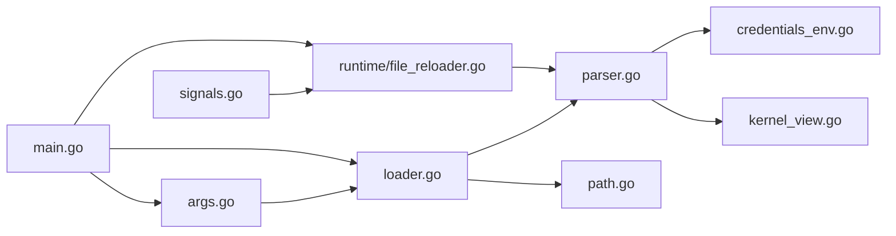

# 配置管理系统

<cite>
**本文引用的文件**   
- [src/daemon/internal/config/loader.go](file://src/daemon/internal/config/loader.go)
- [src/daemon/internal/config/parser.go](file://src/daemon/internal/config/parser.go)
- [src/daemon/internal/config/args.go](file://src/daemon/internal/config/args.go)
- [src/daemon/internal/config/path.go](file://src/daemon/internal/config/path.go)
- [src/daemon/internal/config/kernel_view.go](file://src/daemon/internal/config/kernel_view.go)
- [src/daemon/internal/config/logging.go](file://src/daemon/internal/config/logging.go)
- [src/daemon/internal/config/credentials_env.go](file://src/daemon/internal/config/credentials_env.go)
- [config/default.yaml](file://config/default.yaml)
- [src/daemon/internal/runtime/file_reloader.go](file://src/daemon/internal/runtime/file_reloader.go)
- [src/daemon/internal/runtime/signals.go](file://src/daemon/internal/runtime/signals.go)
- [src/daemon/cmd/firewall-daemon/main.go](file://src/daemon/cmd/firewall-daemon/main.go)
</cite>

## 目录
1. [简介](#简介)
2. [项目结构](#项目结构)
3. [核心组件](#核心组件)
4. [架构总览](#架构总览)
5. [详细组件分析](#详细组件分析)
6. [依赖关系分析](#依赖关系分析)
7. [性能考虑](#性能考虑)
8. [故障排查指南](#故障排查指南)
9. [结论](#结论)
10. [附录](#附录)

## 简介
本文件系统性地梳理守护进程的配置管理子系统，覆盖 YAML 配置解析、默认值与智能推断、环境变量注入、路径安全校验、目录合并与运行期覆盖、命令行参数处理、内核配置视图投影、信号驱动的热重载与回滚流程。文档同时给出最佳实践、常见问题定位方法与性能调优建议，帮助运维与开发者在复杂部署中稳定使用配置能力。

## 项目结构
配置相关代码集中在守护进程的 `internal/config` 包，并由运行时模块提供热重载入口；命令行入口位于 `cmd/firewall-daemon/main.go`；示例默认配置位于 `config/default.yaml`。

**图表来源**
- [src/daemon/cmd/firewall-daemon/main.go:52-109](file://src/daemon/cmd/firewall-daemon/main.go#L52-L109)
- [src/daemon/internal/config/args.go:14-111](file://src/daemon/internal/config/args.go#L14-L111)
- [src/daemon/internal/config/loader.go:17-128](file://src/daemon/internal/config/loader.go#L17-L128)
- [src/daemon/internal/config/parser.go:155-207](file://src/daemon/internal/config/parser.go#L155-L207)
- [src/daemon/internal/config/path.go:13-52](file://src/daemon/internal/config/path.go#L13-L52)
- [src/daemon/internal/config/credentials_env.go:21-32](file://src/daemon/internal/config/credentials_env.go#L21-L32)
- [src/daemon/internal/config/kernel_view.go:42-78](file://src/daemon/internal/config/kernel_view.go#L42-L78)
- [src/daemon/internal/runtime/file_reloader.go:24-58](file://src/daemon/internal/runtime/file_reloader.go#L24-L58)
- [src/daemon/internal/runtime/signals.go:50-68](file://src/daemon/internal/runtime/signals.go#L50-L68)
- [config/default.yaml:1-198](file://config/default.yaml#L1-L198)

**章节来源**
- [src/daemon/cmd/firewall-daemon/main.go:52-109](file://src/daemon/cmd/firewall-daemon/main.go#L52-L109)
- [src/daemon/internal/config/args.go:14-111](file://src/daemon/internal/config/args.go#L14-L111)
- [src/daemon/internal/config/loader.go:17-128](file://src/daemon/internal/config/loader.go#L17-L128)
- [src/daemon/internal/config/parser.go:155-207](file://src/daemon/internal/config/parser.go#L155-L207)
- [src/daemon/internal/config/path.go:13-52](file://src/daemon/internal/config/path.go#L13-L52)
- [src/daemon/internal/config/credentials_env.go:21-32](file://src/daemon/internal/config/credentials_env.go#L21-L32)
- [src/daemon/internal/config/kernel_view.go:42-78](file://src/daemon/internal/config/kernel_view.go#L42-L78)
- [src/daemon/internal/runtime/file_reloader.go:24-58](file://src/daemon/internal/runtime/file_reloader.go#L24-L58)
- [src/daemon/internal/runtime/signals.go:50-68](file://src/daemon/internal/runtime/signals.go#L50-L68)
- [config/default.yaml:1-198](file://config/default.yaml#L1-L198)

## 核心组件
- 命令行参数解析：支持单文件 `-c/--config`、目录 `-C/--config-dir`、守护进程模式 `-d/--daemon`、严格模式开关 `--no-strict`、回滚 `--rollback`。
- 配置加载器：单文件解析与目录批量加载，统一原子性语义与排序规则。
- YAML 解析器：顶层段 defaults/jails/ddos/webui/capacity/threat_feeds/geoip 等，严格模式未知字段拒绝，智能默认与范围校验。
- 环境变量注入：认证凭据可被环境变量覆盖，优先级高于 YAML。
- 路径安全校验：防路径遍历、URL 编码绕过、Shell 元字符注入、长度限制与符号链接规范化。
- 内核配置视图：将守护进程配置投影为内核 SET_CONFIG 载荷，带位掩码与边界说明。
- 运行时重载：SIGHUP/SIGUSR1 触发重载或回滚，基于 Default() + 文件重新解析并应用。

**章节来源**
- [src/daemon/internal/config/args.go:14-111](file://src/daemon/internal/config/args.go#L14-L111)
- [src/daemon/internal/config/loader.go:17-128](file://src/daemon/internal/config/loader.go#L17-L128)
- [src/daemon/internal/config/parser.go:155-207](file://src/daemon/internal/config/parser.go#L155-L207)
- [src/daemon/internal/config/credentials_env.go:21-32](file://src/daemon/internal/config/credentials_env.go#L21-L32)
- [src/daemon/internal/config/path.go:13-52](file://src/daemon/internal/config/path.go#L13-L52)
- [src/daemon/internal/config/kernel_view.go:42-78](file://src/daemon/internal/config/kernel_view.go#L42-L78)
- [src/daemon/internal/runtime/file_reloader.go:24-58](file://src/daemon/internal/runtime/file_reloader.go#L24-L58)

## 架构总览
守护进程启动时解析命令行，按文件或目录加载配置，执行后处理（智能默认、校验、正则编译），初始化日志与 HTTP 服务，装配内核链路、事件泵与入站执行体。运行时通过信号桥接收 SIGHUP/SIGUSR1，调用重载器从 Default() 起步重新解析并应用新配置，必要时向内核下发配置变更。

**图表来源**
- [src/daemon/cmd/firewall-daemon/main.go:52-109](file://src/daemon/cmd/firewall-daemon/main.go#L52-L109)
- [src/daemon/internal/config/args.go:62-111](file://src/daemon/internal/config/args.go#L62-L111)
- [src/daemon/internal/config/loader.go:17-128](file://src/daemon/internal/config/loader.go#L17-L128)
- [src/daemon/internal/config/parser.go:155-207](file://src/daemon/internal/config/parser.go#L155-L207)
- [src/daemon/internal/runtime/file_reloader.go:24-58](file://src/daemon/internal/runtime/file_reloader.go#L24-L58)
- [src/daemon/internal/config/kernel_view.go:42-78](file://src/daemon/internal/config/kernel_view.go#L42-L78)

## 详细组件分析

### YAML 配置解析与验证
- 顶层结构包含 defaults、jails、ddos、webui、trusted_ips、capacity、threat_feeds、geoip 相关字段。
- 严格模式：未知顶层键直接报错；宽松模式忽略未知键。
- defaults 段逐项应用到全局默认值；jails 同名后到优先，未显式字段保留；ddos/webui/capacity/threat_feeds 采用“仅覆盖显式字段”策略。
- 坐标字段必须成对给出且取值合法；探测 URL 需 http(s) 协议、非空主机名、长度与空白控制字符检查。
- 认证凭据在 YAML 应用成功后再被环境变量覆盖，保证「解析失败不改 cfg」的原子性。

**图表来源**
- [src/daemon/internal/config/parser.go:155-207](file://src/daemon/internal/config/parser.go#L155-L207)
- [src/daemon/internal/config/parser.go:209-275](file://src/daemon/internal/config/parser.go#L209-L275)
- [src/daemon/internal/config/parser.go:277-374](file://src/daemon/internal/config/parser.go#L277-L374)
- [src/daemon/internal/config/parser.go:499-591](file://src/daemon/internal/config/parser.go#L499-L591)
- [src/daemon/internal/config/parser.go:593-635](file://src/daemon/internal/config/parser.go#L593-L635)
- [src/daemon/internal/config/credentials_env.go:21-32](file://src/daemon/internal/config/credentials_env.go#L21-L32)

**章节来源**
- [src/daemon/internal/config/parser.go:155-207](file://src/daemon/internal/config/parser.go#L155-L207)
- [src/daemon/internal/config/parser.go:209-275](file://src/daemon/internal/config/parser.go#L209-L275)
- [src/daemon/internal/config/parser.go:277-374](file://src/daemon/internal/config/parser.go#L277-L374)
- [src/daemon/internal/config/parser.go:499-591](file://src/daemon/internal/config/parser.go#L499-L591)
- [src/daemon/internal/config/parser.go:593-635](file://src/daemon/internal/config/parser.go#L593-L635)
- [src/daemon/internal/config/credentials_env.go:21-32](file://src/daemon/internal/config/credentials_env.go#L21-L32)

### 默认值处理与智能推断
- defaults 段提供全局默认：重试次数、查找时间、封禁时长、指标端口/绑定地址、日志级别/目的地/格式/轮转、历史库路径与保留天数等。
- jail 智能默认：若只声明 log_files/regex，则自动推断 findtime/ban_time/max_retries；findtime 较短时收紧 max_retries，ban_time 根据 findtime 放宽或取默认。
- 容量上限：max_ban_entries、max_whitelist_entries、max_rate_entries、max_local_ip_cache。
- 威胁情报源：enabled、刷新间隔、HTTP 超时、重试次数、sources 列表替换默认。

**章节来源**
- [config/default.yaml:7-31](file://config/default.yaml#L7-L31)
- [config/default.yaml:103-111](file://config/default.yaml#L103-L111)
- [config/default.yaml:133-169](file://config/default.yaml#L133-L169)
- [src/daemon/internal/config/parser.go:209-275](file://src/daemon/internal/config/parser.go#L209-L275)
- [src/daemon/internal/config/parser.go:473-497](file://src/daemon/internal/config/parser.go#L473-L497)
- [src/daemon/internal/config/parser.go:550-591](file://src/daemon/internal/config/parser.go#L550-L591)

### 路径管理与安全校验
- 禁止路径遍历、URL 编码绕过、Shell 元字符注入、超长路径。
- 对已存在路径进行符号链接规范化，防止逃逸。
- 日志文件路径长度上限与配置引用路径统一受控。

**章节来源**
- [src/daemon/internal/config/path.go:13-52](file://src/daemon/internal/config/path.go#L13-L52)

### 环境变量注入与认证
- 环境变量名：FIREWALL_METRICS_USERNAME、FIREWALL_METRICS_PASSWORD。
- 优先级：环境变量 > YAML > Default()。
- 两项都空表示未配置认证；只填一项视为非法，端点一律拒绝。
- 启动时检测监听地址对外开放但未配置认证、或使用出厂默认口令，输出明显告警。

**章节来源**
- [src/daemon/internal/config/credentials_env.go:15-32](file://src/daemon/internal/config/credentials_env.go#L15-L32)
- [src/daemon/internal/config/credentials_env.go:46-72](file://src/daemon/internal/config/credentials_env.go#L46-L72)
- [src/daemon/cmd/firewall-daemon/main.go:106-120](file://src/daemon/cmd/firewall-daemon/main.go#L106-L120)

### 内核配置视图
- 将守护进程配置投影为内核 SET_CONFIG 载荷，携带速率窗口、各协议最大包率、全局连接速率、默认封禁时长、DDoS 自动封禁时长等。
- 通过位掩码表达哪些字段需要更新；越界值由内核拒绝位图反馈诊断。
- 某些字段不投影（如字节速率、动态阈值比例、基线采样输入、永久封禁语义）以避免错误语义。

**图表来源**
- [src/daemon/internal/config/kernel_view.go:42-78](file://src/daemon/internal/config/kernel_view.go#L42-L78)

**章节来源**
- [src/daemon/internal/config/kernel_view.go:42-78](file://src/daemon/internal/config/kernel_view.go#L42-L78)

### 命令行参数处理
- 支持 -c/--config、-C/--config-dir、-d/--daemon、--no-strict、--rollback、-h/--help。
- 默认配置文件路径常量与帮助文本一致；未知参数或缺取值返回错误。
- --help 打印帮助并返回 nil，调用方以成功状态退出。

**章节来源**
- [src/daemon/internal/config/args.go:8-111](file://src/daemon/internal/config/args.go#L8-L111)

### 配置热更新流程
- 信号桥接收 SIGTERM/SIGINT（优雅退出）、SIGHUP（重载）、SIGUSR1（回滚）。
- 重载器从 Default() 起步，按当前路径（文件或目录）重新解析，编译正则（失败仅告警），应用新配置。
- 回滚器尝试读取同目录下的 config.yaml.rollback，失败则退化为 Reload。
- applyConfig 会提示监听地址变化不会立即重绑，需重启守护进程。

**图表来源**
- [src/daemon/internal/runtime/signals.go:50-68](file://src/daemon/internal/runtime/signals.go#L50-L68)
- [src/daemon/internal/runtime/file_reloader.go:24-58](file://src/daemon/internal/runtime/file_reloader.go#L24-L58)
- [src/daemon/internal/runtime/file_reloader.go:61-91](file://src/daemon/internal/runtime/file_reloader.go#L61-L91)
- [src/daemon/internal/runtime/file_reloader.go:94-106](file://src/daemon/internal/runtime/file_reloader.go#L94-L106)
- [src/daemon/cmd/firewall-daemon/main.go:766-800](file://src/daemon/cmd/firewall-daemon/main.go#L766-L800)

**章节来源**
- [src/daemon/internal/runtime/signals.go:50-68](file://src/daemon/internal/runtime/signals.go#L50-L68)
- [src/daemon/internal/runtime/file_reloader.go:24-58](file://src/daemon/internal/runtime/file_reloader.go#L24-L58)
- [src/daemon/internal/runtime/file_reloader.go:61-91](file://src/daemon/internal/runtime/file_reloader.go#L61-L91)
- [src/daemon/internal/runtime/file_reloader.go:94-106](file://src/daemon/internal/runtime/file_reloader.go#L94-L106)
- [src/daemon/cmd/firewall-daemon/main.go:766-800](file://src/daemon/cmd/firewall-daemon/main.go#L766-L800)

### 目录加载与运行期覆盖
- 目录内所有 .yml/.yaml 按文件名排序合并；隐藏文件与非 YAML 跳过。
- 运行期覆盖文件以 `_` 前缀命名，最后合并，拥有最终发言权；仅承载运行期状态（如 jail.enabled）。
- 运行期覆盖引用未定义 jail 时忽略并告警，不凭空创建。
- 任一文件解析失败整体回滚，保持原子性。

**章节来源**
- [src/daemon/internal/config/loader.go:11-15](file://src/daemon/internal/config/loader.go#L11-L15)
- [src/daemon/internal/config/loader.go:53-128](file://src/daemon/internal/config/loader.go#L53-L128)
- [src/daemon/internal/config/parser.go:163-171](file://src/daemon/internal/config/parser.go#L163-L171)
- [src/daemon/internal/config/parser.go:303-311](file://src/daemon/internal/config/parser.go#L303-L311)

## 依赖关系分析
配置子系统内部耦合清晰：命令行参数决定加载路径与严格模式；加载器负责文件/目录枚举与排序；解析器负责 YAML 解码、默认值与校验；环境变量注入在解析成功后执行；内核视图负责投影；运行时重载器复用同一解析逻辑，确保一致性。

**图表来源**
- [src/daemon/internal/config/args.go:14-111](file://src/daemon/internal/config/args.go#L14-L111)
- [src/daemon/internal/config/loader.go:17-128](file://src/daemon/internal/config/loader.go#L17-L128)
- [src/daemon/internal/config/parser.go:155-207](file://src/daemon/internal/config/parser.go#L155-L207)
- [src/daemon/internal/config/credentials_env.go:21-32](file://src/daemon/internal/config/credentials_env.go#L21-L32)
- [src/daemon/internal/config/kernel_view.go:42-78](file://src/daemon/internal/config/kernel_view.go#L42-L78)
- [src/daemon/internal/config/path.go:13-52](file://src/daemon/internal/config/path.go#L13-L52)
- [src/daemon/internal/runtime/signals.go:50-68](file://src/daemon/internal/runtime/signals.go#L50-L68)
- [src/daemon/internal/runtime/file_reloader.go:24-58](file://src/daemon/internal/runtime/file_reloader.go#L24-L58)
- [src/daemon/cmd/firewall-daemon/main.go:52-109](file://src/daemon/cmd/firewall-daemon/main.go#L52-L109)

**章节来源**
- [src/daemon/internal/config/args.go:14-111](file://src/daemon/internal/config/args.go#L14-L111)
- [src/daemon/internal/config/loader.go:17-128](file://src/daemon/internal/config/loader.go#L17-L128)
- [src/daemon/internal/config/parser.go:155-207](file://src/daemon/internal/config/parser.go#L155-L207)
- [src/daemon/internal/config/credentials_env.go:21-32](file://src/daemon/internal/config/credentials_env.go#L21-L32)
- [src/daemon/internal/config/kernel_view.go:42-78](file://src/daemon/internal/config/kernel_view.go#L42-L78)
- [src/daemon/internal/config/path.go:13-52](file://src/daemon/internal/config/path.go#L13-L52)
- [src/daemon/internal/runtime/signals.go:50-68](file://src/daemon/internal/runtime/signals.go#L50-L68)
- [src/daemon/internal/runtime/file_reloader.go:24-58](file://src/daemon/internal/runtime/file_reloader.go#L24-L58)
- [src/daemon/cmd/firewall-daemon/main.go:52-109](file://src/daemon/cmd/firewall-daemon/main.go#L52-L109)

## 性能考虑
- 配置解析与正则编译：Finalize 阶段编译正则，失败仅告警，避免阻塞重载；合理拆分 jail 正则，减少匹配开销。
- 目录加载顺序：按文件名排序合并，避免频繁扫描大目录；运行期覆盖文件集中管理，减少预置文件数量。
- 内核配置下发：仅在必要字段变更时设置位掩码，避免无意义重写；DDoS 阈值过大可能增加内核侧统计压力，应结合业务流量调优。
- 指标与观测：Prometheus 指标在启动时预注册，避免首次抓取缺失样本；事件泵与内核链路具备独立度量，便于定位瓶颈。

[本节为通用指导，不涉及具体文件分析]

## 故障排查指南
- 配置解析失败：检查严格模式下是否存在未知字段；确认 defaults/jails/ddos/webui 等段拼写正确；坐标字段必须成对且取值合法；探测 URL 必须以 http(s) 开头且主机名非空。
- 路径问题：确认日志文件路径不存在时不会被当作软链接逃逸；避免路径中包含 ..、%2e/%2f 等编码或 shell 元字符。
- 环境变量覆盖：确认 FIREWALL_METRICS_USERNAME/PASSWORD 是否设置；两项都空表示未启用认证；只填一项会被判定为非法。
- 热重载无效：确认 SIGHUP/SIGUSR1 是否正确送达；注意 HTTP 监听地址变化不会立即重绑，需重启守护进程；回滚文件需位于配置来源旁边。
- 内核下发异常：查看内核拒绝位图（RejectedFlags）定位未采纳字段；确认内核模块已加载且 procfs 接口可用。

**章节来源**
- [src/daemon/internal/config/parser.go:593-635](file://src/daemon/internal/config/parser.go#L593-L635)
- [src/daemon/internal/config/path.go:13-52](file://src/daemon/internal/config/path.go#L13-L52)
- [src/daemon/internal/config/credentials_env.go:46-72](file://src/daemon/internal/config/credentials_env.go#L46-L72)
- [src/daemon/internal/runtime/file_reloader.go:94-106](file://src/daemon/internal/runtime/file_reloader.go#L94-L106)
- [src/daemon/cmd/firewall-daemon/main.go:512-521](file://src/daemon/cmd/firewall-daemon/main.go#L512-L521)

## 结论
该配置管理系统以严格的 YAML 解析与默认值机制为基础，结合环境变量注入、路径安全校验、目录合并与运行期覆盖，提供了稳定可靠的配置生命周期管理。通过信号驱动的热重载与内核配置视图投影，守护进程能够在不停机的情况下安全地调整行为，并将变更同步至内核模块。遵循本文的最佳实践与排障建议，可在生产环境中实现高可用、可观测、易维护的配置治理。

[本节为总结性内容，不涉及具体文件分析]

## 附录
- 默认配置示例参考：[config/default.yaml](file://config/default.yaml)
- 命令行帮助与参数说明：[src/daemon/internal/config/args.go](file://src/daemon/internal/config/args.go)
- 配置加载与解析核心逻辑：[src/daemon/internal/config/loader.go](file://src/daemon/internal/config/loader.go)、[src/daemon/internal/config/parser.go](file://src/daemon/internal/config/parser.go)
- 环境变量与认证：[src/daemon/internal/config/credentials_env.go](file://src/daemon/internal/config/credentials_env.go)
- 内核配置投影：[src/daemon/internal/config/kernel_view.go](file://src/daemon/internal/config/kernel_view.go)
- 运行时重载与信号：[src/daemon/internal/runtime/file_reloader.go](file://src/daemon/internal/runtime/file_reloader.go)、[src/daemon/internal/runtime/signals.go](file://src/daemon/internal/runtime/signals.go)
- 守护进程组合根：[src/daemon/cmd/firewall-daemon/main.go](file://src/daemon/cmd/firewall-daemon/main.go)