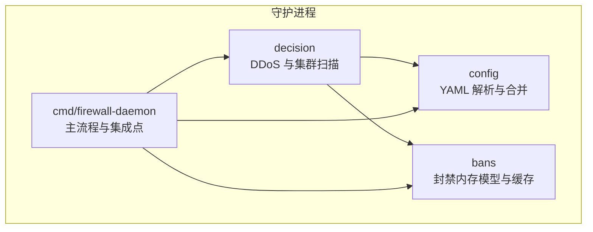
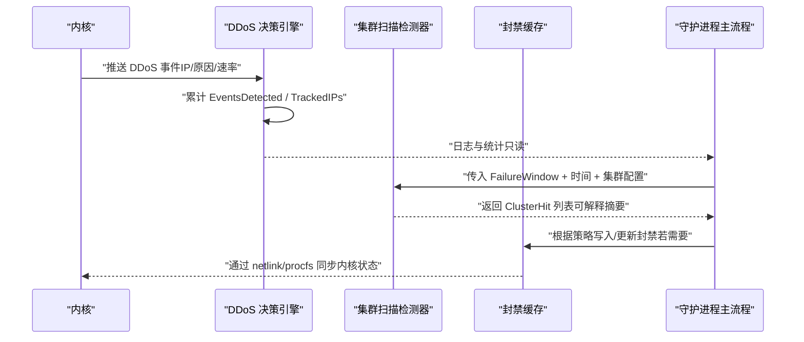
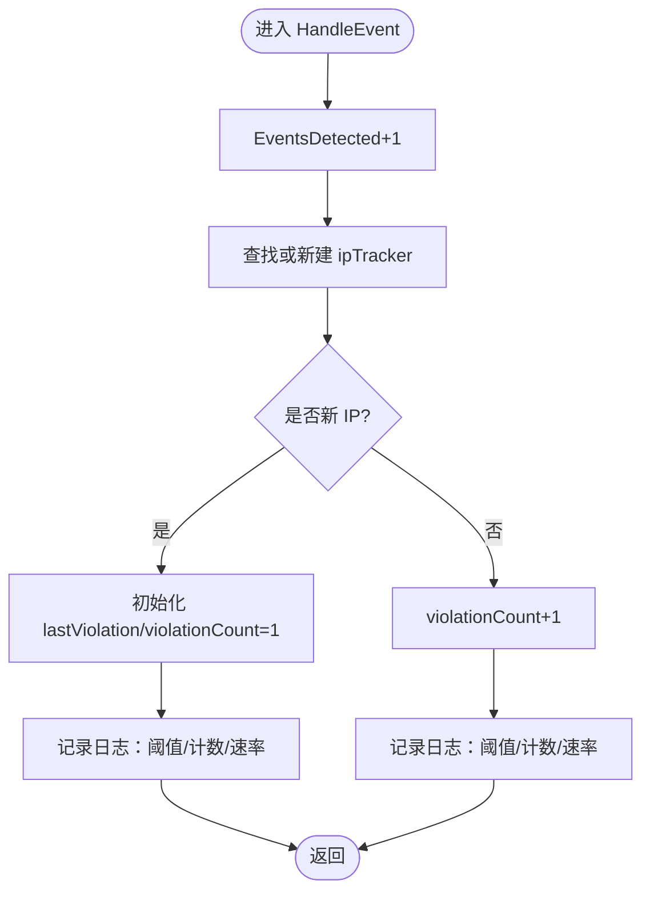
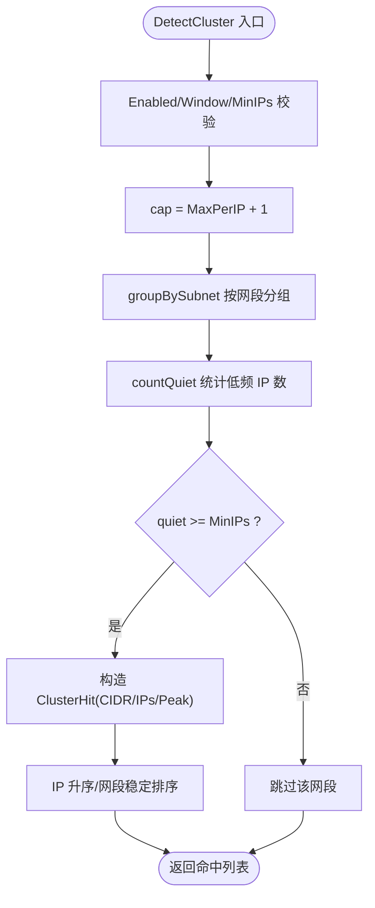
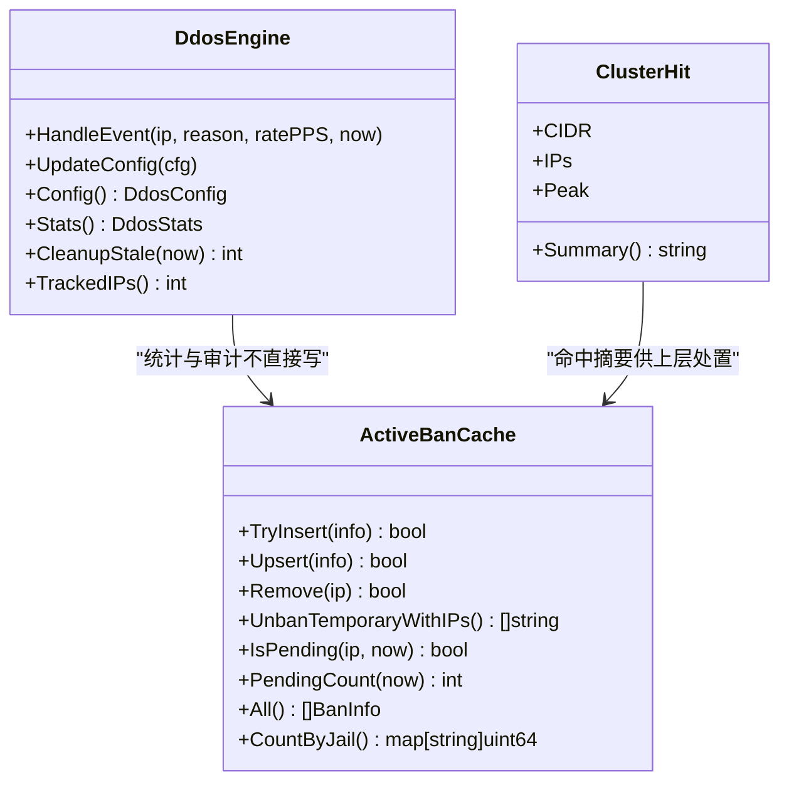
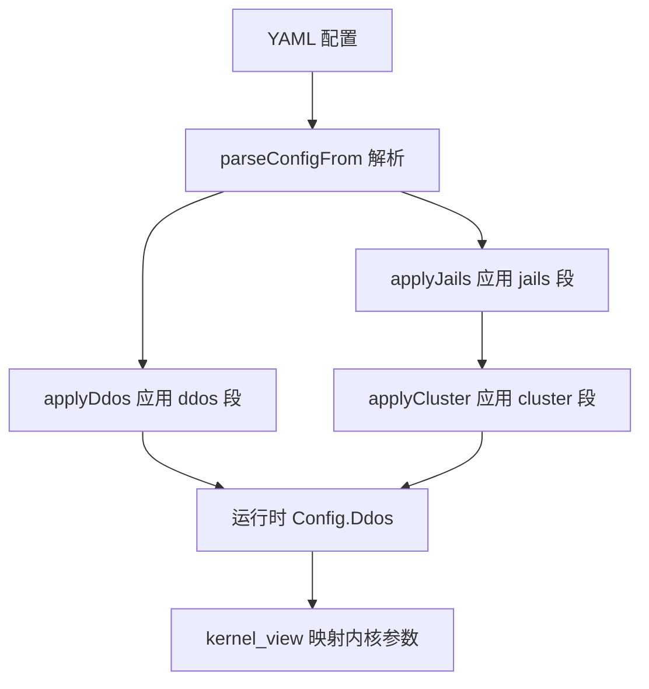
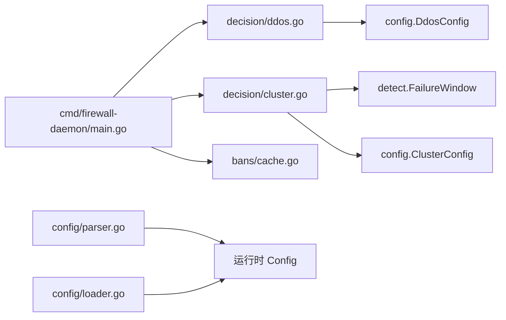

# 决策引擎

<cite>
**本文引用的文件**   
- [ddos.go](file://src/daemon/internal/decision/ddos.go)
- [cluster.go](file://src/daemon/internal/decision/cluster.go)
- [parser.go](file://src/daemon/internal/config/parser.go)
- [loader.go](file://src/daemon/internal/config/loader.go)
- [kernel_view.go](file://src/daemon/internal/config/kernel_view.go)
- [ban.go](file://src/daemon/internal/bans/ban.go)
- [cache.go](file://src/daemon/internal/bans/cache.go)
- [main.go](file://src/daemon/cmd/firewall-daemon/main.go)
</cite>

## 目录
1. [简介](#简介)
2. [项目结构](#项目结构)
3. [核心组件](#核心组件)
4. [架构总览](#架构总览)
5. [详细组件分析](#详细组件分析)
6. [依赖关系分析](#依赖关系分析)
7. [性能与可扩展性](#性能与可扩展性)
8. [故障排查指南](#故障排查指南)
9. [结论](#结论)
10. [附录：配置示例与最佳实践](#附录配置示例与最佳实践)

## 简介
本文件聚焦守护进程中的“决策引擎”，围绕自动封禁决策、DDoS 检测逻辑、集群扫描识别、策略冲突解决、阈值配置、渐进式响应、白名单优先级、可解释性与审计日志、人工干预接口，以及规则配置与性能优化进行系统化说明。该引擎不直接下发封禁动作，而是基于内核已发生的封禁事实进行统计、分析与可观测性输出；实际封禁由内核与守护进程的封禁缓存层协同完成。

## 项目结构
决策相关代码位于守护进程内部模块的 decision 包，并与配置解析、封禁内存模型、守护进程主流程等模块协作。

**图示来源**
- [ddos.go:57-81](file://src/daemon/internal/decision/ddos.go#L57-L81)
- [cluster.go:38-84](file://src/daemon/internal/decision/cluster.go#L38-L84)
- [parser.go:155-207](file://src/daemon/internal/config/parser.go#L155-L207)
- [cache.go:16-40](file://src/daemon/internal/bans/cache.go#L16-L40)
- [main.go:212-213](file://src/daemon/cmd/firewall-daemon/main.go#L212-L213)

**章节来源**
- [ddos.go:57-81](file://src/daemon/internal/decision/ddos.go#L57-L81)
- [cluster.go:38-84](file://src/daemon/internal/decision/cluster.go#L38-L84)
- [parser.go:155-207](file://src/daemon/internal/config/parser.go#L155-L207)
- [cache.go:16-40](file://src/daemon/internal/bans/cache.go#L16-L40)
- [main.go:212-213](file://src/daemon/cmd/firewall-daemon/main.go#L212-L213)

## 核心组件
- DDoS 决策引擎：接收内核推送的 DDoS 事件，维护每 IP 违规计数与统计快照，支持热更新配置与清理陈旧条目。
- 集群扫描检测器：在失败窗口内按网段聚合源 IP，识别低频多 IP 的扫描行为，返回可解释的命中摘要。
- 配置解析与合并：YAML 字段映射到运行时配置，支持 defaults/jails/ddos/webui/capacity/threat_feeds/geoip 等多段合并，严格模式与运行期覆盖文件语义明确。
- 封禁内存模型与缓存：提供单条封禁信息、活跃封禁缓存、待确认状态、过期清理、按 jail 统计等能力，是决策结果落地与对账的基础。
- 守护进程集成：将白名单、可信 IP、内核通信与决策引擎组合起来，形成端到端的数据流。

**章节来源**
- [ddos.go:57-164](file://src/daemon/internal/decision/ddos.go#L57-L164)
- [cluster.go:12-84](file://src/daemon/internal/decision/cluster.go#L12-L84)
- [parser.go:13-102](file://src/daemon/internal/config/parser.go#L13-L102)
- [ban.go:82-132](file://src/daemon/internal/bans/ban.go#L82-L132)
- [cache.go:16-293](file://src/daemon/internal/bans/cache.go#L16-L293)
- [main.go:212-213](file://src/daemon/cmd/firewall-daemon/main.go#L212-L213)

## 架构总览
决策引擎处于“内核事件 → 守护进程统计/分析 → 面板与审计”的关键路径上。DDoS 引擎仅记账与记录，集群检测器提供纯计算判定，二者均不直接下发封禁；封禁由 bans 层与内核侧共同保证一致性。

**图示来源**
- [ddos.go:103-129](file://src/daemon/internal/decision/ddos.go#L103-L129)
- [cluster.go:38-84](file://src/daemon/internal/decision/cluster.go#L38-L84)
- [cache.go:42-115](file://src/daemon/internal/bans/cache.go#L42-L115)
- [main.go:212-213](file://src/daemon/cmd/firewall-daemon/main.go#L212-L213)

## 详细组件分析

### DDoS 决策引擎
职责边界
- 接收内核已触发的 DDoS 封禁事件，不做重复封禁。
- 维护每 IP 的违规计数与最近违规时间，支持原子并发读写。
- 暴露统计快照与配置快照，供 API 与面板展示。
- 定期清理长时间未活动的跟踪条目，防止内存增长。

关键数据结构
- ipTracker：每 IP 违规计数与最近违规时间。
- DdosStats/DdosStatsSnapshot：全局只读统计快照。
- DdosEngine：持有 logger、stats、cfg、trackers。

处理流程
- HandleEvent：首次出现创建 tracker 并记录；后续自增计数；统一记录日志，包含阈值与当前计数。
- UpdateConfig：线程安全替换配置，并记录更新日志。
- CleanupStale：按 StaleTrackerWindow 回收陈旧条目。

**图示来源**
- [ddos.go:103-129](file://src/daemon/internal/decision/ddos.go#L103-L129)

阈值与渐进式响应
- AutoBanThreshold：用于日志与诊断的阈值参考；实际封禁由内核触发，本引擎不执行封禁。
- AutoBanDuration：用于向内核视图传递的封禁时长参数（见 kernel_view）。
- 渐进式响应：通过统计与日志体现“累积次数 vs 阈值”的趋势，便于观察攻击强度变化与策略效果。

白名单优先级
- 守护进程主流程中白名单 sink 由内核镜像重建，HTTP 层负责下发规则；白名单优先于自动封禁，避免误伤受信任地址。

可解释性与审计日志
- 每次事件均记录 IP、原因、PPS、violation_count、threshold，便于审计与回溯。
- Stats 提供 EventsDetected/AutoBansTriggered/TrackedIPs 三类指标，支撑面板可视化。

**章节来源**
- [ddos.go:14-164](file://src/daemon/internal/decision/ddos.go#L14-L164)
- [kernel_view.go:72-74](file://src/daemon/internal/config/kernel_view.go#L72-L74)
- [main.go:212-213](file://src/daemon/cmd/firewall-daemon/main.go#L212-L213)

### 集群扫描识别
目标
- 识别“低频多 IP”的扫描模式：单 IP 失败数低但同一网段内不同 IP 数量高。
- 排除 CGNAT 与高频正常访客：通过 MaxPerIP 过滤掉单 IP 高频访问者。

算法要点
- DetectCluster：检查 Enabled/Window/MinIPs，计算 cap = MaxPerIP+1，调用 groupBySubnet 分组。
- groupBySubnet：遍历 FailureWindow，按 SubnetKey 分组，保留窗口内有失败的 IP。
- countQuiet：统计组内失败数 ≤ MaxPerIP 的 IP 个数，要求 ≥ MinIPs。
- 结果排序：IP 升序、网段键升序，保证结果可复现。

**图示来源**
- [cluster.go:38-84](file://src/daemon/internal/decision/cluster.go#L38-L84)
- [cluster.go:92-116](file://src/daemon/internal/decision/cluster.go#L92-L116)
- [cluster.go:118-146](file://src/daemon/internal/decision/cluster.go#L118-L146)

可解释性
- ClusterHit.Summary 提供一行摘要，包含 CIDR、命中 IP 数与峰值失败数，便于日志与前端展示。

**章节来源**
- [cluster.go:12-84](file://src/daemon/internal/decision/cluster.go#L12-L84)
- [cluster.go:92-146](file://src/daemon/internal/decision/cluster.go#L92-L146)

### 策略冲突解决与优先级
- 白名单优先：守护进程主流程将白名单 sink 注入到内核通信链路，确保受信任地址不被自动封禁。
- 内核权威：封禁权威在内核，守护进程 bans 缓存作为镜像与对账依据；PendingAckTimeout 保护短窗口内的对账一致性。
- 配置优先级：defaults < jails < ddos/webui/capacity/threat_feeds/geoip；运行期覆盖文件（_ 前缀）最后合并，拥有最终发言权。

**图示来源**
- [ddos.go:57-164](file://src/daemon/internal/decision/ddos.go#L57-L164)
- [cluster.go:12-26](file://src/daemon/internal/decision/cluster.go#L12-L26)
- [cache.go:42-293](file://src/daemon/internal/bans/cache.go#L42-L293)

**章节来源**
- [main.go:212-213](file://src/daemon/cmd/firewall-daemon/main.go#L212-L213)
- [cache.go:8-14](file://src/daemon/internal/bans/cache.go#L8-L14)
- [loader.go:11-15](file://src/daemon/internal/config/loader.go#L11-L15)

### 决策阈值配置
- DDoS 阈值：AutoBanThreshold、AutoBanDuration 来自 ddos 段，解析后进入运行时配置；KernelView 将 AutoBanDuration 映射为内核侧封禁时长。
- 集群阈值：Enabled、AuditOnly、PrefixV4/V6、Window、MinIPs、MaxPerIP、BanTime 来自 jail.cluster 段，解析后进入 Jail.Cluster。

**图示来源**
- [parser.go:155-207](file://src/daemon/internal/config/parser.go#L155-L207)
- [parser.go:499-522](file://src/daemon/internal/config/parser.go#L499-L522)
- [parser.go:376-405](file://src/daemon/internal/config/parser.go#L376-L405)
- [kernel_view.go:72-74](file://src/daemon/internal/config/kernel_view.go#L72-L74)

**章节来源**
- [parser.go:499-522](file://src/daemon/internal/config/parser.go#L499-L522)
- [parser.go:376-405](file://src/daemon/internal/config/parser.go#L376-L405)
- [kernel_view.go:72-74](file://src/daemon/internal/config/kernel_view.go#L72-L74)

### 渐进式响应机制
- DDoS 引擎通过 violation_count 与 threshold 的对比，在日志中呈现“逐步逼近阈值”的过程，便于运营人员评估是否需要收紧策略。
- 集群扫描通过 Peak 与 quiet 数量提供“扫描规模与频率”的可解释信号，辅助判断是否从审计模式升级为自动封禁。

**章节来源**
- [ddos.go:103-129](file://src/daemon/internal/decision/ddos.go#L103-L129)
- [cluster.go:23-26](file://src/daemon/internal/decision/cluster.go#L23-L26)

### 白名单优先级处理
- 守护进程主流程将 whitelistSinkForDaemon 注入内核通信链路，白名单由内核镜像重建，HTTP 层负责下发规则，确保白名单优先于自动封禁。

**章节来源**
- [main.go:212-213](file://src/daemon/cmd/firewall-daemon/main.go#L212-L213)

### 决策可解释性与审计日志
- DDoS 引擎每次事件记录 IP、reason、rate_pps、violation_count、threshold，便于审计与问题定位。
- ClusterHit.Summary 提供网段级摘要，便于面板与日志展示。
- bans 层提供 BanInfo.PlannedDuration/IsExpired/DurationSecs 等字段，支撑历史与面板统计口径一致。

**章节来源**
- [ddos.go:103-129](file://src/daemon/internal/decision/ddos.go#L103-L129)
- [cluster.go:23-26](file://src/daemon/internal/decision/cluster.go#L23-L26)
- [ban.go:104-132](file://src/daemon/internal/bans/ban.go#L104-L132)

### 人工干预接口
- bans 层提供 UnbanTemporary/UnbanTemporaryWithIPs 等接口，支持批量解封非永久封禁，便于人工干预。
- ActiveBanCache 提供 Upsert/TryInsert/Remove 等方法，配合对账与镜像保持一致。

**章节来源**
- [cache.go:247-272](file://src/daemon/internal/bans/cache.go#L247-L272)
- [cache.go:81-115](file://src/daemon/internal/bans/cache.go#L81-L115)

## 依赖关系分析
- decision.ddos 依赖 config.DdosConfig 与 slog 日志，不直接依赖 bans 下发逻辑。
- decision.cluster 依赖 detect.FailureWindow 与 config.ClusterConfig，纯计算无副作用。
- config.parser 提供 YAML 到运行时配置的映射，loader 负责目录加载与运行期覆盖文件的合并顺序。
- bans.cache 提供封禁权威镜像，守护进程主流程将其与内核通信整合。

**图示来源**
- [ddos.go:1-12](file://src/daemon/internal/decision/ddos.go#L1-L12)
- [cluster.go:1-10](file://src/daemon/internal/decision/cluster.go#L1-L10)
- [parser.go:155-207](file://src/daemon/internal/config/parser.go#L155-L207)
- [loader.go:53-128](file://src/daemon/internal/config/loader.go#L53-L128)
- [main.go:212-213](file://src/daemon/cmd/firewall-daemon/main.go#L212-L213)

**章节来源**
- [ddos.go:1-12](file://src/daemon/internal/decision/ddos.go#L1-L12)
- [cluster.go:1-10](file://src/daemon/internal/decision/cluster.go#L1-L10)
- [parser.go:155-207](file://src/daemon/internal/config/parser.go#L155-L207)
- [loader.go:53-128](file://src/daemon/internal/config/loader.go#L53-L128)
- [main.go:212-213](file://src/daemon/cmd/firewall-daemon/main.go#L212-L213)

## 性能与可扩展性
- 并发安全：DdosEngine 使用互斥锁保护配置与 trackers；ipTracker 使用 atomic 字段提升计数性能。
- 内存控制：CleanupStale 按固定窗口回收陈旧条目，避免 trackers 无限增长。
- 纯计算判定：DetectCluster 不修改外部状态，适合高频调用与测试。
- 统计快照：DdosStatsSnapshot 与 ActiveBanCache.All/CountByJail 提供高效只读视图，降低读路径开销。
- 建议
  - 合理设置 StaleTrackerWindow 与 Window/MinIPs/MaxPerIP，平衡误报与漏报。
  - 在高吞吐场景下，优先使用 Snapshot/All/CountByJail 等只读接口，避免频繁加锁。
  - 对集群检测，结合业务流量特征调整 PrefixV4/V6，提高聚合准确性。

[本节为通用指导，不直接分析具体文件]

## 故障排查指南
- DDoS 事件计数异常
  - 检查 EventsDetected 与 TrackedIPs 是否随预期增长；确认 CleanupStale 是否被周期性调用。
  - 核对 AutoBanThreshold 与 AutoBanDuration 配置是否正确生效。
- 集群扫描未命中
  - 检查 Enabled/Window/MinIPs 是否配置；确认 FailureWindow 数据是否有效。
  - 调整 MaxPerIP 以排除高频正常访客；调整 MinIPs 以控制灵敏度。
- 封禁不一致
  - 关注 PendingAckTimeout 与 IsPending/PendingCount，确认对账窗口内的一致性。
  - 使用 UnbanTemporaryWithIPs 进行人工解封，并结合 CountByJail 验证。

**章节来源**
- [ddos.go:138-164](file://src/daemon/internal/decision/ddos.go#L138-L164)
- [cluster.go:50-84](file://src/daemon/internal/decision/cluster.go#L50-L84)
- [cache.go:8-14](file://src/daemon/internal/bans/cache.go#L8-L14)
- [cache.go:156-199](file://src/daemon/internal/bans/cache.go#L156-L199)
- [cache.go:247-272](file://src/daemon/internal/bans/cache.go#L247-L272)

## 结论
决策引擎以“内核权威、守护进程镜像”的架构为基础，DDoS 引擎专注统计与可解释性，集群检测器提供纯计算判定；配置解析与合并确保策略可演进与可控。通过白名单优先、渐进式响应与完善的审计日志，系统可在保障可用性的同时提升安全性与可运维性。

[本节为总结性内容，不直接分析具体文件]

## 附录：配置示例与最佳实践
- DDoS 配置关键字段
  - enabled：启用/禁用 DDoS 防护
  - auto_ban_threshold：自动封禁阈值（用于日志与诊断）
  - auto_ban_duration：自动封禁时长（映射到内核侧）
  - check_interval：检查间隔
  - baseline_warmup_samples：基线预热样本数
  - max_syn_per_second/max_udp_per_second/max_icmp_per_second/max_ack_per_second/max_rst_per_second/max_fin_per_second：协议级阈值
  - static_threshold/dynamic_threshold：静态/动态阈值开关
  - ddos_detection：DDoS 检测开关
  - max_bans_per_second/max_rate_entries：容量限制
  - protect_open_ports：保护开放端口

- 集群扫描配置关键字段（jail.cluster）
  - enabled：启用/禁用
  - audit_only：仅审计模式
  - prefix_v4/prefix_v6：IPv4/IPv6 聚合前缀
  - window：失败窗口
  - min_ips：最低不同 IP 数
  - max_per_ip：单 IP 失败上限
  - ban_time：集群扫描封禁时长

- 最佳实践
  - 先开启 audit_only，观察 ClusterHit 摘要与日志，再切换为自动封禁。
  - 针对 CGNAT 环境，适当提高 MaxPerIP，避免误伤共享出口用户。
  - 结合面板指标（EventsDetected/TrackedIPs/CountByJail）持续调优阈值。
  - 使用运行期覆盖文件（_ 前缀）管理临时策略变更，避免污染预置定义。

**章节来源**
- [parser.go:82-102](file://src/daemon/internal/config/parser.go#L82-L102)
- [parser.go:65-75](file://src/daemon/internal/config/parser.go#L65-L75)
- [loader.go:11-15](file://src/daemon/internal/config/loader.go#L11-L15)