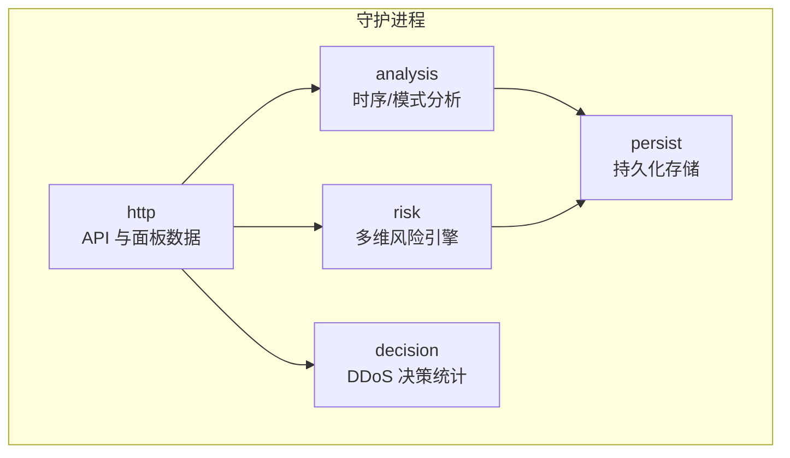
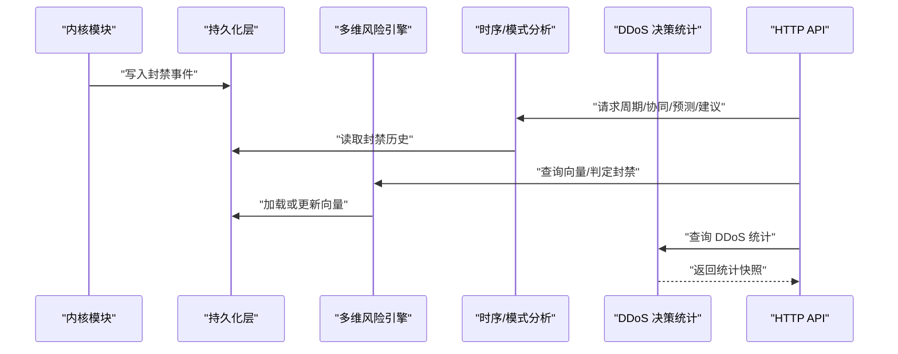
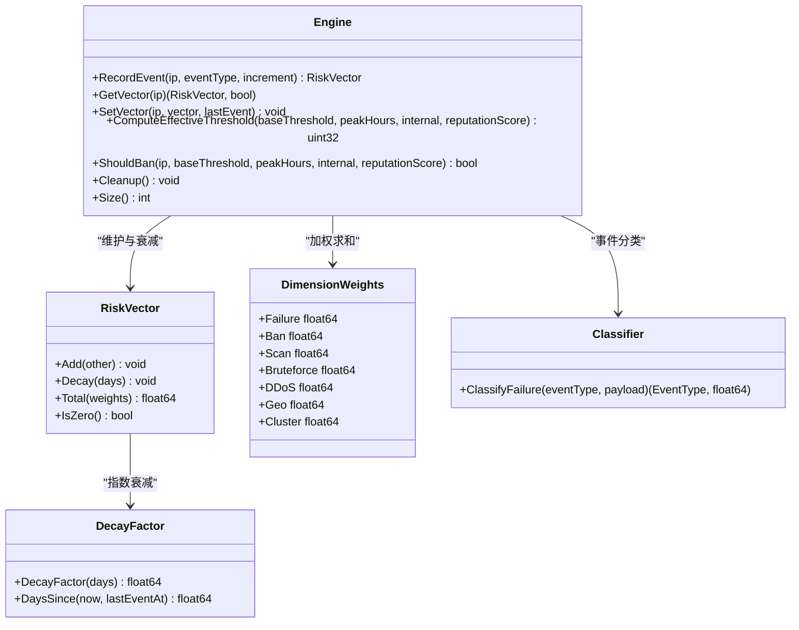
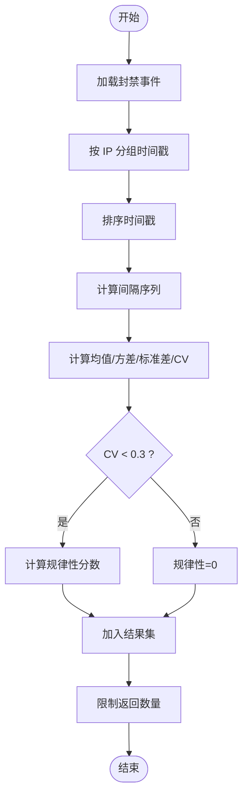
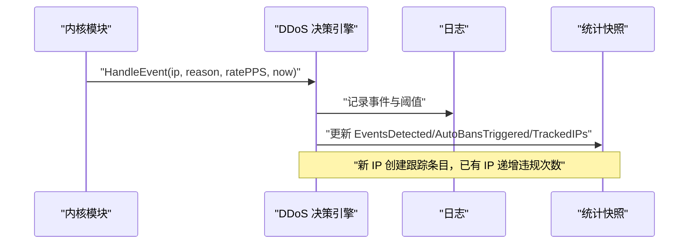
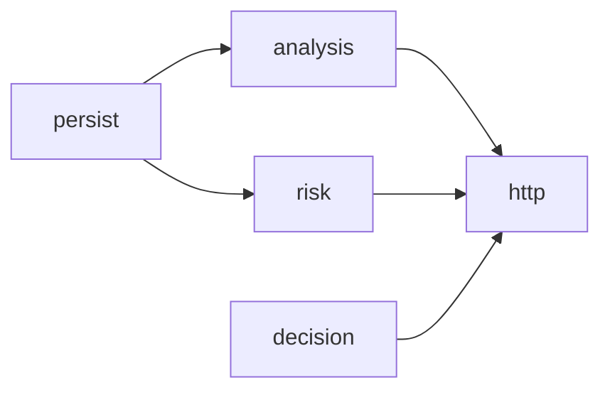

# 异常检测系统

<cite>
**本文引用的文件**   
- [README.md](file://README.md)
- [detection.go](file://src/daemon/internal/analysis/detection.go)
- [network.go](file://src/daemon/internal/analysis/network.go)
- [prediction.go](file://src/daemon/internal/analysis/prediction.go)
- [recommendations.go](file://src/daemon/internal/analysis/recommendations.go)
- [classifier.go](file://src/daemon/internal/risk/classifier.go)
- [types.go](file://src/daemon/internal/risk/types.go)
- [engine.go](file://src/daemon/internal/risk/engine.go)
- [decay.go](file://src/daemon/internal/risk/decay.go)
- [ddos.go](file://src/daemon/internal/decision/ddos.go)
</cite>

## 目录
1. [引言](#引言)
2. [项目结构](#项目结构)
3. [核心组件](#核心组件)
4. [架构总览](#架构总览)
5. [详细组件分析](#详细组件分析)
6. [依赖关系分析](#依赖关系分析)
7. [性能与精度考量](#性能与精度考量)
8. [阈值配置、误报控制与优化](#阈值配置误报控制与优化)
9. [规则配置示例与调试方法](#规则配置示例与调试方法)
10. [故障排查指南](#故障排查指南)
11. [结论](#结论)

## 引言
本文件系统性地说明异常检测子系统，覆盖多维度风险评分、频率与时序分析、模式识别、网络分布分析、协议异常识别、DDoS 决策统计，以及阈值配置、误报率控制和检测精度优化。该系统采用“用户态智能判定 + 内核态高速封禁”的三层架构：内核模块负责零用户态开销的包过滤与封禁表；守护进程负责日志采集、多维风险引擎、威胁情报聚合、HTTP API 与面板服务；前端提供实时监控与可视化分析。

该文档聚焦守护进程中的异常检测实现，包括：
- 频率与时序异常：周期性攻击检测、协同攻击检测、预测模型。
- 模式识别：事件分类器将日志事件映射到多维风险向量。
- 网络行为分析：按子网聚合封禁事件，识别集中性攻击。
- 协议异常识别：通过事件类型与负载字段区分扫描、爆破、DDoS、地域异常等。
- 阈值与策略：加法阈值模型、信誉调整、高峰期与内网差异化处理。
- DDoS 决策统计：内核已封禁事件的跟踪与统计。

## 项目结构
异常检测相关代码主要位于守护进程的 `internal` 目录下：
- `analysis`：时序与模式分析（周期性攻击、协同攻击、网络分布、预测、建议）。
- `risk`：多维风险向量引擎（事件分类、衰减、阈值计算、封禁判定）。
- `decision`：DDoS 事件统计与跟踪。
- `persist`：持久化层（被 analysis 调用，用于读取封禁历史）。
- `http`：对外暴露的分析与配置接口（引用上述模块）。

图表来源
- [README.md:10-31](file://README.md#L10-L31)
- [detection.go:35-126](file://src/daemon/internal/analysis/detection.go#L35-L126)
- [engine.go:8-20](file://src/daemon/internal/risk/engine.go#L8-L20)
- [ddos.go:57-81](file://src/daemon/internal/decision/ddos.go#L57-L81)

章节来源
- [README.md:10-31](file://README.md#L10-L31)

## 核心组件
- 多维风险向量引擎（risk）
  - 维护 IP 维度的风险向量，支持独立衰减、权重加权、有效阈值计算与封禁判定。
  - 关键能力：事件分类、向量衰减、缓存管理、阈值调整（高峰期、内网、信誉）。
- 时序与模式分析（analysis）
  - 周期性攻击检测：基于时间间隔变异系数评估规律性。
  - 协同攻击检测：滑动窗口内多源联动识别。
  - 网络分布分析：按子网聚合封禁事件，识别集中攻击。
  - 预测与建议：预测下次攻击时间、jail 趋势、封禁时长与阈值建议。
- DDoS 决策统计（decision）
  - 接收内核推送的 DDoS 事件，记录违规次数与统计快照，定期清理陈旧条目。

章节来源
- [engine.go:8-20](file://src/daemon/internal/risk/engine.go#L8-L20)
- [detection.go:35-126](file://src/daemon/internal/analysis/detection.go#L35-L126)
- [network.go:22-109](file://src/daemon/internal/analysis/network.go#L22-L109)
- [prediction.go:47-186](file://src/daemon/internal/analysis/prediction.go#L47-L186)
- [recommendations.go:23-103](file://src/daemon/internal/analysis/recommendations.go#L23-L103)
- [ddos.go:57-81](file://src/daemon/internal/decision/ddos.go#L57-L81)

## 架构总览
异常检测系统的端到端流程如下：
- 内核模块进行包过滤与封禁，产生封禁事件。
- 守护进程持久化封禁事件，并供 analysis 与 risk 使用。
- risk 对每个 IP 维护多维风险向量，结合分类器增量、衰减与阈值判定是否封禁。
- analysis 从持久化层拉取历史事件，执行时序与模式分析，输出预测与建议。
- decision 统计内核已触发的 DDoS 事件，提供可观测性与审计。

图表来源
- [README.md:10-31](file://README.md#L10-L31)
- [detection.go:35-126](file://src/daemon/internal/analysis/detection.go#L35-L126)
- [engine.go:39-82](file://src/daemon/internal/risk/engine.go#L39-L82)
- [ddos.go:103-129](file://src/daemon/internal/decision/ddos.go#L103-L129)

## 详细组件分析

### 多维风险向量引擎（risk）
- 设计目标
  - 纯函数可测试：衰减因子与事件分类不依赖状态。
  - 事件溯源：每次攻击事件持久化，向量可重算。
  - 加法阈值模型：各维度系数不会互相抵消。
- 关键数据结构
  - EventType：攻击事件类型枚举（失败、封禁、扫描、爆破、DDoS、地域、集群）。
  - RiskVector：七维风险向量，支持 Add、Decay、Total、IsZero。
  - DimensionWeights：维度权重配置，默认均为 1.0。
  - Engine：内存缓存（带过期时间），线程安全，提供 RecordEvent、GetVector、SetVector、ShouldBan、ComputeEffectiveThreshold、Cleanup、Size。
- 衰减机制
  - 半衰期 7 天，指数衰减公式为 0.5^(days/HalfLifeDays)。
  - DaysSince 计算自上次事件以来的天数，避免负时间导致错误衰减。
- 事件分类器
  - ClassifyFailure 根据事件类型与负载字段映射到具体 EventType 与增量值。
  - 典型增量：高频失败、端口扫描、目录遍历、高频爆破、流量型 DDoS、境外访问、关联恶意 IP、永久封禁等。
- 阈值计算
  - ComputeEffectiveThreshold 使用加法模型：基础阈值 + 高峰期加项 + 内网加项 + 信誉调整。
  - ReputationAdjustment 将信誉分映射为阈值调整量（高信誉不调整，中低信誉降低阈值）。
  - ShouldBan 比较向量加权和与有效阈值，决定是否封禁。

图表来源
- [engine.go:8-20](file://src/daemon/internal/risk/engine.go#L8-L20)
- [types.go:44-93](file://src/daemon/internal/risk/types.go#L44-L93)
- [decay.go:5-34](file://src/daemon/internal/risk/decay.go#L5-L34)
- [classifier.go:15-34](file://src/daemon/internal/risk/classifier.go#L15-L34)

章节来源
- [engine.go:39-82](file://src/daemon/internal/risk/engine.go#L39-L82)
- [engine.go:116-189](file://src/daemon/internal/risk/engine.go#L116-L189)
- [types.go:44-93](file://src/daemon/internal/risk/types.go#L44-L93)
- [decay.go:5-34](file://src/daemon/internal/risk/decay.go#L5-L34)
- [classifier.go:15-34](file://src/daemon/internal/risk/classifier.go#L15-L34)

### 时序与模式分析（analysis）
- 周期性攻击检测
  - 输入：封禁事件列表（IP、时间戳、jail）。
  - 算法：计算相邻封禁时间间隔的平均值、标准差、变异系数（CV），当 CV < 0.3 时计算规律性分数（(1-CV)*100），否则记 0。
  - 输出：按规律性降序排序，限制返回数量，附带原始时间戳以便面板可视化。
- 协同攻击检测
  - 输入：按 jail 分组的事件，滑动窗口（秒）、最小唯一 IP 数、限制数量。
  - 算法：对每个起点构建窗口，统计窗口内唯一 IP 数与封禁事件数，达到阈值则记录协同强度（按事件数线性放大，上限 100）。
  - 输出：每个 jail 仅报告第一个达标窗口，避免重复复制。
- 网络分布分析
  - 输入：近 N 天的封禁事件。
  - 算法：按子网聚合（IPv4 /24，IPv6 /48），统计唯一 IP 数、总封禁数、最近封禁时间与代表 IP。
  - 输出：按总封禁数降序排序，限制返回数量。
- 预测与建议
  - 预测：基于中位数周期估计下次攻击时间，结合规律性与数据量计算置信度，划分紧急程度（imminent/soon/later/distant）。
  - 趋势：按 jail 汇总近 24h 与 7d 封禁量，计算趋势（rising/falling/stable）。
  - 建议：封禁时长建议（复发间隔中位数与当前时长对比）、阈值建议（复发率与样本量决定方向与置信度）。

图表来源
- [detection.go:35-126](file://src/daemon/internal/analysis/detection.go#L35-L126)

章节来源
- [detection.go:35-126](file://src/daemon/internal/analysis/detection.go#L35-L126)
- [network.go:22-109](file://src/daemon/internal/analysis/network.go#L22-L109)
- [prediction.go:47-186](file://src/daemon/internal/analysis/prediction.go#L47-L186)
- [recommendations.go:23-103](file://src/daemon/internal/analysis/recommendations.go#L23-L103)

### DDoS 决策统计（decision）
- 职责
  - 接收内核推送的 DDoS 事件，记录违规次数与统计快照。
  - 不重复封禁，仅做审计与可观测性。
- 关键能力
  - HandleEvent：新增或更新 IP 跟踪条目，累计违规次数。
  - CleanupStale：回收长时间未活动的条目，防止内存增长。
  - Stats/Snapshot：提供只读统计快照（事件总数、自动封禁数、跟踪 IP 数）。

图表来源
- [ddos.go:103-129](file://src/daemon/internal/decision/ddos.go#L103-L129)

章节来源
- [ddos.go:57-81](file://src/daemon/internal/decision/ddos.go#L57-L81)
- [ddos.go:103-129](file://src/daemon/internal/decision/ddos.go#L103-L129)
- [ddos.go:138-156](file://src/daemon/internal/decision/ddos.go#L138-L156)

## 依赖关系分析
- analysis 依赖 persist 读取封禁历史，输出给 http 层展示与分析。
- risk 维护内存缓存，必要时从 persist 加载向量，提供封禁判定。
- decision 独立统计内核事件，不修改封禁策略。
- http 层聚合 analysis、risk、decision 的数据，对外暴露 API 与面板数据。

图表来源
- [detection.go:35-126](file://src/daemon/internal/analysis/detection.go#L35-L126)
- [engine.go:39-82](file://src/daemon/internal/risk/engine.go#L39-L82)
- [ddos.go:103-129](file://src/daemon/internal/decision/ddos.go#L103-L129)

章节来源
- [detection.go:35-126](file://src/daemon/internal/analysis/detection.go#L35-L126)
- [engine.go:39-82](file://src/daemon/internal/risk/engine.go#L39-L82)
- [ddos.go:103-129](file://src/daemon/internal/decision/ddos.go#L103-L129)

## 性能与精度考量
- 性能
  - 风险向量缓存：5 分钟过期，减少数据库压力。
  - 周期性/协同检测：限制事件读取数量（eventLimit），避免全量扫描。
  - 网络分布分析：限制返回数量（limit），避免面板过载。
  - DDoS 统计：原子计数与定时清理，避免内存无限增长。
- 精度
  - 周期性检测：CV < 0.3 才计规律性，避免噪声误判。
  - 协同检测：按唯一 IP 数判定，避免同一 IP 多次封禁被误认为多源。
  - 预测置信度：结合规律性与数据量，避免小样本误导。
  - 阈值建议：基于复发率与样本量，给出方向与置信度。

章节来源
- [engine.go:80-102](file://src/daemon/internal/risk/engine.go#L80-L102)
- [detection.go:35-126](file://src/daemon/internal/analysis/detection.go#L35-L126)
- [network.go:22-109](file://src/daemon/internal/analysis/network.go#L22-L109)
- [prediction.go:110-143](file://src/daemon/internal/analysis/prediction.go#L110-L143)
- [recommendations.go:126-237](file://src/daemon/internal/analysis/recommendations.go#L126-L237)
- [ddos.go:138-156](file://src/daemon/internal/decision/ddos.go#L138-L156)

## 阈值配置、误报控制与优化
- 加法阈值模型
  - 基础阈值（baseThreshold）+ 高峰期加项（peakHours）+ 内网加项（internal）+ 信誉调整（reputationScore）。
  - 修复旧乘法模型的 Bug：内网与低信誉不再相乘抵消。
- 信誉调整
  - 高信誉（≥80）：不调整。
  - 中信誉（≥50）：阈值减 1。
  - 低信誉（<50）：阈值减 2。
- 误报控制
  - 周期性检测：CV 阈值 0.3，避免噪声。
  - 协同检测：唯一 IP 数门槛，避免单 IP 重复封禁。
  - 预测置信度：数据量不足时置信度低，避免过度预警。
  - 阈值建议：样本量不足时不给出建议，避免误导。
- 优化建议
  - 调整维度权重（DimensionWeights）以突出特定攻击类型。
  - 调整半衰期（HalfLifeDays）以适应业务节奏。
  - 调整周期性检测的 CV 阈值与最小事件数。
  - 调整协同检测的窗口大小与最小唯一 IP 数。

章节来源
- [engine.go:116-189](file://src/daemon/internal/risk/engine.go#L116-L189)
- [decay.go:5-34](file://src/daemon/internal/risk/decay.go#L5-L34)
- [detection.go:35-126](file://src/daemon/internal/analysis/detection.go#L35-L126)
- [recommendations.go:126-237](file://src/daemon/internal/analysis/recommendations.go#L126-L237)

## 规则配置示例与调试方法
- 规则配置要点
  - 维度权重：failure、ban、scan、bruteforce、ddos、geo、cluster，默认均为 1.0。
  - 半衰期：HalfLifeDays = 7 天，可根据业务调整。
  - 周期性检测：minEvents ≥ 3，CV < 0.3 计规律性。
  - 协同检测：windowSeconds ≥ 300，minIPs ≥ 3。
  - 预测：limit ≤ 15，confidence 由规律性与数据量决定。
  - 建议：MinThresholdSampleEvents = 10，DefaultThresholdForRecommendation = 5，DefaultBanDurationForRecommendation = 3600。
- 调试方法
  - 查看风险向量：通过 API 查询 IP 的向量与总分。
  - 查看周期性/协同检测结果：检查规律性分数与协同强度。
  - 查看预测与建议：关注置信度与解释说明。
  - 查看 DDoS 统计：检查事件总数、自动封禁数、跟踪 IP 数。

章节来源
- [types.go:106-130](file://src/daemon/internal/risk/types.go#L106-L130)
- [decay.go:5-34](file://src/daemon/internal/risk/decay.go#L5-L34)
- [detection.go:35-126](file://src/daemon/internal/analysis/detection.go#L35-L126)
- [prediction.go:47-186](file://src/daemon/internal/analysis/prediction.go#L47-L186)
- [recommendations.go:239-251](file://src/daemon/internal/analysis/recommendations.go#L239-L251)
- [ddos.go:49-55](file://src/daemon/internal/decision/ddos.go#L49-L55)

## 故障排查指南
- 常见问题
  - 周期性检测无结果：检查 minEvents 与 CV 阈值，确认时间戳足够且规律性显著。
  - 协同检测误报：检查窗口大小与最小唯一 IP 数，避免单 IP 重复封禁。
  - 预测置信度低：检查数据量与规律性，避免小样本误导。
  - 阈值建议缺失：检查样本量是否低于 MinThresholdSampleEvents。
  - DDoS 统计不更新：检查内核事件推送与 HandleEvent 调用。
- 排查步骤
  - 查看风险向量缓存：确认缓存命中与过期时间。
  - 查看封禁历史：确认事件写入与读取正常。
  - 查看日志：确认 DDoS 事件记录与阈值打印。
  - 调整参数：逐步调整阈值与窗口，观察效果。

章节来源
- [engine.go:80-102](file://src/daemon/internal/risk/engine.go#L80-L102)
- [detection.go:35-126](file://src/daemon/internal/analysis/detection.go#L35-L126)
- [recommendations.go:126-237](file://src/daemon/internal/analysis/recommendations.go#L126-L237)
- [ddos.go:103-129](file://src/daemon/internal/decision/ddos.go#L103-L129)

## 结论
异常检测系统通过多维风险向量、时序与模式分析、网络分布分析与 DDoS 决策统计，构建了完整的异常检测闭环。加法阈值模型与信誉调整提升了误报控制的鲁棒性，周期性检测与协同检测增强了模式识别能力，预测与建议提供了前瞻性洞察。通过合理配置阈值、窗口与权重，可在保证检测精度的同时控制误报率，适应不同业务场景的需求。