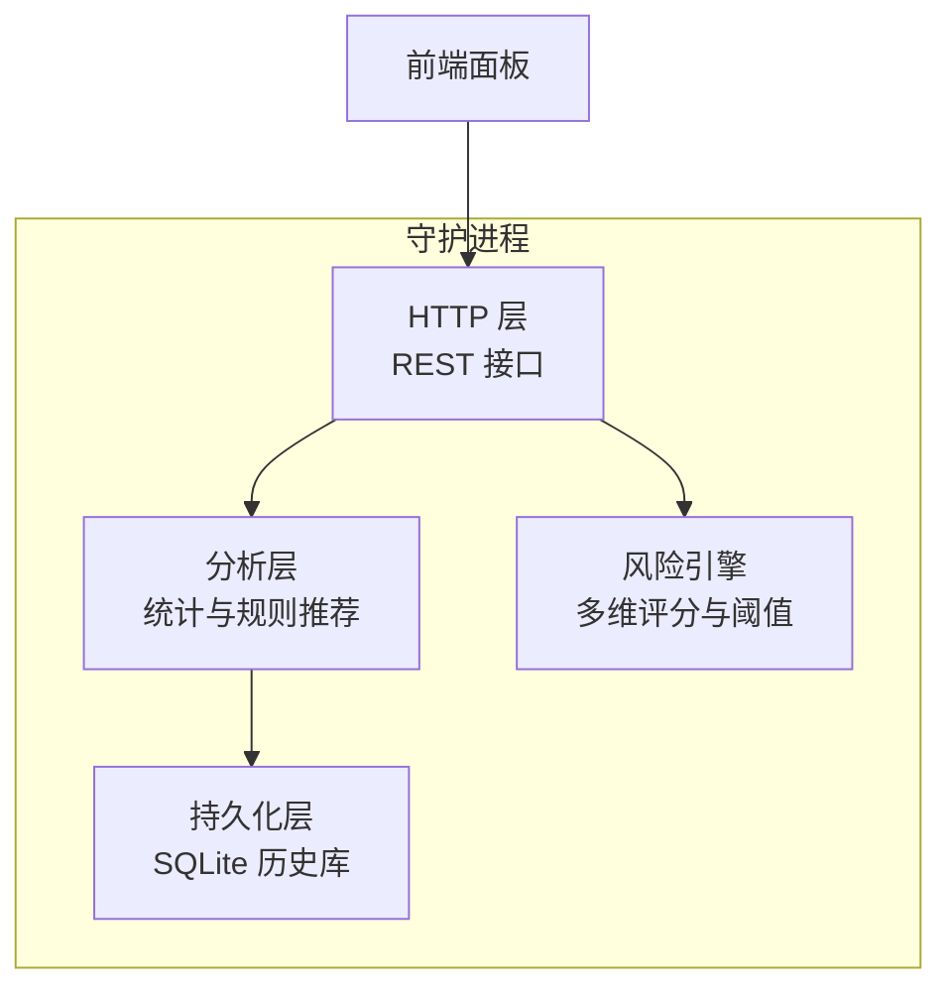
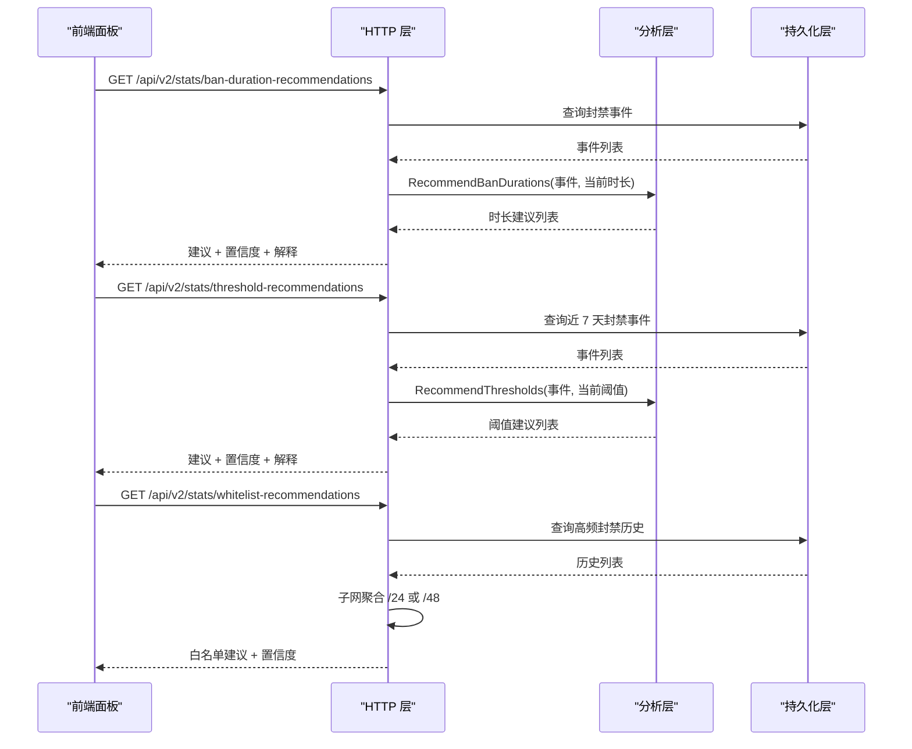
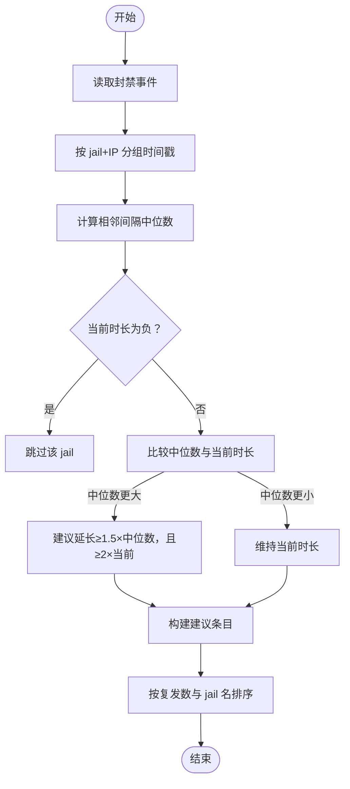
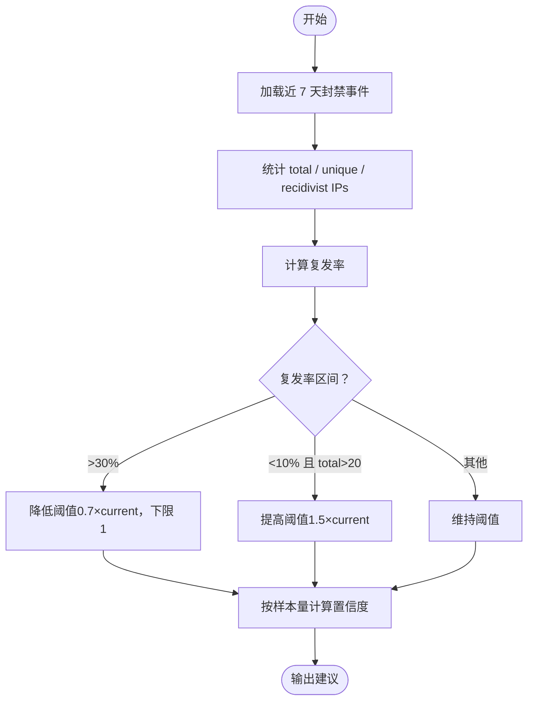
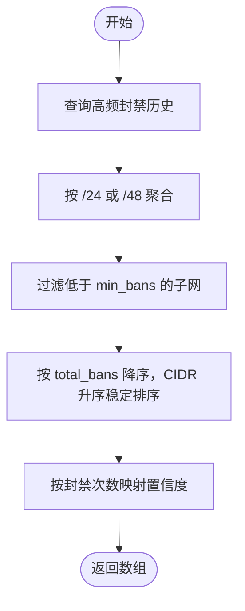
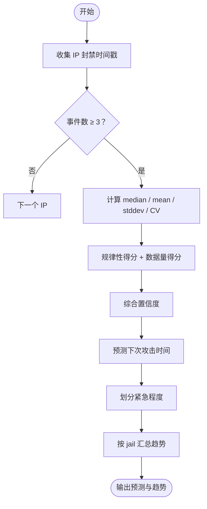
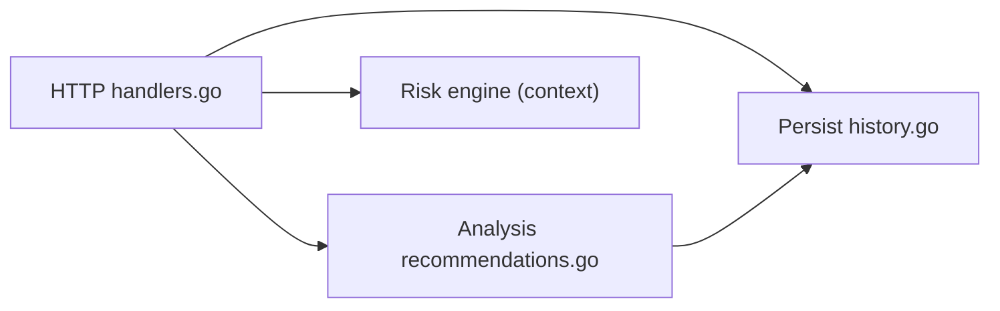

# 推荐系统

<cite>
**本文引用的文件**   
- [README.md](file://README.md)
- [recommendations.go](file://src/daemon/internal/analysis/recommendations.go)
- [recommendations.go](file://src/daemon/internal/http/recommendations.go)
- [handlers.go](file://src/daemon/internal/http/handlers.go)
- [history.go](file://src/daemon/internal/persist/history.go)
- [prediction.go](file://src/daemon/internal/analysis/prediction.go)
- [engine_test.go](file://src/daemon/internal/risk/engine_test.go)
</cite>

## 目录
1. [引言](#引言)
2. [项目结构](#项目结构)
3. [核心组件](#核心组件)
4. [架构总览](#架构总览)
5. [详细组件分析](#详细组件分析)
6. [依赖关系分析](#依赖关系分析)
7. [性能与扩展性](#性能与扩展性)
8. [故障排查指南](#故障排查指南)
9. [结论](#结论)
10. [附录：推荐结果展示与交互设计](#附录推荐结果展示与交互设计)

## 引言
本文件面向“智能内核防火墙”的推荐子系统，聚焦安全策略推荐算法与相关实现。内容覆盖：
- 最佳实践匹配：基于封禁历史、复发率、时间间隔中位数等指标，给出阈值与封禁时长的调整建议。
- 风险缓解建议：结合威胁情报、低信誉地址、周期攻击与协同攻击检测，提供白名单、阈值收紧或放宽的策略建议。
- 配置优化推荐：对每个 jail 的失败阈值与封禁时长给出可操作的调参建议，并附带置信度与解释。
- 规则与机器学习辅助：以统计规则为主（复发率、CV 系数、分档置信度），辅以预测模块的时间序列规律性评分。
- 用户偏好学习机制：通过面板反馈（采纳/忽略/回滚）沉淀到历史库，驱动后续推荐排序与置信度校准。
- 推荐置信度计算：按样本量阶梯化打分，并与前端统一刻度。
- 反馈循环优化与 A/B 测试支持：在 API 层记录决策与效果，为后续策略迭代提供数据基础。

## 项目结构
推荐系统主要位于守护进程内部：
- 分析层 analysis：负责从持久化历史数据中提取模式、计算统计量、生成建议。
- HTTP 层 http：暴露 RESTful 接口，聚合当前配置、调用分析层、返回契约载荷。
- 持久化层 persist：SQLite 存储封禁事件、历史底账、信誉等数据。
- 风险引擎 risk：多维风险评分与有效阈值计算，影响推荐系统的输入与上下文。

图表来源
- [handlers.go:195-225](file://src/daemon/internal/http/handlers.go#L195-L225)
- [recommendations.go:23-103](file://src/daemon/internal/analysis/recommendations.go#L23-L103)
- [history.go:110-141](file://src/daemon/internal/persist/history.go#L110-L141)

章节来源
- [README.md:10-31](file://README.md#L10-L31)

## 核心组件
- 封禁时长推荐：根据每个 jail 的历史封禁事件，计算复发地址的中位间隔，若中位间隔超过当前封禁时长则建议延长，否则维持。
- 失败阈值推荐：基于近 7 天封禁事件的复发率（同一 jail 内重复被封的地址占比），按阈值区间决定降低、提高或维持。
- 白名单推荐：对频繁临时封禁的 IP 聚合为 IPv4 /24 或 IPv6 /48 子网，按累计封禁次数与唯一 IP 数评估是否误伤。
- 攻击预测：对具备周期性行为的地址估计下次攻击时间，输出紧急程度与置信度，辅助提前加固。
- 风险引擎：维护多维向量与衰减，计算有效阈值，为推荐系统提供信誉与上下文。

章节来源
- [recommendations.go:23-103](file://src/daemon/internal/analysis/recommendations.go#L23-L103)
- [recommendations.go:126-237](file://src/daemon/internal/analysis/recommendations.go#L126-L237)
- [recommendations.go:44-141](file://src/daemon/internal/http/recommendations.go#L44-L141)
- [prediction.go:47-186](file://src/daemon/internal/analysis/prediction.go#L47-L186)
- [engine_test.go:43-125](file://src/daemon/internal/risk/engine_test.go#L43-L125)

## 架构总览
推荐系统的数据流遵循“读取历史 → 统计建模 → 生成建议 → 暴露 API → 前端展示”的路径。

图表来源
- [handlers.go:195-225](file://src/daemon/internal/http/handlers.go#L195-L225)
- [recommendations.go:23-103](file://src/daemon/internal/analysis/recommendations.go#L23-L103)
- [recommendations.go:126-237](file://src/daemon/internal/analysis/recommendations.go#L126-L237)
- [recommendations.go:44-141](file://src/daemon/internal/http/recommendations.go#L44-L141)
- [history.go:110-141](file://src/daemon/internal/persist/history.go#L110-L141)

## 详细组件分析

### 封禁时长推荐
- 输入：最近封禁事件、各 jail 当前封禁时长。
- 逻辑：
  - 按 jail 与 IP 分组，统计每 IP 的封禁时间戳序列。
  - 计算相邻封禁间隔的中位数；若中位数大于当前时长，建议延长至中位数的 1.5 倍且不低于当前时长的 2 倍。
  - 配置级永久封禁（负值）不产生建议条目。
- 输出：每条建议包含 jail 名、当前时长、建议时长、复发地址数、中位间隔、解释、是否足够。

图表来源
- [recommendations.go:23-103](file://src/daemon/internal/analysis/recommendations.go#L23-L103)

章节来源
- [recommendations.go:23-103](file://src/daemon/internal/analysis/recommendations.go#L23-L103)

### 失败阈值推荐
- 输入：近 7 天封禁事件、各 jail 当前失败阈值。
- 逻辑：
  - 统计每个 jail 的总封禁数、唯一 IP 数、复发 IP 数（同一 jail 内被封 ≥2 次）。
  - 计算复发率 = 复发 IP 数 / 唯一 IP 数 × 100%。
  - 若复发率 > 30%，建议降低阈值（降至 0.7×当前，最小为 1）。
  - 若复发率 < 10% 且总封禁数 > 20，建议提高阈值（提升至 1.5×当前）。
  - 否则维持当前阈值。
- 置信度：仅按样本量分档（≥50→0.9，≥20→0.7，≥10→0.5，其余 0.3）。

图表来源
- [recommendations.go:126-237](file://src/daemon/internal/analysis/recommendations.go#L126-L237)

章节来源
- [recommendations.go:126-237](file://src/daemon/internal/analysis/recommendations.go#L126-L237)

### 白名单推荐
- 输入：高频封禁历史（ban_history）。
- 逻辑：
  - 将 IP 聚合成子网：IPv4 /24、IPv6 /48。
  - 统计每个子网的累计封禁次数与唯一 IP 数。
  - 过滤低于阈值的子网，按总封禁次数降序排序，相同次数按 CIDR 文本升序稳定排序。
  - 置信度按封禁次数分档（≥50→90，≥20→70，≥10→50，其余 30）。
- 输出：每条建议包含类型（subnet）、CIDR、原因、受影响 IP 数、总封禁数、置信度。

图表来源
- [recommendations.go:44-141](file://src/daemon/internal/http/recommendations.go#L44-L141)
- [history.go:110-141](file://src/daemon/internal/persist/history.go#L110-L141)

章节来源
- [recommendations.go:44-141](file://src/daemon/internal/http/recommendations.go#L44-L141)
- [history.go:110-141](file://src/daemon/internal/persist/history.go#L110-L141)

### 攻击预测与趋势
- 输入：封禁事件序列。
- 逻辑：
  - 对每个 IP 至少 3 次封禁的事件序列，计算相邻间隔的中位数、均值与标准差。
  - 变异系数 CV = stddev / avg，规律性得分 = (1 - CV) × 100（当 CV < 0.3）。
  - 数据量得分 = min(100, 事件数/5 × 100)。
  - 综合置信度 = 规律性得分 × 0.6 + 数据量得分 × 0.4。
  - 预测下次攻击时间 = 最近封禁时间 + 中位间隔。
  - 紧急程度：按距离现在的小时数划分为 imminent / soon / later / distant。
  - 按 jail 汇总 24h/7d 封禁量与趋势（rising/falling/stable）。
- 输出：预测列表、jail 趋势、即将发生计数、24 小时内预计再动手计数。

图表来源
- [prediction.go:47-186](file://src/daemon/internal/analysis/prediction.go#L47-L186)
- [prediction.go:188-259](file://src/daemon/internal/analysis/prediction.go#L188-L259)

章节来源
- [prediction.go:47-186](file://src/daemon/internal/analysis/prediction.go#L47-L186)
- [prediction.go:188-259](file://src/daemon/internal/analysis/prediction.go#L188-L259)

### 风险引擎与推荐联动
- 风险引擎维护多维向量（频率、扫描、探测、协议异常、历史信誉），并进行时间衰减与加法阈值模型。
- 有效阈值计算考虑峰值时段、内网来源、信誉分数等因素，为推荐系统提供上下文。
- 低信誉地址会触发更严格的阈值调整，从而间接影响复发率与阈值建议的方向。

章节来源
- [engine_test.go:43-125](file://src/daemon/internal/risk/engine_test.go#L43-L125)

## 依赖关系分析
推荐系统的关键依赖如下：
- HTTP 层依赖分析层与持久化层，同时读取当前活跃 jail 配置。
- 分析层依赖持久化层的封禁事件与历史底账。
- 白名单推荐直接依赖 ban_history 表的高频封禁记录。
- 预测与趋势分析依赖封禁事件的时间序列。

图表来源
- [handlers.go:195-225](file://src/daemon/internal/http/handlers.go#L195-L225)
- [recommendations.go:23-103](file://src/daemon/internal/analysis/recommendations.go#L23-L103)
- [history.go:110-141](file://src/daemon/internal/persist/history.go#L110-L141)

章节来源
- [handlers.go:195-225](file://src/daemon/internal/http/handlers.go#L195-L225)
- [recommendations.go:23-103](file://src/daemon/internal/analysis/recommendations.go#L23-L103)
- [history.go:110-141](file://src/daemon/internal/persist/history.go#L110-L141)

## 性能与扩展性
- 样本限制：分析层与直方图采样均使用固定上限（如 10000），避免全表扫描带来的延迟。
- 排序稳定性：白名单推荐在同次数时使用 CIDR 文本升序作为 tie-break，保证列表刷新稳定。
- 置信度阶梯：统一的分档尺度便于前后端一致理解证据强度。
- 可扩展点：
  - 增加机器学习模型（如时序预测、聚类）替代或增强规则判断。
  - 引入用户反馈权重，动态调整置信度与推荐优先级。
  - 支持 A/B 测试分流，对比不同推荐策略的效果。

[本节为通用指导，不涉及具体文件分析]

## 故障排查指南
- 历史库未初始化：HTTP 层在 db 为空时返回服务不可用提示，面板应显示相应状态。
- 查询失败：分析层或持久化层报错时，HTTP 层记录错误日志并返回内部错误。
- 无样本或样本过薄：阈值建议要求最低样本事件数，低于阈值时不产出建议。
- 配置级永久封禁：对应 jail 不会产出生效的时长建议条目，需运维手动处理。

章节来源
- [handlers.go:68-108](file://src/daemon/internal/http/handlers.go#L68-L108)
- [handlers.go:195-225](file://src/daemon/internal/http/handlers.go#L195-L225)
- [recommendations.go:239-251](file://src/daemon/internal/analysis/recommendations.go#L239-L251)

## 结论
推荐系统以统计规则为核心，结合风险引擎的多维评分与历史数据，提供封禁时长、失败阈值与白名单的最佳实践建议。其置信度体系与样本量挂钩，确保建议的可信度透明。未来可通过机器学习与用户反馈闭环进一步提升准确性与适应性。

[本节为总结，不涉及具体文件分析]

## 附录：推荐结果展示与交互设计
- 展示维度：
  - 封禁时长建议：显示当前时长、建议时长、复发地址数、中位间隔、解释、置信度。
  - 失败阈值建议：显示当前阈值、建议方向（降低/提高/维持）、复发率、唯一 IP 数、平均封禁数/IP、置信度。
  - 白名单建议：显示 CIDR、受影响 IP 数、总封禁数、原因、置信度。
  - 攻击预测：显示 IP、jail、下次攻击时间、紧急程度、置信度、事件数、中位周期。
- 交互设计：
  - 采纳建议：一键应用阈值或时长变更，记录决策与生效结果。
  - 忽略建议：标记忽略，减少同类建议的优先级。
  - 回滚操作：对已应用的建议提供回滚入口，记录回滚原因。
  - 反馈采集：在面板侧记录用户对建议的满意度与效果反馈，用于后续置信度校准与策略优化。
- A/B 测试支持：
  - 在 API 层增加实验标识，分流不同推荐策略。
  - 记录实验组与对照组的采纳率、误报率、复发率变化。
  - 定期评估并自动切换表现更优的策略。

[本节为概念性指导，不涉及具体文件分析]