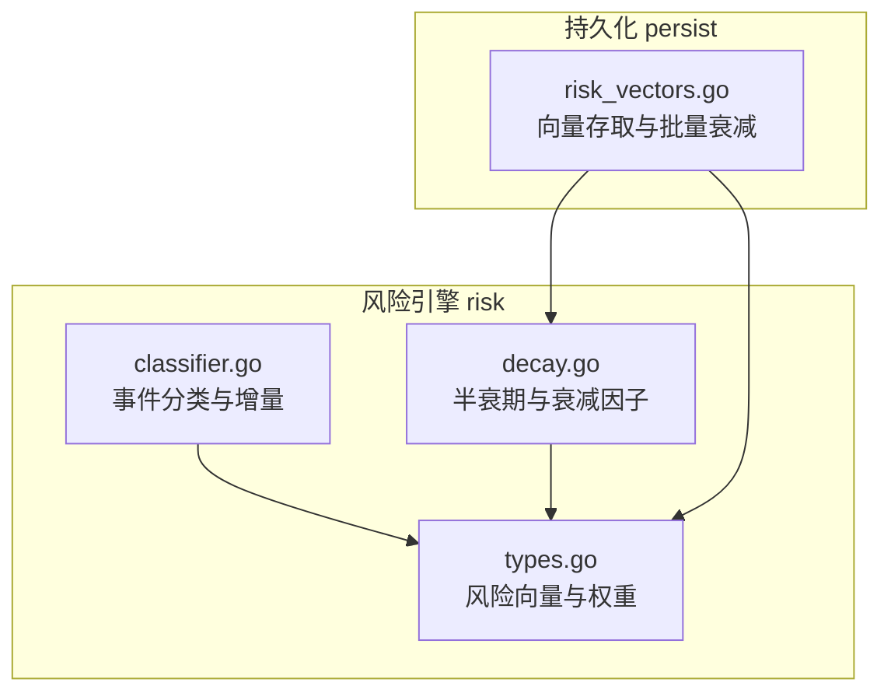
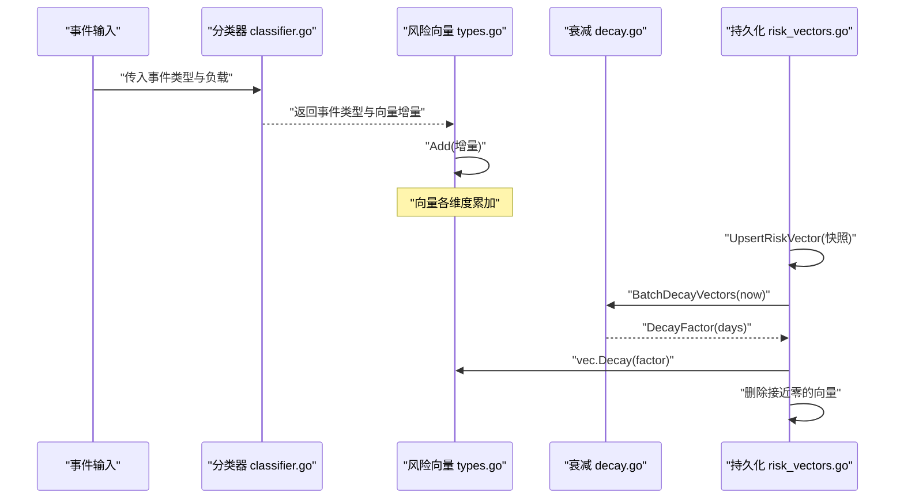
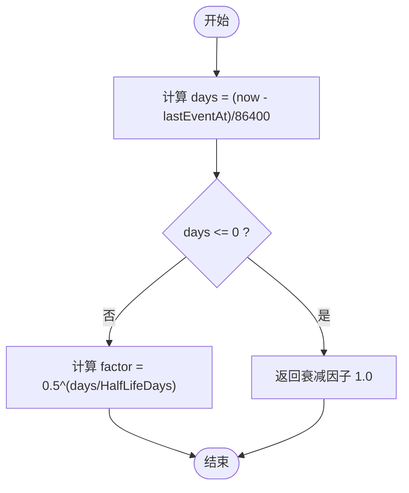
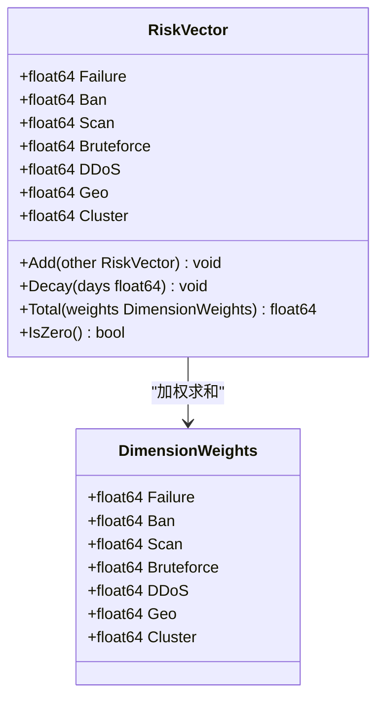
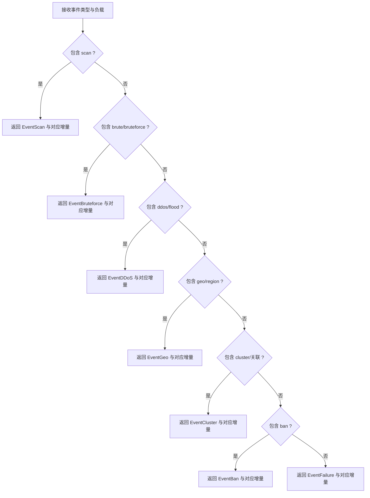
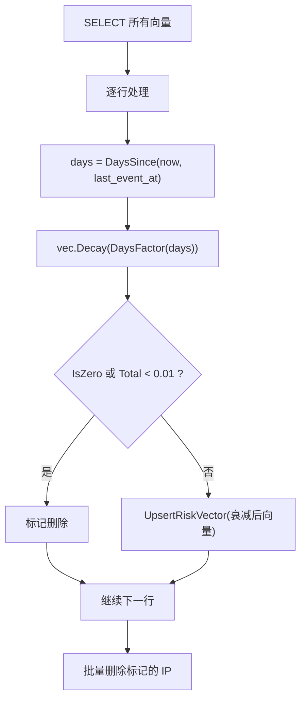
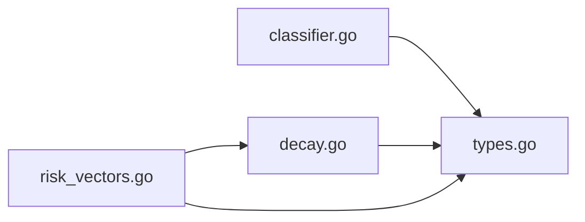

# 时间衰减机制

<cite>
**本文引用的文件**   
- [decay.go](file://src/daemon/internal/risk/decay.go)
- [types.go](file://src/daemon/internal/risk/types.go)
- [classifier.go](file://src/daemon/internal/risk/classifier.go)
- [risk_vectors.go](file://src/daemon/internal/persist/risk_vectors.go)
- [decay_test.go](file://src/daemon/internal/risk/decay_test.go)
</cite>

## 目录
1. [简介](#简介)
2. [项目结构](#项目结构)
3. [核心组件](#核心组件)
4. [架构总览](#架构总览)
5. [详细组件分析](#详细组件分析)
6. [依赖关系分析](#依赖关系分析)
7. [性能与内存优化](#性能与内存优化)
8. [参数调优指南](#参数调优指南)
9. [故障排查](#故障排查)
10. [结论](#结论)

## 简介
本文件系统性阐述风险评分的时间衰减机制，重点包括：
- 指数衰减模型与半衰期配置
- 衰减因子计算与天数换算
- 风险向量随时间的自然降低过程
- 不同攻击类型的衰减策略差异
- 衰减曲线可视化、性能考虑与内存管理优化
- 衰减参数调优指南与实际应用场景示例

该机制用于在持续累积的攻击事件基础上，通过时间维度对历史风险进行“自然遗忘”，使近期行为对当前风险评分影响更大，远期影响逐步减弱。

## 项目结构
与时间衰减机制直接相关的代码位于守护进程的风险引擎与持久化层：
- 风险引擎（risk）：定义事件类型、风险向量、衰减函数与分类器
- 持久化（persist）：负责风险向量的存储、批量衰减与清理

**图表来源**
- [types.go:44-93](file://src/daemon/internal/risk/types.go#L44-L93)
- [decay.go:5-34](file://src/daemon/internal/risk/decay.go#L5-L34)
- [classifier.go:5-34](file://src/daemon/internal/risk/classifier.go#L5-L34)
- [risk_vectors.go:19-84](file://src/daemon/internal/persist/risk_vectors.go#L19-L84)

**章节来源**
- [types.go:44-93](file://src/daemon/internal/risk/types.go#L44-L93)
- [decay.go:5-34](file://src/daemon/internal/risk/decay.go#L5-L34)
- [risk_vectors.go:19-84](file://src/daemon/internal/persist/risk_vectors.go#L19-L84)

## 核心组件
- 指数衰减与半衰期
  - 半衰期常量：默认 7 天
  - 衰减因子公式：0.5^(days / HalfLifeDays)
  - 天数换算：基于 Unix 秒差值转换为天数
- 风险向量
  - 多维向量：failure、ban、scan、bruteforce、ddos、geo、cluster
  - 独立衰减：每个维度乘以相同衰减因子
  - 加权和：按维度权重求和得到总风险
- 事件分类与增量
  - 根据事件类型与负载字段判定具体攻击类型并给出向量增量
- 持久化与批量衰减
  - 向量快照存储，定期批量衰减，接近零的向量删除以控制数据库规模

**章节来源**
- [decay.go:5-34](file://src/daemon/internal/risk/decay.go#L5-L34)
- [types.go:44-93](file://src/daemon/internal/risk/types.go#L44-L93)
- [classifier.go:5-34](file://src/daemon/internal/risk/classifier.go#L5-L34)
- [risk_vectors.go:86-144](file://src/daemon/internal/persist/risk_vectors.go#L86-L144)

## 架构总览
下图展示从事件分类到风险向量衰减与落库的整体流程。

**图表来源**
- [classifier.go:5-34](file://src/daemon/internal/risk/classifier.go#L5-L34)
- [types.go:57-80](file://src/daemon/internal/risk/types.go#L57-L80)
- [decay.go:10-24](file://src/daemon/internal/risk/decay.go#L10-L24)
- [risk_vectors.go:50-84](file://src/daemon/internal/persist/risk_vectors.go#L50-L84)
- [risk_vectors.go:86-144](file://src/daemon/internal/persist/risk_vectors.go#L86-L144)

## 详细组件分析

### 指数衰减与半衰期
- 半衰期
  - 默认 7 天，意味着每过 7 天，风险向量各维度值减半
- 衰减因子
  - 使用纯函数计算，不依赖外部状态，便于测试与复用
  - 当 days ≤ 0 时返回 1.0，即无衰减
- 天数换算
  - 将 now 与 lastEventAt 的秒差转换为天数，避免负数导致异常衰减

**图表来源**
- [decay.go:19-24](file://src/daemon/internal/risk/decay.go#L19-L24)
- [decay.go:26-34](file://src/daemon/internal/risk/decay.go#L26-L34)

**章节来源**
- [decay.go:5-34](file://src/daemon/internal/risk/decay.go#L5-L34)
- [decay_test.go:8-30](file://src/daemon/internal/risk/decay_test.go#L8-L30)

### 风险向量与衰减
- 向量结构
  - 包含 failure、ban、scan、bruteforce、ddos、geo、cluster 七个维度
- 向量操作
  - Add：累加另一个向量（事件增量）
  - Decay：对每个维度乘以衰减因子
  - Total：按权重计算加权和
  - IsZero：判断是否全为零
- 权重
  - 默认权重均为 1.0，可通过配置调整各维度对总风险的贡献

**图表来源**
- [types.go:44-93](file://src/daemon/internal/risk/types.go#L44-L93)
- [types.go:106-130](file://src/daemon/internal/risk/types.go#L106-L130)

**章节来源**
- [types.go:44-93](file://src/daemon/internal/risk/types.go#L44-L93)
- [types.go:106-130](file://src/daemon/internal/risk/types.go#L106-L130)

### 事件分类与增量
- 分类逻辑
  - 根据事件类型字符串匹配扫描、爆破、DDoS、地域、集群、封禁等类别
  - 未命中则归类为认证失败
- 增量规则
  - 依据负载字段（如 count、rate、pps、foreign、malicious、permanent 等）决定增量大小
  - 典型增量范围 1.0-20.0，体现不同攻击严重性

**图表来源**
- [classifier.go:5-34](file://src/daemon/internal/risk/classifier.go#L5-L34)
- [classifier.go:36-144](file://src/daemon/internal/risk/classifier.go#L36-L144)

**章节来源**
- [classifier.go:5-34](file://src/daemon/internal/risk/classifier.go#L5-L34)
- [classifier.go:36-144](file://src/daemon/internal/risk/classifier.go#L36-L144)

### 持久化与批量衰减
- 向量快照
  - 每次事件后更新 ip_risk_vectors 表中的向量快照，避免每次查询都从事件重算
- 批量衰减
  - 定期调用 BatchDecayVectors，对所有向量应用衰减
  - 若向量接近零或总和低于阈值，则删除记录，防止数据库无限增长
- 高威胁 IP 查询
  - 支持按加权和阈值筛选高风险 IP，用于自动封禁策略

**图表来源**
- [risk_vectors.go:86-144](file://src/daemon/internal/persist/risk_vectors.go#L86-L144)
- [decay.go:19-34](file://src/daemon/internal/risk/decay.go#L19-L34)

**章节来源**
- [risk_vectors.go:19-84](file://src/daemon/internal/persist/risk_vectors.go#L19-L84)
- [risk_vectors.go:86-144](file://src/daemon/internal/persist/risk_vectors.go#L86-L144)

## 依赖关系分析
- 模块内依赖
  - persist.risk_vectors 依赖 risk.types 与 risk.decay
  - risk.classifier 输出事件类型与增量，供上层聚合到 risk.RiskVector
- 数据流
  - 事件输入 → 分类器 → 向量累加 → 持久化快照 → 批量衰减 → 清理低价值记录

**图表来源**
- [classifier.go:5-34](file://src/daemon/internal/risk/classifier.go#L5-L34)
- [types.go:44-93](file://src/daemon/internal/risk/types.go#L44-L93)
- [decay.go:5-34](file://src/daemon/internal/risk/decay.go#L5-L34)
- [risk_vectors.go:1-9](file://src/daemon/internal/persist/risk_vectors.go#L1-L9)

**章节来源**
- [risk_vectors.go:1-9](file://src/daemon/internal/persist/risk_vectors.go#L1-L9)
- [risk_vectors.go:86-144](file://src/daemon/internal/persist/risk_vectors.go#L86-L144)

## 性能与内存优化
- 计算复杂度
  - DecayFactor 为 O(1)，DaysSince 为 O(1)
  - BatchDecayVectors 为 O(N)，N 为向量记录数
- I/O 与批处理
  - 批量读取与更新减少多次往返开销
  - 对接近零的向量进行删除，降低存储膨胀
- 数值稳定性
  - 使用浮点运算，注意极小值的舍入误差；采用阈值 0.01 作为清理边界
- 基准测试
  - 提供 DecayFactor 的基准用例，便于评估 CPU 开销

建议：
- 合理设置批量衰减频率（例如每小时），平衡实时性与资源占用
- 监控数据库行数与磁盘增长，必要时调整清理阈值
- 在高并发场景下，确保 Upsert 与 Delete 操作的幂等性与事务一致性

**章节来源**
- [decay_test.go:56-60](file://src/daemon/internal/risk/decay_test.go#L56-L60)
- [risk_vectors.go:86-144](file://src/daemon/internal/persist/risk_vectors.go#L86-L144)

## 参数调优指南
- 半衰期（HalfLifeDays）
  - 默认 7 天，适合大多数场景
  - 缩短半衰期：使历史风险更快消退，适用于高频误报环境
  - 延长半衰期：保留更长历史影响，适用于低频但高危攻击
- 维度权重（DimensionWeights）
  - 默认均为 1.0
  - 提高某维度权重可增强该类型攻击对总风险的贡献
  - 降低某维度权重可降低其影响，避免过度敏感
- 清理阈值
  - 当前实现使用 IsZero 或 Total < 0.01 作为删除条件
  - 可根据业务容忍度调整阈值，平衡准确性与存储成本
- 事件增量
  - 通过分类器负载字段（count、rate、pps 等）调节增量大小
  - 针对特定攻击类型（如端口扫描、DDoS）提高增量，使其更快触发阈值

实际应用场景示例：
- SSH 暴力破解
  - 提高 bruteforce 权重，适当缩短半衰期，快速识别并处置重复尝试
- 端口扫描
  - 提高 scan 权重，结合路径遍历检测提升增量，加速发现探测行为
- DDoS 流量型攻击
  - 提高 ddos 权重，结合 pps 阈值提升增量，及时阻断大规模流量
- 异常地域访问
  - 适度提高 geo 权重，结合白名单策略降低误报
- 已知恶意集群关联
  - 提高 cluster 权重，利用关联情报快速提升风险评分

**章节来源**
- [decay.go:5-8](file://src/daemon/internal/risk/decay.go#L5-L8)
- [types.go:106-130](file://src/daemon/internal/risk/types.go#L106-L130)
- [classifier.go:36-144](file://src/daemon/internal/risk/classifier.go#L36-L144)
- [risk_vectors.go:121-144](file://src/daemon/internal/persist/risk_vectors.go#L121-L144)

## 故障排查
常见问题与定位方法：
- 风险值不衰减
  - 检查 last_event_at 是否正确更新
  - 确认 BatchDecayVectors 是否定时执行
  - 验证 DaysSince 返回值是否为正数
- 向量不删除
  - 检查 IsZero 与 Total 阈值是否符合预期
  - 确认 UpsertRiskVector 与 DeleteRiskVector 调用链正常
- 性能问题
  - 观察 BatchDecayVectors 的执行时间与数据库 IO
  - 调整批量频率与清理阈值，减少扫描行数

**章节来源**
- [risk_vectors.go:86-144](file://src/daemon/internal/persist/risk_vectors.go#L86-L144)
- [decay.go:26-34](file://src/daemon/internal/risk/decay.go#L26-L34)

## 结论
时间衰减机制通过指数衰减模型与半衰期配置，使风险评分随时间自然降低，既保留近期行为的敏感性，又避免历史噪声长期干扰。通过多维向量与事件分类，系统能够针对不同攻击类型实施差异化策略。配合批量衰减与近零清理，系统在准确性与性能之间取得良好平衡。建议根据业务特征调整半衰期、维度权重与清理阈值，以获得更贴合实际的防护效果。