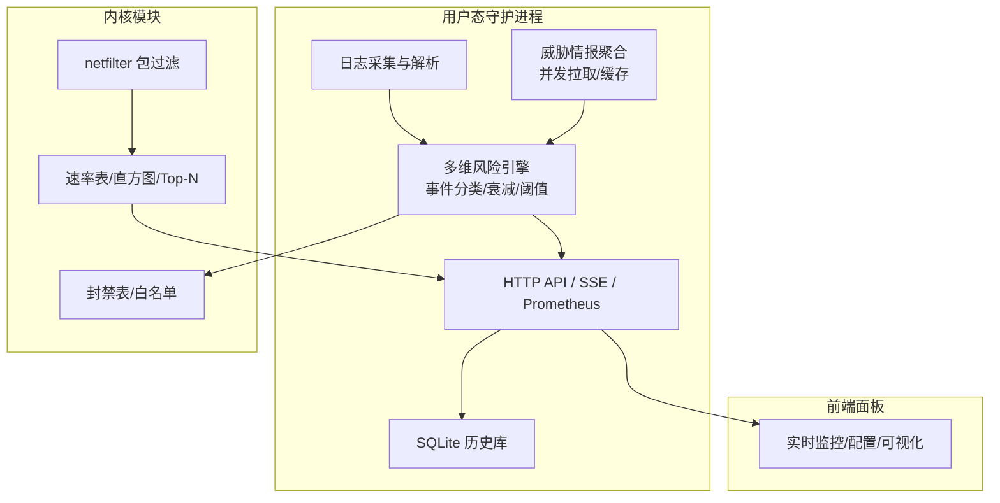
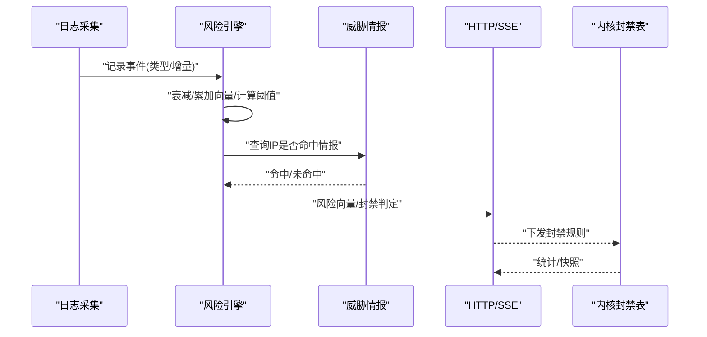
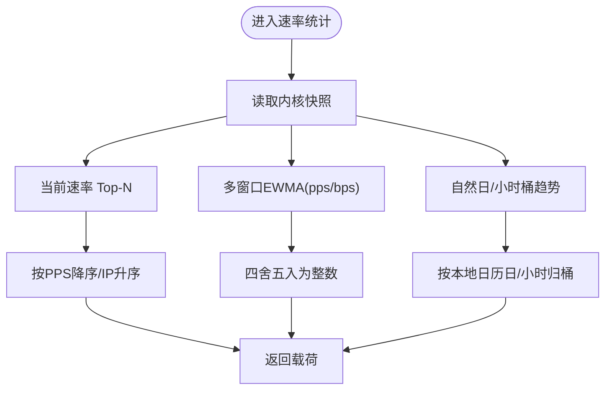
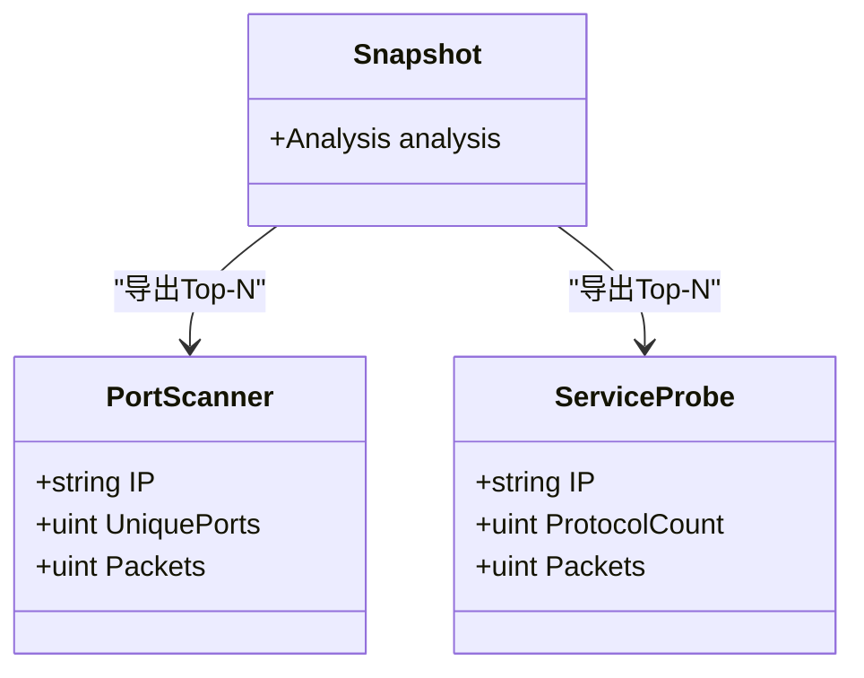
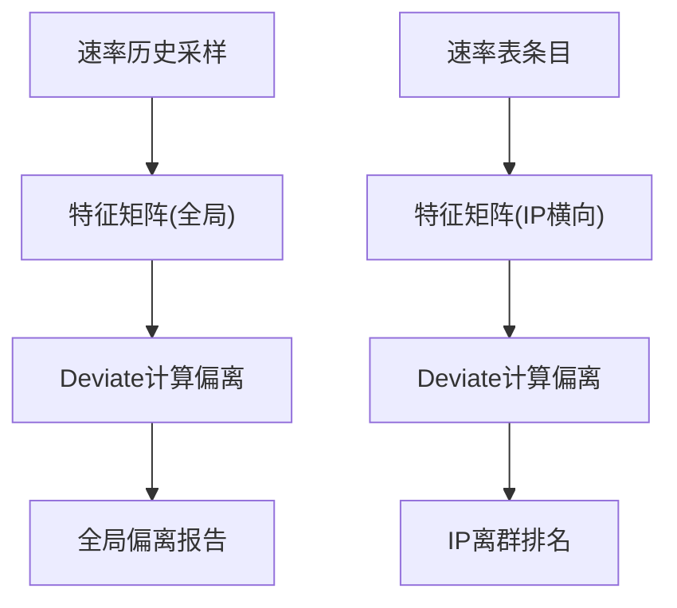
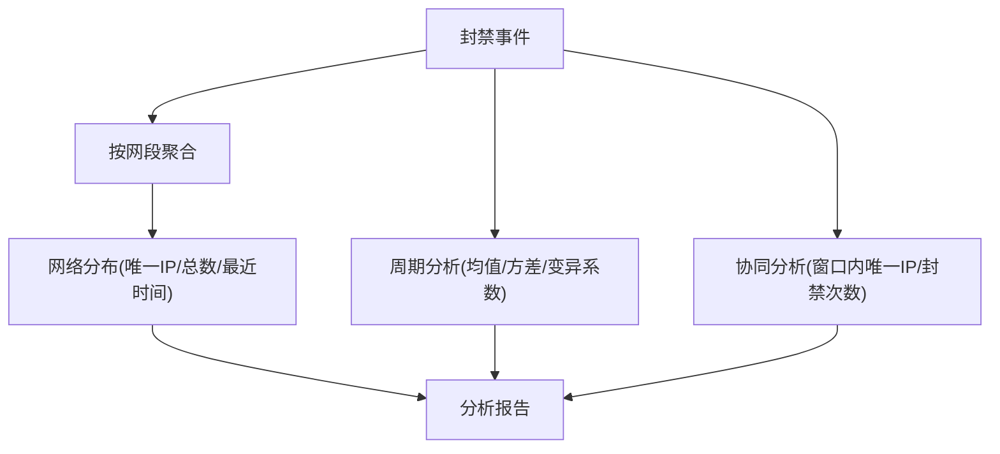
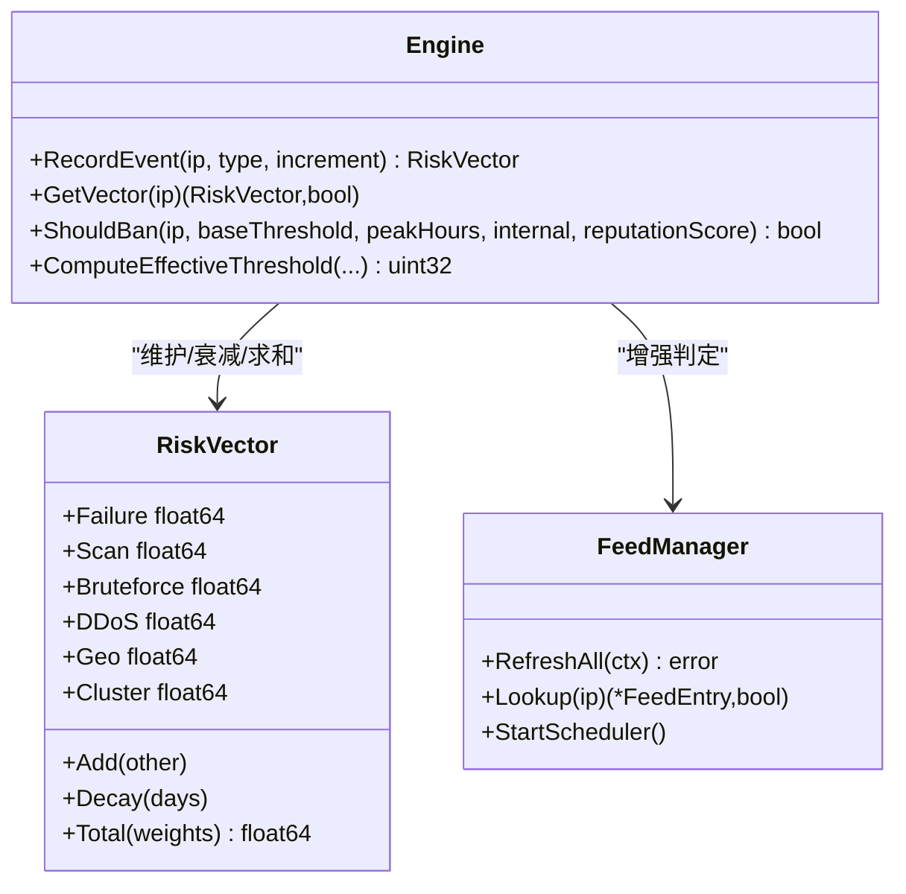
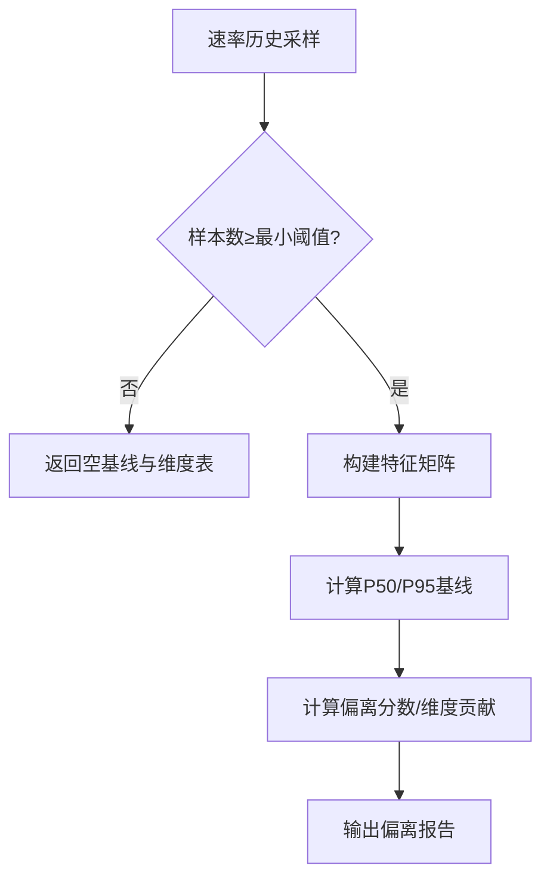
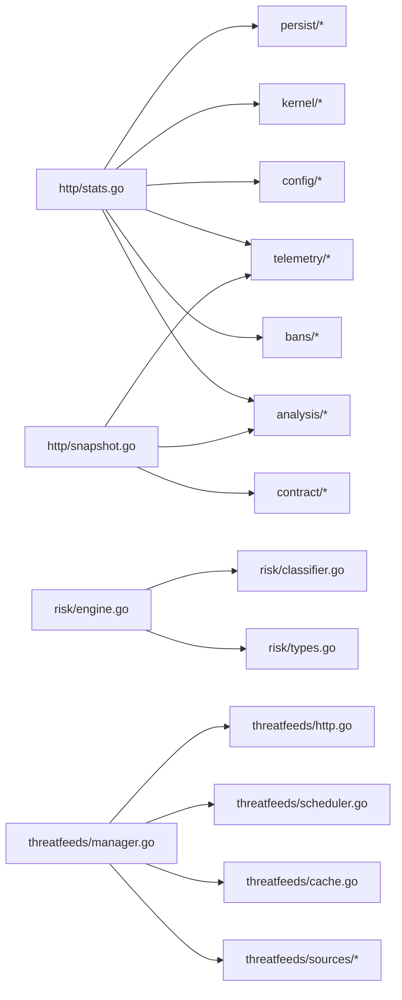

# 网络行为分析

<cite>
**本文引用的文件**   
- [README.md](file://README.md)
- [detection.go](file://src/daemon/internal/analysis/detection.go)
- [network.go](file://src/daemon/internal/analysis/network.go)
- [engine.go](file://src/daemon/internal/risk/engine.go)
- [types.go](file://src/daemon/internal/risk/types.go)
- [classifier.go](file://src/daemon/internal/risk/classifier.go)
- [db.go](file://src/daemon/internal/persist/db.go)
- [history.go](file://src/daemon/internal/persist/history.go)
- [stats.go](file://src/daemon/internal/http/stats.go)
- [snapshot.go](file://src/daemon/internal/http/snapshot.go)
- [manager.go](file://src/daemon/internal/threatfeeds/manager.go)
- [default.yaml](file://config/default.yaml)
</cite>

## 目录
1. [引言](#引言)
2. [项目结构](#项目结构)
3. [核心组件](#核心组件)
4. [架构总览](#架构总览)
5. [详细组件分析](#详细组件分析)
6. [依赖关系分析](#依赖关系分析)
7. [性能与容量调优](#性能与容量调优)
8. [故障排查指南](#故障排查指南)
9. [结论](#结论)
10. [附录：配置参数速查](#附录配置参数速查)

## 引言
本文件面向“网络行为分析”主题，围绕连接模式识别、端口扫描检测、协议异常分析、IP 地址行为画像、访问频率统计、地理位置分析、网络基线建立、行为偏离检测以及威胁情报关联进行系统化说明。文档同时给出可操作的配置参数与性能调优建议，帮助运维与研发在 Linux 内核防火墙守护进程与模块之上构建稳定、可观测、可扩展的网络行为分析体系。

## 项目结构
系统采用“用户态智能判定 + 内核态高速封禁”的三层架构：日志采集与多维风险引擎位于守护进程（Go），内核模块负责高速包过滤与统计；前端面板提供可视化与配置管理。

图表来源
- [README.md:10-31](file://README.md#L10-L31)
- [stats.go:50-88](file://src/daemon/internal/http/stats.go#L50-L88)
- [snapshot.go:1-15](file://src/daemon/internal/http/snapshot.go#L1-L15)

章节来源
- [README.md:10-31](file://README.md#L10-L31)

## 核心组件
- 多维风险引擎：对认证失败、扫描、爆破、DDoS、地域异常、集群关联、封禁历史等维度独立衰减与加权求和，结合有效阈值决定是否封禁。
- 威胁情报管理器：多源并发拉取、错误隔离、后台刷新、缓存查询，高置信度 IP 可直接触发封禁。
- 网络分布与协同攻击分析：按网段聚合封禁、识别周期性攻击与窗口内多源联动。
- 快照与统计接口：从内核导出速率、协议分布、端口扫描者、服务探测者、离群分析等。
- 持久化层：SQLite 存储封禁事件、信誉分、历史与向量，支持迁移与清理调度。

章节来源
- [engine.go:8-20](file://src/daemon/internal/risk/engine.go#L8-L20)
- [types.go:44-93](file://src/daemon/internal/risk/types.go#L44-L93)
- [manager.go:20-41](file://src/daemon/internal/threatfeeds/manager.go#L20-L41)
- [detection.go:10-33](file://src/daemon/internal/analysis/detection.go#L10-L33)
- [db.go:71-144](file://src/daemon/internal/persist/db.go#L71-L144)

## 架构总览
下图展示一次典型请求到封禁决策的数据流：日志解析产生事件 → 风险引擎更新向量 → 威胁情报增强 → HTTP/SSE 暴露分析结果 → 内核封禁生效。

图表来源
- [engine.go:39-82](file://src/daemon/internal/risk/engine.go#L39-L82)
- [manager.go:111-155](file://src/daemon/internal/threatfeeds/manager.go#L111-L155)
- [stats.go:50-88](file://src/daemon/internal/http/stats.go#L50-L88)

## 详细组件分析

### 连接模式识别与访问频率统计
- 全局速率窗口：守护进程维护短/中/长期 EWMA 窗口，将浮点平滑值四舍五入为契约要求的整数 pps/bps。
- per-IP 速率：内核速率表按源 IP 跟踪 PPS/BPS/TCP 标志位/UDP/ICMP 等指标，守护进程侧排序输出 Top-N。
- 趋势与热力图：基于 ban_events 的自然日与小时桶归并，提供今日封禁数、近 5 分钟封禁数与 24 小时热力图。

图表来源
- [snapshot.go:28-97](file://src/daemon/internal/http/snapshot.go#L28-L97)
- [stats.go:134-169](file://src/daemon/internal/http/stats.go#L134-L169)

章节来源
- [snapshot.go:28-97](file://src/daemon/internal/http/snapshot.go#L28-L97)
- [stats.go:134-169](file://src/daemon/internal/http/stats.go#L134-L169)

### 端口扫描与服务探测检测
- 内核侧维护端口扫描者与多协议探测者 Top-N 列表，带唯一端口数或协议种类计数。
- 守护进程侧将内核条目映射为载荷，并保留累计检出计数与阈值字段供面板展示。

图表来源
- [snapshot.go:188-216](file://src/daemon/internal/http/snapshot.go#L188-L216)

章节来源
- [snapshot.go:188-216](file://src/daemon/internal/http/snapshot.go#L188-L216)

### 协议异常分析与离群检测
- 全局离群：基于速率历史环构造特征矩阵（PPS/BPS/TCP标志/UDP/ICMP/TrackedIPs），计算基线P50/P95与偏离分数。
- per-IP 离群：在同一快照内比较被跟踪地址之间的相对占比特征（如 SYN/UDP/ICMP 占比、唯一端口数），输出离群排名。

图表来源
- [snapshot.go:218-339](file://src/daemon/internal/http/snapshot.go#L218-L339)

章节来源
- [snapshot.go:218-339](file://src/daemon/internal/http/snapshot.go#L218-L339)

### IP 地址行为画像与网络分布
- 网段聚合：按 IPv4 /24 或 IPv6 /48 聚合封禁事件，统计唯一 IP 数、总封禁数、最近封禁时间与代表 IP。
- 周期性攻击：对同一 IP 的封禁时间序列计算均值、标准差、变异系数与规则度得分，按规则度排序。
- 协同攻击：以 jail 为单位滑动时间窗，统计窗口内唯一 IP 数与封禁次数，输出协作强度评分。

图表来源
- [network.go:22-109](file://src/daemon/internal/analysis/network.go#L22-L109)
- [detection.go:35-126](file://src/daemon/internal/analysis/detection.go#L35-L126)
- [detection.go:150-238](file://src/daemon/internal/analysis/detection.go#L150-L238)

章节来源
- [network.go:22-109](file://src/daemon/internal/analysis/network.go#L22-L109)
- [detection.go:35-126](file://src/daemon/internal/analysis/detection.go#L35-L126)
- [detection.go:150-238](file://src/daemon/internal/analysis/detection.go#L150-L238)

### 多维风险引擎与威胁情报关联
- 事件分类：根据事件名与负载字段（端口数、路径、速率、pps、foreign、malicious、permanent）决定事件类型与向量增量。
- 向量衰减：每个维度独立指数衰减，半衰期 7 天；内存 LRU 缓存 5 分钟。
- 阈值模型：加法模型（基础阈值 + 高峰期 + 内网 + 信誉调整），避免旧乘法模型的抵消问题。
- 威胁情报：多源并发拉取，合并至缓存；Lookup 返回命中条目，用于增强判定或直接封禁。

图表来源
- [engine.go:8-20](file://src/daemon/internal/risk/engine.go#L8-L20)
- [engine.go:39-189](file://src/daemon/internal/risk/engine.go#L39-L189)
- [types.go:44-93](file://src/daemon/internal/risk/types.go#L44-L93)
- [manager.go:111-210](file://src/daemon/internal/threatfeeds/manager.go#L111-L210)

章节来源
- [engine.go:39-189](file://src/daemon/internal/risk/engine.go#L39-L189)
- [types.go:44-93](file://src/daemon/internal/risk/types.go#L44-L93)
- [classifier.go:15-144](file://src/daemon/internal/risk/classifier.go#L15-L144)
- [manager.go:111-210](file://src/daemon/internal/threatfeeds/manager.go#L111-L210)

### 网络基线建立与行为偏离检测
- 基线来源：速率历史环（每问一次内核一个点，容量约 1 小时）。
- 样本门槛：全局样本不足时不输出 global_features，仅返回空数组基线与维度表，避免前端误判。
- 偏离评分：对全局特征矩阵与 per-IP 特征矩阵分别执行偏离计算，输出维度分数与行分数。

图表来源
- [snapshot.go:218-270](file://src/daemon/internal/http/snapshot.go#L218-L270)

章节来源
- [snapshot.go:218-270](file://src/daemon/internal/http/snapshot.go#L218-L270)

### 地理位置分析
- GeoIP 库：可选 City 级库，提供经纬度用于攻击地图与地理维度风险。
- 出口探测：可选启动时探测本机出口 IP 并解析坐标，用于标注服务器位置。
- 风险向量：geo 维度通过 payload.foreign 布尔字段增加向量增量。

章节来源
- [default.yaml:112-121](file://config/default.yaml#L112-L121)
- [default.yaml:170-198](file://config/default.yaml#L170-L198)
- [classifier.go:101-114](file://src/daemon/internal/risk/classifier.go#L101-L114)

## 依赖关系分析
- 守护进程内部依赖：
  - http/stats.go 依赖 analysis、bans、config、kernel、persist、telemetry。
  - http/snapshot.go 依赖 contract、telemetry、analysis。
  - risk/engine.go 依赖 persist（通过上层装配）、risk/types.go、risk/classifier.go。
  - threatfeeds/manager.go 依赖 sources、cache、scheduler、http。
- 外部依赖：
  - SQLite（WAL、NORMAL同步、busy_timeout）。
  - netfilter/netlink/procfs（内核模块能力检查）。

图表来源
- [stats.go:14-28](file://src/daemon/internal/http/stats.go#L14-L28)
- [snapshot.go:17-26](file://src/daemon/internal/http/snapshot.go#L17-L26)
- [engine.go:1-6](file://src/daemon/internal/risk/engine.go#L1-L6)
- [manager.go:1-12](file://src/daemon/internal/threatfeeds/manager.go#L1-L12)

章节来源
- [stats.go:14-28](file://src/daemon/internal/http/stats.go#L14-L28)
- [snapshot.go:17-26](file://src/daemon/internal/http/snapshot.go#L17-L26)
- [engine.go:1-6](file://src/daemon/internal/risk/engine.go#L1-L6)
- [manager.go:1-12](file://src/daemon/internal/threatfeeds/manager.go#L1-L12)

## 性能与容量调优
- 数据库性能
  - WAL 模式、NORMAL 同步、busy_timeout=5000ms，单连接池（MaxOpenConns=1，MaxIdleConns=1）。
  - 定期清理过期数据（ban_events、ip_reputation、ban_history、attack_events、ip_risk_vectors）。
- 风险引擎缓存
  - 内存 LRU 缓存 5 分钟，定期 Cleanup 清理过期条目。
- 威胁情报刷新
  - 并发拉取多个源，错误隔离；后台调度器定时刷新，支持 SIGHUP 热重载。
- 内核与守护进程容量
  - 封禁表/白名单/速率表最大条目数由 capacity 配置控制。
  - DDoS 防护开关与静态/动态阈值可调；对外监听端口自动纳入速率判定。

章节来源
- [db.go:23-51](file://src/daemon/internal/persist/db.go#L23-L51)
- [db.go:283-351](file://src/daemon/internal/persist/db.go#L283-L351)
- [engine.go:191-209](file://src/daemon/internal/risk/engine.go#L191-L209)
- [manager.go:111-155](file://src/daemon/internal/threatfeeds/manager.go#L111-L155)
- [default.yaml:63-91](file://config/default.yaml#L63-L91)
- [default.yaml:103-110](file://config/default.yaml#L103-L110)

## 故障排查指南
- 历史库缺失或查询失败
  - stats.go 对历史库缺席或查询失败降级为“无读数”，不抛 50002/50003，保证首屏可用。
- 链路陈旧
  - snapshot.go 明确：链路未注册或采样失败时返回上一次成功读数，新鲜度由 /health 链路字段判断。
- 威胁情报源失败
  - manager.go 单个源失败不影响其他源，记录错误并继续聚合；调度器重试。
- 数据库迁移与列补齐
  - db.go 使用 ensureColumn 幂等补齐列，避免重复启动报错；迁移版本顺序执行。
- 速率表/直方图累计口径
  - snapshot.go 指出内核直方图为自加载起累计计数，面板应理解为“本机见过的流量长什么样”，非时间窗口。

章节来源
- [stats.go:1-12](file://src/daemon/internal/http/stats.go#L1-L12)
- [snapshot.go:1-15](file://src/daemon/internal/http/snapshot.go#L1-L15)
- [manager.go:111-155](file://src/daemon/internal/threatfeeds/manager.go#L111-L155)
- [db.go:177-213](file://src/daemon/internal/persist/db.go#L177-L213)
- [db.go:215-281](file://src/daemon/internal/persist/db.go#L215-L281)

## 结论
该项目的网络行为分析体系以“内核高速统计 + 用户态多维风险 + 威胁情报增强”为核心，覆盖连接模式识别、端口扫描与服务探测检测、协议异常与离群分析、IP 行为画像与网络分布、基线建立与偏离检测，并通过 SQLite 历史库与 HTTP/SSE 接口提供可视化与自动化封禁能力。通过合理的容量与性能调优，可在高吞吐场景下保持低延迟与高可用性。

## 附录：配置参数速查
- 全局默认
  - max_retries、findtime、ban_time、interval、metrics_port、metrics_bind_address、metrics_username/password、log_file、log_level、history_db_path、history_retention_days
- DDoS 防护
  - enabled、global_conn_rate、auto_ban_duration、auto_ban_threshold、check_interval、max_syn_per_second、max_udp_per_second、max_icmp_per_second、max_ack_per_second、max_rst_per_second、max_fin_per_second、static_threshold、dynamic_threshold、ddos_detection、max_bans_per_second、max_rate_entries、protect_open_ports
- 容量
  - max_ban_entries、max_whitelist_entries、max_rate_entries、max_local_ip_cache
- GeoIP
  - geoip_db_path、server_latitude/server_longitude、geoip_detect_egress、geoip_egress_probe_url
- 威胁情报
  - enabled、refresh_interval、http_timeout、max_retries、sources[*].name/url/enabled/category/confidence

章节来源
- [default.yaml:7-30](file://config/default.yaml#L7-L30)
- [default.yaml:63-91](file://config/default.yaml#L63-L91)
- [default.yaml:103-110](file://config/default.yaml#L103-L110)
- [default.yaml:112-121](file://config/default.yaml#L112-L121)
- [default.yaml:123-168](file://config/default.yaml#L123-L168)
- [default.yaml:170-198](file://config/default.yaml#L170-L198)