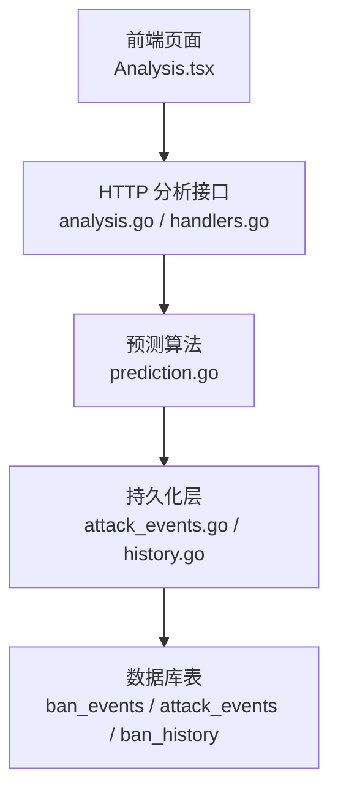
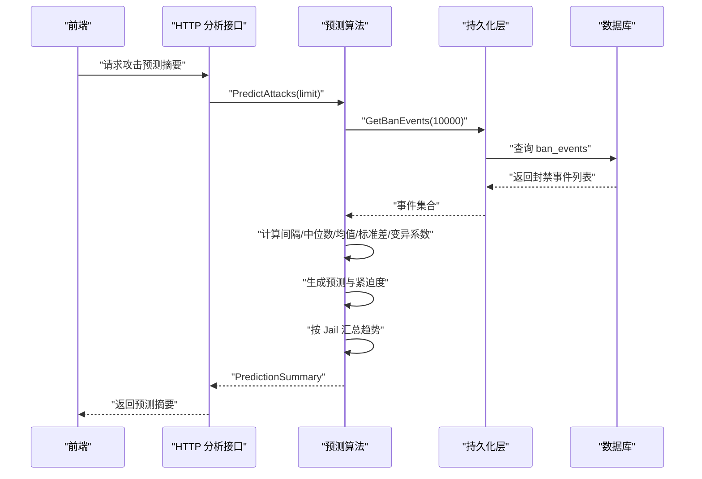
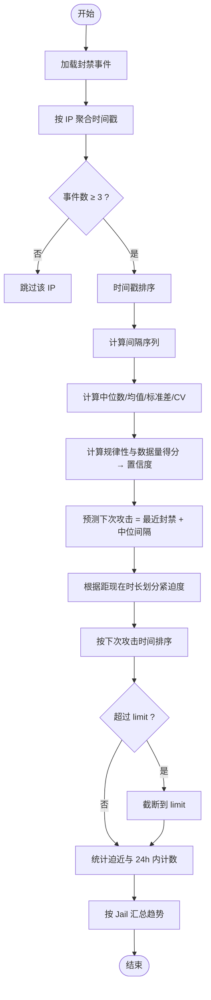
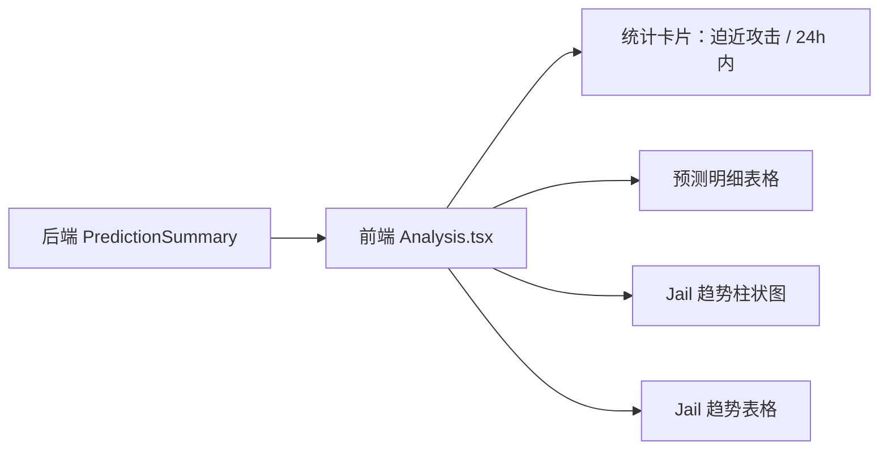
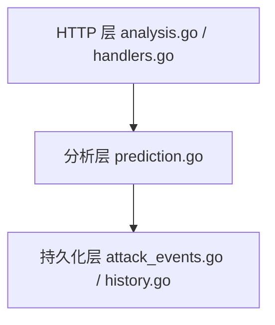

# 预测引擎

<cite>
**本文引用的文件**   
- [prediction.go](file://src/daemon/internal/analysis/prediction.go)
- [analysis.go](file://src/daemon/internal/http/analysis.go)
- [handlers.go](file://src/daemon/internal/http/handlers.go)
- [attack_events.go](file://src/daemon/internal/persist/attack_events.go)
- [history.go](file://src/daemon/internal/persist/history.go)
- [Analysis.tsx](file://frontend/src/views/Analysis.tsx)
</cite>

## 目录
1. [引言](#引言)
2. [项目结构](#项目结构)
3. [核心组件](#核心组件)
4. [架构总览](#架构总览)
5. [详细组件分析](#详细组件分析)
6. [依赖关系分析](#依赖关系分析)
7. [性能与复杂度](#性能与复杂度)
8. [参数配置与效果验证](#参数配置与效果验证)
9. [故障排查指南](#故障排查指南)
10. [结论](#结论)

## 引言
本文件面向“预测引擎”，聚焦基于历史封禁数据的攻击预测能力。该引擎从持久化层读取封禁事件，对每个地址的封禁时间序列进行统计建模，输出下一次攻击时刻估计、紧迫度分级、置信度评分，以及按服务（Jail）维度的趋势分析与未来 24 小时预计攻击者数量。同时说明威胁等级预判、资源消耗预估的实现思路，并给出准确率评估、模型更新策略与可视化方案。

## 项目结构
预测引擎位于守护进程的分析模块中，通过 HTTP 层暴露接口，前端在“智能分析”页面展示结果。关键路径如下：
- 分析算法：`src/daemon/internal/analysis/prediction.go`
- HTTP 聚合与单 IP 预测查询：`src/daemon/internal/http/analysis.go`
- 统计端点调用预测引擎：`src/daemon/internal/http/handlers.go`
- 持久化数据源（封禁事件、攻击事件、封禁历史）：`src/daemon/internal/persist/attack_events.go`、`src/daemon/internal/persist/history.go`
- 前端可视化：`frontend/src/views/Analysis.tsx`

**图表来源**
- [analysis.go:49-104](file://src/daemon/internal/http/analysis.go#L49-L104)
- [handlers.go:184-184](file://src/daemon/internal/http/handlers.go#L184-L184)
- [prediction.go:47-186](file://src/daemon/internal/analysis/prediction.go#L47-L186)
- [attack_events.go:20-36](file://src/daemon/internal/persist/attack_events.go#L20-L36)
- [history.go:42-65](file://src/daemon/internal/persist/history.go#L42-L65)

**章节来源**
- [analysis.go:49-104](file://src/daemon/internal/http/analysis.go#L49-L104)
- [handlers.go:184-184](file://src/daemon/internal/http/handlers.go#L184-L184)
- [prediction.go:47-186](file://src/daemon/internal/analysis/prediction.go#L47-L186)
- [attack_events.go:20-36](file://src/daemon/internal/persist/attack_events.go#L20-L36)
- [history.go:42-65](file://src/daemon/internal/persist/history.go#L42-L65)

## 核心组件
- 预测结果结构体
  - `AttackPredictionFinding`：单个地址的下次攻击时刻估计、最近封禁时间、置信度、紧迫度、事件数、中位周期等。
  - `JailTrend`：按服务维度汇总近 24h/7d 封禁量、趋势标签、未来 24h 预计攻击者数量。
  - `PredictionSummary`：预测列表、Jail 趋势、迫近攻击计数、24 小时内攻击计数。
- 主要函数
  - `PredictAttacks(db, limit)`：从持久化层拉取封禁事件，计算每个地址的间隔分布、中位数、均值、标准差、变异系数，生成预测与紧迫度，并按 Jail 汇总趋势。
  - `analyzeJailTrends(events, upcoming)`：按 Jail 统计近 24h/7d 封禁量，计算相对 7 天日均的倍数，判定上升/下降/平稳趋势。

**章节来源**
- [prediction.go:11-45](file://src/daemon/internal/analysis/prediction.go#L11-L45)
- [prediction.go:47-186](file://src/daemon/internal/analysis/prediction.go#L47-L186)
- [prediction.go:188-259](file://src/daemon/internal/analysis/prediction.go#L188-L259)

## 架构总览
预测引擎的数据流与处理流程如下：

**图表来源**
- [analysis.go:292-313](file://src/daemon/internal/http/analysis.go#L292-L313)
- [handlers.go:184-184](file://src/daemon/internal/http/handlers.go#L184-L184)
- [prediction.go:47-186](file://src/daemon/internal/analysis/prediction.go#L47-L186)

## 详细组件分析

### 攻击演进预测算法
- 输入：过去一段时间内的封禁事件（默认最多 10000 条）。
- 步骤：
  1. 按 IP 聚合封禁时间戳，保留最近一次封禁所属的 Jail。
  2. 对每个 IP 的时间戳排序，计算相邻间隔序列。
  3. 计算间隔的中位数、均值、标准差与变异系数（CV）。
  4. 用 CV 衡量规律性：CV < 0.3 时赋予规律性分数；结合样本量得分得到综合置信度。
  5. 预测下次攻击 = 最近封禁时间 + 中位间隔。
  6. 根据距离当前时间的时长划分紧迫度：即将发生、很快、稍后、遥远。
  7. 按 NextAttackAt 升序排序，必要时截断为 limit 条。
  8. 统计“迫近攻击”和“24 小时内”的数量（基于截断后的列表）。
  9. 按 Jail 汇总未来 24h 内预计再动手的攻击者数量，用于趋势面板。

**图表来源**
- [prediction.go:47-186](file://src/daemon/internal/analysis/prediction.go#L47-L186)

**章节来源**
- [prediction.go:47-186](file://src/daemon/internal/analysis/prediction.go#L47-L186)

### 模式匹配与概率预测模型
- 模式匹配：通过间隔序列的规律性（CV）识别周期性攻击行为；CV 越小表示越规律。
- 概率预测模型：采用统计启发式方法而非机器学习模型。以中位数作为中心趋势估计，使用标准差与 CV 量化波动性，并以样本量加权得到置信度。
- 扩展方向：可引入指数加权移动平均（EWMA）、季节性分解或简单自回归（AR）模型，但当前实现保持轻量与可解释性。

**章节来源**
- [prediction.go:82-116](file://src/daemon/internal/analysis/prediction.go#L82-L116)

### 威胁等级预判
- 综合分析中的威胁等级由 HTTP 层复用已有检测子系统（活跃攻击、异常计数、协同攻击窗口）与风险向量共同构建。
- 预测引擎本身不直接产出威胁等级，但其“迫近攻击”与“24 小时内”计数可作为面板指标参与整体态势感知。

**章节来源**
- [analysis.go:17-34](file://src/daemon/internal/http/analysis.go#L17-L34)
- [analysis.go:49-74](file://src/daemon/internal/http/analysis.go#L49-L74)

### 资源消耗预估
- 预测引擎每次运行会读取大量封禁事件并进行多轮排序与统计计算。
- 建议通过限制事件读取上限、控制 limit、缓存中间结果等方式降低 CPU 与内存占用。
- 前端侧可通过分页与懒加载减少渲染压力。

[本节为通用指导，不直接分析具体文件]

### 预测结果可视化
- 前端“智能分析”页面的“攻击预测”分区展示：
  - 统计卡片：迫近攻击、24 小时内。
  - 预测明细表格：IP、Jail、累计封禁、紧迫度、置信度、预测下次攻击、最近封禁、剩余秒数。
  - Jail 攻击趋势柱状图与表格：近 24h 封禁、近 7d 封禁、趋势标签、预测攻击者（24h）。
- 颜色映射：紧迫度与趋势文案在前端有统一映射，未识别取值回退默认样式。

**图表来源**
- [Analysis.tsx:533-726](file://frontend/src/views/Analysis.tsx#L533-L726)

**章节来源**
- [Analysis.tsx:533-726](file://frontend/src/views/Analysis.tsx#L533-L726)

## 依赖关系分析
- HTTP 层依赖分析层：
  - `analysis.PredictAttacks` 被 `/api/v2/analysis/ip/:ip` 与统计端点调用。
- 分析层依赖持久化层：
  - 读取封禁事件（ban_events）用于预测与趋势统计。
  - 攻击事件（attack_events）与封禁历史（ban_history）提供辅助审计与重算能力。

**图表来源**
- [analysis.go:292-313](file://src/daemon/internal/http/analysis.go#L292-L313)
- [handlers.go:184-184](file://src/daemon/internal/http/handlers.go#L184-L184)
- [prediction.go:47-186](file://src/daemon/internal/analysis/prediction.go#L47-L186)
- [attack_events.go:20-36](file://src/daemon/internal/persist/attack_events.go#L20-L36)
- [history.go:42-65](file://src/daemon/internal/persist/history.go#L42-L65)

**章节来源**
- [analysis.go:292-313](file://src/daemon/internal/http/analysis.go#L292-L313)
- [handlers.go:184-184](file://src/daemon/internal/http/handlers.go#L184-L184)
- [prediction.go:47-186](file://src/daemon/internal/analysis/prediction.go#L47-L186)

## 性能与复杂度
- 时间复杂度：
  - 对每个 IP 的时间戳排序 O(k log k)，k 为该 IP 的事件数。
  - 间隔统计 O(k)。
  - 全局排序预测列表 O(n log n)，n 为候选 IP 数量。
- 空间复杂度：
  - 存储每个 IP 的时间戳数组与间隔序列。
- 优化建议：
  - 限制事件读取上限（已默认 10000）。
  - 合理设置 limit，避免过大列表导致前端渲染缓慢。
  - 对高频访问的 IP 可做短期缓存（注意时效性）。

[本节为通用指导，不直接分析具体文件]

## 参数配置与效果验证

### 预测参数
- `limit`：预测列表最大条目数，默认 15；影响最终返回的预测明细长度。
- 事件读取上限：默认 10000 条封禁事件，用于全量统计与趋势计算。
- 紧迫度阈值：
  - 即将发生：< 1 小时
  - 很快：< 6 小时
  - 稍后：< 24 小时
  - 遥远：≥ 24 小时
- 规律性阈值：CV < 0.3 视为较规律。
- 置信度权重：规律性得分占 60%，数据量得分占 40%。

**章节来源**
- [prediction.go:47-186](file://src/daemon/internal/analysis/prediction.go#L47-L186)

### 效果验证方法
- 离线回测：
  - 选取历史时间段，将实际攻击时间作为标签，对比预测的 NextAttackAt。
  - 计算命中率（预测在真实攻击前 N 分钟内命中）、平均绝对误差（MAE）、均方根误差（RMSE）。
- 在线评估：
  - 监控“迫近攻击”与实际再次攻击的比例。
  - 观察置信度与紧迫度分级的稳定性。
- 趋势校验：
  - 对比 Jail 趋势标签（上升/下降/平稳）与实际封禁量的变化方向是否一致。

[本节为通用指导，不直接分析具体文件]

### 模型更新策略
- 当前实现为无状态统计模型，每次调用实时计算，无需显式训练或版本管理。
- 如需引入更复杂模型（如 EWMA、AR），建议：
  - 增加模型版本字段与参数快照。
  - 定期增量更新参数（例如按日滚动窗口）。
  - 记录评估指标并做 A/B 测试。

[本节为通用指导，不直接分析具体文件]

## 故障排查指南
- 数据库未初始化：
  - HTTP 层在 db 为空时返回服务不可用。
- 预测结果为空：
  - 可能因事件不足（< 3 次封禁）或无周期性证据。
- 趋势标签异常：
  - 当 7 天窗口无样本时，趋势标记为“平稳”，避免误判。
- 前端显示问题：
  - 检查紧迫度与趋势文案映射，未识别值回退默认样式。

**章节来源**
- [analysis.go:51-55](file://src/daemon/internal/http/analysis.go#L51-L55)
- [prediction.go:188-259](file://src/daemon/internal/analysis/prediction.go#L188-L259)
- [Analysis.tsx:114-158](file://frontend/src/views/Analysis.tsx#L114-L158)

## 结论
预测引擎以轻量统计模型为核心，通过对历史封禁事件的间隔分布进行分析，输出下次攻击时刻估计、紧迫度与置信度，并结合 Jail 维度趋势提供态势洞察。其优势在于实现简洁、可解释性强；扩展空间包括引入时序模型与在线学习机制，以提升准确率与适应性。配合前端的可视化与参数调优，可在运维场景中有效辅助威胁研判与资源调度。