# 风险引擎核心

<cite>
**本文引用的文件**   
- [README.md](file://README.md)
- [types.go](file://src/daemon/internal/risk/types.go)
- [classifier.go](file://src/daemon/internal/risk/classifier.go)
- [decay.go](file://src/daemon/internal/risk/decay.go)
- [engine_test.go](file://src/daemon/internal/risk/engine_test.go)
- [detection.go](file://src/daemon/internal/analysis/detection.go)
- [network.go](file://src/daemon/internal/analysis/network.go)
- [prediction.go](file://src/daemon/internal/analysis/prediction.go)
- [recommendations.go](file://src/daemon/internal/analysis/recommendations.go)
- [ddos.go](file://src/daemon/internal/decision/ddos.go)
- [cluster.go](file://src/daemon/internal/decision/cluster.go)
</cite>

## 目录
1. [引言](#引言)
2. [项目结构](#项目结构)
3. [核心组件](#核心组件)
4. [架构总览](#架构总览)
5. [详细组件分析](#详细组件分析)
6. [依赖关系分析](#依赖关系分析)
7. [性能与调优](#性能与调优)
8. [故障排查指南](#故障排查指南)
9. [结论](#结论)
10. [附录：配置参数与阈值建议](#附录配置参数与阈值建议)

## 引言
本文件聚焦“风险引擎核心”，围绕多维风险评分、时间衰减、攻击分类器、异常检测、网络行为分析、预测模型与推荐系统，以及 DDoS 检测、集群扫描识别和策略决策引擎进行系统化说明。目标是帮助读者在不深入源码的情况下理解风险判定链路，同时为运维与算法调优提供可操作的参考。

## 项目结构
风险引擎相关代码主要位于守护进程内部模块中，分为三层：
- 风险向量与分类层：负责事件类型归一化、向量累加与衰减、加权总分计算。
- 分析与预测层：基于历史封禁数据做周期性攻击检测、协同攻击发现、网络分布分析、未来攻击预测与策略推荐。
- 决策与防护层：处理内核上报的 DDoS 事件统计，并在失败窗口上识别集群扫描模式。

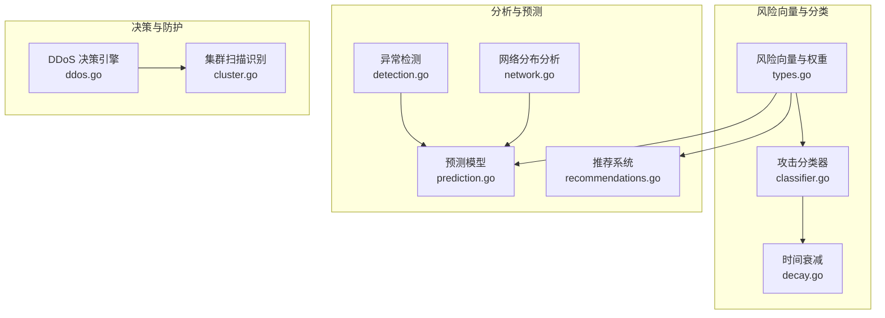

图表来源
- [types.go:44-131](file://src/daemon/internal/risk/types.go#L44-L131)
- [classifier.go:15-145](file://src/daemon/internal/risk/classifier.go#L15-L145)
- [decay.go:5-35](file://src/daemon/internal/risk/decay.go#L5-L35)
- [detection.go:10-239](file://src/daemon/internal/analysis/detection.go#L10-L239)
- [network.go:13-127](file://src/daemon/internal/analysis/network.go#L13-L127)
- [prediction.go:11-260](file://src/daemon/internal/analysis/prediction.go#L11-L260)
- [recommendations.go:10-252](file://src/daemon/internal/analysis/recommendations.go#L10-L252)
- [ddos.go:14-164](file://src/daemon/internal/decision/ddos.go#L14-L164)
- [cluster.go:12-147](file://src/daemon/internal/decision/cluster.go#L12-L147)

章节来源
- [README.md:76-110](file://README.md#L76-L110)

## 核心组件
- 多维风险向量：定义 7 个独立维度（认证失败、封禁历史、扫描、爆破、DDoS、异常地域、关联集群），支持独立衰减与加权求和。
- 攻击分类器：将日志解析后的事件类型映射到风险向量维度，并按负载字段给出增量分值。
- 时间衰减：按半衰期指数衰减，避免长期误判累积。
- 异常检测：周期性攻击检测（变异系数）、协同攻击检测（时间窗内多源联动）。
- 网络行为分析：按子网聚合封禁 IP，输出代表性 IP 与总量趋势。
- 预测模型：基于历史封禁间隔的中位数估计下次攻击时刻，并给出置信度与紧急程度。
- 推荐系统：根据复发率与复发间隔中位数，建议封禁时长与阈值调整方向。
- DDoS 决策引擎：统计内核已触发的 DDoS 封禁事件，维护每 IP 违规计数与清理过期条目。
- 集群扫描识别：在失败窗口内按子网分组，识别低频但多源的扫描行为。

章节来源
- [types.go:44-131](file://src/daemon/internal/risk/types.go#L44-L131)
- [classifier.go:15-145](file://src/daemon/internal/risk/classifier.go#L15-L145)
- [decay.go:5-35](file://src/daemon/internal/risk/decay.go#L5-L35)
- [detection.go:35-239](file://src/daemon/internal/analysis/detection.go#L35-L239)
- [network.go:22-127](file://src/daemon/internal/analysis/network.go#L22-L127)
- [prediction.go:47-260](file://src/daemon/internal/analysis/prediction.go#L47-L260)
- [recommendations.go:23-252](file://src/daemon/internal/analysis/recommendations.go#L23-L252)
- [ddos.go:57-164](file://src/daemon/internal/decision/ddos.go#L57-L164)
- [cluster.go:38-147](file://src/daemon/internal/decision/cluster.go#L38-L147)

## 架构总览
风险引擎整体遵循“用户态智能判定 + 内核态高速封禁”的分层设计。内核模块完成包过滤与快速封禁；守护进程负责日志采集、风险判定、分析与预测、策略下发与面板展示。

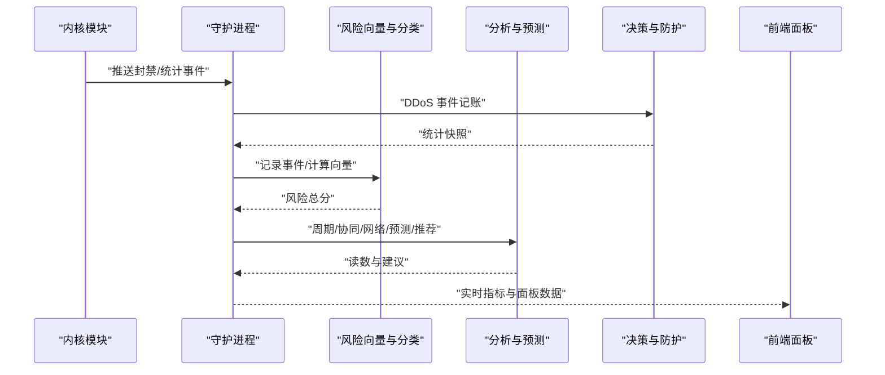

图表来源
- [README.md:10-31](file://README.md#L10-L31)
- [ddos.go:57-164](file://src/daemon/internal/decision/ddos.go#L57-L164)
- [types.go:44-131](file://src/daemon/internal/risk/types.go#L44-L131)
- [detection.go:35-239](file://src/daemon/internal/analysis/detection.go#L35-L239)
- [prediction.go:47-260](file://src/daemon/internal/analysis/prediction.go#L47-L260)

## 详细组件分析

### 多维风险评分与分类器
- 风险向量包含 7 个维度，每个维度独立衰减与加权求和，确保不同因子不会互相抵消。
- 分类器根据事件类型字符串与负载字段（如 count、rate、pps、foreign、malicious、permanent）决定事件归属与增量分值。
- 典型增量分值：认证失败默认 1.0，高频失败 5.0；扫描默认 3.0，端口扫描 >100 端口时 10.0；爆破默认 5.0，高频 >100/min 时 10.0；DDoS 默认 10.0，PPS >10000 时 20.0；异常地域默认 2.0，境外访问 3.0；关联集群默认 3.0，命中恶意 5.0；封禁历史默认 5.0，永久封禁 10.0。

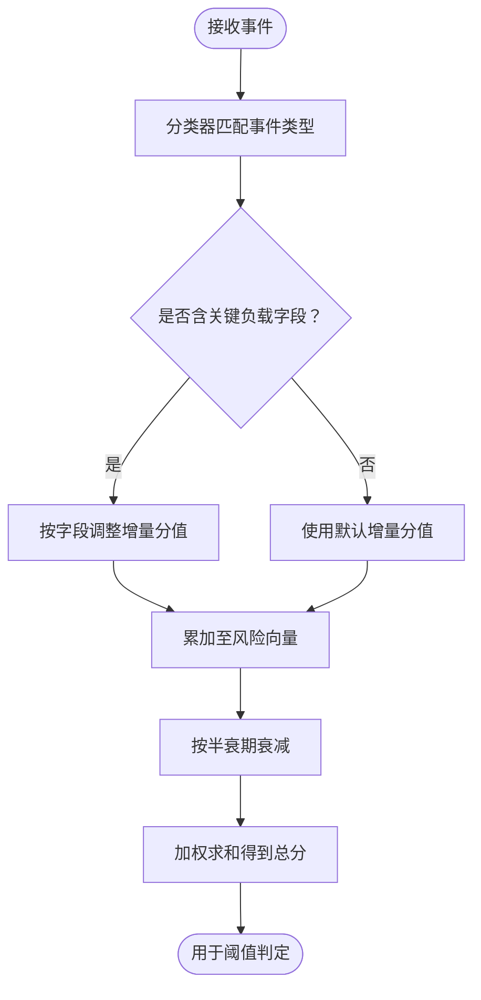

图表来源
- [classifier.go:15-145](file://src/daemon/internal/risk/classifier.go#L15-L145)
- [types.go:44-131](file://src/daemon/internal/risk/types.go#L44-L131)
- [decay.go:5-35](file://src/daemon/internal/risk/decay.go#L5-L35)

章节来源
- [classifier.go:15-145](file://src/daemon/internal/risk/classifier.go#L15-L145)
- [types.go:44-131](file://src/daemon/internal/risk/types.go#L44-L131)
- [decay.go:5-35](file://src/daemon/internal/risk/decay.go#L5-L35)

### 时间衰减机制
- 采用指数衰减，半衰期为 7 天；公式为 0.5^(days/7)。
- 当 days ≤ 0 时不衰减，保证最近事件不被抹除。
- 该机制避免历史风险无限累积，降低误判概率。

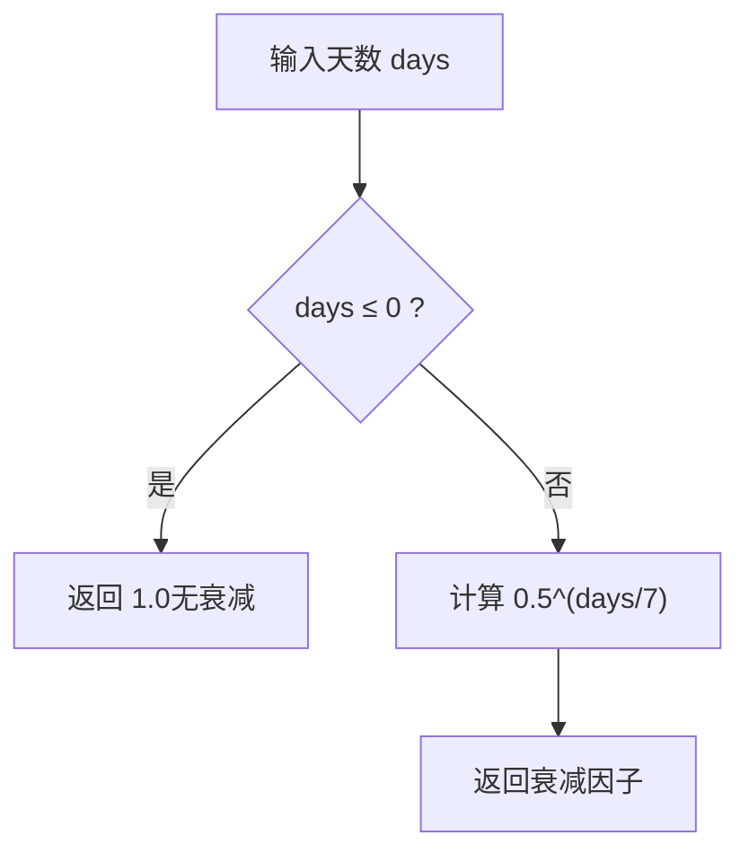

图表来源
- [decay.go:5-35](file://src/daemon/internal/risk/decay.go#L5-L35)

章节来源
- [decay.go:5-35](file://src/daemon/internal/risk/decay.go#L5-L35)

### 异常检测算法
- 周期性攻击检测：对同一地址的封禁时间戳序列计算均值、标准差与变异系数；若 cv < 0.3，则规则度分数 = (1 - cv) × 100，否则记 0。结果按规则度降序排序，限制返回数量。
- 协同攻击检测：以固定时间窗滑动，统计窗口内唯一 IP 数与封禁次数；唯一 IP 数达到阈值即视为协同攻击，强度按封禁次数线性放大并封顶 100。

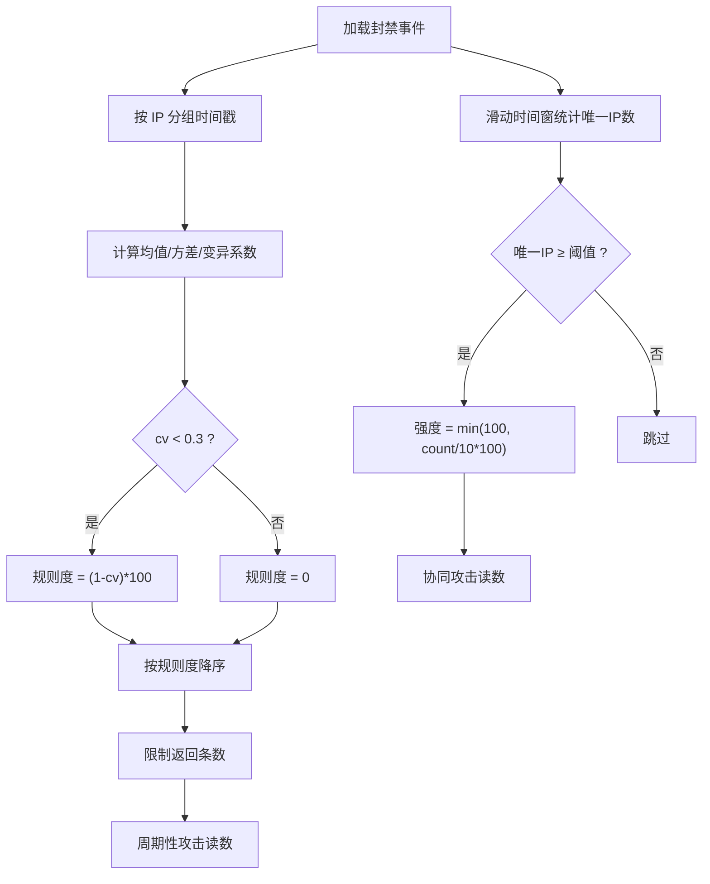

图表来源
- [detection.go:35-239](file://src/daemon/internal/analysis/detection.go#L35-L239)

章节来源
- [detection.go:35-239](file://src/daemon/internal/analysis/detection.go#L35-L239)

### 网络行为分析
- 按子网聚合近 N 天的封禁事件，统计唯一 IP 数、总封禁数、最近封禁时间与代表性 IP。
- IPv4 聚合为 /24，IPv6 聚合为 /48；结果按总封禁数降序排序，限制返回数量。

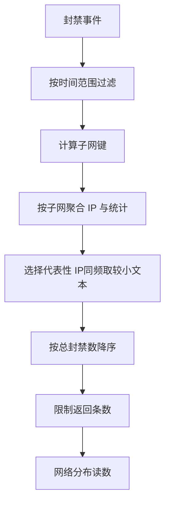

图表来源
- [network.go:22-127](file://src/daemon/internal/analysis/network.go#L22-L127)

章节来源
- [network.go:22-127](file://src/daemon/internal/analysis/network.go#L22-L127)

### 预测模型
- 对每个地址的历史封禁时间戳计算中位数周期与均值、标准差、变异系数；规则度分数与数据量分数加权得到置信度。
- 下次攻击时刻 = 最近封禁时间 + 中位数周期；根据距当前时间的小时数划分紧急程度（imminent/soon/later/distant）。
- 按 jail 汇总近 24h/7d 封禁量，比较日均得出趋势（rising/falling/stable）。

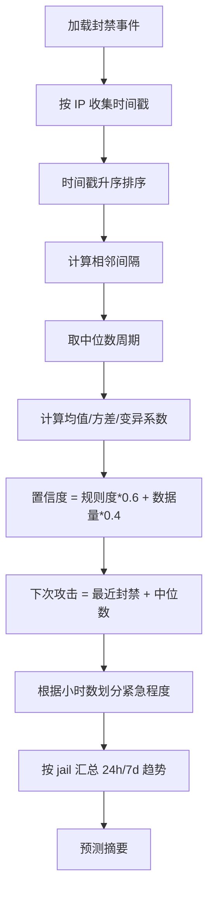

图表来源
- [prediction.go:47-260](file://src/daemon/internal/analysis/prediction.go#L47-L260)

章节来源
- [prediction.go:47-260](file://src/daemon/internal/analysis/prediction.go#L47-L260)

### 推荐系统
- 封禁时长建议：对每个 jail 统计复发地址的间隔中位数；若中位数超过当前封禁时长，建议延长（至少翻倍，且不低于当前值）。
- 阈值建议：基于近 7 天封禁事件计算复发率（复发地址数/唯一地址数×100%）；复发率高建议降低阈值，复发率低且封禁数多建议放宽阈值；置信度随样本量阶梯提升。

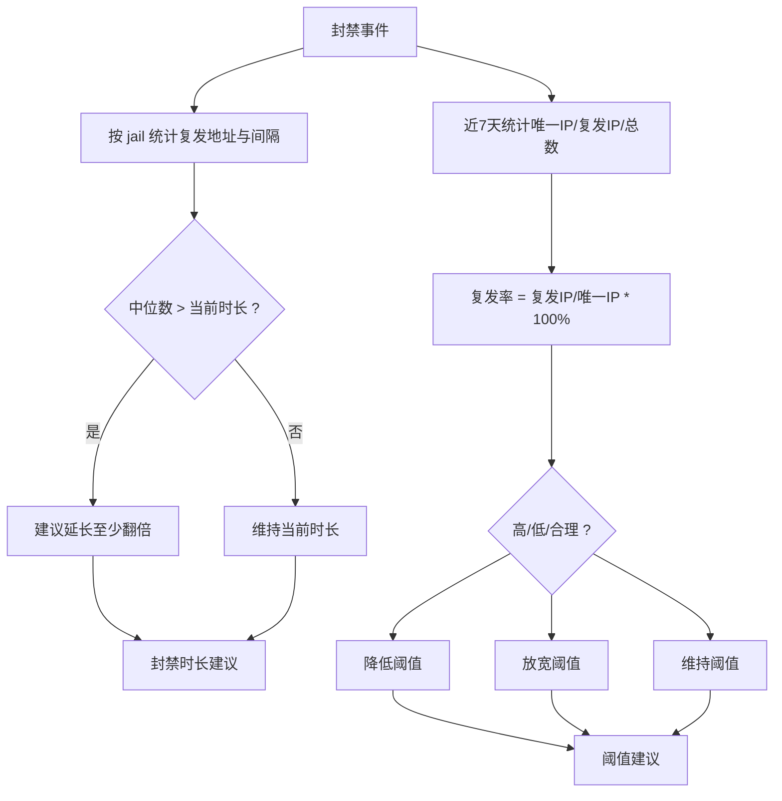

图表来源
- [recommendations.go:23-252](file://src/daemon/internal/analysis/recommendations.go#L23-L252)

章节来源
- [recommendations.go:23-252](file://src/daemon/internal/analysis/recommendations.go#L23-L252)

### DDoS 检测逻辑
- 内核已完成封禁，守护进程仅做事件记账与统计；维护每 IP 的违规计数与最后违规时间。
- 支持配置自动封禁阈值与持续时间；定期清理长时间未活动的跟踪条目，防止内存增长。
- 暴露统计快照供监控与面板展示。

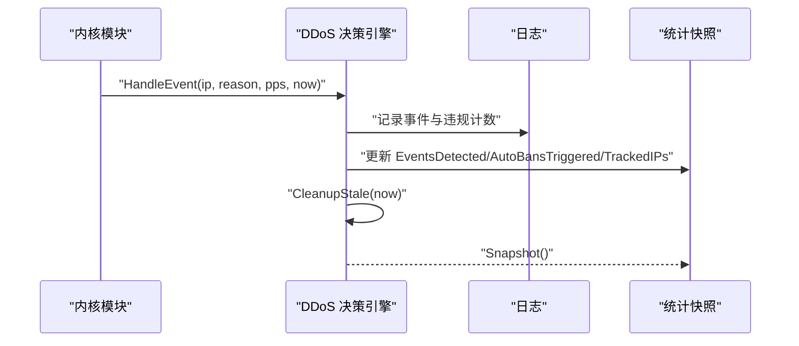

图表来源
- [ddos.go:57-164](file://src/daemon/internal/decision/ddos.go#L57-L164)

章节来源
- [ddos.go:57-164](file://src/daemon/internal/decision/ddos.go#L57-L164)

### 集群扫描识别
- 在失败窗口内按子网分组，统计组内“低频”（≤ MaxPerIP）的不同源 IP 数；若达到 MinIPs 阈值，则判定为集群扫描。
- 单 IP 计数形状与扫描形态相反：扫描器每个源 IP 只用一两次，无法触发单 IP 阈值；正常高频访客反而会被封，因此用“网段内不同 IP 数”作为主判据，并以“每 IP 失败数 ≤ MaxPerIP”排除 CGNAT 与高频访客。

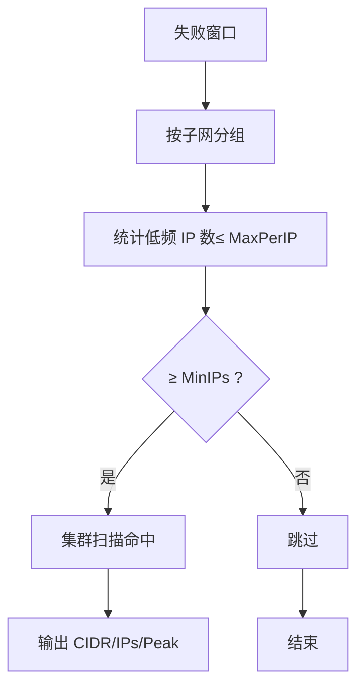

图表来源
- [cluster.go:38-147](file://src/daemon/internal/decision/cluster.go#L38-L147)

章节来源
- [cluster.go:38-147](file://src/daemon/internal/decision/cluster.go#L38-L147)

## 依赖关系分析
- 风险向量与分类器依赖时间衰减函数，形成“事件→分类→向量→衰减→总分”的链式依赖。
- 分析与预测模块依赖持久化存储的封禁事件，进行统计与建模。
- 决策模块依赖失败窗口与配置，执行 DDoS 统计与集群扫描识别。

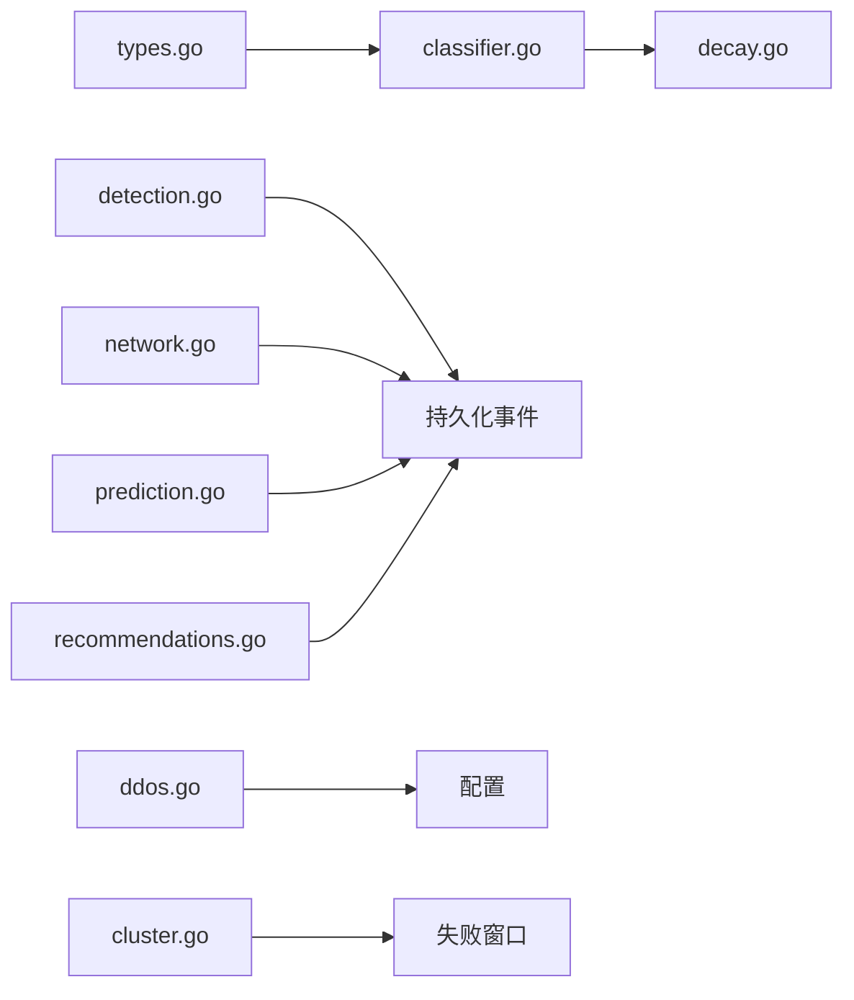

图表来源
- [types.go:44-131](file://src/daemon/internal/risk/types.go#L44-L131)
- [classifier.go:15-145](file://src/daemon/internal/risk/classifier.go#L15-L145)
- [decay.go:5-35](file://src/daemon/internal/risk/decay.go#L5-L35)
- [detection.go:35-239](file://src/daemon/internal/analysis/detection.go#L35-L239)
- [network.go:22-127](file://src/daemon/internal/analysis/network.go#L22-L127)
- [prediction.go:47-260](file://src/daemon/internal/analysis/prediction.go#L47-L260)
- [recommendations.go:23-252](file://src/daemon/internal/analysis/recommendations.go#L23-L252)
- [ddos.go:57-164](file://src/daemon/internal/decision/ddos.go#L57-L164)
- [cluster.go:38-147](file://src/daemon/internal/decision/cluster.go#L38-L147)

## 性能与调优
- 风险向量与分类器：纯函数设计，便于单元测试与基准测试；建议关注 RecordEvent 与 ComputeEffectiveThreshold 的热点路径。
- 异常检测：周期性攻击与协同攻击均涉及排序与统计，建议在大数据集下限制 eventLimit 与 limit，避免全量扫描。
- 网络分布分析：按子网聚合与排序，建议限制 days 与 limit，减少 IO 与 CPU 消耗。
- 预测模型：按 IP 分组与排序，建议限制 limit 与事件上限，避免长尾影响。
- 推荐系统：基于近 7 天事件，建议控制事件上限与最小样本阈值，避免噪声干扰。
- DDoS 决策引擎：定期清理陈旧跟踪条目，避免内存泄漏；统计快照只读，适合高频查询。
- 集群扫描识别：使用 Peek 截断计数，避免精确计数开销；按子网分组与排序保证结果稳定。

章节来源
- [engine_test.go:167-180](file://src/daemon/internal/risk/engine_test.go#L167-L180)
- [detection.go:35-239](file://src/daemon/internal/analysis/detection.go#L35-L239)
- [network.go:22-127](file://src/daemon/internal/analysis/network.go#L22-L127)
- [prediction.go:47-260](file://src/daemon/internal/analysis/prediction.go#L47-L260)
- [recommendations.go:23-252](file://src/daemon/internal/analysis/recommendations.go#L23-L252)
- [ddos.go:138-164](file://src/daemon/internal/decision/ddos.go#L138-L164)
- [cluster.go:50-84](file://src/daemon/internal/decision/cluster.go#L50-L84)

## 故障排查指南
- 风险向量异常：检查分类器事件类型映射与负载字段是否正确；确认衰减半衰期与权重配置是否符合预期。
- 周期性攻击漏报：检查最小事件数、limit 与 eventLimit 设置；确认时间戳排序与变异系数阈值。
- 协同攻击误报：检查时间窗大小、minIPs 与 eventLimit；确认窗口内唯一 IP 数判据。
- 网络分布异常：检查 IP 解析与子网聚合逻辑；确认时间范围与代表性 IP 选择规则。
- 预测置信度偏低：检查数据量分数与规则度分数权重；确认中位数周期与紧急程度划分。
- 推荐建议不稳定：检查最小样本事件数与复发率计算口径；确认兜底阈值与时长是否被正确过滤。
- DDoS 统计异常：检查 HandleEvent 调用频率与 CleanupStale 清理周期；确认统计快照一致性。
- 集群扫描误判：检查 MaxPerIP、MinIPs 与 Window 配置；确认失败窗口迭代与分组逻辑。

章节来源
- [classifier.go:15-145](file://src/daemon/internal/risk/classifier.go#L15-L145)
- [detection.go:35-239](file://src/daemon/internal/analysis/detection.go#L35-L239)
- [network.go:22-127](file://src/daemon/internal/analysis/network.go#L22-L127)
- [prediction.go:47-260](file://src/daemon/internal/analysis/prediction.go#L47-L260)
- [recommendations.go:23-252](file://src/daemon/internal/analysis/recommendations.go#L23-L252)
- [ddos.go:103-164](file://src/daemon/internal/decision/ddos.go#L103-L164)
- [cluster.go:50-147](file://src/daemon/internal/decision/cluster.go#L50-L147)

## 结论
风险引擎通过多维向量、时间衰减与分类器实现稳健的风险评分；结合异常检测、网络行为分析、预测模型与推荐系统，形成从感知到决策的闭环。DDoS 决策与集群扫描识别进一步增强了自动化防护能力。通过合理的配置与阈值调优，可在保障安全的同时降低误判与资源消耗。

## 附录：配置参数与阈值建议
- 风险向量权重：可按业务场景调整各维度权重，重点关注扫描、爆破、DDoS 与异常地域。
- 衰减半衰期：默认 7 天，可根据业务容忍度调整。
- 周期性攻击检测：minEvents 建议 ≥ 3；limit 与 eventLimit 根据数据规模调整。
- 协同攻击检测：windowSeconds 建议 300；minIPs 建议 ≥ 3；limit 与 eventLimit 控制输出规模。
- 网络分布分析：days 建议 7；limit 控制输出规模。
- 预测模型：limit 控制预测列表长度；置信度由规则度与数据量共同决定。
- 推荐系统：最小样本事件数建议 ≥ 10；复发率阈值 30% 与 10% 用于方向判断。
- DDoS 决策引擎：AutoBanThreshold 与 AutoBanDuration 需结合流量特征调优；CleanupStale 周期建议覆盖连续攻击间隔。
- 集群扫描识别：MaxPerIP、MinIPs 与 Window 需结合扫描器行为与正常访客特征调优。

章节来源
- [types.go:106-131](file://src/daemon/internal/risk/types.go#L106-L131)
- [decay.go:5-35](file://src/daemon/internal/risk/decay.go#L5-L35)
- [detection.go:35-239](file://src/daemon/internal/analysis/detection.go#L35-L239)
- [network.go:22-127](file://src/daemon/internal/analysis/network.go#L22-L127)
- [prediction.go:47-260](file://src/daemon/internal/analysis/prediction.go#L47-L260)
- [recommendations.go:239-252](file://src/daemon/internal/analysis/recommendations.go#L239-L252)
- [ddos.go:70-101](file://src/daemon/internal/decision/ddos.go#L70-L101)
- [cluster.go:50-84](file://src/daemon/internal/decision/cluster.go#L50-L84)