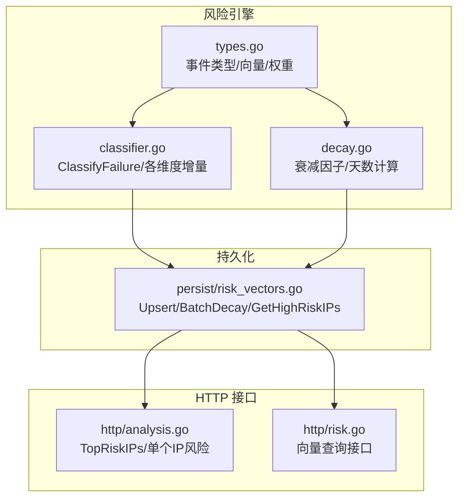
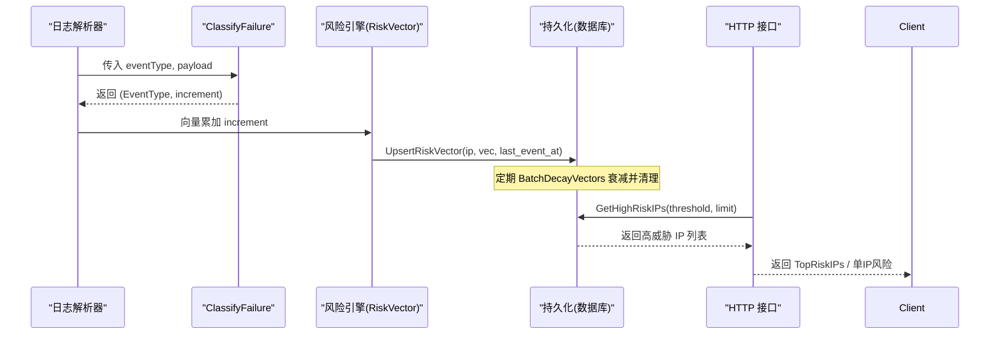
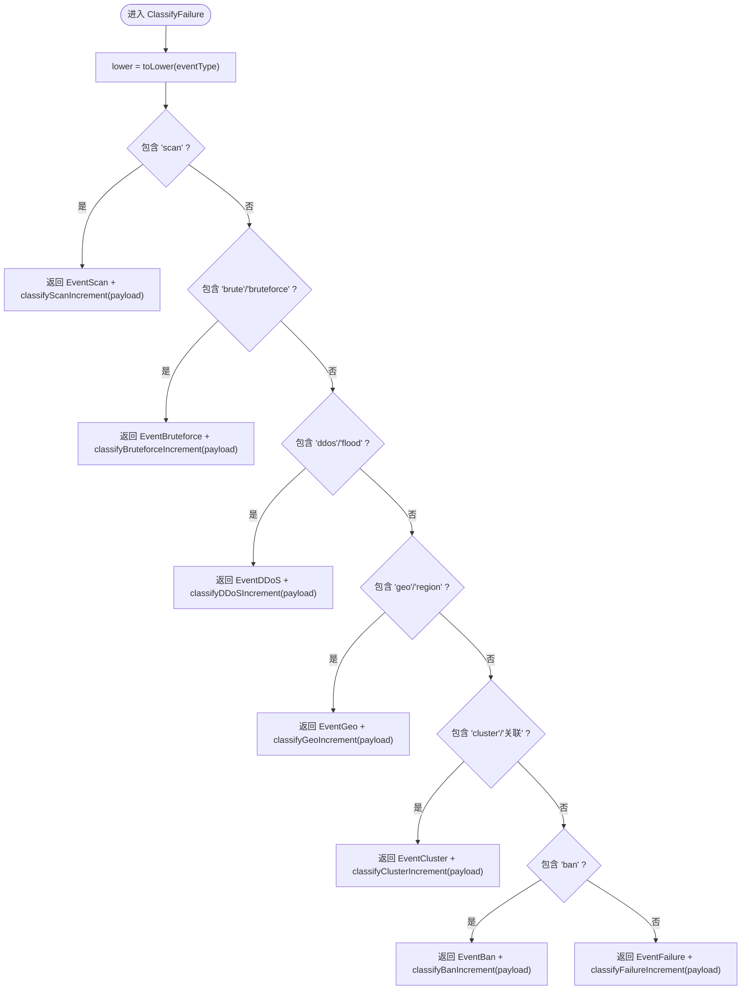
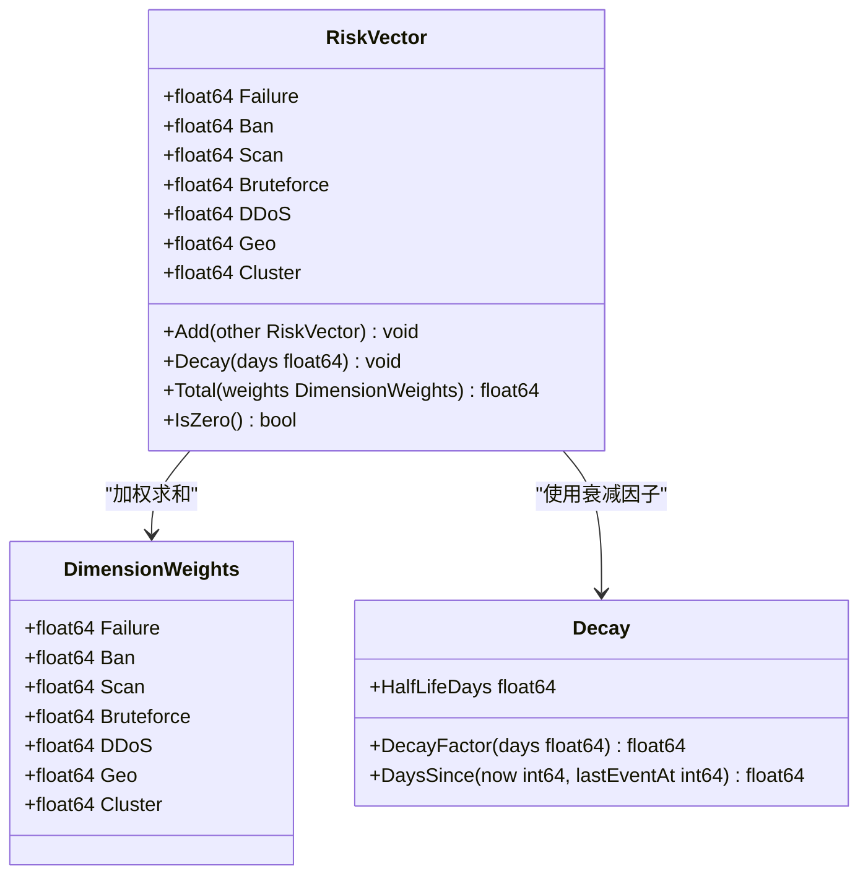
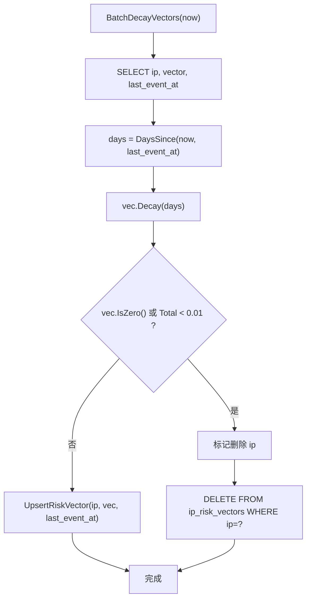
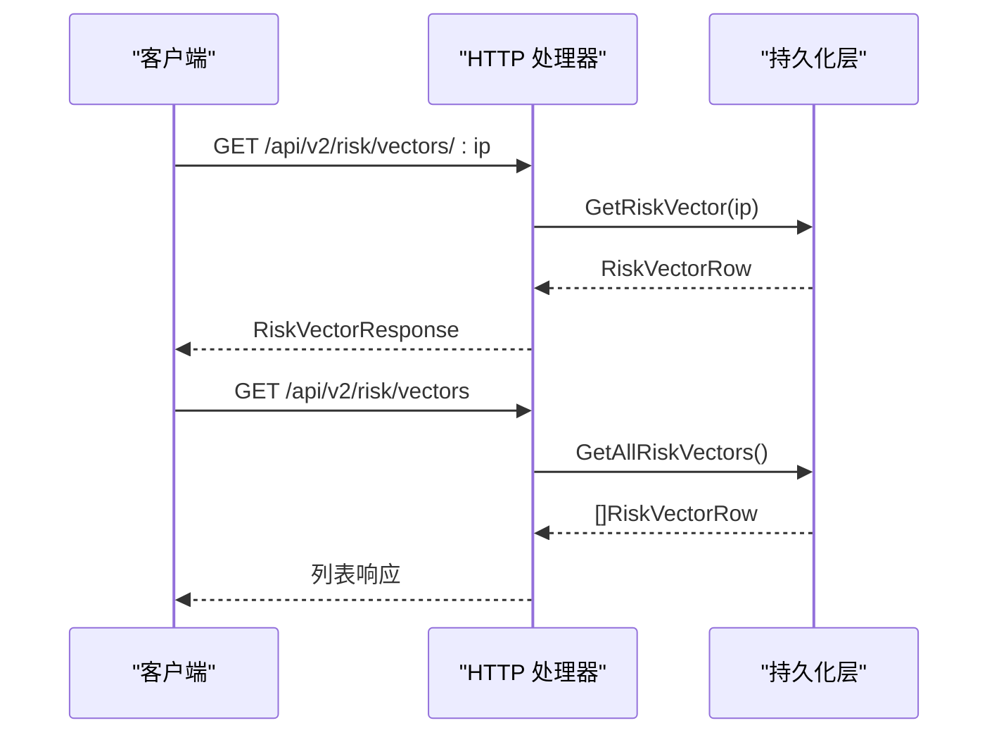
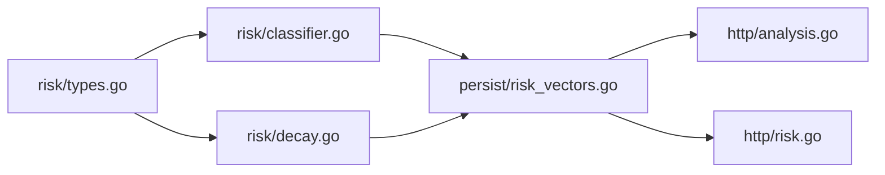

# 风险评分算法

<cite>
**本文引用的文件**   
- [classifier.go](file://src/daemon/internal/risk/classifier.go)
- [types.go](file://src/daemon/internal/risk/types.go)
- [decay.go](file://src/daemon/internal/risk/decay.go)
- [risk_vectors.go](file://src/daemon/internal/persist/risk_vectors.go)
- [analysis.go](file://src/daemon/internal/http/analysis.go)
- [risk.go](file://src/daemon/internal/http/risk.go)
</cite>

## 目录
1. [引言](#引言)
2. [项目结构](#项目结构)
3. [核心组件](#核心组件)
4. [架构总览](#架构总览)
5. [详细组件分析](#详细组件分析)
6. [依赖关系分析](#依赖关系分析)
7. [性能与可扩展性](#性能与可扩展性)
8. [阈值调优与配置指南](#阈值调优与配置指南)
9. [故障排查](#故障排查)
10. [结论](#结论)

## 引言
本文件系统性梳理多维风险评分算法的实现，重点包括：
- 事件分类器 ClassifyFailure 的工作原理
- 向量增量计算逻辑与各攻击类型判定规则（扫描、爆破、DDoS、地理异常、集群关联、封禁历史）
- 风险向量衰减模型与加权和计算
- 持久化存储中的阈值查询与批量衰减
- 评分权重配置、阈值调优方法与性能优化建议

该机制以“纯函数可测试”为核心设计目标，支持事件溯源、独立维度衰减与加法阈值模型，便于在真实流量中持续校准。

## 项目结构
风险评分相关代码主要分布在以下模块：
- risk 包：定义事件类型、风险向量、衰减函数与事件分类器
- persist 包：负责风险向量的持久化、批量衰减与高威胁 IP 查询
- http 层：暴露风险向量查询接口，并复用风险引擎结果进行展示

**图表来源**
- [types.go:1-131](file://src/daemon/internal/risk/types.go#L1-L131)
- [decay.go:1-35](file://src/daemon/internal/risk/decay.go#L1-L35)
- [classifier.go:1-145](file://src/daemon/internal/risk/classifier.go#L1-L145)
- [risk_vectors.go:1-236](file://src/daemon/internal/persist/risk_vectors.go#L1-L236)
- [analysis.go:1-230](file://src/daemon/internal/http/analysis.go#L1-L230)
- [risk.go:1-70](file://src/daemon/internal/http/risk.go#L1-L70)

**章节来源**
- [types.go:1-131](file://src/daemon/internal/risk/types.go#L1-L131)
- [decay.go:1-35](file://src/daemon/internal/risk/decay.go#L1-L35)
- [classifier.go:1-145](file://src/daemon/internal/risk/classifier.go#L1-L145)
- [risk_vectors.go:1-236](file://src/daemon/internal/persist/risk_vectors.go#L1-L236)
- [analysis.go:1-230](file://src/daemon/internal/http/analysis.go#L1-L230)
- [risk.go:1-70](file://src/daemon/internal/http/risk.go#L1-L70)

## 核心组件
- 事件类型与风险向量
  - EventType 枚举定义了 failure、ban、scan、bruteforce、ddos、geo、cluster 七个维度
  - RiskVector 表示每个维度的当前值，支持 Add、Decay、Total、IsZero
  - DimensionWeights 提供各维度权重，默认均为 1.0
- 衰减模型
  - HalfLifeDays=7 天；DecayFactor(days)=0.5^(days/7)
  - DaysSince(now, lastEventAt) 将时间差转换为天数
- 事件分类器
  - ClassifyFailure(eventType, payload) 返回 (EventType, float64)
  - 针对 scan、bruteforce、ddos、geo、cluster、ban 分别实现增量计算函数
- 持久化
  - UpsertRiskVector 写入快照
  - BatchDecayVectors 定期衰减并清理接近零的向量
  - GetHighRiskIPs 按阈值筛选高威胁 IP

**章节来源**
- [types.go:9-131](file://src/daemon/internal/risk/types.go#L9-L131)
- [decay.go:5-35](file://src/daemon/internal/risk/decay.go#L5-L35)
- [classifier.go:5-145](file://src/daemon/internal/risk/classifier.go#L5-L145)
- [risk_vectors.go:11-236](file://src/daemon/internal/persist/risk_vectors.go#L11-L236)

## 架构总览
风险评分的整体流程如下：
1. 日志解析后得到 eventType 与 payload
2. 调用 ClassifyFailure 判定攻击类型与向量增量
3. 将增量累加到对应 IP 的风险向量
4. 定期执行批量衰减，删除接近零的向量
5. HTTP 接口暴露 TopRiskIPs 与单 IP 风险向量

**图表来源**
- [classifier.go:15-34](file://src/daemon/internal/risk/classifier.go#L15-L34)
- [types.go:57-93](file://src/daemon/internal/risk/types.go#L57-L93)
- [risk_vectors.go:50-84](file://src/daemon/internal/persist/risk_vectors.go#L50-L84)
- [risk_vectors.go:86-144](file://src/daemon/internal/persist/risk_vectors.go#L86-L144)
- [analysis.go:138-163](file://src/daemon/internal/http/analysis.go#L138-L163)
- [risk.go:11-40](file://src/daemon/internal/http/risk.go#L11-L40)

## 详细组件分析

### 事件分类器 ClassifyFailure
ClassifyFailure 是纯函数，根据 eventType 字符串匹配攻击类型，并委托具体 classifyXxxIncrement 函数计算向量增量。

- 匹配优先级与类型映射
  - 包含 "scan" → EventScan
  - 包含 "brute"/"bruteforce" → EventBruteforce
  - 包含 "ddos"/"flood" → EventDDoS
  - 包含 "geo"/"region" → EventGeo
  - 包含 "cluster"/"关联" → EventCluster
  - 包含 "ban" → EventBan
  - 其他 → EventFailure

- 各类增量的判定规则
  - 认证失败（failure）
    - 默认增量 1.0
    - payload.count > 10 → 增量 5.0
  - 扫描（scan）
    - 默认增量 3.0
    - payload.ports > 100 → 增量 10.0
    - payload.path 包含 ".." 或 "%2e" → 增量 5.0
  - 爆破（bruteforce）
    - 默认增量 5.0
    - payload.rate > 100（次/分钟）→ 增量 10.0
  - DDoS（ddos）
    - 默认增量 10.0
    - payload.pps > 10000 → 增量 20.0
  - 地理异常（geo）
    - 默认增量 2.0
    - payload.foreign == true → 增量 3.0
  - 集群关联（cluster）
    - 默认增量 3.0
    - payload.malicious == true → 增量 5.0
  - 封禁历史（ban）
    - 默认增量 5.0
    - payload.permanent == true → 增量 10.0

**图表来源**
- [classifier.go:15-34](file://src/daemon/internal/risk/classifier.go#L15-L34)
- [classifier.go:36-145](file://src/daemon/internal/risk/classifier.go#L36-L145)

**章节来源**
- [classifier.go:5-145](file://src/daemon/internal/risk/classifier.go#L5-L145)

### 风险向量与衰减模型
- RiskVector
  - 字段：Failure、Ban、Scan、Bruteforce、DDoS、Geo、Cluster
  - Add(other)：逐维度累加
  - Decay(days)：所有维度乘以 DecayFactor(days)
  - Total(weights)：加权求和，用于阈值判定
  - IsZero()：判断是否全为零
- DimensionWeights
  - 默认均为 1.0，可通过配置文件调整
- 衰减
  - HalfLifeDays=7 天
  - DecayFactor(days)=0.5^(days/7)
  - DaysSince(now, lastEventAt) 计算天数

**图表来源**
- [types.go:44-131](file://src/daemon/internal/risk/types.go#L44-L131)
- [decay.go:5-35](file://src/daemon/internal/risk/decay.go#L5-L35)

**章节来源**
- [types.go:44-131](file://src/daemon/internal/risk/types.go#L44-L131)
- [decay.go:5-35](file://src/daemon/internal/risk/decay.go#L5-L35)

### 持久化与阈值查询
- UpsertRiskVector：插入或更新 IP 的风险向量快照
- BatchDecayVectors：遍历所有向量，计算衰减后的值；若接近零则删除记录
- GetHighRiskIPs：按阈值筛选高威胁 IP，并按总分降序返回

**图表来源**
- [risk_vectors.go:86-144](file://src/daemon/internal/persist/risk_vectors.go#L86-L144)

**章节来源**
- [risk_vectors.go:19-84](file://src/daemon/internal/persist/risk_vectors.go#L19-L84)
- [risk_vectors.go:86-144](file://src/daemon/internal/persist/risk_vectors.go#L86-L144)
- [risk_vectors.go:192-235](file://src/daemon/internal/persist/risk_vectors.go#L192-L235)

### HTTP 接口与风险展示
- GET /api/v2/risk/vectors/:ip：返回指定 IP 的风险向量
- GET /api/v2/risk/vectors：返回所有 IP 的风险向量（按总分排序）
- analysis.go 中 getTopRiskIPs 与 getRiskVector 复用持久化数据，对外输出 TopRiskIPs 与单 IP 风险

**图表来源**
- [risk.go:11-40](file://src/daemon/internal/http/risk.go#L11-L40)
- [risk.go:57-70](file://src/daemon/internal/http/risk.go#L57-L70)
- [analysis.go:119-163](file://src/daemon/internal/http/analysis.go#L119-L163)

**章节来源**
- [risk.go:11-70](file://src/daemon/internal/http/risk.go#L11-L70)
- [analysis.go:119-163](file://src/daemon/internal/http/analysis.go#L119-L163)

## 依赖关系分析
- risk 包内部依赖
  - types.go 定义基础数据结构与行为
  - decay.go 提供衰减计算工具
  - classifier.go 依赖 types.go 的事件类型与向量结构
- risk 与 persist 的耦合
  - persist 层直接引用 risk.RiskVector 与 risk.DaysSince、risk.DefaultDimensionWeights
- http 层对 persist 的依赖
  - 通过 DB 接口获取风险向量，不直接依赖 risk 包

**图表来源**
- [types.go:1-131](file://src/daemon/internal/risk/types.go#L1-L131)
- [decay.go:1-35](file://src/daemon/internal/risk/decay.go#L1-L35)
- [classifier.go:1-145](file://src/daemon/internal/risk/classifier.go#L1-L145)
- [risk_vectors.go:1-236](file://src/daemon/internal/persist/risk_vectors.go#L1-L236)
- [analysis.go:1-230](file://src/daemon/internal/http/analysis.go#L1-L230)
- [risk.go:1-70](file://src/daemon/internal/http/risk.go#L1-L70)

**章节来源**
- [types.go:1-131](file://src/daemon/internal/risk/types.go#L1-L131)
- [decay.go:1-35](file://src/daemon/internal/risk/decay.go#L1-L35)
- [classifier.go:1-145](file://src/daemon/internal/risk/classifier.go#L1-L145)
- [risk_vectors.go:1-236](file://src/daemon/internal/persist/risk_vectors.go#L1-L236)
- [analysis.go:1-230](file://src/daemon/internal/http/analysis.go#L1-L230)
- [risk.go:1-70](file://src/daemon/internal/http/risk.go#L1-L70)

## 性能与可扩展性
- 分类器性能
  - ClassifyFailure 为纯函数，无状态、分支少，适合高频调用
  - 基准测试覆盖典型路径，确保低延迟
- 向量操作复杂度
  - Add/Decay/Total 均为 O(1) 固定维度运算
- 持久化优化
  - UpsertRiskVector 使用 ON CONFLICT 减少重复写入
  - BatchDecayVectors 定期批量处理，避免每次查询都重算
  - 接近零的向量被删除，控制表规模增长
- 可扩展点
  - 新增攻击类型时，扩展 EventType 与 classifyXxxIncrement
  - 权重与阈值通过 DimensionWeights 与阈值参数灵活调整

**章节来源**
- [classifier.go:15-34](file://src/daemon/internal/risk/classifier.go#L15-L34)
- [types.go:57-93](file://src/daemon/internal/risk/types.go#L57-L93)
- [risk_vectors.go:50-84](file://src/daemon/internal/persist/risk_vectors.go#L50-L84)
- [risk_vectors.go:86-144](file://src/daemon/internal/persist/risk_vectors.go#L86-L144)

## 阈值调优与配置指南
- 评分权重配置
  - 使用 DimensionWeights 调整各维度贡献度
  - 默认均为 1.0；可根据业务场景提高 ddos、bruteforce 等高风险维度的权重
- 阈值调优方法
  - 基于 Total(weights) 的加权总分设定阈值
  - 使用 GetHighRiskIPs(threshold, limit) 拉取高威胁 IP 列表
  - 结合 BatchDecayVectors 的清理策略，观察长期趋势调整阈值
- 实战建议
  - 初期采用默认权重，逐步提升关键维度权重
  - 通过 HTTP 接口观察 TopRiskIPs 分布，微调阈值以避免误报/漏报
  - 关注 payload 字段（如 rate、pps、count）的阈值，必要时调整 classifyXxxIncrement 的判断条件

**章节来源**
- [types.go:106-131](file://src/daemon/internal/risk/types.go#L106-L131)
- [risk_vectors.go:192-235](file://src/daemon/internal/persist/risk_vectors.go#L192-L235)

## 故障排查
- 分类器问题
  - 检查 eventType 字符串是否包含预期关键字（scan、brute、ddos、geo、cluster、ban）
  - 校验 payload 字段类型与键名（count、rate、pps、foreign、malicious、permanent）
- 向量衰减问题
  - 确认 last_event_at 时间戳是否正确
  - 检查 BatchDecayVectors 调度频率与清理阈值（接近零删除）
- 阈值查询问题
  - 核对 GetHighRiskIPs 的 threshold 与 limit 参数
  - 确认数据库索引与排序列是否符合预期

**章节来源**
- [classifier.go:15-145](file://src/daemon/internal/risk/classifier.go#L15-L145)
- [risk_vectors.go:86-144](file://src/daemon/internal/persist/risk_vectors.go#L86-L144)
- [risk_vectors.go:192-235](file://src/daemon/internal/persist/risk_vectors.go#L192-L235)

## 结论
该风险评分算法以清晰的分层设计与纯函数实现为基础，提供了可扩展的多维风险向量模型。通过事件分类器、向量衰减与持久化阈值查询，系统能够在真实环境中持续评估与响应威胁。建议在生产环境中结合业务特征调整权重与阈值，并通过 HTTP 接口与监控面板持续观测效果，逐步优化。