# 信任边界分析

<cite>
**本文引用的文件**   
- [firewall-daemon.service](file://firewall-daemon.service)
- [procfs.fwidl](file://contract/procfs.fwidl)
- [fw_procfs.h](file://src/kernel-module/fw_procfs.h)
- [fw_ban.c](file://src/kernel-module/fw_ban.c)
- [fw_main.c](file://src/kernel-module/fw_main.c)
- [loader.go](file://src/daemon/internal/config/loader.go)
</cite>

## 目录
1. [引言](#引言)
2. [项目结构中的信任边界](#项目结构中的信任边界)
3. [核心信任边界划分](#核心信任边界划分)
4. [架构总览与进程-内核交互](#架构总览与进程-内核交互)
5. [详细组件分析](#详细组件分析)
6. [依赖关系与耦合分析](#依赖关系与耦合分析)
7. [性能与资源限制特性](#性能与资源限制特性)
8. [故障排查与常见风险](#故障排查与常见风险)
9. [结论](#结论)

## 引言
本文从“谁能写、能改什么、失败时是否开放”的角度，对防火墙系统的信任边界进行系统化分析。重点覆盖：
- procfs 权限模型与谁可以封禁 IP；
- 守护进程以 root 运行但受 systemd 沙箱约束；
- 内核态与用户态之间的权限隔离；
- 内核侧内生自限机制，包括每秒封禁添加数上限、本机地址集合保护、表规模上限等；
- 通过可视化图表和权限矩阵帮助非技术读者理解系统如何防止滥用。

## 项目结构中的信任边界
本仓库包含三类关键代码面：
- 内核模块：实现 netfilter 钩子、封禁表、白名单、速率统计、procfs/netlink 接口。
- 守护进程：加载 YAML 配置、扫描端口、下发策略、管理状态。
- 契约与文档：冻结 procfs/netlink 文本/二进制协议，并记录容量上限与缺陷处置。

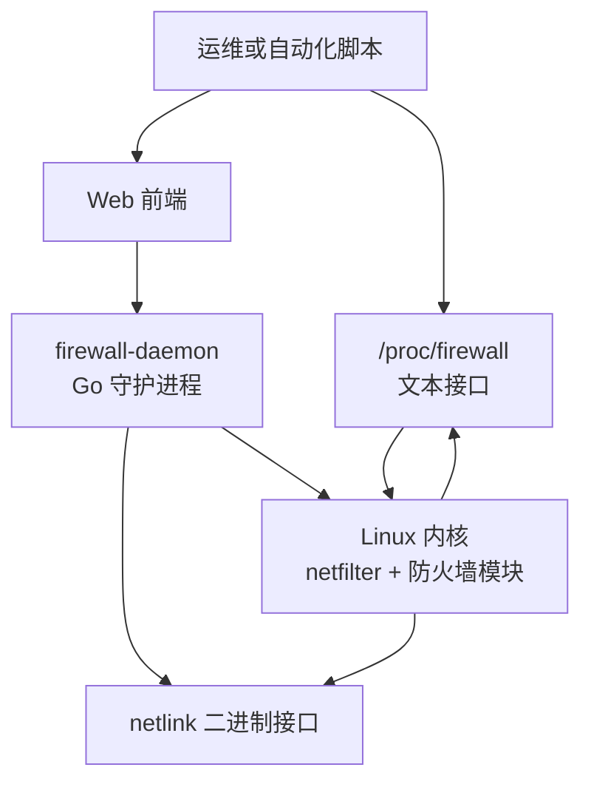

**图示来源**
- [procfs.fwidl:30-33](file://contract/procfs.fwidl#L30-L33)
- [fw_main.c:249-264](file://src/kernel-module/fw_main.c#L249-L264)
- [firewall-daemon.service:5-12](file://firewall-daemon.service#L5-L12)

**章节来源**
- [procfs.fwidl:1-27](file://contract/procfs.fwidl#L1-L27)
- [fw_main.c:182-269](file://src/kernel-module/fw_main.c#L182-L269)
- [firewall-daemon.service:1-51](file://firewall-daemon.service#L1-L51)

## 核心信任边界划分
本节把信任边界拆成三层：
1. **用户态到内核态的边界**：只有具备写入 /proc/firewall 权限的用户，以及拥有 netlink 控制能力的守护进程，才能触发封禁。
2. **守护进程内部边界**：虽然以 root 运行，但被 systemd 沙箱限制文件系统、系统调用族、设备访问、内存执行等能力。
3. **内核态内部分层边界**：封禁表、白名单、速率表、本机地址集合各自有容量上限、归一化校验、泛洪闸门和本机地址保护。

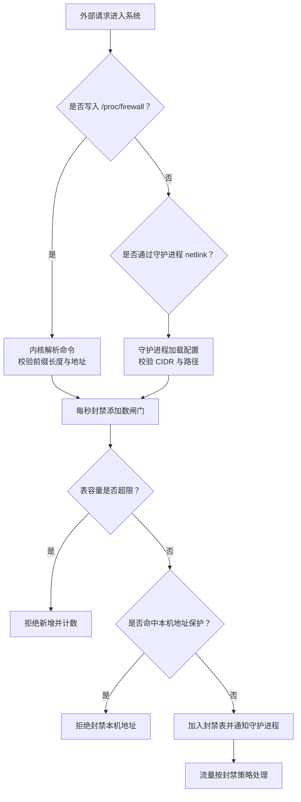

**图示来源**
- [procfs.fwidl:170-190](file://contract/procfs.fwidl#L170-L190)
- [fw_ban.c:393-409](file://src/kernel-module/fw_ban.c#L393-L409)
- [fw_ban.c:479-484](file://src/kernel-module/fw_ban.c#L479-L484)
- [fw_main.c:238-243](file://src/kernel-module/fw_main.c#L238-L243)

**章节来源**
- [procfs.fwidl:62-97](file://contract/procfs.fwidl#L62-L97)
- [fw_ban.c:389-423](file://src/kernel-module/fw_ban.c#L389-L423)
- [fw_main.c:117-180](file://src/kernel-module/fw_main.c#L117-L180)

## 架构总览与进程-内核交互
从信任角度，最重要的两条路径是：
- **procfs 路径**：任意可写 /proc/firewall 的用户可直接写 bans、whitelist、config。
- **守护进程路径**：守护进程读取 YAML 配置，经 netlink 与内核通信，负责自动发现、端口保护、DDoS 判定与状态恢复。

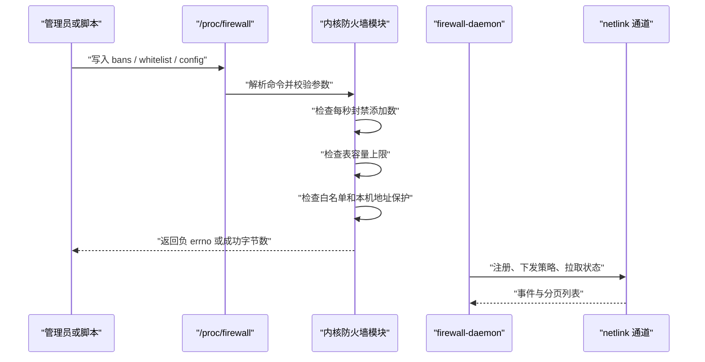

**图示来源**
- [procfs.fwidl:17-26](file://contract/procfs.fwidl#L17-L26)
- [procfs.fwidl:170-190](file://contract/procfs.fwidl#L170-L190)
- [fw_ban.c:506-531](file://src/kernel-module/fw_ban.c#L506-L531)

**章节来源**
- [procfs.fwidl:1-27](file://contract/procfs.fwidl#L1-L27)
- [fw_ban.c:506-531](file://src/kernel-module/fw_ban.c#L506-L531)

## 详细组件分析

### procfs 权限模型与“谁能写就能封 IP”的设计原理
procfs 是内核暴露给用户的文本接口。根据契约，/proc/firewall 下多个条目具有不同权限：
- bans、whitelist、config 为 0600，仅 root 可读写；
- stats 为 0400，仅 root 可读；
- 其他观察类条目多为只读。

这意味着：**任何能以 root 身份写入 /proc/firewall 的进程，都可以直接封禁 IP、修改白名单或调整运行时配置**。这是典型的“高权限入口即高破坏面”设计，因此必须配合严格的部署与审计。

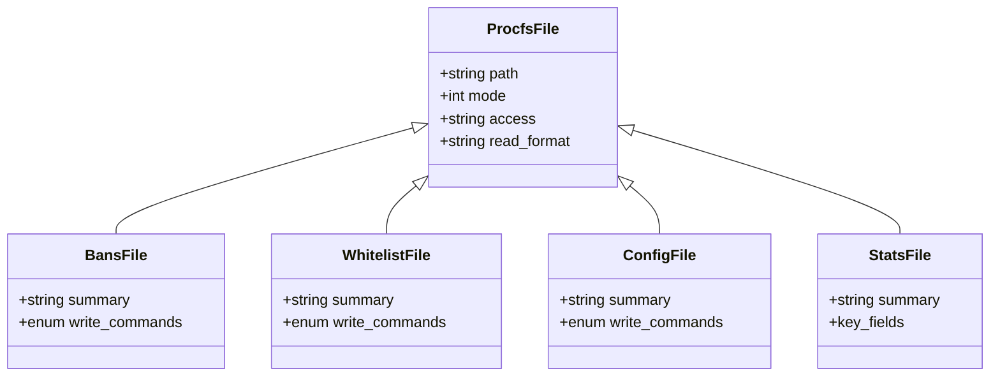

**图示来源**
- [procfs.fwidl:71-97](file://contract/procfs.fwidl#L71-L97)
- [procfs.fwidl:170-216](file://contract/procfs.fwidl#L170-L216)

**章节来源**
- [procfs.fwidl:62-97](file://contract/procfs.fwidl#L62-L97)
- [procfs.fwidl:170-216](file://contract/procfs.fwidl#L170-L216)
- [fw_procfs.h:1-14](file://src/kernel-module/fw_procfs.h#L1-L14)

### 守护进程的 systemd 沙箱配置
守护进程以 root 运行，但 systemd 单元提供了较强的安全加固：
- NoNewPrivileges=yes：禁止子进程获取更高权限。
- ProtectSystem=strict：整体文件系统只读，并通过 ReadWritePaths 放开必要目录。
- PrivateTmp=yes、ProtectHome=yes：隔离临时目录与家目录。
- ProtectKernelTunables=yes、ProtectKernelLogs=yes、ProtectClock=yes：限制内核可调参数、日志、时钟相关能力。
- PrivateDevices=yes、RestrictNamespaces=yes、RestrictRealtime=yes、RestrictSUIDSGID=yes：限制设备、命名空间、实时调度、SUID/SGID。
- RestrictAddressFamilies=AF_INET AF_INET6 AF_UNIX AF_NETLINK：仅允许网络与本地套接字及 netlink。
- MemoryDenyWriteExecute=yes、LockPersonality=yes、SystemCallFilter=@system-service、SystemCallArchitectures=native：限制可执行内存、系统调用族与架构。

这些配置共同构成守护进程的“最小可用权限集”，即使守护进程本身存在漏洞，攻击者也不能随意写系统文件、加载模块、创建命名空间或使用全部系统调用。

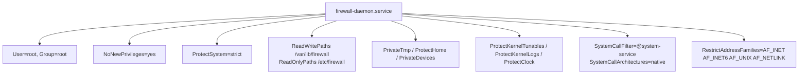

**图示来源**
- [firewall-daemon.service:5-43](file://firewall-daemon.service#L5-L43)

**章节来源**
- [firewall-daemon.service:1-51](file://firewall-daemon.service#L1-L51)

### 内核态与用户态的权限隔离
内核态承担最终执行职责：
- 接收 procfs 文本命令；
- 接收守护进程 netlink 指令；
- 维护封禁表、白名单、速率表、本机地址集合；
- 在 netfilter 热路径中判断是否丢弃数据包。

用户态不能直接操作内核数据结构，只能通过契约定义的接口访问。契约还明确：
- 写侧一次 write(2) 一条命令；
- 写失败返回负 errno，不提供文本错误通道；
- stats 是机器可读契约，bans/whitelist 等表格为 unstable；
- 所有容量上限必须在代码中真实实施，并由契约锚点验证。

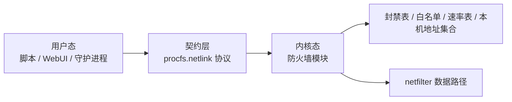

**图示来源**
- [procfs.fwidl:1-27](file://contract/procfs.fwidl#L1-L27)
- [procfs.fwidl:218-273](file://contract/procfs.fwidl#L218-L273)
- [fw_main.c:182-269](file://src/kernel-module/fw_main.c#L182-L269)

**章节来源**
- [procfs.fwidl:17-26](file://contract/procfs.fwidl#L17-L26)
- [procfs.fwidl:218-273](file://contract/procfs.fwidl#L218-L273)

### 内核侧内生自限机制

#### 每秒封禁添加数限制
内核使用统一泛洪闸门 fw_ban_flood_allow()，由 procfs、netlink、DDoS 自决三条封禁路径共用。其核心逻辑是：
- 以 jiffies 为单位维护一个时间窗口；
- 每个窗口内累计 recent_additions；
- 超过 fw_max_bans_per_second 则拒绝新增；
- 该值默认 200，可通过模块参数调整。

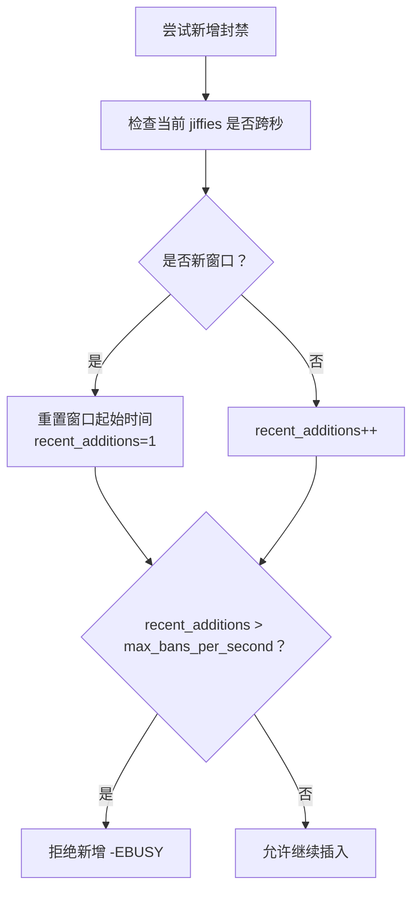

**图示来源**
- [fw_ban.c:393-409](file://src/kernel-module/fw_ban.c#L393-L409)
- [fw_main.c:69-84](file://src/kernel-module/fw_main.c#L69-L84)

**章节来源**
- [fw_ban.c:389-423](file://src/kernel-module/fw_ban.c#L389-L423)
- [fw_main.c:53-106](file://src/kernel-module/fw_main.c#L53-L106)

#### 本机地址集合保护
内核在初始化阶段先重建本机地址集合，再注册 netfilter 钩子。如果首次发现本机地址失败，模块会放弃注册钩子，而不是带着空表运行。这样避免旧实现中“本机地址为空时误判为非本机”的失败开放窗口。

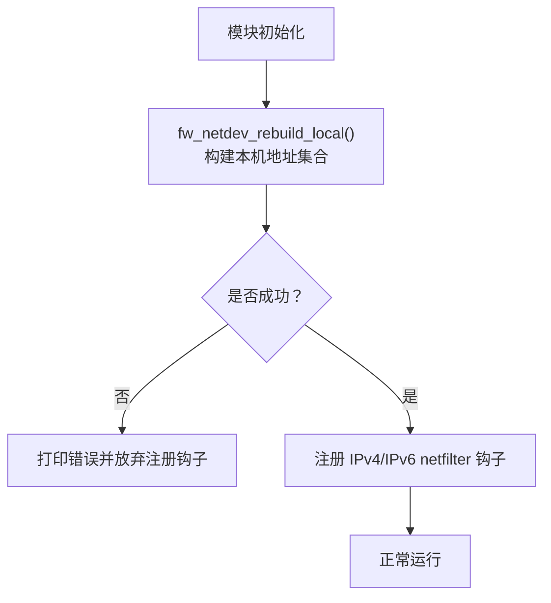

**图示来源**
- [fw_main.c:238-264](file://src/kernel-module/fw_main.c#L238-L264)

**章节来源**
- [fw_main.c:182-269](file://src/kernel-module/fw_main.c#L182-L269)

#### 表规模上限防护
内核对多个关键表设置了容量上限：
- 封禁表：默认 65535 条，达到上限后拒绝新增并递增 ban_table_full_rejects；
- 白名单：默认 65535 条，达到上限后拒绝新增；
- 速率表：默认 65536 条，达到上限后有意放行（契约明确该方向为“失败开放但可观测”）；
- 其他展示型表如 UDP 端口、ICMP 类型、端口扫描结果、服务探测结果也有固定上限。

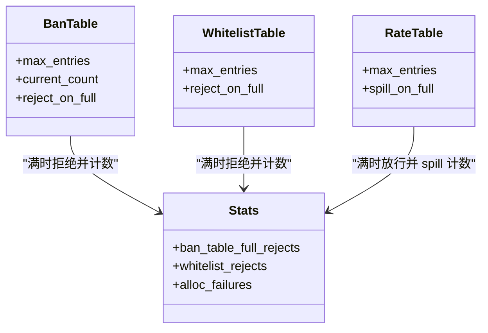

**图示来源**
- [procfs.fwidl:227-273](file://contract/procfs.fwidl#L227-L273)
- [fw_ban.c:479-484](file://src/kernel-module/fw_ban.c#L479-L484)
- [fw_main.c:71-95](file://src/kernel-module/fw_main.c#L71-L95)

**章节来源**
- [procfs.fwidl:218-273](file://contract/procfs.fwidl#L218-L273)
- [fw_ban.c:429-504](file://src/kernel-module/fw_ban.c#L429-L504)
- [fw_main.c:53-106](file://src/kernel-module/fw_main.c#L53-L106)

### 守护进程配置加载的信任边界
守护进程负责加载 YAML 配置，并对路径、文件类型、目录内容做基础校验。它支持按字母序合并配置文件，并把运行期覆盖文件放在最后合并，从而保证预置定义与运行期状态的优先级清晰。

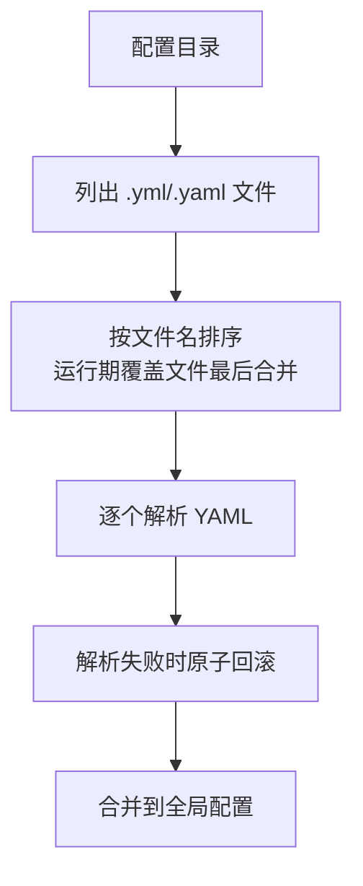

**图示来源**
- [loader.go:53-128](file://src/daemon/internal/config/loader.go#L53-L128)

**章节来源**
- [loader.go:1-129](file://src/daemon/internal/config/loader.go#L1-L129)

## 依赖关系与耦合分析
从信任边界角度看，主要依赖如下：
- procfs 契约驱动内核模块创建 /proc/firewall 条目，并规定权限与格式；
- 守护进程通过 netlink 与内核通信，承担自动化策略下发；
- 内核模块依赖 fw_info 单例保存运行期参数，并在 init 顺序上严格保证本机地址集合先于 netfilter 钩子就绪；
- 所有容量上限由契约声明，并由代码锚点验证，防止契约漂移。

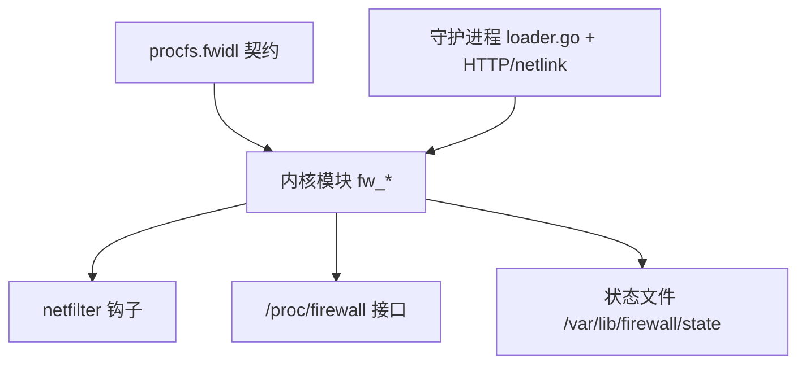

**图示来源**
- [procfs.fwidl:1-27](file://contract/procfs.fwidl#L1-L27)
- [fw_main.c:182-269](file://src/kernel-module/fw_main.c#L182-L269)
- [loader.go:53-128](file://src/daemon/internal/config/loader.go#L53-L128)

**章节来源**
- [procfs.fwidl:1-27](file://contract/procfs.fwidl#L1-L27)
- [fw_main.c:182-269](file://src/kernel-module/fw_main.c#L182-L269)
- [loader.go:53-128](file://src/daemon/internal/config/loader.go#L53-L128)

## 性能与资源限制特性
从信任边界角度，性能限制也是安全限制的一部分：
- 封禁表采用分层桶表加 RCU，热路径查找优先精确前缀，再遍历短前缀层；
- 定时器 per-entry 到期解封，避免全局清理线程带来的锁竞争；
- 每秒封禁添加数限制防止快速注入大量封禁条目；
- 表容量上限防止内存膨胀；
- 守护进程 LimitNOFILE=65536、LimitNPROC=10，限制文件描述符与进程数。

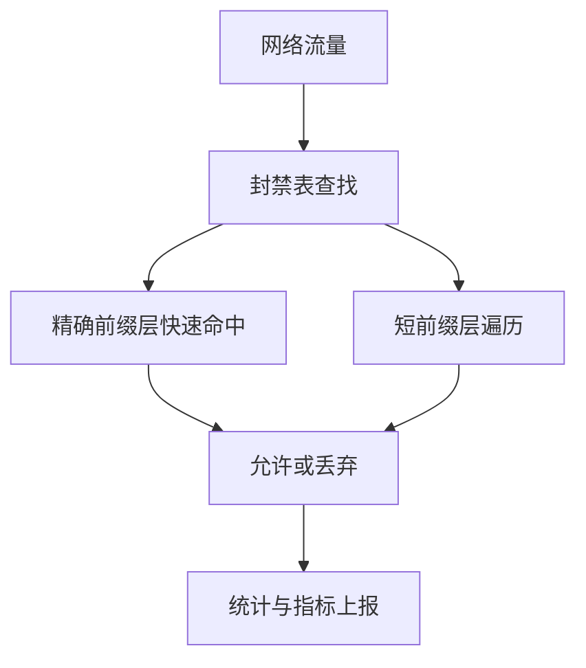

**图示来源**
- [fw_ban.c:369-383](file://src/kernel-module/fw_ban.c#L369-L383)
- [fw_ban.c:634-673](file://src/kernel-module/fw_ban.c#L634-L673)
- [firewall-daemon.service:45-48](file://firewall-daemon.service#L45-L48)

**章节来源**
- [fw_ban.c:369-383](file://src/kernel-module/fw_ban.c#L369-L383)
- [fw_ban.c:634-673](file://src/kernel-module/fw_ban.c#L634-L673)
- [firewall-daemon.service:45-48](file://firewall-daemon.service#L45-L48)

## 故障排查与常见风险

### 谁可以写 /proc/firewall
- 由于 bans、whitelist、config 为 0600，只有 root 可写；
- 若系统存在 sudo 配置不当、容器逃逸、root shell 泄露等问题，攻击者可利用该入口封禁合法 IP；
- 建议：最小化 root 账户暴露面，审计 sudoers，限制容器权限，启用内核审计与登录审计。

**章节来源**
- [procfs.fwidl:71-97](file://contract/procfs.fwidl#L71-L97)

### 守护进程权限过大但受沙箱约束
- firewall-daemon.service 以 root 运行，但启用了 NoNewPrivileges、ProtectSystem=strict、PrivateTmp、ProtectHome、RestrictAddressFamilies、SystemCallFilter 等；
- 若需要扩展守护进程能力，应优先增加最小化的 ReadWritePaths 或 RestrictAddressFamilies 白名单，而不是关闭沙箱；
- 注意：ProtectSystem=strict 会把整个文件系统挂为只读，必须确保日志与状态目录已预创建。

**章节来源**
- [firewall-daemon.service:5-43](file://firewall-daemon.service#L5-L43)

### 内核侧封禁风暴与表满
- 如果外部批量写入 bans，可能触发每秒封禁添加数限制；
- 如果封禁表满，新增封禁会被拒绝并计入 ban_table_full_rejects；
- 如果速率表满，内核有意放行，但会通过 spill 计数暴露该状态；
- 建议监控 stats 中的 total_bans、ban_table_full_rejects、recent_additions、whitelist_rejects。

**章节来源**
- [fw_ban.c:393-409](file://src/kernel-module/fw_ban.c#L393-L409)
- [fw_ban.c:479-484](file://src/kernel-module/fw_ban.c#L479-L484)
- [procfs.fwidl:202-216](file://contract/procfs.fwidl#L202-L216)
- [procfs.fwidl:369-375](file://contract/procfs.fwidl#L369-L375)

### 本机地址误封风险
- 内核在注册 netfilter 钩子前必须先成功重建本机地址集合；
- 若失败，模块不会注册钩子，宁可功能不可用也不带病运行；
- 建议关注模块加载日志，确认本机地址集合构建成功。

**章节来源**
- [fw_main.c:238-243](file://src/kernel-module/fw_main.c#L238-L243)

## 结论
本系统的信任边界围绕三个关键点展开：
1. **procfs 是高权限控制面**：能写 /proc/firewall 就能封 IP，因此必须严格限制 root 访问与审计。
2. **守护进程以 root 运行但受 systemd 沙箱约束**：通过 NoNewPrivileges、ProtectSystem、PrivateTmp、RestrictAddressFamilies、SystemCallFilter 等组合，将用户态破坏面收敛到最小必要范围。
3. **内核态提供内生自限**：每秒封禁添加数限制、本机地址集合保护、封禁表/白名单/速率表容量上限，共同防止滥用、资源耗尽与失败开放。

在实际部署中，建议把 procfs 视为“高危控制台”，把守护进程视为“受控管理平面”，把内核模块视为“最终执行与自限层”。三者协同，才能在高性能封禁的同时保持可控的信任边界。