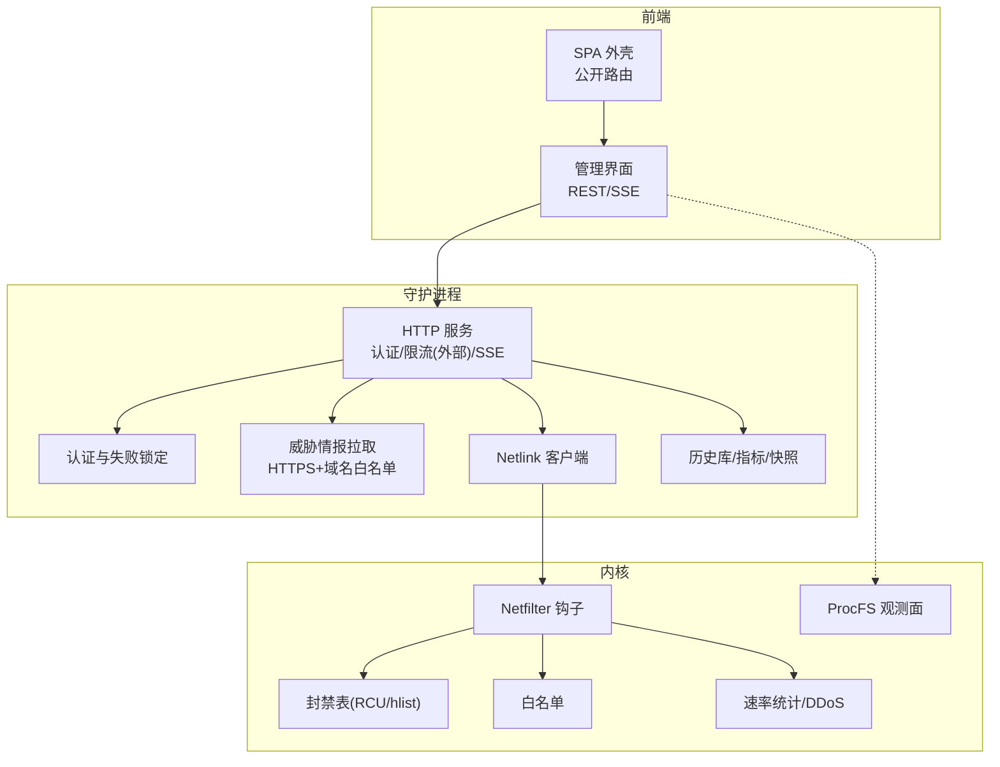
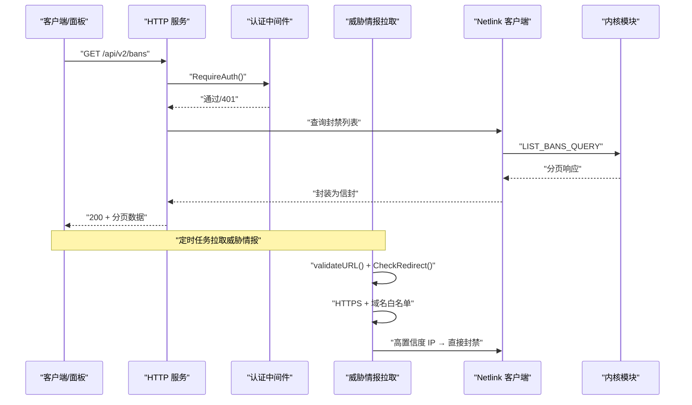
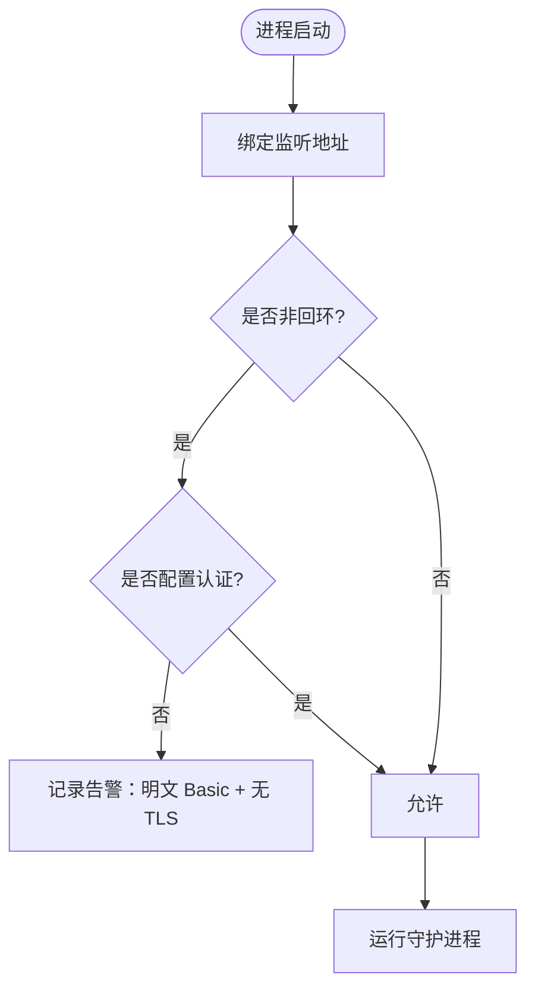
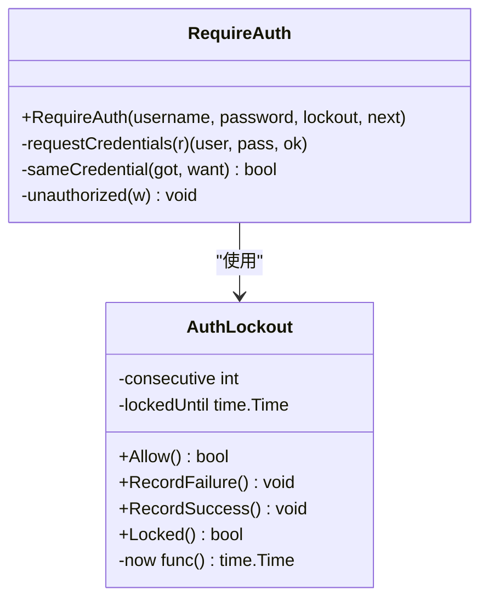
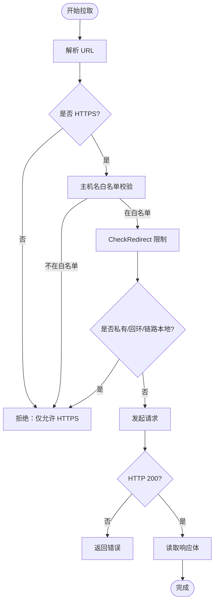
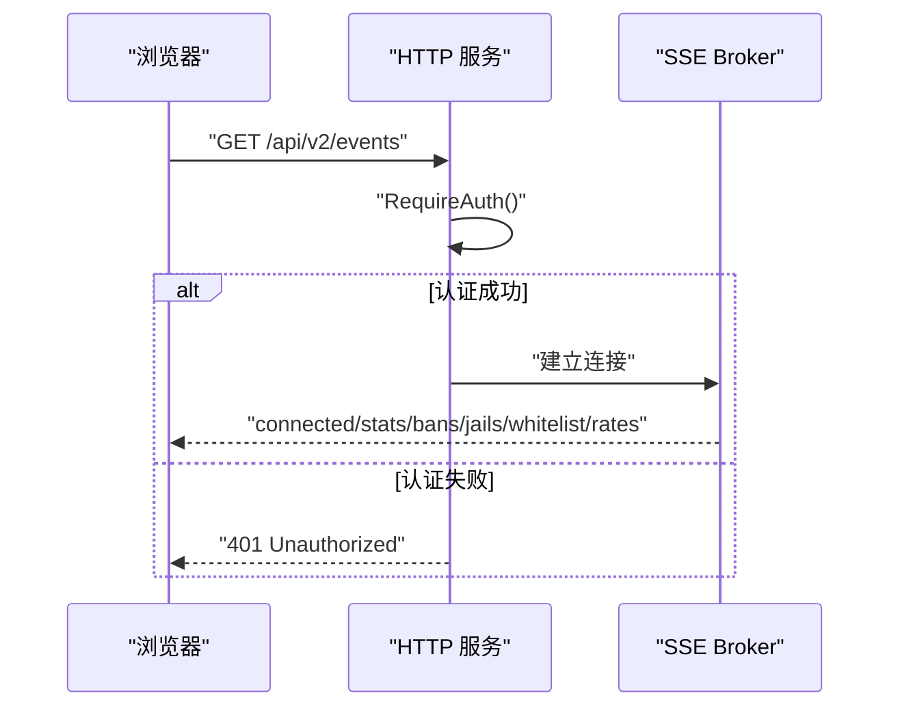
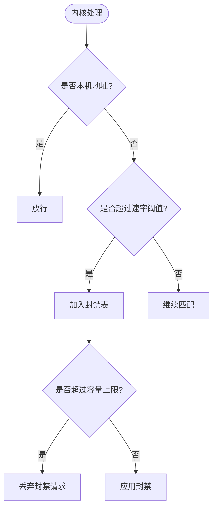
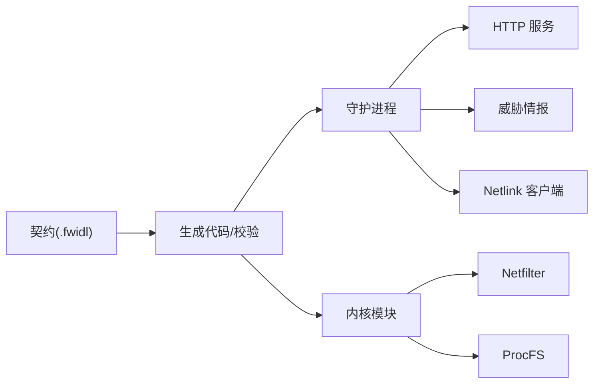

# 安全设计

<cite>
**本文引用的文件**   
- [README.md](file://README.md)
- [SECURITY.md](file://SECURITY.md)
- [http.fwidl](file://contract/http.fwidl)
- [netlink.fwidl](file://contract/netlink.fwidl)
- [procfs.fwidl](file://contract/procfs.fwidl)
- [src/daemon/internal/threatfeeds/http.go](file://src/daemon/internal/threatfeeds/http.go)
- [src/daemon/internal/threatfeeds/config.go](file://src/daemon/internal/threatfeeds/config.go)
- [src/daemon/internal/http/auth.go](file://src/daemon/internal/http/auth.go)
- [src/daemon/internal/http/auth_lockout.go](file://src/daemon/internal/http/auth_lockout.go)
</cite>

## 目录
1. [引言](#引言)
2. [项目结构](#项目结构)
3. [核心组件](#核心组件)
4. [架构总览](#架构总览)
5. [详细组件分析](#详细组件分析)
6. [依赖关系分析](#依赖关系分析)
7. [性能与容量特性](#性能与容量特性)
8. [故障排查指南](#故障排查指南)
9. [结论](#结论)
10. [附录：企业级安全实践清单](#附录企业级安全实践清单)

## 引言
本文件面向安全工程师、运维与审计人员，系统化梳理该智能内核防火墙的安全设计。内容覆盖信任边界、认证授权、输入校验、SSRF 防护、权限控制、数据安全、API 安全、内核态安全防护，以及安全配置最佳实践、漏洞扫描与安全审计方法。目标是帮助读者在不深入源码的情况下，也能理解系统如何以“用户态智能判定 + 内核态高速封禁”的方式实现企业级防护能力。

## 项目结构
系统由四层组成：内核模块（C）、守护进程（Go）、前端面板（React/TS）和契约系统（Python + .fwidl）。安全相关的关键位置包括：
- 契约层：HTTP、Netlink、ProcFS 三端接口契约集中定义鉴权语义、错误模型、SSE 上限、安全头、容量上限等。
- 守护进程：HTTP 认证、失败锁定、威胁情报拉取、内核通信、日志采集、风险引擎、持久化。
- 内核模块：netfilter 钩子、RCU 封禁表、白名单、速率统计、DDoS 检测、状态快照。
- 前端面板：SPA 外壳公开、数据面受保护；SSE 事件流与 REST API 均受认证约束。

**图表来源**
- [README.md:10-31](file://README.md#L10-L31)
- [http.fwidl:131-153](file://contract/http.fwidl#L131-L153)
- [netlink.fwidl:27-30](file://contract/netlink.fwidl#L27-L30)
- [procfs.fwidl:62-164](file://contract/procfs.fwidl#L62-L164)

**章节来源**
- [README.md:10-31](file://README.md#L10-L31)

## 核心组件
- 信任边界与权限模型
  - ProcFS 写入口即封禁面：`/proc/firewall/bans`、`whitelist`、`config` 为 0600，其余只读 0400。
  - 守护进程以 root 运行，但 systemd 单元启用多项沙箱限制。
  - HTTP 面板默认监听回环地址；若绑定到非回环地址必须配置凭据。
- 认证与授权
  - HTTP Basic 认证，支持查询参数 `access_token`；连续失败阈值触发进程级锁定窗口。
  - 未配置认证时（用户名和密码均为空），API 完全开放；半配置视为结构性失败。
- 输入校验
  - 静态资源路径拒绝 `..`；正则模式大小与复杂度受限；配置严格模式默认开启。
- SSRF 防护
  - 威胁情报源强制 HTTPS、域名白名单、重定向次数限制、禁止自动跟随重定向。
- 内核侧自限
  - 封禁添加速率限制、本机地址集合在 netfilter 注册前发布、端口位图全端口受保护语义、容量上限。

**章节来源**
- [SECURITY.md:22-138](file://SECURITY.md#L22-L138)
- [http.fwidl:68-88](file://contract/http.fwidl#L68-L88)
- [http.fwidl:131-153](file://contract/http.fwidl#L131-L153)
- [procfs.fwidl:62-164](file://contract/procfs.fwidl#L62-L164)
- [src/daemon/internal/threatfeeds/http.go:14-65](file://src/daemon/internal/threatfeeds/http.go#L14-L65)

## 架构总览
下图展示从请求进入、认证、情报拉取到内核封禁的端到端流程，并标注关键安全点。

**图表来源**
- [http.fwidl:477-511](file://contract/http.fwidl#L477-L511)
- [http.fwidl:525-577](file://contract/http.fwidl#L525-L577)
- [netlink.fwidl:218-237](file://contract/netlink.fwidl#L218-L237)
- [src/daemon/internal/threatfeeds/http.go:30-65](file://src/daemon/internal/threatfeeds/http.go#L30-L65)

## 详细组件分析

### 信任边界与权限控制
- ProcFS 权限模型
  - 可写条目：`bans`、`whitelist`、`config`（0600）；只读条目：`stats`、`rates`、分布统计等（0400）。
  - 写操作可直接影响封禁面与全局时长，属于强权限面。
- 守护进程权限
  - systemd 单元以 root 运行，启用 NoNewPrivileges、ProtectSystem=strict、ReadOnlyPaths、PrivateTmp、RestrictNamespaces、MemoryDenyWriteExecute 等。
  - 注意：`ProtectKernelModules` 被注释，因为模块通过 modules-load.d 启动时加载。
- 监听地址与暴露面
  - 默认监听 127.0.0.1；仓库默认配置为 0.0.0.0，需配合凭据使用。
  - 绑定非回环且未配置认证会记录告警日志。

**图表来源**
- [SECURITY.md:86-107](file://SECURITY.md#L86-L107)

**章节来源**
- [SECURITY.md:22-58](file://SECURITY.md#L22-L58)
- [SECURITY.md:86-107](file://SECURITY.md#L86-L107)
- [procfs.fwidl:62-164](file://contract/procfs.fwidl#L62-L164)

### 认证与授权机制
- 认证方案
  - Basic 认证，支持 Authorization 头与查询参数 `access_token`。
  - 两项凭据都为空 = 未配置认证，放行；半配置 = 结构性失败，一律 401。
- 失败锁定
  - 连续失败达到阈值后进入锁定窗口，期间正确凭据也拒绝。
  - 锁定为进程级账本，不按路由或来源 IP 切分。
- 安全头
  - 所有路由统一设置 X-Content-Type-Options、X-Frame-Options、Content-Security-Policy、Cache-Control。

**图表来源**
- [src/daemon/internal/http/auth.go:22-116](file://src/daemon/internal/http/auth.go#L22-L116)
- [src/daemon/internal/http/auth_lockout.go:15-83](file://src/daemon/internal/http/auth_lockout.go#L15-L83)
- [http.fwidl:68-88](file://contract/http.fwidl#L68-L88)
- [http.fwidl:131-153](file://contract/http.fwidl#L131-L153)

**章节来源**
- [SECURITY.md:59-85](file://SECURITY.md#L59-L85)
- [http.fwidl:68-88](file://contract/http.fwidl#L68-L88)
- [http.fwidl:131-153](file://contract/http.fwidl#L131-L153)
- [src/daemon/internal/http/auth.go:22-116](file://src/daemon/internal/http/auth.go#L22-L116)
- [src/daemon/internal/http/auth_lockout.go:15-83](file://src/daemon/internal/http/auth_lockout.go#L15-L83)

### 输入验证策略
- 静态资源路径：使用 `fs.ValidPath` 并拒绝包含 `..` 的名称。
- 正则表达式：拒绝嵌套量词、占有量词、量化交替组等易回溯模式；模式长度与分支数有限制；每 jail 正则数量有上限。
- 配置解析：严格模式默认开启，未知顶层键直接报错；可通过 `--no-strict` 关闭。
- 出口探测地址：存在长度上限；本机经纬度必须成对给出。

**章节来源**
- [SECURITY.md:109-119](file://SECURITY.md#L109-L119)

### SSRF 防护（威胁情报源）
- 协议限制：仅允许 HTTPS。
- 域名白名单：仅允许已知情报源域名。
- 重定向限制：禁止自动跟随重定向，最多 3 次重定向检查。
- 私有地址检测：对目标 IP 进行回环、私有、链路本地单播/多播判断。
- 超时与重试：单次拉取超时、指数退避重试。

**图表来源**
- [src/daemon/internal/threatfeeds/http.go:30-65](file://src/daemon/internal/threatfeeds/http.go#L30-L65)
- [src/daemon/internal/threatfeeds/http.go:72-129](file://src/daemon/internal/threatfeeds/http.go#L72-L129)

**章节来源**
- [src/daemon/internal/threatfeeds/http.go:14-65](file://src/daemon/internal/threatfeeds/http.go#L14-L65)
- [src/daemon/internal/threatfeeds/config.go:33-81](file://src/daemon/internal/threatfeeds/config.go#L33-L81)

### API 安全
- 认证模型：Basic + 查询参数 token；未配置认证时 API 完全开放。
- SSE 连接上限：events 10 条、logs/stream 5 条，超限返回 503。
- 安全头：统一设置 nosniff、DENY、default-src 'none'（WebUI 放宽）、no-store。
- 错误模型：统一信封、纯文本 401、框架默认错误并存；前端需兼容多种形状。
- 健康探针：/health 与 /healthz 以 HTTP 状态码承载就绪语义，不走信封。

**图表来源**
- [http.fwidl:477-511](file://contract/http.fwidl#L477-L511)
- [http.fwidl:131-153](file://contract/http.fwidl#L131-L153)
- [http.fwidl:298-304](file://contract/http.fwidl#L298-L304)

**章节来源**
- [http.fwidl:68-88](file://contract/http.fwidl#L68-L88)
- [http.fwidl:131-153](file://contract/http.fwidl#L131-L153)
- [http.fwidl:477-511](file://contract/http.fwidl#L477-L511)
- [http.fwidl:298-304](file://contract/http.fwidl#L298-L304)

### 内核态安全防护
- 封禁速率限制：每秒封禁添加数受流控保护，上限来自模块参数与配置。
- 本机地址集合：在 netfilter 钩子注册之前发布，避免空表导致放行。
- 端口位图语义：置位端口表示“纳入防护”，不参与速率判定的端口避免内部流量误封。
- 容量上限：封禁、白名单、速率条目数均有上限；速率每 CPU 槽表定长。
- 状态持久化：封禁与白名单可跨重启保留，路径由模块参数指定；CRC32 尾行校验。

**图表来源**
- [SECURITY.md:121-138](file://SECURITY.md#L121-L138)
- [netlink.fwidl:422-435](file://contract/netlink.fwidl#L422-L435)

**章节来源**
- [SECURITY.md:121-138](file://SECURITY.md#L121-L138)
- [netlink.fwidl:422-435](file://contract/netlink.fwidl#L422-L435)

## 依赖关系分析
- 契约驱动
  - HTTP、Netlink、ProcFS 三端契约作为单一真相源，生成代码与校验脚本保证一致性。
- 守护进程依赖
  - HTTP 层依赖认证与失败锁定；威胁情报拉取依赖 HTTP 客户端与配置；内核通信依赖 Netlink 客户端。
- 内核模块依赖
  - Netfilter 钩子依赖封禁表、白名单、速率统计；ProcFS 提供观测面。

**图表来源**
- [http.fwidl:1-43](file://contract/http.fwidl#L1-L43)
- [netlink.fwidl:1-30](file://contract/netlink.fwidl#L1-L30)
- [procfs.fwidl:1-27](file://contract/procfs.fwidl#L1-L27)

**章节来源**
- [http.fwidl:1-43](file://contract/http.fwidl#L1-L43)
- [netlink.fwidl:1-30](file://contract/netlink.fwidl#L1-L30)
- [procfs.fwidl:1-27](file://contract/procfs.fwidl#L1-L27)

## 性能与容量特性
- 内核封禁表：hlist + RCU，命中即丢，零用户态开销。
- 速率统计：每 CPU 槽表定长 512，聚合端口扫描与服务探测指标。
- 容量上限：封禁、白名单、速率条目数默认 65535；UDP/ICMP 分布表有固定容量。
- SSE 序列化优化：仅在内容变化时序列化，按连接投递 channel，避免重复序列化。

**章节来源**
- [README.md:76-131](file://README.md#L76-L131)
- [http.fwidl:330-344](file://contract/http.fwidl#L330-L344)

## 故障排查指南
- 认证问题
  - 确认是否配置了用户名与密码；半配置将导致所有 API 返回 401。
  - 检查是否处于锁定窗口；锁定期间正确凭据也会被拒。
- SSRF 防护
  - 检查威胁情报源 URL 是否为 HTTPS；域名是否在白名单内。
  - 检查重定向链是否超过限制。
- 内核态问题
  - 检查封禁表是否达到容量上限；查看 stats 计数器。
  - 检查本机地址集合是否正确发布；端口位图是否按预期下发。

**章节来源**
- [SECURITY.md:59-138](file://SECURITY.md#L59-L138)
- [src/daemon/internal/threatfeeds/http.go:30-65](file://src/daemon/internal/threatfeeds/http.go#L30-L65)

## 结论
该系统通过契约驱动的多层架构，实现了从用户态到内核态的安全闭环。认证授权、输入校验、SSRF 防护、内核自限等机制共同构建了企业级防护能力。然而，当前实现仍存在若干缺口：未内置 TLS、未实现 API 限速、部分历史趋势数据未持久化。建议在生产环境中结合反向代理、密钥管理、监控告警等手段补齐这些缺口。

## 附录：企业级安全实践清单
- 部署与配置
  - 使用 systemd 启动，保持沙箱项启用。
  - 绑定回环或内网地址；如需广绑，务必配置凭据。
  - 前置 TLS 反向代理；凭据当密钥对待，不提交进版本库。
- 监控与审计
  - 定期查看 `/proc/firewall/stats` 与 Prometheus 指标。
  - 审查封禁面与白名单，关注异常增长。
  - 启用 CI 契约校验，确保 HTTP/Netlink/ProcFS 三端一致。
- 漏洞扫描与审计
  - 使用 SAST/DAST 工具扫描 Go/TS/C 代码。
  - 定期执行依赖漏洞扫描（如 npm audit、go mod tidy + govulncheck）。
  - 审计内核模块编译与加载过程，确保签名与完整性校验。