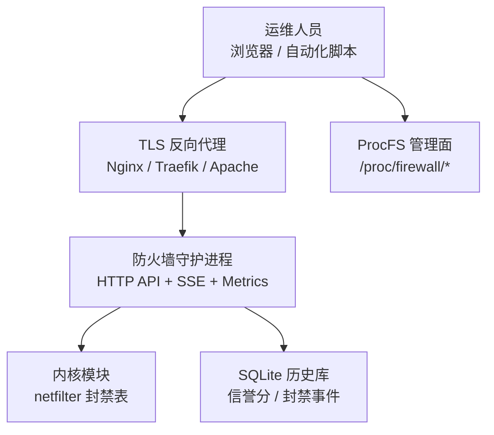
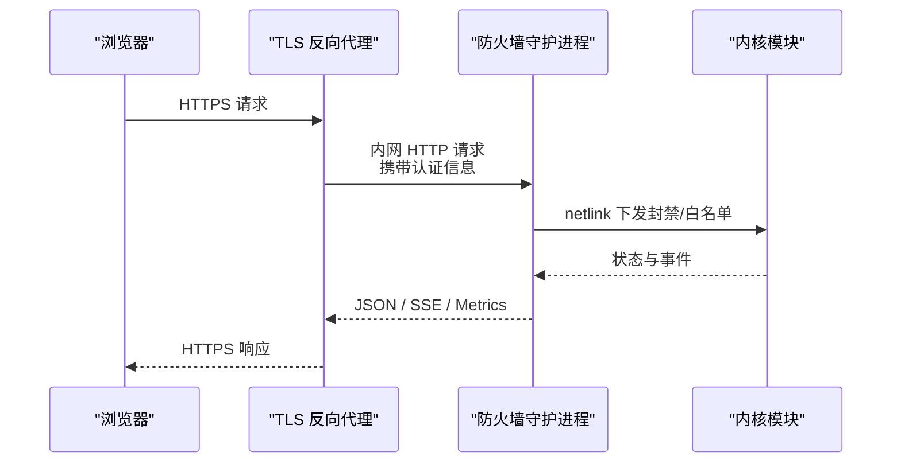
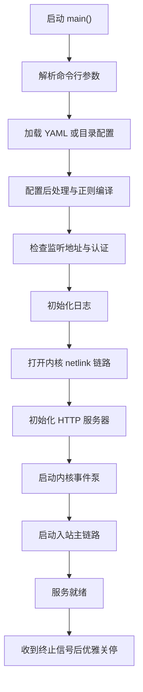
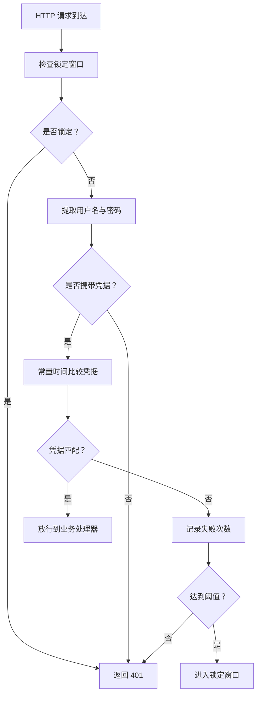
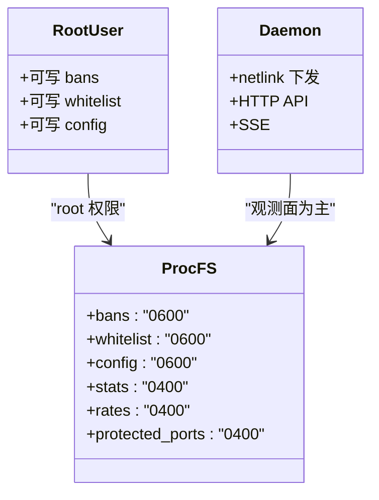
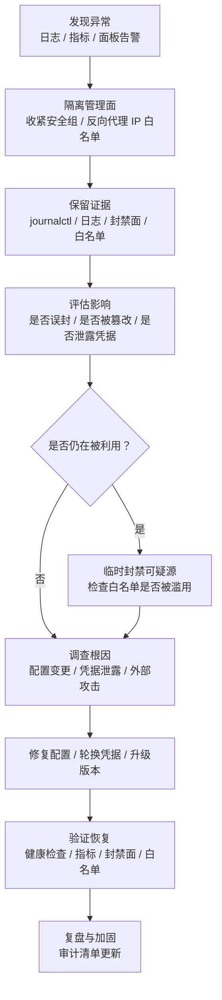

# 安全配置最佳实践

<cite>
**本文引用的文件**   
- [README.md](file://README.md)
- [SECURITY.md](file://SECURITY.md)
- [firewall-daemon.service](file://firewall-daemon.service)
- [main.go](file://src/daemon/cmd/firewall-daemon/main.go)
- [bind_address.go](file://src/daemon/cmd/firewall-daemon/bind_address.go)
- [loader.go](file://src/daemon/internal/config/loader.go)
- [args.go](file://src/daemon/internal/config/args.go)
- [credentials_env.go](file://src/daemon/internal/config/credentials_env.go)
- [default.yaml](file://config/default.yaml)
- [server.go](file://src/daemon/internal/http/server.go)
- [auth.go](file://src/daemon/internal/http/auth.go)
- [auth_lockout.go](file://src/daemon/internal/http/auth_lockout.go)
- [installation.md](file://docs/zh/getting-started/installation.md)
- [management.md](file://docs/zh/operations/management.md)
- [examples.md](file://docs/zh/configuration/examples.md)
</cite>

## 目录
1. [引言](#引言)
2. [项目结构与安全边界](#项目结构与安全边界)
3. [核心安全组件](#核心安全组件)
4. [架构总览](#架构总览)
5. [详细组件分析](#详细组件分析)
6. [依赖与信任边界分析](#依赖与信任边界分析)
7. [生产环境安全配置模板](#生产环境安全配置模板)
8. [性能与资源限制](#性能与资源限制)
9. [安全审计清单](#安全审计清单)
10. [漏洞扫描建议](#漏洞扫描建议)
11. [应急响应流程](#应急响应流程)
12. [结论](#结论)

## 引言
本文件面向生产环境的防火墙守护进程，给出可执行的安全配置最佳实践。内容覆盖：使用 systemd 启动、绑定回环或内网地址、前置 TLS 反向代理、凭据安全管理、保持配置校验严格、定期查看封禁面和白名单；解释服务为何不提供 HTTPS、为什么 Basic 认证不适合公网暴露；并提供单机、集群、云环境的安全配置模板、安全审计清单、漏洞扫描建议和应急响应流程。

该守护进程采用“用户态智能判定 + 内核态高速封禁”的三层架构：日志采集进入多维风险引擎，最终通过 netlink 把封禁规则下发到内核模块，命中即丢，用户态不成为包转发瓶颈。Web 面板和 HTTP API 是管理面，不是数据面，因此其暴露面、认证和加密策略必须单独设计。

**章节来源**
- [README.md:10-31](file://README.md#L10-L31)
- [README.md:120-131](file://README.md#L120-L131)

## 项目结构与安全边界
从安全视角看，系统分为四层：

| 层级 | 职责 | 安全重点 |
|------|------|----------|
| 内核模块 | netfilter 钩子、封禁表、白名单、速率统计 | 权限最小化、表容量上限、泛洪保护 |
| 守护进程 | 日志采集、风险判定、HTTP API、SSE、威胁情报 | 认证、监听地址、systemd 沙箱、配置严格校验 |
| Web 面板 | 实时监控、配置管理、可视化分析 | 仅管理面入口，不应直接暴露公网 |
| 契约层 | HTTP/netlink/procfs 接口定义 | 防止实现与文档不一致导致安全语义漂移 |

**图示来源**
- [README.md:14-29](file://README.md#L14-L29)
- [SECURITY.md:22-41](file://SECURITY.md#L22-L41)

**章节来源**
- [README.md:10-31](file://README.md#L10-L31)
- [SECURITY.md:22-41](file://SECURITY.md#L22-L41)

## 核心安全组件
本节聚焦生产部署中最容易出问题的五个点：systemd 单元、监听地址、Basic 认证、凭据来源、配置校验。

### systemd 启动与沙箱
`firewall-daemon.service` 以 root 运行，因为需要加载内核模块、读写 procfs 和状态目录；但单元同时启用大量沙箱能力，包括禁止提权、只读文件系统、私有临时目录、限制命名空间、限制系统调用族、限制文件句柄数和进程数等。

生产要求：
- 始终通过 `systemctl start/reload/status` 管理服务，不要手动前台长期运行。
- 保留 `NoNewPrivileges=yes`、`ProtectSystem=strict`、`PrivateTmp=yes`、`RestrictNamespaces=yes`、`MemoryDenyWriteExecute=yes`、`SystemCallFilter=@system-service`。
- 不要把 `/etc/firewall` 改成可写，只允许守护进程写入 `/var/lib/firewall` 和 `/var/log/firewall.log`。
- 监控重启次数和失败原因，避免频繁崩溃导致封禁表重建。

**章节来源**
- [firewall-daemon.service:1-51](file://firewall-daemon.service#L1-L51)
- [SECURITY.md:43-58](file://SECURITY.md#L43-L58)

### 监听地址：默认回环，严禁随意开放
HTTP 服务器在未显式配置时默认监听 `127.0.0.1:9119`；但仓库默认配置文件里 `metrics_bind_address` 写的是 `0.0.0.0`，这意味着局域网可达。守护进程在启动时会检测是否绑定到非回环地址且未开启认证，并记录警告。

生产要求：
- 如果不需要局域网访问，把 `metrics_bind_address` 改为 `127.0.0.1`。
- 如果需要内网访问，必须同时配置用户名和密码。
- 绝对不要在没有反向代理和认证的情况下把 9119 端口暴露在公网。
- 若使用主机名而非 IP，保守判断为可能对外开放，因为运行时解析结果不可控。

**章节来源**
- [server.go:34-51](file://src/daemon/internal/http/server.go#L34-L51)
- [main.go:106-120](file://src/daemon/cmd/firewall-daemon/main.go#L106-L120)
- [bind_address.go:8-29](file://src/daemon/cmd/firewall-daemon/bind_address.go#L8-L29)
- [default.yaml:12-19](file://config/default.yaml#L12-L19)

### Basic 认证：适合受控内网，不适合公网
守护进程的 HTTP 认证使用 Basic 方案，支持请求头中的 `Authorization: Basic <base64>` 和查询参数 `access_token=<base64>`。两项凭据都空表示未配置认证；只填一项视为结构性失败，整组端点一律拒绝。

Basic 的问题在于：
- Base64 只是编码，不是加密。
- 查询参数形式的 token 会进入浏览器历史、反向代理日志和服务器访问日志。
- 没有内置 TLS 时，凭据在网络中明文传输。
- 当前实现按进程级累计失败次数，不按来源 IP 切分，也没有全局 API 限速。

因此，Basic 认证可以放在可信内网，但不应作为公网暴露的唯一防护。

**章节来源**
- [auth.go:22-69](file://src/daemon/internal/http/auth.go#L22-L69)
- [auth_lockout.go:15-21](file://src/daemon/internal/http/auth_lockout.go#L15-L21)
- [SECURITY.md:59-84](file://SECURITY.md#L59-L84)

### 凭据安全管理：YAML 与环境变量分离
凭据有两个来源：
1. YAML 配置中的 `defaults.metrics_username` 和 `defaults.metrics_password`。
2. 环境变量 `FIREWALL_METRICS_USERNAME` 和 `FIREWALL_METRICS_PASSWORD`。

随包安装会准备 `/etc/firewall/credentials.env`，权限 0600，属主 root，但不会生成真实口令。生产应把凭据从被 git 跟踪的 YAML 移到这台机器的环境变量文件中，并把 YAML 里的占位值替换掉。

**章节来源**
- [credentials_env.go:1-32](file://src/daemon/internal/config/credentials_env.go#L1-L32)
- [installation.md:123-137](file://docs/zh/getting-started/installation.md#L123-L137)
- [SECURITY.md:86-107](file://SECURITY.md#L86-L107)

### 配置校验严格模式
守护进程默认开启严格模式：未知配置键直接报错退出。命令行参数 `--no-strict` 可以关闭严格模式，但生产不建议长期使用。目录模式下，所有 `.yaml` / `.yml` 按文件名字母序合并，`_` 前缀的运行期覆盖文件最后加载，拥有最终覆盖权。

**章节来源**
- [args.go:62-111](file://src/daemon/internal/config/args.go#L62-L111)
- [loader.go:53-127](file://src/daemon/internal/config/loader.go#L53-L127)
- [management.md:337-355](file://docs/zh/operations/management.md#L337-L355)

## 架构总览
下图展示生产推荐的安全入口路径：浏览器先经过前置 TLS 反向代理，再访问守护进程的 HTTP API 和面板。

**图示来源**
- [main.go:228-353](file://src/daemon/cmd/firewall-daemon/main.go#L228-L353)
- [server.go:34-73](file://src/daemon/internal/http/server.go#L34-L73)
- [SECURITY.md:72-78](file://SECURITY.md#L72-L78)

## 详细组件分析

### 守护进程装配与生命周期
守护进程组合根负责解析参数、加载配置、初始化日志、装配内核链路、HTTP 服务器、事件泵、入站主链路，并按登记逆序优雅关停。它不是业务逻辑中心，而是装配与生命周期中心。

关键安全行为：
- 前端静态面板缺失时直接启动失败，而不是假装可用。
- 出厂默认口令会被检测并告警。
- 监听地址对外开放但未配置认证时记录明显警告。
- 内核链路失败时降级为告警，HTTP 面仍可独立运行。
- 单实例约束通过内核租约落地，第二个实例无法接管。

**图示来源**
- [main.go:44-120](file://src/daemon/cmd/firewall-daemon/main.go#L44-L120)
- [main.go:173-353](file://src/daemon/cmd/firewall-daemon/main.go#L173-L353)
- [main.go:465-497](file://src/daemon/cmd/firewall-daemon/main.go#L465-L497)

**章节来源**
- [main.go:44-120](file://src/daemon/cmd/firewall-daemon/main.go#L44-L120)
- [main.go:173-353](file://src/daemon/cmd/firewall-daemon/main.go#L173-L353)
- [main.go:465-497](file://src/daemon/cmd/firewall-daemon/main.go#L465-L497)

### HTTP 服务器与安全中间件
HTTP 服务器默认监听 `127.0.0.1:9119`，连接数默认 32，关闭超时 5 秒。安全头在连接配额中间件外层注册，这样配额满返回 503 时也能带上安全响应头。

安全要点：
- 连接数超限返回 503，避免无限连接耗尽资源。
- 读取头部、读取、写入、空闲都有超时。
- 关停时先停 SSE 流，再等待活跃连接空闲，必要时强制关闭。
- 静态资源和路由注册由组合根统一装配，避免绕过认证的路由。

**章节来源**
- [server.go:34-73](file://src/daemon/internal/http/server.go#L34-L73)
- [server.go:92-113](file://src/daemon/internal/http/server.go#L92-L113)
- [server.go:129-149](file://src/daemon/internal/http/server.go#L129-L149)

### 认证与锁定机制
认证中间件支持两种凭据来源：请求头和查询参数。失败达到阈值后进入锁定窗口，锁定期内正确凭据也拒绝。锁定是进程级账本，不按路由或来源 IP 切分。

**图示来源**
- [auth.go:36-69](file://src/daemon/internal/http/auth.go#L36-L69)
- [auth_lockout.go:38-62](file://src/daemon/internal/http/auth_lockout.go#L38-L62)

**章节来源**
- [auth.go:22-116](file://src/daemon/internal/http/auth.go#L22-L116)
- [auth_lockout.go:1-83](file://src/daemon/internal/http/auth_lockout.go#L1-L83)

### 配置加载与覆盖顺序
配置支持单文件和目录两种模式。目录模式下按文件名字母序合并，`_` 前缀的运行期覆盖文件最后加载，用于保存界面开关等运行期状态。任一文件解析失败会整体回滚，保证原子性。

**章节来源**
- [loader.go:17-51](file://src/daemon/internal/config/loader.go#L17-L51)
- [loader.go:53-127](file://src/daemon/internal/config/loader.go#L53-L127)

### 默认配置中的安全风险
默认配置示例展示了完整骨架，但也包含几个需要人工确认的安全项：
- `metrics_bind_address` 默认为 `0.0.0.0`，意味着局域网可达。
- `metrics_username` 和 `metrics_password` 是占位值，生产必须替换。
- `history_db_path` 指向持久化数据库，需确保目录权限正确。
- `threat_feeds` 可从公网拉取威胁情报，需评估网络出口和 SSRF 防护。

**章节来源**
- [default.yaml:7-31](file://config/default.yaml#L7-L31)
- [default.yaml:93-102](file://config/default.yaml#L93-L102)
- [default.yaml:123-168](file://config/default.yaml#L123-L168)
- [examples.md:102-179](file://docs/zh/configuration/examples.md#L102-L179)

## 依赖与信任边界分析

### 谁能写封禁面
procfs 中以下条目具有写权限：
- `/proc/firewall/bans`：封禁、解封任意 IP。
- `/proc/firewall/whitelist`：添加或删除白名单。
- `/proc/firewall/config`：修改全局封禁时长。

这些条目权限为 0600，只有 root 可写。拿到 root 就能改封禁面，这是设计而非漏洞。

**图示来源**
- [SECURITY.md:27-41](file://SECURITY.md#L27-L41)
- [management.md:94-121](file://docs/zh/operations/management.md#L94-L121)

**章节来源**
- [SECURITY.md:27-41](file://SECURITY.md#L27-L41)
- [management.md:94-121](file://docs/zh/operations/management.md#L94-L121)

### 为什么服务本身不提供 HTTPS
HTTP 服务器直接使用标准 HTTP 服务器监听 TCP 端口，没有 TLS 配置。因此：
- 面板和管理 API 默认走明文 HTTP。
- Basic 认证凭据在网络中明文传输。
- 查询参数形式的 token 会进入浏览器历史和代理日志。
- 必须在前置 TLS 反向代理处完成 HTTPS 终止。

**章节来源**
- [SECURITY.md:72-78](file://SECURITY.md#L72-L78)
- [server.go:34-73](file://src/daemon/internal/http/server.go#L34-L73)

### 为什么 Basic 认证不适合公网暴露
Basic 认证不是强身份验证方案，尤其在不加 TLS 时风险更高。即使加了 TLS，仍建议：
- 公网入口使用更严格的身份验证机制（如 OAuth、OIDC、证书认证）。
- 管理面走专用管理网络或跳板机。
- 对管理 API 做访问控制、审计和限流。
- 不把 Basic 凭据放进 URL、日志或公开配置。

**章节来源**
- [SECURITY.md:59-84](file://SECURITY.md#L59-L84)
- [auth.go:22-69](file://src/daemon/internal/http/auth.go#L22-L69)

## 生产环境安全配置模板

### 单机部署模板
适用场景：单台 Linux 服务器，面板仅本机或可信内网访问。

| 配置项 | 推荐值 | 说明 |
|--------|--------|------|
| `defaults.metrics_bind_address` | `127.0.0.1` | 仅本机访问 |
| `defaults.metrics_port` | `9119` | Prometheus 指标端口 |
| `defaults.metrics_username` | 强随机用户名 | 不要使用默认值 |
| `defaults.metrics_password` | 强随机口令 | 不要使用默认值 |
| `defaults.history_db_path` | `/var/lib/firewall/history.db` | 启用历史分析 |
| `defaults.log_file` | `/var/log/firewall.log` | 集中日志 |
| `trusted_ips` | 运维跳板机、监控主机 | 防止误封 |
| `threat_feeds.enabled` | 根据网络策略决定 | 公网可拉取则开启 |

部署步骤要点：
- 使用 systemd 启动。
- 把凭据放入 `/etc/firewall/credentials.env`，权限 0600。
- 保持严格模式，不要长期挂 `--no-strict`。
- 如果只本机访问，无需前置反向代理。

**章节来源**
- [installation.md:170-189](file://docs/zh/getting-started/installation.md#L170-L189)
- [default.yaml:7-31](file://config/default.yaml#L7-L31)
- [credentials_env.go:1-32](file://src/daemon/internal/config/credentials_env.go#L1-L32)

### 集群部署模板
适用场景：多台节点共享威胁情报、统一策略，或存在多实例守护进程。

安全要点：
- 每个节点仍绑定回环或内网地址。
- 集群间通信走受控内网，不使用公网。
- 威胁情报源拉取集中在受控出口，避免每台机器各自探测。
- 注意守护进程租约约束：内核明确已有活跃守护进程时，第二个实例会被拒绝。
- 集群扫描功能可按审计优先策略逐步放开。

**章节来源**
- [main.go:413-418](file://src/daemon/cmd/firewall-daemon/main.go#L413-L418)
- [examples.md:200-223](file://docs/zh/configuration/examples.md#L200-L223)

### 云环境部署模板
适用场景：云服务器、容器化部署、有 VPC/安全组/网络 ACL。

安全要点：
- 安全组或网络 ACL 只允许管理网段访问 9119。
- 如果使用公网暴露面板，必须在反向代理处做 HTTPS、强认证、IP 白名单和访问审计。
- 状态目录 `/var/lib/firewall` 和日志目录 `/var/log/firewall.log` 要持久化或纳入备份策略。
- 威胁情报拉取要符合云厂商出站策略，避免意外外发。
- 容器镜像不要包含真实凭据，凭据通过密钥管理注入环境变量。

**章节来源**
- [SECURITY.md:86-107](file://SECURITY.md#L86-L107)
- [default.yaml:123-168](file://config/default.yaml#L123-L168)

## 性能与资源限制
systemd 单元已设置资源限制：
- `LimitNOFILE=65536`
- `LimitNPROC=10`
- HTTP 服务器默认最大连接数 32
- SSE 连接数按契约分组限制

生产建议：
- 观察 `/proc/firewall/stats` 和 Prometheus 指标，关注封禁表、白名单、速率表是否接近上限。
- 如果面板并发高，适当调整 `MaxConnections`，但不要无上限放开。
- 历史库清理调度器按保留天数清理旧记录，避免 SQLite 无限增长。
- 威胁情报拉取失败隔离，单个源失败不影响其他源。

**章节来源**
- [firewall-daemon.service:45-47](file://firewall-daemon.service#L45-L47)
- [server.go:34-43](file://src/daemon/internal/http/server.go#L34-L43)
- [management.md:292-314](file://docs/zh/operations/management.md#L292-L314)

## 安全审计清单
以下为生产上线前和定期复评的检查项：

| 类别 | 检查项 | 预期结果 |
|------|--------|----------|
| 启动方式 | 是否通过 systemd 启动 | `systemctl status firewall-daemon` 正常 |
| 监听地址 | 是否绑定回环或内网 | 非回环时必须开启认证 |
| 认证 | 是否配置用户名和密码 | 不为默认值，不为空 |
| 凭据存储 | 是否使用 0600 环境变量文件 | 不在 git 中提交真实凭据 |
| TLS | 公网暴露是否有前置反向代理 | 浏览器访问为 HTTPS |
| 配置校验 | 是否保持严格模式 | 未知键报错，不长期挂 `--no-strict` |
| 内核模块 | 是否已加载且 procfs 存在 | `/proc/firewall/bans` 可读 |
| 封禁面 | 是否定期查看封禁列表 | 无异常永久封禁 |
| 白名单 | 是否定期查看白名单 | 无过期或错误放行 |
| 日志 | 是否启用集中日志 | `/var/log/firewall.log` 可查 |
| 指标 | 是否接入监控 | `/metrics` 可抓取 |
| 威胁情报 | 是否启用且可更新 | 拉取成功，SSRF 防护生效 |
| 权限 | 配置文件和状态目录权限是否正确 | 配置文件 0600，状态目录 0700 |

**章节来源**
- [SECURITY.md:168-179](file://SECURITY.md#L168-L179)
- [management.md:357-379](file://docs/zh/operations/management.md#L357-L379)

## 漏洞扫描建议
建议将本项目纳入常规漏洞扫描和配置核查流程：

| 扫描类型 | 目标 | 说明 |
|----------|------|------|
| 容器镜像扫描 | 守护进程镜像 | 检查基础镜像、依赖漏洞 |
| 代码依赖扫描 | Go 依赖、前端依赖 | 使用供应链安全工具 |
| 配置扫描 | YAML 配置 | 检查默认口令、宽泛监听地址 |
| 端口扫描 | 9119 端口 | 确认未被公网暴露 |
| 基线扫描 | systemd 单元 | 检查沙箱选项是否启用 |
| 协议扫描 | HTTP API | 确认是否需要更强认证 |
| 威胁情报拉取 | 出站连接 | 检查域名白名单和重定向限制 |

**章节来源**
- [SECURITY.md:109-138](file://SECURITY.md#L109-L138)
- [README.md:88-98](file://README.md#L88-L98)

## 应急响应流程
当发现面板被未授权访问、封禁异常、白名单被篡改或疑似攻击时，建议按以下流程处理：

具体操作参考：
- 查看守护进程日志：`journalctl -u firewall-daemon -f`。
- 查看内核日志：`sudo dmesg --follow | grep firewall`。
- 查看封禁面：`sudo cat /proc/firewall/bans`。
- 查看白名单：`sudo cat /proc/firewall/whitelist`。
- 查看运行时配置：`sudo cat /proc/firewall/config`。
- 查看统计计数器：`sudo cat /proc/firewall/stats`。
- 如需快速回滚配置，可使用守护进程的回滚参数，前提是已有运行中的守护进程。

**章节来源**
- [management.md:316-347](file://docs/zh/operations/management.md#L316-L347)
- [main.go:523-546](file://src/daemon/cmd/firewall-daemon/main.go#L523-L546)

## 结论
这套防火墙的核心价值在于内核态高速封禁和用户态智能判定，但管理面——Web 面板、HTTP API、procfs、配置和凭据——同样需要严格的安全设计。生产环境应做到：

- 用 systemd 启动，启用沙箱，限制资源。
- 默认绑定回环，非回环必须认证。
- 公网暴露必须前置 TLS 反向代理，并考虑更强的身份验证。
- 凭据不进版本库，使用 0600 环境变量文件。
- 保持配置严格模式，避免未知配置静默生效。
- 定期查看封禁面和白名单，结合指标和日志持续审计。
- 建立漏洞扫描和应急响应流程，把安全变成持续过程，而不是一次性配置。