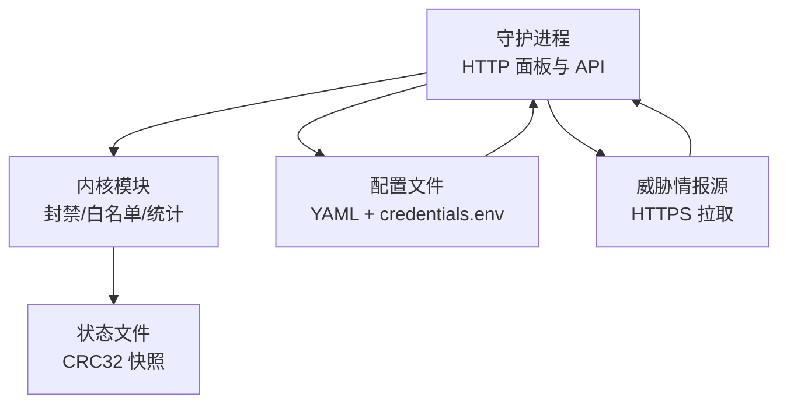
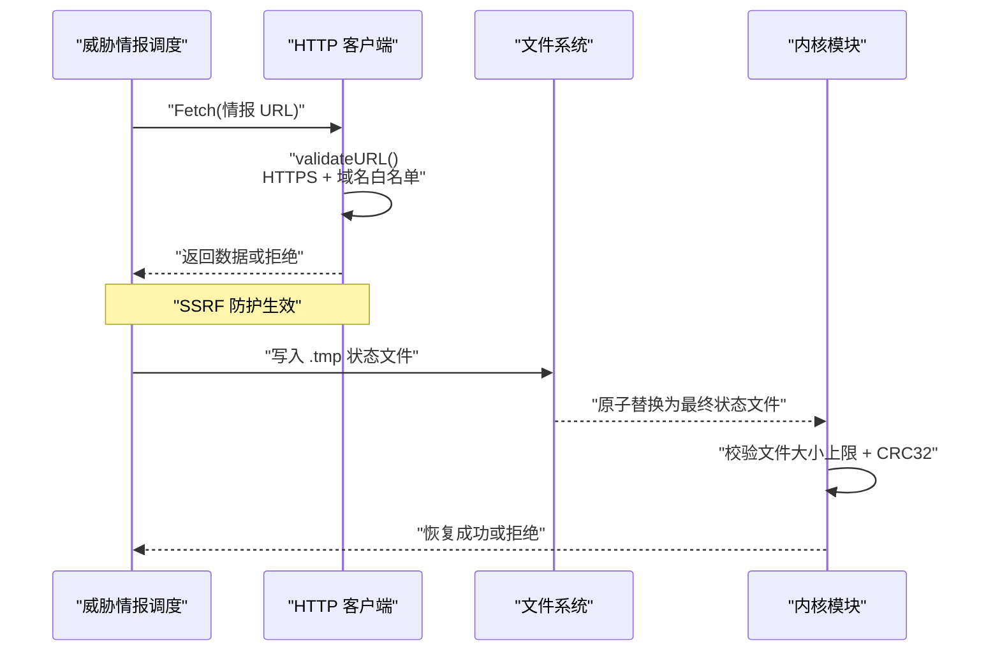
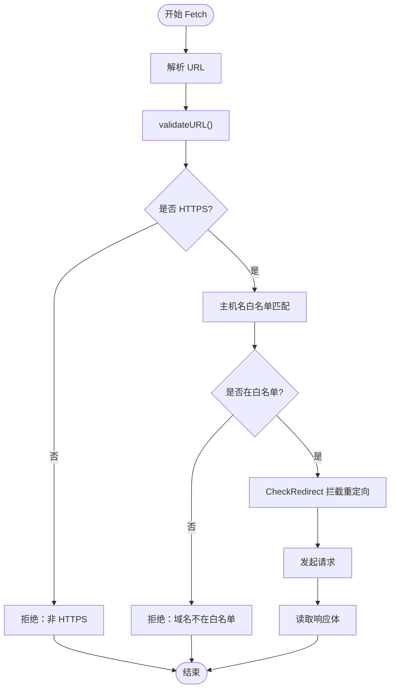
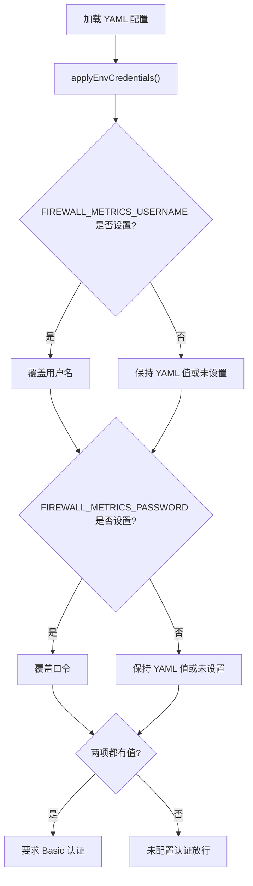
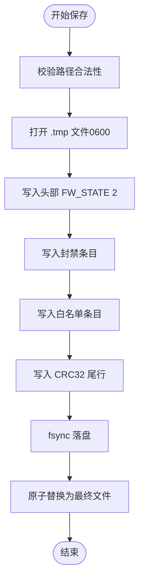
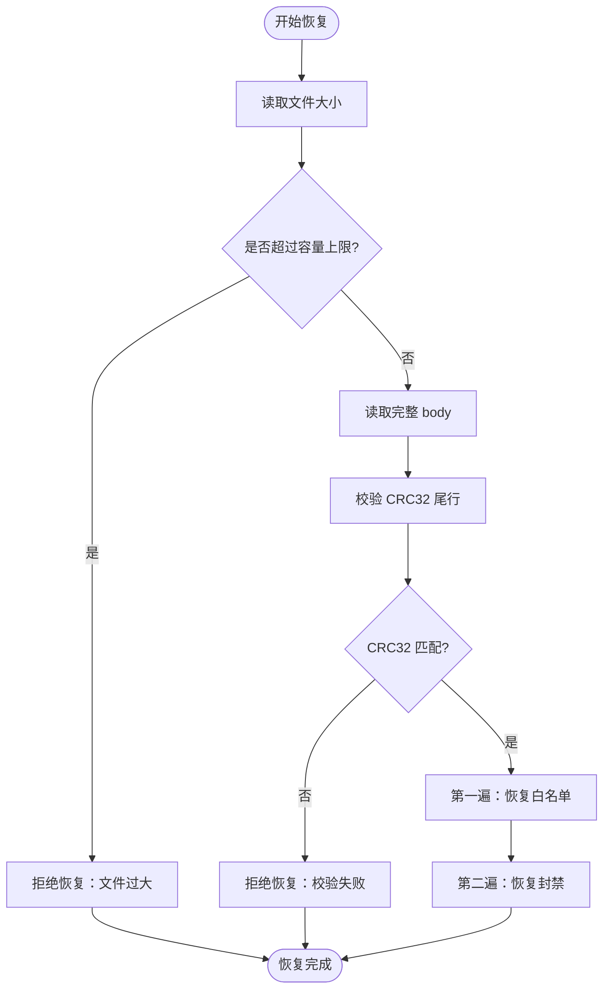
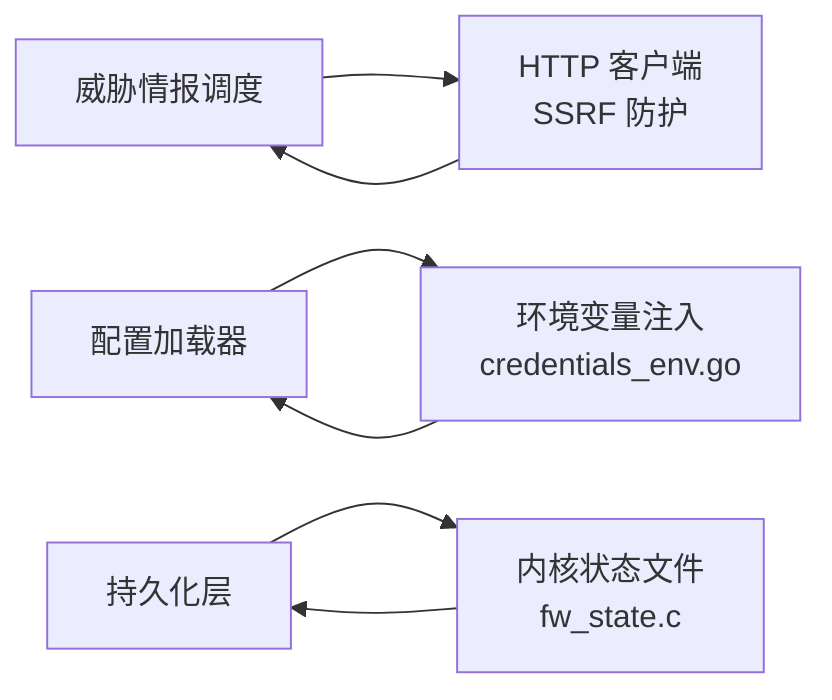

# 数据安全保护

<cite>
**本文引用的文件**   
- [SECURITY.md](file://SECURITY.md)
- [http.go](file://src/daemon/internal/threatfeeds/http.go)
- [credentials_env.go](file://src/daemon/internal/config/credentials_env.go)
- [fw_state.c](file://src/kernel-module/fw_state.c)
- [recovery.go](file://src/daemon/internal/persist/recovery.go)
</cite>

## 目录
1. [引言](#引言)
2. [项目结构与安全边界](#项目结构与安全边界)
3. [核心安全能力总览](#核心安全能力总览)
4. [架构概览](#架构概览)
5. [威胁情报源 SSRF 防护机制](#威胁情报源-ssrf-防护机制)
6. [凭据存储与注入安全](#凭据存储与注入安全)
7. [数据持久化完整性保护](#数据持久化完整性保护)
8. [依赖关系分析](#依赖关系分析)
9. [性能与容量特性](#性能与容量特性)
10. [备份恢复流程与密钥管理最佳实践](#备份恢复流程与密钥管理最佳实践)
11. [故障排查指南](#故障排查指南)
12. [结论](#结论)

## 引言
本文件聚焦系统的数据安全保护，覆盖以下关键主题：
- 威胁情报源的 SSRF 防护机制。
- 凭据存储安全：YAML 明文存储、环境变量注入、`credentials.env` 生成与管理、文件权限控制（0600、属主 root）。
- `FIREWALL_METRICS_USERNAME` / `FIREWALL_METRICS_PASSWORD` 环境变量的覆盖语义。
- 数据持久化的安全措施：状态文件 CRC32 校验、快照完整性检查。
- 数据备份恢复的安全流程与密钥管理最佳实践。

## 项目结构与安全边界
系统由守护进程、内核模块、配置与文档组成；安全边界贯穿“读取日志 → 判定坏 IP → netlink 下发 → 内核命中即丢”的链路。守护进程以 root 运行并启用多项 systemd 沙箱项；面板与 API 使用 Basic 认证，默认监听地址为回环地址，绑定非回环时必须配置凭据。

图示来源
- [SECURITY.md:43-107](file://SECURITY.md#L43-L107)
- [fw_state.c:281-354](file://src/kernel-module/fw_state.c#L281-L354)

章节来源
- [SECURITY.md:22-107](file://SECURITY.md#L22-L107)

## 核心安全能力总览
- 威胁情报出口安全：仅允许 HTTPS，域名白名单，禁止自动重定向到内网。
- 凭据安全：YAML 明文但受文件系统权限保护；环境变量可覆盖 YAML；`credentials.env` 由安装流程准备，权限 0600、属主 root。
- 持久化安全：状态文件写入原子替换，尾部 CRC32 必需；恢复时先校验大小上限与 CRC32，再按两遍顺序恢复白名单和封禁。
- 运维安全：Basic 认证、失败锁定、严格模式配置解析、路径与输入校验。

章节来源
- [SECURITY.md:59-107](file://SECURITY.md#L59-L107)
- [http.go:14-65](file://src/daemon/internal/threatfeeds/http.go#L14-L65)
- [fw_state.c:281-401](file://src/kernel-module/fw_state.c#L281-L401)

## 架构概览
下图展示威胁情报拉取、凭据加载、状态持久化三条关键安全流。

图示来源
- [http.go:51-101](file://src/daemon/internal/threatfeeds/http.go#L51-L101)
- [fw_state.c:281-401](file://src/kernel-module/fw_state.c#L281-L401)

## 威胁情报源 SSRF 防护机制
威胁情报拉取通过受限 HTTP 客户端实现，核心防护包括：
- 协议限制：只允许 HTTPS。
- 域名白名单：仅允许已知情报源域名。
- 重定向控制：禁止自动跟随重定向，并在重定向时再次校验 URL。
- 私有地址检测：对回环、私有、链路本地等地址进行识别。

图示来源
- [http.go:14-65](file://src/daemon/internal/threatfeeds/http.go#L14-L65)
- [http.go:72-129](file://src/daemon/internal/threatfeeds/http.go#L72-L129)

章节来源
- [http.go:14-65](file://src/daemon/internal/threatfeeds/http.go#L14-L65)
- [http.go:72-129](file://src/daemon/internal/threatfeeds/http.go#L72-L129)

## 凭据存储与注入安全
### YAML 明文存储与文件权限
- 配置中的认证凭据以明文形式存在于 YAML。
- 安装时 `/etc/firewall` 目录权限为 0700，配置文件权限为 0600，属主 root。
- `config/default.yaml` 被版本库跟踪，不应提交真实凭据。

章节来源
- [SECURITY.md:96-107](file://SECURITY.md#L96-L107)

### 环境变量注入与覆盖语义
- 支持通过环境变量覆盖 YAML 中的用户名与口令：
  - `FIREWALL_METRICS_USERNAME`
  - `FIREWALL_METRICS_PASSWORD`
- 覆盖发生在 YAML 应用成功后，不落盘写回配置文件。
- 使用 `LookupEnv` 保留“显式设空”与“未设置”的区别：
  - 两项都空：视为未配置认证并放行。
  - 只填一项：判为非法，整组端点一律拒绝。
  - 某项显式设为空串：属于“已设置”，用于关闭认证或覆盖 YAML。

图示来源
- [credentials_env.go:21-32](file://src/daemon/internal/config/credentials_env.go#L21-L32)
- [credentials_env.go:46-72](file://src/daemon/internal/config/credentials_env.go#L46-L72)

章节来源
- [credentials_env.go:1-73](file://src/daemon/internal/config/credentials_env.go#L1-L73)
- [SECURITY.md:96-107](file://SECURITY.md#L96-L107)

### credentials.env 文件的生成与管理
- 随包 systemd 单元通过 `EnvironmentFile=-/etc/firewall/credentials.env` 读取该文件（可选）。
- `make install` 会准备一个空的 `credentials.env`，权限 0600、属主 root，两行均为注释掉的空键，不生成任何值。
- 管理员填写用户名与口令后，守护进程启动时即可从环境变量注入并覆盖 YAML。

章节来源
- [SECURITY.md:99-107](file://SECURITY.md#L99-L107)

## 数据持久化完整性保护
### 状态文件保存流程
- 写入临时文件 `.tmp`，权限 0600。
- 逐块写入封禁表和白名单，同时累计 CRC32。
- 写入尾部 CRC32 行，fsync 落盘后原子替换为目标文件。
- 路径校验拒绝危险字符、URL 转义、`..` 分量，并限制在 `/var/lib/`、`/tmp/`、`/etc/` 之下。

图示来源
- [fw_state.c:281-354](file://src/kernel-module/fw_state.c#L281-L354)
- [fw_state.c:81-116](file://src/kernel-module/fw_state.c#L81-L116)

章节来源
- [fw_state.c:281-354](file://src/kernel-module/fw_state.c#L281-L354)
- [fw_state.c:81-116](file://src/kernel-module/fw_state.c#L81-L116)

### 状态文件恢复与 CRC32 校验
- 首次启动若无状态文件属正常情况。
- 恢复前校验文件大小不超过按容量参数反推的上限。
- 定位最后一行 CRC32，计算 body 的 CRC32 并与期望值比较；缺失或无法解析则拒绝恢复。
- 两遍解析：第一遍恢复白名单，第二遍恢复封禁，确保封禁时的白名单前检命中。

图示来源
- [fw_state.c:542-654](file://src/kernel-module/fw_state.c#L542-L654)
- [fw_state.c:366-401](file://src/kernel-module/fw_state.c#L366-L401)

章节来源
- [fw_state.c:542-654](file://src/kernel-module/fw_state.c#L542-L654)
- [fw_state.c:366-401](file://src/kernel-module/fw_state.c#L366-L401)

## 依赖关系分析
- 威胁情报拉取依赖受限 HTTP 客户端，受域名白名单与协议限制约束。
- 凭据加载依赖 YAML 解析与环境变量注入，遵循“两项都空才放行”的契约。
- 状态持久化依赖内核模块的文件操作与 CRC32 算法，保证原子性与完整性。

图示来源
- [http.go:14-65](file://src/daemon/internal/threatfeeds/http.go#L14-L65)
- [credentials_env.go:21-72](file://src/daemon/internal/config/credentials_env.go#L21-L72)
- [fw_state.c:281-401](file://src/kernel-module/fw_state.c#L281-L401)

章节来源
- [http.go:14-65](file://src/daemon/internal/threatfeeds/http.go#L14-L65)
- [credentials_env.go:21-72](file://src/daemon/internal/config/credentials_env.go#L21-L72)
- [fw_state.c:281-401](file://src/kernel-module/fw_state.c#L281-L401)

## 性能与容量特性
- 威胁情报拉取带超时与重试，采用指数退避策略。
- 状态文件保存与恢复按分页与容量上限处理，避免内存压力与超大文件风险。
- 内核侧对每秒封禁添加数有流控保护，表规模有上限。

章节来源
- [http.go:72-101](file://src/daemon/internal/threatfeeds/http.go#L72-L101)
- [fw_state.c:46-75](file://src/kernel-module/fw_state.c#L46-L75)
- [SECURITY.md:121-138](file://SECURITY.md#L121-L138)

## 备份恢复流程与密钥管理最佳实践
### 备份恢复安全流程
- 备份：触发状态文件保存，确保写入 `.tmp` 并完成 fsync 与原子替换。
- 恢复：启动时自动尝试恢复，若文件缺失或 CRC32 校验失败则拒绝恢复，避免半截快照污染运行态。
- 容量检查：恢复路径仍执行容量检查，超限行跳过并计数。

章节来源
- [fw_state.c:281-401](file://src/kernel-module/fw_state.c#L281-L401)
- [fw_state.c:542-654](file://src/kernel-module/fw_state.c#L542-L654)

### 密钥管理最佳实践
- 将凭据视为密钥：不要提交进 git，不要写进脚本。
- 优先使用环境变量注入，避免把真实凭据放入被版本库跟踪的 YAML。
- 使用 `credentials.env` 配合 systemd 的 `EnvironmentFile`，确保文件权限 0600、属主 root。
- 绑定非回环地址时必须配置凭据；否则面板对任何可达者完全开放。

章节来源
- [SECURITY.md:96-107](file://SECURITY.md#L96-L107)
- [credentials_env.go:1-11](file://src/daemon/internal/config/credentials_env.go#L1-L11)

## 故障排查指南
- 威胁情报拉取失败：
  - 检查 URL 是否为 HTTPS，域名是否在白名单。
  - 检查是否存在过多重定向或指向内网地址。
- 凭据相关异常：
  - 确认 `FIREWALL_METRICS_USERNAME` 与 `FIREWALL_METRICS_PASSWORD` 的设置语义：两项都空为未配置认证；只填一项为非法。
  - 检查 `credentials.env` 是否存在且权限正确。
- 状态文件恢复失败：
  - 检查文件是否缺少 CRC32 尾行或 CRC32 不匹配。
  - 检查文件大小是否超过容量上限。

章节来源
- [http.go:51-101](file://src/daemon/internal/threatfeeds/http.go#L51-L101)
- [credentials_env.go:46-72](file://src/daemon/internal/config/credentials_env.go#L46-L72)
- [fw_state.c:366-401](file://src/kernel-module/fw_state.c#L366-L401)
- [fw_state.c:542-654](file://src/kernel-module/fw_state.c#L542-L654)

## 结论
系统在威胁情报拉取、凭据注入、状态持久化三个关键面实现了明确的安全边界与控制措施：
- 威胁情报出口通过 HTTPS 与域名白名单防止 SSRF。
- 凭据通过 YAML 明文存储与文件系统权限保护，并结合环境变量注入提供灵活覆盖。
- 状态文件通过 CRC32 校验与原子替换保障完整性与一致性。
运维应遵循最小权限原则，谨慎管理凭据与配置文件，并在暴露服务端口时启用认证与反向代理 TLS。